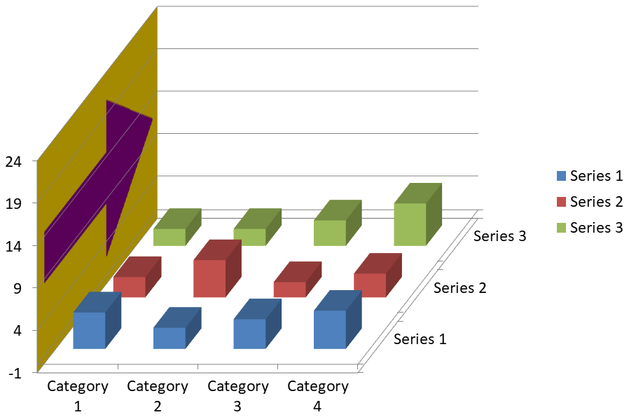

## **Обзор**

Aspose.Slides for Java позволяет настраивать отображение 3D‑диаграммы через метод [IChart.getRotation3D](https://reference.aspose.com/slides/java/com.aspose.slides/ichart/#getRotation3D--) . Эта статья демонстрирует, как изменить вращение, пропорции высоты, глубину, оси под прямым углом и интервал между сериями, а затем сохранить презентацию в формате PPTX.

## **Установка вращения и глубины 3D‑диаграммы**

Пример ниже создает [Presentation](https://reference.aspose.com/slides/java/com.aspose.slides/presentation/) и использует [IShapeCollection.addChart](https://reference.aspose.com/slides/java/com.aspose.slides/ishapecollection/#addChart-int-float-float-float-float-) для добавления сложенной 3D‑столбчатой диаграммы на первый слайд. Он заменяет серии и категории по умолчанию двумя сериями, содержащими по три значения каждая. Индекс листа `0` указывает на первый лист данных диаграммы; строка `0` содержит имена серий, а столбец `0` — подписи категорий.

Методы [setRotationX](https://reference.aspose.com/slides/java/com.aspose.slides/irotation3d/#setRotationX-byte-) и [setRotationY](https://reference.aspose.com/slides/java/com.aspose.slides/irotation3d/#setRotationY-int-) задают вращение диаграммы соответственно 40 и 270 градусов. [setDepthPercents](https://reference.aspose.com/slides/java/com.aspose.slides/irotation3d/#setDepthPercents-int-) устанавливает её глубину в 150 % от ширины, а [setRightAngleAxes](https://reference.aspose.com/slides/java/com.aspose.slides/irotation3d/#setRightAngleAxes-boolean-) включает оси под прямым углом вместо перспективы. Полученная презентация содержит заполненную диаграмму с этими настройками 3D‑просмотра.

```java
import com.aspose.slides.*;

Presentation presentation = new Presentation();
try {
    ISlide slide = presentation.getSlides().get_Item(0);

    IChart chart = slide.getShapes().addChart(ChartType.StackedColumn3D, 0, 0, 500, 500);

    chart.getChartData().getSeries().clear();
    chart.getChartData().getCategories().clear();

    IChartDataWorkbook workbook = chart.getChartData().getChartDataWorkbook();
    int worksheetIndex = 0;

    double[][] values = { { 20, 50, 30 }, { 30, 10, 60 } };

    for (int categoryIndex = 0; categoryIndex < 3; categoryIndex++) {
        IChartDataCell categoryCell = workbook.getCell(worksheetIndex, categoryIndex + 1, 0, "Category " + (categoryIndex + 1));
        chart.getChartData().getCategories().add(categoryCell);
    }

    for (int seriesIndex = 0; seriesIndex < 2; seriesIndex++) {
        IChartDataCell seriesCell = workbook.getCell(worksheetIndex, 0, seriesIndex + 1, "Series " + (seriesIndex + 1));
        IChartSeries series = chart.getChartData().getSeries().add(seriesCell, chart.getType());

        for (int categoryIndex = 0; categoryIndex < 3; categoryIndex++) {
            IChartDataCell valueCell = workbook.getCell(worksheetIndex, categoryIndex + 1, seriesIndex + 1, values[seriesIndex][categoryIndex]);
            series.getDataPoints().addDataPointForBarSeries(valueCell);
        }
    }

    chart.getRotation3D().setRightAngleAxes(true);
    chart.getRotation3D().setRotationX((byte) 40);
    chart.getRotation3D().setRotationY(270);
    chart.getRotation3D().setDepthPercents(150);

    presentation.save("Rotation3D_out.pptx", SaveFormat.Pptx);
} finally {
    presentation.dispose();
}
```

## **Применение заливки изображением к поверхности 3D‑диаграммы**

У 3D‑диаграммы есть три поверхности, которые можно заполнять независимо: [side wall](https://reference.aspose.com/slides/java/com.aspose.slides/ichart/#getSideWall--), [back wall](https://reference.aspose.com/slides/java/com.aspose.slides/ichart/#getBackWall--) и [floor](https://reference.aspose.com/slides/java/com.aspose.slides/ichart/#getFloor--) . Установите для поверхности [fill type](https://reference.aspose.com/slides/java/com.aspose.slides/ifillformat/#setFillType-byte-) значение `Picture` и назначьте изображение. Установите как [picture fill mode](https://reference.aspose.com/slides/java/com.aspose.slides/ipicturefillformat/#setPictureFillMode-int-), так и [picture type](https://reference.aspose.com/slides/java/com.aspose.slides/ichartwall/#setPictureType-int-) поверхности в `Stretch`, чтобы одно изображение растянулось по всей поверхности.

Сохраните [arrow.png](arrow.png) в рабочем каталоге. Пример вращает диаграмму и поднимает максимальное значение вертикальной оси, чтобы пол был виден между столбцами. Затем он клонирует слайд дважды и применяет стрелку к разной поверхности на каждом слайде. Все три диаграммы сохраняют одинаковые данные, угол обзора и фон.

```java
import com.aspose.slides.*;
import java.nio.file.Files;
import java.nio.file.Paths;

Presentation presentation = new Presentation();
try {
    ISlide slide = presentation.getSlides().get_Item(0);

    IChart chart = slide.getShapes().addChart(ChartType.Column3D, 20, 30, 680, 480);
    chart.getRotation3D().setRightAngleAxes(true);
    chart.getRotation3D().setRotationX((byte) 40);
    chart.getRotation3D().setRotationY(30);
    chart.getAxes().getVerticalAxis().setAutomaticMaxValue(false);
    chart.getAxes().getVerticalAxis().setMaxValue(24);

    ISlide backSlide = presentation.getSlides().addClone(slide);
    ISlide floorSlide = presentation.getSlides().addClone(slide);
    IChart backChart = (IChart) backSlide.getShapes().get_Item(0);
    IChart floorChart = (IChart) floorSlide.getShapes().get_Item(0);

    byte[] imageBytes = Files.readAllBytes(Paths.get("arrow.png"));
    IPPImage arrow = presentation.getImages().addImage(imageBytes);

    IChartWall[] surfaces = { chart.getSideWall(), backChart.getBackWall(), floorChart.getFloor() };
    for (IChartWall surface : surfaces) {
        IFillFormat fill = surface.getFormat().getFill();
        fill.setFillType(FillType.Picture);
        fill.getPictureFillFormat().getPicture().setImage(arrow);
        fill.getPictureFillFormat().setPictureFillMode(PictureFillMode.Stretch);
        surface.setPictureType(PictureType.Stretch);
    }

    presentation.save("chart-surfaces.pptx", SaveFormat.Pptx);
} finally {
    presentation.dispose();
}
```

Microsoft PowerPoint отображает три слайда следующим образом.

| Боковая стена | Задняя стена | Пол |
| --- | --- | --- |
|  |  |  |

## **Регулировка пропорций высоты 3D‑диаграммы**

Используйте [IRotation3D.setHeightPercents](https://reference.aspose.com/slides/java/com.aspose.slides/irotation3d/#setHeightPercents-int-) для установки высоты 3D‑диаграммы в процентах от её ширины. Это меняет пропорции 3D‑сцены без изменения размеров объекта диаграммы на слайде.

Следующий пример создает диаграмму [Column3D](https://reference.aspose.com/slides/java/com.aspose.slides/charttype/) с данными по умолчанию: три серии и четыре категории. Он сохраняет три презентации с пропорциями высоты 50 %, 100 % и 200 %. Позиция, ширина и высота диаграммы остаются фиксированными. Данные, вращение, глубина, интервалы между сериями и форматирование одинаковы во всех трёх файлах; меняется только процент высоты.

```java
import com.aspose.slides.*;

Presentation presentation = new Presentation();
try {
    ISlide slide = presentation.getSlides().get_Item(0);

    IChart chart = slide.getShapes().addChart(ChartType.Column3D, 40, 30, 620, 460);
    chart.getRotation3D().setRotationX((byte) 20);
    chart.getRotation3D().setRotationY(30);
    chart.getRotation3D().setRightAngleAxes(true);
    chart.getRotation3D().setDepthPercents(100);
    chart.getChartData().getSeries().get_Item(0).getParentSeriesGroup().setGapDepth(150);

    for (int heightPercent : new int[] { 50, 100, 200 }) {
        chart.getRotation3D().setHeightPercents(heightPercent);
        presentation.save("chart_height_" + heightPercent + ".pptx", SaveFormat.Pptx);
    }
} finally {
    presentation.dispose();
}
```

Следующие изображения иллюстрируют одинаковые настройки высоты в эквивалентном примере .NET и экспортированы с помощью Microsoft PowerPoint. При меньшем проценте сцена выглядит плоской, при большем — более высокой при том же объекте диаграммы. PowerPoint также может скорректировать интервалы делений осей и размещение подписей, чтобы вписать сцену.

| Высота: 50% | Высота: 100% | Высота: 200% |
| --- | --- | --- |
|  |  |  |

Эти методы управляют различными аспектами диаграммы:

| Метод | Эффект |
| --- | --- |
| [IRotation3D.setHeightPercents](https://reference.aspose.com/slides/java/com.aspose.slides/irotation3d/#setHeightPercents-int-) | Высота 3D‑сцены в процентах от её ширины. |
| [IChart.setHeight](https://reference.aspose.com/slides/java/com.aspose.slides/ishape/#setHeight-float-) | Высота объекта диаграммы на слайде, в пунктах. |
| [IRotation3D.setDepthPercents](https://reference.aspose.com/slides/java/com.aspose.slides/irotation3d/#setDepthPercents-int-) | Глубина 3D‑сцены в процентах от её ширины. |
| [IChartSeriesGroup.setGapDepth](https://reference.aspose.com/slides/java/com.aspose.slides/ichartseriesgroup/#setGapDepth-int-) | Интервал между сериями вдоль оси глубины, в процентах от ширины маркера. |

Настройка высоты влияет на 3D‑столбчатые и линейные диаграммы, включая варианты цилиндра, конуса и пирамиды, а также 3D‑линейные, областные, круговые и поверхностные диаграммы. Сравнение выше использует проверенный тип `Column3D`. Настройка не меняет внешний вид 2D‑диаграммы `ClusteredColumn` или `BubbleWith3D`; эти имена являются членами класса [ChartType](https://reference.aspose.com/slides/java/com.aspose.slides/charttype/). Для других параметров оформления диаграмм см. [Chart Formatting](/slides/ru/java/chart-formatting/).

## **Регулировка промежутка между сериями**

Используйте [IChartSeriesGroup.setGapDepth](https://reference.aspose.com/slides/java/com.aspose.slides/ichartseriesgroup/#setGapDepth-int-) для управления расстоянием между сериями данных вдоль оси глубины 3D‑диаграммы, выраженным в процентах от ширины маркера. Допустимые значения от **0 до 500**, включительно: `0` удаляет промежуток, большие значения увеличивают интервал. При фиксированной глубине диаграммы увеличение промежутка делает маркеры тоньше вдоль оси глубины.

Получить группу можно через [IChartSeries.getParentSeriesGroup](https://reference.aspose.com/slides/java/com.aspose.slides/ichartseries/#getParentSeriesGroup--) . Настройка применяется ко всем сериям в этой группе, а не только к серии, через которую она получена. [IChartSeries.getGapDepth](https://reference.aspose.com/slides/java/com.aspose.slides/ichartseries/#getGapDepth--) возвращает текущий промежуток глубины и отражает настройку родительской группы.

Это влияет на 3D‑столбчатые и линейные диаграммы, включая их варианты цилиндра, конуса и пирамиды, а также 3D‑линейные и областные диаграммы. Вид зависит от того, расположены ли серии в глубину, сгруппированы или сложены. Для наглядного сравнения промежутков между отдельными сериями используйте `ChartType.Column3D` из класса [ChartType](https://reference.aspose.com/slides/java/com.aspose.slides/charttype/).

Эти методы управляют различными аспектами диаграммы:

| Метод | Эффект |
| --- | --- |
| [IChartSeriesGroup.setGapDepth](https://reference.aspose.com/slides/java/com.aspose.slides/ichartseriesgroup/#setGapDepth-int-) | Интервал между сериями вдоль оси глубины, в процентах от ширины маркера. |
| [IChartSeriesGroup.setGapWidth](https://reference.aspose.com/slides/java/com.aspose.slides/ichartseriesgroup/#setGapWidth-int-) | Интервал между соседними кластерами столбцов или полос, в процентах от их ширины. |
| [setDepthPercents](https://reference.aspose.com/slides/java/com.aspose.slides/irotation3d/#setDepthPercents-int-) | Общая глубина диаграммы в процентах от её ширины. |

Следующий автономный пример использует данные диаграммы по умолчанию, содержащие три серии и четыре категории. Он сохраняет две презентации с одинаковыми данными, вращением, шириной промежутка и глубиной диаграммы; меняется только глубина промежутка.

```java
import com.aspose.slides.*;

Presentation presentation = new Presentation();
try {
    ISlide slide = presentation.getSlides().get_Item(0);
    
    IChart chart = slide.getShapes().addChart(ChartType.Column3D, 40, 30, 620, 230);

    chart.getRotation3D().setRotationX((byte) 20);
    chart.getRotation3D().setRotationY(30);
    chart.getRotation3D().setDepthPercents(100);

    IChartSeries series = chart.getChartData().getSeries().get_Item(0);
    IChartSeriesGroup group = series.getParentSeriesGroup();
    group.setGapWidth(150);

    for (int gapDepth : new int[] { 0, 500 }) {
        group.setGapDepth(gapDepth);

        String fileName = "series_gap_depth_" + gapDepth + ".pptx";
        presentation.save(fileName, SaveFormat.Pptx);
    }
} finally {
    presentation.dispose();
}
```

Следующие изображения иллюстрируют одинаковые настройки глубины промежутка в эквивалентном примере .NET.

| Промежуток глубины: 0% | Промежуток глубины: 500% |
| --- | --- |
|  |  |

## **Изменение типа 3D‑серии и формы столбца**

В кластеризованной цилиндрической диаграмме первая серия начинается с цилиндрической формы столбца. Пример выводит целочисленные значения, возвращаемые [IChartSeries.getType](https://reference.aspose.com/slides/java/com.aspose.slides/ichartseries/#getType--) и [IChartSeries.getBar3DShape](https://reference.aspose.com/slides/java/com.aspose.slides/ichartseries/#getBar3DShape--) до и после каждого изменения. Таблица содержит соответствующие названия констант.

```java
import com.aspose.slides.*;

Presentation presentation = new Presentation();
try {
    ISlide slide = presentation.getSlides().get_Item(0);
    
    IChart chart = slide.getShapes().addChart(ChartType.ClusteredCylinder, 20, 20, 500, 300);
    IChartSeries series = chart.getChartData().getSeries().get_Item(0);

    System.out.println(series.getType() + " | " + series.getBar3DShape());

    series.setType(ChartType.ClusteredCone);
    System.out.println(series.getType() + " | " + series.getBar3DShape());

    series.setBar3DShape(ChartShapeType.Box);
    System.out.println(series.getType() + " | " + series.getBar3DShape());

    presentation.save("series_shape.pptx", SaveFormat.Pptx);
} finally {
    presentation.dispose();
}
```

| Изменение первой серии | Тип серии | Форма столбца |
| --- | --- | --- |
| Создание диаграммы | `ClusteredCylinder` | `Cylinder` |
| Установить тип серии в `ClusteredCone` | `ClusteredCone` | `Cone` |
| Установить форму столбца в `Box` | `ClusteredColumn3D` | `Box` |

Установка формы `Box` также меняет тип серии на `ClusteredColumn3D`. Если ваш код ветвится в зависимости от типа серии, вызывайте `series.getType()` после изменения формы. Значение, полученное до назначения, всё равно будет указывать на ветвь `ClusteredCone`.


## **FAQ**

**Какие типы диаграмм поддерживают 3D‑режим в Aspose.Slides?**

Aspose.Slides поддерживает 3D‑варианты столбчатых диаграмм, включая Column 3D, Clustered Column 3D, Stacked Column 3D и 100 % Stacked Column 3D, а также связанные 3D‑типы, доступные через класс [ChartType](https://reference.aspose.com/slides/java/com.aspose.slides/charttype/). Для точного актуального списка см. члены [ChartType](https://reference.aspose.com/slides/java/com.aspose.slides/charttype/) в справочнике API установленной версии.

**Можно ли получить растровое изображение 3D‑диаграммы для отчёта или веба?**

Да. Вы можете экспортировать диаграмму в изображение с помощью [Shape.getImage](https://reference.aspose.com/slides/java/com.aspose.slides/shape/#getImage--) или [отрендерить весь слайд](/slides/ru/java/convert-powerpoint-to-png/) в форматы PNG или JPEG. Это удобно, когда нужен растровый предварительный просмотр или необходимо встроить диаграмму в документы, информационные панели или веб‑страницы без использования PowerPoint.

**Насколько эффективно построение и рендеринг больших 3D‑диаграмм?**

Производительность зависит от объёма данных и визуальной сложности. Для лучших результатов минимизируйте 3D‑эффекты, избегайте тяжёлых текстур на стенах и областях построения, по возможности ограничивайте количество точек данных в серии и рендерьте в подходящем разрешении и размерах, соответствующих целевому дисплею или печати.