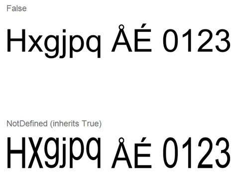

## **Обзор**

В этой статье показано, как форматировать текст в презентациях PowerPoint и OpenDocument с использованием Aspose.Slides для Node.js через Java. Описываются фоновые цвета, прозрачность, интервалы между символами, свойства шрифтов, вращение, интервалы абзацев, поведение автоматической подгонки, привязка текста, табуляция и настройки языка.

Если не указано иное, примеры используют [sample.pptx](sample.pptx). Первая фигура на первом слайде является текстовым полем, и её первый абзац содержит показанный ниже текст. Индексы слайдов и фигур начинаются с нуля. Примеры, в которых выделяются жирные части, используют эффективное форматирование, включая унаследованное жирное форматирование:


Чтобы найти и выделить буквальный текст или совпадения регулярных выражений, см. [Поиск и замена текста](/slides/ru/nodejs-java/search-and-replace-text/).

## **Установить цвет фона текста**

Используйте [ParagraphFormat.getDefaultPortionFormat](https://reference.aspose.com/slides/nodejs-java/aspose.slides/paragraphformat/#getDefaultPortionFormat) для установки цвета выделения по умолчанию для абзаца, либо используйте [BasePortionFormat.getHighlightColor](https://reference.aspose.com/slides/nodejs-java/aspose.slides/baseportionformat/#getHighlightColor) для отдельных частей текста.

Следующий пример задаёт светло‑серое выделение по умолчанию для первого абзаца. Явно заданные цвета выделения для отдельных частей текста имеют приоритет над этим значением по умолчанию:

```javascript
const aspose = { slides: require("aspose.slides.via.java") };
const java = require("java");

const presentation = new aspose.slides.Presentation("sample.pptx");
try {
    const slide = presentation.getSlides().get_Item(0);

    const autoShape = slide.getShapes().get_Item(0);
    const paragraph = autoShape.getTextFrame().getParagraphs().get_Item(0);

    // Установить цвет выделения для всего абзаца.
    paragraph.getParagraphFormat().getDefaultPortionFormat().getHighlightColor().setColor(java.getStaticFieldValue("java.awt.Color", "LIGHT_GRAY"));

    presentation.save("gray_paragraph.pptx", aspose.slides.SaveFormat.Pptx);
} finally {
    presentation.dispose();
}
```

Результат:


Как установить цвет фона для **текстовых частей с полужирным шрифтом**:

```javascript
const aspose = { slides: require("aspose.slides.via.java") };
const java = require("java");

const presentation = new aspose.slides.Presentation("sample.pptx");
try {
    const slide = presentation.getSlides().get_Item(0);

    const autoShape = slide.getShapes().get_Item(0);
    const paragraph = autoShape.getTextFrame().getParagraphs().get_Item(0);
    const portions = paragraph.getPortions();
    const portionCount = portions.getCount();

    for (let portionIndex = 0; portionIndex < portionCount; portionIndex++) {
        const portion = portions.get_Item(portionIndex);
        if (portion.getPortionFormat().getEffective().getFontBold()) {
            // Установить цвет выделения для части текста.
            portion.getPortionFormat().getHighlightColor().setColor(java.getStaticFieldValue("java.awt.Color", "LIGHT_GRAY"));
        }
    }

    presentation.save("gray_text_portions.pptx", aspose.slides.SaveFormat.Pptx);
} finally {
    presentation.dispose();
}
```

Результат:


## **Выравнивание абзацев текста**

Используйте [ParagraphFormat.setAlignment](https://reference.aspose.com/slides/nodejs-java/aspose.slides/paragraphformat/#setAlignment) для установки выравнивания абзаца внутри текстовой рамки. Значение может быть по центру, выравнено по левому, правому краю, по ширине и т.д.

Следующий пример кода демонстрирует, как выровнять абзац по **центру**:

```javascript
const aspose = { slides: require("aspose.slides.via.java") };

const presentation = new aspose.slides.Presentation("sample.pptx");
try {
    const slide = presentation.getSlides().get_Item(0);

    const autoShape = slide.getShapes().get_Item(0);
    const paragraph = autoShape.getTextFrame().getParagraphs().get_Item(0);

    // Установить выравнивание абзаца по центру.
    paragraph.getParagraphFormat().setAlignment(aspose.slides.TextAlignment.Center);

    presentation.save("aligned_paragraph.pptx", aspose.slides.SaveFormat.Pptx);
} finally {
    presentation.dispose();
}
```

Результат:


## **Выравнивание шрифтов внутри строки**

Используйте [ParagraphFormat.setFontAlignment](https://reference.aspose.com/slides/nodejs-java/aspose.slides/paragraphformat/#setFontAlignment) для вертикального выравнивания текстовых частей разного размера шрифта внутри строки. Эта настройка применяется к всему абзацу и управляет выравниванием в каждой его строке.

Следующий автономный пример создаёт четыре помеченных текстовых блока на одном слайде. Каждый абзац содержит одинаковый текст размером 18, 36 и 54 пункта, но с разным выравниванием шрифта. Используется Arial, отключены автоподгонка и перенос, а текстовые рамки достаточно велики для одной строки.

```javascript
const aspose = { slides: require("aspose.slides.via.java") };
const java = require("java");

const presentation = new aspose.slides.Presentation();
try {
    const slide = presentation.getSlides().get_Item(0);

    const alignments = [aspose.slides.FontAlignment.Baseline, aspose.slides.FontAlignment.Top, aspose.slides.FontAlignment.Center, aspose.slides.FontAlignment.Bottom];
    const alignmentNames = ["Baseline", "Top", "Center", "Bottom"];
    const fontSizes = [18, 36, 54];

    for (let i = 0; i < alignments.length; i++) {
        const shape = slide.getShapes().addAutoShape(aspose.slides.ShapeType.Rectangle, 30, 20 + i * 130, 660, 120);
        shape.getFillFormat().setFillType(java.newByte(aspose.slides.FillType.NoFill));
        shape.getLineFormat().getFillFormat().setFillType(java.newByte(aspose.slides.FillType.NoFill));

        const textFrame = shape.getTextFrame();
        textFrame.getTextFrameFormat().setAnchoringType(java.newByte(aspose.slides.TextAnchorType.Top));
        textFrame.getTextFrameFormat().setAutofitType(java.newByte(aspose.slides.TextAutofitType.None));
        textFrame.getTextFrameFormat().setWrapText(java.newByte(aspose.slides.NullableBool.False));

        const label = textFrame.getParagraphs().get_Item(0);
        label.setText(alignmentNames[i]);
        label.getParagraphFormat().setAlignment(aspose.slides.TextAlignment.Left);
        label.getParagraphFormat().getDefaultPortionFormat().setFontHeight(14);
        label.getParagraphFormat().getDefaultPortionFormat().setLatinFont(new aspose.slides.FontData("Arial"));
        label.getParagraphFormat().getDefaultPortionFormat().getFillFormat().setFillType(java.newByte(aspose.slides.FillType.Solid));
        label.getParagraphFormat().getDefaultPortionFormat().getFillFormat().getSolidFillColor().setColor(java.getStaticFieldValue("java.awt.Color", "GRAY"));

        const paragraph = new aspose.slides.Paragraph();
        paragraph.getParagraphFormat().setFontAlignment(alignments[i]);
        paragraph.getParagraphFormat().setAlignment(aspose.slides.TextAlignment.Left);
        paragraph.getParagraphFormat().getDefaultPortionFormat().setLatinFont(new aspose.slides.FontData("Arial"));
        paragraph.getParagraphFormat().getDefaultPortionFormat().getFillFormat().setFillType(java.newByte(aspose.slides.FillType.Solid));
        paragraph.getParagraphFormat().getDefaultPortionFormat().getFillFormat().getSolidFillColor().setColor(java.getStaticFieldValue("java.awt.Color", "BLACK"));

        for (const fontSize of fontSizes) {
            const portion = new aspose.slides.Portion("Ag ");
            portion.getPortionFormat().setFontHeight(fontSize);
            paragraph.getPortions().add(portion);
        }

        textFrame.getParagraphs().add(paragraph);
    }

    presentation.save("font_alignment.pptx", aspose.slides.SaveFormat.Pptx);
} finally {
    presentation.dispose();
}
```

Результат:


Выравнивание шрифтов использует метрики шрифта, поэтому визуальные границы отдельных букв не всегда точно совпадают. Пример включает как заглавную букву, так и нижний вынос, чтобы показать разницу между базовой линией и выравниванием по низу. Наличие шрифта и его подстановка, используемые символы и различие в размерах шрифтов влияют на результат. Размеры рамки, отступы, межстрочный интервал, перенос и автоподгонка также влияют на компоновку; при сравнении режимов используйте те же шрифты и настройки.

Эта настройка отличается от [ParagraphFormat.setAlignment](https://reference.aspose.com/slides/nodejs-java/aspose.slides/paragraphformat/#setAlignment), который управляет горизонтальным выравниванием абзаца, и от [TextFrameFormat.setAnchoringType](https://reference.aspose.com/slides/nodejs-java/aspose.slides/textframeformat/#setAnchoringType), который позиционирует текстовый блок вертикально внутри фигуры. Форматирование верхнего и нижнего индекса через [BasePortionFormat.setEscapement](https://reference.aspose.com/slides/nodejs-java/aspose.slides/baseportionformat/#setEscapement) смещает отдельные части относительно базовой линии, а не задаёт выравнивание шрифта для строк абзаца.

## **Установить прозрачность текста**

Прозрачность текста контролируется альфа‑компонентом цвета, присвоенного [BasePortionFormat.getFillFormat](https://reference.aspose.com/slides/nodejs-java/aspose.slides/baseportionformat/#getFillFormat). В примерах ниже `alpha = 50` — это значение альфа‑канала ARGB в диапазоне 0–255, а не процент прозрачности.

Следующий пример кода показывает, как применить прозрачность к **всему абзацу**:

```javascript
const aspose = { slides: require("aspose.slides.via.java") };
const java = require("java");

const alpha = 50;
const transparentBlack = java.newInstanceSync("java.awt.Color", 0, 0, 0, alpha);
const presentation = new aspose.slides.Presentation("sample.pptx");
try {
    const slide = presentation.getSlides().get_Item(0);

    const autoShape = slide.getShapes().get_Item(0);
    const paragraph = autoShape.getTextFrame().getParagraphs().get_Item(0);
    const fillFormat = paragraph.getParagraphFormat().getDefaultPortionFormat().getFillFormat();

    // Установить цвет заливки текста в прозрачный цвет.
    fillFormat.setFillType(java.newByte(aspose.slides.FillType.Solid));
    fillFormat.getSolidFillColor().setColor(transparentBlack);

    presentation.save("transparent_paragraph.pptx", aspose.slides.SaveFormat.Pptx);
} finally {
    presentation.dispose();
}
```

Результат:


Следующий пример кода показывает, как применить прозрачность к **текстовым частям с полужирным шрифтом**:

```javascript
const aspose = { slides: require("aspose.slides.via.java") };
const java = require("java");

const alpha = 50;
const transparentBlack = java.newInstanceSync("java.awt.Color", 0, 0, 0, alpha);
const presentation = new aspose.slides.Presentation("sample.pptx");
try {
    const slide = presentation.getSlides().get_Item(0);

    const autoShape = slide.getShapes().get_Item(0);
    const paragraph = autoShape.getTextFrame().getParagraphs().get_Item(0);
    const portions = paragraph.getPortions();
    const portionCount = portions.getCount();

    for (let portionIndex = 0; portionIndex < portionCount; portionIndex++) {
        const portion = portions.get_Item(portionIndex);
        if (portion.getPortionFormat().getEffective().getFontBold()) {
            const fillFormat = portion.getPortionFormat().getFillFormat();

            // Установить прозрачность текстовой части.
            fillFormat.setFillType(java.newByte(aspose.slides.FillType.Solid));
            fillFormat.getSolidFillColor().setColor(transparentBlack);
        }
    }

    presentation.save("transparent_text_portions.pptx", aspose.slides.SaveFormat.Pptx);
} finally {
    presentation.dispose();
}
```

Результат:


## **Установить интервал между символами текста**

Используйте [BasePortionFormat.setSpacing](https://reference.aspose.com/slides/nodejs-java/aspose.slides/baseportionformat/#setSpacing) для увеличения или уменьшения интервала между символами в текстовом поле. В примерах добавляется интервал в 3 пункта; отрицательные значения сжимают текст.

Следующий JavaScript‑код показывает, как увеличить интервал между символами в **всём абзаце**:

```javascript
const aspose = { slides: require("aspose.slides.via.java") };

const presentation = new aspose.slides.Presentation("sample.pptx");
try {
    const slide = presentation.getSlides().get_Item(0);

    const autoShape = slide.getShapes().get_Item(0);
    const paragraph = autoShape.getTextFrame().getParagraphs().get_Item(0);

    // Примечание: используйте отрицательные значения для сжатия интервала между символами.
    paragraph.getParagraphFormat().getDefaultPortionFormat().setSpacing(3); // Увеличить интервал между символами.

    presentation.save("character_spacing_in_paragraph.pptx", aspose.slides.SaveFormat.Pptx);
} finally {
    presentation.dispose();
}
```

Результат:


Следующий пример кода показывает, как увеличить интервал между символами в **текстовых частях с полужирным шрифтом**:

```javascript
const aspose = { slides: require("aspose.slides.via.java") };

const presentation = new aspose.slides.Presentation("sample.pptx");
try {
    const slide = presentation.getSlides().get_Item(0);

    const autoShape = slide.getShapes().get_Item(0);
    const paragraph = autoShape.getTextFrame().getParagraphs().get_Item(0);
    const portions = paragraph.getPortions();
    const portionCount = portions.getCount();

    for (let portionIndex = 0; portionIndex < portionCount; portionIndex++) {
        const portion = portions.get_Item(portionIndex);
        if (portion.getPortionFormat().getEffective().getFontBold()) {
            // Примечание: используйте отрицательные значения для сжатия интервала между символами.
            portion.getPortionFormat().setSpacing(3); // Увеличить интервал между символами.
        }
    }

    presentation.save("character_spacing_in_text_portions.pptx", aspose.slides.SaveFormat.Pptx);
} finally {
    presentation.dispose();
}
```

Результат:


### **Отключить кёрнинг для определённых шрифтов**

В некоторых случаях текст, отрисованный Aspose.Slides, может выглядеть чуть плотнее, чем тот же текст в PowerPoint. Это может происходить, потому что PowerPoint игнорирует данные кёрнинга для определённых шрифтов, даже если шрифт содержит корректные данные кёрнинга и кёрнинг включён в настройках PowerPoint.

Чтобы визуально приблизить результат к PowerPoint, можно отключить кёрнинг для текстовых частей, использующих проблемный шрифт. Установите [BasePortionFormat.setKerningMinimalSize](https://reference.aspose.com/slides/nodejs-java/aspose.slides/baseportionformat/#setKerningMinimalSize) в значение, превышающее фактический размер шрифта. В примере требуется файл "presentation.pptx" с текстовым полем в первой фигуре первого слайда. Пример проверяет эффективные названия шрифтов, включая унаследованные, и задаёт порог в 100 пунктов для частей, использующих Roboto. Это отключает кёрнинг для совпадающих частей, у которых размер шрифта ниже 100 пунктов:

```javascript
const aspose = { slides: require("aspose.slides.via.java") };

const presentation = new aspose.slides.Presentation("presentation.pptx");
try {
    const slide = presentation.getSlides().get_Item(0);

    const autoShape = slide.getShapes().get_Item(0);
    const paragraphs = autoShape.getTextFrame().getParagraphs();
    const paragraphCount = paragraphs.getCount();
    const targetFont = "Roboto";

    for (let paragraphIndex = 0; paragraphIndex < paragraphCount; paragraphIndex++) {
        const portions = paragraphs.get_Item(paragraphIndex).getPortions();
        const portionCount = portions.getCount();

        for (let portionIndex = 0; portionIndex < portionCount; portionIndex++) {
            const portion = portions.get_Item(portionIndex);
            const portionFormat = portion.getPortionFormat().getEffective();
            const latinFont = portionFormat.getLatinFont();
            const eastAsianFont = portionFormat.getEastAsianFont();
            const complexScriptFont = portionFormat.getComplexScriptFont();

            if ((latinFont !== null && latinFont.getFontName() === targetFont) ||
                (eastAsianFont !== null && eastAsianFont.getFontName() === targetFont) ||
                (complexScriptFont !== null && complexScriptFont.getFontName() === targetFont)) {
                portion.getPortionFormat().setKerningMinimalSize(100);
            }
        }
    }

    presentation.save("output.pptx", aspose.slides.SaveFormat.Pptx);
} finally {
    presentation.dispose();
}
```

Для совпадающего текста ниже порога данная настройка предотвращает кёрнинг и помогает согласовать рендеринг Aspose.Slides с визуальным выводом PowerPoint для шрифтов, на которые влияет данное специфическое поведение PowerPoint.

## **Управление свойствами шрифта текста**

Свойства шрифта можно задавать на уровне абзаца через [ParagraphFormat.getDefaultPortionFormat](https://reference.aspose.com/slides/nodejs-java/aspose.slides/paragraphformat/#getDefaultPortionFormat) или для отдельных частей через [PortionFormat](https://reference.aspose.com/slides/nodejs-java/aspose.slides/portionformat/).

Следующий пример задаёт шрифт по умолчанию для первого абзаца: Times New Roman 12 пт с полужирным, курсивным и пунктирным подчёркиванием. Явное форматирование отдельных частей имеет приоритет над этими значениями по умолчанию:

```javascript
const aspose = { slides: require("aspose.slides.via.java") };
const java = require("java");

const presentation = new aspose.slides.Presentation("sample.pptx");
try {
    const slide = presentation.getSlides().get_Item(0);

    const autoShape = slide.getShapes().get_Item(0);
    const paragraph = autoShape.getTextFrame().getParagraphs().get_Item(0);
    const defaultPortionFormat = paragraph.getParagraphFormat().getDefaultPortionFormat();

    // Установить свойства шрифта для абзаца.
    defaultPortionFormat.setFontHeight(12);
    defaultPortionFormat.setFontBold(java.newByte(aspose.slides.NullableBool.True));
    defaultPortionFormat.setFontItalic(java.newByte(aspose.slides.NullableBool.True));
    defaultPortionFormat.setFontUnderline(java.newByte(aspose.slides.TextUnderlineType.Dotted));
    defaultPortionFormat.setLatinFont(new aspose.slides.FontData("Times New Roman"));

    presentation.save("font_properties_for_paragraph.pptx", aspose.slides.SaveFormat.Pptx);
} finally {
    presentation.dispose();
}
```

Результат:


Следующий пример применяет шрифт Times New Roman 13 пт, курсив и пунктирное подчёркивание к частям, у которых эффективное форматирование — жирный шрифт:

```javascript
const aspose = { slides: require("aspose.slides.via.java") };
const java = require("java");

const presentation = new aspose.slides.Presentation("sample.pptx");
try {
    const slide = presentation.getSlides().get_Item(0);

    const autoShape = slide.getShapes().get_Item(0);
    const paragraph = autoShape.getTextFrame().getParagraphs().get_Item(0);
    const portions = paragraph.getPortions();
    const portionCount = portions.getCount();

    for (let portionIndex = 0; portionIndex < portionCount; portionIndex++) {
        const portion = portions.get_Item(portionIndex);
        if (portion.getPortionFormat().getEffective().getFontBold()) {
            const portionFormat = portion.getPortionFormat();

            // Установить свойства шрифта для текстовой части.
            portionFormat.setFontHeight(13);
            portionFormat.setFontItalic(java.newByte(aspose.slides.NullableBool.True));
            portionFormat.setFontUnderline(java.newByte(aspose.slides.TextUnderlineType.Dotted));
            portionFormat.setLatinFont(new aspose.slides.FontData("Times New Roman"));
        }
    }

    presentation.save("font_properties_for_text_portions.pptx", aspose.slides.SaveFormat.Pptx);
} finally {
    presentation.dispose();
}
```

Результат:


## **Управление нормализацией высоты текста**

Используйте [BasePortionFormat.setNormaliseHeight](https://reference.aspose.com/slides/nodejs-java/aspose.slides/baseportionformat/#setNormaliseHeight), когда необходимо воспроизводить типографику шаблона или исследовать различия в высоте символов. В PowerPoint включение нормализации растягивает или сжимает отдельные символы вертикально, чтобы они имели одинаковую видимую высоту внутри текстовой части. Это не гарантирует одинаковую высоту текста между разными шрифтами.

Устанавливайте свойство в [NullableBool.True или False](https://reference.aspose.com/slides/nodejs-java/aspose.slides/nullablebool/) для явного включения или отключения нормализации. `NullableBool.NotDefined` оставляет локальную настройку неопределённой, позволяя части наследовать значение, например, из [getDefaultPortionFormat](https://reference.aspose.com/slides/nodejs-java/aspose.slides/paragraphformat/#getDefaultPortionFormat) абзаца. Это не значит `False`. Используйте [PortionFormat.getEffective](https://reference.aspose.com/slides/nodejs-java/aspose.slides/portionformat/#getEffective) и читайте [IBasePortionFormatEffectiveData.getNormaliseHeight](https://reference.aspose.com/slides/java/com.aspose.slides/ibaseportionformateffectivedata/#getNormaliseHeight--) для получения разрешённого булевого значения.

Следующий автономный пример требует установленный **Arial**. Он создаёт два текстовых блока, содержащих одинаковые заглавные буквы, строчные буквы, нижние выносы и символы с диакритическими знаками размером 54 пт. Оба абзаца включают нормализацию по умолчанию. Верхняя часть явно отключает её; нижняя часть наследует её. Размеры рамок, отступы и интервалы абзацев одинаковы; перенос и автоподгонка отключены, чтобы сравнение было корректным. Пример выводит `False: false` и `NotDefined: true`, затем сохраняет «text_height_normalization.pptx».

```javascript
const aspose = { slides: require("aspose.slides.via.java") };
const java = require("java");

const presentation = new aspose.slides.Presentation();
try {
    const slide = presentation.getSlides().get_Item(0);

    const settings = [aspose.slides.NullableBool.False, aspose.slides.NullableBool.NotDefined];
    const settingNames = ["False", "NotDefined"];

    for (let i = 0; i < settings.length; i++) {
        const shape = slide.getShapes().addAutoShape(aspose.slides.ShapeType.Rectangle, 30, 60 + i * 200, 660, 150);
        shape.getFillFormat().setFillType(java.newByte(aspose.slides.FillType.NoFill));
        shape.getLineFormat().getFillFormat().setFillType(java.newByte(aspose.slides.FillType.NoFill));

        const textFrame = shape.getTextFrame();
        textFrame.setText("Hxgjpq ÅÉ 0123");
        textFrame.getTextFrameFormat().setAutofitType(java.newByte(aspose.slides.TextAutofitType.None));
        textFrame.getTextFrameFormat().setWrapText(java.newByte(aspose.slides.NullableBool.False));
        textFrame.getTextFrameFormat().setAnchoringType(java.newByte(aspose.slides.TextAnchorType.Top));
        textFrame.getTextFrameFormat().setMarginTop(0);
        textFrame.getTextFrameFormat().setMarginLeft(0);

        const paragraph = textFrame.getParagraphs().get_Item(0);
        paragraph.getParagraphFormat().setAlignment(aspose.slides.TextAlignment.Left);
        paragraph.getParagraphFormat().setSpaceBefore(0);
        paragraph.getParagraphFormat().setSpaceAfter(0);
        paragraph.getParagraphFormat().setSpaceWithin(100);
        paragraph.getParagraphFormat().getDefaultPortionFormat().setNormaliseHeight(java.newByte(aspose.slides.NullableBool.True));

        const portion = paragraph.getPortions().get_Item(0);
        const font = new aspose.slides.FontData("Arial");
        portion.getPortionFormat().setLatinFont(font);
        portion.getPortionFormat().setFontHeight(54);
        portion.getPortionFormat().getFillFormat().setFillType(java.newByte(aspose.slides.FillType.Solid));
        const textColor = java.getStaticFieldValue("java.awt.Color", "BLACK");
        portion.getPortionFormat().getFillFormat().getSolidFillColor().setColor(textColor);
        portion.getPortionFormat().setNormaliseHeight(java.newByte(settings[i]));

        console.log(settingNames[i] + ": " + portion.getPortionFormat().getEffective().getNormaliseHeight());
    }

    presentation.save("text_height_normalization.pptx", aspose.slides.SaveFormat.Pptx);
} finally {
    presentation.dispose();
}
```

Сравнение ниже экспортировано из сохранённой презентации. В верхней строке нормализация отключена (`False`); в нижней строке она унаследована (`NotDefined` → `True`). Оставьте установленный Arial, чтобы воспроизвести внешний вид.



Нормализация изменяет высоту символов без изменения значения [getFontHeight](https://reference.aspose.com/slides/nodejs-java/aspose.slides/baseportionformat/#getFontHeight), которое задаёт размер шрифта в пунктах. Параметр [setSpaceWithin](https://reference.aspose.com/slides/nodejs-java/aspose.slides/paragraphformat/#setSpaceWithin) абзаца контролирует межстрочный интервал, а [setAutofitType](https://reference.aspose.com/slides/nodejs-java/aspose.slides/textframeformat/#setAutofitType) текстовой рамки управляет тем, как текст или его контейнер адаптируются к размеру. Эти параметры служат разным целям и могут независимо влиять на общую компоновку. См. раздел [Управление абзацем](/slides/ru/nodejs-java/manage-paragraph/) для более подробной информации о форматировании абзацев и наследовании.

## **Применить и удалить зачёркивание**

Используйте [BasePortionFormat.setStrikethroughType](https://reference.aspose.com/slides/nodejs-java/aspose.slides/baseportionformat/#setStrikethroughType) для текстовой части, чтобы отразить исправления, аннулированные термины или прежние цены без удаления исходного текста. Установите значение [TextStrikethroughType.Single или Double](https://reference.aspose.com/slides/nodejs-java/aspose.slides/textstrikethroughtype/) для одной или двух линий через текст.

Чтобы удалить зачёркивание, передайте [TextStrikethroughType.None](https://reference.aspose.com/slides/nodejs-java/aspose.slides/textstrikethroughtype/#None). Это явно отключает эффект, даже если окружающее форматирование указывает на зачёркивание. В отличие от этого, [TextStrikethroughType.NotDefined](https://reference.aspose.com/slides/nodejs-java/aspose.slides/textstrikethroughtype/#NotDefined) оставляет локальную настройку неопределённой, позволяя части наследовать форматирование, например, из абзаца. Это не гарантирует, что зачёркивание будет удалено. Используйте [PortionFormat.getEffective](https://reference.aspose.com/slides/nodejs-java/aspose.slides/portionformat/#getEffective) для чтения итогового форматирования, включая унаследованные значения.

Следующий автономный пример создаёт три сравнения цен. Каждый абзац содержит отдельные части для метки, прежней цены и текущей цены, поэтому только прежняя цена получает зачёркивание. В первой строке зачёркивание применяется и затем удаляется; остальные строки сохраняют одиночное и двойное зачёркивание. Такое изменение сохраняет текст и его прочее форматирование, включая полужирную прежнюю цену.

```javascript
const aspose = { slides: require("aspose.slides.via.java") };
const java = require("java");

const presentation = new aspose.slides.Presentation();
try {
    const slide = presentation.getSlides().get_Item(0);

    const shape = slide.getShapes().addAutoShape(aspose.slides.ShapeType.Rectangle, 50, 50, 620, 220);
    shape.getFillFormat().setFillType(java.newByte(aspose.slides.FillType.NoFill));
    shape.getLineFormat().getFillFormat().setFillType(java.newByte(aspose.slides.FillType.NoFill));
    shape.getTextFrame().getParagraphs().clear();

    const labels = ["None: ", "Single: ", "Double: "];

    for (const label of labels) {
        const paragraph = new aspose.slides.Paragraph();
        paragraph.getParagraphFormat().setAlignment(aspose.slides.TextAlignment.Left);
        paragraph.getParagraphFormat().setSpaceAfter(20);

        const format = paragraph.getParagraphFormat().getDefaultPortionFormat();
        format.setFontHeight(28);
        const font = new aspose.slides.FontData("Arial");
        format.setLatinFont(font);
        format.getFillFormat().setFillType(java.newByte(aspose.slides.FillType.Solid));
        const textColor = java.getStaticFieldValue("java.awt.Color", "BLACK");
        format.getFillFormat().getSolidFillColor().setColor(textColor);

        const labelPortion = new aspose.slides.Portion(label);
        paragraph.getPortions().add(labelPortion);

        const previousPrice = new aspose.slides.Portion("$100");
        previousPrice.getPortionFormat().setFontBold(java.newByte(aspose.slides.NullableBool.True));
        paragraph.getPortions().add(previousPrice);
        const currentPrice = new aspose.slides.Portion(" → $80");
        paragraph.getPortions().add(currentPrice);

        shape.getTextFrame().getParagraphs().add(paragraph);
    }

    const paragraphs = shape.getTextFrame().getParagraphs();

    // Применить зачёркивание, затем явно удалить его у первой прежней цены.
    paragraphs.get_Item(0).getPortions().get_Item(1).getPortionFormat().setStrikethroughType(java.newByte(aspose.slides.TextStrikethroughType.Single));
    paragraphs.get_Item(0).getPortions().get_Item(1).getPortionFormat().setStrikethroughType(java.newByte(aspose.slides.TextStrikethroughType.None));

    paragraphs.get_Item(1).getPortions().get_Item(1).getPortionFormat().setStrikethroughType(java.newByte(aspose.slides.TextStrikethroughType.Single));
    paragraphs.get_Item(2).getPortions().get_Item(1).getPortionFormat().setStrikethroughType(java.newByte(aspose.slides.TextStrikethroughType.Double));

    presentation.save("strikethrough.pptx", aspose.slides.SaveFormat.Pptx);
} finally {
    presentation.dispose();
}
```

Результат сверху вниз: без зачёркивания, одиночное зачёркивание и двойное зачёркивание.


## **Установить вращение текста**

Используйте [TextFrameFormat.setTextVerticalType](https://reference.aspose.com/slides/nodejs-java/aspose.slides/textframeformat/#setTextVerticalType) для задания предопределённой ориентации текста внутри фигуры.

Следующий пример кода задаёт ориентацию текста в фигуре как [TextVerticalType.Vertical270](https://reference.aspose.com/slides/nodejs-java/aspose.slides/textverticaltype/), что поворачивает текст **на 90 градусов против часовой стрелки**:

```javascript
const aspose = { slides: require("aspose.slides.via.java") };
const java = require("java");

const presentation = new aspose.slides.Presentation("sample.pptx");
try {
    const slide = presentation.getSlides().get_Item(0);

    const autoShape = slide.getShapes().get_Item(0);
    autoShape.getTextFrame().getTextFrameFormat().setTextVerticalType(java.newByte(aspose.slides.TextVerticalType.Vertical270));

    presentation.save("text_rotation.pptx", aspose.slides.SaveFormat.Pptx);
} finally {
    presentation.dispose();
}
```

Результат:


## **Установить пользовательский угол вращения для текстовых рамок**

Используйте [TextFrameFormat.setRotationAngle](https://reference.aspose.com/slides/nodejs-java/aspose.slides/textframeformat/#setRotationAngle) для задания произвольного угла вращения для [TextFrame](https://reference.aspose.com/slides/nodejs-java/aspose.slides/textframe/).

Следующий пример кода поворачивает текстовую рамку на 3 градуса по часовой стрелке внутри фигуры:

```javascript
const aspose = { slides: require("aspose.slides.via.java") };

const presentation = new aspose.slides.Presentation("sample.pptx");
try {
    const slide = presentation.getSlides().get_Item(0);

    const autoShape = slide.getShapes().get_Item(0);
    autoShape.getTextFrame().getTextFrameFormat().setRotationAngle(3);

    presentation.save("custom_text_rotation.pptx", aspose.slides.SaveFormat.Pptx);
} finally {
    presentation.dispose();
}
```

Результат:


## **Установить межстрочный интервал абзацев**

Aspose.Slides предоставляет [ParagraphFormat.setSpaceAfter](https://reference.aspose.com/slides/nodejs-java/aspose.slides/paragraphformat/#setSpaceAfter), [ParagraphFormat.setSpaceBefore](https://reference.aspose.com/slides/nodejs-java/aspose.slides/paragraphformat/#setSpaceBefore) и [ParagraphFormat.setSpaceWithin](https://reference.aspose.com/slides/nodejs-java/aspose.slides/paragraphformat/#setSpaceWithin) для управления интервалами абзацев. Эти свойства используются следующим образом:

* Положительное значение задаёт межстрочный интервал в процентах от высоты строки.
* Отрицательное значение задаёт межстрочный интервал в пунктах.

Следующий пример задаёт интервал внутри первого абзаца в 200 % от высоты строки (двойной интервал):

```javascript
const aspose = { slides: require("aspose.slides.via.java") };

const presentation = new aspose.slides.Presentation("sample.pptx");
try {
    const slide = presentation.getSlides().get_Item(0);

    const autoShape = slide.getShapes().get_Item(0);

    const paragraph = autoShape.getTextFrame().getParagraphs().get_Item(0);
    paragraph.getParagraphFormat().setSpaceWithin(200);

    presentation.save("line_spacing.pptx", aspose.slides.SaveFormat.Pptx);
} finally {
    presentation.dispose();
}
```

Результат:


## **Управление разрывами строк**

Правила разрыва строк абзаца полезны в узких текстовых блоках и презентациях, где смешивается латинский и восточно‑азиатский текст. Ниже перечисленные методы принадлежат [ParagraphFormat](https://reference.aspose.com/slides/nodejs-java/aspose.slides/paragraphformat/), поэтому они применяются к целому абзацу:

- [setLatinLineBreak](https://reference.aspose.com/slides/nodejs-java/aspose.slides/paragraphformat/#setLatinLineBreak) контролирует правила переноса латинского текста. В смешанном тексте изменение может также влиять на то, где переносится соседний восточно‑азиатский текст и пунктуация.
- [setEastAsianLineBreak](https://reference.aspose.com/slides/nodejs-java/aspose.slides/paragraphformat/#setEastAsianLineBreak) контролирует правила переноса восточно‑азиатского текста, включая ограничения на символы в начале и в конце строки.

Эти правила не заменяют [TextFrameFormat.setWrapText](https://reference.aspose.com/slides/nodejs-java/aspose.slides/textframeformat/#setWrapText), который включает автоматический перенос внутри текстовой рамки. Они влияют на компоновку, когда перенос происходит; они не вставляют символы разрыва строки. Явный разрыв строки заставляет создать новую строку внутри абзаца независимо от доступной ширины.

Следующий автономный пример создаёт узкий текстовый блок, содержащий китайский и латинский текст. Он явно задаёт оба параметра разрыва строк и сохраняет файл «line_breaking.pptx». Чтобы поэкспериментировать с любым правилом, измените соответствующее значение, оставив другое неизменным. Пример использует Arial 24 пт и SimSun, ширина рамки 160 пт и нулевые горизонтальные отступы текстовой рамки. [TextFrameFormat.setAutofitType](https://reference.aspose.com/slides/nodejs-java/aspose.slides/textframeformat/#setAutofitType) вызывается с [TextAutofitType.None](https://reference.aspose.com/slides/nodejs-java/aspose.slides/textautofittype/), чтобы размер текста и рамки оставались фиксированными.

```javascript
const aspose = { slides: require("aspose.slides.via.java") };
const java = require("java");

const presentation = new aspose.slides.Presentation();
try {
    const slide = presentation.getSlides().get_Item(0);

    const shape = slide.getShapes().addAutoShape(aspose.slides.ShapeType.Rectangle, 50, 50, 160, 300);
    shape.getFillFormat().setFillType(java.newByte(aspose.slides.FillType.NoFill));

    const textFrame = shape.getTextFrame();
    textFrame.getTextFrameFormat().setWrapText(java.newByte(aspose.slides.NullableBool.True));
    textFrame.getTextFrameFormat().setAutofitType(java.newByte(aspose.slides.TextAutofitType.None));
    textFrame.getTextFrameFormat().setMarginLeft(0);
    textFrame.getTextFrameFormat().setMarginRight(0);

    const paragraph = textFrame.getParagraphs().get_Item(0);
    paragraph.setText("中文排版测试，PowerPoint 中文演示。");

    const format = paragraph.getParagraphFormat();
    format.setAlignment(aspose.slides.TextAlignment.Left);
    format.getDefaultPortionFormat().setFontHeight(24);
    const latinFont = new aspose.slides.FontData("Arial");
    format.getDefaultPortionFormat().setLatinFont(latinFont);
    const eastAsianFont = new aspose.slides.FontData("SimSun");
    format.getDefaultPortionFormat().setEastAsianFont(eastAsianFont);
    format.getDefaultPortionFormat().getFillFormat().setFillType(java.newByte(aspose.slides.FillType.Solid));
    const textColor = java.getStaticFieldValue("java.awt.Color", "BLACK");
    format.getDefaultPortionFormat().getFillFormat().getSolidFillColor().setColor(textColor);
    format.setLatinLineBreak(java.newByte(aspose.slides.NullableBool.False));
    format.setEastAsianLineBreak(java.newByte(aspose.slides.NullableBool.True));

    presentation.save("line_breaking.pptx", aspose.slides.SaveFormat.Pptx);
} finally {
    presentation.dispose();
}
```

## **Управление висячей пунктуацией**

[ParagraphFormat.setHangingPunctuation](https://reference.aspose.com/slides/nodejs-java/aspose.slides/paragraphformat/#setHangingPunctuation) позволяет допускаемой пунктуации выходить за правый край строки вместо того, чтобы занимать следующую строку. Применяется к всему абзацу и отличается от висячего отступа.

Следующий автономный пример включает висячую пунктуацию в текстовой рамке шириной 100 пт и сохраняет файл «hanging_punctuation.pptx». При Arial 24 пт и нулевых горизонтальных отступах последняя точка остаётся после слова «sentence» и выходит за правый край текста. Установите свойство в [NullableBool.False](https://reference.aspose.com/slides/nodejs-java/aspose.slides/nullablebool/), чтобы сравнить: при этих настройках точка занимает отдельную строку. Перенос включён, автоподгонка отключена, чтобы фиксировать доступную ширину.

```javascript
const aspose = { slides: require("aspose.slides.via.java") };
const java = require("java");

const presentation = new aspose.slides.Presentation();
try {
    const slide = presentation.getSlides().get_Item(0);

    const shape = slide.getShapes().addAutoShape(aspose.slides.ShapeType.Rectangle, 50, 50, 100, 200);
    shape.getFillFormat().setFillType(java.newByte(aspose.slides.FillType.NoFill));

    const textFrame = shape.getTextFrame();
    textFrame.getTextFrameFormat().setWrapText(java.newByte(aspose.slides.NullableBool.True));
    textFrame.getTextFrameFormat().setAutofitType(java.newByte(aspose.slides.TextAutofitType.None));
    textFrame.getTextFrameFormat().setMarginLeft(0);
    textFrame.getTextFrameFormat().setMarginRight(0);

    const paragraph = textFrame.getParagraphs().get_Item(0);
    paragraph.setText("Simple text, next sentence.");

    const format = paragraph.getParagraphFormat();
    format.setAlignment(aspose.slides.TextAlignment.Left);
    format.getDefaultPortionFormat().setFontHeight(24);
    const latinFont = new aspose.slides.FontData("Arial");
    format.getDefaultPortionFormat().setLatinFont(latinFont);
    format.getDefaultPortionFormat().getFillFormat().setFillType(java.newByte(aspose.slides.FillType.Solid));
    const textColor = java.getStaticFieldValue("java.awt.Color", "BLACK");
    format.getDefaultPortionFormat().getFillFormat().getSolidFillColor().setColor(textColor);
    format.setHangingPunctuation(java.newByte(aspose.slides.NullableBool.True));

    presentation.save("hanging_punctuation.pptx", aspose.slides.SaveFormat.Pptx);
} finally {
    presentation.dispose();
}
```

Не каждый знак пунктуации может «висеть». Описанные выше [условия шрифта и компоновки](#control-line-breaking) также применимы к этому сравнению: изменение шрифта, доступной ширины, отступов или настроек автоподгонки может убрать видимую разницу.

## **Установить тип автоподгонки для текстовых рамок**

[TextFrameFormat.setAutofitType](https://reference.aspose.com/slides/nodejs-java/aspose.slides/textframeformat/#setAutofitType) определяет, как текст ведёт себя, когда превышает границы своего контейнера. Используйте его, чтобы контролировать, будет ли текст сжиматься, выходить за пределы или автоматически изменять размер фигуры. Следующий пример конфигурирует фигуру так, чтобы она меняла размер в соответствии с текстом, и сохраняет результат в файл «autofit_type.pptx».

```javascript
const aspose = { slides: require("aspose.slides.via.java") };
const java = require("java");

const presentation = new aspose.slides.Presentation("sample.pptx");
try {
    const slide = presentation.getSlides().get_Item(0);

    const autoShape = slide.getShapes().get_Item(0);
    autoShape.getTextFrame().getTextFrameFormat().setAutofitType(java.newByte(aspose.slides.TextAutofitType.Shape));

    presentation.save("autofit_type.pptx", aspose.slides.SaveFormat.Pptx);
} finally {
    presentation.dispose();
}
```

Чтобы подсчитать строки после автоматического переноса и увидеть, как меняются ширина текста или фигуры, см. [Count Rendered Lines](/slides/ru/nodejs-java/manage-paragraph/). Само количество строк не указывает, выходит ли текст за границы контейнера.

## **Установить привязку текстовых рамок**

[TextFrameFormat.setAnchoringType](https://reference.aspose.com/slides/nodejs-java/aspose.slides/textframeformat/#setAnchoringType) определяет, как текст позиционируется вертикально внутри фигуры, например, вверху, по центру или внизу. Следующий пример привязывает текст к нижней части первой фигуры и сохраняет результат в файл «text_anchor.pptx».

```javascript
const aspose = { slides: require("aspose.slides.via.java") };
const java = require("java");

const presentation = new aspose.slides.Presentation("sample.pptx");
try {
    const slide = presentation.getSlides().get_Item(0);

    const autoShape = slide.getShapes().get_Item(0);
    autoShape.getTextFrame().getTextFrameFormat().setAnchoringType(java.newByte(aspose.slides.TextAnchorType.Bottom));

    presentation.save("text_anchor.pptx", aspose.slides.SaveFormat.Pptx);
} finally {
    presentation.dispose();
}
```

## **Установить табуляцию текста**

Используйте [ParagraphFormat.setDefaultTabSize](https://reference.aspose.com/slides/nodejs-java/aspose.slides/paragraphformat/#setDefaultTabSize) и [ParagraphFormat.getTabs](https://reference.aspose.com/slides/nodejs-java/aspose.slides/paragraphformat/#getTabs) для настройки табуляций в абзаце. Следующий пример задаёт обычный интервал табуляции в 100 пунктов и добавляет левый табулятор на 30 пунктов. Эти настройки влияют на текст, содержащий табуляцию.

```javascript
const aspose = { slides: require("aspose.slides.via.java") };
const java = require("java");

const presentation = new aspose.slides.Presentation("sample.pptx");
try {
    const slide = presentation.getSlides().get_Item(0);

    const autoShape = slide.getShapes().get_Item(0);

    const paragraph = autoShape.getTextFrame().getParagraphs().get_Item(0);
    paragraph.getParagraphFormat().setDefaultTabSize(100);
    paragraph.getParagraphFormat().getTabs().add(30, java.newByte(aspose.slides.TabAlignment.Left));

    presentation.save("paragraph_tabs.pptx", aspose.slides.SaveFormat.Pptx);
} finally {
    presentation.dispose();
}
```

Результат:


## **Установить язык проверки правописания**

Aspose.Slides предоставляет [BasePortionFormat.setLanguageId](https://reference.aspose.com/slides/nodejs-java/aspose.slides/baseportionformat/#setLanguageId), который позволяет задать язык проверки правописания для текстовой части. Язык проверки определяет, какой язык будет использоваться для проверок орфографии и грамматики в PowerPoint.

Следующий пример требует файл «presentation.pptx» с текстовым полем в первой фигуре первого слайда и как минимум один абзац. Он заменяет содержимое первого абзаца на «1。», задаёт SimSun как шрифт и устанавливает упрощённый китайский язык проверки (`zh-CN`). Затем сохраняет результат в файл «proofing_language.pptx»:

```javascript
const aspose = { slides: require("aspose.slides.via.java") };

const presentation = new aspose.slides.Presentation("presentation.pptx");
try {
    const slide = presentation.getSlides().get_Item(0);

    const autoShape = slide.getShapes().get_Item(0);

    const paragraph = autoShape.getTextFrame().getParagraphs().get_Item(0);
    paragraph.getPortions().clear();

    const font = new aspose.slides.FontData("SimSun");
    const textPortion = new aspose.slides.Portion();
    textPortion.getPortionFormat().setComplexScriptFont(font);
    textPortion.getPortionFormat().setEastAsianFont(font);
    textPortion.getPortionFormat().setLatinFont(font);

    // Установить идентификатор языка проверки.
    textPortion.getPortionFormat().setLanguageId("zh-CN");

    textPortion.setText("1。");
    paragraph.getPortions().add(textPortion);

    presentation.save("proofing_language.pptx", aspose.slides.SaveFormat.Pptx);
} finally {
    presentation.dispose();
}
```

### **Копировать метаданные языка**

При копировании многоязычного текста из шаблона необходимо сохранять как [BasePortionFormat.getLanguageId](https://reference.aspose.com/slides/nodejs-java/aspose.slides/baseportionformat/#getLanguageId), так и [BasePortionFormat.getAlternativeLanguageId](https://reference.aspose.com/slides/nodejs-java/aspose.slides/baseportionformat/#getAlternativeLanguageId). Следующий автономный пример создаёт исходную часть с языком US English и альтернативным языком French, а затем копирует текст и идентификаторы в часть новой презентации.

```javascript
const aspose = { slides: require("aspose.slides.via.java") };

const source = new aspose.slides.Portion("Hello! Bonjour!");
source.getPortionFormat().setLanguageId("en-US");
source.getPortionFormat().setAlternativeLanguageId("fr-FR");

const presentation = new aspose.slides.Presentation();
try {
    const slide = presentation.getSlides().get_Item(0);

    const shape = slide.getShapes().addAutoShape(aspose.slides.ShapeType.Rectangle, 20, 20, 400, 80);
    const paragraph = shape.getTextFrame().getParagraphs().get_Item(0);
    paragraph.getPortions().clear();

    const destination = new aspose.slides.Portion();
    destination.setText(source.getText());
    destination.getPortionFormat().setLanguageId(source.getPortionFormat().getLanguageId());
    // Если у источника нет альтернативного языка, null очищает значение у назначения.
    destination.getPortionFormat().setAlternativeLanguageId(source.getPortionFormat().getAlternativeLanguageId());
    paragraph.getPortions().add(destination);

    presentation.save("copied_language_metadata.pptx", aspose.slides.SaveFormat.Pptx);
} finally {
    presentation.dispose();
}
```

Чтобы попробовать источник без альтернативного языка, опустите присваивание `"fr-FR"`. В этом случае альтернативный идентификатор будет `null`, и та же инструкция копирования сохранит его отсутствие без ввода значения по умолчанию, даже если у назначения ранее был установлен альтернативный язык.

Эти идентификаторы хранят метаданные языка. Их сохранение не определяет, какой словарь PowerPoint выберет для проверки орфографии или грамматики.

## **Установить язык по умолчанию**

Используйте [LoadOptions.setDefaultTextLanguage](https://reference.aspose.com/slides/nodejs-java/aspose.slides/loadoptions/#setDefaultTextLanguage) для задания языка текста по умолчанию, который будет использоваться при загрузке или создании презентации. Следующий пример создаёт презентацию с языком текста US English по умолчанию, добавляет текстовое поле и выводит `en-US` для первой текстовой части.

```javascript
const aspose = { slides: require("aspose.slides.via.java") };

const loadOptions = new aspose.slides.LoadOptions();
loadOptions.setDefaultTextLanguage("en-US");

const presentation = new aspose.slides.Presentation(loadOptions);
try {
    const slide = presentation.getSlides().get_Item(0);

    // Добавить новую прямоугольную фигуру с текстом.
    const shape = slide.getShapes().addAutoShape(aspose.slides.ShapeType.Rectangle, 20, 20, 150, 50);
    shape.getTextFrame().setText("Sample text");

    // Проверить язык первой части текста.
    const portion = shape.getTextFrame().getParagraphs().get_Item(0).getPortions().get_Item(0);
    console.log(portion.getPortionFormat().getLanguageId());
} finally {
    presentation.dispose();
}
```

## **Установить стиль текста по умолчанию**

Чтобы применить форматирование текста по умолчанию на уровне презентации, используйте [Presentation.getDefaultTextStyle](https://reference.aspose.com/slides/nodejs-java/aspose.slides/presentation/#getDefaultTextStyle).

Следующий пример задаёт шрифт 14 пт полужирным как стиль по умолчанию для абзацев высшего уровня в новой презентации и сохраняет её в файл «default_text_style.pptx». Текст может наследовать эти значения, если не переопределено более конкретным форматированием.

```javascript
const aspose = { slides: require("aspose.slides.via.java") };
const java = require("java");

const presentation = new aspose.slides.Presentation();
try {
    // Получить формат абзаца верхнего уровня.
    const paragraphFormat = presentation.getDefaultTextStyle().getLevel(0);

    if (paragraphFormat !== null) {
        paragraphFormat.getDefaultPortionFormat().setFontHeight(14);
        paragraphFormat.getDefaultPortionFormat().setFontBold(java.newByte(aspose.slides.NullableBool.True));
    }

    presentation.save("default_text_style.pptx", aspose.slides.SaveFormat.Pptx);
} finally {
    presentation.dispose();
}
```

## **Извлечь текст с эффектом всех заглавных букв**

В PowerPoint применение эффекта **All Caps** делает текст отображаемым заглавными буквами на слайде, даже если он был введён строчными. При получении такой части текста через Aspose.Slides библиотека возвращает строку точно в том виде, в каком она была введена. Чтобы сопоставить отображаемый текст, проверьте [TextCapType](https://reference.aspose.com/slides/nodejs-java/aspose.slides/textcaptype/) и, если значение — `All`, преобразуйте полученную строку в верхний регистр.

Пример требует файл «sample2.pptx» с текстовым полем в первой фигуре первого слайда. В первой части первого абзаца содержится «Hello, Aspose!», к которой применён эффект All Caps, как показано ниже.


Следующий пример кода показывает, как извлечь текст с применённым эффектом **All Caps**:

```javascript
const aspose = { slides: require("aspose.slides.via.java") };

const presentation = new aspose.slides.Presentation("sample2.pptx");
try {
    const slide = presentation.getSlides().get_Item(0);
    
    const autoShape = slide.getShapes().get_Item(0);
    const textPortion = autoShape.getTextFrame().getParagraphs().get_Item(0).getPortions().get_Item(0);

    console.log("Original text: " + textPortion.getText());

    const textFormat = textPortion.getPortionFormat().getEffective();
    if (textFormat.getTextCapType() === aspose.slides.TextCapType.All) {
        const text = textPortion.getText().toUpperCase();
        console.log("All-Caps effect: " + text);
    }
} finally {
    presentation.dispose();
}
```

Вывод:

```text
Original text: Hello, Aspose!
All-Caps effect: HELLO, ASPOSE!
```

## **FAQ**

**Как изменить текст в таблице на слайде?**

Для изменения текста в таблице на слайде используйте [Table](https://reference.aspose.com/slides/nodejs-java/aspose.slides/table/). Пройдитесь по ячейкам и обновите каждую через [Cell.getTextFrame](https://reference.aspose.com/slides/nodejs-java/aspose.slides/cell/#getTextFrame) и форматирование абзаца через [Paragraph.getParagraphFormat](https://reference.aspose.com/slides/nodejs-java/aspose.slides/paragraph/#getParagraphFormat).

**Как применить градиентный цвет к тексту на слайде PowerPoint?**

Для применения градиентного цвета к тексту используйте [BasePortionFormat.getFillFormat](https://reference.aspose.com/slides/nodejs-java/aspose.slides/baseportionformat/#getFillFormat). Установите [FillFormat.setFillType](https://reference.aspose.com/slides/nodejs-java/aspose.slides/fillformat/#setFillType) в [FillType.Gradient](https://reference.aspose.com/slides/nodejs-java/aspose.slides/filltype/) и настройте градиентные точки, направление и прозрачность.