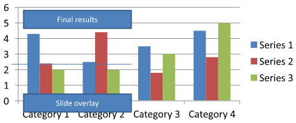

## **Обзор**

Эта статья объясняет, как форматировать диаграммы в презентациях PowerPoint, используя Aspose.Slides. Она показывает, как настроить основные элементы диаграммы, такие как оси, линии сетки, заголовки, легенды, область построения и заливки стен, чтобы улучшить внешний вид и читаемость данных диаграммы.

Она также демонстрирует, как задать свойства шрифта для текста диаграммы, применить предустановленные числовые форматы к данным диаграммы и включить скруглённые углы области диаграммы. Вместе эти примеры показывают, как управлять как визуальным стилем, так и представлением данных диаграмм в презентации.

Для отдельных заливок и контуров при восходящих и нисходящих интервалах см. [пример диаграммы акций](/slides/ru/python-java/create-chart/#create-stock-charts).

## **Форматирование элементов диаграммы**

Используйте [Chart](https://reference.aspose.com/slides/python-java/aspose.slides/chart/) для форматирования заголовков диаграмм, осей, линий сетки, легенд и области построения. Этот пример создаёт линейную диаграмму с маркерами и данными по умолчанию, затем применяет отдельные стили текста и линий к её оси значений и оси категорий. Размеры шрифтов и толщины линий указаны в пунктах; подписи категорий повернуты на 45 градусов.

Ось значений использует [setNumberFormat](https://reference.aspose.com/slides/python-java/aspose.slides/axis/#setNumberFormat) независимо от исходных ячеек. Её масштаб идёт от -2 до 15 с основными интервалами 2 и второстепенными 0.5. Пример также сочетает процентное форматирование с [setDisplayUnit](https://reference.aspose.com/slides/python-java/aspose.slides/axis/#setDisplayUnit), установленным в тысячи, поэтому адаптируйте эти настройки к смыслу и величине ваших данных. Легенда остаётся за пределами области построения, потому что [setOverlay](https://reference.aspose.com/slides/python-java/aspose.slides/legend/#setOverlay) вызывается с `False`. Заливки задней стены и пола настраиваются через [getBackWall](https://reference.aspose.com/slides/python-java/aspose.slides/chart/#getBackWall) и [getFloor](https://reference.aspose.com/slides/python-java/aspose.slides/chart/#getFloor), но эти поверхности видны только в 3‑D диаграммах.

```python
import jpype
import asposeslides

if not jpype.isJVMStarted():
    jpype.startJVM()

from asposeslides.api import ChartType, DisplayUnitType, FillType, FontData, LineDashStyle, NullableBool, Presentation, PresetColor, SaveFormat, TickLabelPositionType

Color = jpype.JClass("java.awt.Color")

presentation = Presentation()
try:
    slide = presentation.getSlides().get_Item(0)

    chart = slide.getShapes().addChart(ChartType.LineWithMarkers, 50, 50, 500, 400)

    chart.setTitle(True)
    chart.getChartTitle().addTextFrameForOverriding("")
    chart_title = chart.getChartTitle().getTextFrameForOverriding().getParagraphs().get_Item(0).getPortions().get_Item(0)
    chart_title.setText("Sample Chart")
    chart_title.getPortionFormat().getFillFormat().setFillType(FillType.Solid)
    chart_title.getPortionFormat().getFillFormat().getSolidFillColor().setColor(Color.GRAY)
    chart_title.getPortionFormat().setFontHeight(20)
    chart_title.getPortionFormat().setFontBold(NullableBool.True_)
    chart_title.getPortionFormat().setFontItalic(NullableBool.True_)

    chart.getAxes().getVerticalAxis().getMajorGridLinesFormat().getLine().getFillFormat().setFillType(FillType.Solid)
    chart.getAxes().getVerticalAxis().getMajorGridLinesFormat().getLine().getFillFormat().getSolidFillColor().setColor(Color.BLUE)
    chart.getAxes().getVerticalAxis().getMajorGridLinesFormat().getLine().setWidth(5)
    chart.getAxes().getVerticalAxis().getMajorGridLinesFormat().getLine().setDashStyle(LineDashStyle.DashDot)

    chart.getAxes().getVerticalAxis().getMinorGridLinesFormat().getLine().getFillFormat().setFillType(FillType.Solid)
    chart.getAxes().getVerticalAxis().getMinorGridLinesFormat().getLine().getFillFormat().getSolidFillColor().setColor(Color.RED)
    chart.getAxes().getVerticalAxis().getMinorGridLinesFormat().getLine().setWidth(3)

    chart.getAxes().getVerticalAxis().setNumberFormatLinkedToSource(False)
    chart.getAxes().getVerticalAxis().setDisplayUnit(DisplayUnitType.Thousands)
    chart.getAxes().getVerticalAxis().setNumberFormat("0.0%")

    chart.getAxes().getVerticalAxis().setAutomaticMajorUnit(False)
    chart.getAxes().getVerticalAxis().setAutomaticMaxValue(False)
    chart.getAxes().getVerticalAxis().setAutomaticMinorUnit(False)
    chart.getAxes().getVerticalAxis().setAutomaticMinValue(False)

    chart.getAxes().getVerticalAxis().setMaxValue(15)
    chart.getAxes().getVerticalAxis().setMinValue(-2)
    chart.getAxes().getVerticalAxis().setMinorUnit(0.5)
    chart.getAxes().getVerticalAxis().setMajorUnit(2.0)

    value_axis_text = chart.getAxes().getVerticalAxis().getTextFormat().getPortionFormat()
    value_axis_text.setFontBold(NullableBool.True_)
    value_axis_text.setFontHeight(16)
    value_axis_text.setFontItalic(NullableBool.True_)
    value_axis_text.getFillFormat().setFillType(FillType.Solid)
    value_axis_text.getFillFormat().getSolidFillColor().setPresetColor(PresetColor.DarkGreen)
    value_axis_font = FontData("Times New Roman")
    value_axis_text.setLatinFont(value_axis_font)

    chart.getAxes().getVerticalAxis().setTitle(True)
    chart.getAxes().getVerticalAxis().getTitle().addTextFrameForOverriding("")
    value_axis_title = chart.getAxes().getVerticalAxis().getTitle().getTextFrameForOverriding().getParagraphs().get_Item(0).getPortions().get_Item(0)
    value_axis_title.setText("Primary Axis")
    value_axis_title.getPortionFormat().getFillFormat().setFillType(FillType.Solid)
    value_axis_title.getPortionFormat().getFillFormat().getSolidFillColor().setColor(Color.GRAY)
    value_axis_title.getPortionFormat().setFontHeight(20)
    value_axis_title.getPortionFormat().setFontBold(NullableBool.True_)
    value_axis_title.getPortionFormat().setFontItalic(NullableBool.True_)

    chart.getAxes().getHorizontalAxis().getMajorGridLinesFormat().getLine().getFillFormat().setFillType(FillType.Solid)
    category_grid_color = Color(0, 128, 0)
    chart.getAxes().getHorizontalAxis().getMajorGridLinesFormat().getLine().getFillFormat().getSolidFillColor().setColor(category_grid_color)
    chart.getAxes().getHorizontalAxis().getMajorGridLinesFormat().getLine().setWidth(5)

    chart.getAxes().getHorizontalAxis().getMinorGridLinesFormat().getLine().getFillFormat().setFillType(FillType.Solid)
    chart.getAxes().getHorizontalAxis().getMinorGridLinesFormat().getLine().getFillFormat().getSolidFillColor().setColor(Color.YELLOW)
    chart.getAxes().getHorizontalAxis().getMinorGridLinesFormat().getLine().setWidth(3)

    category_axis_text = chart.getAxes().getHorizontalAxis().getTextFormat().getPortionFormat()
    category_axis_text.setFontBold(NullableBool.True_)
    category_axis_text.setFontHeight(16)
    category_axis_text.setFontItalic(NullableBool.True_)
    category_axis_text.getFillFormat().setFillType(FillType.Solid)
    category_axis_text.getFillFormat().getSolidFillColor().setColor(Color.BLUE)
    category_axis_font = FontData("Arial")
    category_axis_text.setLatinFont(category_axis_font)

    chart.getAxes().getHorizontalAxis().setTitle(True)
    chart.getAxes().getHorizontalAxis().getTitle().addTextFrameForOverriding("")

    category_axis_title = chart.getAxes().getHorizontalAxis().getTitle().getTextFrameForOverriding().getParagraphs().get_Item(0).getPortions().get_Item(0)
    category_axis_title.setText("Sample Category")
    category_axis_title.getPortionFormat().getFillFormat().setFillType(FillType.Solid)
    category_axis_title.getPortionFormat().getFillFormat().getSolidFillColor().setColor(Color.GRAY)
    category_axis_title.getPortionFormat().setFontHeight(20)
    category_axis_title.getPortionFormat().setFontBold(NullableBool.True_)
    category_axis_title.getPortionFormat().setFontItalic(NullableBool.True_)

    chart.getAxes().getHorizontalAxis().setTickLabelPosition(TickLabelPositionType.Low)
    chart.getAxes().getHorizontalAxis().setTickLabelRotationAngle(45)

    legend_text = chart.getLegend().getTextFormat().getPortionFormat()
    legend_text.setFontBold(NullableBool.True_)
    legend_text.setFontHeight(16)
    legend_text.setFontItalic(NullableBool.True_)
    legend_text.getFillFormat().setFillType(FillType.Solid)
    legend_text.getFillFormat().getSolidFillColor().setPresetColor(PresetColor.DarkRed)

    chart.getLegend().setOverlay(False)

    chart.getBackWall().setThickness(1)
    chart.getBackWall().getFormat().getFill().setFillType(FillType.Solid)
    back_wall_color = Color(255, 165, 0)
    chart.getBackWall().getFormat().getFill().getSolidFillColor().setColor(back_wall_color)

    chart.getFloor().getFormat().getFill().setFillType(FillType.Solid)
    chart.getFloor().getFormat().getFill().getSolidFillColor().setColor(Color.RED)

    chart.getPlotArea().getFormat().getFill().setFillType(FillType.Solid)
    chart.getPlotArea().getFormat().getFill().getSolidFillColor().setPresetColor(PresetColor.LightCyan)

    presentation.save("FormattedChart_out.pptx", SaveFormat.Pptx)
finally:
    presentation.dispose()
```

## **Установить свойства шрифта для диаграммы**

Задайте размер шрифта по умолчанию для текста диаграммы через [Chart.getTextFormat](https://reference.aspose.com/slides/python-java/aspose.slides/chart/#getTextFormat). Пример создаёт колонную диаграмму с кластером, шрифтом 20 пт и включает подписи значений для первой серии через [setShowValue](https://reference.aspose.com/slides/python-java/aspose.slides/datalabelformat/#setShowValue). Текстовые элементы с собственными явными настройками шрифта могут переопределять значение по умолчанию диаграммы.

```python
import jpype
import asposeslides

if not jpype.isJVMStarted():
    jpype.startJVM()

from asposeslides.api import ChartType, Presentation, SaveFormat

presentation = Presentation()
try:
    slide = presentation.getSlides().get_Item(0)

    chart = slide.getShapes().addChart(ChartType.ClusteredColumn, 100, 100, 500, 400)
    chart.getTextFormat().getPortionFormat().setFontHeight(20)
    chart.getChartData().getSeries().get_Item(0).getLabels().getDefaultDataLabelFormat().setShowValue(True)

    presentation.save("FontPropertiesForChart.pptx", SaveFormat.Pptx)
finally:
    presentation.dispose()
```

## **Повторное использование форматирования текстового фрейма для легенды диаграммы**

Чтобы согласовать легенду с заголовком слайда, задайте шрифт заголовка через [getDefaultPortionFormat](https://reference.aspose.com/slides/python-java/aspose.slides/paragraphformat/#getDefaultPortionFormat) в первом абзаце. Вызовите [copyFrom](https://reference.aspose.com/slides/python-java/aspose.slides/charttextformat/#copyFrom) у формата, возвращённого [getTextFormat](https://reference.aspose.com/slides/python-java/aspose.slides/legend/#getTextFormat) легенды. Это копирует настройки текстового фрейма, форматирование первого абзаца и его свойства шрифта по умолчанию. Форматирование, применённое напрямую к отдельным частям или к более поздним абзацам, остаётся локальным для источника.

Пример использует жирный заголовок Calibri 26 пт тёмно‑синего цвета в качестве шаблона. После стилизации легенды вызывается [copyTo](https://reference.aspose.com/slides/python-java/aspose.slides/charttextformat/#copyTo) для применения того же форматирования к отдельной подписи.

```python
import jpype
import asposeslides

if not jpype.isJVMStarted():
    jpype.startJVM()

from asposeslides.api import ChartType, FillType, FontData, LegendPositionType, NullableBool, Presentation, SaveFormat, ShapeType, StyleType

Color = jpype.JClass("java.awt.Color")

presentation = Presentation()
try:
    shapes = presentation.getSlides().get_Item(0).getShapes()
    
    heading = shapes.addAutoShape(ShapeType.Rectangle, 40, 20, 640, 40, False)
    source_text_frame = heading.addTextFrame("Quarterly sales")
    paragraph = source_text_frame.getParagraphs().get_Item(0)
    font = paragraph.getParagraphFormat().getDefaultPortionFormat()
    font.setLatinFont(FontData("Calibri"))
    font.setFontHeight(26)
    font.setFontBold(NullableBool.True_)
    font.getFillFormat().setFillType(FillType.Solid)
    font.getFillFormat().getSolidFillColor().setColor(Color(32, 64, 96))

    chart = shapes.addChart(ChartType.ClusteredColumn, 40, 75, 640, 360)
    chart.setStyle(StyleType.Style3)
    workbook = chart.getChartData().getChartDataWorkbook()
    for column, series_name in enumerate(("Retail", "Online", "Wholesale"), start=1):
        workbook.getCell(0, 0, column).setValue(series_name)
    for quarter in range(1, 5):
        workbook.getCell(0, quarter, 0).setValue(f"Q{quarter}")

    chart.setLegend(True)
    legend = chart.getLegend()
    legend.setPosition(LegendPositionType.Bottom)
    legend_format = legend.getTextFormat()
    legend_format.copyFrom(source_text_frame)

    caption = shapes.addAutoShape(ShapeType.Rectangle, 40, 460, 640, 40, False)
    caption_text_frame = caption.addTextFrame("Sales in millions of dollars")
    legend_format.copyTo(caption_text_frame)

    presentation.save("legend-formatting.pptx", SaveFormat.Pptx)
finally:
    presentation.dispose()
```

В сохранённой презентации легенда и подпись соответствуют заголовку по размеру, насыщенности и цвету. Легенда по‑прежнему отображает названия серий, а подпись сохраняет собственный текст. Если часть подписи уже имеет явный размер шрифта, этот размер имеет приоритет над скопированным значением шрифта по умолчанию.

| До копирования | После копирования |
| --- | --- |
|  |  |

## **Установить числовой формат**

Используйте [ChartDataCell.setPresetNumberFormat](https://reference.aspose.com/slides/python-java/aspose.slides/chartdatacell/#setPresetNumberFormat) для применения встроенного числового формата к ячейкам рабочей книги диаграммы. Этот пример создаёт колонную диаграмму с кластером, данными, поддерживаемыми ячейками, и применяет индекс формата 10 (`0.00%`) к ячейке значения каждой серии. Это меняет отображение значений в рабочей книге без изменения самих чисел; например, 0.25 отображается как 25.00 %. Форматы осей и подписи данных можно настраивать отдельно.

```python
import jpype
import asposeslides

if not jpype.isJVMStarted():
    jpype.startJVM()

from asposeslides.api import ChartType, Presentation, SaveFormat

presentation = Presentation()
try:
    slide = presentation.getSlides().get_Item(0)

    chart = slide.getShapes().addChart(ChartType.ClusteredColumn, 50, 50, 500, 400)
    chart_series_collection = chart.getChartData().getSeries()

    for chart_series in chart_series_collection:
        for data_point in chart_series.getDataPoints():
            data_point.getValue().getAsCell().setPresetNumberFormat(jpype.JByte(10))  # 0.00%

    presentation.save("PresetNumberFormat_out.pptx", SaveFormat.Pptx)
finally:
    presentation.dispose()
```

В следующей таблице перечислены встроенные индексы числовых форматов с характерными представлениями Excel для локали «English (United States)». Точные строки форматов и их отображение могут различаться в зависимости от приложения и локали, особенно для валют и дат. Некоторые форматы Excel также отличаются от значений по умолчанию в стандарте OOXML, как описано в [Microsoft's number format implementation notes](https://learn.microsoft.com/en-us/openspecs/office_standards/ms-oi29500/17d11129-219b-4e2c-88db-45844d21e528).

| Индекс | Формат |
| --- | --- |
| 0 | `General` |
| 1 | `0` |
| 2 | `0.00` |
| 3 | `#,##0` |
| 4 | `#,##0.00` |
| 5 | `"$"#,##0_);("$"#,##0)` |
| 6 | `"$"#,##0_);[Red]("$"#,##0)` |
| 7 | `"$"#,##0.00_);("$"#,##0.00)` |
| 8 | `"$"#,##0.00_);[Red]("$"#,##0.00)` |
| 9 | `0%` |
| 10 | `0.00%` |
| 11 | `0.00E+00` |
| 12 | `# ?/?` |
| 13 | `# ??/??` |
| 14 | `m/d/yyyy` |
| 15 | `d-mmm-yy` |
| 16 | `d-mmm` |
| 17 | `mmm-yy` |
| 18 | `h:mm AM/PM` |
| 19 | `h:mm:ss AM/PM` |
| 20 | `h:mm` |
| 21 | `h:mm:ss` |
| 22 | `m/d/yyyy h:mm` |
| 37 | `#,##0_);(#,##0)` |
| 38 | `#,##0_);[Red](#,##0)` |
| 39 | `#,##0.00_);(#,##0.00)` |
| 40 | `#,##0.00_);[Red](#,##0.00)` |
| 41 | `_(* #,##0_);_(* (#,##0);_(* "-"_);_(@_)` |
| 42 | `_("$"* #,##0_);_("$"* (#,##0);_("$"* "-"_);_(@_)` |
| 43 | `_(* #,##0.00_);_(* (#,##0.00);_(* "-"??_);_(@_)` |
| 44 | `_("$"* #,##0.00_);_("$"* (#,##0.00);_("$"* "-"??_);_(@_)` |
| 45 | `mm:ss` |
| 46 | `[h]:mm:ss` |
| 47 | `mm:ss.0` |
| 48 | `##0.0E+0` |
| 49 | `@` |

## **Установить скруглённые границы области диаграммы**

Вызовите [Chart.setRoundedCorners](https://reference.aspose.com/slides/python-java/aspose.slides/chart/#setRoundedCorners) с `True`, чтобы скруглить углы области диаграммы. Пример создаёт колонную диаграмму с кластером и использует [getLineFormat](https://reference.aspose.com/slides/python-java/aspose.slides/shape/#getLineFormat) для задания её контуру сплошным серым цветом и одиночным типом линии перед сохранением презентации.

```python
import jpype
import asposeslides

if not jpype.isJVMStarted():
    jpype.startJVM()

from asposeslides.api import ChartType, FillType, LineStyle, Presentation, SaveFormat

Color = jpype.JClass("java.awt.Color")

presentation = Presentation()
try:
    slide = presentation.getSlides().get_Item(0)

    chart = slide.getShapes().addChart(ChartType.ClusteredColumn, 20, 100, 600, 400)
    chart.getLineFormat().getFillFormat().setFillType(FillType.Solid)
    chart.getLineFormat().getFillFormat().getSolidFillColor().setColor(Color.GRAY)
    chart.getLineFormat().setStyle(LineStyle.Single)
    chart.setRoundedCorners(True)

    presentation.save("out.pptx", SaveFormat.Pptx)
finally:
    presentation.dispose()
```

## **Редактировать существующие аннотации диаграммы**

Диаграмма может содержать пользовательские фигуры, например текстовую аннотацию, объясняющую статус отчёта. Доступ к этим фигурам получаете через [Chart.getUserShapes](https://reference.aspose.com/slides/python-java/aspose.slides/chart/#getUserShapes). Коллекция, возвращаемая [getShapes](https://reference.aspose.com/slides/python-java/aspose.slides/groupshape/#getShapes), содержит фигуры, принадлежащие диаграмме.

Обычный текстовый блок, размещённый над диаграммой, принадлежит слайду, даже если выглядит как часть диаграммы. Перебирая [Slide.getShapes](https://reference.aspose.com/slides/python-java/aspose.slides/baseslide/#getShapes), вы находите диаграмму и обычные фигуры слайда, но не перечисляете отдельные фигуры внутри диаграммы. Заголовки диаграмм и подписи данных являются отдельными элементами диаграммы, а не пользовательскими аннотациями в этой коллекции.

Скачайте [chart-annotations.pptx](chart-annotations.pptx) и поместите его в рабочий каталог приложения. На его первом слайде находится диаграмма с разъединённой аннотацией «Preliminary results», линией, принадлежащей диаграмме, и обычным текстовым блоком слайда «Slide overlay». Пример находит первую диаграмму на этом слайде и меняет аннотацию на «Final results», когда отчёт готов к публикации. Он проверяет, что коллекция не пуста, и редактирует только [AutoShape](https://reference.aspose.com/slides/python-java/aspose.slides/autoshape/) с текстовым фреймом, отличным от `None`, возвращаемым [getTextFrame](https://reference.aspose.com/slides/python-java/aspose.slides/autoshape/#getTextFrame), и соответствующим ожидаемому тексту.

```python
import jpype
import asposeslides

if not jpype.isJVMStarted():
    jpype.startJVM()

from asposeslides.api import AutoShape, Chart, Presentation, SaveFormat

presentation = Presentation("chart-annotations.pptx")
try:
    slide = presentation.getSlides().get_Item(0)

    chart = None
    for shape in slide.getShapes():
        if isinstance(shape, Chart):
            chart = shape
            break

    if chart is None or chart.getUserShapes().getShapes().size() == 0:
        print("No chart or chart-owned shapes found.")
    else:
        updated = False
        for shape in chart.getUserShapes().getShapes():
            if isinstance(shape, AutoShape):
                text_frame = shape.getTextFrame()
                if text_frame is not None and text_frame.getText() == "Preliminary results":
                    text_frame.setText("Final results")
                    updated = True
                    break

        if updated:
            presentation.save("chart-annotations-updated.pptx", SaveFormat.Pptx)
        else:
            print("No matching text annotation found.")
finally:
    presentation.dispose()
```

Линия и текстовый блок слайда остаются без изменений. Ниже показаны входные изображения и сохранённый, вновь открытый результат:

| До редактирования | После редактирования |
| --- | --- |
|  |  |

{}
Пример проверяет только фигуры верхнего уровня, принадлежащие диаграмме. Если аннотация находится внутри [GroupShape](https://reference.aspose.com/slides/python-java/aspose.slides/groupshape/), проверьте также коллекцию [getShapes](https://reference.aspose.com/slides/python-java/aspose.slides/groupshape/#getShapes) этой группы. Повторяйте проверку рекурсивно для вложенных групп, применяя те же проверки текста к их дочерним фигурам. Сама группа является контейнером; не рассматривайте её как текстовый блок.
{}

## **FAQ**

**Можно ли установить полупрозрачные заливки для столбцов/областей, сохраняя границу непрозрачной?**  
Да. Прозрачность заливки и контур задаются отдельно. Это полезно для повышения читаемости сетки и данных в плотных визуализациях.

**Как справиться с подписью данных, когда они перекрываются?**  
Уменьшите размер шрифта, отключите необязательные компоненты подписи (например, категории), скорректируйте позицию подписи, при необходимости показывайте подписи только для выбранных точек или переключите формат на «значение + легенда».

**Можно ли применять градиентные или шаблонные заливки к сериям?**  
Да. Серии поддерживают сплошные, градиентные и шаблонные заливки. На практике используйте градиенты умеренно и избегайте сочетаний, снижающих контраст с сеткой и текстом.