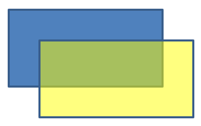

## **Введение**

Форматируйте фигуры в PowerPoint, регулируя их контура, заливки и эффекты. Aspose.Slides for Python via Java позволяет программно управлять этими настройками, включая прозрачность, поворот и 3D‑форматирование.


Aspose.Slides for Python via Java предоставляет классы и методы, позволяющие форматировать фигуры, используя те же параметры, что доступны в PowerPoint.

## **Форматирование линий**

Используйте [Shape.getLineFormat](https://reference.aspose.com/slides/python-java/aspose.slides/shape/#getLineFormat) чтобы управлять контуром фигуры. Этот пример создает незаполненный прямоугольник с синей пунктирной обводкой. [LineFormat.setStyle](https://reference.aspose.com/slides/python-java/aspose.slides/lineformat/#setStyle) выбирает составную линию «толстая‑тонкая», а [LineFormat.setWidth](https://reference.aspose.com/slides/python-java/aspose.slides/lineformat/#setWidth) задаёт её ширину 7 пунктов, а [LineFormat.setDashStyle](https://reference.aspose.com/slides/python-java/aspose.slides/lineformat/#setDashStyle) выбирает тип пунктирной линии.

```python
import jpype
import asposeslides

if not jpype.isJVMStarted():
    jpype.startJVM()

from asposeslides.api import FillType, LineDashStyle, LineStyle, Presentation, SaveFormat, ShapeType
from java.awt import Color

presentation = Presentation()
try:
    slide = presentation.getSlides().get_Item(0)

    shape = slide.getShapes().addAutoShape(ShapeType.Rectangle, 50, 50, 150, 75)
    shape.getFillFormat().setFillType(FillType.NoFill)
    shape.getLineFormat().setStyle(LineStyle.ThickThin)
    shape.getLineFormat().setWidth(7)
    shape.getLineFormat().setDashStyle(LineDashStyle.Dash)
    shape.getLineFormat().getFillFormat().setFillType(FillType.Solid)
    shape.getLineFormat().getFillFormat().getSolidFillColor().setColor(Color.BLUE)

    presentation.save("formatted_lines.pptx", SaveFormat.Pptx)
finally:
    presentation.dispose()
```

Результат:


### **Установить пользовательские шаблоны пунктиров линии**

Используйте [LineFormat.setCustomDashPattern](https://reference.aspose.com/slides/python-java/aspose.slides/lineformat/#setCustomDashPattern), когда предопределённые стили линий не предоставляют нужных длин штрихов и пробелов, например для фирменных контуров или технических схем. Присвоение шаблона автоматически меняет стиль пунктирной линии на [LineDashStyle.Custom](https://reference.aspose.com/slides/python-java/aspose.slides/linedashstyle/).

Элементы массива чередуются между длинами штриха и пробела, начиная со штриха. Каждое значение является множителем толщины линии: `[4, 2]` при ширине 3 пункта дает штрих длиной 12 пунктов, за которым следует пробел длиной 6 пунктов. Используйте пары конечных неотрицательных значений для определения полных сегментов штрих‑пробел. В примере используются положительные значения, чтобы каждый штрих и пробел были видимы.

В этом примере создаются пять синих линий одинаковой длины с плоскими концами. Первые три сравнивают шаблоны при ширине 3 пункта. Четвёртая повторяет первый шаблон при двойной ширине, удваивая длину штрихов и пробелов. Пятая переключается от пользовательского шаблона к сплошной линии.

```python
import jpype
import asposeslides

if not jpype.isJVMStarted():
    jpype.startJVM()

from asposeslides.api import FillType, LineArrowheadStyle, LineCapStyle, LineDashStyle, Presentation, SaveFormat, ShapeType, SlideSizeScaleType
from java.awt import Color

presentation = Presentation()
try:
    presentation.getSlideSize().setSize(600, 300, SlideSizeScaleType.DoNotScale)
    slide = presentation.getSlides().get_Item(0)

    patterns = [
        [4, 2],
        [1, 2],
        [6, 2, 1, 2],
        [4, 2],
        [4, 2]
    ]

    for i, pattern in enumerate(patterns):
        line = slide.getShapes().addAutoShape(ShapeType.Line, 50, 50 + i * 50, 500, 0)
        line.getLineFormat().setWidth(6 if i == 3 else 3)
        line.getLineFormat().getFillFormat().setFillType(FillType.Solid)
        color = Color(0, 0, 139)
        line.getLineFormat().getFillFormat().getSolidFillColor().setColor(color)
        line.getLineFormat().setCapStyle(LineCapStyle.Flat)
        line.getLineFormat().setBeginArrowheadStyle(LineArrowheadStyle.None_)
        line.getLineFormat().setEndArrowheadStyle(LineArrowheadStyle.None_)
        line.getLineFormat().setCustomDashPattern(jpype.JArray(jpype.JFloat)(pattern))

    # Вернуть последнюю линию к сплошному стилю.
    slide.getShapes().get_Item(4).getLineFormat().setDashStyle(LineDashStyle.Solid)

    presentation.save("custom_dash_patterns.pptx", SaveFormat.Pptx)
finally:
    presentation.dispose()
```

Чтобы вернуться к предопределённому пунктирному стилю, передайте [LineDashStyle.Dash](https://reference.aspose.com/slides/python-java/aspose.slides/linedashstyle/) в [LineFormat.setDashStyle](https://reference.aspose.com/slides/python-java/aspose.slides/lineformat/#setDashStyle). Выбранный стиль контролирует внешний вид линии.

Результат в PowerPoint сверху вниз: **{4, 2}, 3 пт**; **{1, 2}, 3 пт**; **{6, 2, 1, 2}, 3 пт**; **{4, 2}, 6 пт**; и **Сплошная, 3 пт**.


### **Установить типы концов линии**

Используйте [LineFormat.setCapStyle](https://reference.aspose.com/slides/python-java/aspose.slides/lineformat/#setCapStyle), чтобы задать концы открытой линии. Класс [LineCapStyle](https://reference.aspose.com/slides/python-java/aspose.slides/linecapstyle/) предоставляет три явных типа окончания:

- `Flat`: Обводка заканчивается в конечной точке.
- `Round`: Полукруглое окончание выступает за конечную точку на половину толщины линии.
- `Square`: Квадратное окончание выступает за конечную точку на половину толщины линии.

Класс также включает `NotDefined`, что означает, что тип окончания явно не задан.

Окончания отличаются от стрелок, которые добавляют символы к концам линии, и соединений, которые управляют углами между отрезками линии. В этом примере стрелки отключаются с помощью [LineFormat.setBeginArrowheadStyle](https://reference.aspose.com/slides/python-java/aspose.slides/lineformat/#setBeginArrowheadStyle) и [LineFormat.setEndArrowheadStyle](https://reference.aspose.com/slides/python-java/aspose.slides/lineformat/#setEndArrowheadStyle), чтобы сравнивать только формы окончаний.

Следующий пример создаёт три в остальных отношениях одинаковые горизонтальные линии толщиной 20 пунктов. Сверху вниз они используют окончания Flat, Round и Square. Их конечные точки имеют одинаковые горизонтальные координаты; круглое и квадратное окончания выступают на 10 пунктов за каждую конечную точку.

```python
import jpype
import asposeslides

if not jpype.isJVMStarted():
    jpype.startJVM()

from asposeslides.api import FillType, LineArrowheadStyle, LineCapStyle, LineDashStyle, Presentation, SaveFormat, ShapeType, SlideSizeScaleType
from java.awt import Color

presentation = Presentation()
try:
    presentation.getSlideSize().setSize(500, 240, SlideSizeScaleType.DoNotScale)
    slide = presentation.getSlides().get_Item(0)

    cap_styles = [LineCapStyle.Flat, LineCapStyle.Round, LineCapStyle.Square]

    for i, cap_style in enumerate(cap_styles):
        line = slide.getShapes().addAutoShape(ShapeType.Line, 100, 50 + i * 70, 300, 0)
        line.getLineFormat().setWidth(20)
        line.getLineFormat().getFillFormat().setFillType(FillType.Solid)
        color = Color(0, 0, 139)
        line.getLineFormat().getFillFormat().getSolidFillColor().setColor(color)
        line.getLineFormat().setDashStyle(LineDashStyle.Solid)
        line.getLineFormat().setCapStyle(cap_style)
        line.getLineFormat().setBeginArrowheadStyle(LineArrowheadStyle.None_)
        line.getLineFormat().setEndArrowheadStyle(LineArrowheadStyle.None_)

    presentation.save("line_caps.pptx", SaveFormat.Pptx)
finally:
    presentation.dispose()
```

Результат в PowerPoint сверху вниз: **Flat**, **Round** и **Square**.


## **Применить эффект эскиза к линиям фигуры**

Эффект эскиза делает линию фигуры выглядящей нарисованной от руки. Используйте [Shape.getLineFormat](https://reference.aspose.com/slides/python-java/aspose.slides/shape/#getLineFormat), чтобы получить настройки линии, [LineFormat.getSketchFormat](https://reference.aspose.com/slides/python-java/aspose.slides/lineformat/#getSketchFormat), чтобы получить настройки эскиза, и [SketchFormat.setSketchType](https://reference.aspose.com/slides/python-java/aspose.slides/sketchformat/#setSketchType), чтобы выбрать значение из класса [LineSketchType](https://reference.aspose.com/slides/python-java/aspose.slides/linesketchtype/).

Следующий код Python демонстрирует, как применить эффект [LineSketchType.Curved](https://reference.aspose.com/slides/python-java/aspose.slides/linesketchtype/), прочитать явно присвоенное значение и удалить эффект с помощью [LineSketchType.None_](https://reference.aspose.com/slides/python-java/aspose.slides/linesketchtype/):

```python
import jpype
import asposeslides

if not jpype.isJVMStarted():
    jpype.startJVM()

from asposeslides.api import LineSketchType, Presentation, ShapeType

presentation = Presentation()
try:
    slide = presentation.getSlides().get_Item(0)

    shape = slide.getShapes().addAutoShape(ShapeType.Rectangle, 50, 50, 200, 100)

    sketch_format = shape.getLineFormat().getSketchFormat()
    sketch_format.setSketchType(LineSketchType.Curved)
    explicit_sketch_type = sketch_format.getSketchType()
    print("Explicit sketch type:", explicit_sketch_type)
    sketch_format.setSketchType(LineSketchType.None_)
finally:
    presentation.dispose()
```

Значение, возвращаемое [SketchFormat.getSketchType](https://reference.aspose.com/slides/python-java/aspose.slides/sketchformat/#getSketchType), представляет настройку, непосредственно присвоенную фигуре. Если форматирование линии может наследоваться из темы, главного слайда или макета слайда, используйте [LineFormat.getEffective](https://reference.aspose.com/slides/python-java/aspose.slides/lineformat/#getEffective) и считайте тип эскиза из возвращённого эффективного форматирования линии, как показано ниже. Эффективное значение отражает форматирование, действительно применённое после разрешения наследования. Этот пример требует существующей презентации с хотя бы одной фигурой на первом слайде и выводит оба значения:

```python
import jpype
import asposeslides

if not jpype.isJVMStarted():
    jpype.startJVM()

from asposeslides.api import Presentation

presentation = Presentation("presentation.pptx")
try:
    shape = presentation.getSlides().get_Item(0).getShapes().get_Item(0)

    line_format = shape.getLineFormat()
    explicit_sketch_type = line_format.getSketchFormat().getSketchType()
    effective_line_format = line_format.getEffective()
    effective_sketch_type = effective_line_format.getSketchFormat().getSketchType()

    print("Explicit sketch type:", explicit_sketch_type)
    print("Effective sketch type:", effective_sketch_type)
finally:
    presentation.dispose()
```

## **Форматировать стили соединений**

Вот три варианта типа соединения:

* Round
* Miter
* Bevel

Стиль соединения определяет, как два сегмента контура встречаются в угле. Используйте **Round** для скруглённых углов, **Miter** для острых углов или **Bevel** для плоских углов.


В этом примере создаются три чёрных прямоугольника с синими контурами толщиной 15 пунктов. Он использует [LineFormat.setJoinStyle](https://reference.aspose.com/slides/python-java/aspose.slides/lineformat/#setJoinStyle), чтобы установить значения miter, bevel и round класса [LineJoinStyle](https://reference.aspose.com/slides/python-java/aspose.slides/linejoinstyle/), соответственно, для сравнения того, как рисуются углы.

```python
import jpype
import asposeslides

if not jpype.isJVMStarted():
    jpype.startJVM()

from asposeslides.api import FillType, LineJoinStyle, Presentation, SaveFormat, ShapeType
from java.awt import Color

presentation = Presentation()
try:
    slide = presentation.getSlides().get_Item(0)

    miter_shape = slide.getShapes().addAutoShape(ShapeType.Rectangle, 20, 20, 150, 75)
    bevel_shape = slide.getShapes().addAutoShape(ShapeType.Rectangle, 210, 20, 150, 75)
    round_shape = slide.getShapes().addAutoShape(ShapeType.Rectangle, 20, 135, 150, 75)

    miter_shape.getFillFormat().setFillType(FillType.Solid)
    miter_shape.getFillFormat().getSolidFillColor().setColor(Color.BLACK)
    bevel_shape.getFillFormat().setFillType(FillType.Solid)
    bevel_shape.getFillFormat().getSolidFillColor().setColor(Color.BLACK)
    round_shape.getFillFormat().setFillType(FillType.Solid)
    round_shape.getFillFormat().getSolidFillColor().setColor(Color.BLACK)

    miter_shape.getLineFormat().setWidth(15)
    bevel_shape.getLineFormat().setWidth(15)
    round_shape.getLineFormat().setWidth(15)

    miter_shape.getLineFormat().getFillFormat().setFillType(FillType.Solid)
    miter_shape.getLineFormat().getFillFormat().getSolidFillColor().setColor(Color.BLUE)
    bevel_shape.getLineFormat().getFillFormat().setFillType(FillType.Solid)
    bevel_shape.getLineFormat().getFillFormat().getSolidFillColor().setColor(Color.BLUE)
    round_shape.getLineFormat().getFillFormat().setFillType(FillType.Solid)
    round_shape.getLineFormat().getFillFormat().getSolidFillColor().setColor(Color.BLUE)

    miter_shape.getLineFormat().setJoinStyle(LineJoinStyle.Miter)
    bevel_shape.getLineFormat().setJoinStyle(LineJoinStyle.Bevel)
    round_shape.getLineFormat().setJoinStyle(LineJoinStyle.Round)

    miter_shape.getTextFrame().setText("Miter Join Style")
    bevel_shape.getTextFrame().setText("Bevel Join Style")
    round_shape.getTextFrame().setText("Round Join Style")

    presentation.save("join_styles.pptx", SaveFormat.Pptx)
finally:
    presentation.dispose()
```

### **Ограничить соединения Miter на острых углах**

Используйте [LineFormat.setMiterLimit](https://reference.aspose.com/slides/python-java/aspose.slides/lineformat/#setMiterLimit) совместно с [LineFormat.setJoinStyle](https://reference.aspose.com/slides/python-java/aspose.slides/lineformat/#setJoinStyle), установленным в [LineJoinStyle.Miter](https://reference.aspose.com/slides/python-java/aspose.slides/linejoinstyle/), чтобы ограничить, насколько далеко может выступать острый угол.

Ограничение представляет собой отношение расстояния между внутренним и внешним углами соединения к толщине линии. Например, значение `8` позволяет длину соединения miter до восьми раз большей толщины линии; это не измерение в пунктах. Если угол превышает ограничение, PowerPoint использует скруглённое соединение в этом месте. Большее ограничение позволяет более острые точки. Эта настройка влияет только на соединения miter, и её изменение не имеет визуального эффекта, когда угол остаётся в пределах ограничения.

В этом примере создаются два одинаковых незаполненных треугольника с контурами толщиной 20 пунктов. Левая треугольник использует ограничение `2`, а правый — `8`. Каждый треугольник шириной 80 пунктов и высотой 160 пунктов, что даёт отношению длины miter к толщине линии в верхнем угле примерно `4.12`. Следовательно, PowerPoint скругляет левый верхний угол и сохраняет правый.

```python
import jpype
import asposeslides

if not jpype.isJVMStarted():
    jpype.startJVM()

from asposeslides.api import FillType, LineJoinStyle, Presentation, SaveFormat, ShapeType, SlideSizeScaleType
from java.awt import Color

presentation = Presentation()
try:
    presentation.getSlideSize().setSize(500, 320, SlideSizeScaleType.DoNotScale)
    slide = presentation.getSlides().get_Item(0)

    miter_limits = [2.0, 8.0]

    for i, miter_limit in enumerate(miter_limits):
        triangle = slide.getShapes().addAutoShape(ShapeType.Triangle, 90 + i * 240, 110, 80, 160)
        triangle.getFillFormat().setFillType(FillType.NoFill)
        triangle.getLineFormat().setWidth(20)
        triangle.getLineFormat().getFillFormat().setFillType(FillType.Solid)
        color = Color(0, 0, 139)
        triangle.getLineFormat().getFillFormat().getSolidFillColor().setColor(color)
        triangle.getLineFormat().setJoinStyle(LineJoinStyle.Miter)
        triangle.getLineFormat().setMiterLimit(miter_limit)

    presentation.save("miter_limits.pptx", SaveFormat.Pptx)
finally:
    presentation.dispose()
```

Результат в PowerPoint: **Miter limit 2** слева и **miter limit 8** справа.


## **Градиентная заливка**

Градиентная заливка смешивает цвета по фигуре. Этот пример заполняет эллипс линейным градиентом под углом 45° от красного к фиолетовому с помощью [FillFormat.getGradientFormat](https://reference.aspose.com/slides/python-java/aspose.slides/fillformat/#getGradientFormat). Метод [GradientStopCollection.addPresetColor](https://reference.aspose.com/slides/python-java/aspose.slides/gradientstopcollection/#addPresetColor) размещает цветовые стопы в позициях 0 и 1, в начале и конце градиента. Очистка существующих стопов гарантирует, что будут использованы только эти два цвета.

```python
import jpype
import asposeslides

if not jpype.isJVMStarted():
    jpype.startJVM()

from asposeslides.api import FillType, GradientShape, Presentation, PresetColor, SaveFormat, ShapeType
from java.awt import Color

presentation = Presentation()
try:
    slide = presentation.getSlides().get_Item(0)

    shape = slide.getShapes().addAutoShape(ShapeType.Ellipse, 50, 50, 150, 75)
    shape.getFillFormat().setFillType(FillType.Gradient)
    shape.getFillFormat().getGradientFormat().setGradientShape(GradientShape.Linear)
    shape.getFillFormat().getGradientFormat().setLinearGradientAngle(45)
    shape.getFillFormat().getGradientFormat().getGradientStops().clear()
    shape.getFillFormat().getGradientFormat().getGradientStops().addPresetColor(1.0, PresetColor.Purple)
    shape.getFillFormat().getGradientFormat().getGradientStops().addPresetColor(0.0, PresetColor.Red)

    presentation.save("gradient_fill.pptx", SaveFormat.Pptx)
finally:
    presentation.dispose()
```

Результат:


Если градиент выглядит иначе в экспортированном изображении, чем в PowerPoint, см. [Choose a Gradient Rendering Style](/slides/ru/python-java/convert-powerpoint-to-png/#choose-a-gradient-rendering-style). Вы можете выбрать стиль отрисовки, не меняя градиентную заливку, сохранённую в презентации.

### **Установить угол линейного градиента**

Используйте [GradientFormat.setLinearGradientAngle](https://reference.aspose.com/slides/python-java/aspose.slides/gradientformat/#setLinearGradientAngle), чтобы управлять ориентацией заливки [GradientShape.Linear](https://reference.aspose.com/slides/python-java/aspose.slides/gradientshape/). Угол измеряется в градусах и увеличивается по часовой стрелке: `0` — слева направо, `90` — сверху вниз, `180` — справа налево, `270` — снизу вверх. Дробные углы поддерживаются. Углы вне диапазона `[0, 360)` нормализуются к одной полной обороте; например, `-45` становится `315`, а `360` — `0`.

Этот пример создаёт шесть прямоугольников с одинаковыми красными, зелёными и синими стопами в позициях `0`, `0.5` и `1`. Масштабирование отключено, чтобы угол можно было сравнивать независимо от пропорций прямоугольников. Углы слева направо: `0`, `45` и `90` в первой строке, и `135`, `180` и `270` во второй строке.

```python
import jpype
import asposeslides

if not jpype.isJVMStarted():
    jpype.startJVM()

from asposeslides.api import FillType, GradientShape, NullableBool, Presentation, SaveFormat, ShapeType, SlideSizeScaleType
from java.awt import Color

presentation = Presentation()
try:
    presentation.getSlideSize().setSize(720, 400, SlideSizeScaleType.DoNotScale)
    slide = presentation.getSlides().get_Item(0)

    angles = [0, 45, 90, 135, 180, 270]

    for i, angle in enumerate(angles):
        x = 30 + (i % 3) * 230
        y = 30 + (i // 3) * 190

        shape = slide.getShapes().addAutoShape(ShapeType.Rectangle, x, y, 200, 150)
        shape.getLineFormat().getFillFormat().setFillType(FillType.NoFill)
        shape.getFillFormat().setFillType(FillType.Gradient)

        gradient = shape.getFillFormat().getGradientFormat()
        gradient.setGradientShape(GradientShape.Linear)
        gradient.getGradientStops().clear()
        gradient.getGradientStops().add(0, Color.RED)
        gradient.getGradientStops().add(0.5, Color.GREEN)
        gradient.getGradientStops().add(1, Color.BLUE)
        gradient.setLinearGradientScaled(NullableBool.False_)
        gradient.setLinearGradientAngle(angle)

    presentation.save("linear_gradient_angles.pptx", SaveFormat.Pptx)
finally:
    presentation.dispose()
```

Результат в PowerPoint:


### **Масштабировать линейный градиент вместе с фигурой**

[GradientFormat.setLinearGradientScaled](https://reference.aspose.com/slides/python-java/aspose.slides/gradientformat/#setLinearGradientScaled) принимает значение [NullableBool](https://reference.aspose.com/slides/python-java/aspose.slides/nullablebool/). Установите его явно в `False_`, чтобы сохранять геометрический угол градиента при изменении пропорций фигуры, или в `True_`, чтобы масштабировать градиент вместе с шириной и высотой фигуры. При включённом масштабировании видимый угол может отличаться от назначенного угла у неквадратной фигуры.

В следующем примере используется угол `45` градусов и те же цветовые стопы, что и в сравнении углов. В левом столбце используется `False_`; в правом — `True_`. Каждый столбец содержит широкий прямоугольник над высоким прямоугольником. Оба начинаются с одинаковых широких размеров; изменение ширины и высоты второго прямоугольника демонстрирует, как заливка реагирует на изменение размеров без изменения настроек градиента.

```python
import jpype
import asposeslides

if not jpype.isJVMStarted():
    jpype.startJVM()

from asposeslides.api import FillType, GradientShape, NullableBool, Presentation, SaveFormat, ShapeType, SlideSizeScaleType
from java.awt import Color

presentation = Presentation()
try:
    presentation.getSlideSize().setSize(720, 460, SlideSizeScaleType.DoNotScale)
    slide = presentation.getSlides().get_Item(0)

    scaling_options = [NullableBool.False_, NullableBool.True_]

    for column, scaled in enumerate(scaling_options):
        for row in range(2):
            x = 30 + column * 360
            y = 30 if row == 0 else 150

            shape = slide.getShapes().addAutoShape(ShapeType.Rectangle, x, y, 300, 90)
            shape.getLineFormat().getFillFormat().setFillType(FillType.NoFill)
            shape.getFillFormat().setFillType(FillType.Gradient)

            gradient = shape.getFillFormat().getGradientFormat()
            gradient.setGradientShape(GradientShape.Linear)
            gradient.getGradientStops().clear()
            gradient.getGradientStops().add(0, Color.RED)
            gradient.getGradientStops().add(0.5, Color.GREEN)
            gradient.getGradientStops().add(1, Color.BLUE)
            gradient.setLinearGradientAngle(45)
            gradient.setLinearGradientScaled(scaled)

            if row == 1:
                shape.setWidth(90)
                shape.setHeight(280)

    presentation.save("linear_gradient_scaling.pptx", SaveFormat.Pptx)
finally:
    presentation.dispose()
```

Результат в PowerPoint, с отключённым масштабированием слева и включённым справа:


При отключённом масштабировании диагональные цветовые полосы сохраняют одинаковую ориентацию в обоих прямоугольниках. При включённом масштабировании полосы растягиваются вместе с пропорциями фигуры. Это помогает воспроизвести градиент шаблона при адаптации фигуры к другому размеру. На квадрате включение масштабирования не меняет внешний вид этого градиента под углом `45` градусов.

Оба параметра — угол и масштабирование — применяются к линейным градиентам. Они не управляют заливками [GradientShape.Radial или GradientShape.Rectangle](https://reference.aspose.com/slides/python-java/aspose.slides/gradientshape/).

### **Комбинировать угол с направлением градиента**

[GradientFormat.setGradientDirection](https://reference.aspose.com/slides/python-java/aspose.slides/gradientformat/#setGradientDirection) выбирает стиль градиента из класса [GradientDirection](https://reference.aspose.com/slides/python-java/aspose.slides/gradientdirection/); это не замена числовому углу. Для линейного градиента стили углов могут менять область распределения цветов без изменения угла, заданного через [setLinearGradientAngle](https://reference.aspose.com/slides/python-java/aspose.slides/gradientformat/#setLinearGradientAngle). Оставляйте направление неизменным при сравнении углов или масштабировании.

В следующем примере те же настройки применяются в обратном порядке. Два прямоугольника выглядят одинаково: назначение направления до или после угла не меняет результат.

```python
import jpype
import asposeslides

if not jpype.isJVMStarted():
    jpype.startJVM()

from asposeslides.api import FillType, GradientDirection, GradientShape, NullableBool, Presentation, SaveFormat, ShapeType
from java.awt import Color

presentation = Presentation()
try:
    slide = presentation.getSlides().get_Item(0)

    for i in range(2):
        shape = slide.getShapes().addAutoShape(ShapeType.Rectangle, 30, 30 + i * 140, 320, 100)
        shape.getLineFormat().getFillFormat().setFillType(FillType.NoFill)
        shape.getFillFormat().setFillType(FillType.Gradient)

        gradient = shape.getFillFormat().getGradientFormat()
        gradient.setGradientShape(GradientShape.Linear)
        gradient.getGradientStops().clear()
        gradient.getGradientStops().add(0, Color.RED)
        gradient.getGradientStops().add(0.5, Color.GREEN)
        gradient.getGradientStops().add(1, Color.BLUE)
        gradient.setLinearGradientScaled(NullableBool.True_)

        if i == 0:
            gradient.setGradientDirection(GradientDirection.FromCorner1)
            gradient.setLinearGradientAngle(30)
        else:
            gradient.setLinearGradientAngle(30)
            gradient.setGradientDirection(GradientDirection.FromCorner1)

    presentation.save("linear_gradient_direction.pptx", SaveFormat.Pptx)
finally:
    presentation.dispose()
```

## **Заполнение узором**

Заполнение узором применяет двухцветный рисунок, например точки, полосы или шахматную доску. Этот пример использует [PatternFormat.setPatternStyle](https://reference.aspose.com/slides/python-java/aspose.slides/patternformat/#setPatternStyle), чтобы выбрать узор «решётка». [PatternFormat.getBackColor](https://reference.aspose.com/slides/python-java/aspose.slides/patternformat/#getBackColor) задаёт светло-серый фон, а [PatternFormat.getForeColor](https://reference.aspose.com/slides/python-java/aspose.slides/patternformat/#getForeColor) задаёт жёлтый цвет узора.

```python
import jpype
import asposeslides

if not jpype.isJVMStarted():
    jpype.startJVM()

from asposeslides.api import FillType, PatternStyle, Presentation, SaveFormat, ShapeType
from java.awt import Color

presentation = Presentation()
try:
    slide = presentation.getSlides().get_Item(0)

    shape = slide.getShapes().addAutoShape(ShapeType.Rectangle, 50, 50, 150, 75)
    shape.getFillFormat().setFillType(FillType.Pattern)
    shape.getFillFormat().getPatternFormat().setPatternStyle(PatternStyle.Trellis)
    shape.getFillFormat().getPatternFormat().getBackColor().setColor(Color.LIGHT_GRAY)
    shape.getFillFormat().getPatternFormat().getForeColor().setColor(Color.YELLOW)

    presentation.save("pattern_fill.pptx", SaveFormat.Pptx)
finally:
    presentation.dispose()
```

Результат:


## **Заполнение изображением**

Заполнение изображением использует картинку внутри фигуры. Этот пример требует локального изображения и использует [Images.fromFile](https://reference.aspose.com/slides/python-java/aspose.slides/images/#fromFile), чтобы загрузить его в коллекцию изображений презентации. Установка [PictureFillFormat.setPictureFillMode](https://reference.aspose.com/slides/python-java/aspose.slides/picturefillformat/#setPictureFillMode) в режим плитки повторяет изображение внутри прямоугольника. Исходное изображение, использованное здесь, показано ниже:


```python
import jpype
import asposeslides

if not jpype.isJVMStarted():
    jpype.startJVM()

from asposeslides.api import FillType, Images, PictureFillMode, Presentation, SaveFormat, ShapeType

presentation = Presentation()
try:
    slide = presentation.getSlides().get_Item(0)

    shape = slide.getShapes().addAutoShape(ShapeType.Rectangle, 50, 50, 255, 130)
    shape.getFillFormat().setFillType(FillType.Picture)
    shape.getFillFormat().getPictureFillFormat().setPictureFillMode(PictureFillMode.Tile)

    image = Images.fromFile("lotus.png")
    try:
        picture = presentation.getImages().addImage(image)
    finally:
        image.dispose()
    shape.getFillFormat().getPictureFillFormat().getPicture().setImage(picture)

    presentation.save("picture_fill.pptx", SaveFormat.Pptx)
finally:
    presentation.dispose()
```

Результат:


### **Повторять изображение как текстуру**

Если вы хотите установить повторяющееся изображение как текстуру и настроить поведение плитки, вы можете использовать следующие методы класса [PictureFillFormat](https://reference.aspose.com/slides/python-java/aspose.slides/picturefillformat/):

- [setPictureFillMode](https://reference.aspose.com/slides/python-java/aspose.slides/picturefillformat/#setPictureFillMode): Устанавливает режим заполнения изображения — `Tile` или `Stretch`.
- [setTileAlignment](https://reference.aspose.com/slides/python-java/aspose.slides/picturefillformat/#setTileAlignment): Указывает выравнивание плиток внутри фигуры.
- [setTileFlip](https://reference.aspose.com/slides/python-java/aspose.slides/picturefillformat/#setTileFlip): Управляет тем, будет ли плитка отражена по горизонтали, вертикали или обоими способами.
- [setTileOffsetX](https://reference.aspose.com/slides/python-java/aspose.slides/picturefillformat/#setTileOffsetX): Устанавливает горизонтальное смещение плитки (в пунктах) от начала фигуры.
- [setTileOffsetY](https://reference.aspose.com/slides/python-java/aspose.slides/picturefillformat/#setTileOffsetY): Устанавливает вертикальное смещение плитки (в пунктах) от начала фигуры.
- [setTileScaleX](https://reference.aspose.com/slides/python-java/aspose.slides/picturefillformat/#setTileScaleX): Определяет горизонтальный масштаб плитки в процентах.
- [setTileScaleY](https://reference.aspose.com/slides/python-java/aspose.slides/picturefillformat/#setTileScaleY): Определяет вертикальный масштаб плитки в процентах.

Этот пример требует локального изображения и настраивает [PictureFillFormat](https://reference.aspose.com/slides/python-java/aspose.slides/picturefillformat/) , чтобы повторять его с масштабом 50 % от оригинального размера. Смещения −32 пункта смещают плитки горизонтально и вертикально; выравнивание снизу‑справа и отражение в обоих направлениях определяют, как расположена повторяющаяся текстура.

```python
import jpype
import asposeslides

if not jpype.isJVMStarted():
    jpype.startJVM()

from asposeslides.api import FillType, Images, PictureFillMode, Presentation, RectangleAlignment, SaveFormat, ShapeType, TileFlip

presentation = Presentation()
try:
    first_slide = presentation.getSlides().get_Item(0)

    shape = first_slide.getShapes().addAutoShape(ShapeType.Rectangle, 50, 50, 190, 95)
    shape.getFillFormat().setFillType(FillType.Picture)

    source_image = Images.fromFile("lotus.png")
    try:
        presentation_image = presentation.getImages().addImage(source_image)
    finally:
        source_image.dispose()

    picture_fill_format = shape.getFillFormat().getPictureFillFormat()
    picture_fill_format.getPicture().setImage(presentation_image)
    picture_fill_format.setPictureFillMode(PictureFillMode.Tile)
    picture_fill_format.setTileOffsetX(-32)
    picture_fill_format.setTileOffsetY(-32)
    picture_fill_format.setTileScaleX(50)
    picture_fill_format.setTileScaleY(50)
    picture_fill_format.setTileAlignment(RectangleAlignment.BottomRight)
    picture_fill_format.setTileFlip(TileFlip.FlipBoth)

    presentation.save("tile.pptx", SaveFormat.Pptx)
finally:
    presentation.dispose()
```

Результат:


## **Заполнение сплошным цветом**

Сплошная заливка задаёт фигуре один единственный цвет. Этот пример использует [FillFormat.setFillType](https://reference.aspose.com/slides/python-java/aspose.slides/fillformat/#setFillType), чтобы установить режим сплошной заливки, и назначает жёлтый цвет через [FillFormat.getSolidFillColor](https://reference.aspose.com/slides/python-java/aspose.slides/fillformat/#getSolidFillColor), затем сохраняет прямоугольник в презентацию.

```python
import jpype
import asposeslides

if not jpype.isJVMStarted():
    jpype.startJVM()

from asposeslides.api import FillType, Presentation, SaveFormat, ShapeType
from java.awt import Color

presentation = Presentation()
try:
    slide = presentation.getSlides().get_Item(0)

    shape = slide.getShapes().addAutoShape(ShapeType.Rectangle, 50, 50, 150, 75)
    shape.getFillFormat().setFillType(FillType.Solid)
    shape.getFillFormat().getSolidFillColor().setColor(Color.YELLOW)

    presentation.save("solid_color_fill.pptx", SaveFormat.Pptx)
finally:
    presentation.dispose()
```

Результат:


## **Использовать фон слайда как заливку фигуры**

Используйте [AutoShape.setUseBackgroundFill](https://reference.aspose.com/slides/python-java/aspose.slides/autoshape/#setUseBackgroundFill), когда фигура должна соответствовать фону слайда, например в шаблоне презентации. Сначала установите [FillFormat.setFillType](https://reference.aspose.com/slides/python-java/aspose.slides/fillformat/#setFillType) в [FillType.NotDefined](https://reference.aspose.com/slides/python-java/aspose.slides/filltype/) , чтобы удалить любую явную заливку. При такой комбинации фигура будет использовать фон слайда вместо своей стилизованной заливки. Включение флага самостоятельно не удаляет существующую явную заливку.

Это отличается от [FillType.NoFill](https://reference.aspose.com/slides/python-java/aspose.slides/filltype/): заливка фоном покрывает объекты за фигурой соответствующей областью фона слайда, тогда как отсутствие заливки оставляет эти объекты видимыми. Градиент остаётся выровненным с слайдом, а не начинается заново внутри каждой фигуры.

В следующем примере создаётся фон мастера, наследуемый слайдом, и размещается пурпурная полоса за тремя прямоугольниками. Левый прямоугольник использует фон, средний — без заливки, а правый переключается от заливки фоном к явной оранжевой заливке.

```python
import jpile
import asposeslides

if not jpype.isJVMStarted():
    jpype.startJVM()

from asposeslides.api import BackgroundType, FillType, GradientShape, Presentation, SaveFormat, ShapeType, SlideSizeScaleType
from java.awt import Color

presentation = Presentation()
try:
    presentation.getSlideSize().setSize(720, 400, SlideSizeScaleType.DoNotScale)
    slide = presentation.getSlides().get_Item(0)

    # Наследовать градиент из мастера.
    slide.getBackground().setType(BackgroundType.NotDefined)
    slide.getLayoutSlide().getBackground().setType(BackgroundType.NotDefined)
    background = slide.getLayoutSlide().getMasterSlide().getBackground()
    background.setType(BackgroundType.OwnBackground)
    background.getFillFormat().setFillType(FillType.Gradient)
    gradient = background.getFillFormat().getGradientFormat()
    gradient.setGradientShape(GradientShape.Linear)
    gradient.setLinearGradientAngle(0)
    gradient.getGradientStops().clear()
    color = Color(0, 0, 139)
    gradient.getGradientStops().add(0, color)
    color = Color(135, 206, 250)
    gradient.getGradientStops().add(1, color)

    # Добавить этот объект первым, чтобы он находился позади прямоугольников.
    band = slide.getShapes().addAutoShape(ShapeType.Rectangle, 25, 150, 670, 100)
    band.getFillFormat().setFillType(FillType.Solid)
    band.getFillFormat().getSolidFillColor().setColor(Color.MAGENTA)
    band.getLineFormat().getFillFormat().setFillType(FillType.NoFill)

    background_shape = slide.getShapes().addAutoShape(ShapeType.Rectangle, 50, 100, 160, 200)
    background_shape.getFillFormat().setFillType(FillType.NotDefined)
    background_shape.setUseBackgroundFill(True)

    no_fill_shape = slide.getShapes().addAutoShape(ShapeType.Rectangle, 280, 100, 160, 200)
    no_fill_shape.getFillFormat().setFillType(FillType.NoFill)

    explicit_shape = slide.getShapes().addAutoShape(ShapeType.Rectangle, 510, 100, 160, 200)
    explicit_shape.getFillFormat().setFillType(FillType.NotDefined)
    explicit_shape.setUseBackgroundFill(True)

    # Отключить заливку фоном перед применением явной заливки.
    explicit_shape.setUseBackgroundFill(False)
    explicit_shape.getFillFormat().setFillType(FillType.Solid)
    color = Color(255, 165, 0)
    explicit_shape.getFillFormat().getSolidFillColor().setColor(color)

    presentation.save("background_fill.pptx", SaveFormat.Pptx)
finally:
    presentation.dispose()
```

Результат слева направо: **заполнение фоном**, **без заполнения** и **явная заливка**. Пурпурная полоса скрыта левым и правым прямоугольниками, но остаётся видимой через средний прямоугольник.


То же поведение применяется к фону, определённому непосредственно на слайде или унаследованному из макета. Фигура использует разрешённый фон слайда; в примере оба фона слайда и макета не заданы, поэтому используется фон мастера.

## **Установить прозрачность**

Для сплошной заливки альфа‑компонента цвета управляет непрозрачностью: 0 — полностью прозрачно, 255 — полностью непрозрачно. Этот пример использует альфа‑значение 128 для жёлтого прямоугольника, делая его примерно на 50 % прозрачным, чтобы нижний прямоугольник оставался видимым. Цвет задаётся через [FillFormat.getSolidFillColor](https://reference.aspose.com/slides/python-java/aspose.slides/fillformat/#getSolidFillColor).

```python
import jpype
import asposeslides

if not jpype.isJVMStarted():
    jpype.startJVM()

from asposeslides.api import FillType, Presentation, SaveFormat, ShapeType
from java.awt import Color

presentation = Presentation()
try:
    slide = presentation.getSlides().get_Item(0)

    solid_shape = slide.getShapes().addAutoShape(ShapeType.Rectangle, 50, 50, 150, 75)

    transparent_shape = slide.getShapes().addAutoShape(ShapeType.Rectangle, 80, 80, 150, 75)
    transparent_shape.getFillFormat().setFillType(FillType.Solid)
    color = Color(255, 255, 0, 128)
    transparent_shape.getFillFormat().getSolidFillColor().setColor(color)

    presentation.save("shape_transparency.pptx", SaveFormat.Pptx)
finally:
    presentation.dispose()
```

Результат:



## **Повернуть фигуры**

Используйте [Shape.setRotation](https://reference.aspose.com/slides/python-java/aspose.slides/shape/#setRotation), чтобы повернуть фигуру в плоскости слайда. Угол измеряется в градусах; в этом примере прямоугольник поворачивается на 5 градусов по часовой стрелке и сохраняется презентация.

```python
import jpype
import asposeslides

if not jpype.isJVMStarted():
    jpype.startJVM()

from asposeslides.api import Presentation, SaveFormat, ShapeType

presentation = Presentation()
try:
    slide = presentation.getSlides().get_Item(0)

    shape = slide.getShapes().addAutoShape(ShapeType.Rectangle, 50, 50, 150, 75)
    shape.setRotation(5)

    presentation.save("shape_rotation.pptx", SaveFormat.Pptx)
finally:
    presentation.dispose()
```

Результат:


## **Добавить 3D‑эффекты фаски**

Используйте [Shape.getThreeDFormat](https://reference.aspose.com/slides/python-java/aspose.slides/shape/#getThreeDFormat), чтобы придать фигуре объём и фаски. Этот пример создаёт зелёный эллипс с оранжевым контуром, использует [ThreeDFormat.setDepth](https://reference.aspose.com/slides/python-java/aspose.slides/threedformat/#setDepth), чтобы установить глубину 4 пункта, и применяет круглую верхнюю фаску шириной и высотой 6 пунктов через [ThreeDFormat.getBevelTop](https://reference.aspose.com/slides/python-java/aspose.slides/threedformat/#getBevelTop). Фронтальная ортографическая камера и трёхточечное освещение делают фаску видимой.

```python
import jpype
import asposeslides

if not jpype.isJVMStarted():
    jpype.startJVM()

from asposeslides.api import BevelPresetType, CameraPresetType, FillType, LightRigPresetType, LightingDirection, Presentation, SaveFormat, ShapeType
from java.awt import Color

presentation = Presentation()
try:
    slide = presentation.getSlides().get_Item(0)

    shape = slide.getShapes().addAutoShape(ShapeType.Ellipse, 50, 50, 100, 100)
    shape.getFillFormat().setFillType(FillType.Solid)
    color = Color(0, 128, 0)
    shape.getFillFormat().getSolidFillColor().setColor(color)
    shape.getLineFormat().getFillFormat().setFillType(FillType.Solid)
    color = Color(255, 165, 0)
    shape.getLineFormat().getFillFormat().getSolidFillColor().setColor(color)
    shape.getLineFormat().setWidth(2.0)
    shape.getThreeDFormat().setDepth(4)
    shape.getThreeDFormat().getBevelTop().setBevelType(BevelPresetType.Circle)
    shape.getThreeDFormat().getBevelTop().setHeight(6)
    shape.getThreeDFormat().getBevelTop().setWidth(6)
    shape.getThreeDFormat().getCamera().setCameraType(CameraPresetType.OrthographicFront)
    shape.getThreeDFormat().getLightRig().setLightType(LightRigPresetType.ThreePt)
    shape.getThreeDFormat().getLightRig().setDirection(LightingDirection.Top)

    presentation.save("3D_bevel_effect.pptx", SaveFormat.Pptx)
finally:
    presentation.dispose()
```

Результат:


## **Добавить 3D‑повороты**

3D‑вид фигур контролируется настройками её камеры. Этот пример использует [Camera.setRotation](https://reference.aspose.com/slides/python-java/aspose.slides/camera/#setRotation) с углами широты, долготы и оборота 40, 35 и 20 градусов соответственно. Он выбирает изометрическую камеру через [Camera.setCameraType](https://reference.aspose.com/slides/python-java/aspose.slides/camera/#setCameraType), сбалансированное освещение через [LightRig.setLightType](https://reference.aspose.com/slides/python-java/aspose.slides/lightrig/#setLightType), затем сохраняет отформатированный прямоугольник.

```python
import jpype
import asposeslides

if not jpype.isJVMStarted():
    jpype.startJVM()

from asposeslides.api import CameraPresetType, LightRigPresetType, Presentation, SaveFormat, ShapeType

presentation = Presentation()
try:
    slide = presentation.getSlides().get_Item(0)

    auto_shape = slide.getShapes().addAutoShape(ShapeType.Rectangle, 50, 50, 150, 75)
    auto_shape.getTextFrame().setText("Hello, Aspose!")
    auto_shape.getThreeDFormat().getCamera().setCameraType(CameraPresetType.IsometricLeftUp)
    auto_shape.getThreeDFormat().getCamera().setRotation(40, 35, 20)
    auto_shape.getThreeDFormat().getLightRig().setLightType(LightRigPresetType.Balanced)

    presentation.save("3D_rotation_effect.pptx", SaveFormat.Pptx)
finally:
    presentation.dispose()
```

Результат:


## **Управление чёрно‑белой отрисовкой фигур**

Метод [Shape.setBlackWhiteMode](https://reference.aspose.com/slides/python-java/aspose.slides/shape/#setBlackWhiteMode) указывает, как отдельная фигура отрисовывается, когда презентация просматривается или обрабатывается в чёрно‑белом режиме. Он сам по себе не включает чёрно‑белый режим и не меняет заливку, контур или другое форматирование фигуры в обычном цветном режиме.

Используйте значение из класса [BlackWhiteMode](https://reference.aspose.com/slides/python-java/aspose.slides/blackwhitemode/), чтобы выбрать желаемое поведение. Например, `Automatic` позволяет приложению выбора преобразования, `Gray` и `LightGray` используют серую окраску, `BlackWhite` использует только чёрный и белый, `Black` и `White` принуждают к одному цвету, `Color` сохраняет обычную окраску, а `Hidden` исключает фигуру в чёрно‑белом режиме. `NotDefined` означает, что режим для фигуры не задан.

В этом примере создаётся оранжевый прямоугольник и используется [Shape.setBlackWhiteMode](https://reference.aspose.com/slides/python-java/aspose.slides/shape/#setBlackWhiteMode), чтобы установить режим в `Gray`. Сохранённая фигура сохраняет оранжую заливку для обычного цветного отображения и запрашивает серую окраску у приложений, которые учитывают настройки чёрно‑белого отображения:

```python
import jpype
import asposeslides

if not jpype.isJVMStarted():
    jpype.startJVM()

from asposeslides.api import BlackWhiteMode, FillType, Presentation, SaveFormat, ShapeType
from java.awt import Color

presentation = Presentation()
try:
    slide = presentation.getSlides().get_Item(0)

    shape = slide.getShapes().addAutoShape(ShapeType.Rectangle, 50, 50, 200, 100)
    shape.getFillFormat().setFillType(FillType.Solid)
    color = Color(255, 165, 0)
    shape.getFillFormat().getSolidFillColor().setColor(color)
    shape.setBlackWhiteMode(BlackWhiteMode.Gray)

    presentation.save("shape_black_white_mode.pptx", SaveFormat.Pptx)
finally:
    presentation.dispose()
```

В обычном цветном режиме прямоугольник сохраняет оранжевую заливку. В рабочем процессе чёрно‑белого отображения он использует серую окраску, потому что его режим установлен в `Gray`. Это позволяет сохранить полноцветный слайд, одновременно определяя отдельный вид для печати, предварительного просмотра или других процессов, учитывающих настройки чёрно‑белого отображения презентации.

## **Сброс форматирования**

Используйте [Slide.reset](https://reference.aspose.com/slides/python-java/aspose.slides/slide/#reset), чтобы восстановить позицию, размер и форматирование заполнителей слайда из соответствующих заполнителей макета. Этот пример требует существующей презентации с заполнителями, связанными с макетом, и сбрасывает каждый слайд перед сохранением. Фигуры без соответствующих заполнителей макета не сбрасываются.

```python
import jpype
import asposeslides

if not jpype.isJVMStarted():
    jpype.startJVM()

from asposeslides.api import Presentation, SaveFormat

presentation = Presentation("sample.pptx")
try:
    for slide in presentation.getSlides():
        slide.reset()

    presentation.save("reset_formatting.pptx", SaveFormat.Pptx)
finally:
    presentation.dispose()
```

## **FAQ**

**Влияет ли форматирование фигур на конечный размер файла презентации?**

Цвета, стили линий и настройки эффектов обычно добавляют мало данных по сравнению со встроенными изображениями и мультимедиа. Заполнение изображениями может увеличить размер файла, поскольку их изображения хранятся в презентации.

**Как определить фигуры на слайде с одинаковым форматированием, чтобы их сгруппировать?**

Сравните ключевые свойства форматирования каждой фигуры — заливку, контур и настройки эффектов. Если все соответствующие значения совпадают, считавайте их стили одинаковыми и логически группируйте такие фигуры, что упрощает последующее управление стилями.

**Можно ли сохранить набор пользовательских стилей фигур в отдельный файл для повторного использования в других презентациях?**

Да. Сохраните образцы фигур с нужными стилями в шаблон набора слайдов или в файл шаблона .POTX. При создании новой презентации откройте шаблон, клонируйте необходимые стилизованные фигуры и повторно примените их форматирование там, где это требуется.