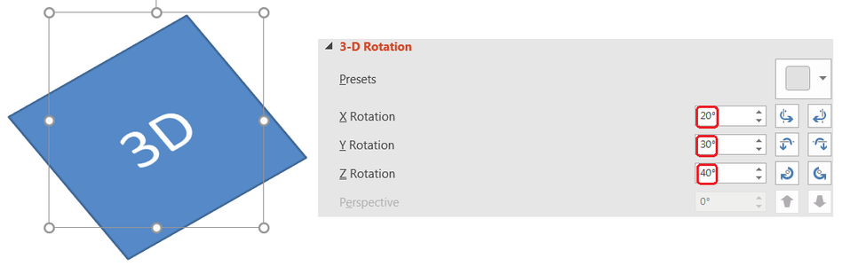

## **Översikt**

Aspose.Slides för Android via Java kan skapa, redigera, bevara och rendera PowerPoint‑liknande 3D‑formatering för former och text. Den här artikeln täcker 3D‑effekter såsom rotation, extrudering, avfasningar, belysning, material, gradient‑ eller bildfyllningar och 3D‑text.

{}
Denna artikel handlar om 3D‑formateringseffekter på PowerPoint‑former och text. Det handlar inte om att infoga eller redigera fristående 3D‑modelfiler. När du exporterar en bild till en bild, PDF eller HTML renderar Aspose.Slides dessa 3D‑effekter i den exporterade 2D‑utdata.
{}

## **3D‑formateringskoncept**

Använd metoden [IShape.getThreeDFormat](https://reference.aspose.com/slides/androidjava/com.aspose.slides/ishape/#getThreeDFormat--) för att applicera 3D‑formatering på en form. Metoden returnerar [IThreeDFormat](https://reference.aspose.com/slides/androidjava/com.aspose.slides/ithreedformat/), som styr 3D‑scenen för den formen.

För text, använd metoden [ITextFrameFormat.getThreeDFormat](https://reference.aspose.com/slides/androidjava/com.aspose.slides/itextframeformat/#getThreeDFormat--) . Detta applicerar 3D‑formatering på textramen istället för på formens kropp.

De viktigaste API‑medlemmarna är:

| API‑medlem | Vad den styr | När den ska användas |
|---|---|---|
| [getCamera](https://reference.aspose.com/slides/androidjava/com.aspose.slides/ithreedformat/#getCamera--) | Vypunkt, förinställd kameratyp, rotation, zoom och perspektiv. | Rotera objektet i 3D‑utrymme eller matcha en PowerPoint‑3D‑rotationsförinställning. |
| [getLightRig](https://reference.aspose.com/slides/androidjava/com.aspose.slides/ithreedformat/#getLightRig--) | Ljusförinställning, riktning och ljusrotation. | Ändra hur högdagrar och skuggor visas på 3D‑ytan. |
| [getMaterial](https://reference.aspose.com/slides/androidjava/com.aspose.slides/ithreedformat/#getMaterial--) och [setMaterial](https://reference.aspose.com/slides/androidjava/com.aspose.slides/ithreedformat/#setMaterial-int-) | Ytmaterial, såsom platt, matt, plast eller metall. | Få samma geometri att se plattare, mjukare, glansigare eller metallisk ut. |
| [getExtrusionHeight](https://reference.aspose.com/slides/androidjava/com.aspose.slides/ithreedformat/#getExtrusionHeight--) och [setExtrusionHeight](https://reference.aspose.com/slides/androidjava/com.aspose.slides/ithreedformat/#setExtrusionHeight-double-) | Hur långt formen sträcker sig bakåt från dess främre yta. | Omvandla en platt form till ett tydligt tjockt 3D‑objekt. |
| [getExtrusionColor](https://reference.aspose.com/slides/androidjava/com.aspose.slides/ithreedformat/#getExtrusionColor--) | Färg på de extruderade sidorna. | Gör djupet synligt eller samordna sidofärgen med den främre fyllningen. |
| [getDepth](https://reference.aspose.com/slides/androidjava/com.aspose.slides/ithreedformat/#getDepth--) och [setDepth](https://reference.aspose.com/slides/androidjava/com.aspose.slides/ithreedformat/#setDepth-double-) | Ytterligare 3D‑djup som används av PowerPoint‑3D‑formatering. | Finjustera djupet för former eller text, särskilt i kombination med avfasnings‑ och materialinställningar. |
| [getBevelTop](https://reference.aspose.com/slides/androidjava/com.aspose.slides/ithreedformat/#getBevelTop--) och [getBevelBottom](https://reference.aspose.com/slides/androidjava/com.aspose.slides/ithreedformat/#getBevelBottom--) | Upphöjda eller avrundade kanter på fram- och baksidorna. | Lägg till en mjukad eller formad kant istället för en skarp platt yta. |
| [getContourColor](https://reference.aspose.com/slides/androidjava/com.aspose.slides/ithreedformat/#getContourColor--) och [getContourWidth](https://reference.aspose.com/slides/androidjava/com.aspose.slides/ithreedformat/#getContourWidth--) och [setContourWidth](https://reference.aspose.com/slides/androidjava/com.aspose.slides/ithreedformat/#setContourWidth-double-) | Kontur runt 3D‑objektet. | Betona objektets gräns i den renderade utskriften. |

## **Skapa en 3D‑form**

En form brukar behöva fyra typer av inställningar innan den ser övertygande 3D‑ut på:

- Kamerainställningar, eftersom standardframsidan kan dölja extruderingen.
- Ljuseinställningar, eftersom belysning gör ytorna och sidorna läsbara.
- Materialinställningar, eftersom ytan påverkar hur ljuset renderas.
- Extruderings‑ eller djupinställningar, eftersom en platt form behöver tjocklek.

Följande exempel skapar en rektangel, lägger till text på dess framsida och applicerar 3D‑formatering. Kamerarotationsvärdena är i grader och extruderingshöjden är 100 punkter. Exemplet renderar bilden till en PNG‑fil med dubbla standarddimensioner och sparar presentationen som PPTX.

```java
import com.aspose.slides.*;
import android.graphics.Color;

final float imageScale = 2;

Presentation presentation = new Presentation();
try {
    ISlide slide = presentation.getSlides().get_Item(0);

    IAutoShape shape = slide.getShapes().addAutoShape(ShapeType.Rectangle, 200, 150, 200, 200);

    shape.getTextFrame().setText("3D");
    shape.getTextFrame().getParagraphs().get_Item(0).getParagraphFormat().getDefaultPortionFormat().setFontHeight(64);

    shape.getFillFormat().setFillType(FillType.Solid);
    shape.getFillFormat().getSolidFillColor().setColor(Color.rgb(100, 149, 237));

    shape.getThreeDFormat().getCamera().setCameraType(CameraPresetType.OrthographicFront);
    shape.getThreeDFormat().getCamera().setRotation(20, 30, 40);
    shape.getThreeDFormat().getLightRig().setLightType(LightRigPresetType.Flat);
    shape.getThreeDFormat().getLightRig().setDirection(LightingDirection.Top);
    shape.getThreeDFormat().setMaterial(MaterialPresetType.Flat);
    shape.getThreeDFormat().setExtrusionHeight(100);
    shape.getThreeDFormat().getExtrusionColor().setColor(Color.BLUE);

    IImage thumbnail = slide.getImage(imageScale, imageScale);
    try {
        thumbnail.save("shape_3d.png", ImageFormat.Png);
    } finally {
        thumbnail.dispose();
    }

    presentation.save("shape_3d.pptx", SaveFormat.Pptx);
} finally {
    presentation.dispose();
}
```

Den renderade bildfilen visar rektangeln som ett tjockt 3D‑block:


## **Rotera en form med kameran**

I PowerPoint konfigureras 3D‑rotation i panelen 3‑D‑Rotation. X‑, Y‑ och Z‑rotationsvärdena motsvarar den rotation du anger via kamera‑API‑et.



I Aspose.Slides får du åtkomst till kameran via [IThreeDFormat.getCamera](https://reference.aspose.com/slides/androidjava/com.aspose.slides/ithreedformat/#getCamera--). Detta exempel skapar en rektangel, väljer en ortografisk frontvy och sätter X‑, Y‑ och Z‑rotationerna till 20, 30 respektive 40 grader. Det konfigurerar formen i minnet utan att spara en fil:

```java
import com.aspose.slides.*;

Presentation presentation = new Presentation();
try {
    ISlide slide = presentation.getSlides().get_Item(0);

    IAutoShape shape = slide.getShapes().addAutoShape(ShapeType.Rectangle, 200, 150, 200, 200);

    shape.getThreeDFormat().getCamera().setCameraType(CameraPresetType.OrthographicFront);
    shape.getThreeDFormat().getCamera().setRotation(20, 30, 40);
} finally {
    presentation.dispose();
}
```

Använd kameran när du behöver ändra hur betraktaren ser objektet. Det ändrar inte 2D‑geometrin på bilden. Det ändrar den 3D‑vyn som PowerPoint och Aspose.Slides använder vid rendering.

### **Kopiera kameraorientering från en mallform**

För att matcha orienteringen på en mallform, läs dess kameraförinställning med [getCameraType](https://reference.aspose.com/slides/androidjava/com.aspose.slides/icamera/#getCameraType--) och dess rotationsvinklar med [getRotation](https://reference.aspose.com/slides/androidjava/com.aspose.slides/icamera/#getRotation--). Exemplet öppnar `template.pptx` och kopierar kameraorienteringen från den första formen på den första bilden till den andra formen. Båda formerna har redan 3D‑belysning, och den andra formen har ingen explicit kamera‑rotation.

Vinklarna är i grader. Index `0` är latitud, index `1` är longitud och index `2` är revolution. Skicka dem till [setRotation](https://reference.aspose.com/slides/androidjava/com.aspose.slides/icamera/#setRotation-float-float-float-) i den ordningen. Om källan returnerar `null` har den ingen explicit rotation, så lämna den andra formens vinklar odefinierade. En explicit rotation av `(0, 0, 0)` returnerar tre nollor och bör kopieras.

```java
import com.aspose.slides.*;

Presentation presentation = new Presentation("template.pptx");
try {
    IShapeCollection shapes = presentation.getSlides().get_Item(0).getShapes();

    ICamera sourceCamera = shapes.get_Item(0).getThreeDFormat().getCamera();
    ICamera destinationCamera = shapes.get_Item(1).getThreeDFormat().getCamera();

    destinationCamera.setCameraType(sourceCamera.getCameraType());
    float[] angles = sourceCamera.getRotation();
    if (angles != null) {
        destinationCamera.setRotation(angles[0], angles[1], angles[2]);
    }

    presentation.save("camera-copy.pptx", SaveFormat.Pptx);
} finally {
    presentation.dispose();
}
```

När du öppnar `camera-copy.pptx` i PowerPoint har pilen till höger samma kamera‑förinställning och rotation som rektangeln till vänster. Båda formerna använder samma belysning och extruderingsdjup.


## **Lägg till extrudering och djup**

Extrudering får en form att se tjock ut genom att den sträcker sig bakom framsidan. I PowerPoint styr djupkontrollen den synliga tjockleken och färgkontrollen färgen på sidoytorna.


Använd [IThreeDFormat.setExtrusionHeight](https://reference.aspose.com/slides/androidjava/com.aspose.slides/ithreedformat/#setExtrusionHeight-double-) för att ange tjockleken och [IThreeDFormat.getExtrusionColor](https://reference.aspose.com/slides/androidjava/com.aspose.slides/ithreedformat/#getExtrusionColor--) för att hämta sidofärgen. Detta exempel ger en rektangel en extrudering på 100 punkter med lila sidor och roterar kameran för att visa tjockleken. Det konfigurerar formen i minnet utan att spara en fil:

```java
import com.aspose.slides.*;
import android.graphics.Color;

Presentation presentation = new Presentation();
try {
    ISlide slide = presentation.getSlides().get_Item(0);

    IAutoShape shape = slide.getShapes().addAutoShape(ShapeType.Rectangle, 200, 150, 200, 200);

    int extrusionColor = Color.rgb(128, 0, 128);

    shape.getThreeDFormat().getCamera().setCameraType(CameraPresetType.OrthographicFront);
    shape.getThreeDFormat().getCamera().setRotation(20, 30, 40);
    shape.getThreeDFormat().getLightRig().setLightType(LightRigPresetType.Flat);
    shape.getThreeDFormat().getLightRig().setDirection(LightingDirection.Top);
    shape.getThreeDFormat().setMaterial(MaterialPresetType.Flat);
    shape.getThreeDFormat().setExtrusionHeight(100);
    shape.getThreeDFormat().getExtrusionColor().setColor(extrusionColor);
} finally {
    presentation.dispose();
}
```

Metoden [IThreeDFormat.setDepth](https://reference.aspose.com/slides/androidjava/com.aspose.slides/ithreedformat/#setDepth-double-) sätter djupet för en 3D‑form. Metoden [setExtrusionHeight](https://reference.aspose.com/slides/androidjava/com.aspose.slides/ithreedformat/#setExtrusionHeight-double-) styr höjden på extruderings‑effekten, som visas i detta exempel.

## **Använd gradient‑ eller bildfyllningar med 3D‑effekter**

3D‑formatering är oberoende av formens fyllning. Du kan applicera en solid färg, en gradient, ett mönster eller en bildfyllning på framsidan och ändå använda samma kamera, ljus, material och extruderingsinställningar.

Detta exempel applicerar en blå‑till‑orange gradient på framsidan och en mörkorange färg på den 150‑punkts extruderingen. Gradientstopp vid 0 och 100 markerar början respektive slutet av gradienten. Kamerarotationsvärdena är i grader. Bilden renderas till en PNG‑fil med dubbla standarddimensioner:

```java
import com.aspose.slides.*;
import android.graphics.Color;

final float imageScale = 2;

Presentation presentation = new Presentation();
try {
    ISlide slide = presentation.getSlides().get_Item(0);

    IAutoShape shape = slide.getShapes().addAutoShape(ShapeType.Rectangle, 200, 150, 250, 250);

    shape.getTextFrame().setText("3D Gradient");
    shape.getTextFrame().getParagraphs().get_Item(0).getParagraphFormat().getDefaultPortionFormat().setFontHeight(64);

    shape.getFillFormat().setFillType(FillType.Gradient);
    shape.getFillFormat().getGradientFormat().getGradientStops().add(0, Color.BLUE);
    shape.getFillFormat().getGradientFormat().getGradientStops().add(100, Color.rgb(255, 165, 0));

    shape.getThreeDFormat().getCamera().setCameraType(CameraPresetType.OrthographicFront);
    shape.getThreeDFormat().getCamera().setRotation(10, 20, 30);
    shape.getThreeDFormat().getLightRig().setLightType(LightRigPresetType.Flat);
    shape.getThreeDFormat().getLightRig().setDirection(LightingDirection.Top);
    shape.getThreeDFormat().setMaterial(MaterialPresetType.Flat);
    int extrusionColor = Color.rgb(255, 140, 0);
    shape.getThreeDFormat().setExtrusionHeight(150);
    shape.getThreeDFormat().getExtrusionColor().setColor(extrusionColor);

    IImage thumbnail = slide.getImage(imageScale, imageScale);
    try {
        thumbnail.save("gradient_3d.png", ImageFormat.Png);
    } finally {
        thumbnail.dispose();
    }
} finally {
    presentation.dispose();
}
```

Den renderade utskriften behåller gradienten på framsidan och renderar extruderingen separat:


För att i stället använda en bildfyllning, lägg till bilden i presentationen och tilldela den som formens fyllning. Detta exempel kräver en befintlig fil med namnet `image.jpg` i arbetskatalogen. Det sträcker bilden så att den fyller rektangeln, applicerar en extrudering på 150 punkter och sätter kamerarotation i grader. Det konfigurerar formen i minnet utan att spara eller rendera en fil:

```java
import com.aspose.slides.*;
import android.graphics.Color;
import java.io.FileInputStream;

Presentation presentation = new Presentation();
try {
    ISlide slide = presentation.getSlides().get_Item(0);

    IAutoShape shape = slide.getShapes().addAutoShape(ShapeType.Rectangle, 200, 150, 250, 250);

    IPPImage image;
    try (FileInputStream imageStream = new FileInputStream("image.jpg")) {
        image = presentation.getImages().addImage(imageStream);
    }

    shape.getFillFormat().setFillType(FillType.Picture);
    shape.getFillFormat().getPictureFillFormat().getPicture().setImage(image);
    shape.getFillFormat().getPictureFillFormat().setPictureFillMode(PictureFillMode.Stretch);

    int extrusionColor = Color.rgb(255, 140, 0);
    shape.getThreeDFormat().getCamera().setCameraType(CameraPresetType.OrthographicFront);
    shape.getThreeDFormat().getCamera().setRotation(10, 20, 30);
    shape.getThreeDFormat().getLightRig().setLightType(LightRigPresetType.Flat);
    shape.getThreeDFormat().getLightRig().setDirection(LightingDirection.Top);
    shape.getThreeDFormat().setMaterial(MaterialPresetType.Flat);
    shape.getThreeDFormat().setExtrusionHeight(150);
    shape.getThreeDFormat().getExtrusionColor().setColor(extrusionColor);
} finally {
    presentation.dispose();
}
```

Bilden renderas på framsidan, medan extruderingen renderas som 3D‑sidoyta:


## **Applicera 3D‑formatering på text**

Formens 3D‑formatering påverkar formens kropp. Textens 3D‑formatering påverkar textramen. Detta är användbart för WordArt‑liknande effekter där bokstäverna själva behöver extrudering, material, belysning och kamerainställningar.

Följande exempel skapar text med ett orange‑och‑vitt rutnätsmönster, applicerar en uppåtböjd båge och konfigurerar 3D‑inställningarna via [ITextFrameFormat.getThreeDFormat](https://reference.aspose.com/slides/androidjava/com.aspose.slides/itextframeformat/#getThreeDFormat--). Extruderingshöjden och djupet är i punkter och ljusrotationen i grader. Formens fyllning och kontur är dolda så att bara texten syns. Exemplet renderar en PNG‑bild med dubbla standarddimensioner och sparar presentationen som PPTX:

```java
import com.aspose.slides.*;
import android.graphics.Color;

final float imageScale = 2;

Presentation presentation = new Presentation();
try {
    ISlide slide = presentation.getSlides().get_Item(0);

    IAutoShape shape = slide.getShapes().addAutoShape(ShapeType.Rectangle, 200, 150, 250, 250);

    shape.getFillFormat().setFillType(FillType.NoFill);
    shape.getLineFormat().getFillFormat().setFillType(FillType.NoFill);
    shape.getTextFrame().setText("3D Text");

    IPortion portion = shape.getTextFrame().getParagraphs().get_Item(0).getPortions().get_Item(0);
    portion.getPortionFormat().getFillFormat().setFillType(FillType.Pattern);
    int patternColor = Color.rgb(255, 140, 0);
    portion.getPortionFormat().getFillFormat().getPatternFormat().getForeColor().setColor(patternColor);
    portion.getPortionFormat().getFillFormat().getPatternFormat().getBackColor().setColor(Color.WHITE);
    portion.getPortionFormat().getFillFormat().getPatternFormat().setPatternStyle(PatternStyle.LargeGrid);

    shape.getTextFrame().getParagraphs().get_Item(0).getParagraphFormat().getDefaultPortionFormat().setFontHeight(128);

    ITextFrameFormat textFrameFormat = shape.getTextFrame().getTextFrameFormat();
    textFrameFormat.setTransform(TextShapeType.ArchUp);
    textFrameFormat.getThreeDFormat().setExtrusionHeight(3.5f);
    textFrameFormat.getThreeDFormat().setDepth(3);
    textFrameFormat.getThreeDFormat().setMaterial(MaterialPresetType.Plastic);
    textFrameFormat.getThreeDFormat().getLightRig().setDirection(LightingDirection.Top);
    textFrameFormat.getThreeDFormat().getLightRig().setLightType(LightRigPresetType.Balanced);
    textFrameFormat.getThreeDFormat().getLightRig().setRotation(0, 0, 40);
    textFrameFormat.getThreeDFormat().getCamera().setCameraType(CameraPresetType.PerspectiveContrastingRightFacing);

    IImage thumbnail = slide.getImage(imageScale, imageScale);
    try {
        thumbnail.save("text_3d.png", ImageFormat.Png);
    } finally {
        thumbnail.dispose();
    }

    presentation.save("text_3d.pptx", SaveFormat.Pptx);
} finally {
    presentation.dispose();
}
```


## **Behåll texten platt på en 3D‑form**

För att hålla texten läsbar samtidigt som du behåller en 3D‑utseende på formen, anropa [ITextFrameFormat.setKeepTextFlat](https://reference.aspose.com/slides/androidjava/com.aspose.slides/itextframeformat/#setKeepTextFlat-boolean-) via [ITextFrame.getTextFrameFormat](https://reference.aspose.com/slides/androidjava/com.aspose.slides/itextframe/#getTextFrameFormat--). När värdet är `true` behåller texten sig utanför 3D‑scenen. När det är `false` deltar texten i scenen och följer dess 3D‑orientering.

Denna inställning tar inte bort formens 3D‑formatering: dess kamera, belysning, material och extrudering förblir konfigurerade via [IShape.getThreeDFormat](https://reference.aspose.com/slides/androidjava/com.aspose.slides/ishape/#getThreeDFormat--). Den skiljer sig också från vanlig rotation. [IShape.setRotation](https://reference.aspose.com/slides/androidjava/com.aspose.slides/ishape/#setRotation-float-) roterar formen i bildens plan, medan [ITextFrameFormat.setRotationAngle](https://reference.aspose.com/slides/androidjava/com.aspose.slides/itextframeformat/#setRotationAngle-float-) styr textens anpassade rotation inom dess begränsningsram. Att hålla texten utanför 3D‑scenen återställer inte någon av dessa vinklar.

Följande självständiga exempel skapar en blå rektangel med text och klonar den bredvid originalet. Båda formerna har samma 3D‑formatering; endast textinställningen skiljer sig: `false` till vänster och `true` till höger. Kameravinklarna är i grader och extruderingshöjden är 40 punkter. Exemplet sparar presentationen som PPTX och renderar jämförelsesbilden till PNG med dubbla standarddimensioner.

```java
import com.aspose.slides.*;
import android.graphics.Color;

Presentation presentation = new Presentation();
try {
    ISlide slide = presentation.getSlides().get_Item(0);

    IAutoShape shape = slide.getShapes().addAutoShape(ShapeType.Rectangle, 70, 160, 240, 140);

    shape.getTextFrame().setText("Readable text");
    shape.getTextFrame().getParagraphs().get_Item(0).getParagraphFormat().getDefaultPortionFormat().setFontHeight(28);
    shape.getTextFrame().getParagraphs().get_Item(0).getParagraphFormat().setAlignment(TextAlignment.Center);
    shape.getTextFrame().getTextFrameFormat().setAnchoringType(TextAnchorType.Center);
    shape.getFillFormat().setFillType(FillType.Solid);
    shape.getFillFormat().getSolidFillColor().setColor(Color.rgb(100, 149, 237));

    shape.getThreeDFormat().getCamera().setCameraType(CameraPresetType.OrthographicFront);
    shape.getThreeDFormat().getCamera().setRotation(30, 30, 0);
    shape.getThreeDFormat().getLightRig().setLightType(LightRigPresetType.Flat);
    shape.getThreeDFormat().getLightRig().setDirection(LightingDirection.Top);
    shape.getThreeDFormat().setMaterial(MaterialPresetType.Flat);
    shape.getThreeDFormat().setExtrusionHeight(40);
    shape.getThreeDFormat().getExtrusionColor().setColor(Color.rgb(65, 105, 225));
    shape.getTextFrame().getTextFrameFormat().setKeepTextFlat(false);

    IAutoShape flatTextShape = (IAutoShape) slide.getShapes().addClone(shape, 400, 160);
    flatTextShape.getTextFrame().getTextFrameFormat().setKeepTextFlat(true);

    presentation.save("keep_text_flat.pptx", SaveFormat.Pptx);
    IImage image = slide.getImage(2, 2);
    try {
        image.save("keep_text_flat.png", ImageFormat.Png);
    } finally {
        image.dispose();
    }
} finally {
    presentation.dispose();
}
```

Till vänster följer texten 3D‑orienteringen. Till höger förblir den platt och lättare att läsa. Båda rektanglarna behåller samma synliga extrudering och 3D‑orientering.


## **Export‑ och renderingsbeteende**

Aspose.Slides bevarar 3D‑formatering när du sparar till PowerPoint‑format som PPTX. När du renderar eller exporterar till format med fast layout rasteriseras 3D‑scenen eller ritas in i utdata som ett 2D‑resultat. Detta gäller när du renderar bilder till [PNG](/slides/sv/androidjava/convert-powerpoint-to-png/), exporterar till [PDF](/slides/sv/androidjava/convert-powerpoint-to-pdf/), exporterar till [HTML](/slides/sv/androidjava/convert-powerpoint-to-html/), eller genererar ramar för [video conversion](/slides/sv/androidjava/convert-powerpoint-to-video/).

- Exporterade bilder och PDF‑filer är inte interaktiva. Objektet kan inte roteras av betraktaren efter export.
- Det slutgiltiga utseendet beror på kombinationen av kamera, ljusrigg, material, extrudering, fyllning och bildskalning.
- Om du behöver inspektera ärvda eller temabaserade formateringsvärden, läs de [effective shape properties](/slides/sv/androidjava/shape-effective-properties/).
- Vissa exportformat kan inte lagra redigerbar PowerPoint‑3D‑formatering. I dessa format renderas det visuella resultatet istället för att bevaras som redigerbara 3D‑inställningar.

## **FAQ**

**Kan Aspose.Slides skapa interaktiva 3D‑presentationer?**

Aspose.Slides skapar och renderar PowerPoint‑3D‑effekter för former och text. Det gör inte exporterade bilder, PDF‑filer eller HTML‑sidor till interaktiva 3D‑scener som en betraktare kan rotera. I PPTX förblir 3D‑formateringen redigerbar i PowerPoint när formatet stödjer det.

**Vad är skillnaden mellan en 3D‑modell och en 3D‑effekt?**

En 3D‑modell är ett separat 3D‑objekt som infogas i en presentation. En 3D‑effekt är formatering som appliceras på en vanlig PowerPoint‑form eller text, såsom rotation, extrudering, avfasning, belysning och material. Denna artikel behandlar 3D‑effekter.

**Vilka inställningar krävs för en synlig 3D‑form?**

Minst en kamerarotation och antingen extrudering eller djup måste anges. I praktiken är det också vanligt att ange en ljusrigg och material så att de renderade ytorna får tydliga högdagrar och skuggor.

**Kan jag applicera 3D‑effekter på både former och text?**

Ja. Använd [IShape.getThreeDFormat](https://reference.aspose.com/slides/androidjava/com.aspose.slides/ishape/#getThreeDFormat--) för formens kropp och [ITextFrameFormat.getThreeDFormat](https://reference.aspose.com/slides/androidjava/com.aspose.slides/itextframeformat/#getThreeDFormat--) för text.

**Kommer 3D‑effekter att visas vid export till bilder, PDF, HTML eller videoram?**

Ja. Aspose.Slides renderar 3D‑effekter när du producerar bildfiler, PDF‑utdata, HTML‑utdata och ramar som används för videokonvertering. Den exporterade utdata innehåller det renderade utseendet, inte ett redigerbart 3D‑objekt.

**Kan jag läsa de slutgiltiga 3D‑värdena efter att arv och temainställningar har tillämpats?**

Ja. Använd de effektiva formaterings‑API:erna som beskrivs i [Shape Effective Properties](/slides/sv/androidjava/shape-effective-properties/) för att läsa slutgiltiga kamera‑, ljusrigg‑, avfasnings‑ och relaterade 3D‑värden.