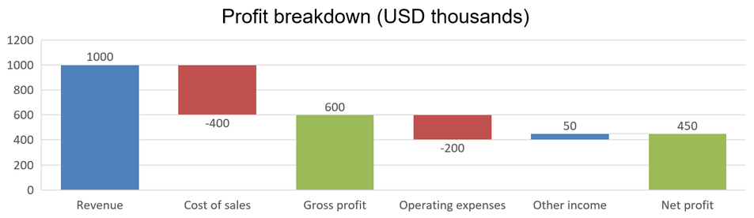
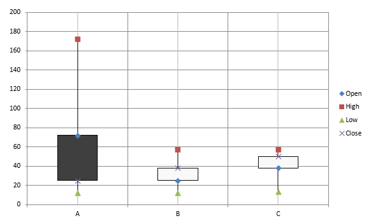

## **Översikt**

Den här artikeln ger en omfattande guide om hur du skapar och anpassar diagram med Aspose.Slides för Android via Java. Du kommer att lära dig hur du programatiskt lägger till ett diagram på en bild, fyller det med data och tillämpar olika formateringsalternativ för att matcha dina specifika designkrav. Genom hela artikeln illustrerar detaljerade kodexempel varje steg, från att initiera presentationen och diagramobjektet till att konfigurera serier, axlar och förklaringar. Genom att följa den här guiden får du en solid förståelse för hur du integrerar dynamisk diagramgenerering i dina Android-applikationer, vilket förenklar processen att skapa databaserade presentationer.

## **Skapa ett diagram**

Diagram hjälper människor att snabbt visualisera data och få insikter som kanske inte är omedelbart uppenbara från en tabell eller ett kalkylblad.

**Varför skapa diagram?**

* Sammanfatta, komprimera eller summera stora mängder data på en enda bild i en presentation;
* Avslöja mönster och trender i data;
* Dra slutsatser om datans riktning och momentum över tid eller i förhållande till en specifik mätenhet;
* Identifiera avvikande värden, avvikelser, fel och nonsensisk data;
* Kommunicera eller presentera komplex data.

I PowerPoint kan du skapa diagram via *Infoga*-funktionen, som erbjuder mallar för att designa många typer av diagram. Med Aspose.Slides kan du skapa både vanliga diagram (baserade på populära diagramtyper) och anpassade diagram.

{}
Använd [ChartType](https://reference.aspose.com/slides/androidjava/com.aspose.slides/charttype/) uppräkningen i paketet [com.aspose.slides](https://reference.aspose.com/slides/androidjava/com.aspose.slides/). Värdena i denna uppräkning motsvarar olika diagramtyper.
{}

### **Skapa grupperade kolumndiagram**

Detta exempel använder [addChart](https://reference.aspose.com/slides/androidjava/com.aspose.slides/ishapecollection/#addChart-int-float-float-float-float-) för att skapa ett grupperat kolumndiagram som jämför två serier över tre kategorier. Serierna använder röd och grön fyllning, och enskilda etiketter visar kategorinamn, serienamn och värden. Arbetsbladindex 0 refererar till det första bladet i den inbäddade diagramarbetsboken.

```java
import com.aspose.slides.*;
import android.graphics.Color;

Presentation presentation = new Presentation();
try
{
    ISlide slide = presentation.getSlides().get_Item(0);

    IChart chart = slide.getShapes().addChart(ChartType.ClusteredColumn, 20, 20, 500, 300);

    chart.getChartTitle().addTextFrameForOverriding("Sample Title");
    chart.getChartTitle().getTextFrameForOverriding().getTextFrameFormat().setCenterText(NullableBool.True);
    chart.getChartTitle().setHeight(20);
    chart.setTitle(true);

    IChartDataWorkbook workbook = chart.getChartData().getChartDataWorkbook();
    int worksheetIndex = 0;

    chart.getChartData().getSeries().clear();
    chart.getChartData().getCategories().clear();

    IChartDataCell seriesNameCell = workbook.getCell(worksheetIndex, 0, 1, "Series 1");
    chart.getChartData().getSeries().add(seriesNameCell, chart.getType());
    seriesNameCell = workbook.getCell(worksheetIndex, 0, 2, "Series 2");
    chart.getChartData().getSeries().add(seriesNameCell, chart.getType());

    IChartDataCell categoryCell = workbook.getCell(worksheetIndex, 1, 0, "Category 1");
    chart.getChartData().getCategories().add(categoryCell);
    categoryCell = workbook.getCell(worksheetIndex, 2, 0, "Category 2");
    chart.getChartData().getCategories().add(categoryCell);
    categoryCell = workbook.getCell(worksheetIndex, 3, 0, "Category 3");
    chart.getChartData().getCategories().add(categoryCell);

    IChartSeries series = chart.getChartData().getSeries().get_Item(0);

    IChartDataCell valueCell = workbook.getCell(worksheetIndex, 1, 1, 20);
    series.getDataPoints().addDataPointForBarSeries(valueCell);
    valueCell = workbook.getCell(worksheetIndex, 2, 1, 50);
    series.getDataPoints().addDataPointForBarSeries(valueCell);
    valueCell = workbook.getCell(worksheetIndex, 3, 1, 30);
    series.getDataPoints().addDataPointForBarSeries(valueCell);

    series.getFormat().getFill().setFillType(FillType.Solid);
    series.getFormat().getFill().getSolidFillColor().setColor(Color.RED);

    series = chart.getChartData().getSeries().get_Item(1);

    valueCell = workbook.getCell(worksheetIndex, 1, 2, 30);
    series.getDataPoints().addDataPointForBarSeries(valueCell);
    valueCell = workbook.getCell(worksheetIndex, 2, 2, 10);
    series.getDataPoints().addDataPointForBarSeries(valueCell);
    valueCell = workbook.getCell(worksheetIndex, 3, 2, 60);
    series.getDataPoints().addDataPointForBarSeries(valueCell);

    series.getFormat().getFill().setFillType(FillType.Solid);
    series.getFormat().getFill().getSolidFillColor().setColor(Color.rgb(0, 128, 0));

    IDataLabel label = series.getDataPoints().get_Item(0).getLabel();
    label.getDataLabelFormat().setShowCategoryName(true);

    label = series.getDataPoints().get_Item(1).getLabel();
    label.getDataLabelFormat().setShowSeriesName(true);

    label = series.getDataPoints().get_Item(2).getLabel();
    label.getDataLabelFormat().setShowValue(true);
    label.getDataLabelFormat().setShowSeriesName(true);
    label.getDataLabelFormat().setSeparator("/");

    presentation.save("AsposeChart.pptx", SaveFormat.Pptx);
}
finally
{
    presentation.dispose();
}
```

Resultatet:


### **Skapa spridningsdiagram**

Spridningsdiagram (även kända som spridningsplott eller x-y-diagram) används ofta för att kontrollera mönster eller demonstrera korrelationer mellan två variabler.

Använd ett spridningsdiagram när:

* Du har parade numeriska data.
* Du har två variabler som passar bra ihop.
* Du vill avgöra om de två variablerna är relaterade.
* Du har en oberoende variabel som har flera värden för en beroende variabel.

Detta exempel plottar två uppsättningar av x‑y‑värden. Den första serien använder raka linjer med stjärnmarkörer, medan den andra använder jämna linjer med cirkelmarkörer; båda använder en markörstorlek på 10, konfigurerad med [setSize](https://reference.aspose.com/slides/androidjava/com.aspose.slides/imarker/#setSize-int-). Metoden [setSymbol](https://reference.aspose.com/slides/androidjava/com.aspose.slides/imarker/#setSymbol-int-) styr markörformen.

```java
import com.aspose.slides.*;

Presentation presentation = new Presentation();
try
{
    ISlide slide = presentation.getSlides().get_Item(0);

    IChart chart = slide.getShapes().addChart(ChartType.ScatterWithSmoothLines, 20, 20, 500, 300);

    IChartDataWorkbook workbook = chart.getChartData().getChartDataWorkbook();
    int worksheetIndex = 0;

    chart.getChartData().getSeries().clear();

    IChartDataCell seriesNameCell = workbook.getCell(worksheetIndex, 1, 1, "Series 1");
    chart.getChartData().getSeries().add(seriesNameCell, chart.getType());
    seriesNameCell = workbook.getCell(worksheetIndex, 1, 3, "Series 2");
    chart.getChartData().getSeries().add(seriesNameCell, chart.getType());

    IChartSeries series = chart.getChartData().getSeries().get_Item(0);

    IChartDataCell xValueCell = workbook.getCell(worksheetIndex, 2, 1, 1);
    IChartDataCell yValueCell = workbook.getCell(worksheetIndex, 2, 2, 3);
    series.getDataPoints().addDataPointForScatterSeries(xValueCell, yValueCell);

    xValueCell = workbook.getCell(worksheetIndex, 3, 1, 2);
    yValueCell = workbook.getCell(worksheetIndex, 3, 2, 10);
    series.getDataPoints().addDataPointForScatterSeries(xValueCell, yValueCell);

    series.setType(ChartType.ScatterWithStraightLinesAndMarkers);

    series.getMarker().setSize(10);
    series.getMarker().setSymbol(MarkerStyleType.Star);

    series = chart.getChartData().getSeries().get_Item(1);

    xValueCell = workbook.getCell(worksheetIndex, 2, 3, 5);
    yValueCell = workbook.getCell(worksheetIndex, 2, 4, 2);
    series.getDataPoints().addDataPointForScatterSeries(xValueCell, yValueCell);

    xValueCell = workbook.getCell(worksheetIndex, 3, 3, 3);
    yValueCell = workbook.getCell(worksheetIndex, 3, 4, 1);
    series.getDataPoints().addDataPointForScatterSeries(xValueCell, yValueCell);

    xValueCell = workbook.getCell(worksheetIndex, 4, 3, 2);
    yValueCell = workbook.getCell(worksheetIndex, 4, 4, 2);
    series.getDataPoints().addDataPointForScatterSeries(xValueCell, yValueCell);

    xValueCell = workbook.getCell(worksheetIndex, 5, 3, 5);
    yValueCell = workbook.getCell(worksheetIndex, 5, 4, 1);
    series.getDataPoints().addDataPointForScatterSeries(xValueCell, yValueCell);

    series.getMarker().setSize(10);
    series.getMarker().setSymbol(MarkerStyleType.Circle);

    presentation.save("AsposeChart.pptx", SaveFormat.Pptx);
}
finally
{
    presentation.dispose();
}
```

Resultatet:


### **Skapa cirkeldiagram**

Cirkeldiagram är bäst lämpade för att visa del‑till‑hel‑förhållandet i data, särskilt när data innehåller kategoriska etiketter med numeriska värden. Om dina data innehåller många delar eller etiketter kan du dock överväga att använda ett stapeldiagram istället.

Detta exempel skapar ett cirkeldiagram med tre kvartalsvärden. Varje segment har en anpassad fyllning och kant, och etiketterna visar olika kombinationer av värden, procent och serieinformation. Metoden [setFirstSliceAngle](https://reference.aspose.com/slides/androidjava/com.aspose.slides/ichartseriesgroup/#setFirstSliceAngle-int-) sätter den första biten att starta vid 180 grader.

```java
import com.aspose.slides.*;
import android.graphics.Color;

Presentation presentation = new Presentation();
try
{
    ISlide slide = presentation.getSlides().get_Item(0);

    IChart chart = slide.getShapes().addChart(ChartType.Pie, 20, 20, 500, 300);

    chart.getChartTitle().addTextFrameForOverriding("Sample Title");
    chart.getChartTitle().getTextFrameForOverriding().getTextFrameFormat().setCenterText(NullableBool.True);
    chart.getChartTitle().setHeight(20);
    chart.setTitle(true);

    chart.getChartData().getSeries().get_Item(0).getLabels().getDefaultDataLabelFormat().setShowValue(true);

    IChartDataWorkbook workbook = chart.getChartData().getChartDataWorkbook();
    int worksheetIndex = 0;

    chart.getChartData().getSeries().clear();
    chart.getChartData().getCategories().clear();

    IChartDataCell categoryCell = workbook.getCell(0, 1, 0, "1st Qtr");
    chart.getChartData().getCategories().add(categoryCell);
    categoryCell = workbook.getCell(0, 2, 0, "2nd Qtr");
    chart.getChartData().getCategories().add(categoryCell);
    categoryCell = workbook.getCell(0, 3, 0, "3rd Qtr");
    chart.getChartData().getCategories().add(categoryCell);

    IChartDataCell seriesNameCell = workbook.getCell(0, 0, 1, "Series 1");
    IChartSeries series = chart.getChartData().getSeries().add(seriesNameCell, chart.getType());

    IChartDataCell valueCell = workbook.getCell(worksheetIndex, 1, 1, 20);
    series.getDataPoints().addDataPointForPieSeries(valueCell);
    valueCell = workbook.getCell(worksheetIndex, 2, 1, 50);
    series.getDataPoints().addDataPointForPieSeries(valueCell);
    valueCell = workbook.getCell(worksheetIndex, 3, 1, 30);
    series.getDataPoints().addDataPointForPieSeries(valueCell);

    chart.getChartData().getSeriesGroups().get_Item(0).setColorVaried(true);

    IChartDataPoint firstSlice = series.getDataPoints().get_Item(0);
    firstSlice.getFormat().getFill().setFillType(FillType.Solid);
    firstSlice.getFormat().getFill().getSolidFillColor().setColor(Color.CYAN);

    firstSlice.getFormat().getLine().getFillFormat().setFillType(FillType.Solid);
    firstSlice.getFormat().getLine().getFillFormat().getSolidFillColor().setColor(Color.rgb(128, 128, 128));
    firstSlice.getFormat().getLine().setWidth(3.0);
    firstSlice.getFormat().getLine().setStyle(LineStyle.ThinThick);
    firstSlice.getFormat().getLine().setDashStyle(LineDashStyle.LargeDash);

    IChartDataPoint secondSlice = series.getDataPoints().get_Item(1);
    secondSlice.getFormat().getFill().setFillType(FillType.Solid);
    secondSlice.getFormat().getFill().getSolidFillColor().setColor(Color.rgb(165, 42, 42));

    secondSlice.getFormat().getLine().getFillFormat().setFillType(FillType.Solid);
    secondSlice.getFormat().getLine().getFillFormat().getSolidFillColor().setColor(Color.BLUE);
    secondSlice.getFormat().getLine().setWidth(3.0);
    secondSlice.getFormat().getLine().setStyle(LineStyle.Single);
    secondSlice.getFormat().getLine().setDashStyle(LineDashStyle.LargeDashDot);

    IChartDataPoint thirdSlice = series.getDataPoints().get_Item(2);
    thirdSlice.getFormat().getFill().setFillType(FillType.Solid);
    thirdSlice.getFormat().getFill().getSolidFillColor().setColor(Color.rgb(255, 127, 80));

    thirdSlice.getFormat().getLine().getFillFormat().setFillType(FillType.Solid);
    thirdSlice.getFormat().getLine().getFillFormat().getSolidFillColor().setColor(Color.RED);
    thirdSlice.getFormat().getLine().setWidth(2.0);
    thirdSlice.getFormat().getLine().setStyle(LineStyle.ThinThin);
    thirdSlice.getFormat().getLine().setDashStyle(LineDashStyle.LargeDashDotDot);

    IDataLabel firstLabel = series.getDataPoints().get_Item(0).getLabel();
    firstLabel.getDataLabelFormat().setShowValue(true);

    IDataLabel secondLabel = series.getDataPoints().get_Item(1).getLabel();
    secondLabel.getDataLabelFormat().setShowValue(true);
    secondLabel.getDataLabelFormat().setShowLegendKey(true);
    secondLabel.getDataLabelFormat().setShowPercentage(true);

    IDataLabel thirdLabel = series.getDataPoints().get_Item(2).getLabel();
    thirdLabel.getDataLabelFormat().setShowSeriesName(true);
    thirdLabel.getDataLabelFormat().setShowPercentage(true);

    series.getLabels().getDefaultDataLabelFormat().setShowLeaderLines(true);

    chart.getChartData().getSeriesGroups().get_Item(0).setFirstSliceAngle(180);

    presentation.save("PieChart.pptx", SaveFormat.Pptx);
}
finally
{
    presentation.dispose();
}
```

Resultatet:


För att förbättra läsbarheten för etiketter utanför cirkeln, se [Formatera ledarlinjer](/slides/sv/androidjava/chart-data-label/#format-leader-lines) för ett exempel som positionerar etiketter och anpassar linjernas färg, bredd, transparens och streckstil.

### **Skapa linjediagram**

Linjediagram (även kända som linjegrafer) är bäst lämpade i situationer där du vill demonstrera förändringar i värde över tid. Med ett linjediagram kan du jämföra en stor mängd data på en gång, spåra förändringar och trender över tid, markera anomalier i dataserier, och mer.

Detta exempel använder [addChart](https://reference.aspose.com/slides/androidjava/com.aspose.slides/ishapecollection/#addChart-int-float-float-float-float-) för att skapa ett linjediagram med standardserier och -kategorier, och sparar sedan presentationen som PPTX.

```java
import com.aspose.slides.*;

Presentation presentation = new Presentation();
try
{
    ISlide slide = presentation.getSlides().get_Item(0);

    IChart lineChart = slide.getShapes().addChart(ChartType.Line, 20, 20, 500, 300);

    presentation.save("lineChart.pptx", SaveFormat.Pptx);
}
finally
{
    presentation.dispose();
}
```

Som standard är punkterna i ett linjediagram förenade med raka kontinuerliga linjer. Om du vill att punkterna ska förenas med streck istället, anropa [setDashStyle](https://reference.aspose.com/slides/androidjava/com.aspose.slides/ilineformat/#setDashStyle-byte-) med ett värde från [LineDashStyle](https://reference.aspose.com/slides/androidjava/com.aspose.slides/linedashstyle/):

```java
import com.aspose.slides.*;

Presentation presentation = new Presentation();
try
{
    ISlide slide = presentation.getSlides().get_Item(0);

    IChart lineChart = slide.getShapes().addChart(ChartType.Line, 20, 20, 500, 300);

    for (IChartSeries series : lineChart.getChartData().getSeries())
    {
        series.getFormat().getLine().setDashStyle(LineDashStyle.Dash);
    }
}
finally
{
    presentation.dispose();
}
```

Resultatet:


### **Skapa trädkartediagram**

Trädkartediagram är bäst lämpade för försäljningsdata när du vill visa den relativa storleken på datakategorier och snabbt rikta uppmärksamhet mot objekt som är stora bidragsgivare inom varje kategori.

Detta exempel skapar en trädkarta med åtta blad grupperade i fyra stammar och två grenar. Metoden [setGroupingItem](https://reference.aspose.com/slides/androidjava/com.aspose.slides/ichartcategorylevelsmanager/#setGroupingItem-int-java.lang.Object-) tilldelar stammar på gruppnivå 1 och grenar på nivå 2. Värden bestämmer de relativa rektangelstorlekarna, medan kategorietiketter och överlappande föräldratiketter identifierar hierarkin.

```java
import com.aspose.slides.*;

Presentation presentation = new Presentation();
try
{
    ISlide slide = presentation.getSlides().get_Item(0);

    IChart chart = slide.getShapes().addChart(ChartType.Treemap, 20, 20, 500, 300);

    chart.getChartData().getCategories().clear();
    chart.getChartData().getSeries().clear();

    IChartDataWorkbook workbook = chart.getChartData().getChartDataWorkbook();
    workbook.clear(0);

    // Gren 1
    IChartDataCell categoryCell = workbook.getCell(0, "C1", "Leaf1");
    IChartCategory leaf = chart.getChartData().getCategories().add(categoryCell);
    leaf.getGroupingLevels().setGroupingItem(1, "Stem1");
    leaf.getGroupingLevels().setGroupingItem(2, "Branch1");

    categoryCell = workbook.getCell(0, "C2", "Leaf2");
    chart.getChartData().getCategories().add(categoryCell);

    categoryCell = workbook.getCell(0, "C3", "Leaf3");
    leaf = chart.getChartData().getCategories().add(categoryCell);
    leaf.getGroupingLevels().setGroupingItem(1, "Stem2");

    categoryCell = workbook.getCell(0, "C4", "Leaf4");
    chart.getChartData().getCategories().add(categoryCell);

    // Gren 2
    categoryCell = workbook.getCell(0, "C5", "Leaf5");
    leaf = chart.getChartData().getCategories().add(categoryCell);
    leaf.getGroupingLevels().setGroupingItem(1, "Stem3");
    leaf.getGroupingLevels().setGroupingItem(2, "Branch2");

    categoryCell = workbook.getCell(0, "C6", "Leaf6");
    chart.getChartData().getCategories().add(categoryCell);

    categoryCell = workbook.getCell(0, "C7", "Leaf7");
    leaf = chart.getChartData().getCategories().add(categoryCell);
    leaf.getGroupingLevels().setGroupingItem(1, "Stem4");

    categoryCell = workbook.getCell(0, "C8", "Leaf8");
    chart.getChartData().getCategories().add(categoryCell);

    IChartSeries series = chart.getChartData().getSeries().add(ChartType.Treemap);
    series.getLabels().getDefaultDataLabelFormat().setShowCategoryName(true);
    IChartDataCell valueCell = workbook.getCell(0, "D1", 4);
    series.getDataPoints().addDataPointForTreemapSeries(valueCell);
    valueCell = workbook.getCell(0, "D2", 5);
    series.getDataPoints().addDataPointForTreemapSeries(valueCell);
    valueCell = workbook.getCell(0, "D3", 3);
    series.getDataPoints().addDataPointForTreemapSeries(valueCell);
    valueCell = workbook.getCell(0, "D4", 6);
    series.getDataPoints().addDataPointForTreemapSeries(valueCell);
    valueCell = workbook.getCell(0, "D5", 9);
    series.getDataPoints().addDataPointForTreemapSeries(valueCell);
    valueCell = workbook.getCell(0, "D6", 9);
    series.getDataPoints().addDataPointForTreemapSeries(valueCell);
    valueCell = workbook.getCell(0, "D7", 4);
    series.getDataPoints().addDataPointForTreemapSeries(valueCell);
    valueCell = workbook.getCell(0, "D8", 3);
    series.getDataPoints().addDataPointForTreemapSeries(valueCell);

    series.setParentLabelLayout(ParentLabelLayoutType.Overlapping);

    presentation.save("Treemap.pptx", SaveFormat.Pptx);
}
finally
{
    presentation.dispose();
}
```

Resultatet:


### **Skapa vattenfallsdiagram**

Ett vattenfallsdiagram visar hur positiva och negativa förändringar bidrar till ett slutvärde. Till exempel kan en vinstuppdelning starta med intäkter, dra av kostnader och lägga till annan inkomst. Ändringskolumner flyter mellan föregående och nya löpande värden, medan totalskolumner sträcker sig från noll till det ackumulerade värdet.

| Kategori | Arbetsbokens värde | Kolumntyp |
| --- | ---: | --- |
| Intäkter | 1000 | Ökning |
| Kostnad för såld vara | -400 | Minskning |
| Bruttoresultat | 600 | Mellanliggande total |
| Rörelsekostnader | -200 | Minskning |
| Övriga intäkter | 50 | Ökning |
| Nettoresultat | 450 | Slutlig total |

För att markera en punkt som ett mellanliggande eller slutligt total, anropa dess [setSetAsTotal](https://reference.aspose.com/slides/androidjava/com.aspose.slides/chartdatapoint/#setSetAsTotal-boolean-)‑metod med `true`. Ange det faktiska ackumulerade beloppet i punktens arbetsboks cell: `600` för bruttoresultat (`1000 - 400`) och `450` för nettoresultat (`600 - 200 + 50`). Metoden markerar kolumnen som en total; den beräknar inte eller fyller i cellvärdet. Använd inte noll som platshållare eller ange en annan förändring för en totalpunkt. En totalkolumn visar det ackumulerade värdet utan att lägga till det igen till det löpande värdet.

Detta kompletta Java‑exempel skapar ett diagram med `Waterfall`‑medlemmen i [ChartType](https://reference.aspose.com/slides/androidjava/com.aspose.slides/charttype/), rensar standarddata och fyller den inbäddade arbetsboken. Arbetsbladsindex `0` väljer det första kalkylbladet; kolumn A innehåller kategorinamnen och kolumn B innehåller värdena. Varje värdecell läggs till med [addDataPointForWaterfallSeries](https://reference.aspose.com/slides/androidjava/com.aspose.slides/ichartdatapointcollection/#addDataPointForWaterfallSeries-com.aspose.slides.IChartDataCell-). Nollbaserade punktindex `2` och `5` identifierar de mellanliggande och slutliga totalerna. Genom att anropa [setShowValue](https://reference.aspose.com/slides/androidjava/com.aspose.slides/idatalabelformat/#setShowValue-boolean-) med `true` visas beloppen på kolumnerna. Ingen inmatningspresentation eller arbetsbok krävs.

```java
import com.aspose.slides.*;

Presentation presentation = new Presentation();
try
{
    ISlide slide = presentation.getSlides().get_Item(0);

    IChart chart = slide.getShapes().addChart(ChartType.Waterfall, 20, 20, 680, 200);

    chart.setTitle(true);
    chart.getChartTitle().addTextFrameForOverriding("Profit breakdown (USD thousands)");
    chart.getChartTitle().setOverlay(false);
    chart.setLegend(false);

    chart.getChartData().getSeries().clear();
    chart.getChartData().getCategories().clear();

    IChartDataWorkbook workbook = chart.getChartData().getChartDataWorkbook();
    int worksheetIndex = 0;

    workbook.clear(worksheetIndex);

    IChartDataCell seriesNameCell = workbook.getCell(worksheetIndex, 0, 1, "Profit");
    IChartSeries series = chart.getChartData().getSeries().add(seriesNameCell, ChartType.Waterfall);
    String[] categories = new String[] { "Revenue", "Cost of sales", "Gross profit", "Operating expenses", "Other income", "Net profit" };
    double[] values = new double[] { 1000, -400, 600, -200, 50, 450 };

    for (int i = 0; i < categories.length; i++)
    {
        IChartDataCell categoryCell = workbook.getCell(worksheetIndex, i + 1, 0, categories[i]);
        chart.getChartData().getCategories().add(categoryCell);
        IChartDataCell valueCell = workbook.getCell(worksheetIndex, i + 1, 1, values[i]);
        series.getDataPoints().addDataPointForWaterfallSeries(valueCell);
    }

    // Den tredje och sjätte punkten representerar totaler, inte ytterligare förändringar.
    series.getDataPoints().get_Item(2).setSetAsTotal(true);
    series.getDataPoints().get_Item(5).setSetAsTotal(true);
    series.setShowConnectorLines(true);
    series.getLabels().getDefaultDataLabelFormat().setShowValue(true);

    presentation.save("WaterfallChart.pptx", SaveFormat.Pptx);
}
finally
{
    presentation.dispose();
}
```

Anropa seriesnivåns [setShowConnectorLines](https://reference.aspose.com/slides/androidjava/com.aspose.slides/chartseries/#setShowConnectorLines-boolean-) med `true` för att visa linjer som länkar ihop på varandra följande kolumner och göra det löpande värdet lättare att följa. För att dölja dessa linjer, ersätt metodanropet i exemplet med `series.setShowConnectorLines(false);` innan sparning. Detta ändrar endast linjens synlighet, inte data eller totala.

Sparad presentation visar bruttoresultat på 600 och nettoresultat på 450, med båda totala ritade från noll:



### **Skapa aktiediagram**

Aktiediagram används för att visa finansiella data såsom öppnings-, högsta-, lägsta- och stängningspriser, vilket hjälper till att analysera marknadstrender och volatilitet. De ger viktig insikt i aktiens prestanda och underlättar för investerare och analytiker att fatta informerade beslut.

Detta exempel skapar ett öppna-höga-låga-stängningsdiagram med fyra serier i den ordningen och tre kategorier. Metoden [setUpDownBars](https://reference.aspose.com/slides/androidjava/com.aspose.slides/iupdownbarsmanager/#setUpDownBars-boolean-) aktiverar upp/ner‑staplar, och [getHiLowLinesFormat](https://reference.aspose.com/slides/androidjava/com.aspose.slides/ichartseriesgroup/#getHiLowLinesFormat--) styr hög‑lägslinjerna som visar prisintervall, medan de enskilda serielinjerna och mindre horisontella rutnätlinjer döljs.

Manager‑objektet som returneras av [getUpDownBars](https://reference.aspose.com/slides/androidjava/com.aspose.slides/ichartseriesgroup/#getUpDownBars--) exponerar separata formateringsobjekt via [getUpBarsFormat](https://reference.aspose.com/slides/androidjava/com.aspose.slides/iupdownbarsmanager/#getUpBarsFormat--) och [getDownBarsFormat](https://reference.aspose.com/slides/androidjava/com.aspose.slides/iupdownbarsmanager/#getDownBarsFormat--). Använd varje objekts [getFill](https://reference.aspose.com/slides/androidjava/com.aspose.slides/iformat/#getFill--) och [getLine](https://reference.aspose.com/slides/androidjava/com.aspose.slides/iformat/#getLine--)‑metoder för att sätta dess fyllning och kontur oberoende av varandra. Detta exempel använder gröna staplar med mörkgröna konturer för stigande intervaller och orange‑röda staplar med mörkröda konturer för fallande intervaller.

Ange numeriska värden för alla fyra serier vid varje kategori, med High och Low som omger Open och Close. Staplarna jämför Close med Open **inom samma kategori**, inte med föregående kategori: A faller från 72 till 25, medan B stiger från 25 till 38 och C stiger från 38 till 50. Identiska Open‑ och Close‑värden ger ingen synlig fylld intervall. Upp/ner‑staplar sträcker sig över Open–Close; hög‑lägslinjer sträcker sig över Low–High. Dessa staplar tillhör seriesgruppen och är inte vanliga stapeldiagramserier.

Denna formatering fungerar även med [Line and LineWithMarkers](https://reference.aspose.com/slides/androidjava/com.aspose.slides/charttype/)‑diagram som innehåller minst två serier i samma grupp och motsvarande numeriska värden för varje kategori. För dessa icke‑staplade linjediagram jämför upp/ner‑staplar den första och sista serien: ett högre sista värde ger en uppstapel, och ett lägre sista värde ger en nerstapel. Att byta plats på serierna vänder klassificeringen. Exemplet nedan använder [OpenHighLowClose](https://reference.aspose.com/slides/androidjava/com.aspose.slides/charttype/); anta inte att andra aktie‑, staplade‑linje‑ eller 3D‑varianter använder samma dataarrangemang eller intervalltolkning.

```java
import com.aspose.slides.*;
import android.graphics.Color;

Presentation presentation = new Presentation();
try
{
    ISlide slide = presentation.getSlides().get_Item(0);

    IChart chart = slide.getShapes().addChart(ChartType.OpenHighLowClose, 20, 20, 500, 150, false);

    IChartDataWorkbook workbook = chart.getChartData().getChartDataWorkbook();

    IChartDataCell categoryCell = workbook.getCell(0, 1, 0, "A");
    chart.getChartData().getCategories().add(categoryCell);
    categoryCell = workbook.getCell(0, 2, 0, "B");
    chart.getChartData().getCategories().add(categoryCell);
    categoryCell = workbook.getCell(0, 3, 0, "C");
    chart.getChartData().getCategories().add(categoryCell);

    IChartDataCell seriesNameCell = workbook.getCell(0, 0, 1, "Open");
    chart.getChartData().getSeries().add(seriesNameCell, ChartType.OpenHighLowClose);
    seriesNameCell = workbook.getCell(0, 0, 2, "High");
    chart.getChartData().getSeries().add(seriesNameCell, ChartType.OpenHighLowClose);
    seriesNameCell = workbook.getCell(0, 0, 3, "Low");
    chart.getChartData().getSeries().add(seriesNameCell, ChartType.OpenHighLowClose);
    seriesNameCell = workbook.getCell(0, 0, 4, "Close");
    chart.getChartData().getSeries().add(seriesNameCell, ChartType.OpenHighLowClose);

    IChartSeries series = chart.getChartData().getSeries().get_Item(0);
    IChartDataCell valueCell = workbook.getCell(0, 1, 1, 72);
    series.getDataPoints().addDataPointForStockSeries(valueCell);
    valueCell = workbook.getCell(0, 2, 1, 25);
    series.getDataPoints().addDataPointForStockSeries(valueCell);
    valueCell = workbook.getCell(0, 3, 1, 38);
    series.getDataPoints().addDataPointForStockSeries(valueCell);

    series = chart.getChartData().getSeries().get_Item(1);
    valueCell = workbook.getCell(0, 1, 2, 172);
    series.getDataPoints().addDataPointForStockSeries(valueCell);
    valueCell = workbook.getCell(0, 2, 2, 57);
    series.getDataPoints().addDataPointForStockSeries(valueCell);
    valueCell = workbook.getCell(0, 3, 2, 57);
    series.getDataPoints().addDataPointForStockSeries(valueCell);

    series = chart.getChartData().getSeries().get_Item(2);
    valueCell = workbook.getCell(0, 1, 3, 12);
    series.getDataPoints().addDataPointForStockSeries(valueCell);
    valueCell = workbook.getCell(0, 2, 3, 12);
    series.getDataPoints().addDataPointForStockSeries(valueCell);
    valueCell = workbook.getCell(0, 3, 3, 13);
    series.getDataPoints().addDataPointForStockSeries(valueCell);

    series = chart.getChartData().getSeries().get_Item(3);
    valueCell = workbook.getCell(0, 1, 4, 25);
    series.getDataPoints().addDataPointForStockSeries(valueCell);
    valueCell = workbook.getCell(0, 2, 4, 38);
    series.getDataPoints().addDataPointForStockSeries(valueCell);
    valueCell = workbook.getCell(0, 3, 4, 50);
    series.getDataPoints().addDataPointForStockSeries(valueCell);

    IUpDownBarsManager upDownBars = chart.getChartData().getSeriesGroups().get_Item(0).getUpDownBars();
    upDownBars.setUpDownBars(true);

    upDownBars.getUpBarsFormat().getFill().setFillType(FillType.Solid);
    upDownBars.getUpBarsFormat().getFill().getSolidFillColor().setColor(Color.rgb(50, 205, 50));
    upDownBars.getUpBarsFormat().getLine().getFillFormat().setFillType(FillType.Solid);
    upDownBars.getUpBarsFormat().getLine().getFillFormat().getSolidFillColor().setColor(Color.rgb(0, 100, 0));
    upDownBars.getUpBarsFormat().getLine().setWidth(2);

    upDownBars.getDownBarsFormat().getFill().setFillType(FillType.Solid);
    upDownBars.getDownBarsFormat().getFill().getSolidFillColor().setColor(Color.rgb(255, 69, 0));
    upDownBars.getDownBarsFormat().getLine().getFillFormat().setFillType(FillType.Solid);
    upDownBars.getDownBarsFormat().getLine().getFillFormat().getSolidFillColor().setColor(Color.rgb(139, 0, 0));
    upDownBars.getDownBarsFormat().getLine().setWidth(2);
    chart.getChartData().getSeriesGroups().get_Item(0).getHiLowLinesFormat().getLine().getFillFormat().setFillType(FillType.Solid);

    for (IChartSeries stockSeries : chart.getChartData().getSeries())
    {
        stockSeries.getFormat().getLine().getFillFormat().setFillType(FillType.NoFill);
    }

    chart.getAxes().getVerticalAxis().getMinorGridLinesFormat().getLine().getFillFormat().setFillType(FillType.NoFill);

    presentation.save("Stock-chart.pptx", SaveFormat.Pptx);
}
finally
{
    presentation.dispose();
}
```

Resultatet, exporterat från PowerPoint:



### **Skapa låd- och whiskerdiagram**

Låddiagram används för att visa fördelningen av data genom att sammanfatta nyckelstatistiska mått, såsom median, kvartiler och potentiella avvikare. De är särskilt användbara i explorativ dataanalys och statistiska studier för att snabbt förstå datavariabilitet och identifiera eventuella anomalier.

Detta exempel skapar ett låd‑och‑whisker‑diagram från sex värden. Metoden [setQuartileMethod](https://reference.aspose.com/slides/androidjava/com.aspose.slides/ichartseries/#setQuartileMethod-int-) väljer den exklusiva kvartilsberäkningen. Exemplet aktiverar också medellinjer, medelmarkörer, innerpunkter och avvikande punkter.

```java
import com.aspose.slides.*;

Presentation presentation = new Presentation();
try
{
    ISlide slide = presentation.getSlides().get_Item(0);

    IChart chart = slide.getShapes().addChart(ChartType.BoxAndWhisker, 20, 20, 500, 300);

    chart.getChartData().getCategories().clear();
    chart.getChartData().getSeries().clear();

    IChartDataWorkbook workbook = chart.getChartData().getChartDataWorkbook();
    workbook.clear(0);

    IChartDataCell categoryCell = workbook.getCell(0, "A1", "Category 1");
    chart.getChartData().getCategories().add(categoryCell);
    categoryCell = workbook.getCell(0, "A2", "Category 2");
    chart.getChartData().getCategories().add(categoryCell);
    categoryCell = workbook.getCell(0, "A3", "Category 3");
    chart.getChartData().getCategories().add(categoryCell);
    categoryCell = workbook.getCell(0, "A4", "Category 4");
    chart.getChartData().getCategories().add(categoryCell);
    categoryCell = workbook.getCell(0, "A5", "Category 5");
    chart.getChartData().getCategories().add(categoryCell);
    categoryCell = workbook.getCell(0, "A6", "Category 6");
    chart.getChartData().getCategories().add(categoryCell);

    IChartSeries series = chart.getChartData().getSeries().add(ChartType.BoxAndWhisker);

    series.setQuartileMethod(QuartileMethodType.Exclusive);
    series.setShowMeanLine(true);
    series.setShowMeanMarkers(true);
    series.setShowInnerPoints(true);
    series.setShowOutlierPoints(true);

    IChartDataCell valueCell = workbook.getCell(0, "B1", 15);
    series.getDataPoints().addDataPointForBoxAndWhiskerSeries(valueCell);
    valueCell = workbook.getCell(0, "B2", 41);
    series.getDataPoints().addDataPointForBoxAndWhiskerSeries(valueCell);
    valueCell = workbook.getCell(0, "B3", 16);
    series.getDataPoints().addDataPointForBoxAndWhiskerSeries(valueCell);
    valueCell = workbook.getCell(0, "B4", 10);
    series.getDataPoints().addDataPointForBoxAndWhiskerSeries(valueCell);
    valueCell = workbook.getCell(0, "B5", 23);
    series.getDataPoints().addDataPointForBoxAndWhiskerSeries(valueCell);
    valueCell = workbook.getCell(0, "B6", 16);
    series.getDataPoints().addDataPointForBoxAndWhiskerSeries(valueCell);

    presentation.save("BoxAndWhisker.pptx", SaveFormat.Pptx);
}
finally
{
    presentation.dispose();
}
```

### **Skapa trattdiagram**

Trattdiagram används för att visualisera processer som involverar sekventiella steg, där datavolymen minskar när den går från ett steg till nästa. De är särskilt hjälpsamma för att analysera konverteringsgrader, identifiera flaskhalsar och följa effektiviteten i försäljnings‑ eller marknadsföringsprocesser.

Detta exempel använder [addChart](https://reference.aspose.com/slides/androidjava/com.aspose.slides/ishapecollection/#addChart-int-float-float-float-float-) för att lägga till ett trattdiagram till den första bilden i en befintlig presentation. Det ersätter standarddata med sex kategorier och värden från 50 till 500, och sparar sedan den uppdaterade presentationen. Inmatningspresentationen måste innehålla minst en bild.

```java
import com.aspose.slides.*;

Presentation presentation = new Presentation("test.pptx");
try
{
    ISlide slide = presentation.getSlides().get_Item(0);

    IChart chart = slide.getShapes().addChart(ChartType.Funnel, 50, 50, 500, 400);

    chart.getChartData().getCategories().clear();
    chart.getChartData().getSeries().clear();

    IChartDataWorkbook workbook = chart.getChartData().getChartDataWorkbook();
    workbook.clear(0);

    IChartDataCell categoryCell = workbook.getCell(0, "A1", "Category 1");
    chart.getChartData().getCategories().add(categoryCell);
    categoryCell = workbook.getCell(0, "A2", "Category 2");
    chart.getChartData().getCategories().add(categoryCell);
    categoryCell = workbook.getCell(0, "A3", "Category 3");
    chart.getChartData().getCategories().add(categoryCell);
    categoryCell = workbook.getCell(0, "A4", "Category 4");
    chart.getChartData().getCategories().add(categoryCell);
    categoryCell = workbook.getCell(0, "A5", "Category 5");
    chart.getChartData().getCategories().add(categoryCell);
    categoryCell = workbook.getCell(0, "A6", "Category 6");
    chart.getChartData().getCategories().add(categoryCell);

    IChartSeries series = chart.getChartData().getSeries().add(ChartType.Funnel);

    IChartDataCell valueCell = workbook.getCell(0, "B1", 50);
    series.getDataPoints().addDataPointForFunnelSeries(valueCell);
    valueCell = workbook.getCell(0, "B2", 100);
    series.getDataPoints().addDataPointForFunnelSeries(valueCell);
    valueCell = workbook.getCell(0, "B3", 200);
    series.getDataPoints().addDataPointForFunnelSeries(valueCell);
    valueCell = workbook.getCell(0, "B4", 300);
    series.getDataPoints().addDataPointForFunnelSeries(valueCell);
    valueCell = workbook.getCell(0, "B5", 400);
    series.getDataPoints().addDataPointForFunnelSeries(valueCell);
    valueCell = workbook.getCell(0, "B6", 500);
    series.getDataPoints().addDataPointForFunnelSeries(valueCell);

    presentation.save("Funnel.pptx", SaveFormat.Pptx);
}
finally
{
    presentation.dispose();
}
```

Resultatet:


### **Skapa solstråladiagram**

Solstråle‑diagram används för att visualisera hierarkisk data, där nivåer visas som koncentriska ringar. De hjälper till att illustrera del‑till‑hel‑förhållanden och är ideala för att representera nestlade kategorier och underkategorier i ett tydligt, kompakt format.

Detta exempel skapar ett solstråladiagram med åtta blad grupperade i fyra stammar och två grenar. Metoden [setGroupingItem](https://reference.aspose.com/slides/androidjava/com.aspose.slides/ichartcategorylevelsmanager/#setGroupingItem-int-java.lang.Object-) tilldelar stammar på gruppnivå 1 och grenar på nivå 2. Kategorietiketter identifierar segmenten, och värdena bestämmer deras relativa storlekar.

```java
import com.aspose.slides.*;

Presentation presentation = new Presentation();
try
{
    ISlide slide = presentation.getSlides().get_Item(0);

    IChart chart = slide.getShapes().addChart(ChartType.Sunburst, 20, 20, 500, 300);

    chart.getChartData().getCategories().clear();
    chart.getChartData().getSeries().clear();

    IChartDataWorkbook workbook = chart.getChartData().getChartDataWorkbook();
    workbook.clear(0);

    // Gren 1
    IChartDataCell categoryCell = workbook.getCell(0, "C1", "Leaf1");
    IChartCategory leaf = chart.getChartData().getCategories().add(categoryCell);
    leaf.getGroupingLevels().setGroupingItem(1, "Stem1");
    leaf.getGroupingLevels().setGroupingItem(2, "Branch1");

    categoryCell = workbook.getCell(0, "C2", "Leaf2");
    chart.getChartData().getCategories().add(categoryCell);

    categoryCell = workbook.getCell(0, "C3", "Leaf3");
    leaf = chart.getChartData().getCategories().add(categoryCell);
    leaf.getGroupingLevels().setGroupingItem(1, "Stem2");

    categoryCell = workbook.getCell(0, "C4", "Leaf4");
    chart.getChartData().getCategories().add(categoryCell);

    // Gren 2
    categoryCell = workbook.getCell(0, "C5", "Leaf5");
    leaf = chart.getChartData().getCategories().add(categoryCell);
    leaf.getGroupingLevels().setGroupingItem(1, "Stem3");
    leaf.getGroupingLevels().setGroupingItem(2, "Branch2");

    categoryCell = workbook.getCell(0, "C6", "Leaf6");
    chart.getChartData().getCategories().add(categoryCell);

    categoryCell = workbook.getCell(0, "C7", "Leaf7");
    leaf = chart.getChartData().getCategories().add(categoryCell);
    leaf.getGroupingLevels().setGroupingItem(1, "Stem4");

    categoryCell = workbook.getCell(0, "C8", "Leaf8");
    chart.getChartData().getCategories().add(categoryCell);

    IChartSeries series = chart.getChartData().getSeries().add(ChartType.Sunburst);
    series.getLabels().getDefaultDataLabelFormat().setShowCategoryName(true);
    IChartDataCell valueCell = workbook.getCell(0, "D1", 4);
    series.getDataPoints().addDataPointForSunburstSeries(valueCell);
    valueCell = workbook.getCell(0, "D2", 5);
    series.getDataPoints().addDataPointForSunburstSeries(valueCell);
    valueCell = workbook.getCell(0, "D3", 3);
    series.getDataPoints().addDataPointForSunburstSeries(valueCell);
    valueCell = workbook.getCell(0, "D4", 6);
    series.getDataPoints().addDataPointForSunburstSeries(valueCell);
    valueCell = workbook.getCell(0, "D5", 9);
    series.getDataPoints().addDataPointForSunburstSeries(valueCell);
    valueCell = workbook.getCell(0, "D6", 9);
    series.getDataPoints().addDataPointForSunburstSeries(valueCell);
    valueCell = workbook.getCell(0, "D7", 4);
    series.getDataPoints().addDataPointForSunburstSeries(valueCell);
    valueCell = workbook.getCell(0, "D8", 3);
    series.getDataPoints().addDataPointForSunburstSeries(valueCell);

    presentation.save("Sunburst.pptx", SaveFormat.Pptx);
}
finally
{
    presentation.dispose();
}
```

Resultatet:


### **Skapa histogramdiagram**

Histogramdiagram visar hur numeriska värden är fördelade över intervall (bins). För månatliga rapporter om orderbehandlingstider, använd samma binbredd och tröskelvärden för att hålla intervallen konsekventa och göra fördelningarna enklare att jämföra.

Anropa [setAggregationType](https://reference.aspose.com/slides/androidjava/com.aspose.slides/iaxis/#setAggregationType-int-) på den horisontella axeln med ett läge från [AxisAggregationType](https://reference.aspose.com/slides/androidjava/com.aspose.slides/axisaggregationtype/). [setBinWidth](https://reference.aspose.com/slides/androidjava/com.aspose.slides/iaxis/#setBinWidth-double-) gäller endast för `ByBinWidth`; [setNumberOfBins](https://reference.aspose.com/slides/androidjava/com.aspose.slides/iaxis/#setNumberOfBins-long-) gäller endast för `ByNumberOfBins`. Använd `Automatic` för att låta diagrammet välja binarna.

#### **Använd en fast binbredd**

Detta exempel grupperar behandlingstider i 10‑minutersintervall, med separata bin för tider på eller under 10 minuter och över 40 minuter. Aktivera dessa bin med [setUnderflowBin](https://reference.aspose.com/slides/androidjava/com.aspose.slides/iaxis/#setUnderflowBin-boolean-) och [setOverflowBin](https://reference.aspose.com/slides/androidjava/com.aspose.slides/iaxis/#setOverflowBin-boolean-). När du anger explicita tröskelvärden genom [setUnderflowBin](https://reference.aspose.com/slides/androidjava/com.aspose.slides/iaxis/#setUnderflowBin-double-) och [setOverflowBin](https://reference.aspose.com/slides/androidjava/com.aspose.slides/iaxis/#setOverflowBin-double-), anropa [setAutomaticUnderflowBin](https://reference.aspose.com/slides/androidjava/com.aspose.slides/iaxis/#setAutomaticUnderflowBin-boolean-) och [setAutomaticOverflowBin](https://reference.aspose.com/slides/androidjava/com.aspose.slides/iaxis/#setAutomaticOverflowBin-boolean-) med `false`.

```java
import com.aspose.slides.*;

Presentation presentation = new Presentation();
try
{
    ISlide slide = presentation.getSlides().get_Item(0);

    IChart chart = slide.getShapes().addChart(ChartType.Histogram, 20, 20, 680, 200);

    chart.setLegend(false);
    chart.setTitle(false);

    chart.getChartData().getCategories().clear();
    chart.getChartData().getSeries().clear();

    IChartDataWorkbook workbook = chart.getChartData().getChartDataWorkbook();
    workbook.clear(0);

    IChartSeries series = chart.getChartData().getSeries().add(ChartType.Histogram);
    double[] values = { 5, 10, 10, 11, 15, 20, 20, 21, 25, 30, 30, 31, 35, 40, 40, 41, 50 };
    for (int i = 0; i < values.length; i++)
    {
        IChartDataCell valueCell = workbook.getCell(0, i, 0, values[i]);
        series.getDataPoints().addDataPointForHistogramSeries(valueCell);
    }

    IAxis axis = chart.getAxes().getHorizontalAxis();
    axis.setAggregationType(AxisAggregationType.ByBinWidth);
    axis.setBinWidth(10);
    axis.setUnderflowBin(true);
    axis.setAutomaticUnderflowBin(false);
    axis.setUnderflowBin(10);
    axis.setOverflowBin(true);
    axis.setAutomaticOverflowBin(false);
    axis.setOverflowBin(40);

    presentation.save("Histogram-bin-width.pptx", SaveFormat.Pptx);
}
finally
{
    presentation.dispose();
}
```

Presentationen som visas i PowerPoint visar binantal på **3, 4, 4, 4 och 2**. Underflödesbinen inkluderar `5, 10, 10`, så dess tröskel är inklusiv. Överflödesbinen inkluderar endast `41, 50`, så dess tröskel är exklusiv; båda värdena lika med `40` förblir i föregående intervall. De inre binarna innehåller värden större än deras nedre gräns och mindre än eller lika med deras övre gräns.


#### **Ange antalet bin**

För en fast detaljnivå istället för fasta intervall, begär fem bin för samma data. Detta exempel har under‑ och överflödesbin inaktiverade. Diagrammet bestämmer bredden från dataområdet, så gränserna kan förändras mellan rapporter.

```java
import com.aspose.slides.*;

Presentation presentation = new Presentation();
try
{
    ISlide slide = presentation.getSlides().get_Item(0);

    IChart chart = slide.getShapes().addChart(ChartType.Histogram, 20, 20, 680, 200);

    chart.setLegend(false);
    chart.setTitle(false);

    chart.getChartData().getCategories().clear();
    chart.getChartData().getSeries().clear();

    IChartDataWorkbook workbook = chart.getChartData().getChartDataWorkbook();
    workbook.clear(0);

    IChartSeries series = chart.getChartData().getSeries().add(ChartType.Histogram);
    double[] values = { 5, 10, 10, 11, 15, 20, 20, 21, 25, 30, 30, 31, 35, 40, 40, 41, 50 };
    for (int i = 0; i < values.length; i++)
    {
        IChartDataCell valueCell = workbook.getCell(0, i, 0, values[i]);
        series.getDataPoints().addDataPointForHistogramSeries(valueCell);
    }

    IAxis axis = chart.getAxes().getHorizontalAxis();
    axis.setAggregationType(AxisAggregationType.ByNumberOfBins);
    axis.setNumberOfBins(5);

    presentation.save("Histogram-bin-count.pptx", SaveFormat.Pptx);
}
finally
{
    presentation.dispose();
}
```

De fem bin har räknat **4, 4, 4, 4 och 1**. Jämför denna fördelning med resultatet från fast bredd ovan: inmatningsvärdena är identiska, men gränserna skiljer sig.


### **Skapa radardiagram**

Radardiagram används för att visa multivariata data i ett tvådimensionellt format, vilket möjliggör enkel jämförelse av flera variabler samtidigt. De är särskilt användbara för att identifiera mönster, styrkor och svagheter över flera prestationsmått eller attribut.

Detta exempel använder [addChart](https://reference.aspose.com/slides/androidjava/com.aspose.slides/ishapecollection/#addChart-int-float-float-float-float-) för att skapa ett radardiagram med standardserier och -kategorier, och sparar sedan presentationen som PPTX.

```java
import com.aspose.slides.*;

Presentation presentation = new Presentation();
try
{
    ISlide slide = presentation.getSlides().get_Item(0);

    slide.getShapes().addChart(ChartType.Radar, 20, 20, 500, 300);

    presentation.save("Radar-chart.pptx", SaveFormat.Pptx);
}
finally
{
    presentation.dispose();
}
```

Resultatet:


### **Skapa flerkategori‑diagram**

Flerkategori‑diagram används för att visa data som involverar mer än en kategorisk gruppering, vilket möjliggör jämförelse av värden över flera dimensioner samtidigt. De är särskilt hjälpsamma när du behöver analysera trender och relationer inom komplexa, lageruppbyggda dataset.

Detta exempel skapar ett grupperat kolumndiagram med åtta kategorier arrangerade i fyra par. Metoden [setGroupingItem](https://reference.aspose.com/slides/androidjava/com.aspose.slides/ichartcategorylevelsmanager/#setGroupingItem-int-java.lang.Object-) ger varje par en gemensam etikett på gruppnivå 1, vilket producerar en kategorialaxel med både enskilda och gruppetiketter.

```java
import com.aspose.slides.*;

Presentation presentation = new Presentation();
try
{
    ISlide slide = presentation.getSlides().get_Item(0);

    IChart chart = slide.getShapes().addChart(ChartType.ClusteredColumn, 20, 20, 500, 300);

    chart.getChartData().getSeries().clear();
    chart.getChartData().getCategories().clear();

    IChartDataWorkbook workbook = chart.getChartData().getChartDataWorkbook();
    workbook.clear(0);

    int worksheetIndex = 0;

    IChartDataCell categoryCell = workbook.getCell(0, "c2", "A");
    IChartCategory category = chart.getChartData().getCategories().add(categoryCell);
    category.getGroupingLevels().setGroupingItem(1, "Group1");
    categoryCell = workbook.getCell(0, "c3", "B");
    category = chart.getChartData().getCategories().add(categoryCell);

    categoryCell = workbook.getCell(0, "c4", "C");
    category = chart.getChartData().getCategories().add(categoryCell);
    category.getGroupingLevels().setGroupingItem(1, "Group2");
    categoryCell = workbook.getCell(0, "c5", "D");
    category = chart.getChartData().getCategories().add(categoryCell);

    categoryCell = workbook.getCell(0, "c6", "E");
    category = chart.getChartData().getCategories().add(categoryCell);
    category.getGroupingLevels().setGroupingItem(1, "Group3");
    categoryCell = workbook.getCell(0, "c7", "F");
    category = chart.getChartData().getCategories().add(categoryCell);

    categoryCell = workbook.getCell(0, "c8", "G");
    category = chart.getChartData().getCategories().add(categoryCell);
    category.getGroupingLevels().setGroupingItem(1, "Group4");
    categoryCell = workbook.getCell(0, "c9", "H");
    category = chart.getChartData().getCategories().add(categoryCell);

    IChartDataCell seriesNameCell = workbook.getCell(0, "D1", "Series 1");
    IChartSeries series = chart.getChartData().getSeries().add(seriesNameCell, ChartType.ClusteredColumn);

    IChartDataCell valueCell = workbook.getCell(worksheetIndex, "D2", 10);
    series.getDataPoints().addDataPointForBarSeries(valueCell);
    valueCell = workbook.getCell(worksheetIndex, "D3", 20);
    series.getDataPoints().addDataPointForBarSeries(valueCell);
    valueCell = workbook.getCell(worksheetIndex, "D4", 30);
    series.getDataPoints().addDataPointForBarSeries(valueCell);
    valueCell = workbook.getCell(worksheetIndex, "D5", 40);
    series.getDataPoints().addDataPointForBarSeries(valueCell);
    valueCell = workbook.getCell(worksheetIndex, "D6", 50);
    series.getDataPoints().addDataPointForBarSeries(valueCell);
    valueCell = workbook.getCell(worksheetIndex, "D7", 60);
    series.getDataPoints().addDataPointForBarSeries(valueCell);
    valueCell = workbook.getCell(worksheetIndex, "D8", 70);
    series.getDataPoints().addDataPointForBarSeries(valueCell);
    valueCell = workbook.getCell(worksheetIndex, "D9", 80);
    series.getDataPoints().addDataPointForBarSeries(valueCell);

    presentation.save("AsposeChart.pptx", SaveFormat.Pptx);
}
finally
{
    presentation.dispose();
}
```

Resultatet:


#### **Ta bort en kvartalsetikett**

Ladda ner [quarters.pptx](quarters.pptx) och placera den i arbetskatalogen. Dess diagram visar nio månader och en enda försäljningsserie med värden från 10 till 18. På kategori‑axeln sträcker Q1 sig över januari till mars, Q2 över april till juni, och Q3 över juli till september.

April är den fjärde kategorin (index 3) och har Q2‑etiketten. Använd [getGroupingLevels](https://reference.aspose.com/slides/androidjava/com.aspose.slides/ichartcategory/#getGroupingLevels--) för att komma åt Aprils gruppnivåer, och anropa sedan [deleteGroupingItem](https://reference.aspose.com/slides/androidjava/com.aspose.slides/ichartcategorylevelsmanager/#deleteGroupingItem-int-) med nivå 1 för att ta bort dess kvartalsetikett. Nivå 0 representerar själva månaden och kan inte tas bort med denna metod.

```java
import com.aspose.slides.*;
import java.util.ArrayList;
import java.util.List;
import android.text.TextUtils;

Presentation presentation = new Presentation("quarters.pptx");
try {
    IChart chart = (IChart) presentation.getSlides().get_Item(0).getShapes().get_Item(0);
    IChartCategory april = chart.getChartData().getCategories().get_Item(3);
    april.getGroupingLevels().deleteGroupingItem(1);

    presentation.save("quarters-updated.pptx", SaveFormat.Pptx);
} finally {
    presentation.dispose();
}

Presentation reopened = new Presentation("quarters-updated.pptx");
try {
    IChart updatedChart = (IChart) reopened.getSlides().get_Item(0).getShapes().get_Item(0);
    IChartData data = updatedChart.getChartData();
    
    List<String> months = new ArrayList<>();
    for (IChartCategory month : data.getCategories()) {
        months.add(String.valueOf(month.getAsCell().getValue()));
    }
    List<String> sales = new ArrayList<>();
    for (IChartDataPoint point : data.getSeries().get_Item(0).getDataPoints()) {
        sales.add(String.valueOf(point.getValue().getData()));
    }
    System.out.println(TextUtils.join(", ", months));
    System.out.println(TextUtils.join(", ", sales));
} finally {
    reopened.dispose();
}
```

Efter att diagrammet öppnas igen skriver exemplet ut de ursprungliga månaderna (`Jan, Feb, Mar, Apr, May, Jun, Jul, Aug, Sep`) och försäljningsvärdena (`10, 11, 12, 13, 14, 15, 16, 17, 18`) i samma ordning. Öppna `quarters-updated.pptx` i PowerPoint för att jämföra axel­etiketterna. Q2‑etiketten och gruppegreppet före april försvinner, så Q1 sträcker sig över januari till juni. Q3 börjar fortfarande i juli.


### **Skapa kartdiagram**

Kartdiagram används för att visualisera geografisk data genom att mappa information till specifika platser såsom länder, delstater eller städer. De är särskilt användbara för att analysera regionala trender, demografisk data och rumsliga fördelningar på ett tydligt, visuellt tilltalande sätt.

Detta exempel använder [addChart](https://reference.aspose.com/slides/androidjava/com.aspose.slides/ishapecollection/#addChart-int-float-float-float-float-) för att skapa ett kartdiagram med standardgeografiska data och sparar det för visning i PowerPoint.

```java
import com.aspose.slides.*;

Presentation presentation = new Presentation();
try
{
    ISlide slide = presentation.getSlides().get_Item(0);

    IChart chart = slide.getShapes().addChart(ChartType.Map, 20, 20, 500, 300);

    presentation.save("mapChart.pptx", SaveFormat.Pptx);
}
finally
{
    presentation.dispose();
}
```

Resultatet:


{}
Bilden ovan visar den sparade presentationen öppnad i PowerPoint. Aspose.Slides skriver kartdiagrammet och dess data korrekt, men ritar inte själva kartdiagrammen: när en bild som innehåller ett sådant renderas till en bild eller konverteras till PDF eller SVG blir diagramområdet tomt. Övriga former på samma bild påverkas inte.
{}

### **Skapa kombinationsdiagram**

Ett kombinationsdiagram (eller combo‑diagram) kombinerar två eller fler diagramtyper i ett enda diagram. Detta diagram låter dig framhäva, jämföra eller undersöka skillnader mellan två eller fler dataset, vilket hjälper dig att identifiera relationer mellan dem.


Detta exempel kombinerar två grupperade kolumnserier med en linjeserie över fyra kategorier. Kolumnerna använder den primära vertikala axeln, medan [setPlotOnSecondAxis](https://reference.aspose.com/slides/androidjava/com.aspose.slides/ichartseries/#setPlotOnSecondAxis-boolean-) placerar linjen på en sekundär vertikal axel till höger. Hjälpfunktionerna konfigurerar titel, förklaring, axel‑etiketter och rutnätslinjer.

```java
import com.aspose.slides.*;
import android.graphics.Color;

class ComboChartExample
{
    void createComboChart()
    {
        Presentation presentation = new Presentation();
        try
        {
            IChart chart = createChartWithFirstSeries(presentation.getSlides().get_Item(0));

            addSecondSeriesToChart(chart);
            addThirdSeriesToChart(chart);

            setPrimaryAxesFormat(chart);
            setSecondaryAxesFormat(chart);

            presentation.save("combo-chart.pptx", SaveFormat.Pptx);
        }
        finally
        {
            presentation.dispose();
        }
    }

    IChart createChartWithFirstSeries(ISlide slide)
    {
        IChart chart = slide.getShapes().addChart(ChartType.ClusteredColumn, 50, 50, 600, 400);

        chart.setTitle(true);
        chart.getChartTitle().addTextFrameForOverriding("Chart Title");
        chart.getChartTitle().setOverlay(false);
        IPortionFormat portionFormat = chart.getChartTitle().getTextFrameForOverriding().getParagraphs().get_Item(0).getParagraphFormat().getDefaultPortionFormat();
        portionFormat.setFontBold(NullableBool.False);
        portionFormat.setFontHeight(18f);

        chart.getLegend().setPosition(LegendPositionType.Bottom);
        chart.getLegend().getTextFormat().getPortionFormat().setFontHeight(12f);

        chart.getChartData().getSeries().clear();
        chart.getChartData().getCategories().clear();

        IChartDataWorkbook workbook = chart.getChartData().getChartDataWorkbook();
        int worksheetIndex = 0;

        IChartDataCell categoryCell = workbook.getCell(worksheetIndex, 1, 0, "Category 1");
        chart.getChartData().getCategories().add(categoryCell);
        categoryCell = workbook.getCell(worksheetIndex, 2, 0, "Category 2");
        chart.getChartData().getCategories().add(categoryCell);
        categoryCell = workbook.getCell(worksheetIndex, 3, 0, "Category 3");
        chart.getChartData().getCategories().add(categoryCell);
        categoryCell = workbook.getCell(worksheetIndex, 4, 0, "Category 4");
        chart.getChartData().getCategories().add(categoryCell);

        IChartDataCell seriesNameCell = workbook.getCell(worksheetIndex, 0, 1, "Series 1");
        IChartSeries series = chart.getChartData().getSeries().add(seriesNameCell, chart.getType());

        series.getParentSeriesGroup().setOverlap((byte) -25);
        series.getParentSeriesGroup().setGapWidth(220);

        IChartDataCell valueCell = workbook.getCell(worksheetIndex, 1, 1, 4.3);
        series.getDataPoints().addDataPointForBarSeries(valueCell);
        valueCell = workbook.getCell(worksheetIndex, 2, 1, 2.5);
        series.getDataPoints().addDataPointForBarSeries(valueCell);
        valueCell = workbook.getCell(worksheetIndex, 3, 1, 3.5);
        series.getDataPoints().addDataPointForBarSeries(valueCell);
        valueCell = workbook.getCell(worksheetIndex, 4, 1, 4.5);
        series.getDataPoints().addDataPointForBarSeries(valueCell);

        return chart;
    }

    void addSecondSeriesToChart(IChart chart)
    {
        IChartDataWorkbook workbook = chart.getChartData().getChartDataWorkbook();
        final int worksheetIndex = 0;

        IChartDataCell seriesNameCell = workbook.getCell(worksheetIndex, 0, 2, "Series 2");
        IChartSeries series = chart.getChartData().getSeries().add(seriesNameCell, ChartType.ClusteredColumn);

        series.getParentSeriesGroup().setOverlap((byte) -25);
        series.getParentSeriesGroup().setGapWidth(220);

        IChartDataCell valueCell = workbook.getCell(worksheetIndex, 1, 2, 2.4);
        series.getDataPoints().addDataPointForBarSeries(valueCell);
        valueCell = workbook.getCell(worksheetIndex, 2, 2, 4.4);
        series.getDataPoints().addDataPointForBarSeries(valueCell);
        valueCell = workbook.getCell(worksheetIndex, 3, 2, 1.8);
        series.getDataPoints().addDataPointForBarSeries(valueCell);
        valueCell = workbook.getCell(worksheetIndex, 4, 2, 2.8);
        series.getDataPoints().addDataPointForBarSeries(valueCell);
    }

    void addThirdSeriesToChart(IChart chart)
    {
        IChartDataWorkbook workbook = chart.getChartData().getChartDataWorkbook();
        final int worksheetIndex = 0;

        IChartDataCell seriesNameCell = workbook.getCell(worksheetIndex, 0, 3, "Series 3");
        IChartSeries series = chart.getChartData().getSeries().add(seriesNameCell, ChartType.Line);

        IChartDataCell valueCell = workbook.getCell(worksheetIndex, 1, 3, 2.0);
        series.getDataPoints().addDataPointForLineSeries(valueCell);
        valueCell = workbook.getCell(worksheetIndex, 2, 3, 2.0);
        series.getDataPoints().addDataPointForLineSeries(valueCell);
        valueCell = workbook.getCell(worksheetIndex, 3, 3, 3.0);
        series.getDataPoints().addDataPointForLineSeries(valueCell);
        valueCell = workbook.getCell(worksheetIndex, 4, 3, 5.0);
        series.getDataPoints().addDataPointForLineSeries(valueCell);

        series.setPlotOnSecondAxis(true);
    }

    void setPrimaryAxesFormat(IChart chart)
    {
        IAxis horizontalAxis = chart.getAxes().getHorizontalAxis();
        horizontalAxis.getTextFormat().getPortionFormat().setFontHeight(12f);
        horizontalAxis.getFormat().getLine().getFillFormat().setFillType(FillType.NoFill);

        setAxisTitle(horizontalAxis, "X Axis");

        IAxis verticalAxis = chart.getAxes().getVerticalAxis();
        verticalAxis.getTextFormat().getPortionFormat().setFontHeight(12f);
        verticalAxis.getFormat().getLine().getFillFormat().setFillType(FillType.NoFill);

        setAxisTitle(verticalAxis, "Y Axis 1");

        ILineFillFormat majorGridLinesFormat = verticalAxis.getMajorGridLinesFormat().getLine().getFillFormat();
        majorGridLinesFormat.setFillType(FillType.Solid);
        majorGridLinesFormat.getSolidFillColor().setColor(Color.rgb(217, 217, 217));
    }

    void setSecondaryAxesFormat(IChart chart)
    {
        IAxis secondaryHorizontalAxis = chart.getAxes().getSecondaryHorizontalAxis();
        secondaryHorizontalAxis.setPosition(AxisPositionType.Bottom);
        secondaryHorizontalAxis.setCrossType(CrossesType.Maximum);
        secondaryHorizontalAxis.setVisible(false);
        secondaryHorizontalAxis.getMajorGridLinesFormat().getLine().getFillFormat().setFillType(FillType.NoFill);
        secondaryHorizontalAxis.getMinorGridLinesFormat().getLine().getFillFormat().setFillType(FillType.NoFill);

        IAxis secondaryVerticalAxis = chart.getAxes().getSecondaryVerticalAxis();
        secondaryVerticalAxis.setPosition(AxisPositionType.Right);
        secondaryVerticalAxis.getTextFormat().getPortionFormat().setFontHeight(12f);
        secondaryVerticalAxis.getFormat().getLine().getFillFormat().setFillType(FillType.NoFill);
        secondaryVerticalAxis.getMajorGridLinesFormat().getLine().getFillFormat().setFillType(FillType.NoFill);
        secondaryVerticalAxis.getMinorGridLinesFormat().getLine().getFillFormat().setFillType(FillType.NoFill);

        setAxisTitle(secondaryVerticalAxis, "Y Axis 2");
    }

    void setAxisTitle(IAxis axis, String axisTitle)
    {
        axis.setTitle(true);
        axis.getTitle().setOverlay(false);
        IPortionFormat titlePortionFormat = axis.getTitle().addTextFrameForOverriding(axisTitle).getParagraphs().get_Item(0).getParagraphFormat().getDefaultPortionFormat();
        titlePortionFormat.setFontBold(NullableBool.False);
        titlePortionFormat.setFontHeight(12f);
    }
}

ComboChartExample example = new ComboChartExample();
example.createComboChart();
```

## **Uppdatera diagram**

Aspose.Slides för Android via Java gör det möjligt att uppdatera PowerPoint‑diagram genom att modifiera diagramdata, formatering och stil. Denna funktion förenklar processen att hålla presentationer uppdaterade med dynamiskt innehåll och säkerställer att diagram korrekt återspeglar aktuell data och visuella standarder.

Detta exempel uppdaterar diagrammet med namnet "My chart" på den första bilden i en befintlig presentation. Det kräver två kolumnserier med tre datapunkter vardera, med kategorietiketter i kolumn A och serienamn i den första raden i det första arbetsbladet. Exemplet använder [getCell](https://reference.aspose.com/slides/androidjava/com.aspose.slides/ichartdataworkbook/#getCell-int-int-int-java.lang.Object-) för att ändra arbetsboks­celler, uppdaterar series värden, lägger till en tredje serie och ändrar diagrammet till grupperade cylindrar genom [setType](https://reference.aspose.com/slides/androidjava/com.aspose.slides/ichart/#setType-int-).

```java
import com.aspose.slides.*;

final String chartName = "My chart";

Presentation presentation = new Presentation("ExistingChart.pptx");
try
{
    ISlide slide = presentation.getSlides().get_Item(0);

    for (IShape shape : slide.getShapes())
    {
        if (shape instanceof IChart && chartName.equals(shape.getName()))
        {
            IChart chart = (IChart) shape;
            int worksheetIndex = 0;

            IChartDataWorkbook workbook = chart.getChartData().getChartDataWorkbook();

            workbook.getCell(worksheetIndex, 1, 0, "Modified Category 1");
            workbook.getCell(worksheetIndex, 2, 0, "Modified Category 2");

            IChartSeries series = chart.getChartData().getSeries().get_Item(0);

            workbook.getCell(worksheetIndex, 0, 1, "New_Series 1");
            series.getDataPoints().get_Item(0).getValue().setData(90);
            series.getDataPoints().get_Item(1).getValue().setData(123);
            series.getDataPoints().get_Item(2).getValue().setData(44);

            series = chart.getChartData().getSeries().get_Item(1);

            workbook.getCell(worksheetIndex, 0, 2, "New_Series 2");
            series.getDataPoints().get_Item(0).getValue().setData(23);
            series.getDataPoints().get_Item(1).getValue().setData(67);
            series.getDataPoints().get_Item(2).getValue().setData(99);

            IChartDataCell seriesNameCell = workbook.getCell(worksheetIndex, 0, 3, "Series 3");
            series = chart.getChartData().getSeries().add(seriesNameCell, chart.getType());

            IChartDataCell valueCell = workbook.getCell(worksheetIndex, 1, 3, 20);
            series.getDataPoints().addDataPointForBarSeries(valueCell);
            valueCell = workbook.getCell(worksheetIndex, 2, 3, 50);
            series.getDataPoints().addDataPointForBarSeries(valueCell);
            valueCell = workbook.getCell(worksheetIndex, 3, 3, 30);
            series.getDataPoints().addDataPointForBarSeries(valueCell);

            chart.setType(ChartType.ClusteredCylinder);
        }
    }

    presentation.save("AsposeChartModified.pptx", SaveFormat.Pptx);
}
finally
{
    presentation.dispose();
}
```

## **Ange dataintervall för ett diagram**

För att inspektera intervallet som redan används av ett befintligt diagram, se [Retrieve a Chart's Data Range](/slides/sv/androidjava/chart-workbook/#retrieve-a-charts-data-range).

Aspose.Slides för Android via Java ger flexibiliteten att definiera ett specifikt dataintervall från ett arbetsblad som källa för ditt diagramdata. Detta innebär att du kan direkt mappa en del av ditt arbetsblad till diagrammet, vilket låter dig kontrollera vilka celler som bidrar till diagrammets serier och kategorier. Som resultat kan du enkelt uppdatera och synkronisera dina diagram med de senaste dataskiften i ditt arbetsblad, vilket säkerställer att dina PowerPoint‑presentationer återspeglar aktuell och korrekt information.

Detta exempel använder [setRange](https://reference.aspose.com/slides/androidjava/com.aspose.slides/ichartdata/#setRange-java.lang.String-) för att sätta datakällan för diagrammet med namnet "My chart" på den första bilden i en befintlig presentation till `Sheet1!A1:B4`. Diagramarboken måste innehålla det kalkylbladet och ett befolkat intervall med en serierubrik i den första raden, kategorietiketter i kolumn A och tre värden i kolumn B.

```java
import com.aspose.slides.*;

final String chartName = "My chart";

Presentation presentation = new Presentation("ExistingChart.pptx");
try
{
    ISlide slide = presentation.getSlides().get_Item(0);

    for (IShape shape : slide.getShapes())
    {
        if (shape instanceof IChart && chartName.equals(shape.getName()))
        {
            IChart chart = (IChart) shape;
            chart.getChartData().setRange("Sheet1!A1:B4");
        }
    }

    presentation.save("SetDataRange.pptx", SaveFormat.Pptx);
}
finally
{
    presentation.dispose();
}
```

## **Använd standardmarkörer i diagram**

När du använder standardmarkörer i diagram får varje diagramserie automatiskt en annan standardmarkörsymbol.

Detta exempel använder [addChart](https://reference.aspose.com/slides/androidjava/com.aspose.slides/ishapecollection/#addChart-int-float-float-float-float-) för att skapa ett diagram med två linjeserier och en förklaring. Markeringsinställningarna som nås via [getMarker](https://reference.aspose.com/slides/androidjava/com.aspose.slides/ichartseries/#getMarker--) behåller de automatiskt tilldelade markörsymbolerna. Den första serien inkluderar ett negativt värde och ett saknat värde, representerat av `null`, medan den andra har ett värde för varje kategori.

```java
import com.aspose.slides.*;

Presentation presentation = new Presentation();
try
{
    ISlide slide = presentation.getSlides().get_Item(0);

    IChart chart = slide.getShapes().addChart(ChartType.LineWithMarkers, 10, 10, 400, 400);

    chart.getChartData().getSeries().clear();
    chart.getChartData().getCategories().clear();

    IChartDataWorkbook workbook = chart.getChartData().getChartDataWorkbook();

    IChartDataCell seriesNameCell = workbook.getCell(0, 0, 1, "Series 1");
    IChartSeries series = chart.getChartData().getSeries().add(seriesNameCell, chart.getType());

    IChartDataCell categoryCell = workbook.getCell(0, 1, 0, "C1");
    chart.getChartData().getCategories().add(categoryCell);
    IChartDataCell valueCell = workbook.getCell(0, 1, 1, 24);
    series.getDataPoints().addDataPointForLineSeries(valueCell);

    categoryCell = workbook.getCell(0, 2, 0, "C2");
    chart.getChartData().getCategories().add(categoryCell);
    valueCell = workbook.getCell(0, 2, 1, 23);
    series.getDataPoints().addDataPointForLineSeries(valueCell);

    categoryCell = workbook.getCell(0, 3, 0, "C3");
    chart.getChartData().getCategories().add(categoryCell);
    valueCell = workbook.getCell(0, 3, 1, -10);
    series.getDataPoints().addDataPointForLineSeries(valueCell);

    categoryCell = workbook.getCell(0, 4, 0, "C4");
    chart.getChartData().getCategories().add(categoryCell);
    valueCell = workbook.getCell(0, 4, 1, null);
    series.getDataPoints().addDataPointForLineSeries(valueCell);

    seriesNameCell = workbook.getCell(0, 0, 2, "Series 2");
    IChartSeries secondSeries = chart.getChartData().getSeries().add(seriesNameCell, chart.getType());

    valueCell = workbook.getCell(0, 1, 2, 30);
    secondSeries.getDataPoints().addDataPointForLineSeries(valueCell);
    valueCell = workbook.getCell(0, 2, 2, 10);
    secondSeries.getDataPoints().addDataPointForLineSeries(valueCell);
    valueCell = workbook.getCell(0, 3, 2, 60);
    secondSeries.getDataPoints().addDataPointForLineSeries(valueCell);
    valueCell = workbook.getCell(0, 4, 2, 40);
    secondSeries.getDataPoints().addDataPointForLineSeries(valueCell);

    chart.setLegend(true);
    chart.getLegend().setOverlay(false);

    presentation.save("DefaultMarkersInChart.pptx", SaveFormat.Pptx);
}
finally
{
    presentation.dispose();
}
```

## **Vanliga frågor**

**Vilka diagramtyper stöds av Aspose.Slides för Android via Java?**

Aspose.Slides för Android via Java stöder ett brett utbud av diagramtyper, inklusive stapel, linje, cirkel, area, spridning, histogram, radar och många fler. Denna flexibilitet låter dig välja den mest lämpliga diagramtypen för dina datavisualiseringsbehov.

**Hur lägger jag till ett nytt diagram på en bild?**

För att lägga till ett diagram skapar du först en instans av klassen [Presentation](https://reference.aspose.com/slides/androidjava/com.aspose.slides/presentation/) , hämtar den önskade bilden med dess index, och anropar sedan metoden för att lägga till ett diagram, ange diagramtypen och initiala data. Denna process integrerar diagrammet direkt i din presentation.

**Hur kan jag uppdatera data som visas i ett diagram?**

Du kan uppdatera ett diagramdatas genom att komma åt dess dataarbetsbok ([IChartDataWorkbook](https://reference.aspose.com/slides/androidjava/com.aspose.slides/ichartdataworkbook/)), rensa eventuella standardserier och -kategorier, och sedan lägga till dina egna data. Detta gör att du programmatiskt kan uppdatera diagrammet så att det speglar den senaste datan.

**Är det möjligt att anpassa diagrammets utseende?**

Ja, Aspose.Slides för Android via Java erbjuder omfattande anpassningsalternativ. Du kan ändra färger, typsnitt, etiketter, förklaringar och andra formateringselement för att skräddarsy diagrammets utseende efter dina specifika designkrav.