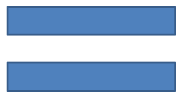

## **Översikt**

Den här artikeln förklarar hur du anpassar presentationsformer i Aspose.Slides genom att redigera formens geometri via redigeringspunkter och geometri‑banor. Den visar hur du arbetar med [GeometryPath](https://reference.aspose.com/slides/androidjava/com.aspose.slides/geometrypath/) och [IGeometryPath](https://reference.aspose.com/slides/androidjava/com.aspose.slides/igeometrypath/) för att modifiera befintliga former, utföra grundläggande redigeringsoperationer för banor, lägga till eller ta bort punkter och tillämpa uppdaterad geometri på en form.

Den visar också hur du skapar anpassade och sammansatta former, bygger former med rundade hörn, bestämmer om en formgeometri är sluten och inspekterar formelement med Android‑punktarrayer.

## **Ändra en form med redigeringspunkter**

I PowerPoint kan du använda **Edit Points** för att ändra en kvadrat:

* Flytta ett hörn inåt eller utåt.
* Justera krökningen vid en punkt.
* Lägg till nya punkter.

Att redigera punkter låter dig ändra en formes kontur eller använda en befintlig form som grund för en ny.

## **Tips för formredigering**


När du redigerar PowerPoint‑former, tänk på följande koncept:

* En form (eller dess bana) kan antingen vara sluten eller öppen.
* En formes bana består av ankarnpunkter som är sammankopplade med segment.
* Ett segment kan vara rakt eller kurvat. Ankarnpunkter och kontrollhandtag bestämmer dess form.
* Ankarnpunkter finns som hörnpunkter, raka punkter eller mjuka punkter:
  * Vid en hörnpunkt kan intilliggande segment mötas i en vinkel.
  * Vid en mjuk punkt är de två kontrollhandtagen i linje och lika avlägsna från ankarnpunkten.
  * Vid en rak punkt är de två kontrollhandtagen i linje men kan ha olika avstånd från ankarnpunkten.
* Att flytta ankarnpunkter eller justera deras handtag ändrar formens kontur.

För att redigera PowerPoint‑former via redigeringspunkter tillhandahåller **Aspose.Slides** klassen [GeometryPath](https://reference.aspose.com/slides/androidjava/com.aspose.slides/geometrypath/) och gränssnittet [IGeometryPath](https://reference.aspose.com/slides/androidjava/com.aspose.slides/igeometrypath/).

* En [GeometryPath](https://reference.aspose.com/slides/androidjava/com.aspose.slides/geometrypath/)‑instans representerar en geometri‑bana för objektet [IGeometryShape](https://reference.aspose.com/slides/androidjava/com.aspose.slides/igeometryshape/).
* För att hämta [GeometryPath](https://reference.aspose.com/slides/androidjava/com.aspose.slides/geometrypath/) från [IGeometryShape](https://reference.aspose.com/slides/androidjava/com.aspose.slides/igeometryshape/)‑instansen kan du använda metoden [IGeometryShape.getGeometryPaths](https://reference.aspose.com/slides/androidjava/com.aspose.slides/igeometryshape/#getGeometryPaths--).
* För att sätta [GeometryPath](https://reference.aspose.com/slides/androidjava/com.aspose.slides/geometrypath/) för en form kan du använda dessa metoder: [IGeometryShape.setGeometryPath](https://reference.aspose.com/slides/androidjava/com.aspose.slides/igeometryshape/#setGeometryPath-com.aspose.slides.IGeometryPath-) för former med en enda bana och [IGeometryShape.setGeometryPaths](https://reference.aspose.com/slides/androidjava/com.aspose.slides/igeometryshape/#setGeometryPaths-com.aspose.slides.IGeometryPath---) för former med flera banor.
* För att lägga till segment kan du använda metoderna under [IGeometryPath](https://reference.aspose.com/slides/androidjava/com.aspose.slides/igeometrypath/).
* Genom att använda metoderna [IGeometryPath.setStroke](https://reference.aspose.com/slides/androidjava/com.aspose.slides/igeometrypath/#setStroke-boolean-) och [IGeometryPath.setFillMode](https://reference.aspose.com/slides/androidjava/com.aspose.slides/igeometrypath/#setFillMode-byte-) kan du ange utseendet för en geometri‑bana.
* Genom att använda metoden [IGeometryPath.getPathData](https://reference.aspose.com/slides/androidjava/com.aspose.slides/igeometrypath/#getPathData--) kan du hämta geometri‑bana för en [GeometryShape](https://reference.aspose.com/slides/androidjava/com.aspose.slides/geometryshape/) som en array av bansegment.

## **Enkla redigeringsoperationer**

Använd följande metoder för att redigera en geometri‑bana. Överlagringar som accepterar ett index infogar ett segment på den nollbaserade positionen i bana‑segmentarrayen.

| Åtgärd | Metod |
| --- | --- |
| Lägg till eller infoga en rak linje. | [GeometryPath.lineTo](https://reference.aspose.com/slides/androidjava/com.aspose.slides/geometrypath/#lineTo-float-float-) |
| Lägg till eller infoga en kubisk Bézier‑kurva med två kontrollpunkter och en slutpunkt. | [GeometryPath.cubicBezierTo](https://reference.aspose.com/slides/androidjava/com.aspose.slides/geometrypath/#cubicBezierTo-float-float-float-float-float-float-) |
| Lägg till eller infoga en kvadratisk Bézier‑kurva med en kontrollpunkt och en slutpunkt. | [GeometryPath.quadraticBezierTo](https://reference.aspose.com/slides/androidjava/com.aspose.slides/geometrypath/#quadraticBezierTo-float-float-float-float-) |
| Lägg till en elliptisk båge med de angivna dimensionerna och vinklarna i grader. | [GeometryPath.arcTo](https://reference.aspose.com/slides/androidjava/com.aspose.slides/geometrypath/#arcTo-float-float-float-float-) |
| Stäng den aktuella figuren genom att ansluta dess slutpunkt till startpunkten. | [GeometryPath.closeFigure](https://reference.aspose.com/slides/androidjava/com.aspose.slides/geometrypath/#closeFigure--) |
| Ange startpunkten för en figur. | [GeometryPath.moveTo](https://reference.aspose.com/slides/androidjava/com.aspose.slides/geometrypath/#moveTo-float-float-) |
| Ta bort ett segment på ett nollbaserat index. | [GeometryPath.removeAt](https://reference.aspose.com/slides/androidjava/com.aspose.slides/geometrypath/#removeAt-int-) |

## **Lägg till anpassade punkter till en form**

Detta exempel infogar två punkter i en rektangulär form med [GeometryPath.lineTo](https://reference.aspose.com/slides/androidjava/com.aspose.slides/geometrypath/#lineTo-float-float-) och tillämpar den redigerade banan med [IGeometryShape.setGeometryPath](https://reference.aspose.com/slides/androidjava/com.aspose.slides/igeometryshape/#setGeometryPath-com.aspose.slides.IGeometryPath-). Koordinaterna är lokala för formen: båda nya punkterna ligger i dess centrum, 100 punkter från vänster och 50 punkter från toppen. Segmentindex 1 och 4 placerar dem på över- respektive nederkanten, vilket drar dessa kanter inåt.

```java
import com.aspose.slides.*;

Presentation presentation = new Presentation();
try {
    ISlide slide = presentation.getSlides().get_Item(0);

    IAutoShape shape = slide.getShapes().addAutoShape(ShapeType.Rectangle, 100, 100, 200, 100);

    IGeometryPath geometryPath = shape.getGeometryPaths()[0];
    geometryPath.lineTo(100, 50, 1);
    geometryPath.lineTo(100, 50, 4);

    shape.setGeometryPath(geometryPath);
} finally {
    presentation.dispose();
}
```


## **Ta bort punkter från en form**

Detta exempel ändrar konturen på en hjärtformad form genom att ta bort segmentet på nollbaserat index 2 med [GeometryPath.removeAt](https://reference.aspose.com/slides/androidjava/com.aspose.slides/geometrypath/#removeAt-int-). Genom att tillämpa den modifierade banan med [IGeometryShape.setGeometryPath](https://reference.aspose.com/slides/androidjava/com.aspose.slides/igeometryshape/#setGeometryPath-com.aspose.slides.IGeometryPath-) uppdateras formens kontur.

```java
import com.aspose.slides.*;

Presentation presentation = new Presentation();
try {
    ISlide slide = presentation.getSlides().get_Item(0);

    IAutoShape shape = slide.getShapes().addAutoShape(ShapeType.Heart, 100, 100, 300, 300);

    IGeometryPath path = shape.getGeometryPaths()[0];
    path.removeAt(2);

    shape.setGeometryPath(path);
} finally {
    presentation.dispose();
}
```


## **Skapa en anpassad form**

Detta exempel bygger en femspetsig stjärna med [GeometryPath](https://reference.aspose.com/slides/androidjava/com.aspose.slides/geometrypath/). Växlande yttre och inre radier på 100 respektive 50 punkter definierar spetsarna och fördjupningarna; ett steg på 72 grader placerar de fem spetsarna jämnt. Banan stängs med [GeometryPath.closeFigure](https://reference.aspose.com/slides/androidjava/com.aspose.slides/geometrypath/#closeFigure--) och tillämpas på en rektangulär form med [IGeometryShape.setGeometryPath](https://reference.aspose.com/slides/androidjava/com.aspose.slides/igeometryshape/#setGeometryPath-com.aspose.slides.IGeometryPath-), vilket ersätter dess kontur.

```java
import com.aspose.slides.*;
import android.graphics.PointF;
import java.util.ArrayList;
import java.util.List;

List<PointF> points = new ArrayList<>();

float outerRadius = 100f;
float innerRadius = 50f;
int angleStep = 72;

for (int angle = -90; angle < 270; angle += angleStep)
{
    double radians = angle * (Math.PI / 180f);
    double x = outerRadius * Math.cos(radians);
    double y = outerRadius * Math.sin(radians);
    PointF point = new PointF((float)x + outerRadius, (float)y + outerRadius);
    points.add(point);

    radians = Math.PI * (angle + angleStep / 2) / 180.0;
    x = innerRadius * Math.cos(radians);
    y = innerRadius * Math.sin(radians);
    point = new PointF((float)x + outerRadius, (float)y + outerRadius);
    points.add(point);
}

GeometryPath starPath = new GeometryPath();
starPath.moveTo(points.get(0));

for (int i = 1; i < points.size(); i++)
{
    starPath.lineTo(points.get(i));
}

starPath.closeFigure();

Presentation presentation = new Presentation();
try {
    ISlide slide = presentation.getSlides().get_Item(0);

    IAutoShape shape = slide.getShapes().addAutoShape(ShapeType.Rectangle, 100, 100, outerRadius * 2, outerRadius * 2);
    shape.setGeometryPath(starPath);
} finally {
    presentation.dispose();
}
```


## **Skapa en sammansatt anpassad form**

Detta exempel definierar två slutna [GeometryPath](https://reference.aspose.com/slides/androidjava/com.aspose.slides/geometrypath/)‑objekt för den övre och nedre tredjedelen av en form. Genom att tillämpa båda banorna med [IGeometryShape.setGeometryPaths](https://reference.aspose.com/slides/androidjava/com.aspose.slides/igeometryshape/#setGeometryPaths-com.aspose.slides.IGeometryPath---) skapas en enda sammansatt form med ett gap över dess mittersta tredjedel.

```java
import com.aspose.slides.*;

Presentation presentation = new Presentation();
try {
    ISlide slide = presentation.getSlides().get_Item(0);

    IAutoShape shape = slide.getShapes().addAutoShape(ShapeType.Rectangle, 100, 100, 200, 100);

    GeometryPath topPath = new GeometryPath();
    topPath.moveTo(0, 0);
    topPath.lineTo(shape.getWidth(), 0);
    topPath.lineTo(shape.getWidth(), shape.getHeight() / 3);
    topPath.lineTo(0, shape.getHeight() / 3);
    topPath.closeFigure();

    GeometryPath bottomPath = new GeometryPath();
    bottomPath.moveTo(0, shape.getHeight() / 3 * 2);
    bottomPath.lineTo(shape.getWidth(), shape.getHeight() / 3 * 2);
    bottomPath.lineTo(shape.getWidth(), shape.getHeight());
    bottomPath.lineTo(0, shape.getHeight());
    bottomPath.closeFigure();

    shape.setGeometryPaths(new GeometryPath[] { topPath, bottomPath });
} finally {
    presentation.dispose();
}
```


## **Skapa en anpassad form med rundade hörn**

Detta exempel kombinerar raka segment med [GeometryPath.arcTo](https://reference.aspose.com/slides/androidjava/com.aspose.slides/geometrypath/#arcTo-float-float-float-float-) för att skapa en form med inåtriktade rundade hörn. Varje hörnstorlek anger bågens bredd och höjd i punkter, och svepet på -90 grader ritar en moturs kvartsellips. Den färdiga banan tillämpas med [IGeometryShape.setGeometryPath](https://reference.aspose.com/slides/androidjava/com.aspose.slides/igeometryshape/#setGeometryPath-com.aspose.slides.IGeometryPath-) och presentationen sparas i PPTX‑format.

```java
import com.aspose.slides.*;
import android.graphics.PointF;

float shapeX = 20f;
float shapeY = 20f;
float shapeWidth = 300f;
float shapeHeight = 200f;

float leftTopSize = 50f;
float rightTopSize = 20f;
float rightBottomSize = 40f;
float leftBottomSize = 10f;

Presentation presentation = new Presentation();
try {
    ISlide slide = presentation.getSlides().get_Item(0);

    IAutoShape shape = slide.getShapes().addAutoShape(ShapeType.Custom, shapeX, shapeY, shapeWidth, shapeHeight);

    PointF topLeft = new PointF(leftTopSize, 0);
    PointF topRight = new PointF(shapeWidth - rightTopSize, 0);
    PointF rightBottom = new PointF(shapeWidth, shapeHeight - rightBottomSize);
    PointF bottomLeft = new PointF(leftBottomSize, shapeHeight);
    PointF leftTop = new PointF(0, leftTopSize);

    GeometryPath geometryPath = new GeometryPath();
    geometryPath.moveTo(topLeft);
    geometryPath.lineTo(topRight);
    geometryPath.arcTo(rightTopSize, rightTopSize, 180, -90);
    geometryPath.lineTo(rightBottom);
    geometryPath.arcTo(rightBottomSize, rightBottomSize, -90, -90);
    geometryPath.lineTo(bottomLeft);
    geometryPath.arcTo(leftBottomSize, leftBottomSize, 0, -90);
    geometryPath.lineTo(leftTop);
    geometryPath.arcTo(leftTopSize, leftTopSize, 90, -90);
    geometryPath.closeFigure();

    shape.setGeometryPath(geometryPath);

    presentation.save("output.pptx", SaveFormat.Pptx);
} finally {
    presentation.dispose();
}
```

## **Ta reda på om en formgeometri är sluten**

Följande hjälpfunktion kontrollerar om varje icke‑tom geometri‑bana avslutas med ett stängningssegment. Den läser [IGeometryPath.getPathData](https://reference.aspose.com/slides/androidjava/com.aspose.slides/igeometrypath/#getPathData--) och jämför det sista segmentets [IPathSegment.getPathCommand](https://reference.aspose.com/slides/androidjava/com.aspose.slides/ipathsegment/#getPathCommand--) med [PathCommandType.Close](https://reference.aspose.com/slides/androidjava/com.aspose.slides/pathcommandtype/). Den returnerar false när det inte finns några icke‑tomma banor. Detta kontrollerar det sista kommandot för varje bana; den inspekterar inte varje subfigur inom en bana. Exemplet skriver ut `true` för en rektangel.

```java
import com.aspose.slides.*;

class GeometryInspector {
    boolean isGeometryClosed(IGeometryShape geometryShape) {
        boolean hasNonemptyPath = false;

        for (IGeometryPath geometryPath : geometryShape.getGeometryPaths()) {
            IPathSegment[] segments = geometryPath.getPathData();
            if (segments.length == 0) {
                continue;
            }

            hasNonemptyPath = true;
            IPathSegment lastSegment = segments[segments.length - 1];
            if (lastSegment.getPathCommand() != PathCommandType.Close) {
                return false;
            }
        }

        return hasNonemptyPath;
    }
}

Presentation presentation = new Presentation();
try {
    ISlide slide = presentation.getSlides().get_Item(0);

    IAutoShape shape = slide.getShapes().addAutoShape(ShapeType.Rectangle, 100, 100, 200, 100);

    GeometryInspector inspector = new GeometryInspector();
    boolean closed = inspector.isGeometryClosed(shape);
    System.out.println(closed);
} finally {
    presentation.dispose();
}
```

## **Inspektera geometri‑banelkommandon**

Ladda ner [contour.pptx](contour.pptx) och ersätt exempelfilnamnet med dess sökväg på enheten. Den första formen på den första bilden har ett rakt överkant, en kubisk Bézier‑kurva och ett rakt avslutningskant. Använd [getGeometryPaths](https://reference.aspose.com/slides/androidjava/com.aspose.slides/igeometryshape/#getGeometryPaths--) för att läsa formens banor och [getPathData](https://reference.aspose.com/slides/androidjava/com.aspose.slides/igeometrypath/#getPathData--) för att läsa varje bans segment i ritordning. För varje segment identifierar [getPathCommand](https://reference.aspose.com/slides/androidjava/com.aspose.slides/ipathsegment/#getPathCommand--) kommandot och avgör hur värdena som returneras av [getSegmentData](https://reference.aspose.com/slides/androidjava/com.aspose.slides/ipathsegment/#getSegmentData--) ska tolkas.

```java
import com.aspose.slides.*;
import java.util.Arrays;

Presentation presentation = new Presentation("contour.pptx");
try {
    IGeometryShape shape = (IGeometryShape) presentation.getSlides().get_Item(0).getShapes().get_Item(0);
    IGeometryPath[] paths = shape.getGeometryPaths();

    for (int i = 0; i < paths.length; i++) {
        IPathSegment[] segments = paths[i].getPathData();
        for (int j = 0; j < segments.length; j++) {
            byte command = segments[j].getPathCommand();
            float[] data = segments[j].getSegmentData();
            String detail;
            switch (command) {
                case PathCommandType.MoveTo:
                case PathCommandType.LineTo:
                    detail = String.format("destination=(%s, %s)", data[0], data[1]);
                    break;
                case PathCommandType.CubicBezierTo:
                    detail = String.format("control1=(%s, %s) control2=(%s, %s) end=(%s, %s)", data[0], data[1], data[2], data[3], data[4], data[5]);
                    break;
                case PathCommandType.Close:
                    detail = "no coordinates";
                    break;
                default:
                    detail = "raw=" + Arrays.toString(data);
            }
            String name = PathCommandType.getName(PathCommandType.class, command);
            System.out.printf("Path %d, segment %d: %s %s%n", i, j, name, detail);
        }
    }
} finally {
    presentation.dispose();
}
```

Formen sitter vid (200, 100) punkter på bilden. De rapporterade koordinaterna är lokala för formen, med (0, 0) i dess övre vänstra hörn, x ökar åt höger och y ökar nedåt. Slutsegmentet återgår till startpunkten utan ytterligare koordinater.

```text
Path 0, segment 0: MoveTo destination=(0.0, 0.0)
Path 0, segment 1: LineTo destination=(80.0, 0.0)
Path 0, segment 2: CubicBezierTo control1=(70.0, 15.0) control2=(30.0, 45.0) end=(0.0, 60.0)
Path 0, segment 3: Close no coordinates
```


## **Extrahera och inspektera formelement**

Använd [IGeometryShape.createShapeElements](https://reference.aspose.com/slides/androidjava/com.aspose.slides/igeometryshape/#createShapeElements--) för att inspektera en befintlig form som element som innehåller banpunkter och punktstyper. Kast varje returnerad [IShapeElement](https://reference.aspose.com/slides/androidjava/com.aspose.slides/ishapeelement/) till [ShapeElement](https://reference.aspose.com/slides/androidjava/com.aspose.slides/shapeelement/) för att hämta punkt‑ och typ‑arrayerna via metoderna [getPathPoints](https://reference.aspose.com/slides/androidjava/com.aspose.slides/shapeelement/#getPathPoints--) och [getPathTypes](https://reference.aspose.com/slides/androidjava/com.aspose.slides/shapeelement/#getPathTypes--) . Denna representation är användbar för kontur‑analys eller för att vidarebefordra geometri till anpassade ritverktyg.

Exemplet öppnar input.pptx, hittar den första geometri‑formen direkt på den första bilden och skriver ut dess bansegment. Använd en presentation som innehåller en form med raka och kurviga segment för att se båda typerna av resultat. Det söker inte i grupper.

```java
import com.aspose.slides.*;
import android.graphics.PointF;

Presentation presentation = new Presentation("input.pptx");
try {
    ISlide slide = presentation.getSlides().get_Item(0);

    IGeometryShape shape = null;
    for (IShape candidate : slide.getShapes()) {
        if (candidate instanceof IGeometryShape) {
            shape = (IGeometryShape) candidate;
            break;
        }
    }

    if (shape == null) {
        System.out.println("No geometry shape found on the first slide.");
    } else {
        for (IShapeElement element : shape.createShapeElements()) {
            ShapeElement shapeElement = (ShapeElement) element;
            PointF[] points = shapeElement.getPathPoints();
            byte[] types = shapeElement.getPathTypes();
            System.out.println("Shape element:");

            for (int i = 0; i < points.length; i++) {
                int pointType = types[i] & 0x07; // Behåll segmenttypen, exklusive flaggor.
                switch (pointType) {
                    case 0:
                        System.out.println("Start figure at " + points[i]);
                        break;
                    case 1:
                        System.out.println("Line to " + points[i]);
                        break;
                    case 3:
                        System.out.println("Cubic Bezier: controls " + points[i] + ", " + points[i + 1] + "; end " + points[i + 2]);
                        i += 2; // Consume both control points and the endpoint.
                        break;
                }

                if ((types[i] & 0x80) != 0) {
                    System.out.println("Close subpath back to its starting point.");
                }
            }
        }
    }
} finally {
    presentation.dispose();
}
```

Arrayerna motsvarar varandra efter index: `points[i]` är en punkt och `types[i]` beskriver dess roll. Typ `0` startar en figur, och typ `1` ritar en linje från föregående punkt till den aktuella. Ett kubiskt Bézier‑segment startar vid föregående slutpunkt och använder tre på varandra följande type‑`3`‑poster: två kontrollpunkter följda av den nya slutpunkten. Loopen konsumerar dessa tre poster tillsammans och kontrollerar om slutpunkten stänger.

Punkt‑typer innehåller också flaggor. Maskera med `0x07` för att identifiera segment‑typen, och testa `0x80` separat för att upptäcka ett slutet delspår. Till exempel betyder `129` (`0x81`) en linjeslutpunkt som stänger ett delspår, och `131` (`0x83`) en Bézier‑slutpunkt som stänger ett. Java lagrar dessa flaggor i signerade bytes; maskering bevarar de avsedda bitvärdena. Att bara jämföra råvärdet med `1` eller `3` skulle missa dessa fall. Andra flaggor, såsom streck (`0x10`) och markör (`0x20`), ändrar inte den grundläggande segment‑typen.

**Koordinater och transformationer.** Punkter mäts i punkter (1/72 tum), med X som ökar åt höger och Y som ökar nedåt. För en icke‑grupperad form inkluderar de extraherade koordinaterna redan positionen som returneras av [getX](https://reference.aspose.com/slides/androidjava/com.aspose.slides/shape/#getX--) och [getY](https://reference.aspose.com/slides/androidjava/com.aspose.slides/shape/#getY--) och speglar dess aktuella bredd och höjd. Till exempel har en icke‑roterad rektangel vid `(100, 200)` med storleken `120 × 80` konturboundaries `(100, 200)`–`(220, 280)`. Lägg inte till formens position igen. Subtrahera dess X och Y för att få koordinater relativt dess icke‑roterade ram.

De extraherade punkterna tar inte hänsyn till formens rotation, som returneras av [getRotation](https://reference.aspose.com/slides/androidjava/com.aspose.slides/shape/#getRotation--), eller horisontella och vertikala speglingar. För att återge den visade konturen, tillämpa dessa transformationer runt formens centrum. För grupperade former, ta också hänsyn till gruppens koordinatmappning och transformationer; anta inte att de extraherade punkterna är de slutliga renderade bildkoordinaterna eller applicera en translation eller skala två gånger om den redan återspeglas i barnets ram.

**Inspektion versus redigering.** Extraherade arrayer beskriver konturen; att ändra dem uppdaterar inte den ursprungliga formen. Välj detta tillvägagångssätt när din analys- eller ritkod behöver punkt‑/typ‑arrayer. Använd [getGeometryPaths](https://reference.aspose.com/slides/androidjava/com.aspose.slides/igeometryshape/#getGeometryPaths--) när du behöver geometri‑kommandon i formens lokala koordinatsystem eller vill redigera dess geometri. Tillämpa redigerade banor via [setGeometryPath](https://reference.aspose.com/slides/androidjava/com.aspose.slides/igeometryshape/#setGeometryPath-com.aspose.slides.IGeometryPath-) eller [setGeometryPaths](https://reference.aspose.com/slides/androidjava/com.aspose.slides/igeometryshape/#setGeometryPaths-com.aspose.slides.IGeometryPath---).

## **FAQ**

**Vad händer med fyllning och kontur efter att geometrin har ersatts?**

Stilen förblir på formen; endast konturen ändras. Fyllning och kontur appliceras automatiskt på den nya geometrin.

**Hur roterar jag korrekt en anpassad form tillsammans med dess geometri?**

Använd formens [setRotation](https://reference.aspose.com/slides/androidjava/com.aspose.slides/shape/#setRotation-float-)‑metod; geometrin roterar med formen eftersom den är bunden till formens eget koordinatsystem.

**Kan jag konvertera en anpassad form till en bild för att "låsa" resultatet?**

Ja. Exportera det behövda [bild](/slides/sv/androidjava/convert-powerpoint-to-png/)‑området eller själva [form](/slides/sv/androidjava/create-shape-thumbnails/) till ett rasterformat; detta förenklar vidare arbete med komplexa geometrier.