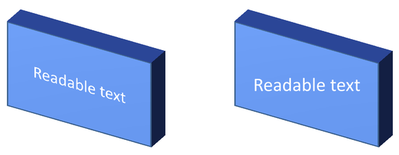

## **Översikt**

Aspose.Slides for C++ kan skapa, redigera, bevara och rendera PowerPoint-liknande 3D-formatering för former och text. Denna artikel behandlar 3D-effekter som rotation, extrusion, avfasningar, belysning, material, gradient- eller bildfyllningar och 3D-text.

{}
This article is about 3D formatting effects on PowerPoint shapes and text. It is not about inserting or editing standalone 3D model files. When you export a slide to an image, PDF, or HTML, Aspose.Slides renders those 3D effects into the exported 2D output.
{}

## **3D-formateringskoncept**

Använd metoden [IShape::get_ThreeDFormat](https://reference.aspose.com/slides/cpp/aspose.slides/ishape/get_threedformat/) för att tillämpa 3D‑formatering på en form. Metoden returnerar [IThreeDFormat](https://reference.aspose.com/slides/cpp/aspose.slides/ithreedformat/), som styr 3D‑scenen för den formen.

För text, använd metoden [ITextFrameFormat::get_ThreeDFormat](https://reference.aspose.com/slides/cpp/aspose.slides/itextframeformat/get_threedformat/). Detta tillämpar 3D‑formatering på textramen istället för formens kropp.

De viktigaste metoderna är:

| Metod | Vad den styr | När den ska användas |
|---|---|---|
| [get_Camera](https://reference.aspose.com/slides/cpp/aspose.slides/ithreedformat/get_camera/) | Vypunkt, förinställd kameratyp, rotation, zoom och perspektiv. | Rotera objektet i 3D‑rummet eller matcha en PowerPoint‑3D‑rotationsförinställning. |
| [get_LightRig](https://reference.aspose.com/slides/cpp/aspose.slides/ithreedformat/get_lightrig/) | Ljusförinställning, riktning och ljusrotation. | Ändra hur högdagrar och skuggor visas på 3D‑ytan. |
| [set_Material](https://reference.aspose.com/slides/cpp/aspose.slides/ithreedformat/set_material/) | Ytmaterial, såsom platt, matt, plast eller metall. | Gör samma geometri plattare, mjukare, glansigare eller metallisk. |
| [set_ExtrusionHeight](https://reference.aspose.com/slides/cpp/aspose.slides/ithreedformat/set_extrusionheight/) | Hur långt formen sträcker sig bakåt från dess främre yta. | Omvandla en platt form till ett tydligt tjockt 3D‑objekt. |
| [get_ExtrusionColor](https://reference.aspose.com/slides/cpp/aspose.slides/ithreedformat/get_extrusioncolor/) | Färg på de extruderade sidorna. | Gör djupet synligt eller samordna sidfärgen med främre fyllning. |
| [set_Depth](https://reference.aspose.com/slides/cpp/aspose.slides/ithreedformat/set_depth/) | Ytterligare 3D‑djup som används av PowerPoint‑3D‑formatering. | Finjustera djupet för former eller text, särskilt tillsammans med avfasning och materialinställningar. |
| [get_BevelTop](https://reference.aspose.com/slides/cpp/aspose.slides/ithreedformat/get_beveltop/) och [get_BevelBottom](https://reference.aspose.com/slides/cpp/aspose.slides/ithreedformat/get_bevelbottom/) | Upphöjda eller rundade kanter på främre och bakre ytor. | Lägg till en mjukad eller formad kant istället för en skarp platt yta. |
| [get_ContourColor](https://reference.aspose.com/slides/cpp/aspose.slides/ithreedformat/get_contourcolor/) och [set_ContourWidth](https://reference.aspose.com/slides/cpp/aspose.slides/ithreedformat/set_contourwidth/) | Kontur runt 3D‑objektet. | Betona objektgränsen i den renderade utdata. |

## **Skapa en 3D-form**

En form behöver vanligtvis fyra typer av inställningar innan den ser övertygande 3D ut:

- Kamerainställningar, eftersom standardframsidan kan dölja extrusionen.
- Ljuseinställningar, eftersom belysning gör ytorna och sidorna läsbara.
- Materialinställningar, eftersom ytan påverkar hur ljuset renderas.
- Extrusions- eller djupinställningar, eftersom en platt form behöver tjocklek.

Följande exempel skapar en rektangel, lägger till text på dess främre yta och tillämpar 3D‑formatering. Kamerarotationsvärdena är i grader och extrusionshöjden är 100 punkter. Exemplet renderar bilden till en PNG‑fil med dubbla standarddimensioner och sparar presentationen som PPTX.

```cpp
#include <DOM/CameraPresetType.h>
#include <DOM/FillType.h>
#include <DOM/IAutoShape.h>
#include <DOM/ICamera.h>
#include <DOM/IColorFormat.h>
#include <DOM/IFillFormat.h>
#include <DOM/ILightRig.h>
#include <DOM/IParagraph.h>
#include <DOM/IParagraphFormat.h>
#include <DOM/IPortionFormat.h>
#include <DOM/IShapeCollection.h>
#include <DOM/ISlide.h>
#include <DOM/ITextFrame.h>
#include <DOM/IThreeDFormat.h>
#include <DOM/LightRigPresetType.h>
#include <DOM/LightingDirection.h>
#include <DOM/MaterialPresetType.h>
#include <DOM/Presentation.h>
#include <DOM/ShapeType.h>
#include <Export/SaveFormat.h>
#include <IImage.h>
#include <drawing/color.h>

using namespace Aspose::Slides;
using namespace Aspose::Slides::Export;
using namespace System::Drawing;

const auto imageScale = 2.0f;

auto presentation = System::MakeObject<Presentation>();
auto slide = presentation->get_Slide(0);

auto shape = slide->get_Shapes()->AddAutoShape(ShapeType::Rectangle, 200.0f, 150.0f, 200.0f, 200.0f);

shape->get_TextFrame()->set_Text(u"3D");
shape->get_TextFrame()->get_Paragraph(0)->get_ParagraphFormat()->get_DefaultPortionFormat()->set_FontHeight(64.0f);

auto frontColor = Color::get_CornflowerBlue();
shape->get_FillFormat()->set_FillType(FillType::Solid);
shape->get_FillFormat()->get_SolidFillColor()->set_Color(frontColor);

auto extrusionColor = Color::get_Blue();
shape->get_ThreeDFormat()->get_Camera()->set_CameraType(CameraPresetType::OrthographicFront);
shape->get_ThreeDFormat()->get_Camera()->SetRotation(20.0f, 30.0f, 40.0f);
shape->get_ThreeDFormat()->get_LightRig()->set_LightType(LightRigPresetType::Flat);
shape->get_ThreeDFormat()->get_LightRig()->set_Direction(LightingDirection::Top);
shape->get_ThreeDFormat()->set_Material(MaterialPresetType::Flat);
shape->get_ThreeDFormat()->set_ExtrusionHeight(100.0);
shape->get_ThreeDFormat()->get_ExtrusionColor()->set_Color(extrusionColor);

auto thumbnail = slide->GetImage(imageScale, imageScale);
thumbnail->Save(u"shape_3d.png");
thumbnail->Dispose();

presentation->Save(u"shape_3d.pptx", SaveFormat::Pptx);
presentation->Dispose();
```

Den renderade bildsidan visar rektangeln som ett tjockt 3D‑block:


## **Rotera en form med kameran**

I PowerPoint konfigureras 3D‑rotation från rutan 3‑D Rotation. X‑, Y‑ och Z‑rotationsvärdena motsvarar rotationen du anger via kamera‑API:et.


I Aspose.Slides får du åtkomst till kameran via [IThreeDFormat::get_Camera](https://reference.aspose.com/slides/cpp/aspose.slides/ithreedformat/get_camera/). Detta exempel skapar en rektangel, väljer en ortografisk frontvy och sätter dess X‑, Y‑ och Z‑rotationer till 20, 30 respektive 40 grader. Det konfigurerar formen i minnet utan att spara en fil:

```cpp
#include <DOM/CameraPresetType.h>
#include <DOM/IAutoShape.h>
#include <DOM/ICamera.h>
#include <DOM/IShapeCollection.h>
#include <DOM/ISlide.h>
#include <DOM/IThreeDFormat.h>
#include <DOM/Presentation.h>
#include <DOM/ShapeType.h>

using namespace Aspose::Slides;

auto presentation = System::MakeObject<Presentation>();
auto slide = presentation->get_Slide(0);

auto shape = slide->get_Shapes()->AddAutoShape(ShapeType::Rectangle, 200.0f, 150.0f, 200.0f, 200.0f);

shape->get_ThreeDFormat()->get_Camera()->set_CameraType(CameraPresetType::OrthographicFront);
shape->get_ThreeDFormat()->get_Camera()->SetRotation(20.0f, 30.0f, 40.0f);

presentation->Dispose();
```

Använd kameran när du behöver ändra hur betraktaren ser objektet. Den ändrar inte den 2D‑formen geometrin på bilden. Den ändrar 3D‑vy‑punkten som används av PowerPoint och av Aspose.Slides vid rendering.

### **Kopiera kamerariktning från en mallform**

För att matcha en mallforms kamerariktning, läs dess förinställning med [get_CameraType](https://reference.aspose.com/slides/cpp/aspose.slides/icamera/get_cameratype/) och tillämpa den med [set_CameraType](https://reference.aspose.com/slides/cpp/aspose.slides/icamera/set_cameratype/). Exemplet öppnar `template.pptx` och kopierar kamerariktningen från den första formen på den första bilden till den andra formen. Båda formerna har redan 3D‑belysning, och den andra formen har ingen explicit kamerarotation.

[GetRotation](https://reference.aspose.com/slides/cpp/aspose.slides/icamera/getrotation/) returnerar vinklarna i grader. Index `0` är latitud, index `1` är longitud och index `2` är revolution. Skicka vinklarna till [SetRotation](https://reference.aspose.com/slides/cpp/aspose.slides/icamera/setrotation/) i den ordningen. Om källan saknar explicit rotation returnerar `GetRotation` en null‑pekare, så låt den andra formens vinklar vara odefinierade. En explicit rotation på `(0, 0, 0)` returnerar en array med tre nollor och bör kopieras.

```cpp
#include <DOM/ICamera.h>
#include <DOM/IShape.h>
#include <DOM/ISlide.h>
#include <DOM/IThreeDFormat.h>
#include <DOM/Presentation.h>
#include <Export/SaveFormat.h>
#include <system/array.h>

using namespace Aspose::Slides;
using namespace Aspose::Slides::Export;

auto presentation = System::MakeObject<Presentation>(u"template.pptx");
auto slide = presentation->get_Slide(0);

auto sourceCamera = slide->get_Shape(0)->get_ThreeDFormat()->get_Camera();
auto destinationCamera = slide->get_Shape(1)->get_ThreeDFormat()->get_Camera();

destinationCamera->set_CameraType(sourceCamera->get_CameraType());
auto angles = sourceCamera->GetRotation();
if (angles != nullptr)
{
    destinationCamera->SetRotation(angles[0], angles[1], angles[2]);
}

presentation->Save(u"camera-copy.pptx", SaveFormat::Pptx);
presentation->Dispose();
```

När du öppnar `camera-copy.pptx` igen i PowerPoint har pilen till höger samma kameraförinställning och rotation som rektangeln till vänster. Båda formerna använder samma belysning och extrusionsdjup.


## **Lägg till extrusion och djup**

Extrusion får en form att se tjock ut genom att den sträcker sig bakom den främre ytan. I PowerPoint styr djupkontrollen denna synliga tjocklek och färgkontrollen bestämmer färgen på sidoytorna.


Ställ in [IThreeDFormat::set_ExtrusionHeight](https://reference.aspose.com/slides/cpp/aspose.slides/ithreedformat/set_extrusionheight/) för tjockleken och [IThreeDFormat::get_ExtrusionColor](https://reference.aspose.com/slides/cpp/aspose.slides/ithreedformat/get_extrusioncolor/) för sidfärgen. Detta exempel ger en rektangel en 100‑punkts extrusion med lila sidor och roterar kameran för att avslöja dess tjocklek. Det konfigurerar formen i minnet utan att spara en fil:

```cpp
#include <DOM/CameraPresetType.h>
#include <DOM/ILightRig.h>
#include <DOM/LightRigPresetType.h>
#include <DOM/LightingDirection.h>
#include <DOM/MaterialPresetType.h>
#include <DOM/IAutoShape.h>
#include <DOM/ICamera.h>
#include <DOM/IColorFormat.h>
#include <DOM/IShapeCollection.h>
#include <DOM/ISlide.h>
#include <DOM/IThreeDFormat.h>
#include <DOM/Presentation.h>
#include <DOM/ShapeType.h>
#include <drawing/color.h>

using namespace Aspose::Slides;
using namespace System::Drawing;

auto presentation = System::MakeObject<Presentation>();
auto slide = presentation->get_Slide(0);

auto shape = slide->get_Shapes()->AddAutoShape(ShapeType::Rectangle, 200.0f, 150.0f, 200.0f, 200.0f);

shape->get_ThreeDFormat()->get_Camera()->set_CameraType(CameraPresetType::OrthographicFront);
shape->get_ThreeDFormat()->get_Camera()->SetRotation(20.0f, 30.0f, 40.0f);
shape->get_ThreeDFormat()->get_LightRig()->set_LightType(LightRigPresetType::Flat);
shape->get_ThreeDFormat()->get_LightRig()->set_Direction(LightingDirection::Top);
shape->get_ThreeDFormat()->set_Material(MaterialPresetType::Flat);
shape->get_ThreeDFormat()->set_ExtrusionHeight(100.0);

auto extrusionColor = Color::get_Purple();
shape->get_ThreeDFormat()->get_ExtrusionColor()->set_Color(extrusionColor);

presentation->Dispose();
```

[IThreeDFormat::set_Depth](https://reference.aspose.com/slides/cpp/aspose.slides/ithreedformat/set_depth/)‑metoden anger djupet på en 3D‑form. [set_ExtrusionHeight](https://reference.aspose.com/slides/cpp/aspose.slides/ithreedformat/set_extrusionheight/)‑metoden styr extrusions‑höjden, som visas i detta exempel.

## **Använd gradient‑ eller bildfyllningar med 3D‑effekter**

3D‑formatering är oberoende av formens fyllning. Du kan applicera en solid färg, gradient, mönster eller bildfyllning på den främre ytan och fortfarande använda samma kamera, ljus, material och extrusionsinställningar.

Detta exempel tillämpar en blå‑till‑orange gradient på den främre ytan och en mörkorange färg på 150‑punkts extrusionen. Gradientstoppens 0 och 100 markerar början och slutet på gradienten. Kamerarotationsvärdena är i grader. Bilden renderas till en PNG‑fil med dubbla standarddimensioner:

```cpp
#include <DOM/CameraPresetType.h>
#include <DOM/FillType.h>
#include <DOM/IAutoShape.h>
#include <DOM/ICamera.h>
#include <DOM/IColorFormat.h>
#include <DOM/IFillFormat.h>
#include <DOM/IGradientFormat.h>
#include <DOM/IGradientStopCollection.h>
#include <DOM/ILightRig.h>
#include <DOM/IParagraph.h>
#include <DOM/IParagraphFormat.h>
#include <DOM/IPortionFormat.h>
#include <DOM/IShapeCollection.h>
#include <DOM/ISlide.h>
#include <DOM/ITextFrame.h>
#include <DOM/IThreeDFormat.h>
#include <DOM/LightRigPresetType.h>
#include <DOM/LightingDirection.h>
#include <DOM/MaterialPresetType.h>
#include <DOM/Presentation.h>
#include <DOM/ShapeType.h>
#include <IImage.h>
#include <drawing/color.h>

using namespace Aspose::Slides;
using namespace System::Drawing;

const auto imageScale = 2.0f;

auto presentation = System::MakeObject<Presentation>();
auto slide = presentation->get_Slide(0);

auto shape = slide->get_Shapes()->AddAutoShape(ShapeType::Rectangle, 200.0f, 150.0f, 250.0f, 250.0f);
shape->get_TextFrame()->set_Text(u"3D Gradient");
shape->get_TextFrame()->get_Paragraph(0)->get_ParagraphFormat()->get_DefaultPortionFormat()->set_FontHeight(64.0f);

auto firstGradientColor = Color::get_Blue();
auto secondGradientColor = Color::get_Orange();
shape->get_FillFormat()->set_FillType(FillType::Gradient);
shape->get_FillFormat()->get_GradientFormat()->get_GradientStops()->Add(0.0f, firstGradientColor);
shape->get_FillFormat()->get_GradientFormat()->get_GradientStops()->Add(100.0f, secondGradientColor);

auto extrusionColor = Color::get_DarkOrange();
shape->get_ThreeDFormat()->get_Camera()->set_CameraType(CameraPresetType::OrthographicFront);
shape->get_ThreeDFormat()->get_Camera()->SetRotation(10.0f, 20.0f, 30.0f);
shape->get_ThreeDFormat()->get_LightRig()->set_LightType(LightRigPresetType::Flat);
shape->get_ThreeDFormat()->get_LightRig()->set_Direction(LightingDirection::Top);
shape->get_ThreeDFormat()->set_Material(MaterialPresetType::Flat);
shape->get_ThreeDFormat()->set_ExtrusionHeight(150.0);
shape->get_ThreeDFormat()->get_ExtrusionColor()->set_Color(extrusionColor);

auto thumbnail = slide->GetImage(imageScale, imageScale);
thumbnail->Save(u"gradient_3d.png");
thumbnail->Dispose();

presentation->Dispose();
```


För att använda en bildfyllning istället, lägg till bilden i presentationen och tilldela den till formens fyllning. Detta exempel kräver en befintlig fil med namn "image.jpg" i arbetskatalogen. Det sträcker bilden för att fylla rektangeln, tillämpar en 150‑punkts extrusion och sätter kamerarotation i grader. Det konfigurerar formen i minnet utan att spara eller rendera en fil:

```cpp
#include <DOM/CameraPresetType.h>
#include <DOM/ILightRig.h>
#include <DOM/LightRigPresetType.h>
#include <DOM/LightingDirection.h>
#include <DOM/MaterialPresetType.h>
#include <DOM/FillType.h>
#include <DOM/IAutoShape.h>
#include <DOM/ICamera.h>
#include <DOM/IColorFormat.h>
#include <DOM/IFillFormat.h>
#include <DOM/IImageCollection.h>
#include <DOM/IPictureFillFormat.h>
#include <DOM/IShapeCollection.h>
#include <DOM/ISlide.h>
#include <DOM/ISlidesPicture.h>
#include <DOM/IThreeDFormat.h>
#include <DOM/PictureFillMode.h>
#include <DOM/Presentation.h>
#include <DOM/ShapeType.h>
#include <drawing/color.h>
#include <system/io/file.h>

using namespace Aspose::Slides;
using namespace System::Drawing;
using namespace System::IO;

auto presentation = System::MakeObject<Presentation>();
auto slide = presentation->get_Slide(0);

auto shape = slide->get_Shapes()->AddAutoShape(ShapeType::Rectangle, 200.0f, 150.0f, 250.0f, 250.0f);

auto imageData = File::ReadAllBytes(u"image.jpg");
auto image = presentation->get_Images()->AddImage(imageData);

shape->get_FillFormat()->set_FillType(FillType::Picture);
shape->get_FillFormat()->get_PictureFillFormat()->get_Picture()->set_Image(image);
shape->get_FillFormat()->get_PictureFillFormat()->set_PictureFillMode(PictureFillMode::Stretch);

auto extrusionColor = Color::get_DarkOrange();
shape->get_ThreeDFormat()->get_Camera()->set_CameraType(CameraPresetType::OrthographicFront);
shape->get_ThreeDFormat()->get_Camera()->SetRotation(10.0f, 20.0f, 30.0f);
shape->get_ThreeDFormat()->get_LightRig()->set_LightType(LightRigPresetType::Flat);
shape->get_ThreeDFormat()->get_LightRig()->set_Direction(LightingDirection::Top);
shape->get_ThreeDFormat()->set_Material(MaterialPresetType::Flat);
shape->get_ThreeDFormat()->set_ExtrusionHeight(150.0);
shape->get_ThreeDFormat()->get_ExtrusionColor()->set_Color(extrusionColor);

presentation->Dispose();
```


## **Tillämpa 3D‑formatering på text**

3D‑formatering av form påverkar själva formkroppen. 3D‑formatering av text påverkar textramen. Detta är användbart för WordArt‑liknande effekter där bokstäverna själva behöver extrusion, material, belysning och kamerainställningar.

Följande exempel skapar text med ett orange‑och‑vitt rutnätmönster, tillämpar en uppåtriktad båg och konfigurerar 3D‑inställningar via [ITextFrameFormat::get_ThreeDFormat](https://reference.aspose.com/slides/cpp/aspose.slides/itextframeformat/get_threedformat/). Extrusionshöjden och djupet är i punkter och ljusrotationen i grader. Formens fyllning och kontur är dolda så att endast texten syns. Exemplet renderar en PNG‑fil med dubbla standarddimensioner och sparar presentationen som PPTX:

```cpp
#include <DOM/CameraPresetType.h>
#include <DOM/FillType.h>
#include <DOM/IAutoShape.h>
#include <DOM/ICamera.h>
#include <DOM/IColorFormat.h>
#include <DOM/IFillFormat.h>
#include <DOM/ILightRig.h>
#include <DOM/ILineFillFormat.h>
#include <DOM/ILineFormat.h>
#include <DOM/IParagraph.h>
#include <DOM/IParagraphFormat.h>
#include <DOM/IPatternFormat.h>
#include <DOM/IPortion.h>
#include <DOM/IPortionFormat.h>
#include <DOM/IShapeCollection.h>
#include <DOM/ISlide.h>
#include <DOM/ITextFrame.h>
#include <DOM/ITextFrameFormat.h>
#include <DOM/IThreeDFormat.h>
#include <DOM/LightRigPresetType.h>
#include <DOM/LightingDirection.h>
#include <DOM/MaterialPresetType.h>
#include <DOM/PatternStyle.h>
#include <DOM/Presentation.h>
#include <DOM/ShapeType.h>
#include <DOM/TextShapeType.h>
#include <Export/SaveFormat.h>
#include <IImage.h>
#include <drawing/color.h>

using namespace Aspose::Slides;
using namespace Aspose::Slides::Export;
using namespace System::Drawing;

const auto imageScale = 2.0f;

auto presentation = System::MakeObject<Presentation>();
auto slide = presentation->get_Slide(0);

auto shape = slide->get_Shapes()->AddAutoShape(ShapeType::Rectangle, 200.0f, 150.0f, 250.0f, 250.0f);

shape->get_FillFormat()->set_FillType(FillType::NoFill);
shape->get_LineFormat()->get_FillFormat()->set_FillType(FillType::NoFill);
shape->get_TextFrame()->set_Text(u"3D Text");

auto portion = shape->get_TextFrame()->get_Paragraph(0)->get_Portion(0);
portion->get_PortionFormat()->get_FillFormat()->set_FillType(FillType::Pattern);

auto foregroundColor = Color::get_DarkOrange();
auto backgroundColor = Color::get_White();
portion->get_PortionFormat()->get_FillFormat()->get_PatternFormat()->get_ForeColor()->set_Color(foregroundColor);
portion->get_PortionFormat()->get_FillFormat()->get_PatternFormat()->get_BackColor()->set_Color(backgroundColor);
portion->get_PortionFormat()->get_FillFormat()->get_PatternFormat()->set_PatternStyle(PatternStyle::LargeGrid);

shape->get_TextFrame()->get_Paragraph(0)->get_ParagraphFormat()->get_DefaultPortionFormat()->set_FontHeight(128.0f);

auto textFrameFormat = shape->get_TextFrame()->get_TextFrameFormat();
textFrameFormat->set_Transform(TextShapeType::ArchUp);
textFrameFormat->get_ThreeDFormat()->set_ExtrusionHeight(3.5);
textFrameFormat->get_ThreeDFormat()->set_Depth(3.0);
textFrameFormat->get_ThreeDFormat()->set_Material(MaterialPresetType::Plastic);
textFrameFormat->get_ThreeDFormat()->get_LightRig()->set_Direction(LightingDirection::Top);
textFrameFormat->get_ThreeDFormat()->get_LightRig()->set_LightType(LightRigPresetType::Balanced);
textFrameFormat->get_ThreeDFormat()->get_LightRig()->SetRotation(0.0f, 0.0f, 40.0f);
textFrameFormat->get_ThreeDFormat()->get_Camera()->set_CameraType(CameraPresetType::PerspectiveContrastingRightFacing);

auto thumbnail = slide->GetImage(imageScale, imageScale);
thumbnail->Save(u"text_3d.png");
thumbnail->Dispose();

presentation->Save(u"text_3d.pptx", SaveFormat::Pptx);
presentation->Dispose();
```


## **Behåll text platt på en 3D‑form**

För att hålla text läsbar samtidigt som en forms 3D‑utseende bevaras, anropa [ITextFrameFormat::set_KeepTextFlat](https://reference.aspose.com/slides/cpp/aspose.slides/itextframeformat/set_keeptextflat/) via [ITextFrame::get_TextFrameFormat](https://reference.aspose.com/slides/cpp/aspose.slides/itextframe/get_textframeformat/). När värdet är `true` hålls texten utanför 3D‑scenen. När det är `false` deltar texten i scenen och följer dess 3D‑orientering.

Denna inställning tar inte bort formens 3D‑formatering: dess kamera, belysning, material och extrusion förblir konfigurerade via [IShape::get_ThreeDFormat](https://reference.aspose.com/slides/cpp/aspose.slides/ishape/get_threedformat/). Den skiljer sig även från vanlig rotation. [IShape::set_Rotation](https://reference.aspose.com/slides/cpp/aspose.slides/ishape/set_rotation/) roterar formen i bildplanen, medan [ITextFrameFormat::set_RotationAngle](https://reference.aspose.com/slides/cpp/aspose.slides/itextframeformat/set_rotationangle/) styr textens anpassade rotation inom dess avgränsningsruta. Att hålla texten utanför 3D‑scenen återställer inte någon av dessa vinklar.

Det följande fristående exemplet skapar en blå rektangel med text och klonar den bredvid originalet. Båda formerna har samma 3D‑formatering; endast textinställningen skiljer sig: `false` till vänster och `true` till höger. Kameravinklarna är i grader och extrusionshöjden är 40 punkter. Exemplet sparar presentationen som PPTX och renderar jämförelsesidan till PNG med dubbla standarddimensioner.

```cpp
#include <DOM/ITextFrameFormat.h>
#include <DOM/TextAlignment.h>
#include <DOM/TextAnchorType.h>
#include <DOM/CameraPresetType.h>
#include <DOM/FillType.h>
#include <DOM/IAutoShape.h>
#include <DOM/ICamera.h>
#include <DOM/IColorFormat.h>
#include <DOM/IFillFormat.h>
#include <DOM/ILightRig.h>
#include <DOM/IParagraph.h>
#include <DOM/IParagraphFormat.h>
#include <DOM/IPortionFormat.h>
#include <DOM/IShapeCollection.h>
#include <DOM/ISlide.h>
#include <DOM/ITextFrame.h>
#include <DOM/IThreeDFormat.h>
#include <DOM/LightRigPresetType.h>
#include <DOM/LightingDirection.h>
#include <DOM/MaterialPresetType.h>
#include <DOM/Presentation.h>
#include <DOM/ShapeType.h>
#include <Export/SaveFormat.h>
#include <IImage.h>
#include <drawing/color.h>

using namespace Aspose::Slides;
using namespace Aspose::Slides::Export;
using namespace System::Drawing;

auto presentation = System::MakeObject<Presentation>();
auto slide = presentation->get_Slide(0);

auto shape = slide->get_Shapes()->AddAutoShape(ShapeType::Rectangle, 70.0f, 160.0f, 240.0f, 140.0f);

shape->get_TextFrame()->set_Text(u"Readable text");
shape->get_TextFrame()->get_Paragraph(0)->get_ParagraphFormat()->get_DefaultPortionFormat()->set_FontHeight(28.0f);
shape->get_TextFrame()->get_Paragraph(0)->get_ParagraphFormat()->set_Alignment(TextAlignment::Center);
shape->get_TextFrame()->get_TextFrameFormat()->set_AnchoringType(TextAnchorType::Center);
shape->get_FillFormat()->set_FillType(FillType::Solid);
shape->get_FillFormat()->get_SolidFillColor()->set_Color(Color::get_CornflowerBlue());

shape->get_ThreeDFormat()->get_Camera()->set_CameraType(CameraPresetType::OrthographicFront);
shape->get_ThreeDFormat()->get_Camera()->SetRotation(30.0f, 30.0f, 0.0f);
shape->get_ThreeDFormat()->get_LightRig()->set_LightType(LightRigPresetType::Flat);
shape->get_ThreeDFormat()->get_LightRig()->set_Direction(LightingDirection::Top);
shape->get_ThreeDFormat()->set_Material(MaterialPresetType::Flat);
shape->get_ThreeDFormat()->set_ExtrusionHeight(40.0);
shape->get_ThreeDFormat()->get_ExtrusionColor()->set_Color(Color::get_RoyalBlue());
shape->get_TextFrame()->get_TextFrameFormat()->set_KeepTextFlat(false);

auto clonedShape = slide->get_Shapes()->AddClone(shape, 400.0f, 160.0f);
auto flatTextShape = System::ExplicitCast<IAutoShape>(clonedShape);
flatTextShape->get_TextFrame()->get_TextFrameFormat()->set_KeepTextFlat(true);

presentation->Save(u"keep_text_flat.pptx", SaveFormat::Pptx);
auto image = slide->GetImage(2.0f, 2.0f);
image->Save(u"keep_text_flat.png");
image->Dispose();
presentation->Dispose();
```

Till vänster följer texten 3D‑orienteringen. Till höger förblir den platt och lättare att läsa. Båda rektanglarna behåller samma synliga extrusion och 3D‑orientering.


## **Export‑ och renderingsbeteende**

Aspose.Slides bevarar 3D‑formatering när du sparar till PowerPoint‑format som PPTX. Vid rendering eller export till fasta layout‑format rasteriseras 3D‑scenen eller ritas in i utdata som ett 2D‑resultat. Detta gäller när du renderar bilder till [PNG](/slides/sv/cpp/convert-powerpoint-to-png/), exporterar till [PDF](/slides/sv/cpp/convert-powerpoint-to-pdf/), exporterar till [HTML](/slides/sv/cpp/convert-powerpoint-to-html/), eller genererar ramar för [videokonvertering](/slides/sv/cpp/convert-powerpoint-to-video/).

- Exporterade bilder och PDF-filer är inte interaktiva. Objektet kan inte roteras av betraktaren efter export.
- Det slutgiltiga utseendet beror på kombinationen av kamera, ljusrigg, material, extrusion, fyllning och bildskalning.
- Om du behöver inspektera ärvda eller temabaserade formateringsvärden, läs de [effektiva formegenskaper](/slides/sv/cpp/shape-effective-properties/).
- Vissa exportformat kan inte lagra redigerbar PowerPoint‑3D‑formatering. I dessa format renderas det visuella resultatet istället för att bevaras som redigerbara 3D‑inställningar.

## **Vanliga frågor**

**Kan Aspose.Slides skapa interaktiva 3D‑presentationer?**

Aspose.Slides skapar och renderar PowerPoint‑3D‑effekter för former och text. Det gör inte exporterade bilder, PDF‑filer eller HTML‑sidor till interaktiva 3D‑scener som en betraktare kan rotera. I PPTX förblir 3D‑formateringen redigerbar i PowerPoint där formatet stöder det.

**Vad är skillnaden mellan en 3D‑modell och en 3D‑effekt?**

En 3D‑modell är ett separat 3D‑objekt som infogas i en presentation. En 3D‑effekt är formatering som tillämpas på en vanlig PowerPoint‑form eller text, såsom rotation, extrusion, avfasning, belysning och material. Denna artikel behandlar 3D‑effekter.

**Vilka inställningar krävs för en synlig 3D‑form?**

Som minimum, ange en kamerarotation och antingen extrusion eller djup. I praktiken bör du också ange en ljusrigg och material så att de renderade ytorna får tydliga högdagrar och skuggor.

**Kan jag tillämpa 3D‑effekter på både former och text?**

Ja. Använd [IShape::get_ThreeDFormat](https://reference.aspose.com/slides/cpp/aspose.slides/ishape/get_threedformat/) för formens kropp och [ITextFrameFormat::get_ThreeDFormat](https://reference.aspose.com/slides/cpp/aspose.slides/itextframeformat/get_threedformat/) för text.

**Kommer 3D‑effekter att visas vid export till bilder, PDF, HTML eller videoramverk?**

Ja. Aspose.Slides renderar 3D‑effekter när bildspel renderas till bildfiler, PDF, HTML och ramar som används för videokonvertering. den exporterade utdata innehåller den renderade utseendet, inte ett redigerbart 3D‑objekt.

**Kan jag läsa de slutgiltiga 3D‑värdena efter arv och temainställningar har tillämpats?**

Ja. Använd de effektiva formaterings‑APIerna som beskrivs i [Formens effektiva egenskaper](/slides/sv/cpp/shape-effective-properties/) för att läsa slutgiltiga kamera‑, ljusrigg‑, avfasnings‑ och relaterade 3D‑värden.