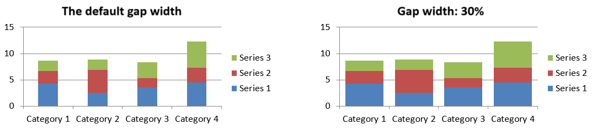

## **Översikt**

Ett diagram kan lagra sina plottade värden i arbetsboks-celler eller direkt som numeriska litteraler. En [IChartSeries](https://reference.aspose.com/slides/cpp/aspose.slides.charts/ichartseries/) representerar en uppsättning relaterade värden, och varje [IChartDataPoint](https://reference.aspose.com/slides/cpp/aspose.slides.charts/ichartdatapoint/) representerar en punkt i den serien. [IChartCategory](https://reference.aspose.com/slides/cpp/aspose.slides.charts/ichartcategory/)‑objekt tillhandahåller etiketter eller grupperingsvärden som delas av serierna. I diagram som skapats med standarddata använder serienamn, kategorier och punktvärden [IChartDataCell](https://reference.aspose.com/slides/cpp/aspose.slides.charts/ichartdatacell/)‑objekt från diagrammets arbetsbok.

För ett typiskt kategori‑diagram använder standardarbetsboken rad 0 för serienamn, kolumn 0 för kategorinamn och de återstående cellerna för serievärden. Arbetsblad, rad‑ och kolumnindex som skickas till [IChartDataWorkbook::GetCell](https://reference.aspose.com/slides/cpp/aspose.slides.charts/ichartdataworkbook/getcell/) är nollbaserade. Denna layout är praktisk när du skapar ett diagram med standarddata, men du får inte anta att varje befintligt diagram använder den. För en inläst presentation, inspektera cellerna som refereras av serierna, kategorierna och datapunkterna innan du ändrar arbetsboks‑värden.

Diagraminställningar har tre olika omfattningar:

- Inställningar på serienivå, såsom [IChartSeries::get_Format](https://reference.aspose.com/slides/cpp/aspose.slides.charts/ichartseries/get_format/), ger standardutseendet för alla punkter i en serie.
- Inställningar för datapunkter, såsom [IChartDataPoint::get_Format](https://reference.aspose.com/slides/cpp/aspose.slides.charts/ichartdatapoint/get_format/), åsidosätter serieutseendet för en punkt.
- Gruppinställningar gäller kompatibla serier som tillhör samma [IChartSeriesGroup](https://reference.aspose.com/slides/cpp/aspose.slides.charts/ichartseriesgroup/). Åtkomst till gruppen sker via [IChartSeries::get_ParentSeriesGroup](https://reference.aspose.com/slides/cpp/aspose.slides.charts/ichartseries/get_parentseriesgroup/) när du behöver ange alternativ såsom överlappning eller gap‑bredd.

När ingen explicit fyllning för punkt eller serie har angetts bestämmer diagramstilen och temat det automatiska utseendet. När både serie‑ och punkt‑formatering finns, har punkt‑formateringen företräde för den punkten.


För ett klustrat cylinder‑diagram, se hur [changing the 3D series type or bar shape](/slides/sv/cpp/3d-chart/#change-the-3d-series-type-and-bar-shape) påverkar den första serien.

## **Ange seriesvärden med numeriska litteraler**

Använd numeriska litteraler när seriesvärden härrör från programdata eller beräkningar och inte behöver referenser till arbetsblads‑celler. Anropa [set_DataSourceTypeForValues](https://reference.aspose.com/slides/cpp/aspose.slides.charts/ichartdatapointcollection/set_datasourcetypeforvalues/) med [DataSourceType::DoubleLiterals](https://reference.aspose.com/slides/cpp/aspose.slides.charts/datasourcetype/) innan du tilldelar värdet som returneras av varje punkts [get_Value](https://reference.aspose.com/slides/cpp/aspose.slides.charts/ichartdatapoint/get_value/) via [set_AsLiteralDouble](https://reference.aspose.com/slides/cpp/aspose.slides.charts/idoublechartvalue/set_asliteraldouble/).

Samlingens inställning styr källtypen för alla punktvärden i den serien. Varje punkts [IBaseChartValue::get_DataSourceType](https://reference.aspose.com/slides/cpp/aspose.slides.charts/ibasechartvalue/get_datasourcetype/) rapporterar den valda typen; ändra den via samlingsinställningen. Med `Worksheet` använde du [get_AsCell](https://reference.aspose.com/slides/cpp/aspose.slides.charts/isinglecellchartvalue/get_ascell/) för att komma åt den refererade cellen. Med `DoubleLiterals` använde du [get_AsLiteralDouble](https://reference.aspose.com/slides/cpp/aspose.slides.charts/idoublechartvalue/get_asliteraldouble/) eller `set_AsLiteralDouble` för att läsa eller skriva talet direkt.

Följande exempel skapar ett stapeldiagram med standardserier och kategorier, och tilldelar sedan beräknade värden 10, 20 osv. till befintliga punkter i dess första serie. Det sparar presentationen, öppnar den igen och skriver ut de lagrade värdena.

```cpp
#include <DOM/Chart/ChartType.h>
#include <DOM/Chart/DataSourceType.h>
#include <DOM/Chart/IChartData.h>
#include <DOM/Chart/IChartDataPoint.h>
#include <DOM/Chart/IChartDataPointCollection.h>
#include <DOM/Chart/IChartSeries.h>
#include <DOM/Chart/IChartSeriesCollection.h>
#include <DOM/Chart/IDoubleChartValue.h>
#include <DOM/IChart.h>
#include <DOM/IShapeCollection.h>
#include <DOM/ISlide.h>
#include <DOM/Presentation.h>
#include <Export/SaveFormat.h>
#include <system/console.h>
#include <system/object_ext.h>
#include <system/shared_ptr.h>

using namespace Aspose::Slides;
using namespace Aspose::Slides::Charts;
using namespace Aspose::Slides::Export;
using namespace System;

auto presentation = MakeObject<Presentation>();
auto slide = presentation->get_Slide(0);

auto chart = slide->get_Shapes()->AddChart(ChartType::ClusteredColumn, 20, 20, 500, 300);
auto series = chart->get_ChartData()->get_Series()->idx_get(0);

series->get_DataPoints()->set_DataSourceTypeForValues(DataSourceType::DoubleLiterals);
for (auto i = 0; i < series->get_DataPoints()->get_Count(); i++)
{
    series->get_DataPoints()->idx_get(i)->get_Value()->set_AsLiteralDouble((i + 1) * 10);
}

presentation->Save(u"numeric_literals.pptx", SaveFormat::Pptx);
presentation->Dispose();

auto reopenedPresentation = MakeObject<Presentation>(u"numeric_literals.pptx");
auto reopenedSlide = reopenedPresentation->get_Slide(0);
auto reopenedChart = ExplicitCast<IChart>(reopenedSlide->get_Shape(0));
auto reopenedSeries = reopenedChart->get_ChartData()->get_Series()->idx_get(0);
for (auto i = 0; i < reopenedSeries->get_DataPoints()->get_Count(); i++)
{
    auto point = reopenedSeries->get_DataPoints()->idx_get(i);
    Console::WriteLine(point->get_Value()->get_AsLiteralDouble());
}
reopenedPresentation->Dispose();
```

Punktvärdets källtyp är separat från [IChartData::get_DataSourceType](https://reference.aspose.com/slides/cpp/aspose.slides.charts/ichartdata/get_datasourcetype/), som identifierar diagrammets interna eller externa arbetsboks‑konfiguration. Att använda numeriska litteraler tar inte i sig själv bort den inbäddade arbetsboken. I detta exempel förblir arbetsboken tillgänglig för kategorietiketter, serienamn och de andra serierna. Se [Chart Workbook](/slides/sv/cpp/chart-workbook/) för hantering av arbetsböcker.

För spridnings‑ och bubbeldiagram, anropa [set_DataSourceTypeForXValues](https://reference.aspose.com/slides/cpp/aspose.slides.charts/ichartdatapointcollection/set_datasourcetypeforxvalues/) och [set_DataSourceTypeForYValues](https://reference.aspose.com/slides/cpp/aspose.slides.charts/ichartdatapointcollection/set_datasourcetypeforyvalues/) för att välja källorna för [get_XValue](https://reference.aspose.com/slides/cpp/aspose.slides.charts/ichartdatapoint/get_xvalue/) och [get_YValue](https://reference.aspose.com/slides/cpp/aspose.slides.charts/ichartdatapoint/get_yvalue/). Bubbeldiagram använder också [set_DataSourceTypeForBubbleSizes](https://reference.aspose.com/slides/cpp/aspose.slides.charts/ichartdatapointcollection/set_datasourcetypeforbubblesizes/) för [get_BubbleSize](https://reference.aspose.com/slides/cpp/aspose.slides.charts/ichartdatapoint/get_bubblesize/). Ställ in varje tillämplig källa på `DoubleLiterals` innan du tilldelar tal via dess `set_AsLiteralDouble`‑metod.

## **Ange överlappning för diagramserier**

[IChartSeries::get_Overlap](https://reference.aspose.com/slides/cpp/aspose.slides.charts/ichartseries/get_overlap/) rapporterar hur mycket staplar eller kolumner överlappar i ett 2D‑diagram, från –100 till 100 procent. Det är en skrivskyddad projektion av inställningen i den överordnade seriegruppen. Anropa [IChartSeriesGroup::set_Overlap](https://reference.aspose.com/slides/cpp/aspose.slides.charts/ichartseriesgroup/set_overlap/) för att uppdatera alla kompatibla serier i den gruppen. Detta alternativ gäller diagramtyper som visar grupperade staplar eller kolumner; det påverkar inte orelaterade seriegrupper i ett kombinationsdiagram.

Följande exempel sätter överlappning för gruppen som innehåller den första serien:

```cpp
#include <cstdint>
#include <DOM/Chart/ChartType.h>
#include <DOM/Chart/IChartData.h>
#include <DOM/Chart/IChartSeries.h>
#include <DOM/Chart/IChartSeriesCollection.h>
#include <DOM/Chart/IChartSeriesGroup.h>
#include <DOM/IChart.h>
#include <DOM/IShapeCollection.h>
#include <DOM/ISlide.h>
#include <DOM/Presentation.h>
#include <Export/SaveFormat.h>
#include <system/shared_ptr.h>

using Aspose::Slides::Charts::ChartType;
using Aspose::Slides::Export::SaveFormat;
using Aspose::Slides::Presentation;

const int firstSlideIndex = 0;
const int firstSeriesIndex = 0;
const int8_t overlapPercent = 30;

auto presentation = System::MakeObject<Presentation>();
auto slide = presentation->get_Slide(firstSlideIndex);

// Det nya diagrammet innehåller exempelserier, kategorier och värden.
auto chart = slide->get_Shapes()->AddChart(ChartType::ClusteredColumn, 20.0f, 20.0f, 500.0f, 200.0f);

auto seriesCollection = chart->get_ChartData()->get_Series();
auto series = seriesCollection->idx_get(firstSeriesIndex);
series->get_ParentSeriesGroup()->set_Overlap(overlapPercent);

presentation->Save(u"series_overlap.pptx", SaveFormat::Pptx);
presentation->Dispose();
```

Resultatet:


## **Ändra series fyllningsfärg**

Använd [IChartSeries::get_Format](https://reference.aspose.com/slides/cpp/aspose.slides.charts/ichartseries/get_format/) för att ange standardfyllning för en hel serie. Om en punkt redan har en explicit fyllning, åsidosätter dess [IChartDataPoint::get_Format](https://reference.aspose.com/slides/cpp/aspose.slides.charts/ichartdatapoint/get_format/) inställning serie‑fyllningen för den punkten.

Följande exempel applicerar en solid blå fyllning på den första serien:

```cpp
#include <DOM/Chart/ChartType.h>
#include <DOM/Chart/IChartData.h>
#include <DOM/Chart/IChartSeries.h>
#include <DOM/Chart/IChartSeriesCollection.h>
#include <DOM/Chart/IFormat.h>
#include <DOM/FillType.h>
#include <DOM/IChart.h>
#include <DOM/IColorFormat.h>
#include <DOM/IFillFormat.h>
#include <DOM/IShapeCollection.h>
#include <DOM/ISlide.h>
#include <DOM/Presentation.h>
#include <Export/SaveFormat.h>
#include <drawing/color.h>
#include <system/shared_ptr.h>

using Aspose::Slides::Charts::ChartType;
using Aspose::Slides::Export::SaveFormat;
using Aspose::Slides::FillType;
using Aspose::Slides::Presentation;
using System::Drawing::Color;

const int firstSlideIndex = 0;
const int firstSeriesIndex = 0;

auto presentation = System::MakeObject<Presentation>();
auto slide = presentation->get_Slide(firstSlideIndex);

auto chart = slide->get_Shapes()->AddChart(ChartType::ClusteredColumn, 20.0f, 20.0f, 500.0f, 200.0f);

auto seriesCollection = chart->get_ChartData()->get_Series();
auto series = seriesCollection->idx_get(firstSeriesIndex);
auto seriesColor = Color::get_Blue();
series->get_Format()->get_Fill()->set_FillType(FillType::Solid);
series->get_Format()->get_Fill()->get_SolidFillColor()->set_Color(seriesColor);

presentation->Save(u"series_color.pptx", SaveFormat::Pptx);
presentation->Dispose();
```

Resultatet:


## **Ändra series namn**

Ett series namn lagras i diagrammets datarbok och visas normalt i förklaringen. I standardarbetsboken som skapas för ett klustrat stapeldiagram ligger cell B1 på rad 0, kolumn 1 och innehåller namnet på den första serien. De namngivna konstanterna i följande exempel gör den strukturen explicit:

```cpp
#include <DOM/Chart/ChartType.h>
#include <DOM/Chart/IChartData.h>
#include <DOM/Chart/IChartDataCell.h>
#include <DOM/Chart/IChartDataWorkbook.h>
#include <DOM/IChart.h>
#include <DOM/IShapeCollection.h>
#include <DOM/ISlide.h>
#include <DOM/Presentation.h>
#include <Export/SaveFormat.h>
#include <system/object_ext.h>
#include <system/shared_ptr.h>
#include <system/string.h>

using Aspose::Slides::Charts::ChartType;
using Aspose::Slides::Export::SaveFormat;
using Aspose::Slides::Presentation;
using System::ObjectExt;
using System::String;

const int firstSlideIndex = 0;
const int worksheetIndex = 0;
const int seriesNameRowIndex = 0;
const int firstSeriesColumnIndex = 1;

auto presentation = System::MakeObject<Presentation>();
auto slide = presentation->get_Slide(firstSlideIndex);

auto chart = slide->get_Shapes()->AddChart(ChartType::ClusteredColumn, 20.0f, 20.0f, 500.0f, 200.0f);

auto workbook = chart->get_ChartData()->get_ChartDataWorkbook();
auto seriesNameCell = workbook->GetCell(worksheetIndex, seriesNameRowIndex, firstSeriesColumnIndex);
auto seriesName = ObjectExt::Box<String>(u"Revenue");
seriesNameCell->set_Value(seriesName);

presentation->Save(u"series_name.pptx", SaveFormat::Pptx);
presentation->Dispose();
```

Du kan också uppdatera cellen som redan refereras av [IChartSeries::get_Name](https://reference.aspose.com/slides/cpp/aspose.slides.charts/ichartseries/get_name/). Detta förfarande undviker att anta en specifik rad och kolumn i ett befintligt diagram:

```cpp
#include <DOM/Chart/ChartType.h>
#include <DOM/Chart/IChartCellCollection.h>
#include <DOM/Chart/IChartData.h>
#include <DOM/Chart/IChartDataCell.h>
#include <DOM/Chart/IChartSeries.h>
#include <DOM/Chart/IChartSeriesCollection.h>
#include <DOM/Chart/IStringChartValue.h>
#include <DOM/IChart.h>
#include <DOM/IShapeCollection.h>
#include <DOM/ISlide.h>
#include <DOM/Presentation.h>
#include <Export/SaveFormat.h>
#include <system/object_ext.h>
#include <system/shared_ptr.h>
#include <system/string.h>

using Aspose::Slides::Charts::ChartType;
using Aspose::Slides::Export::SaveFormat;
using Aspose::Slides::Presentation;
using System::ObjectExt;
using System::String;

const int firstSlideIndex = 0;
const int firstSeriesIndex = 0;
const int firstNameCellIndex = 0;

auto presentation = System::MakeObject<Presentation>();
auto slide = presentation->get_Slide(firstSlideIndex);

auto chart = slide->get_Shapes()->AddChart(ChartType::ClusteredColumn, 20.0f, 20.0f, 500.0f, 200.0f);

auto seriesCollection = chart->get_ChartData()->get_Series();
auto series = seriesCollection->idx_get(firstSeriesIndex);
auto seriesNameCells = series->get_Name()->get_AsCells();
auto seriesNameCell = seriesNameCells->idx_get(firstNameCellIndex);
auto seriesName = ObjectExt::Box<String>(u"Revenue");
seriesNameCell->set_Value(seriesName);

presentation->Save(u"series_name.pptx", SaveFormat::Pptx);
presentation->Dispose();
```

Resultatet:


### **Skapa en serie med namn från flera celler**

Ett sammansatt serienamn är användbart när ett produktnamn och en rapporteringsperiod lagras i separata arbetsboks‑celler. Till exempel kan du kombinera `Product A` i B1 och `2026` i C1 till ett enda serienamn samtidigt som båda delarna förblir länkade till sina källceller.

Använd [IChartDataWorkbook::GetCellCollection](https://reference.aspose.com/slides/cpp/aspose.slides.charts/ichartdataworkbook/getcellcollection/) för att hämta namnområdet, och skicka sedan den samlingen till [IChartSeriesCollection::Add](https://reference.aspose.com/slides/cpp/aspose.slides.charts/ichartseriescollection/add/). Argumentet `skipHiddenCells` styr om dolda celler inkluderas: `true` exkluderar dem, `false` inkluderar dem. Detta exempel använder `false` för att inkludera varje cell i namnområdet.

Följande exempel skapar en presentation med en serie och två datapunkter. Cellerna B1:C1 levererar endast serienamnet; A2:A3 levererar kategorietiketter, och B2:B3 levererar de numeriska värdena.

```cpp
#include <DOM/Chart/ChartType.h>
#include <DOM/Chart/IChartCategoryCollection.h>
#include <DOM/Chart/IChartCellCollection.h>
#include <DOM/Chart/IChartData.h>
#include <DOM/Chart/IChartDataCell.h>
#include <DOM/Chart/IChartDataPointCollection.h>
#include <DOM/Chart/IChartDataWorkbook.h>
#include <DOM/Chart/IChartSeries.h>
#include <DOM/Chart/IChartSeriesCollection.h>
#include <DOM/IChart.h>
#include <DOM/IShapeCollection.h>
#include <DOM/ISlide.h>
#include <DOM/Presentation.h>
#include <Export/SaveFormat.h>
#include <system/object_ext.h>
#include <system/shared_ptr.h>
#include <system/string.h>

using namespace Aspose::Slides;
using namespace Aspose::Slides::Charts;
using namespace Aspose::Slides::Export;
using System::ObjectExt;
using System::String;

auto presentation = System::MakeObject<Presentation>();
auto slide = presentation->get_Slide(0);

auto chart = slide->get_Shapes()->AddChart(ChartType::ClusteredColumn, 50.0f, 50.0f, 620.0f, 180.0f);
auto chartData = chart->get_ChartData();

chartData->get_Series()->Clear();
chartData->get_Categories()->Clear();
chart->set_HasLegend(true);

auto workbook = chartData->get_ChartDataWorkbook();
workbook->Clear(0);

// Dessa två celler levererar serienamnet.
auto productName = ObjectExt::Box<String>(u"Product A");
auto reportingPeriod = ObjectExt::Box<String>(u"2026");
workbook->GetCell(0, 0, 1, productName);
workbook->GetCell(0, 0, 2, reportingPeriod);
auto nameCells = workbook->GetCellCollection(u"Sheet1!$B$1:$C$1", false);
auto series = chartData->get_Series()->Add(nameCells, ChartType::ClusteredColumn);

// Separata celler levererar kategorierna och numeriska datapunkter.
auto northLabel = ObjectExt::Box<String>(u"North");
auto southLabel = ObjectExt::Box<String>(u"South");
auto northCategory = workbook->GetCell(0, 1, 0, northLabel);
auto southCategory = workbook->GetCell(0, 2, 0, southLabel);
chartData->get_Categories()->Add(northCategory);
chartData->get_Categories()->Add(southCategory);
auto northAmount = ObjectExt::Box<int>(120);
auto southAmount = ObjectExt::Box<int>(150);
auto northValue = workbook->GetCell(0, 1, 1, northAmount);
auto southValue = workbook->GetCell(0, 2, 1, southAmount);
series->get_DataPoints()->AddDataPointForBarSeries(northValue);
series->get_DataPoints()->AddDataPointForBarSeries(southValue);

presentation->Save(u"composite_series_name.pptx", SaveFormat::Pptx);
presentation->Dispose();
```

Det resulterande serienamnet blir `Product A 2026`, med ett mellanslag mellan de två cellvärdena. Förklaringen visar detta som ett enda objekt för båda kolumnerna. Bilden nedan illustrerar resultatet:


## **Hämta den automatiska series fyllningsfärg**

[IChartSeries::GetAutomaticSeriesColor](https://reference.aspose.com/slides/cpp/aspose.slides.charts/ichartseries/getautomaticseriescolor/) returnerar färgen som beräknas utifrån serieindex och diagramstil. Detta är färgen som används när serie‑fyllning inte har definierats explicit. Att anropa metoden läser den beräknade färgen; den tilldelar ingen ny fyllning.

Följande exempel skriver ut den automatiska färgen för varje standardserie:

```cpp
#include <DOM/Chart/ChartType.h>
#include <DOM/Chart/IChartData.h>
#include <DOM/Chart/IChartSeries.h>
#include <DOM/Chart/IChartSeriesCollection.h>
#include <DOM/IChart.h>
#include <DOM/IShapeCollection.h>
#include <DOM/ISlide.h>
#include <DOM/Presentation.h>
#include <drawing/color.h>
#include <system/console.h>
#include <system/shared_ptr.h>
#include <system/string.h>

using Aspose::Slides::Charts::ChartType;
using Aspose::Slides::Presentation;
using System::Console;
using System::String;

const int firstSlideIndex = 0;

auto presentation = System::MakeObject<Presentation>();
auto slide = presentation->get_Slide(firstSlideIndex);

auto chart = slide->get_Shapes()->AddChart(ChartType::ClusteredColumn, 20.0f, 20.0f, 500.0f, 200.0f);

auto seriesCollection = chart->get_ChartData()->get_Series();
const int seriesCount = seriesCollection->get_Count();
for (int seriesIndex = 0; seriesIndex < seriesCount; seriesIndex++)
{
    auto series = seriesCollection->idx_get(seriesIndex);
    auto automaticColor = series->GetAutomaticSeriesColor();
    auto colorName = automaticColor.get_Name();
    auto outputLine = String::Format(u"Series {0}: {1}", seriesIndex, colorName);
    Console::WriteLine(outputLine);
}

presentation->Dispose();
```

Exempelutdata för standarddiagramstilen:

```text
Series 0: ff4f81bd
Series 1: ffc0504d
Series 2: ff9bbb59
```

De exakta färgerna beror på diagramstil och tema.

## **Ställ in inverterad fyllningsfärg för en diagramserie**

För stapel‑, kolumn‑ och bubbelseerier kan [IChartSeries::set_InvertIfNegative](https://reference.aspose.com/slides/cpp/aspose.slides.charts/ichartseries/set_invertifnegative/) visa negativa värden med en annan fyllning. Ställ in den vanliga serie‑fyllningen på solid, aktivera inversion och ange den negativa färgen via [IChartSeries::get_InvertedSolidFillColor](https://reference.aspose.com/slides/cpp/aspose.slides.charts/ichartseries/get_invertedsolidfillcolor/). Negativa tal förblir oförändrade i arbetsboken; endast deras visningsfärg ändras.

Följande exempel ersätter standarddiagramdata med en serie. Arbetsbladsrad 0 innehåller serienamnet, kolumn 0 innehåller kategorinamnen och kolumn 1 innehåller värdena:

```cpp
#include <DOM/Chart/ChartType.h>
#include <DOM/Chart/IChartCategoryCollection.h>
#include <DOM/Chart/IChartData.h>
#include <DOM/Chart/IChartDataCell.h>
#include <DOM/Chart/IChartDataPointCollection.h>
#include <DOM/Chart/IChartDataWorkbook.h>
#include <DOM/Chart/IChartSeries.h>
#include <DOM/Chart/IChartSeriesCollection.h>
#include <DOM/Chart/IFormat.h>
#include <DOM/FillType.h>
#include <DOM/IChart.h>
#include <DOM/IColorFormat.h>
#include <DOM/IFillFormat.h>
#include <DOM/IShapeCollection.h>
#include <DOM/ISlide.h>
#include <DOM/Presentation.h>
#include <Export/SaveFormat.h>
#include <drawing/color.h>
#include <system/object_ext.h>
#include <system/shared_ptr.h>
#include <system/string.h>

using Aspose::Slides::Charts::ChartType;
using Aspose::Slides::Export::SaveFormat;
using Aspose::Slides::FillType;
using Aspose::Slides::Presentation;
using System::Drawing::Color;
using System::ObjectExt;
using System::String;

const int firstSlideIndex = 0;
const int worksheetIndex = 0;
const int headerRowIndex = 0;
const int categoryColumnIndex = 0;
const int firstSeriesColumnIndex = 1;
const int firstDataRowIndex = 1;
const int categoryCount = 3;

const String categoryNames[] = {u"Category 1", u"Category 2", u"Category 3"};
const int seriesValues[] = {-20, 50, -30};

auto presentation = System::MakeObject<Presentation>();
auto slide = presentation->get_Slide(firstSlideIndex);

auto chart = slide->get_Shapes()->AddChart(ChartType::ClusteredColumn, 20.0f, 20.0f, 500.0f, 200.0f);
auto chartData = chart->get_ChartData();
auto workbook = chartData->get_ChartDataWorkbook();

auto seriesCollection = chartData->get_Series();
seriesCollection->Clear();
chartData->get_Categories()->Clear();

auto seriesName = ObjectExt::Box<String>(u"Series 1");
auto seriesNameCell = workbook->GetCell(worksheetIndex, headerRowIndex, firstSeriesColumnIndex, seriesName);
auto chartType = chart->get_Type();
auto series = seriesCollection->Add(seriesNameCell, chartType);

for (int categoryIndex = 0; categoryIndex < categoryCount; categoryIndex++)
{
    const int dataRowIndex = firstDataRowIndex + categoryIndex;
    auto categoryName = categoryNames[categoryIndex];
    const int seriesValue = seriesValues[categoryIndex];

    auto boxedCategoryName = ObjectExt::Box<String>(categoryName);
    auto categoryCell = workbook->GetCell(worksheetIndex, dataRowIndex, categoryColumnIndex, boxedCategoryName);
    chartData->get_Categories()->Add(categoryCell);

    auto boxedSeriesValue = ObjectExt::Box<int>(seriesValue);
    auto valueCell = workbook->GetCell(worksheetIndex, dataRowIndex, firstSeriesColumnIndex, boxedSeriesValue);
    series->get_DataPoints()->AddDataPointForBarSeries(valueCell);
}

auto automaticSeriesColor = series->GetAutomaticSeriesColor();
auto invertedSeriesColor = Color::get_Red();
series->get_Format()->get_Fill()->set_FillType(FillType::Solid);
series->get_Format()->get_Fill()->get_SolidFillColor()->set_Color(automaticSeriesColor);
series->set_InvertIfNegative(true);
series->get_InvertedSolidFillColor()->set_Color(invertedSeriesColor);

presentation->Save(u"inverted_solid_fill_color.pptx", SaveFormat::Pptx);
presentation->Dispose();
```

Resultatet:


Du kan aktivera inversion för en enskild punkt via [IChartDataPoint::set_InvertIfNegative](https://reference.aspose.com/slides/cpp/aspose.slides.charts/ichartdatapoint/set_invertifnegative/). I följande exempel är inversion inaktiverad för serien och bara aktiverad för den valda punkten. Punkten får också ett negativt värde så att effekten blir synlig:

```cpp
#include <DOM/Chart/ChartType.h>
#include <DOM/Chart/IChartData.h>
#include <DOM/Chart/IChartDataCell.h>
#include <DOM/Chart/IChartDataPoint.h>
#include <DOM/Chart/IChartSeries.h>
#include <DOM/Chart/IChartSeriesCollection.h>
#include <DOM/Chart/IDoubleChartValue.h>
#include <DOM/Chart/IFormat.h>
#include <DOM/FillType.h>
#include <DOM/IChart.h>
#include <DOM/IColorFormat.h>
#include <DOM/IFillFormat.h>
#include <DOM/IShapeCollection.h>
#include <DOM/ISlide.h>
#include <DOM/Presentation.h>
#include <Export/SaveFormat.h>
#include <drawing/color.h>
#include <system/object_ext.h>
#include <system/shared_ptr.h>

using Aspose::Slides::Charts::ChartType;
using Aspose::Slides::Export::SaveFormat;
using Aspose::Slides::FillType;
using Aspose::Slides::Presentation;
using System::Drawing::Color;
using System::ObjectExt;

const int firstSlideIndex = 0;
const int firstSeriesIndex = 0;
const int targetDataPointIndex = 2;
const int negativeValue = -30;

auto presentation = System::MakeObject<Presentation>();
auto slide = presentation->get_Slide(firstSlideIndex);

auto chart = slide->get_Shapes()->AddChart(ChartType::ClusteredColumn, 20.0f, 20.0f, 500.0f, 200.0f);

auto seriesCollection = chart->get_ChartData()->get_Series();
auto series = seriesCollection->idx_get(firstSeriesIndex);
auto automaticSeriesColor = series->GetAutomaticSeriesColor();
auto invertedSeriesColor = Color::get_Red();
series->get_Format()->get_Fill()->set_FillType(FillType::Solid);
series->get_Format()->get_Fill()->get_SolidFillColor()->set_Color(automaticSeriesColor);
series->get_InvertedSolidFillColor()->set_Color(invertedSeriesColor);
series->set_InvertIfNegative(false);

auto dataPoint = series->get_DataPoint(targetDataPointIndex);
auto boxedNegativeValue = ObjectExt::Box<int>(negativeValue);
dataPoint->get_YValue()->get_AsCell()->set_Value(boxedNegativeValue);
dataPoint->set_InvertIfNegative(true);

presentation->Save(u"data_point_invert_color_if_negative.pptx", SaveFormat::Pptx);
presentation->Dispose();
```

## **Rensa ett specifikt datapunktvärde**

För att göra en punkt tom utan att ta bort de andra punkterna, sätt dess underliggande arbetsboks‑cell till `nullptr`. För ett stapeldiagram är det plottade värdet tillgängligt via [IChartDataPoint::get_YValue](https://reference.aspose.com/slides/cpp/aspose.slides.charts/ichartdatapoint/get_yvalue/). Datapunkten behåller samma kategori‑position, men diagrammet behandlar dess värde som tomt enligt diagrammets inställningar för tomma värden.

Följande exempel rensar endast den andra punkten i den första serien:

```cpp
#include <DOM/Chart/ChartType.h>
#include <DOM/Chart/IChartData.h>
#include <DOM/Chart/IChartDataCell.h>
#include <DOM/Chart/IChartDataPoint.h>
#include <DOM/Chart/IChartSeries.h>
#include <DOM/Chart/IChartSeriesCollection.h>
#include <DOM/Chart/IDoubleChartValue.h>
#include <DOM/IChart.h>
#include <DOM/IShapeCollection.h>
#include <DOM/ISlide.h>
#include <DOM/Presentation.h>
#include <Export/SaveFormat.h>
#include <system/shared_ptr.h>

using Aspose::Slides::Charts::ChartType;
using Aspose::Slides::Export::SaveFormat;
using Aspose::Slides::Presentation;

const int firstSlideIndex = 0;
const int firstSeriesIndex = 0;
const int targetDataPointIndex = 1;

auto presentation = System::MakeObject<Presentation>();
auto slide = presentation->get_Slide(firstSlideIndex);

auto chart = slide->get_Shapes()->AddChart(ChartType::ClusteredColumn, 20.0f, 20.0f, 500.0f, 200.0f);

auto seriesCollection = chart->get_ChartData()->get_Series();
auto series = seriesCollection->idx_get(firstSeriesIndex);
auto dataPoint = series->get_DataPoint(targetDataPointIndex);
dataPoint->get_YValue()->get_AsCell()->set_Value(nullptr);

presentation->Save(u"clear_data_point_value.pptx", SaveFormat::Pptx);
presentation->Dispose();
```

Spridningsdiagram använder separata X‑ och Y‑celler, och bubbeldiagram använder också en storlekscell. Rensa endast den cell som representerar det värde du avser att ta bort. Anropa inte [IChartDataPointCollection::Clear](https://reference.aspose.com/slides/cpp/aspose.slides.charts/ichartdatapointcollection/clear/) när du vill behålla de andra punkterna, eftersom den metoden tar bort alla datapunkter i samlingen.

## **Styr visning av tomma celler**

Dolda celler som innehåller värden är ett separat fall från tomma celler. För att inkludera eller exkludera data från dolda arbetsbladsrader och -kolumner, se [Include Data from Hidden Rows and Columns](/slides/sv/cpp/chart-workbook/#include-data-from-hidden-rows-and-columns).

En tom arbetsboks‑cell representerar saknad data; en cell som innehåller `0` representerar ett känt numeriskt värde. Anropa [IChartDataCell::set_Value](https://reference.aspose.com/slides/cpp/aspose.slides.charts/ichartdatacell/set_value/) med `nullptr` för att göra en cell tom. En numerisk nolla förblir en nolla oavsett inställning för tomcell.

Använd [IChart::set_DisplayBlanksAs](https://reference.aspose.com/slides/cpp/aspose.slides.charts/ichart/set_displayblanksas/) för att välja hur diagrammet visar tomma celler. Denna inställning gäller hela diagrammet. Den ändrar hur tomrum plottas, utan att fylla den tomma arbetsboks‑cellen med noll eller ett interpolerat värde.

Följande självständiga exempel skapar ett linjediagram med en serie, rensar värdet för Dag 3 och sparar samma diagram med varje läge. Ingen indatafil krävs. [IChartDataWorkbook](https://reference.aspose.com/slides/cpp/aspose.slides.charts/ichartdataworkbook/) använder arbetsblad 0, kolumn 0 för kategorietiketter och kolumn 1 för värden; rad 0 innehåller serienamnet. Slutdata är `10, 20, empty, 30, 40`.

```cpp
#include <array>
#include <DOM/Chart/ChartType.h>
#include <DOM/Chart/DisplayBlanksAsType.h>
#include <DOM/Chart/IChartCategoryCollection.h>
#include <DOM/Chart/IChartData.h>
#include <DOM/Chart/IChartDataCell.h>
#include <DOM/Chart/IChartDataPointCollection.h>
#include <DOM/Chart/IChartDataWorkbook.h>
#include <DOM/Chart/IChartSeries.h>
#include <DOM/Chart/IChartSeriesCollection.h>
#include <DOM/IChart.h>
#include <DOM/IShapeCollection.h>
#include <DOM/ISlide.h>
#include <DOM/Presentation.h>
#include <Export/SaveFormat.h>
#include <system/object_ext.h>
#include <system/shared_ptr.h>
#include <system/string.h>

using namespace Aspose::Slides;
using namespace Aspose::Slides::Charts;
using namespace Aspose::Slides::Export;
using System::ObjectExt;
using System::String;

auto presentation = System::MakeObject<Presentation>();
auto slide = presentation->get_Slide(0);

auto chart = slide->get_Shapes()->AddChart(ChartType::LineWithMarkers, 40.0f, 40.0f, 640.0f, 400.0f);
auto chartData = chart->get_ChartData();
auto workbook = chartData->get_ChartDataWorkbook();

chartData->get_Series()->Clear();
chartData->get_Categories()->Clear();

auto seriesName = ObjectExt::Box<String>(u"Measurements");
auto seriesNameCell = workbook->GetCell(0, 0, 1, seriesName);
auto series = chartData->get_Series()->Add(seriesNameCell, chart->get_Type());
auto values = std::array<int, 5>{10, 20, 25, 30, 40};

for (auto i = 0; i < values.size(); i++)
{
    auto categoryName = String::Format(u"Day {0}", i + 1);
    auto boxedCategoryName = ObjectExt::Box<String>(categoryName);
    auto categoryCell = workbook->GetCell(0, i + 1, 0, boxedCategoryName);
    chartData->get_Categories()->Add(categoryCell);
    auto boxedValue = ObjectExt::Box<int>(values[i]);
    auto valueCell = workbook->GetCell(0, i + 1, 1, boxedValue);
    series->get_DataPoints()->AddDataPointForLineSeries(valueCell);
}

// Lämna dag 3 faktiskt tom, samtidigt som du behåller dess kategori och datapunkt.
workbook->GetCell(0, 3, 1)->set_Value(nullptr);

auto modes = std::array<DisplayBlanksAsType, 3>{DisplayBlanksAsType::Gap, DisplayBlanksAsType::Zero, DisplayBlanksAsType::Span};
for (auto mode : modes)
{
    chart->set_DisplayBlanksAs(mode);
    auto outputPath = String::Format(u"empty_cells_{0}.pptx", mode);
    presentation->Save(outputPath, SaveFormat::Pptx);
}

presentation->Dispose();
```

Varje utdatafil lagrar läget som tilldelats före sparning: `empty_cells_Gap.pptx`, `empty_cells_Zero.pptx` och `empty_cells_Span.pptx`. För att spara bara en version, tilldela önskat läge och spara presentationen en gång istället för att iterera över lägena.

Jämförelsen nedan visar samma data i alla tre filer. Dag 3 är tom i arbetsboken i varje fall:


Den synliga effekten beror på diagramtypen. Ett linjediagram gör alla tre lägen enkla att jämföra. Stapel‑ och kolumndiagram har ingen linje att koppla över en saknad kategori, så `Span` kan inte producera den anslutna sektionen som visas ovan; en saknad kolumn och en noll‑höjd kolumn kan också se lika ut. På samma sätt har ett spridningsdiagram med enbart markörer ingen anslutande linje. Förvänta dig inte tre distinkta resultat för varje diagramtyp; kontrollera utdata för den typ du använder.

## **Ange serie‑gap‑bredd**

Gap‑bredd är avståndet mellan intilliggande stapel‑ eller kolumnkluster, uttryckt i procent av stapel‑ eller kolumnbredden. Liksom överlappning tillhör den den överordnade seriegruppen snarare än en enskild serie. Anropa [IChartSeriesGroup::set_GapWidth](https://reference.aspose.com/slides/cpp/aspose.slides.charts/ichartseriesgroup/set_gapwidth/) en gång för gruppen. Ett större värde skapar mer utrymme mellan klusterna; ett mindre värde gör dem tätare.

Följande exempel ändrar gap‑bredden och sparar endast den slutliga presentationen:

```cpp
#include <cstdint>
#include <DOM/Chart/ChartType.h>
#include <DOM/Chart/IChartData.h>
#include <DOM/Chart/IChartSeries.h>
#include <DOM/Chart/IChartSeriesCollection.h>
#include <DOM/Chart/IChartSeriesGroup.h>
#include <DOM/IChart.h>
#include <DOM/IShapeCollection.h>
#include <DOM/ISlide.h>
#include <DOM/Presentation.h>
#include <Export/SaveFormat.h>
#include <system/shared_ptr.h>

using Aspose::Slides::Charts::ChartType;
using Aspose::Slides::Export::SaveFormat;
using Aspose::Slides::Presentation;

const int firstSlideIndex = 0;
const int firstSeriesIndex = 0;
const uint16_t gapWidthPercent = 30;

auto presentation = System::MakeObject<Presentation>();
auto slide = presentation->get_Slide(firstSlideIndex);

auto chart = slide->get_Shapes()->AddChart(ChartType::StackedColumn, 20.0f, 20.0f, 500.0f, 200.0f);

auto seriesCollection = chart->get_ChartData()->get_Series();
auto series = seriesCollection->idx_get(firstSeriesIndex);
series->get_ParentSeriesGroup()->set_GapWidth(gapWidthPercent);

presentation->Save(u"gap_width_30.pptx", SaveFormat::Pptx);
presentation->Dispose();
```

Resultatet:



## **Visa eller dölja serieslinjer**

Serieslinjer kopplar visuellt ihop relaterade delar av ett diagram. Använd [IChartSeriesGroup::set_HasSeriesLines](https://reference.aspose.com/slides/cpp/aspose.slides.charts/ichartseriesgroup/set_hasserieslines/) för att visa eller dölja dem i stödda staplade stapel‑ och OfPie‑diagram. I tvådimensionella staplade stapel‑ och kolumndiagram förbinder de motsvarande stapelgränser över kategorier. I Pie of Pie‑ och Bar of Pie‑diagram förbinder de huvuddiagrammet med sekundärdiagrammet. Denna inställning är inte en generell koppling för andra diagramtyper.

Åtkomst till gruppen sker via [IChartSeries::get_ParentSeriesGroup](https://reference.aspose.com/slides/cpp/aspose.slides.charts/ichartseries/get_parentseriesgroup/). Inställningen gäller varje serie i den gruppen. [IChartSeries::get_HasSeriesLines](https://reference.aspose.com/slides/cpp/aspose.slides.charts/ichartseries/get_hasserieslines/) läser endast värdet och speglar gruppens inställning; anropa gruppens setter för att uppdatera det.

Följande exempel skapar ett [ChartType::PieOfPie](https://reference.aspose.com/slides/cpp/aspose.slides.charts/charttype/)‑diagram med standarddata. Det sparar samma diagram med serieslinjer aktiverade och sedan inaktiverade, vilket ger två presentationer för jämförelse.

```cpp
#include <DOM/Chart/ChartType.h>
#include <DOM/Chart/IChartData.h>
#include <DOM/Chart/IChartSeries.h>
#include <DOM/Chart/IChartSeriesCollection.h>
#include <DOM/Chart/IChartSeriesGroup.h>
#include <DOM/IChart.h>
#include <DOM/IShapeCollection.h>
#include <DOM/ISlide.h>
#include <DOM/Presentation.h>
#include <Export/SaveFormat.h>
#include <system/shared_ptr.h>

using namespace Aspose::Slides;
using namespace Aspose::Slides::Charts;
using namespace Aspose::Slides::Export;

auto presentation = System::MakeObject<Presentation>();
auto slide = presentation->get_Slide(0);

auto chart = slide->get_Shapes()->AddChart(ChartType::PieOfPie, 50, 50, 600, 400);
auto series = chart->get_ChartData()->get_Series()->idx_get(0);
auto seriesGroup = series->get_ParentSeriesGroup();

seriesGroup->set_HasSeriesLines(true);
presentation->Save(u"series_lines_enabled.pptx", SaveFormat::Pptx);

seriesGroup->set_HasSeriesLines(false);
presentation->Save(u"series_lines_disabled.pptx", SaveFormat::Pptx);
presentation->Dispose();
```

| Series lines enabled | Series lines disabled |
| --- | --- |
|  |  |
| De två linjerna förbinder huvudcirkeln med sekundärcirkeln. | Båda cirklarna förblir synliga, men anslutningslinjerna är dolda. |

Serieslinjer skiljer sig från ledlinjer för datatetiketter, som kopplar etiketter till datapunkterna; från rutnätslinjer, som markerar intervaller längs diagramaxlar; och från linjer i ett linjediagram, som representerar datavärden. Denna inställning kontrollerar inte dessa element.

## **FAQ**

**Vilka diagramtyper stödjer dataserier?**

Alla diagramtyper som representeras av [ChartType](https://reference.aspose.com/slides/cpp/aspose.slides.charts/charttype/)-enumerationen använder diagramdata, men deras serier har inte alla samma värdestruktur eller inställningar. Till exempel använder kategori‑diagram kategorier och värden, spridningsdiagram X‑ och Y‑värden, och bubbeldiagram även bubbelformer. Använd den datapunkt‑skapande metod som matchar serietypen. Alternativ som överlappning och gap‑bredd gäller endast kompatibla stapel‑ eller kolumngrupper.

**Vad är en diagramseriegrupp?**

En [IChartSeriesGroup](https://reference.aspose.com/slides/cpp/aspose.slides.charts/ichartseriesgroup/) innehåller kompatibla serier som delar grupp‑nivå­inställningar för plottning. Ett kombinationsdiagram kan innehålla mer än en grupp, så att ändra gruppen som nås via en serie inte nödvändigtvis ändrar alla serier i diagrammet.

**Innehåller ett nyss skapat diagram standarddata?**

Ja. Som standard skapar [IShapeCollection::AddChart](https://reference.aspose.com/slides/cpp/aspose.slides/ishapecollection/addchart/) exempelserier, -kategorier och -värden. Du kan redigera dessa celler eller rensa både serie‑ och kategorisamlingarna innan du lägger till en helt egen datamängd. En överlagring kan också skapa ett diagram utan standarddata.

**Hur är diagramobjekt kopplade till arbetsboks‑celler?**

Serienamn, kategorietiketter och datapunktvärden refererar till celler i en [IChartDataWorkbook](https://reference.aspose.com/slides/cpp/aspose.slides.charts/ichartdataworkbook/). När en refererad cell ändras uppdateras motsvarande diagramdel. När du bygger anpassad data, håll kategori‑rader och serie‑värderader i linje så att varje punkt plottas under avsedd kategori.

**Hur rensar jag en punkt utan att rensa hela serien?**

Sätt den relevanta värdecellen till `nullptr` för att behålla punktens kategori‑position som en tom punkt. Anropa [IChartDataPointCollection::Clear](https://reference.aspose.com/slides/cpp/aspose.slides.charts/ichartdatapointcollection/clear/) endast när du avser att ta bort alla punkter i den serien. Om du också tar bort kategorier, uppdatera varje serie så att deras värden förblir i linje med kategorisamlingen.

**Hur visas tomma punkter?**

Resultatet beror på diagramtyp och [IChart::get_DisplayBlanksAs](https://reference.aspose.com/slides/cpp/aspose.slides.charts/ichart/get_displayblanksas/). Stödda diagram kan visa tomrum som luckor, som nollvärden eller genom att ansluta intilliggande punkter. Välj den inställning som matchar betydelsen av saknad data i din presentation. Se [Control the Display of Empty Cells](#control-the-display-of-empty-cells) för ett komplett exempel och visuell jämförelse.

**Hur formateras negativa värden?**

För stödda stapel‑, kolumn‑ och bubbelseerier, anropa [IChartSeries::set_InvertIfNegative](https://reference.aspose.com/slides/cpp/aspose.slides.charts/ichartseries/set_invertifnegative/) och ange färgen via [IChartSeries::get_InvertedSolidFillColor](https://reference.aspose.com/slides/cpp/aspose.slides.charts/ichartseries/get_invertedsolidfillcolor/). Du kan åsidosätta beteendet för en enskild punkt med [IChartDataPoint::set_InvertIfNegative](https://reference.aspose.com/slides/cpp/aspose.slides.charts/ichartdatapoint/set_invertifnegative/). Dessa metoder påverkar formatering, inte de lagrade numeriska värdena.

**Vilken formatering har företräde när både en serie och en punkt är formaterade?**

Explicit datapunkt‑formatering har företräde för den punkten. Andra punkter fortsätter att använda den explicita serie‑formatet eller, när serie‑formatet inte är definierat, den automatiska diagramstilen och temat. Gruppinställningar såsom överlappning och gap‑bredd styr layout och är inte punkt‑nivå‑formateringsöverskrivningar.

**Finns det en gräns för hur många serier ett diagram kan innehålla?**

Aspose.Slides har ingen separat fast gräns för antalet serier. I praktiken bestäms en användbar gräns av presentationsfilens begränsningar, tillgängligt minne, renderingstid och diagrammets läsbarhet.

**Vad bör jag ändra när kolumner är för nära eller för långt ifrån varandra?**

Anropa [IChartSeriesGroup::set_GapWidth](https://reference.aspose.com/slides/cpp/aspose.slides.charts/ichartseriesgroup/set_gapwidth/) på den relevanta föräldraparentgruppen. Öka värdet för att bredda avståndet mellan kluster, eller minska det för att föra klustren närmare varandra.