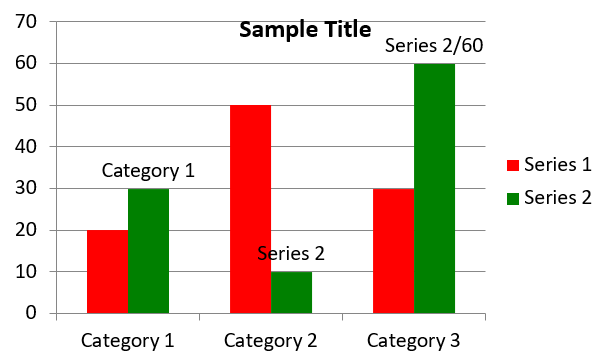

## **Översikt**

Den här artikeln ger en omfattande guide för hur du skapar och anpassar diagram med Aspose.Slides för C++. Du kommer att lära dig hur du programatiskt lägger till ett diagram på en bild, fyller det med data och tillämpar olika formateringsalternativ för att matcha dina specifika designkrav. Genom hela artikeln illustrerar detaljerade kodexempel varje steg, från initiering av presentationen och diagramobjektet till konfiguration av serier, axlar och förklaringar. Genom att följa den här guiden får du en god förståelse för hur du integrerar dynamisk diagramgenerering i dina C++‑applikationer, vilket förenklar processen att skapa databaserade presentationer.

## **Skapa ett diagram**

Diagram hjälper personer att snabbt visualisera data och få insikter som kanske inte är omedelbart uppenbara från en tabell eller ett kalkylblad.

**Varför skapa diagram?**

Med diagram kan du:

* aggregera, komprimera eller sammanfatta stora mängder data på en enda bild i en presentation;
* avslöja mönster och trender i data;
* avgöra riktning och momentum för data över tid eller i förhållande till en specifik mätenhet;
* identifiera avvikande värden, avvikelser, fel och meningslös data;
* kommunicera eller presentera komplexa data.

I PowerPoint kan du skapa diagram via *Insert*-funktionen, som tillhandahåller mallar för att designa många diagramtyper. Med Aspose.Slides kan du skapa både vanliga diagram (baserade på populära diagramtyper) och anpassade diagram.

{}
Använd uppräkningen [ChartType](https://reference.aspose.com/slides/cpp/aspose.slides.charts/charttype/) under namnrymden [Aspose::Slides::Charts](https://reference.aspose.com/slides/cpp/aspose.slides.charts/). Värdena i denna uppräkning motsvarar olika diagramtyper.
{}

### **Skapa staplade kolumndiagram**

Detta exempel använder [AddChart](https://reference.aspose.com/slides/cpp/aspose.slides/ishapecollection/addchart/) för att skapa ett staplat kolumndiagram som jämför två serier över tre kategorier. Serierna använder röd och grön fyllning, och enskilda etiketter visar kategorinamnen, serienamnen och värdena. Arbetsbladindex 0 refererar till det första bladet i den inbäddade diagramarbetsboken.

```cpp
#include <system/shared_ptr.h>
#include <system/object_ext.h>
#include <system/string.h>
#include <drawing/color.h>
#include <DOM/Chart/ChartType.h>
#include <DOM/Chart/IChartCategoryCollection.h>
#include <DOM/Chart/IChartData.h>
#include <DOM/Chart/IChartDataCell.h>
#include <DOM/Chart/IChartDataPoint.h>
#include <DOM/Chart/IChartDataPointCollection.h>
#include <DOM/Chart/IChartDataWorkbook.h>
#include <DOM/Chart/IChartSeries.h>
#include <DOM/Chart/IChartSeriesCollection.h>
#include <DOM/Chart/IChartTitle.h>
#include <DOM/Chart/IDataLabel.h>
#include <DOM/Chart/IDataLabelCollection.h>
#include <DOM/Chart/IDataLabelFormat.h>
#include <DOM/Chart/IDoubleChartValue.h>
#include <DOM/Chart/IFormat.h>
#include <DOM/FillType.h>
#include <DOM/IChart.h>
#include <DOM/IColorFormat.h>
#include <DOM/IFillFormat.h>
#include <DOM/ILineFillFormat.h>
#include <DOM/ILineFormat.h>
#include <DOM/IShapeCollection.h>
#include <DOM/ISlide.h>
#include <DOM/ITextFrame.h>
#include <DOM/ITextFrameFormat.h>
#include <DOM/NullableBool.h>
#include <DOM/Presentation.h>
#include <Export/SaveFormat.h>

using namespace System;
using namespace System::Drawing;
using namespace Aspose::Slides;
using namespace Aspose::Slides::Charts;
using namespace Aspose::Slides::Export;

auto presentation = MakeObject<Presentation>();
auto slide = presentation->get_Slide(0);

auto chart = slide->get_Shapes()->AddChart(ChartType::ClusteredColumn, 20, 20, 500, 300);

chart->get_ChartTitle()->AddTextFrameForOverriding(u"Sample Title");
chart->get_ChartTitle()->get_TextFrameForOverriding()->get_TextFrameFormat()->set_CenterText(NullableBool::True);
chart->get_ChartTitle()->set_Height(20);
chart->set_HasTitle(true);

auto workbook = chart->get_ChartData()->get_ChartDataWorkbook();
auto worksheetIndex = 0;

chart->get_ChartData()->get_Series()->Clear();
chart->get_ChartData()->get_Categories()->Clear();

auto seriesNameCell = workbook->GetCell(worksheetIndex, 0, 1, ObjectExt::Box(String(u"Series 1")));
chart->get_ChartData()->get_Series()->Add(seriesNameCell, chart->get_Type());
seriesNameCell = workbook->GetCell(worksheetIndex, 0, 2, ObjectExt::Box(String(u"Series 2")));
chart->get_ChartData()->get_Series()->Add(seriesNameCell, chart->get_Type());

auto categoryCell = workbook->GetCell(worksheetIndex, 1, 0, ObjectExt::Box(String(u"Category 1")));
chart->get_ChartData()->get_Categories()->Add(categoryCell);
categoryCell = workbook->GetCell(worksheetIndex, 2, 0, ObjectExt::Box(String(u"Category 2")));
chart->get_ChartData()->get_Categories()->Add(categoryCell);
categoryCell = workbook->GetCell(worksheetIndex, 3, 0, ObjectExt::Box(String(u"Category 3")));
chart->get_ChartData()->get_Categories()->Add(categoryCell);

auto series = chart->get_ChartData()->get_Series()->idx_get(0);

auto valueCell = workbook->GetCell(worksheetIndex, 1, 1, ObjectExt::Box(20));
series->get_DataPoints()->AddDataPointForBarSeries(valueCell);
valueCell = workbook->GetCell(worksheetIndex, 2, 1, ObjectExt::Box(50));
series->get_DataPoints()->AddDataPointForBarSeries(valueCell);
valueCell = workbook->GetCell(worksheetIndex, 3, 1, ObjectExt::Box(30));
series->get_DataPoints()->AddDataPointForBarSeries(valueCell);

series->get_Format()->get_Fill()->set_FillType(FillType::Solid);
series->get_Format()->get_Fill()->get_SolidFillColor()->set_Color(Color::get_Red());

series = chart->get_ChartData()->get_Series()->idx_get(1);

valueCell = workbook->GetCell(worksheetIndex, 1, 2, ObjectExt::Box(30));
series->get_DataPoints()->AddDataPointForBarSeries(valueCell);
valueCell = workbook->GetCell(worksheetIndex, 2, 2, ObjectExt::Box(10));
series->get_DataPoints()->AddDataPointForBarSeries(valueCell);
valueCell = workbook->GetCell(worksheetIndex, 3, 2, ObjectExt::Box(60));
series->get_DataPoints()->AddDataPointForBarSeries(valueCell);

series->get_Format()->get_Fill()->set_FillType(FillType::Solid);
series->get_Format()->get_Fill()->get_SolidFillColor()->set_Color(Color::get_Green());

auto label = series->get_DataPoints()->idx_get(0)->get_Label();
label->get_DataLabelFormat()->set_ShowCategoryName(true);

label = series->get_DataPoints()->idx_get(1)->get_Label();
label->get_DataLabelFormat()->set_ShowSeriesName(true);

label = series->get_DataPoints()->idx_get(2)->get_Label();
label->get_DataLabelFormat()->set_ShowValue(true);
label->get_DataLabelFormat()->set_ShowSeriesName(true);
label->get_DataLabelFormat()->set_Separator(u"/");

presentation->Save(u"AsposeChart.pptx", SaveFormat::Pptx);
```

Resultatet:



### **Skapa spridningsdiagram**

Spridningsdiagram (även kallade scatter plots eller x‑y‑grafer) används ofta för att kontrollera mönster eller demonstrera korrelationer mellan två variabler.

Använd ett spridningsdiagram när:

* du har parade numeriska data;
* du har två variabler som passar bra ihop;
* du vill avgöra om de två variablerna är relaterade;
* du har en oberoende variabel som har flera värden för en beroende variabel.

Detta exempel plotar två uppsättningar x‑y‑värden. Den första serien använder raka linjer med stjärnmärkare, medan den andra använder jämna linjer med cirkelmärken; båda använder en markörstorlek på 10, satt med [set_Size](https://reference.aspose.com/slides/cpp/aspose.slides.charts/imarker/set_size/). Metoden [set_Symbol](https://reference.aspose.com/slides/cpp/aspose.slides.charts/imarker/set_symbol/) styr markörens form.

```cpp
#include <system/shared_ptr.h>
#include <system/object_ext.h>
#include <system/string.h>
#include <DOM/Chart/ChartType.h>
#include <DOM/Chart/IChartCategoryCollection.h>
#include <DOM/Chart/IChartData.h>
#include <DOM/Chart/IChartDataCell.h>
#include <DOM/Chart/IChartDataPoint.h>
#include <DOM/Chart/IChartDataPointCollection.h>
#include <DOM/Chart/IChartDataWorkbook.h>
#include <DOM/Chart/IChartSeries.h>
#include <DOM/Chart/IChartSeriesCollection.h>
#include <DOM/Chart/IDoubleChartValue.h>
#include <DOM/Chart/IFormat.h>
#include <DOM/Chart/IMarker.h>
#include <DOM/Chart/MarkerStyleType.h>
#include <DOM/IChart.h>
#include <DOM/IColorFormat.h>
#include <DOM/IFillFormat.h>
#include <DOM/ILineFillFormat.h>
#include <DOM/ILineFormat.h>
#include <DOM/IShapeCollection.h>
#include <DOM/ISlide.h>
#include <DOM/Presentation.h>
#include <Export/SaveFormat.h>

using namespace System;
using namespace Aspose::Slides;
using namespace Aspose::Slides::Charts;
using namespace Aspose::Slides::Export;

auto presentation = MakeObject<Presentation>();
auto slide = presentation->get_Slide(0);

auto chart = slide->get_Shapes()->AddChart(ChartType::ScatterWithSmoothLines, 20, 20, 500, 300);

auto workbook = chart->get_ChartData()->get_ChartDataWorkbook();
auto worksheetIndex = 0;

chart->get_ChartData()->get_Series()->Clear();

auto seriesNameCell = workbook->GetCell(worksheetIndex, 1, 1, ObjectExt::Box(String(u"Series 1")));
chart->get_ChartData()->get_Series()->Add(seriesNameCell, chart->get_Type());
seriesNameCell = workbook->GetCell(worksheetIndex, 1, 3, ObjectExt::Box(String(u"Series 2")));
chart->get_ChartData()->get_Series()->Add(seriesNameCell, chart->get_Type());

auto series = chart->get_ChartData()->get_Series()->idx_get(0);

auto xValueCell = workbook->GetCell(worksheetIndex, 2, 1, ObjectExt::Box(1));
auto yValueCell = workbook->GetCell(worksheetIndex, 2, 2, ObjectExt::Box(3));
series->get_DataPoints()->AddDataPointForScatterSeries(xValueCell, yValueCell);

xValueCell = workbook->GetCell(worksheetIndex, 3, 1, ObjectExt::Box(2));
yValueCell = workbook->GetCell(worksheetIndex, 3, 2, ObjectExt::Box(10));
series->get_DataPoints()->AddDataPointForScatterSeries(xValueCell, yValueCell);

series->set_Type(ChartType::ScatterWithStraightLinesAndMarkers);

series->get_Marker()->set_Size(10);
series->get_Marker()->set_Symbol(MarkerStyleType::Star);

series = chart->get_ChartData()->get_Series()->idx_get(1);

xValueCell = workbook->GetCell(worksheetIndex, 2, 3, ObjectExt::Box(5));
yValueCell = workbook->GetCell(worksheetIndex, 2, 4, ObjectExt::Box(2));
series->get_DataPoints()->AddDataPointForScatterSeries(xValueCell, yValueCell);

xValueCell = workbook->GetCell(worksheetIndex, 3, 3, ObjectExt::Box(3));
yValueCell = workbook->GetCell(worksheetIndex, 3, 4, ObjectExt::Box(1));
series->get_DataPoints()->AddDataPointForScatterSeries(xValueCell, yValueCell);

xValueCell = workbook->GetCell(worksheetIndex, 4, 3, ObjectExt::Box(2));
yValueCell = workbook->GetCell(worksheetIndex, 4, 4, ObjectExt::Box(2));
series->get_DataPoints()->AddDataPointForScatterSeries(xValueCell, yValueCell);

xValueCell = workbook->GetCell(worksheetIndex, 5, 3, ObjectExt::Box(5));
yValueCell = workbook->GetCell(worksheetIndex, 5, 4, ObjectExt::Box(1));
series->get_DataPoints()->AddDataPointForScatterSeries(xValueCell, yValueCell);

series->get_Marker()->set_Size(10);
series->get_Marker()->set_Symbol(MarkerStyleType::Circle);

presentation->Save(u"AsposeChart.pptx", SaveFormat::Pptx);
```

Resultatet:


### **Skapa pajdiagram**

Pajdiagram är bäst för att visa förhållandet del‑till‑helhet i data, särskilt när data innehåller kategoriska etiketter med numeriska värden. Om dina data innehåller många delar eller etiketter kan det dock vara bättre att använda ett stapeldiagram.

Detta exempel skapar ett pajdiagram med tre kvartalsvärden. Varje skiva har en anpassad fyllning och kant, och etiketterna visar olika kombinationer av värden, procentsatser och seriesinformation. Metoden [set_FirstSliceAngle](https://reference.aspose.com/slides/cpp/aspose.slides.charts/ichartseriesgroup/set_firstsliceangle/) sätter den första skivan att börja vid 180 grader.

```cpp
#include <system/shared_ptr.h>
#include <system/object_ext.h>
#include <system/string.h>
#include <drawing/color.h>
#include <DOM/Chart/ChartType.h>
#include <DOM/Chart/IChartCategoryCollection.h>
#include <DOM/Chart/IChartData.h>
#include <DOM/Chart/IChartDataCell.h>
#include <DOM/Chart/IChartDataPoint.h>
#include <DOM/Chart/IChartDataPointCollection.h>
#include <DOM/Chart/IChartDataWorkbook.h>
#include <DOM/Chart/IChartSeries.h>
#include <DOM/Chart/IChartSeriesCollection.h>
#include <DOM/Chart/IChartSeriesGroup.h>
#include <DOM/Chart/IChartSeriesGroupCollection.h>
#include <DOM/Chart/IChartTextFormat.h>
#include <DOM/Chart/IChartTitle.h>
#include <DOM/Chart/IDataLabel.h>
#include <DOM/Chart/IDataLabelCollection.h>
#include <DOM/Chart/IDataLabelFormat.h>
#include <DOM/Chart/IDoubleChartValue.h>
#include <DOM/Chart/IFormat.h>
#include <DOM/Chart/ILegend.h>
#include <DOM/FillType.h>
#include <DOM/IChart.h>
#include <DOM/IColorFormat.h>
#include <DOM/IFillFormat.h>
#include <DOM/ILineFillFormat.h>
#include <DOM/ILineFormat.h>
#include <DOM/IPortionFormat.h>
#include <DOM/IShapeCollection.h>
#include <DOM/ISlide.h>
#include <DOM/ITextFrame.h>
#include <DOM/ITextFrameFormat.h>
#include <DOM/LineDashStyle.h>
#include <DOM/LineStyle.h>
#include <DOM/NullableBool.h>
#include <DOM/Presentation.h>
#include <Export/SaveFormat.h>

using namespace System;
using namespace System::Drawing;
using namespace Aspose::Slides;
using namespace Aspose::Slides::Charts;
using namespace Aspose::Slides::Export;

auto presentation = MakeObject<Presentation>();
auto slide = presentation->get_Slide(0);

auto chart = slide->get_Shapes()->AddChart(ChartType::Pie, 20, 20, 500, 300);

chart->get_ChartTitle()->AddTextFrameForOverriding(u"Sample Title");
chart->get_ChartTitle()->get_TextFrameForOverriding()->get_TextFrameFormat()->set_CenterText(NullableBool::True);
chart->get_ChartTitle()->set_Height(20);
chart->set_HasTitle(true);

chart->get_ChartData()->get_Series()->idx_get(0)->get_Labels()->get_DefaultDataLabelFormat()->set_ShowValue(true);

auto workbook = chart->get_ChartData()->get_ChartDataWorkbook();
auto worksheetIndex = 0;

chart->get_ChartData()->get_Series()->Clear();
chart->get_ChartData()->get_Categories()->Clear();

auto categoryCell = workbook->GetCell(0, 1, 0, ObjectExt::Box(String(u"1st Qtr")));
chart->get_ChartData()->get_Categories()->Add(categoryCell);
categoryCell = workbook->GetCell(0, 2, 0, ObjectExt::Box(String(u"2nd Qtr")));
chart->get_ChartData()->get_Categories()->Add(categoryCell);
categoryCell = workbook->GetCell(0, 3, 0, ObjectExt::Box(String(u"3rd Qtr")));
chart->get_ChartData()->get_Categories()->Add(categoryCell);

auto seriesNameCell = workbook->GetCell(0, 0, 1, ObjectExt::Box(String(u"Series 1")));
auto series = chart->get_ChartData()->get_Series()->Add(seriesNameCell, chart->get_Type());

auto valueCell = workbook->GetCell(worksheetIndex, 1, 1, ObjectExt::Box(20));
series->get_DataPoints()->AddDataPointForPieSeries(valueCell);
valueCell = workbook->GetCell(worksheetIndex, 2, 1, ObjectExt::Box(50));
series->get_DataPoints()->AddDataPointForPieSeries(valueCell);
valueCell = workbook->GetCell(worksheetIndex, 3, 1, ObjectExt::Box(30));
series->get_DataPoints()->AddDataPointForPieSeries(valueCell);

chart->get_ChartData()->get_SeriesGroups()->idx_get(0)->set_IsColorVaried(true);

auto firstSlice = series->get_DataPoints()->idx_get(0);
firstSlice->get_Format()->get_Fill()->set_FillType(FillType::Solid);
firstSlice->get_Format()->get_Fill()->get_SolidFillColor()->set_Color(Color::get_Cyan());

firstSlice->get_Format()->get_Line()->get_FillFormat()->set_FillType(FillType::Solid);
firstSlice->get_Format()->get_Line()->get_FillFormat()->get_SolidFillColor()->set_Color(Color::get_Gray());
firstSlice->get_Format()->get_Line()->set_Width(3.0);
firstSlice->get_Format()->get_Line()->set_Style(LineStyle::ThinThick);
firstSlice->get_Format()->get_Line()->set_DashStyle(LineDashStyle::LargeDash);

auto secondSlice = series->get_DataPoints()->idx_get(1);
secondSlice->get_Format()->get_Fill()->set_FillType(FillType::Solid);
secondSlice->get_Format()->get_Fill()->get_SolidFillColor()->set_Color(Color::get_Brown());

secondSlice->get_Format()->get_Line()->get_FillFormat()->set_FillType(FillType::Solid);
secondSlice->get_Format()->get_Line()->get_FillFormat()->get_SolidFillColor()->set_Color(Color::get_Blue());
secondSlice->get_Format()->get_Line()->set_Width(3.0);
secondSlice->get_Format()->get_Line()->set_Style(LineStyle::Single);
secondSlice->get_Format()->get_Line()->set_DashStyle(LineDashStyle::LargeDashDot);

auto thirdSlice = series->get_DataPoints()->idx_get(2);
thirdSlice->get_Format()->get_Fill()->set_FillType(FillType::Solid);
thirdSlice->get_Format()->get_Fill()->get_SolidFillColor()->set_Color(Color::get_Coral());

thirdSlice->get_Format()->get_Line()->get_FillFormat()->set_FillType(FillType::Solid);
thirdSlice->get_Format()->get_Line()->get_FillFormat()->get_SolidFillColor()->set_Color(Color::get_Red());
thirdSlice->get_Format()->get_Line()->set_Width(2.0);
thirdSlice->get_Format()->get_Line()->set_Style(LineStyle::ThinThin);
thirdSlice->get_Format()->get_Line()->set_DashStyle(LineDashStyle::LargeDashDotDot);

auto firstLabel = series->get_DataPoints()->idx_get(0)->get_Label();
firstLabel->get_DataLabelFormat()->set_ShowValue(true);

auto secondLabel = series->get_DataPoints()->idx_get(1)->get_Label();
secondLabel->get_DataLabelFormat()->set_ShowValue(true);
secondLabel->get_DataLabelFormat()->set_ShowLegendKey(true);
secondLabel->get_DataLabelFormat()->set_ShowPercentage(true);

auto thirdLabel = series->get_DataPoints()->idx_get(2)->get_Label();
thirdLabel->get_DataLabelFormat()->set_ShowSeriesName(true);
thirdLabel->get_DataLabelFormat()->set_ShowPercentage(true);

series->get_Labels()->get_DefaultDataLabelFormat()->set_ShowLeaderLines(true);

chart->get_ChartData()->get_SeriesGroups()->idx_get(0)->set_FirstSliceAngle(180);

presentation->Save(u"PieChart.pptx", SaveFormat::Pptx);
```

Resultatet:


För att förbättra läsbarheten för etiketter utanför pajen, se [Format Leader Lines](/slides/sv/cpp/chart-data-label/#format-leader-lines) för ett exempel som positionerar etiketter och anpassar linjernas färg, bredd, transparens och streckad stil.

### **Skapa linjediagram**

Linjediagram (också kallade linjediagram) är bäst i situationer där du vill demonstrera förändringar i värde över tid. Med ett linjediagram kan du jämföra en stor mängd data samtidigt, spåra förändringar och trender över tid, markera avvikelser i dataserier och mer.

Detta exempel använder [AddChart](https://reference.aspose.com/slides/cpp/aspose.slides/ishapecollection/addchart/) för att skapa ett linjediagram med standardserier och -kategorier, och sparar sedan presentationen som PPTX.

```cpp
#include <system/shared_ptr.h>
#include <DOM/Chart/ChartType.h>
#include <DOM/Chart/IChartCategoryCollection.h>
#include <DOM/Chart/IChartData.h>
#include <DOM/Chart/IChartSeriesCollection.h>
#include <DOM/Chart/IFormat.h>
#include <DOM/IChart.h>
#include <DOM/IColorFormat.h>
#include <DOM/IFillFormat.h>
#include <DOM/ILineFillFormat.h>
#include <DOM/ILineFormat.h>
#include <DOM/IShapeCollection.h>
#include <DOM/ISlide.h>
#include <DOM/Presentation.h>
#include <Export/SaveFormat.h>

using namespace System;
using namespace Aspose::Slides;
using namespace Aspose::Slides::Charts;
using namespace Aspose::Slides::Export;

auto presentation = MakeObject<Presentation>();
auto slide = presentation->get_Slide(0);

auto lineChart = slide->get_Shapes()->AddChart(ChartType::Line, 20, 20, 500, 300);

presentation->Save(u"lineChart.pptx", SaveFormat::Pptx);
```

Som standard förenas punkterna i ett linjediagram med raka kontinuerliga linjer. Vill du att punkterna ska förenas med streck istället, anropa [set_DashStyle](https://reference.aspose.com/slides/cpp/aspose.slides/ilineformat/set_dashstyle/) med ett värde från [LineDashStyle](https://reference.aspose.com/slides/cpp/aspose.slides/linedashstyle/):

```cpp
#include <system/shared_ptr.h>
#include <DOM/Chart/ChartType.h>
#include <DOM/Chart/IChartCategoryCollection.h>
#include <DOM/Chart/IChartData.h>
#include <DOM/Chart/IChartSeries.h>
#include <DOM/Chart/IChartSeriesCollection.h>
#include <DOM/Chart/IFormat.h>
#include <DOM/IChart.h>
#include <DOM/IColorFormat.h>
#include <DOM/IFillFormat.h>
#include <DOM/ILineFillFormat.h>
#include <DOM/ILineFormat.h>
#include <DOM/IShapeCollection.h>
#include <DOM/ISlide.h>
#include <DOM/LineDashStyle.h>
#include <DOM/Presentation.h>

using namespace System;
using namespace Aspose::Slides;
using namespace Aspose::Slides::Charts;

auto presentation = MakeObject<Presentation>();
auto slide = presentation->get_Slide(0);

auto lineChart = slide->get_Shapes()->AddChart(ChartType::Line, 20, 20, 500, 300);

for (auto series : lineChart->get_ChartData()->get_Series())
{
    series->get_Format()->get_Line()->set_DashStyle(LineDashStyle::Dash);
}
```

Resultatet:


### **Skapa trädstrukturdiagram**

Trädstrukturdiagram är bäst för försäljningsdata när du vill visa den relativa storleken på datakategorier och snabbt rikta uppmärksamheten mot objekt som är stora bidragsgivare inom varje kategori.

Detta exempel skapar ett trädstrukturdiagram med åtta löv grupperade i fyra stammar och två grenar. Metoden [SetGroupingItem](https://reference.aspose.com/slides/cpp/aspose.slides.charts/ichartcategorylevelsmanager/setgroupingitem/) tilldelar stammar på grupperingnivå 1 och grenar på nivå 2. Värdena bestämmer de relativa rektangelstorlekarna, medan kategori‑etiketter och överlappande överordnade etiketter identifierar hierarkin.

```cpp
#include <system/shared_ptr.h>
#include <system/object_ext.h>
#include <system/string.h>
#include <DOM/Chart/ChartType.h>
#include <DOM/Chart/IChartCategory.h>
#include <DOM/Chart/IChartCategoryCollection.h>
#include <DOM/Chart/IChartCategoryLevelsManager.h>
#include <DOM/Chart/IChartData.h>
#include <DOM/Chart/IChartDataCell.h>
#include <DOM/Chart/IChartDataPoint.h>
#include <DOM/Chart/IChartDataPointCollection.h>
#include <DOM/Chart/IChartDataWorkbook.h>
#include <DOM/Chart/IChartSeries.h>
#include <DOM/Chart/IChartSeriesCollection.h>
#include <DOM/Chart/IDataLabel.h>
#include <DOM/Chart/IDataLabelCollection.h>
#include <DOM/Chart/IDataLabelFormat.h>
#include <DOM/Chart/IFormat.h>
#include <DOM/Chart/ParentLabelLayoutType.h>
#include <DOM/IChart.h>
#include <DOM/IColorFormat.h>
#include <DOM/IFillFormat.h>
#include <DOM/ILineFillFormat.h>
#include <DOM/ILineFormat.h>
#include <DOM/IShapeCollection.h>
#include <DOM/ISlide.h>
#include <DOM/Presentation.h>
#include <Export/SaveFormat.h>

using namespace System;
using namespace Aspose::Slides;
using namespace Aspose::Slides::Charts;
using namespace Aspose::Slides::Export;

auto presentation = MakeObject<Presentation>();
auto slide = presentation->get_Slide(0);

auto chart = slide->get_Shapes()->AddChart(ChartType::Treemap, 20, 20, 500, 300);

chart->get_ChartData()->get_Categories()->Clear();
chart->get_ChartData()->get_Series()->Clear();

auto workbook = chart->get_ChartData()->get_ChartDataWorkbook();
workbook->Clear(0);

// Gren 1
auto categoryCell = workbook->GetCell(0, u"C1", ObjectExt::Box(String(u"Leaf1")));
auto leaf = chart->get_ChartData()->get_Categories()->Add(categoryCell);
leaf->get_GroupingLevels()->SetGroupingItem(1, ObjectExt::Box(String(u"Stem1")));
leaf->get_GroupingLevels()->SetGroupingItem(2, ObjectExt::Box(String(u"Branch1")));

categoryCell = workbook->GetCell(0, u"C2", ObjectExt::Box(String(u"Leaf2")));
chart->get_ChartData()->get_Categories()->Add(categoryCell);

categoryCell = workbook->GetCell(0, u"C3", ObjectExt::Box(String(u"Leaf3")));
leaf = chart->get_ChartData()->get_Categories()->Add(categoryCell);
leaf->get_GroupingLevels()->SetGroupingItem(1, ObjectExt::Box(String(u"Stem2")));

categoryCell = workbook->GetCell(0, u"C4", ObjectExt::Box(String(u"Leaf4")));
chart->get_ChartData()->get_Categories()->Add(categoryCell);

// Gren 2
categoryCell = workbook->GetCell(0, u"C5", ObjectExt::Box(String(u"Leaf5")));
leaf = chart->get_ChartData()->get_Categories()->Add(categoryCell);
leaf->get_GroupingLevels()->SetGroupingItem(1, ObjectExt::Box(String(u"Stem3")));
leaf->get_GroupingLevels()->SetGroupingItem(2, ObjectExt::Box(String(u"Branch2")));

categoryCell = workbook->GetCell(0, u"C6", ObjectExt::Box(String(u"Leaf6")));
chart->get_ChartData()->get_Categories()->Add(categoryCell);

categoryCell = workbook->GetCell(0, u"C7", ObjectExt::Box(String(u"Leaf7")));
leaf = chart->get_ChartData()->get_Categories()->Add(categoryCell);
leaf->get_GroupingLevels()->SetGroupingItem(1, ObjectExt::Box(String(u"Stem4")));

categoryCell = workbook->GetCell(0, u"C8", ObjectExt::Box(String(u"Leaf8")));
chart->get_ChartData()->get_Categories()->Add(categoryCell);

auto series = chart->get_ChartData()->get_Series()->Add(ChartType::Treemap);
series->get_Labels()->get_DefaultDataLabelFormat()->set_ShowCategoryName(true);
auto valueCell = workbook->GetCell(0, u"D1", ObjectExt::Box(4));
series->get_DataPoints()->AddDataPointForTreemapSeries(valueCell);
valueCell = workbook->GetCell(0, u"D2", ObjectExt::Box(5));
series->get_DataPoints()->AddDataPointForTreemapSeries(valueCell);
valueCell = workbook->GetCell(0, u"D3", ObjectExt::Box(3));
series->get_DataPoints()->AddDataPointForTreemapSeries(valueCell);
valueCell = workbook->GetCell(0, u"D4", ObjectExt::Box(6));
series->get_DataPoints()->AddDataPointForTreemapSeries(valueCell);
valueCell = workbook->GetCell(0, u"D5", ObjectExt::Box(9));
series->get_DataPoints()->AddDataPointForTreemapSeries(valueCell);
valueCell = workbook->GetCell(0, u"D6", ObjectExt::Box(9));
series->get_DataPoints()->AddDataPointForTreemapSeries(valueCell);
valueCell = workbook->GetCell(0, u"D7", ObjectExt::Box(4));
series->get_DataPoints()->AddDataPointForTreemapSeries(valueCell);
valueCell = workbook->GetCell(0, u"D8", ObjectExt::Box(3));
series->get_DataPoints()->AddDataPointForTreemapSeries(valueCell);

series->set_ParentLabelLayout(ParentLabelLayoutType::Overlapping);

presentation->Save(u"Treemap.pptx", SaveFormat::Pptx);
```

Resultatet:


### **Skapa waterfall‑diagram**

Ett waterfall‑diagram visar hur positiva och negativa förändringar bidrar till ett slutvärde. Till exempel kan en vinstuppdelning börja med intäkter, subtrahera kostnader och lägga till annan inkomst. Ändringskolumner svävar mellan föregående och nytt löpande värde, medan total‑kolumner sträcker sig från noll till det ackumulerade värdet.

Följande exempel använder belopp i tusental amerikanska dollar:

| Category | Workbook value | Column type |
| --- | ---: | --- |
| Revenue | 1000 | Increase |
| Cost of sales | -400 | Decrease |
| Gross profit | 600 | Intermediate total |
| Operating expenses | -200 | Decrease |
| Other income | 50 | Increase |
| Net profit | 450 | Final total |

För att markera en punkt som en mellantotal eller sluttotal, anropa dess [set_SetAsTotal](https://reference.aspose.com/slides/cpp/aspose.slides.charts/chartdatapoint/set_setastotal/) med `true`. Ange det faktiska ackumulerade beloppet i den punktens arbetsbokscell: `600` för bruttovinst (`1000 - 400`) och `450` för nettovinst (`600 - 200 + 50`). Metoden markerar kolumnen som total; den beräknar eller fyller inte i cellvärdet. Använd inte noll som platshållare eller ange en annan förändring för en totalpunkt. En total‑kolumn visar det ackumulerade värdet utan att lägga till det igen till det löpande värdet.

Detta kompletta C++‑exempel skapar ett diagram med `Waterfall`‑medlemmen i [ChartType](https://reference.aspose.com/slides/cpp/aspose.slides.charts/charttype/), rensar standarddata och fyller den inbäddade arbetsboken. Arbetsbladsindex `0` väljer det första arbetsbladet; kolumn A innehåller kategorinamnen och kolumn B innehåller värdena. Varje värdecell läggs till med [AddDataPointForWaterfallSeries](https://reference.aspose.com/slides/cpp/aspose.slides.charts/ichartdatapointcollection/adddatapointforwaterfallseries/). De nollbaserade punktindexen `2` och `5` identifierar respektive mellantotal och sluttotal. Genom att skicka `true` till [set_ShowValue](https://reference.aspose.com/slides/cpp/aspose.slides.charts/idatalabelformat/set_showvalue/) visas beloppen på kolumnerna. Ingen ingångspresentation eller arbetsbok krävs.

```cpp
#include <system/shared_ptr.h>
#include <system/object_ext.h>
#include <system/string.h>
#include <system/array.h>
#include <DOM/Chart/ChartType.h>
#include <DOM/Chart/IChartCategoryCollection.h>
#include <DOM/Chart/IChartData.h>
#include <DOM/Chart/IChartDataCell.h>
#include <DOM/Chart/IChartDataPoint.h>
#include <DOM/Chart/IChartDataPointCollection.h>
#include <DOM/Chart/IChartDataWorkbook.h>
#include <DOM/Chart/IChartSeries.h>
#include <DOM/Chart/IChartSeriesCollection.h>
#include <DOM/Chart/IChartTextFormat.h>
#include <DOM/Chart/IChartTitle.h>
#include <DOM/Chart/IDataLabel.h>
#include <DOM/Chart/IDataLabelCollection.h>
#include <DOM/Chart/IDataLabelFormat.h>
#include <DOM/Chart/IDoubleChartValue.h>
#include <DOM/Chart/IFormat.h>
#include <DOM/Chart/ILegend.h>
#include <DOM/IChart.h>
#include <DOM/IColorFormat.h>
#include <DOM/IFillFormat.h>
#include <DOM/ILineFillFormat.h>
#include <DOM/ILineFormat.h>
#include <DOM/IPortionFormat.h>
#include <DOM/IShapeCollection.h>
#include <DOM/ISlide.h>
#include <DOM/ITextFrame.h>
#include <DOM/ITextFrameFormat.h>
#include <DOM/NullableBool.h>
#include <DOM/Presentation.h>
#include <Export/SaveFormat.h>

using namespace System;
using namespace Aspose::Slides;
using namespace Aspose::Slides::Charts;
using namespace Aspose::Slides::Export;

auto presentation = MakeObject<Presentation>();
auto slide = presentation->get_Slide(0);

auto chart = slide->get_Shapes()->AddChart(ChartType::Waterfall, 20, 20, 680, 200);

chart->set_HasTitle(true);
chart->get_ChartTitle()->AddTextFrameForOverriding(u"Profit breakdown (USD thousands)");
chart->get_ChartTitle()->set_Overlay(false);
chart->set_HasLegend(false);

chart->get_ChartData()->get_Series()->Clear();
chart->get_ChartData()->get_Categories()->Clear();

auto workbook = chart->get_ChartData()->get_ChartDataWorkbook();
auto worksheetIndex = 0;

workbook->Clear(worksheetIndex);

auto seriesNameCell = workbook->GetCell(worksheetIndex, 0, 1, ObjectExt::Box(String(u"Profit")));
auto series = chart->get_ChartData()->get_Series()->Add(seriesNameCell, ChartType::Waterfall);
auto categories = MakeArray<String>({ u"Revenue", u"Cost of sales", u"Gross profit", u"Operating expenses", u"Other income", u"Net profit" });
auto values = MakeArray<double>({ 1000, -400, 600, -200, 50, 450 });

for (auto i = 0; i < categories->get_Length(); i++)
{
    auto categoryCell = workbook->GetCell(worksheetIndex, i + 1, 0, ObjectExt::Box(categories->idx_get(i)));
    chart->get_ChartData()->get_Categories()->Add(categoryCell);
    auto valueCell = workbook->GetCell(worksheetIndex, i + 1, 1, ObjectExt::Box(values->idx_get(i)));
    series->get_DataPoints()->AddDataPointForWaterfallSeries(valueCell);
}

// Den tredje och sjätte punkten representerar totaler, inte ytterligare förändringar.
series->get_DataPoints()->idx_get(2)->set_SetAsTotal(true);
series->get_DataPoints()->idx_get(5)->set_SetAsTotal(true);
series->set_ShowConnectorLines(true);
series->get_Labels()->get_DefaultDataLabelFormat()->set_ShowValue(true);

presentation->Save(u"WaterfallChart.pptx", SaveFormat::Pptx);
```

Anropa serie‑nivåmetoden [set_ShowConnectorLines](https://reference.aspose.com/slides/cpp/aspose.slides.charts/chartseries/set_showconnectorlines/) med `true` för att visa linjer som länkar sammanhängande kolumner och underlätta spårning av löpande värde. För att dölja dessa linjer, ersätt tilldelningen i exemplet med `series->set_ShowConnectorLines(false);` före sparning. Detta förändrar endast linjens synlighet, inte data eller totaler.

Den sparade presentationen visar en bruttovinst på 600 och en nettovinst på 450, med båda totalerna ritade från noll:


### **Skapa aktiediagram**

Aktiediagram används för att visa finansiella data såsom öppnings-, högsta-, lägsta- och stängningspriser, vilket underlättar analys av marknadstrender och volatilitet. De ger viktiga insikter om aktiens prestation och hjälper investerare samt analytiker att fatta välgrundade beslut.

Detta exempel skapar ett öppning‑hög‑låg‑stängnings‑diagram med fyra serier i den ordningen och tre kategorier. Metoden [set_HasUpDownBars](https://reference.aspose.com/slides/cpp/aspose.slides.charts/iupdownbarsmanager/set_hasupdownbars/) aktiverar upp/ner‑staplar, och [get_HiLowLinesFormat](https://reference.aspose.com/slides/cpp/aspose.slides.charts/ichartseriesgroup/get_hilowlinesformat/) styr hög‑läg‑linjerna som visar prisintervallen, medan de enskilda serie‑linjerna och mindre horisontella rutnätslinjer döljs.

Hanteraren som returneras av [get_UpDownBars](https://reference.aspose.com/slides/cpp/aspose.slides.charts/ichartseriesgroup/get_updownbars/) exponerar separata formateringsobjekt via [get_UpBarsFormat](https://reference.aspose.com/slides/cpp/aspose.slides.charts/iupdownbarsmanager/get_upbarsformat/) och [get_DownBarsFormat](https://reference.aspose.com/slides/cpp/aspose.slides.charts/iupdownbarsmanager/get_downbarsformat/). Använd varje objekts [get_Fill](https://reference.aspose.com/slides/cpp/aspose.slides.charts/iformat/get_fill/) och [get_Line](https://reference.aspose.com/slides/cpp/aspose.slides.charts/iformat/get_line/) för att oberoende konfigurera fyllning och kontur. Detta exempel använder gröna staplar med mörkgrön kontur för stigande intervaller och orange‑röda staplar med mörkröd kontur för fallande intervaller.

Ange numeriska värden för alla fyra serier vid varje kategori, där Hög och Låg omsluter Öppning och Stängning. Staplarna jämför Stängning med Öppning **inom samma kategori**, inte med föregående kategori: A faller från 72 till 25, medan B stiger från 25 till 38 och C stiger från 38 till 50. Identiska öppnings‑ och stängningsvärden ger inget synligt fyllt intervall. Upp/ner‑staplar sträcker sig över Öppning‑Stängning; hög‑läg‑linjer sträcker sig över Låg‑Hög. Dessa staplar tillhör seriegruppen och är inte vanliga stapeldiagram‑serier.

Denna formatering fungerar även med [Line and LineWithMarkers](https://reference.aspose.com/slides/cpp/aspose.slides.charts/charttype/)‑diagram som innehåller minst två serier i samma grupp och motsvarande numeriska värden för varje kategori. För dessa icke‑staplade linjediagram jämför upp/ner‑staplar den första och sista serien: ett högre sista värde ger en upp‑stapel och ett lägre sista värde ger en ner‑stapel. Att vända ordningen på serierna vänder klassificeringen. Exemplet nedan använder [OpenHighLowClose](https://reference.aspose.com/slides/cpp/aspose.slides.charts/charttype/); anta inte att andra aktie‑, staplade‑linje‑ eller 3D‑varianter använder samma data‑arrangemang eller intervalltolkning.

```cpp
#include <DOM/Chart/IChartLinesFormat.h>
#include <system/shared_ptr.h>
#include <drawing/color.h>
#include <system/object_ext.h>
#include <system/string.h>
#include <DOM/Chart/ChartType.h>
#include <DOM/Chart/IAxesManager.h>
#include <DOM/Chart/IAxis.h>
#include <DOM/Chart/IChartCategoryCollection.h>
#include <DOM/Chart/IChartData.h>
#include <DOM/Chart/IChartDataCell.h>
#include <DOM/Chart/IChartDataPoint.h>
#include <DOM/Chart/IChartDataPointCollection.h>
#include <DOM/Chart/IChartDataWorkbook.h>
#include <DOM/Chart/IChartSeries.h>
#include <DOM/Chart/IChartSeriesCollection.h>
#include <DOM/Chart/IChartSeriesGroup.h>
#include <DOM/Chart/IChartSeriesGroupCollection.h>
#include <DOM/Chart/IFormat.h>
#include <DOM/Chart/IUpDownBarsManager.h>
#include <DOM/FillType.h>
#include <DOM/IChart.h>
#include <DOM/IColorFormat.h>
#include <DOM/IFillFormat.h>
#include <DOM/ILineFillFormat.h>
#include <DOM/ILineFormat.h>
#include <DOM/IShapeCollection.h>
#include <DOM/ISlide.h>
#include <DOM/Presentation.h>
#include <Export/SaveFormat.h>

using namespace System;
using namespace System::Drawing;
using namespace Aspose::Slides;
using namespace Aspose::Slides::Charts;
using namespace Aspose::Slides::Export;

auto presentation = MakeObject<Presentation>();
auto slide = presentation->get_Slide(0);

auto chart = slide->get_Shapes()->AddChart(ChartType::OpenHighLowClose, 20, 20, 500, 150, false);

auto workbook = chart->get_ChartData()->get_ChartDataWorkbook();

auto categoryCell = workbook->GetCell(0, 1, 0, ObjectExt::Box(String(u"A")));
chart->get_ChartData()->get_Categories()->Add(categoryCell);
categoryCell = workbook->GetCell(0, 2, 0, ObjectExt::Box(String(u"B")));
chart->get_ChartData()->get_Categories()->Add(categoryCell);
categoryCell = workbook->GetCell(0, 3, 0, ObjectExt::Box(String(u"C")));
chart->get_ChartData()->get_Categories()->Add(categoryCell);

auto seriesNameCell = workbook->GetCell(0, 0, 1, ObjectExt::Box(String(u"Open")));
chart->get_ChartData()->get_Series()->Add(seriesNameCell, ChartType::OpenHighLowClose);
seriesNameCell = workbook->GetCell(0, 0, 2, ObjectExt::Box(String(u"High")));
chart->get_ChartData()->get_Series()->Add(seriesNameCell, ChartType::OpenHighLowClose);
seriesNameCell = workbook->GetCell(0, 0, 3, ObjectExt::Box(String(u"Low")));
chart->get_ChartData()->get_Series()->Add(seriesNameCell, ChartType::OpenHighLowClose);
seriesNameCell = workbook->GetCell(0, 0, 4, ObjectExt::Box(String(u"Close")));
chart->get_ChartData()->get_Series()->Add(seriesNameCell, ChartType::OpenHighLowClose);

auto series = chart->get_ChartData()->get_Series()->idx_get(0);
auto valueCell = workbook->GetCell(0, 1, 1, ObjectExt::Box(72));
series->get_DataPoints()->AddDataPointForStockSeries(valueCell);
valueCell = workbook->GetCell(0, 2, 1, ObjectExt::Box(25));
series->get_DataPoints()->AddDataPointForStockSeries(valueCell);
valueCell = workbook->GetCell(0, 3, 1, ObjectExt::Box(38));
series->get_DataPoints()->AddDataPointForStockSeries(valueCell);

series = chart->get_ChartData()->get_Series()->idx_get(1);
valueCell = workbook->GetCell(0, 1, 2, ObjectExt::Box(172));
series->get_DataPoints()->AddDataPointForStockSeries(valueCell);
valueCell = workbook->GetCell(0, 2, 2, ObjectExt::Box(57));
series->get_DataPoints()->AddDataPointForStockSeries(valueCell);
valueCell = workbook->GetCell(0, 3, 2, ObjectExt::Box(57));
series->get_DataPoints()->AddDataPointForStockSeries(valueCell);

series = chart->get_ChartData()->get_Series()->idx_get(2);
valueCell = workbook->GetCell(0, 1, 3, ObjectExt::Box(12));
series->get_DataPoints()->AddDataPointForStockSeries(valueCell);
valueCell = workbook->GetCell(0, 2, 3, ObjectExt::Box(12));
series->get_DataPoints()->AddDataPointForStockSeries(valueCell);
valueCell = workbook->GetCell(0, 3, 3, ObjectExt::Box(13));
series->get_DataPoints()->AddDataPointForStockSeries(valueCell);

series = chart->get_ChartData()->get_Series()->idx_get(3);
valueCell = workbook->GetCell(0, 1, 4, ObjectExt::Box(25));
series->get_DataPoints()->AddDataPointForStockSeries(valueCell);
valueCell = workbook->GetCell(0, 2, 4, ObjectExt::Box(38));
series->get_DataPoints()->AddDataPointForStockSeries(valueCell);
valueCell = workbook->GetCell(0, 3, 4, ObjectExt::Box(50));
series->get_DataPoints()->AddDataPointForStockSeries(valueCell);

auto upDownBars = chart->get_ChartData()->get_SeriesGroups()->idx_get(0)->get_UpDownBars();
upDownBars->set_HasUpDownBars(true);

upDownBars->get_UpBarsFormat()->get_Fill()->set_FillType(FillType::Solid);
upDownBars->get_UpBarsFormat()->get_Fill()->get_SolidFillColor()->set_Color(Color::get_LimeGreen());
upDownBars->get_UpBarsFormat()->get_Line()->get_FillFormat()->set_FillType(FillType::Solid);
upDownBars->get_UpBarsFormat()->get_Line()->get_FillFormat()->get_SolidFillColor()->set_Color(Color::get_DarkGreen());
upDownBars->get_UpBarsFormat()->get_Line()->set_Width(2);

upDownBars->get_DownBarsFormat()->get_Fill()->set_FillType(FillType::Solid);
upDownBars->get_DownBarsFormat()->get_Fill()->get_SolidFillColor()->set_Color(Color::get_OrangeRed());
upDownBars->get_DownBarsFormat()->get_Line()->get_FillFormat()->set_FillType(FillType::Solid);
upDownBars->get_DownBarsFormat()->get_Line()->get_FillFormat()->get_SolidFillColor()->set_Color(Color::get_DarkRed());
upDownBars->get_DownBarsFormat()->get_Line()->set_Width(2);

chart->get_ChartData()->get_SeriesGroups()->idx_get(0)->get_HiLowLinesFormat()->get_Line()->get_FillFormat()->set_FillType(FillType::Solid);

for (auto stockSeries : chart->get_ChartData()->get_Series())
{
    stockSeries->get_Format()->get_Line()->get_FillFormat()->set_FillType(FillType::NoFill);
}

chart->get_Axes()->get_VerticalAxis()->get_MinorGridLinesFormat()->get_Line()->get_FillFormat()->set_FillType(FillType::NoFill);

presentation->Save(u"Stock-chart.pptx", SaveFormat::Pptx);
```

Resultatet, exporterat från PowerPoint:


### **Skapa låd‑ och whisker‑diagram**

Låddiagram och whisker‑diagram används för att visa datapunkternas fördelning genom att sammanfatta viktiga statistiska mått, såsom median, kvartiler och potentiella avvikande värden. De är särskilt användbara i utforskande dataanalys och statistiska studier för att snabbt förstå variabiliteten i data och identifiera anomalier.

Detta exempel skapar ett låd‑ och whisker‑diagram från sex värden. Metoden [set_QuartileMethod](https://reference.aspose.com/slides/cpp/aspose.slides.charts/ichartseries/set_quartilemethod/) väljer den exklusiva kvartilberäkningen. Exemplet aktiverar också medellinjer, medelmarkörer, inre punkter och avvikande punkter.

```cpp
#include <system/shared_ptr.h>
#include <system/object_ext.h>
#include <system/string.h>
#include <DOM/Chart/ChartType.h>
#include <DOM/Chart/IChartCategoryCollection.h>
#include <DOM/Chart/IChartData.h>
#include <DOM/Chart/IChartDataCell.h>
#include <DOM/Chart/IChartDataPoint.h>
#include <DOM/Chart/IChartDataPointCollection.h>
#include <DOM/Chart/IChartDataWorkbook.h>
#include <DOM/Chart/IChartSeries.h>
#include <DOM/Chart/IChartSeriesCollection.h>
#include <DOM/Chart/IFormat.h>
#include <DOM/Chart/IMarker.h>
#include <DOM/Chart/QuartileMethodType.h>
#include <DOM/IChart.h>
#include <DOM/IColorFormat.h>
#include <DOM/IFillFormat.h>
#include <DOM/ILineFillFormat.h>
#include <DOM/ILineFormat.h>
#include <DOM/IShapeCollection.h>
#include <DOM/ISlide.h>
#include <DOM/Presentation.h>
#include <Export/SaveFormat.h>

using namespace System;
using namespace Aspose::Slides;
using namespace Aspose::Slides::Charts;
using namespace Aspose::Slides::Export;

auto presentation = MakeObject<Presentation>();
auto slide = presentation->get_Slide(0);

auto chart = slide->get_Shapes()->AddChart(ChartType::BoxAndWhisker, 20, 20, 500, 300);

chart->get_ChartData()->get_Categories()->Clear();
chart->get_ChartData()->get_Series()->Clear();

auto workbook = chart->get_ChartData()->get_ChartDataWorkbook();
workbook->Clear(0);

auto categoryCell = workbook->GetCell(0, u"A1", ObjectExt::Box(String(u"Category 1")));
chart->get_ChartData()->get_Categories()->Add(categoryCell);
categoryCell = workbook->GetCell(0, u"A2", ObjectExt::Box(String(u"Category 2")));
chart->get_ChartData()->get_Categories()->Add(categoryCell);
categoryCell = workbook->GetCell(0, u"A3", ObjectExt::Box(String(u"Category 3")));
chart->get_ChartData()->get_Categories()->Add(categoryCell);
categoryCell = workbook->GetCell(0, u"A4", ObjectExt::Box(String(u"Category 4")));
chart->get_ChartData()->get_Categories()->Add(categoryCell);
categoryCell = workbook->GetCell(0, u"A5", ObjectExt::Box(String(u"Category 5")));
chart->get_ChartData()->get_Categories()->Add(categoryCell);
categoryCell = workbook->GetCell(0, u"A6", ObjectExt::Box(String(u"Category 6")));
chart->get_ChartData()->get_Categories()->Add(categoryCell);

auto series = chart->get_ChartData()->get_Series()->Add(ChartType::BoxAndWhisker);

series->set_QuartileMethod(QuartileMethodType::Exclusive);
series->set_ShowMeanLine(true);
series->set_ShowMeanMarkers(true);
series->set_ShowInnerPoints(true);
series->set_ShowOutlierPoints(true);

auto valueCell = workbook->GetCell(0, u"B1", ObjectExt::Box(15));
series->get_DataPoints()->AddDataPointForBoxAndWhiskerSeries(valueCell);
valueCell = workbook->GetCell(0, u"B2", ObjectExt::Box(41));
series->get_DataPoints()->AddDataPointForBoxAndWhiskerSeries(valueCell);
valueCell = workbook->GetCell(0, u"B3", ObjectExt::Box(16));
series->get_DataPoints()->AddDataPointForBoxAndWhiskerSeries(valueCell);
valueCell = workbook->GetCell(0, u"B4", ObjectExt::Box(10));
series->get_DataPoints()->AddDataPointForBoxAndWhiskerSeries(valueCell);
valueCell = workbook->GetCell(0, u"B5", ObjectExt::Box(23));
series->get_DataPoints()->AddDataPointForBoxAndWhiskerSeries(valueCell);
valueCell = workbook->GetCell(0, u"B6", ObjectExt::Box(16));
series->get_DataPoints()->AddDataPointForBoxAndWhiskerSeries(valueCell);

presentation->Save(u"BoxAndWhisker.pptx", SaveFormat::Pptx);
```

### **Skapa tratt‑diagram**

Tratt‑diagram används för att visualisera processer som involverar sekventiella steg, där datavolymen minskar när den fortskrider från ett steg till nästa. De är särskilt hjälpsamma för att analysera konverteringsgrader, identifiera flaskhalsar och spåra effektiviteten i försäljnings‑ eller marknadsföringsprocesser.

Detta exempel använder [AddChart](https://reference.aspose.com/slides/cpp/aspose.slides/ishapecollection/addchart/) för att lägga till ett tratt‑diagram på den första bilden i en befintlig presentation. Det ersätter standarddata med sex kategorier och värden från 50 till 500, och sparar sedan den uppdaterade presentationen. Indatapresentationen måste innehålla minst en bild.

```cpp
#include <system/shared_ptr.h>
#include <system/object_ext.h>
#include <system/string.h>
#include <DOM/Chart/ChartType.h>
#include <DOM/Chart/IChartCategoryCollection.h>
#include <DOM/Chart/IChartData.h>
#include <DOM/Chart/IChartDataCell.h>
#include <DOM/Chart/IChartDataPoint.h>
#include <DOM/Chart/IChartDataPointCollection.h>
#include <DOM/Chart/IChartDataWorkbook.h>
#include <DOM/Chart/IChartSeries.h>
#include <DOM/Chart/IChartSeriesCollection.h>
#include <DOM/Chart/IFormat.h>
#include <DOM/IChart.h>
#include <DOM/IColorFormat.h>
#include <DOM/IFillFormat.h>
#include <DOM/ILineFillFormat.h>
#include <DOM/ILineFormat.h>
#include <DOM/IShapeCollection.h>
#include <DOM/ISlide.h>
#include <DOM/Presentation.h>
#include <Export/SaveFormat.h>

using namespace System;
using namespace Aspose::Slides;
using namespace Aspose::Slides::Charts;
using namespace Aspose::Slides::Export;

auto presentation = MakeObject<Presentation>(u"test.pptx");
auto slide = presentation->get_Slide(0);

auto chart = slide->get_Shapes()->AddChart(ChartType::Funnel, 50, 50, 500, 400);

chart->get_ChartData()->get_Categories()->Clear();
chart->get_ChartData()->get_Series()->Clear();

auto workbook = chart->get_ChartData()->get_ChartDataWorkbook();
workbook->Clear(0);

auto categoryCell = workbook->GetCell(0, u"A1", ObjectExt::Box(String(u"Category 1")));
chart->get_ChartData()->get_Categories()->Add(categoryCell);
categoryCell = workbook->GetCell(0, u"A2", ObjectExt::Box(String(u"Category 2")));
chart->get_ChartData()->get_Categories()->Add(categoryCell);
categoryCell = workbook->GetCell(0, u"A3", ObjectExt::Box(String(u"Category 3")));
chart->get_ChartData()->get_Categories()->Add(categoryCell);
categoryCell = workbook->GetCell(0, u"A4", ObjectExt::Box(String(u"Category 4")));
chart->get_ChartData()->get_Categories()->Add(categoryCell);
categoryCell = workbook->GetCell(0, u"A5", ObjectExt::Box(String(u"Category 5")));
chart->get_ChartData()->get_Categories()->Add(categoryCell);
categoryCell = workbook->GetCell(0, u"A6", ObjectExt::Box(String(u"Category 6")));
chart->get_ChartData()->get_Categories()->Add(categoryCell);

auto series = chart->get_ChartData()->get_Series()->Add(ChartType::Funnel);

auto valueCell = workbook->GetCell(0, u"B1", ObjectExt::Box(50));
series->get_DataPoints()->AddDataPointForFunnelSeries(valueCell);
valueCell = workbook->GetCell(0, u"B2", ObjectExt::Box(100));
series->get_DataPoints()->AddDataPointForFunnelSeries(valueCell);
valueCell = workbook->GetCell(0, u"B3", ObjectExt::Box(200));
series->get_DataPoints()->AddDataPointForFunnelSeries(valueCell);
valueCell = workbook->GetCell(0, u"B4", ObjectExt::Box(300));
series->get_DataPoints()->AddDataPointForFunnelSeries(valueCell);
valueCell = workbook->GetCell(0, u"B5", ObjectExt::Box(400));
series->get_DataPoints()->AddDataPointForFunnelSeries(valueCell);
valueCell = workbook->GetCell(0, u"B6", ObjectExt::Box(500));
series->get_DataPoints()->AddDataPointForFunnelSeries(valueCell);

presentation->Save(u"Funnel.pptx", SaveFormat::Pptx);
```

Resultatet:


### **Skapa sol‑diagram**

Sol‑diagram används för att visualisera hierarkiska data, där nivåerna visas som koncentriska ringar. De hjälper till att illustrera del‑till‑helhets‑förhållanden och är idealiska för att representera nästlade kategorier och underkategorier på ett tydligt, kompakt sätt.

Detta exempel skapar ett sol‑diagram med åtta löv grupperade i fyra stammar och två grenar. Metoden [SetGroupingItem](https://reference.aspose.com/slides/cpp/aspose.slides.charts/ichartcategorylevelsmanager/setgroupingitem/) tilldelar stammar på grupperingnivå 1 och grenar på nivå 2. Kategorietiketter identifierar segmenten, och värdena bestämmer deras relativa storlekar.

```cpp
#include <system/shared_ptr.h>
#include <system/object_ext.h>
#include <system/string.h>
#include <DOM/Chart/ChartType.h>
#include <DOM/Chart/IChartCategory.h>
#include <DOM/Chart/IChartCategoryCollection.h>
#include <DOM/Chart/IChartCategoryLevelsManager.h>
#include <DOM/Chart/IChartData.h>
#include <DOM/Chart/IChartDataCell.h>
#include <DOM/Chart/IChartDataPoint.h>
#include <DOM/Chart/IChartDataPointCollection.h>
#include <DOM/Chart/IChartDataWorkbook.h>
#include <DOM/Chart/IChartSeries.h>
#include <DOM/Chart/IChartSeriesCollection.h>
#include <DOM/Chart/IDataLabel.h>
#include <DOM/Chart/IDataLabelCollection.h>
#include <DOM/Chart/IDataLabelFormat.h>
#include <DOM/Chart/IFormat.h>
#include <DOM/IChart.h>
#include <DOM/IColorFormat.h>
#include <DOM/IFillFormat.h>
#include <DOM/ILineFillFormat.h>
#include <DOM/ILineFormat.h>
#include <DOM/IShapeCollection.h>
#include <DOM/ISlide.h>
#include <DOM/Presentation.h>
#include <Export/SaveFormat.h>

using namespace System;
using namespace Aspose::Slides;
using namespace Aspose::Slides::Charts;
using namespace Aspose::Slides::Export;

auto presentation = MakeObject<Presentation>();
auto slide = presentation->get_Slide(0);

auto chart = slide->get_Shapes()->AddChart(ChartType::Sunburst, 20, 20, 500, 300);

chart->get_ChartData()->get_Categories()->Clear();
chart->get_ChartData()->get_Series()->Clear();

auto workbook = chart->get_ChartData()->get_ChartDataWorkbook();
workbook->Clear(0);

// Gren 1
auto categoryCell = workbook->GetCell(0, u"C1", ObjectExt::Box(String(u"Leaf1")));
auto leaf = chart->get_ChartData()->get_Categories()->Add(categoryCell);
leaf->get_GroupingLevels()->SetGroupingItem(1, ObjectExt::Box(String(u"Stem1")));
leaf->get_GroupingLevels()->SetGroupingItem(2, ObjectExt::Box(String(u"Branch1")));

categoryCell = workbook->GetCell(0, u"C2", ObjectExt::Box(String(u"Leaf2")));
chart->get_ChartData()->get_Categories()->Add(categoryCell);

categoryCell = workbook->GetCell(0, u"C3", ObjectExt::Box(String(u"Leaf3")));
leaf = chart->get_ChartData()->get_Categories()->Add(categoryCell);
leaf->get_GroupingLevels()->SetGroupingItem(1, ObjectExt::Box(String(u"Stem2")));

categoryCell = workbook->GetCell(0, u"C4", ObjectExt::Box(String(u"Leaf4")));
chart->get_ChartData()->get_Categories()->Add(categoryCell);

// Gren 2
categoryCell = workbook->GetCell(0, u"C5", ObjectExt::Box(String(u"Leaf5")));
leaf = chart->get_ChartData()->get_Categories()->Add(categoryCell);
leaf->get_GroupingLevels()->SetGroupingItem(1, ObjectExt::Box(String(u"Stem3")));
leaf->get_GroupingLevels()->SetGroupingItem(2, ObjectExt::Box(String(u"Branch2")));

categoryCell = workbook->GetCell(0, u"C6", ObjectExt::Box(String(u"Leaf6")));
chart->get_ChartData()->get_Categories()->Add(categoryCell);

categoryCell = workbook->GetCell(0, u"C7", ObjectExt::Box(String(u"Leaf7")));
leaf = chart->get_ChartData()->get_Categories()->Add(categoryCell);
leaf->get_GroupingLevels()->SetGroupingItem(1, ObjectExt::Box(String(u"Stem4")));

categoryCell = workbook->GetCell(0, u"C8", ObjectExt::Box(String(u"Leaf8")));
chart->get_ChartData()->get_Categories()->Add(categoryCell);

auto series = chart->get_ChartData()->get_Series()->Add(ChartType::Sunburst);
series->get_Labels()->get_DefaultDataLabelFormat()->set_ShowCategoryName(true);
auto valueCell = workbook->GetCell(0, u"D1", ObjectExt::Box(4));
series->get_DataPoints()->AddDataPointForSunburstSeries(valueCell);
valueCell = workbook->GetCell(0, u"D2", ObjectExt::Box(5));
series->get_DataPoints()->AddDataPointForSunburstSeries(valueCell);
valueCell = workbook->GetCell(0, u"D3", ObjectExt::Box(3));
series->get_DataPoints()->AddDataPointForSunburstSeries(valueCell);
valueCell = workbook->GetCell(0, u"D4", ObjectExt::Box(6));
series->get_DataPoints()->AddDataPointForSunburstSeries(valueCell);
valueCell = workbook->GetCell(0, u"D5", ObjectExt::Box(9));
series->get_DataPoints()->AddDataPointForSunburstSeries(valueCell);
valueCell = workbook->GetCell(0, u"D6", ObjectExt::Box(9));
series->get_DataPoints()->AddDataPointForSunburstSeries(valueCell);
valueCell = workbook->GetCell(0, u"D7", ObjectExt::Box(4));
series->get_DataPoints()->AddDataPointForSunburstSeries(valueCell);
valueCell = workbook->GetCell(0, u"D8", ObjectExt::Box(3));
series->get_DataPoints()->AddDataPointForSunburstSeries(valueCell);

presentation->Save(u"Sunburst.pptx", SaveFormat::Pptx);
```

Resultatet:


### **Skapa histogram‑diagram**

Histogram‑diagram visar hur numeriska värden fördelas över intervall (bins). För månadsrapporter om orderbehandlingstider, använd samma bin‑bredd och tröskelvärden för att hålla intervallen konsekventa och göra fördelningarna enklare att jämföra.

Anropa horisontell axel [set_AggregationType](https://reference.aspose.com/slides/cpp/aspose.slides.charts/iaxis/set_aggregationtype/) med ett läge från [AxisAggregationType](https://reference.aspose.com/slides/cpp/aspose.slides.charts/axisaggregationtype/). [set_BinWidth](https://reference.aspose.com/slides/cpp/aspose.slides.charts/iaxis/set_binwidth/) gäller endast för `ByBinWidth`; [set_NumberOfBins](https://reference.aspose.com/slides/cpp/aspose.slides.charts/iaxis/set_numberofbins/) gäller endast för `ByNumberOfBins`. Använd `Automatic` för att låta diagrammet välja binarna.

#### **Använd en fast bin‑bredd**

Detta exempel grupperar behandlingstider i 10‑minutersintervall, med separata bin för tider på eller under 10 minuter och över 40 minuter. Aktivera dessa bin med [set_IsUnderflowBin](https://reference.aspose.com/slides/cpp/aspose.slides.charts/iaxis/set_isunderflowbin/) och [set_IsOverflowBin](https://reference.aspose.com/slides/cpp/aspose.slides.charts/iaxis/set_isoverflowbin/). När du anger explicita tröskelvärden via [set_UnderflowBin](https://reference.aspose.com/slides/cpp/aspose.slides.charts/iaxis/set_underflowbin/) och [set_OverflowBin](https://reference.aspose.com/slides/cpp/aspose.slides.charts/iaxis/set_overflowbin/), anropa [set_IsAutomaticUnderflowBin](https://reference.aspose.com/slides/cpp/aspose.slides.charts/iaxis/set_isautomaticunderflowbin/) och [set_IsAutomaticOverflowBin](https://reference.aspose.com/slides/cpp/aspose.slides.charts/iaxis/set_isautomaticoverflowbin/) med `false`.

```cpp
#include <system/array.h>
#include <system/shared_ptr.h>
#include <system/object_ext.h>
#include <system/string.h>
#include <DOM/Chart/AxisAggregationType.h>
#include <DOM/Chart/ChartType.h>
#include <DOM/Chart/IAxesManager.h>
#include <DOM/Chart/IAxis.h>
#include <DOM/Chart/IChartCategoryCollection.h>
#include <DOM/Chart/IChartData.h>
#include <DOM/Chart/IChartDataCell.h>
#include <DOM/Chart/IChartDataPoint.h>
#include <DOM/Chart/IChartDataPointCollection.h>
#include <DOM/Chart/IChartDataWorkbook.h>
#include <DOM/Chart/IChartSeries.h>
#include <DOM/Chart/IChartSeriesCollection.h>
#include <DOM/Chart/IFormat.h>
#include <DOM/IChart.h>
#include <DOM/IColorFormat.h>
#include <DOM/IFillFormat.h>
#include <DOM/ILineFillFormat.h>
#include <DOM/ILineFormat.h>
#include <DOM/IShapeCollection.h>
#include <DOM/ISlide.h>
#include <DOM/Presentation.h>
#include <Export/SaveFormat.h>

using namespace System;
using namespace Aspose::Slides;
using namespace Aspose::Slides::Charts;
using namespace Aspose::Slides::Export;

auto presentation = MakeObject<Presentation>();
auto slide = presentation->get_Slide(0);

auto chart = slide->get_Shapes()->AddChart(ChartType::Histogram, 20, 20, 680, 200);

chart->set_HasLegend(false);
chart->set_HasTitle(false);

chart->get_ChartData()->get_Categories()->Clear();
chart->get_ChartData()->get_Series()->Clear();

auto workbook = chart->get_ChartData()->get_ChartDataWorkbook();
workbook->Clear(0);

auto series = chart->get_ChartData()->get_Series()->Add(ChartType::Histogram);
auto values = MakeArray<double>({ 5, 10, 10, 11, 15, 20, 20, 21, 25, 30, 30, 31, 35, 40, 40, 41, 50 });
for (auto i = 0; i < values->get_Length(); i++)
{
    auto valueCell = workbook->GetCell(0, i, 0, ObjectExt::Box(values[i]));
    series->get_DataPoints()->AddDataPointForHistogramSeries(valueCell);
}

auto axis = chart->get_Axes()->get_HorizontalAxis();
axis->set_AggregationType(AxisAggregationType::ByBinWidth);
axis->set_BinWidth(10);
axis->set_IsUnderflowBin(true);
axis->set_IsAutomaticUnderflowBin(false);
axis->set_UnderflowBin(10);
axis->set_IsOverflowBin(true);
axis->set_IsAutomaticOverflowBin(false);
axis->set_OverflowBin(40);

presentation->Save(u"Histogram-bin-width.pptx", SaveFormat::Pptx);
```

Presentationens PowerPoint‑visning visar bin‑antal på **3, 4, 4, 4 och 2**. Underflödes‑binet inkluderar `5, 10, 10`, så dess tröskel är inklusiv. Överflödes‑binet inkluderar endast `41, 50`, så dess tröskel är exklusiv; båda värdena lika med `40` förblir i föregående intervall. De inre binarna innehåller värden större än deras nedre gräns och mindre än eller lika med deras övre gräns.


#### **Ange antal bin**

För en fast detaljnivå i stället för fasta intervall, begär fem bin för samma data. Detta exempel har under‑ och överflödes‑bin inaktiverade. Diagrammet bestämmer bredden från data‑intervallet, så gränserna kan förändras mellan rapporter.

```cpp
#include <system/array.h>
#include <system/shared_ptr.h>
#include <system/object_ext.h>
#include <system/string.h>
#include <DOM/Chart/AxisAggregationType.h>
#include <DOM/Chart/ChartType.h>
#include <DOM/Chart/IAxesManager.h>
#include <DOM/Chart/IAxis.h>
#include <DOM/Chart/IChartCategoryCollection.h>
#include <DOM/Chart/IChartData.h>
#include <DOM/Chart/IChartDataCell.h>
#include <DOM/Chart/IChartDataPoint.h>
#include <DOM/Chart/IChartDataPointCollection.h>
#include <DOM/Chart/IChartDataWorkbook.h>
#include <DOM/Chart/IChartSeries.h>
#include <DOM/Chart/IChartSeriesCollection.h>
#include <DOM/Chart/IFormat.h>
#include <DOM/IChart.h>
#include <DOM/IColorFormat.h>
#include <DOM/IFillFormat.h>
#include <DOM/ILineFillFormat.h>
#include <DOM/ILineFormat.h>
#include <DOM/IShapeCollection.h>
#include <DOM/ISlide.h>
#include <DOM/Presentation.h>
#include <Export/SaveFormat.h>

using namespace System;
using namespace Aspose::Slides;
using namespace Aspose::Slides::Charts;
using namespace Aspose::Slides::Export;

auto presentation = MakeObject<Presentation>();
auto slide = presentation->get_Slide(0);

auto chart = slide->get_Shapes()->AddChart(ChartType::Histogram, 20, 20, 680, 200);

chart->set_HasLegend(false);
chart->set_HasTitle(false);

chart->get_ChartData()->get_Categories()->Clear();
chart->get_ChartData()->get_Series()->Clear();

auto workbook = chart->get_ChartData()->get_ChartDataWorkbook();
workbook->Clear(0);

auto series = chart->get_ChartData()->get_Series()->Add(ChartType::Histogram);
auto values = MakeArray<double>({ 5, 10, 10, 11, 15, 20, 20, 21, 25, 30, 30, 31, 35, 40, 40, 41, 50 });
for (auto i = 0; i < values->get_Length(); i++)
{
    auto valueCell = workbook->GetCell(0, i, 0, ObjectExt::Box(values[i]));
    series->get_DataPoints()->AddDataPointForHistogramSeries(valueCell);
}

auto axis = chart->get_Axes()->get_HorizontalAxis();
axis->set_AggregationType(AxisAggregationType::ByNumberOfBins);
axis->set_NumberOfBins(5);

presentation->Save(u"Histogram-bin-count.pptx", SaveFormat::Pptx);
```

De fem binarna har antal **4, 4, 4, 4 och 1**. Jämför denna fördelning med resultatet från fast bredd ovan: indata är identiska, men gränserna skiljer sig.


### **Skapa radardiagram**

Radardiagram används för att visa multivariata data i ett tvådimensionellt format, vilket möjliggör enkel jämförelse av flera variabler samtidigt. De är särskilt användbara för att identifiera mönster, styrkor och svagheter över flera prestationsmått eller attribut.

Detta exempel använder [AddChart](https://reference.aspose.com/slides/cpp/aspose.slides/ishapecollection/addchart/) för att skapa ett radardiagram med standardserier och -kategorier, och sparar sedan presentationen som PPTX.

```cpp
#include <system/shared_ptr.h>
#include <DOM/Chart/ChartType.h>
#include <DOM/Chart/IChartCategoryCollection.h>
#include <DOM/Chart/IChartData.h>
#include <DOM/Chart/IChartSeriesCollection.h>
#include <DOM/Chart/IFormat.h>
#include <DOM/IChart.h>
#include <DOM/IColorFormat.h>
#include <DOM/IFillFormat.h>
#include <DOM/ILineFillFormat.h>
#include <DOM/ILineFormat.h>
#include <DOM/IShapeCollection.h>
#include <DOM/ISlide.h>
#include <DOM/Presentation.h>
#include <Export/SaveFormat.h>

using namespace System;
using namespace Aspose::Slides;
using namespace Aspose::Slides::Charts;
using namespace Aspose::Slides::Export;

auto presentation = MakeObject<Presentation>();
auto slide = presentation->get_Slide(0);

slide->get_Shapes()->AddChart(ChartType::Radar, 20, 20, 500, 300);

presentation->Save(u"Radar-chart.pptx", SaveFormat::Pptx);
```

Resultatet:


### **Skapa diagram med flera kategorier**

Diagram med flera kategorier används för att visa data som involverar mer än en kategorisk gruppering, vilket låter dig jämföra värden över flera dimensioner samtidigt. De är särskilt hjälpsamma när du behöver analysera trender och samband i komplexa, flerskikts‑datamängder.

Detta exempel skapar ett staplat kolumndiagram med åtta kategorier arrangerade i fyra par. Metoden [SetGroupingItem](https://reference.aspose.com/slides/cpp/aspose.slides.charts/ichartcategorylevelsmanager/setgroupingitem/) ger varje par en gemensam etikett på grupperingnivå 1, vilket ger en kategori‑axel med både individuella och grupp‑etiketter.

```cpp
#include <system/shared_ptr.h>
#include <system/object_ext.h>
#include <system/string.h>
#include <DOM/Chart/ChartType.h>
#include <DOM/Chart/IChartCategory.h>
#include <DOM/Chart/IChartCategoryCollection.h>
#include <DOM/Chart/IChartCategoryLevelsManager.h>
#include <DOM/Chart/IChartData.h>
#include <DOM/Chart/IChartDataCell.h>
#include <DOM/Chart/IChartDataPoint.h>
#include <DOM/Chart/IChartDataPointCollection.h>
#include <DOM/Chart/IChartDataWorkbook.h>
#include <DOM/Chart/IChartSeries.h>
#include <DOM/Chart/IChartSeriesCollection.h>
#include <DOM/Chart/IFormat.h>
#include <DOM/IChart.h>
#include <DOM/IColorFormat.h>
#include <DOM/IFillFormat.h>
#include <DOM/ILineFillFormat.h>
#include <DOM/ILineFormat.h>
#include <DOM/IShapeCollection.h>
#include <DOM/ISlide.h>
#include <DOM/Presentation.h>
#include <Export/SaveFormat.h>

using namespace System;
using namespace Aspose::Slides;
using namespace Aspose::Slides::Charts;
using namespace Aspose::Slides::Export;

auto presentation = MakeObject<Presentation>();
auto slide = presentation->get_Slide(0);

auto chart = slide->get_Shapes()->AddChart(ChartType::ClusteredColumn, 20, 20, 500, 300);

chart->get_ChartData()->get_Series()->Clear();
chart->get_ChartData()->get_Categories()->Clear();

auto workbook = chart->get_ChartData()->get_ChartDataWorkbook();
workbook->Clear(0);

auto worksheetIndex = 0;

auto categoryCell = workbook->GetCell(0, u"c2", ObjectExt::Box(String(u"A")));
auto category = chart->get_ChartData()->get_Categories()->Add(categoryCell);
category->get_GroupingLevels()->SetGroupingItem(1, ObjectExt::Box(String(u"Group1")));
categoryCell = workbook->GetCell(0, u"c3", ObjectExt::Box(String(u"B")));
category = chart->get_ChartData()->get_Categories()->Add(categoryCell);

categoryCell = workbook->GetCell(0, u"c4", ObjectExt::Box(String(u"C")));
category = chart->get_ChartData()->get_Categories()->Add(categoryCell);
category->get_GroupingLevels()->SetGroupingItem(1, ObjectExt::Box(String(u"Group2")));
categoryCell = workbook->GetCell(0, u"c5", ObjectExt::Box(String(u"D")));
category = chart->get_ChartData()->get_Categories()->Add(categoryCell);

categoryCell = workbook->GetCell(0, u"c6", ObjectExt::Box(String(u"E")));
category = chart->get_ChartData()->get_Categories()->Add(categoryCell);
category->get_GroupingLevels()->SetGroupingItem(1, ObjectExt::Box(String(u"Group3")));
categoryCell = workbook->GetCell(0, u"c7", ObjectExt::Box(String(u"F")));
category = chart->get_ChartData()->get_Categories()->Add(categoryCell);

categoryCell = workbook->GetCell(0, u"c8", ObjectExt::Box(String(u"G")));
category = chart->get_ChartData()->get_Categories()->Add(categoryCell);
category->get_GroupingLevels()->SetGroupingItem(1, ObjectExt::Box(String(u"Group4")));
categoryCell = workbook->GetCell(0, u"c9", ObjectExt::Box(String(u"H")));
category = chart->get_ChartData()->get_Categories()->Add(categoryCell);

auto seriesNameCell = workbook->GetCell(0, u"D1", ObjectExt::Box(String(u"Series 1")));
auto series = chart->get_ChartData()->get_Series()->Add(seriesNameCell, ChartType::ClusteredColumn);

auto valueCell = workbook->GetCell(worksheetIndex, u"D2", ObjectExt::Box(10));
series->get_DataPoints()->AddDataPointForBarSeries(valueCell);
valueCell = workbook->GetCell(worksheetIndex, u"D3", ObjectExt::Box(20));
series->get_DataPoints()->AddDataPointForBarSeries(valueCell);
valueCell = workbook->GetCell(worksheetIndex, u"D4", ObjectExt::Box(30));
series->get_DataPoints()->AddDataPointForBarSeries(valueCell);
valueCell = workbook->GetCell(worksheetIndex, u"D5", ObjectExt::Box(40));
series->get_DataPoints()->AddDataPointForBarSeries(valueCell);
valueCell = workbook->GetCell(worksheetIndex, u"D6", ObjectExt::Box(50));
series->get_DataPoints()->AddDataPointForBarSeries(valueCell);
valueCell = workbook->GetCell(worksheetIndex, u"D7", ObjectExt::Box(60));
series->get_DataPoints()->AddDataPointForBarSeries(valueCell);
valueCell = workbook->GetCell(worksheetIndex, u"D8", ObjectExt::Box(70));
series->get_DataPoints()->AddDataPointForBarSeries(valueCell);
valueCell = workbook->GetCell(worksheetIndex, u"D9", ObjectExt::Box(80));
series->get_DataPoints()->AddDataPointForBarSeries(valueCell);

presentation->Save(u"AsposeChart.pptx", SaveFormat::Pptx);
```

Resultatet:


#### **Ta bort ett kvartalsetikett**

Ladda ner [quarters.pptx](quarters.pptx) och placera den i arbetskatalogen. Dess diagram visar nio månader och en ensam försäljningsserie med värden från 10 till 18. Kategori‑axeln har tre kvartalsetiketter: Q1 sträcker sig över Jan‑Mar, Q2 över Apr‑Jun och Q3 över Jul‑Sep.

April är den fjärde kategorin och den där Q2 uttryckligen satts. Anropa [DeleteGroupingItem](https://reference.aspose.com/slides/cpp/aspose.slides.charts/ichartcategorylevelsmanager/deletegroupingitem/) på Aprils [get_GroupingLevels](https://reference.aspose.com/slides/cpp/aspose.slides.charts/ichartcategory/get_groupinglevels/)‑samling. Nivån är relativ till april: nivå 1 är dess kvartal och nivå 0 är själva månaden. Metoden kan inte ta bort lövkategorin på nivå 0.

```cpp
#include <DOM/Chart/IChartCategory.h>
#include <DOM/Chart/IChartCategoryCollection.h>
#include <DOM/Chart/IChartCategoryLevelsManager.h>
#include <DOM/Chart/IChartData.h>
#include <DOM/Chart/IChartDataCell.h>
#include <DOM/Chart/IChartDataPoint.h>
#include <DOM/Chart/IChartDataPointCollection.h>
#include <DOM/Chart/IChartSeries.h>
#include <DOM/Chart/IChartSeriesCollection.h>
#include <DOM/Chart/IDoubleChartValue.h>
#include <DOM/IChart.h>
#include <DOM/ISlide.h>
#include <DOM/Presentation.h>
#include <Export/SaveFormat.h>
#include <system/console.h>

using namespace System;
using namespace Aspose::Slides;
using namespace Aspose::Slides::Charts;
using namespace Aspose::Slides::Export;

auto presentation = MakeObject<Presentation>(u"quarters.pptx");

auto chart = ExplicitCast<IChart>(presentation->get_Slide(0)->get_Shape(0));
auto april = chart->get_ChartData()->get_Categories()->idx_get(3);
april->get_GroupingLevels()->DeleteGroupingItem(1);

presentation->Save(u"quarters-updated.pptx", SaveFormat::Pptx);

auto reopened = MakeObject<Presentation>(u"quarters-updated.pptx");
auto updatedChart = ExplicitCast<IChart>(reopened->get_Slide(0)->get_Shape(0));
auto data = updatedChart->get_ChartData();

auto categories = data->get_Categories();
for (auto i = 0; i < categories->get_Count(); ++i)
{
    if (i > 0) Console::Write(u", ");
    Console::Write(categories->idx_get(i)->get_AsCell()->get_Value()->ToString());
}
Console::WriteLine();

auto points = data->get_Series()->idx_get(0)->get_DataPoints();
for (auto i = 0; i < points->get_Count(); ++i)
{
    if (i > 0) Console::Write(u", ");
    Console::Write(points->idx_get(i)->get_Value()->get_Data()->ToString());
}
Console::WriteLine();
```

Det återöppnade diagrammet visar de ursprungliga månaderna (`Jan, Feb, Mar, Apr, May, Jun, Jul, Aug, Sep`) och försäljningsvärdena (`10, 11, 12, 13, 14, 15, 16, 17, 18`) i samma ordning. Öppna `quarters-updated.pptx` i PowerPoint för att jämföra axel­etiketterna. Q2‑etiketten och gruppgränsen före april försvinner, så Q1 sträcker sig över januari till juni. Q3 börjar fortfarande i juli.


### **Skapa kartdiagram**

Kartdiagram används för att visualisera geografisk data genom att mappa information till specifika platser såsom länder, delstater eller städer. De är särskilt användbara för att analysera regionala trender, demografiska data och rumsliga fördelningar på ett tydligt, visuellt engagerande sätt.

Detta exempel använder [AddChart](https://reference.aspose.com/slides/cpp/aspose.slides/ishapecollection/addchart/) för att skapa ett kartdiagram med standardgeografisk data och sparar det för visning i PowerPoint.

```cpp
#include <system/shared_ptr.h>
#include <DOM/Chart/ChartType>h
#include <DOM/Chart/IChartCategoryCollection.h>
#include <DOM/Chart/IChartData.h>
#include <DOM/Chart/IChartSeriesCollection.h>
#include <DOM/Chart/IFormat.h>
#include <DOM/IChart.h>
#include <DOM/IColorFormat.h>
#include <DOM/IFillFormat.h>
#include <DOM/ILineFillFormat.h>
#include <DOM/ILine.format.h
```

Resultatet:


{}
Bilden ovan visar den sparade presentationen som öppnats i PowerPoint. Aspose.Slides skriver kartdiagrammet och dess data korrekt, men ritar inte själva kartdiagrammen: när en bild som innehåller ett sådant renderas till en bild eller konverteras till PDF eller SVG blir diagramområdet tomt. Andra former på samma bild påverkas inte.
{}

### **Skapa kombinationsdiagram**

Ett kombinationsdiagram (eller combo‑diagram) kombinerar två eller fler diagramtyper i ett enda diagram. Detta diagram låter dig framhäva, jämföra eller undersöka skillnader mellan två eller fler dataset, vilket hjälper dig att identifiera relationer mellan dem.


Detta exempel kombinerar två staplade kolumnserier med en linjeserie över fyra kategorier. Kolumnerna använder den primära vertikala axeln, medan [set_PlotOnSecondAxis](https://reference.aspose.com/slides/cpp/aspose.slides.charts/ichartseries/set_plotonsecondaxis/) placerar linjen på en sekundär vertikal axel till höger. Hjälpfunktionerna konfigurerar titel, förklaring, axel‑etiketter och rutnätslinjer.

```cpp
#include <DOM/Chart/IChartLinesFormat.h>
#include <DOM/Chart/IChartPortionFormat.h>
#include <DOM/Chart/IAxisFormat.h>
#include <system/shared_ptr.h>
#include <system/object_ext.h>
#include <system/string.h>
#include <drawing/color.h>
#include <DOM/Chart/AxisPositionType.h>
#include <DOM/Chart/ChartType.h>
#include <DOM/Chart/CrossesType.h>
#include <DOM/Chart/IAxesManager.h>
#include <DOM/Chart/IAxis.h>
#include <DOM/Chart/IChartCategoryCollection.h>
#include <DOM/Chart/IChartData.h>
#include <DOM/Chart/IChartDataCell.h>
#include <DOM/Chart/IChartDataPoint.h>
#include <DOM/Chart/IChartDataPointCollection.h>
#include <DOM/Chart/IChartDataWorkbook.h>
#include <DOM/Chart/IChartSeries.h>
#include <DOM/Chart/IChartSeriesCollection.h>
#include <DOM/Chart/IChartSeriesGroup.h>
#include <DOM/Chart/IChartSeriesGroupCollection.h>
#include <DOM/Chart/IChartTextFormat.h>
#include <DOM/Chart/IChartTitle.h>
#include <DOM/Chart/IFormat.h>
#include <DOM/Chart/ILegend.h>
#include <DOM/Chart/LegendPositionType.h>
#include <DOM/FillType.h>
#include <DOM/IChart.h>
#include <DOM/IColorFormat.h>
#include <DOM/IFillFormat.h>
#include <DOM/ILineFillFormat.h>
#include <DOM/ILineFormat.h>
#include <DOM/IParagraph.h>
#include <DOM/IParagraphCollection.h>
#include <DOM/IParagraphFormat.h>
#include <DOM/IPortionFormat.h>
#include <DOM/IShapeCollection.h>
#include <DOM/ISlide.h>
#include <DOM/ITextFrame.h>
#include <DOM/ITextFrameFormat.h>
#include <DOM/NullableBool.h>
#include <DOM/Presentation.h>
#include <Export/SaveFormat.h>

using namespace System;
using namespace System::Drawing;
using namespace Aspose::Slides;
using namespace Aspose::Slides::Charts;
using namespace Aspose::Slides::Export;

struct ComboChartExample
{
    static void CreateComboChart()
    {
        auto presentation = MakeObject<Presentation>();
        auto chart = CreateChartWithFirstSeries(presentation->get_Slide(0));

        AddSecondSeriesToChart(chart);
        AddThirdSeriesToChart(chart);

        SetPrimaryAxesFormat(chart);
        SetSecondaryAxesFormat(chart);

        presentation->Save(u"combo-chart.pptx", SaveFormat::Pptx);
    }

    static SharedPtr<IChart> CreateChartWithFirstSeries(SharedPtr<ISlide> slide)
    {
        auto chart = slide->get_Shapes()->AddChart(ChartType::ClusteredColumn, 50, 50, 600, 400);

        chart->set_HasTitle(true);
        chart->get_ChartTitle()->AddTextFrameForOverriding(u"Chart Title");
        chart->get_ChartTitle()->set_Overlay(false);
        auto portionFormat = chart->get_ChartTitle()->get_TextFrameForOverriding()->get_Paragraphs()->idx_get(0)->get_ParagraphFormat()->get_DefaultPortionFormat();
        portionFormat->set_FontBold(NullableBool::False);
        portionFormat->set_FontHeight(18.0f);

        chart->get_Legend()->set_Position(LegendPositionType::Bottom);
        chart->get_Legend()->get_TextFormat()->get_PortionFormat()->set_FontHeight(12.0f);

        chart->get_ChartData()->get_Series()->Clear();
        chart->get_ChartData()->get_Categories()->Clear();

        auto workbook = chart->get_ChartData()->get_ChartDataWorkbook();
        auto worksheetIndex = 0;

        auto categoryCell = workbook->GetCell(worksheetIndex, 1, 0, ObjectExt::Box(String(u"Category 1")));
        chart->get_ChartData()->get_Categories()->Add(categoryCell);
        categoryCell = workbook->GetCell(worksheetIndex, 2, 0, ObjectExt::Box(String(u"Category 2")));
        chart->get_ChartData()->get_Categories()->Add(categoryCell);
        categoryCell = workbook->GetCell(worksheetIndex, 3, 0, ObjectExt::Box(String(u"Category 3")));
        chart->get_ChartData()->get_Categories()->Add(categoryCell);
        categoryCell = workbook->GetCell(worksheetIndex, 4, 0, ObjectExt::Box(String(u"Category 4")));
        chart->get_ChartData()->get_Categories()->Add(categoryCell);

        auto seriesNameCell = workbook->GetCell(worksheetIndex, 0, 1, ObjectExt::Box(String(u"Series 1")));
        auto series = chart->get_ChartData()->get_Series()->Add(seriesNameCell, chart->get_Type());

        series->get_ParentSeriesGroup()->set_Overlap(-25);
        series->get_ParentSeriesGroup()->set_GapWidth(220);

        auto valueCell = workbook->GetCell(worksheetIndex, 1, 1, ObjectExt::Box(4.3));
        series->get_DataPoints()->AddDataPointForBarSeries(valueCell);
        valueCell = workbook->GetCell(worksheetIndex, 2, 1, ObjectExt::Box(2.5));
        series->get_DataPoints()->AddDataPointForBarSeries(valueCell);
        valueCell = workbook->GetCell(worksheetIndex, 3, 1, ObjectExt::Box(3.5));
        series->get_DataPoints()->AddDataPointForBarSeries(valueCell);
        valueCell = workbook->GetCell(worksheetIndex, 4, 1, ObjectExt::Box(4.5));
        series->get_DataPoints()->AddDataPointForBarSeries(valueCell);

        return chart;
    }

    static void AddSecondSeriesToChart(SharedPtr<IChart> chart)
    {
        auto workbook = chart->get_ChartData()->get_ChartDataWorkbook();
        const int worksheetIndex = 0;

        auto seriesNameCell = workbook->GetCell(worksheetIndex, 0, 2, ObjectExt::Box(String(u"Series 2")));
        auto series = chart->get_ChartData()->get_Series()->Add(seriesNameCell, ChartType::ClusteredColumn);

        series->get_ParentSeriesGroup()->set_Overlap(-25);
        series->get_ParentSeriesGroup()->set_GapWidth(220);

        auto valueCell = workbook->GetCell(worksheetIndex, 1, 2, ObjectExt::Box(2.4));
        series->get_DataPoints()->AddDataPointForBarSeries(valueCell);
        valueCell = workbook->GetCell(worksheetIndex, 2, 2, ObjectExt::Box(4.4));
        series->get_DataPoints()->AddDataPointForBarSeries(valueCell);
        valueCell = workbook->GetCell(worksheetIndex, 3, 2, ObjectExt::Box(1.8));
        series->get_DataPoints()->AddDataPointForBarSeries(valueCell);
        valueCell = workbook->GetCell(worksheetIndex, 4, 2, ObjectExt::Box(2.8));
        series->get_DataPoints()->AddDataPointForBarSeries(valueCell);
    }

    static void AddThirdSeriesToChart(SharedPtr<IChart> chart)
    {
        auto workbook = chart->get_ChartData()->get_ChartDataWorkbook();
        const int worksheetIndex = 0;

        auto seriesNameCell = workbook->GetCell(worksheetIndex, 0, 3, ObjectExt::Box(String(u"Series 3")));
        auto series = chart->get_ChartData()->get_Series()->Add(seriesNameCell, ChartType::Line);

        auto valueCell = workbook->GetCell(worksheetIndex, 1, 3, ObjectExt::Box(2.0));
        series->get_DataPoints()->AddDataPointForLineSeries(valueCell);
        valueCell = workbook->GetCell(worksheetIndex, 2, 3, ObjectExt::Box(2.0));
        series->get_DataPoints()->AddDataPointForLineSeries(valueCell);
        valueCell = workbook->GetCell(worksheetIndex, 3, 3, ObjectExt::Box(3.0));
        series->get_DataPoints()->AddDataPointForLineSeries(valueCell);
        valueCell = workbook->GetCell(worksheetIndex, 4, 3, ObjectExt::Box(5.0));
        series->get_DataPoints()->AddDataPointForLineSeries(valueCell);

        series->set_PlotOnSecondAxis(true);
    }

    static void SetPrimaryAxesFormat(SharedPtr<IChart> chart)
    {
        auto horizontalAxis = chart->get_Axes()->get_HorizontalAxis();
        horizontalAxis->get_TextFormat()->get_PortionFormat()->set_FontHeight(12.0f);
        horizontalAxis->get_Format()->get_Line()->get_FillFormat()->set_FillType(FillType::NoFill);

        SetAxisTitle(horizontalAxis, u"X Axis");

        auto verticalAxis = chart->get_Axes()->get_VerticalAxis();
        verticalAxis->get_TextFormat()->get_PortionFormat()->set_FontHeight(12.0f);
        verticalAxis->get_Format()->get_Line()->get_FillFormat()->set_FillType(FillType::NoFill);

        SetAxisTitle(verticalAxis, u"Y Axis 1");

        auto majorGridLinesFormat = verticalAxis->get_MajorGridLinesFormat()->get_Line()->get_FillFormat();
        majorGridLinesFormat->set_FillType(FillType::Solid);
        majorGridLinesFormat->get_SolidFillColor()->set_Color(Color::FromArgb(217, 217, 217));
    }

    static void SetSecondaryAxesFormat(SharedPtr<IChart> chart)
    {
        auto secondaryHorizontalAxis = chart->get_Axes()->get_SecondaryHorizontalAxis();
        secondaryHorizontalAxis->set_Position(AxisPositionType::Bottom);
        secondaryHorizontalAxis->set_CrossType(CrossesType::Maximum);
        secondaryHorizontalAxis->set_IsVisible(false);
        secondaryHorizontalAxis->get_MajorGridLinesFormat()->get_Line()->get_FillFormat()->set_FillType(FillType::NoFill);
        secondaryHorizontalAxis->get_MinorGridLinesFormat()->get_Line()->get_FillFormat()->set_FillType(FillType::NoFill);

        auto secondaryVerticalAxis = chart->get_Axes()->get_SecondaryVerticalAxis();
        secondaryVerticalAxis->set_Position(AxisPositionType::Right);
        secondaryVerticalAxis->get_TextFormat()->get_PortionFormat()->set_FontHeight(12.0f);
        secondaryVerticalAxis->get_Format()->get_Line()->get_FillFormat()->set_FillType(FillType::NoFill);
        secondaryVerticalAxis->get_MajorGridLinesFormat()->get_Line()->get_FillFormat()->set_FillType(FillType::NoFill);
        secondaryVerticalAxis->get_MinorGridLinesFormat()->get_Line()->get_FillFormat()->set_FillType(FillType::NoFill);

        SetAxisTitle(secondaryVerticalAxis, u"Y Axis 2");
    }

    static void SetAxisTitle(SharedPtr<IAxis> axis, String axisTitle)
    {
        axis->set_HasTitle(true);
        axis->get_Title()->set_Overlay(false);
        auto titlePortionFormat = axis->get_Title()->AddTextFrameForOverriding(axisTitle)->get_Paragraphs()->idx_get(0)->get_ParagraphFormat()->get_DefaultPortionFormat();
        titlePortionFormat->set_FontBold(NullableBool::False);
        titlePortionFormat->set_FontHeight(12.0f);
    }
};

ComboChartExample::CreateComboChart();
```

## **Uppdatera diagram**

Aspose.Slides för C++ gör det möjligt att uppdatera PowerPoint‑diagram genom att modifiera diagramdata, formatering och stil. Denna funktionalitet förenklar processen att hålla presentationer uppdaterade med dynamiskt innehåll och säkerställer att diagramen exakt återspeglar aktuell data och visuella standarder.

Detta exempel uppdaterar diagrammet med namnet "My chart" på den första bilden i en befintlig presentation. Det kräver två kolumnserier med tre datapunkter vardera, med kategorietiketter i kolumn A och serienamn i den första raden i det första arbetsbladet. Exemplet använder [GetCell](https://reference.aspose.com/slides/cpp/aspose.slides.charts/ichartdataworkbook/getcell/) för att ändra arbetsboks­celler, uppdaterar serievärden, lägger till en tredje serie och ändrar diagrammet till staplade cylindrar via [set_Type](https://reference.aspose.com/slides/cpp/aspose.slides.charts/ichart/set_type/).

```cpp
#include <system/shared_ptr.h>
#include <system/object_ext.h>
#include <system/string.h>
#include <DOM/Chart/ChartType.h>
#include <DOM/Chart/IChartCategoryCollection.h>
#include <DOM/Chart/IChartData.h>
#include <DOM/Chart/IChartDataCell.h>
#include <DOM/Chart/IChartDataPoint.h>
#include <DOM/Chart/IChartDataPointCollection.h>
#include <DOM/Chart/IChartDataWorkbook.h>
#include <DOM/Chart/IChartSeries.h>
#include <DOM/Chart/IChartSeriesCollection.h>
#include <DOM/Chart/IDoubleChartValue.h>
#include <DOM/Chart/IFormat.h>
#include <DOM/IChart.h>
#include <DOM/IColorFormat.h>
#include <DOM/IFillFormat.h>
#include <DOM/ILineFillFormat.h>
#include <DOM/ILineFormat.h>
#include <DOM/IShape.h>
#include <DOM/IShapeCollection.h>
#include <DOM/ISlide.h>
#include <DOM/Presentation.h>
#include <Export/SaveFormat.h>

using namespace System;
using namespace Aspose::Slides;
using namespace Aspose::Slides::Charts;
using namespace Aspose::Slides::Export;

const String chartName = u"My chart";

auto presentation = MakeObject<Presentation>(u"ExistingChart.pptx");
auto slide = presentation->get_Slide(0);

for (auto shape : slide->get_Shapes())
{
    auto chart = System::DynamicCast<IChart>(shape);
    if (chart != nullptr && chart->get_Name() == chartName)
    {
        auto worksheetIndex = 0;

        auto workbook = chart->get_ChartData()->get_ChartDataWorkbook();

        workbook->GetCell(worksheetIndex, 1, 0, ObjectExt::Box(String(u"Modified Category 1")));
        workbook->GetCell(worksheetIndex, 2, 0, ObjectExt::Box(String(u"Modified Category 2")));

        auto series = chart->get_ChartData()->get_Series()->idx_get(0);

        workbook->GetCell(worksheetIndex, 0, 1, ObjectExt::Box(String(u"New_Series 1")));
        series->get_DataPoints()->idx_get(0)->get_Value()->set_Data(ObjectExt::Box(90));
        series->get_DataPoints()->idx_get(1)->get_Value()->set_Data(ObjectExt::Box(123));
        series->get_DataPoints()->idx_get(2)->get_Value()->set_Data(ObjectExt::Box(44));

        series = chart->get_ChartData()->get_Series()->idx_get(1);

        workbook->GetCell(worksheetIndex, 0, 2, ObjectExt::Box(String(u"New_Series 2")));
        series->get_DataPoints()->idx_get(0)->get_Value()->set_Data(ObjectExt::Box(23));
        series->get_DataPoints()->idx_get(1)->get_Value()->set_Data(ObjectExt::Box(67));
        series->get_DataPoints()->idx_get(2)->get_Value()->set_Data(ObjectExt::Box(99));

        auto seriesNameCell = workbook->GetCell(worksheetIndex, 0, 3, ObjectExt::Box(String(u"Series 3")));
        series = chart->get_ChartData()->get_Series()->Add(seriesNameCell, chart->get_Type());

        auto valueCell = workbook->GetCell(worksheetIndex, 1, 3, ObjectExt::Box(20));
        series->get_DataPoints()->AddDataPointForBarSeries(valueCell);
        valueCell = workbook->GetCell(worksheetIndex, 2, 3, ObjectExt::Box(50));
        series->get_DataPoints()->AddDataPointForBarSeries(valueCell);
        valueCell = workbook->GetCell(worksheetIndex, 3, 3, ObjectExt::Box(30));
        series->get_DataPoints()->AddDataPointForBarSeries(valueCell);

        chart->set_Type(ChartType::ClusteredCylinder);
    }
}

presentation->Save(u"AsposeChartModified.pptx", SaveFormat::Pptx);
```

## **Ange dataområde för ett diagram**

För att inspektera det område som redan används av ett befintligt diagram, se [Retrieve a Chart's Data Range](/slides/sv/cpp/chart-workbook/#retrieve-a-charts-data-range).

Aspose.Slides för C++ erbjuder flexibiliteten att definiera ett specifikt dataområde från ett arbetsblad som källa för ditt diagrams data. Detta innebär att du kan mappa en del av ditt arbetsblad direkt till diagrammet, vilket ger dig kontroll över vilka celler som bidrar till diagrammets serier och kategorier. Som ett resultat kan du enkelt uppdatera och synkronisera dina diagram med de senaste dataändringarna i ditt arbetsblad, så att dina PowerPoint‑presentationer återspeglar aktuell och korrekt information.

Detta exempel använder [SetRange](https://reference.aspose.com/slides/cpp/aspose.slides.charts/ichartdata/setrange/) för att sätta datakällan för diagrammet med namnet "My chart" på den första bilden i en befintlig presentation till `Sheet1!A1:B4`. Diagramarbetsboken måste innehålla det arbetsbladet och ett fyllt område med en serierubrik i den första raden, kategori‑etiketter i kolumn A och tre värden i kolumn B.

```cpp
#include <system/shared_ptr.h>
#include <DOM/Chart/ChartType.h>
#include <DOM/Chart/IChartCategoryCollection.h>
#include <DOM/Chart/IChartData.h>
#include <DOM/Chart/IChartSeriesCollection.h>
#include <DOM/Chart/IFormat.h>
#include <DOM/IChart.h>
#include <DOM/IColorFormat.h>
#include <DOM/IFillFormat.h>
#include <DOM/ILineFillFormat.h>
#include <DOM/ILineFormat.h>
#include <DOM/IShape.h>
#include <DOM/IShapeCollection.h>
#include <DOM/ISlide.h>
#include <DOM/Presentation.h>
#include <Export/SaveFormat.h>

using namespace System;
using namespace Aspose::Slides;
using namespace Aspose::Slides::Charts;
using namespace Aspose::Slides::Export;

const String chartName = u"My chart";

auto presentation = MakeObject<Presentation>(u"ExistingChart.pptx");
auto slide = presentation->get_Slide(0);

for (auto shape : slide->get_Shapes())
{
    auto chart = System::DynamicCast<IChart>(shape);
    if (chart != nullptr && chart->get_Name() == chartName)
    {
        chart->get_ChartData()->SetRange(u"Sheet1!A1:B4");
    }
}

presentation->Save(u"SetDataRange.pptx", SaveFormat::Pptx);
```

## **Använd standardmarkörer i diagram**

När du använder standardmarkörer i diagram får varje diagramserie automatiskt en annan standardmarkörsymbol.

Detta exempel använder [AddChart](https://reference.aspose.com/slides/cpp/aspose.slides/ishapecollection/addchart/) för att skapa ett diagram med två linjeserier och en förklaring. Inställningarna för [get_Marker](https://reference.aspose.com/slides/cpp/aspose.slides.charts/ichartseries/get_marker/) behåller de automatiskt tilldelade markörsymbolerna. Den första serien innehåller ett negativt värde och ett saknat värde, representerat av `nullptr`, medan den andra har ett värde för varje kategori.

```cpp
#include <system/shared_ptr.h>
#include <system/object_ext.h>
#include <system/string.h>
#include <DOM/Chart/ChartType.h>
#include <DOM/Chart/IChartCategoryCollection.h>
#include <DOM/Chart/IChartData.h>
#include <DOM/Chart/IChartDataCell.h>
#include <DOM/Chart/IChartDataPoint.h>
#include <DOM/Chart/IChartDataPointCollection.h>
#include <DOM/Chart/IChartDataWorkbook.h>
#include <DOM/Chart/IChartSeries.h>
#include <DOM/Chart/IChartSeriesCollection.h>
#include <DOM/Chart/IChartTextFormat.h>
#include <DOM/Chart/IFormat.h>
#include <DOM/Chart/ILegend.h>
#include <DOM/Chart/IMarker.h>
#include <DOM/IChart.h>
#include <DOM/IColorFormat.h>
#include <DOM/IFillFormat.h>
#include <DOM/ILineFillFormat.h>
#include <DOM/ILineFormat.h>
#include <DOM/IPortionFormat.h>
#include <DOM/IShapeCollection.h>
#include <DOM/ISlide.h>
#include <DOM/Presentation.h>
#include <Export/SaveFormat.h>

using namespace System;
using namespace Aspose::Slides;
using namespace Aspose::Slides::Charts;
using namespace Aspose::Slides::Export;

auto presentation = MakeObject<Presentation>();
auto slide = presentation->get_Slide(0);

auto chart = slide->get_Shapes()->AddChart(ChartType::LineWithMarkers, 10, 10, 400, 400);

chart->get_ChartData()->get_Series()->Clear();
chart->get_ChartData()->get_Categories()->Clear();

auto workbook = chart->get_ChartData()->get_ChartDataWorkbook();

auto seriesNameCell = workbook->GetCell(0, 0, 1, ObjectExt::Box(String(u"Series 1")));
auto series = chart->get_ChartData()->get_Series()->Add(seriesNameCell, chart->get_Type());

auto categoryCell = workbook->GetCell(0, 1, 0, ObjectExt::Box(String(u"C1")));
chart->get_ChartData()->get_Categories()->Add(categoryCell);
auto valueCell = workbook->GetCell(0, 1, 1, ObjectExt::Box(24));
series->get_DataPoints()->AddDataPointForLineSeries(valueCell);

categoryCell = workbook->GetCell(0, 2, 0, ObjectExt::Box(String(u"C2")));
chart->get_ChartData()->get_Categories()->Add(categoryCell);
valueCell = workbook->GetCell(0, 2, 1, ObjectExt::Box(23));
series->get_DataPoints()->AddDataPointForLineSeries(valueCell);

categoryCell = workbook->GetCell(0, 3, 0, ObjectExt::Box(String(u"C3")));
chart->get_ChartData()->get_Categories()->Add(categoryCell);
valueCell = workbook->GetCell(0, 3, 1, ObjectExt::Box(-10));
series->get_DataPoints()->AddDataPointForLineSeries(valueCell);

categoryCell = workbook->GetCell(0, 4, 0, ObjectExt::Box(String(u"C4")));
chart->get_ChartData()->get_Categories()->Add(categoryCell);
valueCell = workbook->GetCell(0, 4, 1, nullptr);
series->get_DataPoints()->AddDataPointForLineSeries(valueCell);

seriesNameCell = workbook->GetCell(0, 0, 2, ObjectExt::Box(String(u"Series 2")));
auto secondSeries = chart->get_ChartData()->get_Series()->Add(seriesNameCell, chart->get_Type());

valueCell = workbook->GetCell(0, 1, 2, ObjectExt::Box(30));
secondSeries->get_DataPoints()->AddDataPointForLineSeries(valueCell);
valueCell = workbook->GetCell(0, 2, 2, ObjectExt::Box(10));
secondSeries->get_DataPoints()->AddDataPointForLineSeries(valueCell);
valueCell = workbook->GetCell(0, 3, 2, ObjectExt::Box(60));
secondSeries->get_DataPoints()->AddDataPointForLineSeries(valueCell);
valueCell = workbook->GetCell(0, 4, 2, ObjectExt::Box(40));
secondSeries->get_DataPoints()->AddDataPointForLineSeries(valueCell);

chart->set_HasLegend(true);
chart->get_Legend()->set_Overlay(false);

presentation->Save(u"DefaultMarkersInChart.pptx", SaveFormat::Pptx);
```

## **FAQ**

**Vilka diagramtyper stöds av Aspose.Slides för C++?**

Aspose.Slides för C++ stöder ett brett spektrum av diagramtyper, inklusive stapel, linje, paj, område, spridning, histogram, radar och många fler. Denna flexibilitet låter dig välja den mest lämpliga diagramtypen för dina datavisualiseringsbehov.

**Hur lägger jag till ett nytt diagram på en bild?**

För att lägga till ett diagram skapar du först en instans av klassen [Presentation](https://reference.aspose.com/slides/cpp/aspose.slides/presentation), hämtar önskad bild med dess index och anropar sedan metoden för att lägga till ett diagram, med angiven diagramtyp och initial data. Detta integrerar diagrammet direkt i din presentation.

**Hur kan jag uppdatera data som visas i ett diagram?**

Du kan uppdatera ett diagramdatas genom att komma åt dess dataarbetsbok ([IChartDataWorkbook](https://reference.aspose.com/slides/cpp/aspose.slides.charts/ichartdataworkbook/)), rensa eventuella standardserier och -kategorier, och sedan lägga till dina egna data. Detta låter dig programatiskt fräscha upp diagrammet så att det återspeglar den senaste datan.

**Är det möjligt att anpassa diagrammets utseende?**

Ja, Aspose.Slides för C++ erbjuder omfattande anpassningsalternativ. Du kan ändra färger, typsnitt, etiketter, förklaringar och andra formaterings­element för att anpassa diagrammets utseende efter dina specifika designkrav.

Relaterad funktion: [Create editable charts](/slides/sv/features/create-charts/).