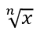

## **Översikt**

PowerPoint lagrar ekvationer som Office Math Markup Language (OMML). Med Aspose.Slides för C++ kan du programatiskt skapa samma typ av matematiskt innehåll: bråk, radikaler, funktioner, gränsvärden, N-ära operatorer, matriser, arrayer och formaterade matematiska block.

I PowerPoint lägger användare normalt till ekvationer från **Insert > Equation**:


Resultatet är redigerbar matematisk text på bilden:


Aspose.Slides bygger den matematiska texten genom tre huvudobjekt:

- En matematikform, skapad med [AddMathShape](https://reference.aspose.com/slides/cpp/aspose.slides/shapecollection/), är formen som innehåller ekvationen.
- [MathPortion](https://reference.aspose.com/slides/cpp/aspose.slides.mathtext/mathportion/) lagrar matematiskt innehåll i formens textruta.
- [MathParagraph](https://reference.aspose.com/slides/cpp/aspose.slides.mathtext/mathparagraph/) innehåller ett eller flera [MathBlock](https://reference.aspose.com/slides/cpp/aspose.slides.mathtext/mathblock/)-objekt.

De flesta exempel nedan använder [MathematicalText](https://reference.aspose.com/slides/cpp/aspose.slides.mathtext/mathematicaltext/) och de flödande metoderna från [IMathElement](https://reference.aspose.com/slides/cpp/aspose.slides.mathtext/imathelement/) för att hålla koden kort och läsbar.

För MathML‑exportscenarier, se [Exportera matematiska ekvationer från presentationer i C++](/slides/sv/cpp/exporting-math-equations/).

## **Skapa en ekvation**

Detta exempel använder [AddMathShape](https://reference.aspose.com/slides/cpp/aspose.slides/ishapecollection/addmathshape/) för att skapa en matematikform och lägger till Pythagoras sats:


```cpp
#include <DOM/IAutoShape.h>
#include <DOM/IParagraph.h>
#include <DOM/IShapeCollection.h>
#include <DOM/ISlide.h>
#include <DOM/ITextFrame.h>
#include <DOM/MathText/IMathBlock.h>
#include <DOM/MathText/IMathParagraph.h>
#include <DOM/MathText/IMathSuperscriptElement.h>
#include <DOM/MathText/MathPortion.h>
#include <DOM/MathText/MathematicalText.h>
#include <DOM/Presentation.h>
#include <Export/SaveFormat.h>

using namespace Aspose::Slides;
using namespace Aspose::Slides::Export;
using namespace Aspose::Slides::MathText;

auto presentation = System::MakeObject<Presentation>();
auto slide = presentation->get_Slide(0);

auto mathShape = slide->get_Shapes()->AddMathShape(20.0f, 20.0f, 700.0f, 120.0f);
auto mathPortion = System::ExplicitCast<MathPortion>(mathShape->get_TextFrame()->get_Paragraph(0)->get_Portion(0));
auto mathParagraph = mathPortion->get_MathParagraph();

auto equation = System::MakeObject<MathematicalText>(u"c")
        - >SetSuperscript(u"2")
        - >Join(u"=")
        - >Join(System::MakeObject<MathematicalText>(u"a")->SetSuperscript(u"2"))
        - >Join(u"+")
        - >Join(System::MakeObject<MathematicalText>(u"b")->SetSuperscript(u"2"));

mathParagraph->Add(equation);

presentation->Save(u"pythagorean-theorem.pptx", SaveFormat::Pptx);
presentation->Dispose();
```

{}
[AddMathShape](https://reference.aspose.com/slides/cpp/aspose.slides/ishapecollection/addmathshape/) skapar en form som redan innehåller ett matematikparagraf. Hämta den första [MathPortion](https://reference.aspose.com/slides/cpp/aspose.slides.mathtext/mathportion/), anropa [get_MathParagraph](https://reference.aspose.com/slides/cpp/aspose.slides.mathtext/mathportion/get_mathparagraph/), och lägg till matematiska block eller element i den.
{}

## **Lägg till bråk**

Använd [Divide](https://reference.aspose.com/slides/cpp/aspose.slides.mathtext/imathelement/divide/) för att skapa ett bråk. Du kan välja en bråksstil med [MathFractionTypes](https://reference.aspose.com/slides/cpp/aspose.slides.mathtext/mathfractiontypes/).


```cpp
#include <DOM/IAutoShape.h>
#include <DOM/IParagraph.h>
#include <DOM/IShapeCollection.h>
#include <DOM/ISlide.h>
#include <DOM/ITextFrame.h>
#include <DOM/MathText/IMathParagraph.h>
#include <DOM/MathText/MathBlock.h>
#include <DOM/MathText/MathFractionTypes.h>
#include <DOM/MathText/MathPortion.h>
#include <DOM/MathText/MathematicalText.h>
#include <DOM/Presentation.h>
#include <Export/SaveFormat.h>

using namespace Aspose::Slides;
using namespace Aspose::Slides::Export;
using namespace Aspose::Slides::MathText;

auto presentation = System::MakeObject<Presentation>();
auto slide = presentation->get_Slide(0);

auto mathShape = slide->get_Shapes()->AddMathShape(20.0f, 20.0f, 700.0f, 100.0f);
auto mathPortion = System::ExplicitCast<MathPortion>(mathShape->get_TextFrame()->get_Paragraph(0)->get_Portion(0));
auto mathParagraph = mathPortion->get_MathParagraph();

auto fraction = System::MakeObject<MathematicalText>(u"1")
        - >Divide(u"x", MathFractionTypes::Skewed);

mathParagraph->Add(System::MakeObject<MathBlock>(fraction));

presentation->Save(u"fraction.pptx", SaveFormat::Pptx);
presentation->Dispose();
```

För ett staplat bråk, använd [MathFractionTypes::Bar](https://reference.aspose.com/slides/cpp/aspose.slides.mathtext/mathfractiontypes/):

```cpp
#include <DOM/MathText/MathFractionTypes.h>
#include <DOM/MathText/MathematicalText.h>
using namespace Aspose::Slides::MathText;

auto stackedFraction = System::MakeObject<MathematicalText>(u"x + 1")->Divide(u"y - 1", MathFractionTypes::Bar);
```

## **Lägg till radikaler**

Använd [Radical](https://reference.aspose.com/slides/cpp/aspose.slides.mathtext/imathelement/radical/) för att skapa en kvadratrots-, kubikrots- eller annan rot. Det aktuella elementet blir basen och argumentet blir graden.



```cpp
#include <DOM/IAutoShape.h>
#include <DOM/IParagraph.h>
#include <DOM/IShapeCollection.h>
#include <DOM/ISlide.h>
#include <DOM/ITextFrame.h>
#include <DOM/MathText/IMathParagraph.h>
#include <DOM/MathText/MathBlock.h>
#include <DOM/MathText/MathPortion.h>
#include <DOM/MathText/MathematicalText.h>
#include <DOM/Presentation.h>
#include <Export/SaveFormat.h>

using namespace Aspose::Slides;
using namespace Aspose::Slides::Export;
using namespace Aspose::Slides::MathText;

auto presentation = System::MakeObject<Presentation>();
auto slide = presentation->get_Slide(0);

auto mathShape = slide->get_Shapes()->AddMathShape(20.0f, 20.0f, 700.0f, 100.0f);
auto mathPortion = System::ExplicitCast<MathPortion>(mathShape->get_TextFrame()->get_Paragraph(0)->get_Portion(0));
auto mathParagraph = mathPortion->get_MathParagraph();

auto radical = System::MakeObject<MathematicalText>(u"x")
        - >Radical(u"n");

mathParagraph->Add(System::MakeObject<MathBlock>(radical));

presentation->Save(u"radical.pptx", SaveFormat::Pptx);
presentation->Dispose();
```

## **Lägg till funktioner och gränsvärden**

Använd [AsArgumentOfFunction](https://reference.aspose.com/slides/cpp/aspose.slides.mathtext/imathelement/asargumentoffunction/) eller [Function](https://reference.aspose.com/slides/cpp/aspose.slides.mathtext/imathelement/function/) för funktioner såsom `sin(x)`, `log(x)` eller egna funktionsnamn. För gränsvärden, sätt `lim` i ett [MathLimit](https://reference.aspose.com/slides/cpp/aspose.slides.mathtext/mathlimit/) eller använd [SetLowerLimit](https://reference.aspose.com/slides/cpp/aspose.slides.mathtext/imathelement/setlowerlimit/).


```cpp
#include <DOM/IAutoShape.h>
#include <DOM/IParagraph.h>
#include <DOM/IShapeCollection.h>
#include <DOM/ISlide.h>
#include <DOM/ITextFrame.h>
#include <DOM/MathText/IMathLimit.h>
#include <DOM/MathText/IMathParagraph.h>
#include <DOM/MathText/MathBlock.h>
#include <DOM/MathText/MathPortion.h>
#include <DOM/MathText/MathematicalText.h>
#include <DOM/Presentation.h>
#include <Export/SaveFormat.h>

using namespace Aspose::Slides;
using namespace Aspose::Slides::Export;
using namespace Aspose::Slides::MathText;

auto presentation = System::MakeObject<Presentation>();
auto slide = presentation->get_Slide(0);

auto mathShape = slide->get_Shapes()->AddMathShape(20.0f, 20.0f, 700.0f, 100.0f);
auto mathPortion = System::ExplicitCast<MathPortion>(mathShape->get_TextFrame()->get_Paragraph(0)->get_Portion(0));
auto mathParagraph = mathPortion->get_MathParagraph();

auto limit = System::MakeObject<MathematicalText>(u"lim")
        - >SetLowerLimit(u"x→∞")
        - >Function(u"x");

mathParagraph->Add(System::MakeObject<MathBlock>(limit));

presentation->Save(u"functions-and-limits.pptx", SaveFormat::Pptx);
presentation->Dispose();
```

För ett eget funktionsnamn, gör funktionsnamnet till det aktuella elementet och anropa [Function](https://reference.aspose.com/slides/cpp/aspose.slides.mathtext/imathelement/function/) med dess argument:

```cpp
#include <DOM/MathText/MathematicalText.h>
using namespace Aspose::Slides::MathText;

auto customFunction = System::MakeObject<MathematicalText>(u"f")->Function(u"x + 1");
```

## **Lägg till N‑ära operatorer och integraler**

Använd [Nary](https://reference.aspose.com/slides/cpp/aspose.slides.mathtext/imathelement/nary/) för summor, föreningar, snitt och andra stora operatorer. Använd [Integral](https://reference.aspose.com/slides/cpp/aspose.slides.mathtext/imathelement/integral/) för integraler. Båda metoderna låter dig ange lägre och högre gränser.


```cpp
#include <DOM/IAutoShape.h>
#include <DOM/IParagraph.h>
#include <DOM/IShapeCollection.h>
#include <DOM/ISlide.h>
#include <DOM/ITextFrame.h>
#include <DOM/MathText/IMathParagraph.h>
#include <DOM/MathText/IMathSuperscriptElement.h>
#include <DOM/MathText/MathBlock.h>
#include <DOM/MathText/MathNaryOperatorTypes.h>
#include <DOM/MathText/MathPortion.h>
#include <DOM/MathText/MathematicalText.h>
#include <DOM/Presentation.h>
#include <Export/SaveFormat.h>

using namespace Aspose::Slides;
using namespace Aspose::Slides::Export;
using namespace Aspose::Slides::MathText;

auto presentation = System::MakeObject<Presentation>();
auto slide = presentation->get_Slide(0);

auto mathShape = slide->get_Shapes()->AddMathShape(20.0f, 20.0f, 700.0f, 120.0f);
auto mathPortion = System::ExplicitCast<MathPortion>(mathShape->get_TextFrame()->get_Paragraph(0)->get_Portion(0));
auto mathParagraph = mathPortion->get_MathParagraph();

auto summationBase = System::MakeObject<MathematicalText>(u"x")
        - >SetSuperscript(u"k")
        - >Join(System::MakeObject<MathematicalText>(u"a")->SetSuperscript(u"n-k"));

auto summation = summationBase->Nary(MathNaryOperatorTypes::Summation, u"k=0", u"n");

mathParagraph->Add(System::MakeObject<MathBlock>(summation));

presentation->Save(u"nary-operators.pptx", SaveFormat::Pptx);
presentation->Dispose();
```

N‑ära operatorer är för stora operatorer med valfria gränser. Enkla operatorer såsom `+`, `-` och `=` läggs vanligtvis till som [MathematicalText](https://reference.aspose.com/slides/cpp/aspose.slides.mathtext/mathematicaltext/) och sammanfogas i uttrycket.

För en integral, använd [Integral](https://reference.aspose.com/slides/cpp/aspose.slides.mathtext/imathelement/integral/):

```cpp
#include <DOM/MathText/IMathBlock.h>
#include <DOM/MathText/IMathBox.h>
#include <DOM/MathText/IMathElement.h>
#include <DOM/MathText/MathIntegralTypes.h>
#include <DOM/MathText/MathematicalText.h>

using namespace Aspose::Slides::MathText;

auto integralBase = System::MakeObject<MathematicalText>(u"x")->Join(System::MakeObject<MathematicalText>(u"dx")->ToBox());
auto integral = integralBase->Integral(MathIntegralTypes::Simple, u"0", u"1");
```

## **Lägg till matriser**

Använd [MathMatrix](https://reference.aspose.com/slides/cpp/aspose.slides.mathtext/mathmatrix/) för rader och kolumner. Matriser inkluderar inte parenteser som standard, så omge matrisen med parenteser, hakparenteser eller klammerparenteser när det behövs.


```cpp
#include <DOM/IAutoShape.h>
#include <DOM/IParagraph.h>
#include <DOM/IShapeCollection.h>
#include <DOM/ISlide.h>
#include <DOM/ITextFrame.h>
#include <DOM/MathText/IMathBlock.h>
#include <DOM/MathText/IMathElement.h>
#include <DOM/MathText/IMathParagraph.h>
#include <DOM/MathText/MathBlock.h>
#include <DOM/MathText/MathMatrix.h>
#include <DOM/MathText/MathPortion.h>
#include <DOM/MathText/MathematicalText.h>
#include <DOM/Presentation.h>
#include <Export/SaveFormat.h>

using namespace Aspose::Slides;
using namespace Aspose::Slides::Export;
using namespace Aspose::Slides::MathText;

auto presentation = System::MakeObject<Presentation>();
auto slide = presentation->get_Slide(0);

auto mathShape = slide->get_Shapes()->AddMathShape(20.0f, 20.0f, 700.0f, 120.0f);
auto mathPortion = System::ExplicitCast<MathPortion>(mathShape->get_TextFrame()->get_Paragraph(0)->get_Portion(0));
auto mathParagraph = mathPortion->get_MathParagraph();

auto matrix = System::MakeObject<MathMatrix>(2, 3);
matrix->idx_set(0, 0, System::MakeObject<MathematicalText>(u"1"));
matrix->idx_set(0, 1, System::MakeObject<MathematicalText>(u"x"));
matrix->idx_set(1, 0, System::MakeObject<MathematicalText>(u"x"));
matrix->idx_set(1, 1, System::MakeObject<MathematicalText>(u"2"));
matrix->idx_set(1, 2, System::MakeObject<MathematicalText>(u"y"));

mathParagraph->Add(System::MakeObject<MathBlock>(matrix));

presentation->Save(u"matrix.pptx", SaveFormat::Pptx);
presentation->Dispose();
```

## **Lägg till ekvationsarrayer**

Använd [ToMathArray](https://reference.aspose.com/slides/cpp/aspose.slides.mathtext/imathelement/tomatharray/) när du behöver justerade ekvationer eller en vertikal stapling av uttryck.


```cpp
#include <DOM/IAutoShape.h>
#include <DOM/IParagraph.h>
#include <DOM/IShapeCollection.h>
#include <DOM/ISlide.h>
#include <DOM/ITextFrame.h>
#include <DOM/MathText/IMathParagraph.h>
#include <DOM/MathText/MathBlock.h>
#include <DOM/MathText/MathPortion.h>
#include <DOM/MathText/MathematicalText.h>
#include <DOM/Presentation.h>
#include <Export/SaveFormat.h>

using namespace Aspose::Slides;
using namespace Aspose::Slides::Export;
using namespace Aspose::Slides::MathText;

auto presentation = System::MakeObject<Presentation>();
auto slide = presentation->get_Slide(0);

auto mathShape = slide->get_Shapes()->AddMathShape(20.0f, 20.0f, 700.0f, 140.0f);
auto mathPortion = System::ExplicitCast<MathPortion>(mathShape->get_TextFrame()->get_Paragraph(0)->get_Portion(0));
auto mathParagraph = mathPortion->get_MathParagraph();

auto equationArray = System::MakeObject<MathematicalText>(u"x")
        - >Join(u"y")
        - >ToMathArray();

mathParagraph->Add(System::MakeObject<MathBlock>(equationArray));

presentation->Save(u"equation-array.pptx", SaveFormat::Pptx);
presentation->Dispose();
```

### **Justera en array med omgivande element**

[IMathArray::set_BaseJustification](https://reference.aspose.com/slides/cpp/aspose.slides.mathtext/imatharray/set_basejustification/) styr den vertikala justeringen av en array i förhållande till de matematiska elementen bredvid den. Exemplet nedan jämför justering med första raden, mitten av arrayen och sista raden.

Följande exempel skapar tre identiska arrayer, var och en med tre rader och de närliggande elementen `A=` och `=B`. All matematisk text använder Cambria Math i 24 punkter. Endast array‑justeringen förändras.

```cpp
#include <system/array.h>
#include <system/console.h>
#include <drawing/color.h>
#include <DOM/IAutoShape.h>
#include <DOM/IParagraph.h>
#include <DOM/IParagraphFormat.h>
#include <DOM/IPortion.h>
#include <DOM/IPortionFormat.h>
#include <DOM/IShapeCollection.h>
#include <DOM/ISlide.h>
#include <DOM/ITextFrame.h>
#include <DOM/Fonts/FontData.h>
#include <DOM/MathText/IMathParagraph.h>
#include <DOM/MathText/MathArray.h>
#include <DOM/MathText/MathBlock.h>
#include <DOM/MathText/MathJustification.h>
#include <DOM/MathText/MathPortion.h>
#include <DOM/MathText/MathVerticalAlignment.h>
#include <DOM/MathText/MathRowSpacingRule.h>
#include <DOM/MathText/MathematicalText.h>
#include <DOM/Presentation.h>
#include <Export/SaveFormat.h>
#include <DOM/FillType.h>
#include <DOM/IColorFormat.h>
#include <DOM/IFillFormat.h>
#include <DOM/ILineFormat.h>
#include <DOM/ISlideSize.h>
#include <DOM/ITextFrameFormat.h>
#include <DOM/ShapeType.h>
#include <DOM/SlideSizeScaleType.h>
#include <DOM/TextAnchorType.h>

using namespace Aspose::Slides;
using namespace Aspose::Slides::Export;
using namespace Aspose::Slides::MathText;

auto createText = [](System::String value)
{
    auto text = System::MakeObject<MathematicalText>(value);
    text->get_Format()->set_FontHeight(24);
    auto font = System::MakeObject<FontData>(u"Cambria Math");
    text->get_Format()->set_LatinFont(font);
    return text;
};

auto presentation = System::MakeObject<Presentation>();
presentation->get_SlideSize()->SetSize(780, 200, SlideSizeScaleType::DoNotScale);
auto slide = presentation->get_Slide(0);

MathVerticalAlignment alignments[] = {MathVerticalAlignment::Top, MathVerticalAlignment::Center, MathVerticalAlignment::Bottom};
System::String labels[] = {u"Top", u"Center", u"Bottom"};

for (auto i = 0; i < 3; i++)
{
    auto label = slide->get_Shapes()->AddAutoShape(ShapeType::Rectangle, 20 + i * 260, 10, 240, 30);
    label->get_FillFormat()->set_FillType(FillType::NoFill);
    label->get_LineFormat()->get_FillFormat()->set_FillType(FillType::NoFill);
    label->get_TextFrame()->set_Text(labels[i]);
    auto labelFormat = label->get_TextFrame()->get_Paragraph(0)->get_Portion(0)->get_PortionFormat();
    labelFormat->set_FontHeight(16);
    labelFormat->get_FillFormat()->set_FillType(FillType::Solid);
    labelFormat->get_FillFormat()->get_SolidFillColor()->set_Color(System::Drawing::Color::get_Black());

    auto mathShape = slide->get_Shapes()->AddMathShape(20 + i * 260, 60, 240, 130);
    mathShape->get_TextFrame()->get_TextFrameFormat()->set_AnchoringType(TextAnchorType::Top);
    auto mathPortion = System::ExplicitCast<MathPortion>(mathShape->get_TextFrame()->get_Paragraph(0)->get_Portion(0));
    auto mathParagraph = mathPortion->get_MathParagraph();
    mathParagraph->set_Justification(MathJustification::LeftJustified);

    auto rows = System::MakeArray<System::SharedPtr<IMathElement>>({createText(u"x+y=3"), createText(u"x-y=1"), createText(u"x=2")});
    auto equationArray = System::MakeObject<MathArray>(rows);
    equationArray->set_BaseJustification(alignments[i]);
    auto leftText = createText(u"A=");
    auto rightText = createText(u"=B");
    auto equation = System::MakeObject<MathBlock>(leftText)->Join(equationArray)->Join(rightText);
    mathParagraph->Add(equation);
}

presentation->Save(u"equation-array-alignment.pptx", SaveFormat::Pptx);
presentation->Dispose();
```

Jämförelsen nedan visar den sparade presentationen i PowerPoint. Lägg märke till positionen för `A=` och `=B` bredvid varje array.


### **Konfigurera radavstånd**

[set_RowSpacingRule](https://reference.aspose.com/slides/cpp/aspose.slides.mathtext/imatharray/set_rowspacingrule/) väljer avståndsregeln för rader inom arrayen. [set_RowSpacing](https://reference.aspose.com/slides/cpp/aspose.slides.mathtext/imatharray/set_rowspacing/) anger ett numeriskt värde för en explicit regel och ignoreras av förinställda regler.

För exakt avstånd mäts värdet i punkter. För proportionellt avstånd mäts det i halvlänkar: värdet `3` i exemplet anger 1,5 linjer. Anropa båda set‑metoderna när du anger ett explicit värde; att bara ändra det numeriska värdet väljer inte en regel.

Exemplet nedan sparar fem presentationer med samma ekvationer, justering och teckensnitt. De första tre använder förinställningar; de sista två visar explicit värde.

```cpp
#include <system/array.h>
#include <system/console.h>
#include <drawing/color.h>
#include <DOM/IAutoShape.h>
#include <DOM/IParagraph.h>
#include <DOM/IParagraphFormat.h>
#include <DOM/IPortion.h>
#include <DOM/IPortionFormat.h>
#include <DOM/IShapeCollection.h>
#include <DOM/ISlide.h>
#include <DOM/ITextFrame.h>
#include <DOM/Fonts/FontData.h>
#include <DOM/MathText/IMathParagraph.h>
#include <DOM/MathText/MathArray.h>
#include <DOM/MathText/MathBlock.h>
#include <DOM/MathText/MathJustification.h>
#include <DOM/MathText/MathPortion.h>
#include <DOM/MathText/MathVerticalAlignment.h>
#include <DOM/MathText/MathRowSpacingRule.h>
#include <DOM/MathText/MathematicalText.h>
#include <DOM/Presentation.h>
#include <Export/SaveFormat.h>

using namespace Aspose::Slides;
using namespace Aspose::Slides::Export;
using namespace Aspose::Slides::MathText;

auto createText = [](System::String value)
{
    auto text = System::MakeObject<MathematicalText>(value);
    text->get_Format()->set_FontHeight(24);
    auto font = System::MakeObject<FontData>(u"Cambria Math");
    text->get_Format()->set_LatinFont(font);
    return text;
};

struct ArraySettings
{
    MathRowSpacingRule rule;
    uint32_t spacing;
    System::String name;
};

ArraySettings settings[] =
{
    {MathRowSpacingRule::SingleLineGap, 0, u"SingleLineGap"},
    {MathRowSpacingRule::OneAndAHalfLineGap, 0, u"OneAndAHalfLineGap"},
    {MathRowSpacingRule::TwoLineGap, 0, u"TwoLineGap"},
    {MathRowSpacingRule::Exactly, 20, u"Exactly"},
    {MathRowSpacingRule::Multiple, 3, u"Multiple"}
};

for (const auto& setting : settings)
{
    auto fileName = u"equation-array-" + setting.name + u".pptx";
    auto presentation = System::MakeObject<Presentation>();
    auto mathShape = presentation->get_Slide(0)->get_Shapes()->AddMathShape(20, 20, 600, 300);
    auto paragraph = mathShape->get_TextFrame()->get_Paragraph(0);
    paragraph->get_ParagraphFormat()->set_SpaceBefore(0);
    paragraph->get_ParagraphFormat()->set_SpaceAfter(0);
    auto mathPortion = System::ExplicitCast<MathPortion>(paragraph->get_Portion(0));
    auto mathParagraph = mathPortion->get_MathParagraph();
    mathParagraph->set_Justification(MathJustification::LeftJustified);

    auto rows = System::MakeArray<System::SharedPtr<IMathElement>>({createText(u"x+y=3"), createText(u"x-y=1"), createText(u"x=2")});
    auto equationArray = System::MakeObject<MathArray>(rows);
    equationArray->set_BaseJustification(MathVerticalAlignment::Center);
    equationArray->set_RowSpacingRule(setting.rule);
    equationArray->set_RowSpacing(setting.spacing);
    auto leftText = createText(u"A=");
    auto rightText = createText(u"=B");
    auto equation = System::MakeObject<MathBlock>(leftText)->Join(equationArray)->Join(rightText);
    mathParagraph->Add(equation);

    presentation->Save(fileName, SaveFormat::Pptx);
    presentation->Dispose();
}
```

Radavstånd i en array är separat från paragrafavstånd. [set_SpaceBefore](https://reference.aspose.com/slides/cpp/aspose.slides/iparagraphformat/set_spacebefore/) och [set_SpaceAfter](https://reference.aspose.com/slides/cpp/aspose.slides/iparagraphformat/set_spaceafter/) lägger till utrymme runt den omgivande paragrafen, inte mellan array‑rader. På samma sätt placerar [IMathParagraph::set_Justification](https://reference.aspose.com/slides/cpp/aspose.slides.mathtext/imathparagraph/set_justification/) hela matematik‑paragrafen horisontellt; den ersätter inte arrayens vertikala justeringsinställning.

## **Lägg till trigonometriska funktioner**

Använd [AsArgumentOfFunction](https://reference.aspose.com/slides/cpp/aspose.slides.mathtext/imathelement/asargumentoffunction/) när argumentet är det aktuella elementet och funktionsnamnet är känt.


```cpp
#include <DOM/IAutoShape.h>
#include <DOM/IParagraph.h>
#include <DOM/IShapeCollection.h>
#include <DOM/ISlide.h>
#include <DOM/ITextFrame.h>
#include <DOM/MathText/IMathParagraph.h>
#include <DOM/MathText/MathBlock.h>
#include <DOM/MathText/MathFunctionsOfOneArgument.h>
#include <DOM/MathText/MathPortion.h>
#include <DOM/MathText/MathematicalText.h>
#include <DOM/Presentation.h>
#include <Export/SaveFormat.h>

using namespace Aspose::Slides;
using namespace Aspose::Slides::Export;
using namespace Aspose::Slides::MathText;

auto presentation = System::MakeObject<Presentation>();
auto slide = presentation->get_Slide(0);

auto mathShape = slide->get_Shapes()->AddMathShape(20.0f, 20.0f, 700.0f, 100.0f);
auto mathPortion = System::ExplicitCast<MathPortion>(mathShape->get_TextFrame()->get_Paragraph(0)->get_Portion(0));
auto mathParagraph = mathPortion->get_MathParagraph();

auto cosine = System::MakeObject<MathematicalText>(u"2x")
        - >AsArgumentOfFunction(MathFunctionsOfOneArgument::Cos);

mathParagraph->Add(System::MakeObject<MathBlock>(cosine));

presentation->Save(u"trigonometric-function.pptx", SaveFormat::Pptx);
presentation->Dispose();
```

## **Lägg till nedsänkningar och upphöjningar**

Använd hjälpfunktionerna för nedsänkningar och upphöjningar för index och potenser. När indexen ska visas till vänster om basen, använd [SetSubSuperscriptOnTheLeft](https://reference.aspose.com/slides/cpp/aspose.slides.mathtext/imathelement/setsubsuperscriptontheleft/).


```cpp
#include <DOM/IAutoShape.h>
#include <DOM/IParagraph.h>
#include <DOM/IShapeCollection.h>
#include <DOM/ISlide.h>
#include <DOM/ITextFrame.h>
#include <DOM/MathText/IMathParagraph.h>
#include <DOM/MathText/MathBlock.h>
#include <DOM/MathText/MathPortion.h>
#include <DOM/MathText/MathematicalText.h>
#include <DOM/Presentation.h>
#include <Export/SaveFormat.h>

using namespace Aspose::Slides;
using namespace Aspose::Slides::Export;
using namespace Aspose::Slides::MathText;

auto presentation = System::MakeObject<Presentation>();
auto slide = presentation->get_Slide(0);

auto mathShape = slide->get_Shapes()->AddMathShape(20.0f, 20.0f, 700.0f, 100.0f);
auto mathPortion = System::ExplicitCast<MathPortion>(mathShape->get_TextFrame()->get_Paragraph(0)->get_Portion(0));
auto mathParagraph = mathPortion->get_MathParagraph();

auto scripts = System::MakeObject<MathematicalText>(u"Y")
        - >SetSubSuperscriptOnTheLeft(u"1", u"n");

mathParagraph->Add(System::MakeObject<MathBlock>(scripts));

presentation->Save(u"subscript-superscript.pptx", SaveFormat::Pptx);
presentation->Dispose();
```

## **Lägg till avgränsare**

Använd [Enclose](https://reference.aspose.com/slides/cpp/aspose.slides.mathtext/imathelement/enclose/) för att placera ett uttryck inom avgränsare. Du kan även ange ett avgränsartecken för avgränsare som innehåller flera element.


```cpp
#include <DOM/IAutoShape.h>
#include <DOM/IParagraph.h>
#include <DOM/IShapeCollection.h>
#include <DOM/ISlide.h>
#include <DOM/ITextFrame.h>
#include <DOM/MathText/IMathParagraph.h>
#include <DOM/MathText/MathBlock.h>
#include <DOM/MathText/MathPortion.h>
#include <DOM/MathText/MathematicalText.h>
#include <DOM/Presentation.h>
#include <Export/SaveFormat.h>

using namespace Aspose::Slides;
using namespace Aspose::Slides::Export;
using namespace Aspose::Slides::MathText;

auto presentation = System::MakeObject<Presentation>();
auto slide = presentation->get_Slide(0);

auto mathShape = slide->get_Shapes()->AddMathShape(20.0f, 20.0f, 700.0f, 100.0f);
auto mathPortion = System::ExplicitCast<MathPortion>(mathShape->get_TextFrame()->get_Paragraph(0)->get_Portion(0));
auto mathParagraph = mathPortion->get_MathParagraph();

auto delimiter = System::MakeObject<MathematicalText>(u"x")
        - >Join(u"y")
        - >Join(u"z")
        - >Enclose(u'<', u'>', u'|');

mathParagraph->Add(System::MakeObject<MathBlock>(delimiter));

presentation->Save(u"delimiters.pptx", SaveFormat::Pptx);
presentation->Dispose();
```

### **Storlek och justering av avgränsare**

Skicka `true` till [set_GrowToMatchOperandHeight](https://reference.aspose.com/slides/cpp/aspose.slides.mathtext/imathdelimiter/set_growtomatchoperandheight/) för att låta parenteserna växa runt ett högt operand, eller `false` för att behålla normal storlek. [set_DelimiterShape](https://reference.aspose.com/slides/cpp/aspose.slides.mathtext/imathdelimiter/set_delimitershape/) accepterar ett av två [MathDelimiterShape](https://reference.aspose.com/slides/cpp/aspose.slides.mathtext/mathdelimitershape/)-värden. `Centered` centrerar parenteserna på matematikaxeln, som går genom mitten av likhetstecknet. `Match` justerar dem efter det omslutna innehållet. Båda inställningarna påverkar endast avgränsarna. Uttrycket inuti förblir oförändrat.

Exemplet placerar ett bråk i exponenten för `x` så att uttrycket sträcker sig längre ovanför baslinjen än under den. Alla fyra ekvationer använder samma parenteser och teckensnitt.

```cpp
#include <DOM/IAutoShape.h>
#include <DOM/IParagraph.h>
#include <DOM/IShapeCollection.h>
#include <DOM/ISlide.h>
#include <DOM/ITextFrame.h>
#include <DOM/MathText/IMathParagraph.h>
#include <DOM/IPortionFormat.h>
#include <DOM/MathText/IMathBlock.h>
#include <DOM/MathText/IMathDelimiter.h>
#include <DOM/MathText/IMathFraction.h>
#include <DOM/MathText/IMathSuperscriptElement.h>
#include <DOM/MathText/MathDelimiterShape.h>
#include <DOM/MathText/MathPortion.h>
#include <DOM/MathText/MathematicalText.h>
#include <DOM/Presentation.h>
#include <Export/SaveFormat.h>

using namespace Aspose::Slides;
using namespace Aspose::Slides::Export;
using namespace Aspose::Slides::MathText;

auto presentation = System::MakeObject<Presentation>();
auto slide = presentation->get_Slide(0);

auto addExpression = [slide](float left, float top, bool grow, MathDelimiterShape shape)
{
    auto fraction = System::MakeObject<MathematicalText>(u"a + b")->Divide(u"c + d");
    auto power = System::MakeObject<MathematicalText>(u"x")->SetSuperscript(fraction);
    auto delimiter = power->Enclose(u'(', u')');
    delimiter->set_GrowToMatchOperandHeight(grow);
    delimiter->set_DelimiterShape(shape);

    auto mathShape = slide->get_Shapes()->AddMathShape(left, top, 300, 100);
    auto portion = System::ExplicitCast<MathPortion>(mathShape->get_TextFrame()->get_Paragraph(0)->get_Portion(0));
    portion->get_PortionFormat()->set_FontHeight(32);
    auto equation = System::MakeObject<MathematicalText>(u"y = ")->Join(delimiter);
    portion->get_MathParagraph()->Add(equation);
};

addExpression(20, 20, true, MathDelimiterShape::Centered);
addExpression(350, 20, true, MathDelimiterShape::Match);
addExpression(20, 140, false, MathDelimiterShape::Centered);
addExpression(350, 140, false, MathDelimiterShape::Match);

presentation->Save(u"delimiter-sizing.pptx", SaveFormat::Pptx);
presentation->Dispose();
```

I PowerPoint, jämför raderna för att se effekten av växande parenteser. I den översta raden växer parenteserna för att omsluta exponenten och ser likadana ut för båda formerna. I den nedersta raden är växling avstängd. De mindre parenteserna till vänster (`Centered`) justeras med likhetstecknet, medan de till höger (`Match`) sitter högre omkring uttrycket.


## **Lägg till en kantlåda**

Anropa [ToBorderBox](https://reference.aspose.com/slides/cpp/aspose.slides.mathtext/imathelement/toborderbox/) på ett bråk för att rama in hela uttrycket. Det returnerade [IMathBorderBox](https://reference.aspose.com/slides/cpp/aspose.slides.mathtext/imathborderbox/) visar alla fyra sidor som standard. Använd [set_HideTop](https://reference.aspose.com/slides/cpp/aspose.slides.mathtext/imathborderbox/set_hidetop/), [set_HideBottom](https://reference.aspose.com/slides/cpp/aspose.slides.mathtext/imathborderbox/set_hidebottom/), [set_HideLeft](https://reference.aspose.com/slides/cpp/aspose.slides.mathtext/imathborderbox/set_hideleft/) och [set_HideRight](https://reference.aspose.com/slides/cpp/aspose.slides.mathtext/imathborderbox/set_hideright/) för att ta bort enskilda sidor.

Exemplet placerar sex kopior av samma bråk på en bild. För att visa genomstrykning, dölj alla fyra sidor och sätt [set_StrikethroughBottomLeftToTopRight](https://reference.aspose.com/slides/cpp/aspose.slides.mathtext/imathborderbox/set_strikethroughbottomlefttotopright/) för en stigande diagonal (↗) eller [set_StrikethroughTopLeftToBottomRight](https://reference.aspose.com/slides/cpp/aspose.slides.mathtext/imathborderbox/set_strikethroughtoplefttobottomright/) för en fallande diagonal (↘). Du kan också använda [set_StrikethroughHorizontal](https://reference.aspose.com/slides/cpp/aspose.slides.mathtext/imathborderbox/set_strikethroughhorizontal/) eller [set_StrikethroughVertical](https://reference.aspose.com/slides/cpp/aspose.slides.mathtext/imathborderbox/set_strikethroughvertical/) med vilken kombination av synliga sidor som helst.

```cpp
#include <DOM/IAutoShape.h>
#include <DOM/IParagraph.h>
#include <DOM/IPortionFormat.h>
#include <DOM/IShapeCollection.h>
#include <DOM/ISlide.h>
#include <DOM/ISlideSize.h>
#include <DOM/ITextFrame.h>
#include <DOM/MathText/IMathBorderBox.h>
#include <DOM/MathText/IMathFraction.h>
#include <DOM/MathText/IMathParagraph.h>
#include <DOM/MathText/MathBlock.h>
#include <DOM/MathText/MathPortion.h>
#include <DOM/MathText/MathematicalText.h>
#include <DOM/Presentation.h>
#include <DOM/SlideSizeScaleType.h>
#include <Export/SaveFormat.h>

using namespace Aspose::Slides;
using namespace Aspose::Slides::Export;
using namespace Aspose::Slides::MathText;

auto presentation = System::MakeObject<Presentation>();
presentation->get_SlideSize()->SetSize(540, 220, SlideSizeScaleType::DoNotScale);
auto slide = presentation->get_Slide(0);

auto addFraction = [slide](float x, float y, bool hideBorder = false)
{
    auto fraction = System::MakeObject<MathematicalText>(u"x+1")->Divide(u"y+2");
    auto box = fraction->ToBorderBox();
    box->set_HideTop(hideBorder);
    box->set_HideBottom(hideBorder);
    box->set_HideLeft(hideBorder);
    box->set_HideRight(hideBorder);

    auto shape = slide->get_Shapes()->AddMathShape(x, y, 160, 90);
    auto portion = System::ExplicitCast<MathPortion>(shape->get_TextFrame()->get_Paragraph(0)->get_Portion(0));
    portion->get_PortionFormat()->set_FontHeight(28);
    auto mathBlock = System::MakeObject<MathBlock>(box);
    portion->get_MathParagraph()->Add(mathBlock);
    return box;
};

addFraction(10, 10);

auto partial = addFraction(190, 10);
partial->set_HideTop(true);
partial->set_HideRight(true);

addFraction(370, 10, true)->set_StrikethroughBottomLeftToTopRight(true);
addFraction(10, 120, true)->set_StrikethroughTopLeftToBottomRight(true);
addFraction(190, 120, true)->set_StrikethroughHorizontal(true);
addFraction(370, 120)->set_StrikethroughVertical(true);

presentation->Save(u"border-box.pptx", SaveFormat::Pptx);
presentation->Dispose();
```


På detta bråk överlappar den horisontella genomstrykningen bråklinjen. Den vertikala genomstrykningen korsar både täljare och nämnare medan den omgivande kanten förblir synlig. Dessa linjer dekorerar hela uttrycket. Vanlig textgenomstrykning gäller tecken i ett textsegment. Efter att ha öppnat om presentationen i PowerPoint kan du fortfarande redigera täljare och nämnare separat.

## **Styr synlighet och layout med phantom‑element**

Omslut ett uttryck i [MathPhantom](https://reference.aspose.com/slides/cpp/aspose.slides.mathtext/mathphantom/) för att styra dess synlighet och det utrymme det bidrar med till en ekvation oberoende. [IMathPhantom](https://reference.aspose.com/slides/cpp/aspose.slides.mathtext/imathphantom/)-settermetoderna styr följande:

| Metod | Effekt |
| --- | --- |
| [set_Show](https://reference.aspose.com/slides/cpp/aspose.slides.mathtext/imathphantom/set_show/) | Skicka `false` för att dölja uttrycket. Dess dimensioner bidrar fortfarande till layouten om inte motsvarande inställningar nedan är `true`. |
| [set_ZeroWidth](https://reference.aspose.com/slides/cpp/aspose.slides.mathtext/imathphantom/set_zerowidth/) | Behandla uttryckets horisontella bredd som noll, så att närliggande element kan komma närmare varandra. |
| [set_ZeroAsc](https://reference.aspose.com/slides/cpp/aspose.slides.mathtext/imathphantom/set_zeroasc/) | Behandla dess uppstigning, höjden ovanför baslinjen, som noll. Detta kan minska utrymmet reserverat ovanför närliggande element. |
| [set_ZeroDesc](https://reference.aspose.com/slides/cpp/aspose.slides.mathtext/imathphantom/set_zerodesc/) | Behandla dess nedstigning, djupet under baslinjen, som noll. Detta kan föra en bråklinje eller annat innehåll under uttrycket närmare sina grannar. |

Baslinjen är referenslinjen som vanliga matematiska tecken vilar på. Att dölja innehåll tar inte bort dess dimensioner, och att behandla en dimension som noll tar inte bort uttrycket. Det underliggande uttrycket finns fortfarande tillgängligt via [get_Base](https://reference.aspose.com/slides/cpp/aspose.slides.mathtext/imathphantom/get_base/). Skicka `true` till [set_Show](https://reference.aspose.com/slides/cpp/aspose.slides.mathtext/imathphantom/set_show/) för att visa det igen; dimensioninställningarna förblir oförändrade.

Exemplet nedan skapar fem sid‑vid‑sid‑varianter: ett synligt bråk, ett dolt bråk som reserverar utrymme och tre dolda bråk med en dimension behandlad som noll. Varje variant använder samma omgivande uttryck och Cambria Math i 24 punkter. Alla ekvationsformer har samma topposition, markerad av den grå guiden. Att placera phantom i täljaren av ett yttre bråk gör de vertikala layout‑förändringarna lättare att se.

```cpp
#include <array>
#include <drawing/color.h>
#include <DOM/FillType.h>
#include <DOM/Fonts/FontData.h>
#include <DOM/IAutoShape.h>
#include <DOM/IColorFormat.h>
#include <DOM/IFillFormat.h>
#include <DOM/ILineFormat.h>
#include <DOM/IParagraph.h>
#include <DOM/IPortion.h>
#include <DOM/IPortionFormat.h>
#include <DOM/IShapeCollection.h>
#include <DOM/ISlide.h>
#include <DOM/ISlideSize.h>
#include <DOM/ITextFrame.h>
#include <DOM/ITextFrameFormat.h>
#include <DOM/MathText/IMathParagraph.h>
#include <DOM/MathText/MathBlock.h>
#include <DOM/MathText/MathFraction.h>
#include <DOM/MathText/MathPhantom.h>
#include <DOM/MathText/MathPortion.h>
#include <DOM/MathText/MathematicalText.h>
#include <DOM/Presentation.h>
#include <DOM/ShapeType.h>
#include <DOM/SlideSizeScaleType.h>
#include <DOM/TextAnchorType.h>
#include <Export/SaveFormat.h>

using namespace Aspose::Slides;
using namespace Aspose::Slides::Export;
using namespace Aspose::Slides::MathText;

auto createText = [](System::String value)
{
    auto text = System::MakeObject<MathematicalText>(value);
    text->get_Format()->set_FontHeight(24);
    auto font = System::MakeObject<FontData>(u"Cambria Math");
    text->get_Format()->set_LatinFont(font);
    return text;
};

auto presentation = System::MakeObject<Presentation>();
presentation->get_SlideSize()->SetSize(1000, 180, SlideSizeScaleType::DoNotScale);
auto slide = presentation->get_Slide(0);

std::array<System::String, 5> labels = {u"Visible", u"Hidden: reserves space", u"Hidden: ZeroWidth", u"Hidden: ZeroAsc", u"Hidden: ZeroDesc"};

auto guide = slide->get_Shapes()->AddAutoShape(ShapeType::Line, 10, 60, 980, 0);
guide->get_LineFormat()->get_FillFormat()->set_FillType(FillType::Solid);
guide->get_LineFormat()->get_FillFormat()->get_SolidFillColor()->set_Color(System::Drawing::Color::get_LightGray());

for (auto i = 0; i < labels.size(); i++)
{
    auto left = 10 + i * 200;

    auto label = slide->get_Shapes()->AddAutoShape(ShapeType::Rectangle, left, 10, 190, 30);
    label->get_FillFormat()->set_FillType(FillType::NoFill);
    label->get_LineFormat()->get_FillFormat()->set_FillType(FillType::NoFill);
    label->get_TextFrame()->set_Text(labels[i]);

    auto labelFormat = label->get_TextFrame()->get_Paragraph(0)->get_Portion(0)->get_PortionFormat();
    labelFormat->set_FontHeight(14);
    labelFormat->get_FillFormat()->set_FillType(FillType::Solid);
    labelFormat->get_FillFormat()->get_SolidFillColor()->set_Color(System::Drawing::Color::get_Black());

    auto fractionNumerator = createText(u"a+b");
    auto fractionDenominator = createText(u"c+d");
    auto fraction = System::MakeObject<MathFraction>(fractionNumerator, fractionDenominator);
    auto phantom = System::MakeObject<MathPhantom>(fraction);
    phantom->set_Show(i == 0);
    phantom->set_ZeroWidth(i == 2);
    phantom->set_ZeroAsc(i == 3);
    phantom->set_ZeroDesc(i == 4);

    auto leadingText = createText(u"x+");
    auto trailingText = createText(u"+y");
    auto numeratorBlock = System::MakeObject<MathBlock>(leadingText);
    auto numerator = numeratorBlock->Join(phantom)->Join(trailingText);
    auto denominator = createText(u"z");
    auto equation = System::MakeObject<MathFraction>(numerator, denominator);

    auto shape = slide->get_Shapes()->AddMathShape(left, 60, 190, 100);
    shape->get_TextFrame()->get_TextFrameFormat()->set_AnchoringType(TextAnchorType::Top);

    auto mathPortion = System::ExplicitCast<MathPortion>(shape->get_TextFrame()->get_Paragraph(0)->get_Portion(0));
    auto mathParagraph = mathPortion->get_MathParagraph();
    auto mathBlock = System::MakeObject<MathBlock>(equation);
    mathParagraph->Add(mathBlock);
}

presentation->Save(u"math-phantom.pptx", SaveFormat::Pptx);
presentation->Dispose();

```


## **Gruppera termer**

Använd [Group](https://reference.aspose.com/slides/cpp/aspose.slides.mathtext/imathelement/group/) för att placera en grupperingssymbol ovanför eller nedanför ett uttryck. Lägg till en gräns för att märka de grupperade termerna.


```cpp
#include <DOM/IAutoShape.h>
#include <DOM/IParagraph.h>
#include <DOM/IShapeCollection.h>
#include <DOM/ISlide.h>
#include <DOM/ITextFrame.h>
#include <DOM/MathText/IMathGroupingCharacter.h>
#include <DOM/MathText/IMathParagraph.h>
#include <DOM/MathText/MathBlock.h>
#include <DOM/MathText/MathPortion.h>
#include <DOM/MathText/MathTopBotPositions.h>
#include <DOM/MathText/MathematicalText.h>
#include <DOM/Presentation.h>
#include <Export/SaveFormat.h>

using namespace Aspose::Slides;
using namespace Aspose::Slides::Export;
using namespace Aspose::Slides::MathText;

auto presentation = System::MakeObject<Presentation>();
auto slide = presentation->get_Slide(0);

auto mathShape = slide->get_Shapes()->AddMathShape(20.0f, 20.0f, 700.0f, 120.0f);
auto mathPortion = System::ExplicitCast<MathPortion>(mathShape->get_TextFrame()->get_Paragraph(0)->get_Portion(0));
auto mathParagraph = mathPortion->get_MathParagraph();

auto grouped = System::MakeObject<MathematicalText>(u"x + y")
        - >Group(u'\u23DF', MathTopBotPositions::Bottom, MathTopBotPositions::Top)
        - >SetLowerLimit(u"any text");

mathParagraph->Add(System::MakeObject<MathBlock>(grouped));

presentation->Save(u"grouped-terms.pptx", SaveFormat::Pptx);
presentation->Dispose();
```

## **Formatera matematiska element**

Använd formateringshjälpare endast där de klargör formeln. Till exempel placerar [Overbar](https://reference.aspose.com/slides/cpp/aspose.slides.mathtext/imathelement/overbar/) en linje ovanför ett matematiskt element.


```cpp
#include <DOM/IAutoShape.h>
#include <DOM/IParagraph.h>
#include <DOM/IShapeCollection.h>
#include <DOM/ISlide.h>
#include <DOM/ITextFrame.h>
#include <DOM/MathText/IMathParagraph.h>
#include <DOM/MathText/MathBlock.h>
#include <DOM/MathText/MathPortion.h>
#include <DOM/MathText/MathematicalText.h>
#include <DOM/Presentation.h>
#include <Export/SaveFormat.h>

using namespace Aspose::Slides;
using namespace Aspose::Slides::Export;
using namespace Aspose::Slides::MathText;

auto presentation = System::MakeObject<Presentation>();
auto slide = presentation->get_Slide(0);

auto mathShape = slide->get_Shapes()->AddMathShape(20.0f, 20.0f, 700.0f, 100.0f);
auto mathPortion = System::ExplicitCast<MathPortion>(mathShape->get_TextFrame()->get_Paragraph(0)->get_Portion(0));
auto mathParagraph = mathPortion->get_MathParagraph();

auto overbar = System::MakeObject<MathematicalText>(u"ABC")->Overbar();

mathParagraph->Add(System::MakeObject<MathBlock>(overbar));

presentation->Save(u"overbar.pptx", SaveFormat::Pptx);
presentation->Dispose();
```

### **Formatera text i en befintlig ekvation**

För att formatera text i hela en befintlig ekvation, gå igenom varje matematikblocks elementträd. [IMathElement::GetChildren](https://reference.aspose.com/slides/cpp/aspose.slides.mathtext/imathelement/getchildren/) returnerar endast de omedelbara barnen, så anropa den rekursivt för att nå text i bråk, skript, radikaler och andra nästlade strukturer. Kontrollera både det aktuella elementet och dess barn för att inkludera start‑elementet när det är [MathematicalText](https://reference.aspose.com/slides/cpp/aspose.slides.mathtext/mathematicaltext/).

Detta exempel förutsätter att en presentation innehåller en ekvation såsom `z = xᵢ / ∛y`, med ett bråk som innehåller en nedsänkningsindex i täljaren och en radikal i nämnaren. Att bearbeta endast blockets element på toppnivå skulle missa texten i bråket. Exemplet hittar matematiska portioner i bild‑textrutor, får deras block via [IMathPortion::get_MathParagraph](https://reference.aspose.com/slides/cpp/aspose.slides.mathtext/imathportion/get_mathparagraph/), och sätter teckenhöjden till 28 punkter med [set_FontHeight](https://reference.aspose.com/slides/cpp/aspose.slides/baseportionformat/set_fontheight/), genom att nå formateringen via varje tekstlementes [get_Format](https://reference.aspose.com/slides/cpp/aspose.slides.mathtext/mathematicaltext/get_format/)-metod.

```cpp
#include <functional>
#include <system/array.h>
#include <DOM/IAutoShape.h>
#include <DOM/IParagraph.h>
#include <DOM/IParagraphCollection.h>
#include <DOM/IPortion.h>
#include <DOM/IPortionCollection.h>
#include <DOM/IPortionFormat.h>
#include <DOM/IShapeCollection.h>
#include <DOM/ISlide.h>
#include <DOM/ISlideCollection.h>
#include <DOM/ITextFrame.h>
#include <DOM/MathText/IMathBlock.h>
#include <DOM/MathText/IMathElement.h>
#include <DOM/MathText/IMathParagraph.h>
#include <DOM/MathText/IMathPortion.h>
#include <DOM/MathText/MathematicalText.h>
#include <DOM/Presentation.h>
#include <Export/SaveFormat.h>

using namespace Aspose::Slides;
using namespace Aspose::Slides::Export;
using namespace Aspose::Slides::MathText;

std::function<void(System::SharedPtr<IMathElement>)> formatMathText;
formatMathText = [&formatMathText](System::SharedPtr<IMathElement> element)
{
    auto text = System::DynamicCast<MathematicalText>(element);
    if (text != nullptr)
        text->get_Format()->set_FontHeight(28.0f);

    for (auto child : element->GetChildren())
        formatMathText(child);
};

auto presentation = System::MakeObject<Presentation>(u"input.pptx");

for (auto slide : presentation->get_Slides())
{
    for (auto shape : slide->get_Shapes())
    {
        auto autoShape = System::DynamicCast<IAutoShape>(shape);
        if (autoShape == nullptr || autoShape->get_TextFrame() == nullptr)
            continue;

        for (auto paragraph : autoShape->get_TextFrame()->get_Paragraphs())
        {
            for (auto portion : paragraph->get_Portions())
            {
                auto mathPortion = System::DynamicCast<IMathPortion>(portion);
                if (mathPortion != nullptr)
                {
                    for (auto block : mathPortion->get_MathParagraph())
                        formatMathText(block);
                }
            }
        }
    }
}

presentation->Save(u"formatted-equations.pptx", SaveFormat::Pptx);
presentation->Dispose();
```

Den sparade presentationen innehåller den uppdaterade textformateringen på varje nivå av varje bearbetad ekvation, samtidigt som textinnehållet och den matematiska strukturen bevaras.

## **Snabbreferens**

| Uppgift | Huvud‑API |
| --- | --- |
| Skapa matematiktext | [MathematicalText](https://reference.aspose.com/slides/cpp/aspose.slides.mathtext/mathematicaltext/) |
| Kombinera element | [IMathElement.Join](https://reference.aspose.com/slides/cpp/aspose.slides.mathtext/imathelement/join/) |
| Skapa bråk | [IMathElement.Divide](https://reference.aspose.com/slides/cpp/aspose.slides.mathtext/imathelement/divide/) |
| Lägg till upphöjning eller nedsänkning | [SetSuperscript](https://reference.aspose.com/slides/cpp/aspose.slides.mathtext/imathelement/setsuperscript/), [SetSubscript](https://reference.aspose.com/slides/cpp/aspose.slides.mathtext/imathelement/setsubscript/) |
| Lägg till funktioner | [Function](https://reference.aspose.com/slides/cpp/aspose.slides.mathtext/imathelement/function/), [AsArgumentOfFunction](https://reference.aspose.com/slides/cpp/aspose.slides.mathtext/imathelement/asargumentoffunction/) |
| Lägg till radikaler | [IMathElement.Radical](https://reference.aspose.com/slides/cpp/aspose.slides.mathtext/imathelement/radical/) |
| Lägg till gränsvärden | [SetLowerLimit](https://reference.aspose.com/slides/cpp/aspose.slides.mathtext/imathelement/setlowerlimit/), [SetUpperLimit](https://reference.aspose.com/slides/cpp/aspose.slides.mathtext/imathelement/setupperlimit/) |
| Lägg till vänstersidiga skript | [SetSubSuperscriptOnTheLeft](https://reference.aspose.com/slides/cpp/aspose.slides.mathtext/imathelement/setsubsuperscriptontheleft/) |
| Lägg till summor och integraler | [Nary](https://reference.aspose.com/slides/cpp/aspose.slides.mathtext/imathelement/nary/), [Integral](https://reference.aspose.com/slides/cpp/aspose.slides.mathtext/imathelement/integral/) |
| Lägg till matriser | [MathMatrix](https://reference.aspose.com/slides/cpp/aspose.slides.mathtext/mathmatrix/) |
| Lägg till ekvationsarrayer | [ToMathArray](https://reference.aspose.com/slides/cpp/aspose.slides.mathtext/imathelement/tomatharray/) |
| Lägg till avgränsare | [Enclose](https://reference.aspose.com/slides/cpp/aspose.slides.mathtext/imathelement/enclose/) |
| Lägg till staplar och kantlinjer | [Overbar](https://reference.aspose.com/slides/cpp/aspose.slides.mathtext/imathelement/overbar/), [ToBorderBox](https://reference.aspose.com/slides/cpp/aspose.slides.mathtext/imathelement/toborderbox/) |
| Gruppera termer | [Group](https://reference.aspose.com/slides/cpp/aspose.slides.mathtext/imathelement/group/) |

## **FAQ**

**Kan jag redigera en befintlig PowerPoint‑ekvation?**

Ja. Öppna presentationen, hitta formen som innehåller en [MathPortion](https://reference.aspose.com/slides/cpp/aspose.slides.mathtext/mathportion/), anropa [get_MathParagraph](https://reference.aspose.com/slides/cpp/aspose.slides.mathtext/mathportion/get_mathparagraph/), och uppdatera matematikblocken i det paragrafen.

**Sparas ekvationerna som redigerbar PowerPoint‑math?**

Ja. När du sparar till PPTX skriver Aspose.Slides ekvationen som redigerbart Office‑math‑innehåll.

**Kan jag exportera ekvationer till LaTeX?**

Ja. Hämta ekvationens [IMathParagraph](https://reference.aspose.com/slides/cpp/aspose.slides.mathtext/imathparagraph/) från dess [IMathPortion](https://reference.aspose.com/slides/cpp/aspose.slides.mathtext/imathportion/), och anropa [IMathParagraph::ToLatex](https://reference.aspose.com/slides/cpp/aspose.slides.mathtext/imathparagraph/tolatex/) för att exportera den direkt. För ett komplett exempel, se [Exportera matematiska ekvationer från presentationer i C++](/slides/sv/cpp/exporting-math-equations/#export-math-equations-to-latex).