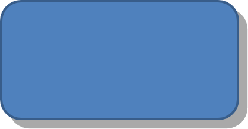

## **Introduktion**

Medan effekter i PowerPoint kan användas för att få en form att sticka ut, skiljer de sig från [fyllningar](/slides/sv/cpp/shape-formatting/#gradient-fill) eller konturer. Genom att använda PowerPoint-effekter kan du skapa övertygande reflektioner på en form, sprida formens glöd, etc.


PowerPoint erbjuder sex effekter som kan tillämpas på former. Du kan applicera en eller flera effekter på en form.

Vissa kombinationer av effekter ser bättre ut än andra. Av den anledningen har PowerPoint alternativ under **Preset**. Preset‑alternativen är i huvudsak en kombination av två eller fler effekter som är kända för att se bra ut tillsammans. På så sätt, genom att välja ett förinställt alternativ, slipper du slösa tid på att testa eller kombinera olika effekter för att hitta en bra kombination.

Aspose.Slides tillhandahåller egenskaper och metoder under klassen [EffectFormat](https://reference.aspose.com/slides/cpp/aspose.slides/effectformat/) som låter dig tillämpa samma effekter på former i PowerPoint‑presentationer.

## **Applicera en skuggeffekt**

Aspose.Slides för C++ stödjer yttre och inre skuggor för former. Du kan anpassa deras färg, riktning, avstånd och oskärperadie för att matcha din presentationsdesign.

### **Applicera en yttre skugga**

Använd en yttre skugga för att få ett kort eller en panel att sticka ut mot bildbakgrunden. Skuggan sträcker sig bortom formens kanter och ger intrycket att formen är upphöjd över sliden. Justera dess färg, riktning, avstånd och oskärperadie för att matcha belysning och stil i din mall.

Den här C++‑koden visar hur du använder den [yttre skuggeffekten](https://reference.aspose.com/slides/cpp/aspose.slides/effectformat/get_outershadoweffect/) på en rektangel:

```cpp
#include <DOM/Effects/IOuterShadow.h>
#include <DOM/IAutoShape.h>
#include <DOM/IColorFormat.h>
#include <DOM/IEffectFormat.h>
#include <DOM/IShapeCollection.h>
#include <DOM/ISlide.h>
#include <DOM/Presentation.h>
#include <DOM/ShapeType.h>
#include <Export/SaveFormat.h>
#include <drawing/color.h>

using namespace Aspose::Slides;
using namespace Aspose::Slides::Export;
using namespace System::Drawing;

auto presentation = System::MakeObject<Presentation>();
auto slide = presentation->get_Slide(0);

auto shape = slide->get_Shapes()->AddAutoShape(ShapeType::RoundCornerRectangle, 20.0f, 20.0f, 200.0f, 100.0f);
auto effectFormat = shape->get_EffectFormat();
effectFormat->EnableOuterShadowEffect();
auto outerShadowEffect = effectFormat->get_OuterShadowEffect();
outerShadowEffect->get_ShadowColor()->set_Color(Color::get_DarkGray());
outerShadowEffect->set_Distance(10);
outerShadowEffect->set_Direction(45.0f);

presentation->Save(u"shadow_effect.pptx", SaveFormat::Pptx);
```



### **Applicera en inre skugga**

När du återger en mallens visuella stil, använd en inre skugga för att ge ett kort eller en panel ett nedsänkt utseende. En yttre skugga sträcker sig utanför formen och får den att se upphöjd ut, medan en inre skugga skuggar insidan av dess kanter.

Anropa [EnableInnerShadowEffect](https://reference.aspose.com/slides/cpp/aspose.slides/effectformat/enableinnershadoweffect/), konfigurera sedan [InnerShadowEffect](https://reference.aspose.com/slides/cpp/aspose.slides/effectformat/get_innershadoweffect/). Större värden på oskärperadie ger mjukare kanter.

Detta C++‑exempel skapar ett ljusblått kort med en mörkgrå inre skugga och sparar det som en PPTX‑fil:

```cpp
#include <DOM/Effects/IInnerShadow.h>
#include <DOM/IAutoShape.h>
#include <DOM/IColorFormat.h>
#include <DOM/IEffectFormat.h>
#include <DOM/IFillFormat.h>
#include <DOM/ILineFormat.h>
#include <DOM/IShapeCollection.h>
#include <DOM/ISlide.h>
#include <DOM/Presentation.h>
#include <DOM/FillType.h>
#include <DOM/ShapeType.h>
#include <Export/SaveFormat.h>
#include <drawing/color.h>

using namespace Aspose::Slides;
using namespace Aspose::Slides::Export;
using namespace System::Drawing;

auto presentation = System::MakeObject<Presentation>();
auto slide = presentation->get_Slide(0);

auto shape = slide->get_Shapes()->AddAutoShape(ShapeType::Rectangle, 20.0f, 20.0f, 200.0f, 100.0f);
shape->get_FillFormat()->set_FillType(FillType::Solid);
shape->get_FillFormat()->get_SolidFillColor()->set_Color(Color::get_LightBlue());
shape->get_LineFormat()->get_FillFormat()->set_FillType(FillType::NoFill);

shape->get_EffectFormat()->EnableInnerShadowEffect();
auto shadow = shape->get_EffectFormat()->get_InnerShadowEffect();
shadow->get_ShadowColor()->set_Color(Color::get_DimGray());
shadow->set_Direction(225);
shadow->set_Distance(7);
shadow->set_BlurRadius(6);

presentation->Save(u"inner_shadow_effect.pptx", SaveFormat::Pptx);
```


För att ta bort den inre skuggan, anropa [DisableInnerShadowEffect](https://reference.aspose.com/slides/cpp/aspose.slides/effectformat/disableinnershadoweffect/) på formens effektformat.

## **Applicera en reflektionseffekt**

För att applicera en reflektions‑effekt i Aspose.Slides för C++ kan du lägga till en spegel‑liknande reflektion på former, justera parametrar såsom avstånd, transparens och storlek. Denna effekt förbättrar estetiken i dina presentationer genom att ge former ett mer polerat och sofistikerat utseende. Det är enkelt att implementera med enkel kod, vilket möjliggör snabb tillämpning på flera element för en konsekvent design.

Den här C++‑koden visar hur du använder [reflektionseffekten](https://reference.aspose.com/slides/cpp/aspose.slides/effectformat/get_reflectioneffect/) på en form:

```cpp
#include <DOM/Effects/IReflection.h>
#include <DOM/IAutoShape.h>
#include <DOM/IEffectFormat.h>
#include <DOM/IShapeCollection.h>
#include <DOM/ISlide.h>
#include <DOM/Presentation.h>
#include <DOM/RectangleAlignment.h>
#include <DOM/ShapeType.h>
#include <Export/SaveFormat.h>

using namespace Aspose::Slides;
using namespace Aspose::Slides::Export;

auto presentation = System::MakeObject<Presentation>();
auto slide = presentation->get_Slide(0);

auto shape = slide->get_Shapes()->AddAutoShape(ShapeType::RoundCornerRectangle, 20.0f, 20.0f, 200.0f, 100.0f);
auto effectFormat = shape->get_EffectFormat();
effectFormat->EnableReflectionEffect();
auto reflectionEffect = effectFormat->get_ReflectionEffect();
reflectionEffect->set_RectangleAlign(RectangleAlignment::Bottom);
reflectionEffect->set_Direction(90.0f);
reflectionEffect->set_Distance(40);
reflectionEffect->set_BlurRadius(2);

presentation->Save(u"reflection_effect.pptx", SaveFormat::Pptx);
```


## **Applicera en glödeffekt**

För att applicera en glödeffekt på en form i Aspose.Slides för C++ kan du lägga till en mjuk, lysande aura runt former, justera egenskaper som färg och storlek. Denna effekt hjälper till att få former att sticka ut och ger ett attraktivt, iögonfallande visuellt element till din presentation. Det är enkelt att implementera med minimal kod, vilket förbättrar det övergripande utseendet på dina bilder.

Den här C++‑koden visar hur du använder [glödeffekten](https://reference.aspose.com/slides/cpp/aspose.slides/effectformat/get_gloweffect/) på en form:

```cpp
#include <DOM/Effects/IGlow.h>
#include <DOM/IAutoShape.h>
#include <DOM/IColorFormat.h>
#include <DOM/IEffectFormat.h>
#include <DOM/IShapeCollection.h>
#include <DOM/ISlide.h>
#include <DOM/Presentation.h>
#include <DOM/ShapeType.h>
#include <Export/SaveFormat.h>
#include <drawing/color.h>

using namespace Aspose::Slides;
using namespace Aspose::Slides::Export;
using namespace System::Drawing;

auto presentation = System::MakeObject<Presentation>();
auto slide = presentation->get_Slide(0);

auto shape = slide->get_Shapes()->AddAutoShape(ShapeType::RoundCornerRectangle, 20.0f, 20.0f, 200.0f, 100.0f);
auto effectFormat = shape->get_EffectFormat();
effectFormat->EnableGlowEffect();
auto glowEffect = effectFormat->get_GlowEffect();
glowEffect->get_Color()->set_Color(Color::get_Magenta());
glowEffect->set_Radius(15);

presentation->Save(u"glow_effect.pptx", SaveFormat::Pptx);
```


## **Applicera en mjuk kanteffekt**

För att applicera en mjuk kant‑effekt i Aspose.Slides för C++ kan du skapa en jämn, suddig övergång runt formen kanter. Denna effekt ger ett mer subtilt och raffinerat utseende, perfekt för designer som kräver ett mjukt, mjukare utseende. Du kan enkelt justera parametrar som radie för att uppnå önskad effekt på olika former i din presentation.

Den här C++‑koden visar hur du använder [mjuk kant](https://reference.aspose.com/slides/cpp/aspose.slides/effectformat/get_softedgeeffect/) på en form:

```cpp
#include <DOM/Effects/ISoftEdge.h>
#include <DOM/IAutoShape.h>
#include <DOM/IEffectFormat.h>
#include <DOM/IShapeCollection.h>
#include <DOM/ISlide.h>
#include <DOM/Presentation.h>
#include <DOM/ShapeType.h>
#include <Export/SaveFormat.h>

using namespace Aspose::Slides;
using namespace Aspose::Slides::Export;

auto presentation = System::MakeObject<Presentation>();
auto slide = presentation->get_Slide(0);

auto shape = slide->get_Shapes()->AddAutoShape(ShapeType::RoundCornerRectangle, 20.0f, 20.0f, 200.0f, 150.0f);
auto effectFormat = shape->get_EffectFormat();
effectFormat->EnableSoftEdgeEffect();
auto softEdgeEffect = effectFormat->get_SoftEdgeEffect();
softEdgeEffect->set_Radius(8);

presentation->Save(u"soft_edges_effect.pptx", SaveFormat::Pptx);
```


## **Applicera en oskärpeeffekt**

Använd formoskarpa för att mjuka upp en forms fyllning och kontur samtidigt som formen förblir redigerbar. Anropa [SetBlurEffect](https://reference.aspose.com/slides/cpp/aspose.slides/ieffectformat/setblureffect/) på formens effektformat. Radien mäts i punkter (1/72 tum): använd ett icke‑negativt värde, där större värden ger starkare oskärpa. En radie på noll lämnar utseendet oförändrat.

Inställningen [Grow](https://reference.aspose.com/slides/cpp/aspose.slides.effects/iblur/get_grow/) kontrollerar de synliga gränserna för effekten. Med `false` klipps oskärpan till de ursprungliga målade gränserna, inklusive konturen. Med `true` kan oskärpan sträcka sig bortom dessa gränser. Ingen av inställningarna ändrar formens position eller dimensioner.

Jämförelsen nedan använder samma fyllning, kontur och formdimensioner genomgående. Den översta raden använder `grow = false`; den nedersta raden använder `grow = true`.


Detta C++‑exempel skapar en orange rektangel med en mörkblå kontur, applicerar en 5‑punkts oskärpa och uppdaterar sedan till en 15‑punkts oskärpa genom att anropa [SetBlurEffect](https://reference.aspose.com/slides/cpp/aspose.slides/ieffectformat/setblureffect/) igen. Det sparar båda oskarpa tillstånden, anropar sedan [DisableBlurEffect](https://reference.aspose.com/slides/cpp/aspose.slides/ieffectformat/disableblureffect/) och sparar formen utan oskärpa.

```cpp
#include <DOM/IAutoShape.h>
#include <DOM/IColorFormat.h>
#include <DOM/IEffectFormat.h>
#include <DOM/IFillFormat.h>
#include <DOM/ILineFormat.h>
#include <DOM/IShapeCollection.h>
#include <DOM/ISlide.h>
#include <DOM/Presentation.h>
#include <DOM/FillType.h>
#include <DOM/ShapeType.h>
#include <Export/SaveFormat.h>
#include <drawing/color.h>

using namespace Aspose::Slides;
using namespace Aspose::Slides::Export;
using namespace System::Drawing;

auto presentation = System::MakeObject<Presentation>();
auto slide = presentation->get_Slide(0);

auto shape = slide->get_Shapes()->AddAutoShape(ShapeType::Rectangle, 100.0f, 80.0f, 160.0f, 100.0f);
shape->get_FillFormat()->set_FillType(FillType::Solid);
shape->get_FillFormat()->get_SolidFillColor()->set_Color(Color::get_Orange());
shape->get_LineFormat()->get_FillFormat()->set_FillType(FillType::Solid);
shape->get_LineFormat()->get_FillFormat()->get_SolidFillColor()->set_Color(Color::get_DarkBlue());
shape->get_LineFormat()->set_Width(8);

shape->get_EffectFormat()->SetBlurEffect(5, false);
presentation->Save(u"shape_blur_5.pptx", SaveFormat::Pptx);

shape->get_EffectFormat()->SetBlurEffect(15, true);
presentation->Save(u"shape_blur_15.pptx", SaveFormat::Pptx);

shape->get_EffectFormat()->DisableBlurEffect();
presentation->Save(u"shape_blur_removed.pptx", SaveFormat::Pptx);
```

Formoskarpa påverkar både fyllning och kontur tillsammans. En mjuk kant‑effekt tonar formens kanter, medan skuggoskarpa mjukar endast skuggan. Bildtransformations‑effekter verkar på bildinnehållet; detta exempel applicerar oskärpa direkt på formens effektformat utan att konvertera formen till en bild.

## **Vanliga frågor**

**Kan jag applicera flera effekter på samma form?**

Ja, du kan kombinera olika effekter, såsom skugga, reflektion och glöd, på en enda form för att skapa ett mer dynamiskt utseende.

**Vilka former kan jag applicera effekter på?**

Du kan applicera effekter på olika former, inklusive autoshapes, diagram, tabeller, bilder, SmartArt‑objekt, OLE‑objekt och mer.

**Kan jag applicera effekter på grupperade former?**

Ja, du kan applicera effekter på grupperade former. Effekten kommer att tillämpas på hela gruppen.