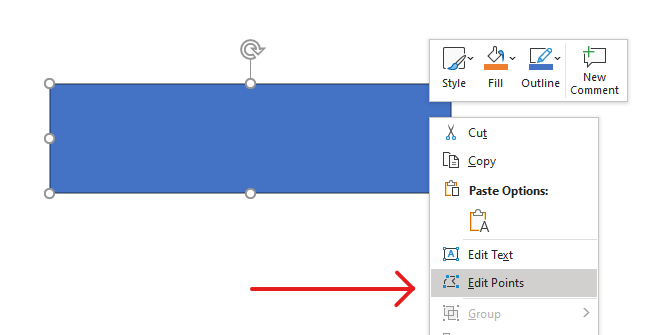

## **Översikt**

Den här artikeln förklarar hur du kan anpassa presentationsformer i Aspose.Slides genom att redigera formgeometri med hjälp av redigeringspunkter och geometri‑banor. Den visar hur du arbetar med [GeometryPath](https://reference.aspose.com/slides/cpp/aspose.slides/geometrypath/) och [IGeometryPath](https://reference.aspose.com/slides/cpp/aspose.slides/igeometrypath/) för att ändra befintliga former, utföra grundläggande redigeringsoperationer, lägga till eller ta bort punkter och applicera den uppdaterade geometrin tillbaka på en form.

Den demonstrerar också hur du skapar anpassade och sammansatta former, bygger former med rundade hörn och bestämmer om en formgeometri är sluten.

## **Ändra en Form med Redigeringspunkter**

I PowerPoint kan du använda **Redigeringspunkter** för att ändra en kvadrat:

* Flytta ett hörn inåt eller utåt.
* Justera krökningen vid en punkt.
* Lägg till nya punkter.

Att redigera punkter låter dig modifiera en forms kontur eller använda en befintlig form som grund för en ny.

## **Tips för Formredigering**



När du redigerar PowerPoint‑former, ha dessa begrepp i åtanke:

* En form (eller dess bana) kan antingen vara sluten eller öppen.
* En forms bana består av ankarnpunkter som är förenade med segment.
* Ett segment kan vara rakt eller kurvat. Ankarnpunkter och kontrollhandtag bestämmer dess form.
* Ankarnpunkter finns som hörnpunkter, raka punkter eller mjuka punkter:
  * Vid en hörnpunkt kan intilliggande segment mötas i en vinkel.
  * Vid en mjuk punkt är de två kontrollhandtagen i linje och lika långt från ankarnpunkten.
  * Vid en rak punkt är de två kontrollhandtagen i linje men kan ha olika avstånd från ankarnpunkten.
* Att flytta ankarnpunkter eller justera deras handtag förändrar formens kontur.

För att redigera PowerPoint‑former via redigeringspunkter tillhandahåller **Aspose.Slides** klassen [GeometryPath](https://reference.aspose.com/slides/cpp/aspose.slides/geometrypath/) och gränssnittet [IGeometryPath](https://reference.aspose.com/slides/cpp/aspose.slides/igeometrypath/).

* En [GeometryPath](https://reference.aspose.com/slides/cpp/aspose.slides/geometrypath/)‑instans representerar en geometri‑bana för objektet [IGeometryShape](https://reference.aspose.com/slides/cpp/aspose.slides/igeometryshape/).
* För att hämta [GeometryPath](https://reference.aspose.com/slides/cpp/aspose.slides/geometrypath/) från en [IGeometryShape](https://reference.aspose.com/slides/cpp/aspose.slides/igeometryshape/)-instans kan du använda metoden [IGeometryShape::GetGeometryPaths](https://reference.aspose.com/slides/cpp/aspose.slides/igeometryshape/getgeometrypaths/).
* För att sätta [GeometryPath](https://reference.aspose.com/slides/cpp/aspose.slides/geometrypath/) för en form kan du använda dessa metoder: [IGeometryShape::SetGeometryPath](https://reference.aspose.com/slides/cpp/aspose.slides/igeometryshape/setgeometrypath/) för former med en enda bana och [IGeometryShape::SetGeometryPaths](https://reference.aspose.com/slides/cpp/aspose.slides/igeometryshape/setgeometrypaths/) för former med flera banor.
* För att lägga till segment kan du använda metoderna under [IGeometryPath](https://reference.aspose.com/slides/cpp/aspose.slides/igeometrypath/).
* Genom att använda metoderna [IGeometryPath::set_Stroke](https://reference.aspose.com/slides/cpp/aspose.slides/igeometrypath/set_stroke/) och [IGeometryPath::set_FillMode](https://reference.aspose.com/slides/cpp/aspose.slides/igeometrypath/set_fillmode/) kan du ange utseendet för en geometri‑bana.
* Med metoden [IGeometryPath::get_PathData](https://reference.aspose.com/slides/cpp/aspose.slides/igeometrypath/get_pathdata/) kan du hämta geometri‑banan för en [GeometryShape](https://reference.aspose.com/slides/cpp/aspose.slides/geometryshape/) som en array av bansegment.

## **Enkla Redigeringsoperationer**

Använd följande metoder för att redigera en geometri‑bana. Överlagringar som tar ett index inför ett segment på den nollbaserade positionen i banans segment‑array.

| Operation | Metod |
| --- | --- |
| Lägg till eller infoga en rak linje. | [GeometryPath::LineTo](https://reference.aspose.com/slides/cpp/aspose.slides/geometrypath/lineto/) |
| Lägg till eller infoga en kubisk Bézier‑kurva med två kontrollpunkter och en slutpunkt. | [GeometryPath::CubicBezierTo](https://reference.aspose.com/slides/cpp/aspose.slides/geometrypath/cubicbezierto/) |
| Lägg till eller infoga en kvadratisk Bézier‑kurva med en kontrollpunkt och en slutpunkt. | [GeometryPath::QuadraticBezierTo](https://reference.aspose.com/slides/cpp/aspose.slides/geometrypath/quadraticbezierto/) |
| Lägg till en elliptisk båge med angivna dimensioner och vinklar i grader. | [GeometryPath::ArcTo](https://reference.aspose.com/slides/cpp/aspose.slides/geometrypath/arcto/) |
| Stäng den aktuella figuren genom att förena dess slutpunkt med startpunkten. | [GeometryPath::CloseFigure](https://reference.aspose.com/slides/cpp/aspose.slides/geometrypath/closefigure/) |
| Sätt startpunkten för en figur. | [GeometryPath::MoveTo](https://reference.aspose.com/slides/cpp/aspose.slides/geometrypath/moveto/) |
| Ta bort ett segment på ett nollbaserat index. | [GeometryPath::RemoveAt](https://reference.aspose.com/slides/cpp/aspose.slides/geometrypath/removeat/) |

## **Lägg till Anpassade Punkter i en Form**

Detta exempel infogar två punkter i en rektangulär form med hjälp av [GeometryPath::LineTo](https://reference.aspose.com/slides/cpp/aspose.slides/geometrypath/lineto/) och applicerar den redigerade banan med [IGeometryShape::SetGeometryPath](https://reference.aspose.com/slides/cpp/aspose.slides/igeometryshape/setgeometrypath/). Koordinaterna är lokala för formen: båda nya punkterna ligger i dess centrum, 100 punkter från vänsterkanten och 50 punkter från toppen. Segmentindex 1 och 4 placerar dem på de övre och nedre kanterna och drar in dessa kanter.

```cpp
#include <DOM/IAutoShape.h>
#include <DOM/IGeometryPath.h>
#include <DOM/IShapeCollection.h>
#include <DOM/ISlide.h>
#include <DOM/ISlideCollection.h>
#include <DOM/Presentation.h>
#include <DOM/ShapeType.h>
#include <system/smart_ptr.h>

using namespace Aspose::Slides;
using namespace System;

auto presentation = System::MakeObject<Presentation>();
auto slide = presentation->get_Slide(0);

auto shape = slide->get_Shapes()->AddAutoShape(ShapeType::Rectangle, 100.0f, 100.0f, 200.0f, 100.0f);

auto geometryPath = shape->GetGeometryPaths()->idx_get(0);
geometryPath->LineTo(100.0f, 50.0f, 1);
geometryPath->LineTo(100.0f, 50.0f, 4);

shape->SetGeometryPath(geometryPath);
```


## **Ta Bort Punkter från en Form**

Detta exempel ändrar konturen på ett hjärtformat objekt genom att ta bort segmentet på nollbaserat index 2 med [GeometryPath::RemoveAt](https://reference.aspose.com/slides/cpp/aspose.slides/geometrypath/removeat/). När den modifierade banan appliceras med [IGeometryShape::SetGeometryPath](https://reference.aspose.com/slides/cpp/aspose.slides/igeometryshape/setgeometrypath/) uppdateras formens kontur.

```cpp
#include <DOM/IAutoShape.h>
#include <DOM/IGeometryPath.h>
#include <DOM/IShapeCollection.h>
#include <DOM/ISlide.h>
#include <DOM/ISlideCollection.h>
#include <DOM/Presentation.h>
#include <DOM/ShapeType.h>
#include <system/smart_ptr.h>

using namespace Aspose::Slides;
using namespace System;

auto presentation = System::MakeObject<Presentation>();
auto slide = presentation->get_Slide(0);

auto shape = slide->get_Shapes()->AddAutoShape(ShapeType::Heart, 100.0f, 100.0f, 300.0f, 300.0f);

auto path = shape->GetGeometryPaths()->idx_get(0);
path->RemoveAt(2);

shape->SetGeometryPath(path);
```


## **Skapa en Anpassad Form**

Detta exempel bygger en femspetsig stjärna med [GeometryPath](https://reference.aspose.com/slides/cpp/aspose.slides/geometrypath/). Växlande yttre och inre radier på 100 respektive 50 punkter definierar spetsarna och inskriptionerna; ett steg på 72 grader placerar de fem spetsarna jämnt. Banen stängs med [GeometryPath::CloseFigure](https://reference.aspose.com/slides/cpp/aspose.slides/geometrypath/closefigure/) och appliceras på en rektangulär form med [IGeometryShape::SetGeometryPath](https://reference.aspose.com/slides/cpp/aspose.slides/igeometryshape/setgeometrypath/), vilket ersätter dess kontur.

```cpp
#include <DOM/GeometryPath.h>
#include <DOM/IAutoShape.h>
#include <DOM/IShapeCollection.h>
#include <DOM/ISlide.h>
#include <DOM/ISlideCollection.h>
#include <DOM/Presentation.h>
#include <DOM/ShapeType.h>
#include <drawing/point_f.h>
#include <system/collections/list.h>
#include <system/math.h>
#include <system/smart_ptr.h>

using namespace Aspose::Slides;
using namespace System;
using namespace System::Collections::Generic;
using namespace System::Drawing;

auto points = System::MakeObject<List<PointF>>();

auto outerRadius = 100.0f;
auto innerRadius = 50.0f;
auto angleStep = 72;

for (auto angle = -90; angle < 270; angle += angleStep)
{
    auto radians = angle * (Math::PI / 180.f);
    auto x = outerRadius * Math::Cos(radians);
    auto y = outerRadius * Math::Sin(radians);
    points->Add(PointF((float)x + outerRadius, (float)y + outerRadius));

    radians = Math::PI * (angle + angleStep / 2) / 180.0;
    x = innerRadius * Math::Cos(radians);
    y = innerRadius * Math::Sin(radians);
    points->Add(PointF((float)x + outerRadius, (float)y + outerRadius));
}

auto starPath = System::MakeObject<GeometryPath>();
starPath->MoveTo(points->idx_get(0));

for (auto i = 1; i < points->get_Count(); i++)
{
    starPath->LineTo(points->idx_get(i));
}

starPath->CloseFigure();

auto presentation = System::MakeObject<Presentation>();
auto slide = presentation->get_Slide(0);

auto shape = slide->get_Shapes()->AddAutoShape(ShapeType::Rectangle, 100.0f, 100.0f, outerRadius * 2, outerRadius * 2);
shape->SetGeometryPath(starPath);
```


## **Skapa en Sammansatt Anpassad Form**

Detta exempel definierar två slutna [GeometryPath](https://reference.aspose.com/slides/cpp/aspose.slides/geometrypath/)‑objekt för den övre och nedre tredjedelen av en form. Genom att applicera båda banorna med [IGeometryShape::SetGeometryPaths](https://reference.aspose.com/slides/cpp/aspose.slides/igeometryshape/setgeometrypaths/) skapas en enda sammansatt form med ett tomrum över mitten av tredjedelen.

```cpp
#include <DOM/GeometryPath.h>
#include <DOM/IAutoShape.h>
#include <DOM/IGeometryPath.h>
#include <DOM/IShapeCollection.h>
#include <DOM/ISlide.h>
#include <DOM/ISlideCollection.h>
#include <DOM/Presentation.h>
#include <DOM/ShapeType.h>
#include <system/smart_ptr.h>

using namespace Aspose::Slides;
using namespace System;

auto presentation = System::MakeObject<Presentation>();
auto slide = presentation->get_Slide(0);

auto shape = slide->get_Shapes()->AddAutoShape(ShapeType::Rectangle, 100.0f, 100.0f, 200.0f, 100.0f);

auto topPath = System::MakeObject<GeometryPath>();
topPath->MoveTo(0.0f, 0.0f);
topPath->LineTo(shape->get_Width(), 0.0f);
topPath->LineTo(shape->get_Width(), shape->get_Height() / 3);
topPath->LineTo(0.0f, shape->get_Height() / 3);
topPath->CloseFigure();

auto bottomPath = System::MakeObject<GeometryPath>();
bottomPath->MoveTo(0.0f, shape->get_Height() / 3 * 2);
bottomPath->LineTo(shape->get_Width(), shape->get_Height() / 3 * 2);
bottomPath->LineTo(shape->get_Width(), shape->get_Height());
bottomPath->LineTo(0.0f, shape->get_Height());
bottomPath->CloseFigure();

auto paths = System::MakeArray<SharedPtr<IGeometryPath>>({ topPath, bottomPath });

shape->SetGeometryPaths(paths);
```


## **Skapa en Anpassad Form med Rundade Hörn**

Detta exempel kombinerar raka segment med [GeometryPath::ArcTo](https://reference.aspose.com/slides/cpp/aspose.slides/geometrypath/arcto/) för att skapa en form med inåtrottade hörn. Varje hörnstorlek anger bågens bredd och höjd i punkter, och en svepning på -90 grader ritar en moturs kvartselips. Den färdiga banan appliceras med [IGeometryShape::SetGeometryPath](https://reference.aspose.com/slides/cpp/aspose.slides/igeometryshape/setgeometrypath/), och presentationen sparas i PPTX‑format.

```cpp
#include <DOM/GeometryPath.h>
#include <DOM/IAutoShape.h>
#include <DOM/IShapeCollection.h>
#include <DOM/ISlide.h>
#include <DOM/ISlideCollection.h>
#include <DOM/Presentation.h>
#include <DOM/ShapeType.h>
#include <Export/SaveFormat.h>
#include <drawing/point_f.h>

using namespace Aspose::Slides;
using namespace Aspose::Slides::Export;
using namespace System::Drawing;

auto shapeX = 20.f;
auto shapeY = 20.f;
auto shapeWidth = 300.f;
auto shapeHeight = 200.f;

auto leftTopSize = 50.f;
auto rightTopSize = 20.f;
auto rightBottomSize = 40.f;
auto leftBottomSize = 10.f;

auto presentation = System::MakeObject<Presentation>();
auto slide = presentation->get_Slide(0);

auto shape = slide->get_Shapes()->AddAutoShape(ShapeType::Custom, shapeX, shapeY, shapeWidth, shapeHeight);

auto topLeft = PointF(leftTopSize, 0.0f);
auto topRight = PointF(shapeWidth - rightTopSize, 0.0f);
auto rightBottom = PointF(shapeWidth, shapeHeight - rightBottomSize);
auto bottomLeft = PointF(leftBottomSize, shapeHeight);
auto leftTop = PointF(0.0f, leftTopSize);

auto geometryPath = System::MakeObject<GeometryPath>();
geometryPath->MoveTo(topLeft);
geometryPath->LineTo(topRight);
geometryPath->ArcTo(rightTopSize, rightTopSize, 180.0f, -90.0f);
geometryPath->LineTo(rightBottom);
geometryPath->ArcTo(rightBottomSize, rightBottomSize, -90.0f, -90.0f);
geometryPath->LineTo(bottomLeft);
geometryPath->ArcTo(leftBottomSize, leftBottomSize, 0.0f, -90.0f);
geometryPath->LineTo(leftTop);
geometryPath->ArcTo(leftTopSize, leftTopSize, 90.0f, -90.0f);
geometryPath->CloseFigure();

shape->SetGeometryPath(geometryPath);

presentation->Save(u"output.pptx", SaveFormat::Pptx);
```

## **Ta reda på om en Formgeometri är Sluten**

Följande hjälpfunktion kontrollerar huruvida varje icke‑tom geometri‑bana slutar med ett slut‑segment. Den läser [IGeometryPath::get_PathData](https://reference.aspose.com/slides/cpp/aspose.slides/igeometrypath/get_pathdata/) och jämför det sista segmentets [IPathSegment::get_PathCommand](https://reference.aspose.com/slides/cpp/aspose.slides/ipathsegment/get_pathcommand/) med [PathCommandType::Close](https://reference.aspose.com/slides/cpp/aspose.slides/pathcommandtype/). Den returnerar false när det inte finns några icke‑tomma banor. Detta kontrollerar den sista kommandot för varje bana; den inspekterar inte varje delfigur inom en bana. Exemplet skriver ut `True` för en rektangel.

```cpp
#include <DOM/Presentation.h>
#include <DOM/ISlide.h>
#include <DOM/IShapeCollection.h>
#include <DOM/IAutoShape.h>
#include <DOM/IGeometryShape.h>
#include <DOM/IGeometryPath.h>
#include <DOM/ShapeType.h>
#include <system/array.h>
#include <system/smart_ptr.h>
#include <system/console.h>
#include <DOM/IPathSegment.h>
#include <DOM/PathCommandType.h>

using namespace Aspose::Slides;
using namespace System;

auto isGeometryClosed = [](SharedPtr<IGeometryShape> geometryShape)
{
    auto hasNonemptyPath = false;
    for (auto&& geometryPath : geometryShape->GetGeometryPaths())
    {
        auto segments = geometryPath->get_PathData();
        if (segments->get_Length() == 0)
        {
            continue;
        }

        hasNonemptyPath = true;
        auto lastSegment = segments->idx_get(segments->get_Length() - 1);
        if (lastSegment->get_PathCommand() != PathCommandType::Close)
        {
            return false;
        }
    }
    return hasNonemptyPath;
};

auto presentation = MakeObject<Presentation>();
auto slide = presentation->get_Slide(0);

auto shape = slide->get_Shapes()->AddAutoShape(ShapeType::Rectangle, 100, 100, 200, 100);
Console::WriteLine(isGeometryClosed(shape));
```

## **Inspektera Geometri‑Banan kommandon**

Ladda ner [contour.pptx](contour.pptx) och placera den i programmets arbetskatalog. Den första formen på den första bilden har en rak övre kant, en kubisk Bézier‑kurva och en rak slutkant. Använd [GetGeometryPaths](https://reference.aspose.com/slides/cpp/aspose.slides/igeometryshape/getgeometrypaths/) för att läsa dess banor. För varje bana returnerar [get_PathData](https://reference.aspose.com/slides/cpp/aspose.slides/igeometrypath/get_pathdata/) segmenten i ritordning. Kommandot som returneras av [get_PathCommand](https://reference.aspose.com/slides/cpp/aspose.slides/ipathsegment/get_pathcommand/) bestämmer hur värdena som returneras av [get_SegmentData](https://reference.aspose.com/slides/cpp/aspose.slides/ipathsegment/get_segmentdata/) ska tolkas.

```cpp
#include <DOM/IGeometryPath.h>
#include <DOM/IGeometryShape.h>
#include <DOM/IPathSegment.h>
#include <DOM/IShape.h>
#include <DOM/ISlide.h>
#include <DOM/PathCommandType.h>
#include <DOM/Presentation.h>
#include <system/array.h>
#include <system/console.h>
#include <system/enum.h>
#include <system/smart_ptr.h>

using namespace Aspose::Slides;
using namespace System;

auto presentation = MakeObject<Presentation>(u"contour.pptx");

auto shape = ExplicitCast<IGeometryShape>(presentation->get_Slide(0)->get_Shape(0));
auto paths = shape->GetGeometryPaths();

for (auto i = 0; i < paths->get_Length(); ++i)
{
    auto segments = paths->idx_get(i)->get_PathData();
    for (auto j = 0; j < segments->get_Length(); ++j)
    {
        auto segment = segments->idx_get(j);
        auto command = segment->get_PathCommand();
        auto data = segment->get_SegmentData();
        String detail;
        switch (command)
        {
            case PathCommandType::MoveTo:
            case PathCommandType::LineTo:
                detail = String::Format(u"destination=({0}, {1})", data->idx_get(0), data->idx_get(1));
                break;
            case PathCommandType::CubicBezierTo:
                detail = String::Format(u"control1=({0}, {1}) control2=({2}, {3}) end=({4}, {5})", data);
                break;
            case PathCommandType::Close:
                detail = u"no coordinates";
                break;
            default:
            {
                auto values = MakeArray<String>(data->get_Length());
                for (auto k = 0; k < data->get_Length(); ++k)
                {
                    values->idx_set(k, String::Format(u"{0}", data->idx_get(k)));
                }
                detail = String::Format(u"raw=[{0}]", String::Join(u", ", values));
                break;
            }
        }
        Console::WriteLine(u"Path {0}, segment {1}: {2} {3}", i, j, Enum<PathCommandType>::GetName(command), detail);
    }
}
```

Formen ligger på (200, 100) punkter på bilden. De rapporterade punkterna är lokala för formen, där (0, 0) är dess övre‑vänstra hörn, x ökar åt höger och y ökar nedåt. Det avslutande segmentet återvänder till startpunkten utan ytterligare koordinater.

```text
Path 0, segment 0: MoveTo destination=(0, 0)
Path 0, segment 1: LineTo destination=(80, 0)
Path 0, segment 2: CubicBezierTo control1=(70, 15) control2=(30, 45) end=(0, 60)
Path 0, segment 3: Close no coordinates
```


## **Extrahera och Inspektera Form‑element**

Använd [IGeometryShape::CreateShapeElements](https://reference.aspose.com/slides/cpp/aspose.slides/igeometryshape/createshapeelements/) för att inspektera en befintlig form som element som innehåller banpunkter och puntstyper. Kasta varje returnerad [IShapeElement](https://reference.aspose.com/slides/cpp/aspose.slides/ishapeelement/) till [ShapeElement](https://reference.aspose.com/slides/cpp/aspose.slides/shapeelement/) för att läsa de arrayer som returneras av [get_PathPoints](https://reference.aspose.com/slides/cpp/aspose.slides/shapeelement/get_pathpoints/) och [get_PathTypes](https://reference.aspose.com/slides/cpp/aspose.slides/shapeelement/get_pathtypes/). Denna representation är användbar för kontur‑analys eller för att vidarebefordra geometri till egna ritverktyg.

Exemplet öppnar en presentation, hittar den första geometri‑formen direkt på den första bilden och skriver ut dess bansegment. Använd en presentation som innehåller en form med raka och kurvade segment för att se båda typerna av utdata. Det söker inte i grupper.

```cpp
#include <DOM/Presentation.h>
#include <DOM/ISlide.h>
#include <DOM/IShapeCollection.h>
#include <DOM/IAutoShape.h>
#include <DOM/IGeometryShape.h>
#include <DOM/IGeometryPath.h>
#include <DOM/ShapeType.h>
#include <system/array.h>
#include <system/smart_ptr.h>
#include <system/console.h>
#include <DOM/IShapeElement.h>
#include <DOM/ShapeElement.h>

using namespace Aspose::Slides;
using namespace System;

auto presentation = MakeObject<Presentation>(u"input.pptx");
auto slide = presentation->get_Slide(0);

SharedPtr<IGeometryShape> shape;
for (auto&& candidate : slide->get_Shapes())
{
    shape = AsCast<IGeometryShape>(candidate);
    if (shape != nullptr)
    {
        break;
    }
}
if (shape == nullptr)
{
    Console::WriteLine(u"No geometry shape found on the first slide.");
    return;
}

for (auto&& element : shape->CreateShapeElements())
{
    auto shapeElement = ExplicitCast<ShapeElement>(element);
    auto points = shapeElement->get_PathPoints();
    auto types = shapeElement->get_PathTypes();
    Console::WriteLine(u"Shape element:");

    for (auto i = 0; i < points->get_Length(); i++)
    {
        auto pointType = types[i] & 0x07; // Behåll segmenttypen, exklusive flaggor.
        switch (pointType)
        {
            case 0:
                Console::WriteLine(u"Start figure at {0}", points[i]);
                break;
            case 1:
                Console::WriteLine(u"Line to {0}", points[i]);
                break;
            case 3:
                Console::WriteLine(u"Cubic Bezier: controls {0}, {1}; end {2}", points[i], points[i + 1], points[i + 2]);
                i += 2; // Consume both control points and the endpoint.
                break;
        }
        if ((types[i] & 0x80) != 0)
        {
            Console::WriteLine(u"Close subpath back to its starting point.");
        }
    }
}
```

Arrayerna motsvarar varandra enligt index: `points[i]` är en punkt och `types[i]` beskriver dess roll. Typ `0` startar en figur, och typ `1` ritar en linje från föregående punkt till den aktuella. Ett kubiskt Bézier‑segment startar vid föregående slutpunkt och använder tre på varandra följande typ‑`3`‑poster: två kontrollpunkter följt av den nya slutpunkten. Loopen konsumerar dessa tre poster tillsammans och kontrollerar slutpunkten för slutenhet.

Punkt‑typer innehåller också flaggor. Maskera med `0x07` för att identifiera segment‑typen och testa `0x80` separat för att upptäcka en sluten underbana. Till exempel betyder `129` (`0x81`) en linje‑slutpunkt som stänger en underbana, och `131` (`0x83`) en Bézier‑slutpunkt som gör det. Att bara jämföra råvärdet med `1` eller `3` skulle missa dessa fall. Andra flaggor, såsom streck (`0x10`) och markör (`0x20`), förändrar inte grundsegment‑typen.

**Koordinater och transformationer.** Punkter mäts i punkter (1/72 tum), där X ökar åt höger och Y ökar nedåt. För en o‑grupperad form innehåller de extraherade koordinaterna redan positionen som returneras av [get_X](https://reference.aspose.com/slides/cpp/aspose.slides/shape/get_x/) och [get_Y](https://reference.aspose.com/slides/cpp/aspose.slides/shape/get_y/) samt reflekterar dess nuvarande bredd och höjd. Till exempel har en o‑roterad rektangel på `(100, 200)` med storlek `120 × 80` konturgränserna `(100, 200)`–`(220, 280)`. Lägg inte till formens position igen. Subtrahera dess X och Y för att få koordinater relativt dess o‑roterade ram.

De extraherade punkterna applicerar inte rotationen som satts via [set_Rotation](https://reference.aspose.com/slides/cpp/aspose.slides/shape/set_rotation/) eller horisontella och vertikala speglingar. För att återskapa den visade konturen, applicera dessa transformationer kring formens centrum. För grupperade former måste du också ta hänsyn till gruppens koordinat‑mappning och transformationer; anta inte att de extraherade punkterna är de slutgiltiga renderade bild‑koordinaterna eller att du ska lägga till en translational eller skala‑förflyttning två gånger om den redan finns i barnets ram.

**Inspektion kontra redigering.** Extraherade arrayer beskriver konturen; att ändra dem uppdaterar inte den ursprungliga formen. Använd detta tillvägagångssätt när din analys‑ eller ritkod behöver punkt‑/typ‑arrayer. Använd [GetGeometryPaths](https://reference.aspose.com/slides/cpp/aspose.slides/igeometryshape/getgeometrypaths/) när du behöver geometri‑kommandon i formens lokala koordinatsystem eller vill redigera dess geometri. Applicera redigerade banor via [SetGeometryPath](https://reference.aspose.com/slides/cpp/aspose.slides/igeometryshape/setgeometrypath/) eller [SetGeometryPaths](https://reference.aspose.com/slides/cpp/aspose.slides/igeometryshape/setgeometrypaths/).

## **Konvertera GeometryPath till GraphicsPath**

Det nuvarande offentliga API‑et för Aspose.Slides för C++ exponerar inte konverteringar mellan geometri‑banor och grafik‑banor. För att inspektera en kontur, använd form‑element som beskrivits ovan. För att redigera en form, använd geometri‑banor och applicera de uppdaterade banorna på formen.

## **Vanliga Frågor**

**Vad händer med fyllning och kontur efter att geometrin har ersatts?**

Stilen förblir knuten till formen; endast konturen förändras. Fyllning och kontur appliceras automatiskt på den nya geometrin.

**Hur roterar jag en anpassad form korrekt tillsammans med dess geometri?**

Använd formens [set_Rotation](https://reference.aspose.com/slides/cpp/aspose.slides/shape/set_rotation/)‑metod; geometrin roterar med formen eftersom den är bunden till formens eget koordinatsystem.

**Kan jag konvertera en anpassad form till en bild för att ”låsa” resultatet?**

Ja. Exportera den önskade [slide](/slides/sv/cpp/convert-powerpoint-to-png/)‑området eller själva [shape](/slides/sv/cpp/shape-thumbnails/) till ett rasterformat; detta förenklar vidare arbete med komplexa geometrier.