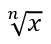

## **Översikt**

PowerPoint lagrar ekvationer som Office Math Markup Language (OMML). Med Aspose.Slides för Java kan du programmässigt skapa samma typ av matematiskt innehåll: bråktal, radikaler, funktioner, gränsvärden, N-ary‑operatorer, matriser, arrayer och formaterade matematiska block.

I PowerPoint lägger användare normalt till ekvationer via **Infoga > Ekvation**:


Resultatet är redigerbar matematiktext på bilden:


Aspose.Slides bygger den matematiska texten genom tre huvudobjekt:

- En matematikform, skapad med [addMathShape](https://reference.aspose.com/slides/java/com.aspose.slides/ishapecollection/#addMathShape-float-float-float-float-), är den form som innehåller ekvationen.
- [MathPortion](https://reference.aspose.com/slides/java/com.aspose.slides/mathportion/) lagrar matematiskt innehåll i formens textramar.
- [MathParagraph](https://reference.aspose.com/slides/java/com.aspose.slides/mathparagraph/) innehåller ett eller flera [MathBlock](https://reference.aspose.com/slides/java/com.aspose.slides/mathblock/)‑objekt.

De flesta exempel nedan använder [MathematicalText](https://reference.aspose.com/slides/java/com.aspose.slides/mathematicaltext/) och de flödande metoderna från [IMathElement](https://reference.aspose.com/slides/java/com.aspose.slides/imathelement/) för att hålla koden kort och läsbar.

För MathML‑exportscenarier, se [Exportera matematiska ekvationer från presentationer i Java](/slides/sv/java/exporting-math-equations/).

## **Skapa en ekvation**

Det här exemplet använder [addMathShape](https://reference.aspose.com/slides/java/com.aspose.slides/ishapecollection/#addMathShape-float-float-float-float-) för att skapa en matematikform och lägger till Pythagoras sats:


```java
import com.aspose.slides.*;

Presentation presentation = new Presentation();
try {
    ISlide slide = presentation.getSlides().get_Item(0);

    IAutoShape mathShape = slide.getShapes().addMathShape(20, 20, 700, 120);
    IMathParagraph mathParagraph = ((MathPortion) mathShape.getTextFrame().getParagraphs()
            .get_Item(0).getPortions().get_Item(0)).getMathParagraph();

    IMathBlock equation = new MathematicalText("c")
            .setSuperscript("2")
            .join("=")
            .join(new MathematicalText("a").setSuperscript("2"))
            .join("+")
            .join(new MathematicalText("b").setSuperscript("2"));

    mathParagraph.add(equation);

    presentation.save("pythagorean-theorem.pptx", SaveFormat.Pptx);
} finally {
    presentation.dispose();
}
```

{}
[addMathShape](https://reference.aspose.com/slides/java/com.aspose.slides/ishapecollection/#addMathShape-float-float-float-float-) skapar en form som redan innehåller ett matematikstycke. Hämta den första [MathPortion](https://reference.aspose.com/slides/java/com.aspose.slides/mathportion/), anropa [getMathParagraph](https://reference.aspose.com/slides/java/com.aspose.slides/imathportion/#getMathParagraph--), och lägg till matematiska block eller matematiska element i den.
{}

### **Kombinera matematiska block**

När delar av en ekvation byggs oberoende som [IMathBlock](https://reference.aspose.com/slides/java/com.aspose.slides/imathblock/)‑objekt, använd [joinBlock](https://reference.aspose.com/slides/java/com.aspose.slides/imathblock/#joinBlock-com.aspose.slides.IMathBlock-) för att kombinera dem. Exemplet bygger `c² =` i det vänstra blocket och `a² + b²` i det högra blocket. [setSuperscript](https://reference.aspose.com/slides/java/com.aspose.slides/imathelement/#setSuperscript-java.lang.String-) skapar redigerbara matematiska upphöjningar för alla tre potenser.

```java
import com.aspose.slides.*;

Presentation presentation = new Presentation();
try {
    ISlide slide = presentation.getSlides().get_Item(0);

    IAutoShape shape = slide.getShapes().addMathShape(20, 20, 600, 100);
    IMathPortion mathPortion = (IMathPortion) shape.getTextFrame().getParagraphs().get_Item(0).getPortions().get_Item(0);
    IMathParagraph mathParagraph = mathPortion.getMathParagraph();

    MathBlock leftBlock = new MathBlock();
    leftBlock.add(new MathematicalText("c").setSuperscript("2"));
    leftBlock.add(new MathematicalText("="));

    MathBlock rightBlock = new MathBlock();
    rightBlock.add(new MathematicalText("a").setSuperscript("2"));
    rightBlock.add(new MathematicalText("+"));
    rightBlock.add(new MathematicalText("b").setSuperscript("2"));

    IMathBlock combinedBlock = leftBlock.joinBlock(rightBlock);
    mathParagraph.add(combinedBlock);

    presentation.save("equation.pptx", SaveFormat.Pptx);
} finally {
    presentation.dispose();
}
```

[joinBlock](https://reference.aspose.com/slides/java/com.aspose.slides/imathblock/#joinBlock-com.aspose.slides.IMathBlock-) returnerar själva `leftBlock`, som nu innehåller båda delarna i ordning, och lämnar `rightBlock` tom. Lägg till det kombinerade blocket i [IMathParagraph](https://reference.aspose.com/slides/java/com.aspose.slides/imathparagraph/) endast en gång. Efter att ha öppnat `equation.pptx` igen innehåller stycket ett block som representerar `c² = a² + b²`, med alla tre potenser bevarade som matematiska upphöjningar.

Att anropa [add](https://reference.aspose.com/slides/java/com.aspose.slides/imathelementcollection/#add-com.aspose.slides.IMathElement-) som `leftBlock.add(rightBlock)` försöker istället att nästla ett block direkt i ett annat och kastar `InvalidOperationException`.

## **Lägg till bråktal**

Använd [divide](https://reference.aspose.com/slides/java/com.aspose.slides/imathelement/#divide-com.aspose.slides.IMathElement-) för att skapa ett bråk. Du kan välja en bråkstil med [MathFractionTypes](https://reference.aspose.com/slides/java/com.aspose.slides/mathfractiontypes/).


```java
import com.aspose.slides.*;

Presentation presentation = new Presentation();
try {
    ISlide slide = presentation.getSlides().get_Item(0);

    IAutoShape mathShape = slide.getShapes().addMathShape(20, 20, 700, 100);
    IMathParagraph mathParagraph = ((MathPortion) mathShape.getTextFrame().getParagraphs()
            .get_Item(0).getPortions().get_Item(0)).getMathParagraph();

    IMathFraction fraction = new MathematicalText("1")
            .divide("x", MathFractionTypes.Skewed);

    mathParagraph.add(new MathBlock(fraction));

    presentation.save("fraction.pptx", SaveFormat.Pptx);
} finally {
    presentation.dispose();
}
```

För ett staplat bråk, använd [MathFractionTypes.Bar](https://reference.aspose.com/slides/java/com.aspose.slides/mathfractiontypes/#Bar):

```java
import com.aspose.slides.*;

IMathFraction stackedFraction = new MathematicalText("x + 1").divide("y - 1", MathFractionTypes.Bar);
```

## **Lägg till radikaler**

Använd [radical](https://reference.aspose.com/slides/java/com.aspose.slides/imathelement/#radical-com.aspose.slides.IMathElement-) för att skapa en kvadratrot, kubikrot eller annan rot. Det aktuella elementet blir basen och argumentet blir graden.



```java
import com.aspose.slides.*;

Presentation presentation = new Presentation();
try {
    ISlide slide = presentation.getSlides().get_Item(0);

    IAutoShape mathShape = slide.getShapes().addMathShape(20, 20, 700, 100);
    IMathParagraph mathParagraph = ((MathPortion) mathShape.getTextFrame().getParagraphs()
            .get_Item(0).getPortions().get_Item(0)).getMathParagraph();

    IMathRadical radical = new MathematicalText("x")
            .radical("n");

    mathParagraph.add(new MathBlock(radical));

    presentation.save("radical.pptx", SaveFormat.Pptx);
} finally {
    presentation.dispose();
}
```

### **Visa eller dölja graden av en kvadratrot**

En kvadratrot kan visa en explicit 2 eller använda den konventionella √x‑notationen. Metoden [setHideDegree](https://reference.aspose.com/slides/java/com.aspose.slides/imathradical/#setHideDegree-boolean-) i [IMathRadical](https://reference.aspose.com/slides/java/com.aspose.slides/imathradical/) styr vilken form som visas. Båda formerna behåller graden 2 och radikanden x i den redigerbara ekvationen.


Exemplet sparar samma kvadratrot två gånger. I `visible-degree.pptx` är 2 synlig. I `hidden-degree.pptx` är den dold.

```java
import com.aspose.slides.*;

Presentation presentation = new Presentation();
try {
    ISlide slide = presentation.getSlides().get_Item(0);
    
    IMathRadical radical = new MathematicalText("x").radical("2");

    IAutoShape shape = slide.getShapes().addMathShape(20, 20, 200, 100);
    IMathPortion portion = (IMathPortion) shape.getTextFrame().getParagraphs().get_Item(0).getPortions().get_Item(0);
    portion.getMathParagraph().add(new MathBlock(radical));

    radical.setHideDegree(false);
    presentation.save("visible-degree.pptx", SaveFormat.Pptx);

    radical.setHideDegree(true);
    presentation.save("hidden-degree.pptx", SaveFormat.Pptx);
} finally {
    presentation.dispose();
}
```

## **Lägg till funktioner och gränsvärden**

Använd [asArgumentOfFunction](https://reference.aspose.com/slides/java/com.aspose.slides/imathelement/#asArgumentOfFunction-com.aspose.slides.IMathElement-) eller [function](https://reference.aspose.com/slides/java/com.aspose.slides/imathelement/#function-com.aspose.slides.IMathElement-) för funktioner såsom `sin(x)`, `log(x)` eller anpassade funktionsnamn. För gränsvärden, placera `lim` i ett [MathLimit](https://reference.aspose.com/slides/java/com.aspose.slides/mathlimit/) eller använd [setLowerLimit](https://reference.aspose.com/slides/java/com.aspose.slides/imathelement/#setLowerLimit-com.aspose.slides.IMathElement-).


```java
import com.aspose.slides.*;

Presentation presentation = new Presentation();
try {
    ISlide slide = presentation.getSlides().get_Item(0);

    IAutoShape mathShape = slide.getShapes().addMathShape(20, 20, 700, 100);
    IMathParagraph mathParagraph = ((MathPortion) mathShape.getTextFrame().getParagraphs()
            .get_Item(0).getPortions().get_Item(0)).getMathParagraph();

    IMathFunction limit = new MathematicalText("lim")
            .setLowerLimit("x\u2192\u221E")
            .function("x");

    mathParagraph.add(new MathBlock(limit));

    presentation.save("functions-and-limits.pptx", SaveFormat.Pptx);
} finally {
    presentation.dispose();
}
```

För ett anpassat funktionsnamn, gör funktionsnamnet till det aktuella elementet och anropa [function](https://reference.aspose.com/slides/java/com.aspose.slides/imathelement/#function-com.aspose.slides.IMathElement-) med dess argument:

```java
import com.aspose.slides.*;

IMathFunction customFunction = new MathematicalText("f").function("x + 1");
```

## **Lägg till N-ary‑operatorer och integraler**

Använd [nary](https://reference.aspose.com/slides/java/com.aspose.slides/imathelement/#nary-int-com.aspose.slides.IMathElement-com.aspose.slides.IMathElement-) för summationer, föreningar, snitt och andra stora operatorer. Använd [integral](https://reference.aspose.com/slides/java/com.aspose.slides/imathelement/#integral-int-com.aspose.slides.IMathElement-com.aspose.slides.IMathElement-) för integraler. Båda metoderna låter dig ange lägre och övre gränser.


```java
import com.aspose.slides.*;

Presentation presentation = new Presentation();
try {
    ISlide slide = presentation.getSlides().get_Item(0);

    IAutoShape mathShape = slide.getShapes().addMathShape(20, 20, 700, 120);
    IMathParagraph mathParagraph = ((MathPortion) mathShape.getTextFrame().getParagraphs()
            .get_Item(0).getPortions().get_Item(0)).getMathParagraph();

    IMathBlock summationBase = new MathematicalText("x")
            .setSuperscript("k")
            .join(new MathematicalText("a").setSuperscript("n-k"));

    IMathNaryOperator summation = summationBase.nary(MathNaryOperatorTypes.Summation, "k=0", "n");

    mathParagraph.add(new MathBlock(summation));

    presentation.save("nary-operators.pptx", SaveFormat.Pptx);
} finally {
    presentation.dispose();
}
```

N-ary‑operatorer är för stora operatorer med valfria gränser. Enkla operatorer såsom `+`, `-` och `=` läggs vanligtvis till som [MathematicalText](https://reference.aspose.com/slides/java/com.aspose.slides/mathematicaltext/) och förenas i uttrycket.

För en integral, använd [integral](https://reference.aspose.com/slides/java/com.aspose.slides/imathelement/#integral-int-com.aspose.slides.IMathElement-com.aspose.slides.IMathElement-):

```java
import com.aspose.slides.*;

IMathBlock integralBase = new MathematicalText("x").join(new MathematicalText("dx").toBox());
IMathNaryOperator integral = integralBase.integral(MathIntegralTypes.Simple, "0", "1");
```

## **Lägg till matriser**

Använd [MathMatrix](https://reference.aspose.com/slides/java/com.aspose.slides/mathmatrix/) för rader och kolumner. Matriser innehåller inte hakparenteser som standard, så omge matrisen när du behöver parenteser, hakparenteser eller klammer.


```java
import com.aspose.slides.*;

Presentation presentation = new Presentation();
try {
    ISlide slide = presentation.getSlides().get_Item(0);

    IAutoShape mathShape = slide.getShapes().addMathShape(20, 20, 700, 120);
    IMathParagraph mathParagraph = ((MathPortion) mathShape.getTextFrame().getParagraphs()
            .get_Item(0).getPortions().get_Item(0)).getMathParagraph();

    MathMatrix matrix = new MathMatrix(2, 3);
    matrix.set_Item(0, 0, new MathematicalText("1"));
    matrix.set_Item(0, 1, new MathematicalText("x"));
    matrix.set_Item(1, 0, new MathematicalText("x"));
    matrix.set_Item(1, 1, new MathematicalText("2"));
    matrix.set_Item(1, 2, new MathematicalText("y"));

    mathParagraph.add(new MathBlock(matrix));

    presentation.save("matrix.pptx", SaveFormat.Pptx);
} finally {
    presentation.dispose();
}
```

### **Redigera en befintlig matris**

Anta att en lektion i linjär algebra börjar med koefficientmatrisen i `matrix.pptx`, sparad av föregående exempel. För nästa övning behåller du den första ekvationen, ersätter den andra med två nya ekvationer och reviderar variabeluppsättningen. Öppna den befintliga matrisen via [IMathMatrix](https://reference.aspose.com/slides/java/com.aspose.slides/imathmatrix/) för att behålla de koefficienter som fortfarande gäller.


Rads- och kolumnindex börjar på noll och refererar till matrisen i dess aktuella tillstånd vid varje anrop. Att infoga en rad före index 1 flyttar den ursprungliga andra raden till index 2. Att infoga efter index 2 lägger sedan till en rad. Att ta bort rad 2 tar bort den ursprungliga andra ekvationen och flyttar den tillagda raden upp en position. Kolumner skiftar på samma sätt.

```java
import com.aspose.slides.*;

Presentation presentation = new Presentation("matrix.pptx");
try {
    IAutoShape shape = (IAutoShape) presentation.getSlides().get_Item(0).getShapes().get_Item(0);
    IMathPortion portion = (IMathPortion) shape.getTextFrame().getParagraphs().get_Item(0).getPortions().get_Item(0);
    IMathMatrix matrix = (IMathMatrix) portion.getMathParagraph().get_Item(0).get_Item(0);

    matrix.insertRowBefore(1);
    matrix.insertRowAfter(2);
    matrix.deleteRow(2);

    matrix.insertColumnBefore(1);
    matrix.insertColumnAfter(3);
    matrix.deleteColumn(3);

    // Nya celler är initialt null. Sätt de icke noll koefficienterna först.
    matrix.set_Item(1, 0, new MathematicalText("12"));
    matrix.set_Item(1, 1, new MathematicalText("1"));
    matrix.set_Item(2, 2, new MathematicalText("10"));
    matrix.set_Item(2, 3, new MathematicalText("1"));
    for (int row = 0; row < matrix.getRowCount(); row++) {
        for (int column = 0; column < matrix.getColumnCount(); column++) {
            if (matrix.get_Item(row, column) == null) {
                matrix.set_Item(row, column, new MathematicalText("0"));
            }
        }
    }

    matrix.setColumnAlignment(0, MathHorizontalAlignment.Left);
    matrix.setColumnsAlignment(1, 3, MathHorizontalAlignment.Right);

    presentation.save("updated-matrix.pptx", SaveFormat.Pptx);
} finally {
    presentation.dispose();
}
```

[setColumnAlignment](https://reference.aspose.com/slides/java/com.aspose.slides/imathmatrix/#setColumnAlignment-int-int-) justerar den första kolumnen åt vänster. [setColumnsAlignment](https://reference.aspose.com/slides/java/com.aspose.slides/imathmatrix/#setColumnsAlignment-int-long-int-) justerar tre på varandra följande kolumner åt höger, med start på index 1. I `updated-matrix.pptx` har matrisen tre ekvationer och fyra variabler. De ursprungliga koefficienterna i den första raden `1` och `x` visas nu i den första och tredje kolumnen.


## **Lägg till ekvationsarrayer**

Använd [toMathArray](https://reference.aspose.com/slides/java/com.aspose.slides/imathelement/#toMathArray--) när du behöver justerade ekvationer eller en vertikal stapel av uttryck.


```java
import com.aspose.slides.*;

Presentation presentation = new Presentation();
try {
    ISlide slide = presentation.getSlides().get_Item(0);

    IAutoShape mathShape = slide.getShapes().addMathShape(20, 20, 700, 140);
    IMathParagraph mathParagraph = ((MathPortion) mathShape.getTextFrame().getParagraphs()
            .get_Item(0).getPortions().get_Item(0)).getMathParagraph();

    IMathArray equationArray = new MathematicalText("x")
            .join("y")
            .toMathArray();

    mathParagraph.add(new MathBlock(equationArray));

    presentation.save("equation-array.pptx", SaveFormat.Pptx);
} finally {
    presentation.dispose();
}
```

### **Justera en array med omgivande element**

[setBaseJustification](https://reference.aspose.com/slides/java/com.aspose.slides/imatharray/#setBaseJustification-int-) styr den vertikala justeringen av en array i förhållande till de matematiska elementen bredvid den. Exemplet nedan jämför justering med första raden, mitten av arrayen och sista raden.

Följande exempel skapar tre identiska arrayer, var och en med tre rader och de intilliggande elementen `A=` och `=B`. All matematisk text använder Cambria Math i 24 punkter. Endast arrayens justering förändras.

```java
import com.aspose.slides.*;
import java.awt.Color;

class MathTextFactory {
    MathematicalText createText(String value) {
        MathematicalText text = new MathematicalText(value);
        text.getFormat().setFontHeight(24);
        text.getFormat().setLatinFont(new FontData("Cambria Math"));
        return text;
    }
}

MathTextFactory factory = new MathTextFactory();
Presentation presentation = new Presentation();
try {
    presentation.getSlideSize().setSize(780, 200, SlideSizeScaleType.DoNotScale);
    ISlide slide = presentation.getSlides().get_Item(0);
    
    int[] alignments = { MathVerticalAlignment.Top, MathVerticalAlignment.Center, MathVerticalAlignment.Bottom };
    String[] alignmentNames = { "Top", "Center", "Bottom" };

    for (int i = 0; i < alignments.length; i++) {
        IAutoShape label = slide.getShapes().addAutoShape(ShapeType.Rectangle, 20 + i * 260, 10, 240, 30);
        label.getFillFormat().setFillType(FillType.NoFill);
        label.getLineFormat().getFillFormat().setFillType(FillType.NoFill);
        label.getTextFrame().setText(alignmentNames[i]);
        IPortionFormat labelFormat = label.getTextFrame().getParagraphs().get_Item(0).getPortions().get_Item(0).getPortionFormat();
        labelFormat.setFontHeight(16);
        labelFormat.getFillFormat().setFillType(FillType.Solid);
        labelFormat.getFillFormat().getSolidFillColor().setColor(Color.BLACK);

        IAutoShape mathShape = slide.getShapes().addMathShape(20 + i * 260, 60, 240, 130);
        mathShape.getTextFrame().getTextFrameFormat().setAnchoringType(TextAnchorType.Top);
        IMathParagraph mathParagraph = ((IMathPortion) mathShape.getTextFrame().getParagraphs().get_Item(0).getPortions().get_Item(0)).getMathParagraph();
        mathParagraph.setJustification(MathJustification.LeftJustified);

        IMathElement[] rows = { factory.createText("x+y=3"), factory.createText("x-y=1"), factory.createText("x=2") };
        MathArray equationArray = new MathArray(rows[0]);
        equationArray.getArguments().add(rows[1]);
        equationArray.getArguments().add(rows[2]);
        equationArray.setBaseJustification(alignments[i]);
        MathematicalText leftText = factory.createText("A=");
        MathematicalText rightText = factory.createText("=B");
        IMathBlock equation = new MathBlock(leftText).join(equationArray).join(rightText);
        mathParagraph.add(equation);
    }

    presentation.save("equation-array-alignment.pptx", SaveFormat.Pptx);
} finally {
    presentation.dispose();
}
```

Följande jämförelse visar den sparade presentationen i PowerPoint. Lägg märke till placeringen av `A=` och `=B` bredvid varje array.


### **Konfigurera radavstånd**

[setRowSpacingRule](https://reference.aspose.com/slides/java/com.aspose.slides/imatharray/#setRowSpacingRule-int-) väljer avståndsregeln för rader inom arrayen. [setRowSpacing](https://reference.aspose.com/slides/java/com.aspose.slides/imatharray/#setRowSpacing-long-) ger ett numeriskt värde för en explicit avståndsregel och ignoreras av förinställda regler.

För exakt avstånd mäts värdet i punkter. För proportionellt avstånd mäts det i halvläror: värdet `3` i exemplet specificerar 1,5 rader. Ställ in båda egenskaperna när du anger ett explicit värde; att bara ändra det numeriska värdet väljer inte en avståndsregel.

Exemplet nedan sparar fem presentationer med samma ekvationer, justering och typsnittsinställningar. De första tre använder förinställningar; de två sista visar explicita värden.

```java
import com.aspose.slides.*;

class MathTextFactory {
    MathematicalText createText(String value) {
        MathematicalText text = new MathematicalText(value);
        text.getFormat().setFontHeight(24);
        text.getFormat().setLatinFont(new FontData("Cambria Math"));
        return text;
    }
}

MathTextFactory factory = new MathTextFactory();
int[] rules = { MathRowSpacingRule.SingleLineGap, MathRowSpacingRule.OneAndAHalfLineGap, MathRowSpacingRule.TwoLineGap, MathRowSpacingRule.Exactly, MathRowSpacingRule.Multiple };
int[] spacingValues = { 0, 0, 0, 20, 3 };
String[] ruleNames = { "SingleLineGap", "OneAndAHalfLineGap", "TwoLineGap", "Exactly", "Multiple" };

for (int i = 0; i < rules.length; i++) {
    String fileName = "equation-array-" + ruleNames[i] + ".pptx";
    Presentation presentation = new Presentation();
    try {
        IAutoShape mathShape = presentation.getSlides().get_Item(0).getShapes().addMathShape(20, 20, 600, 300);
        IParagraph paragraph = mathShape.getTextFrame().getParagraphs().get_Item(0);
        paragraph.getParagraphFormat().setSpaceBefore(0);
        paragraph.getParagraphFormat().setSpaceAfter(0);
        IMathParagraph mathParagraph = ((IMathPortion) paragraph.getPortions().get_Item(0)).getMathParagraph();
        mathParagraph.setJustification(MathJustification.LeftJustified);

        IMathElement[] rows = { factory.createText("x+y=3"), factory.createText("x-y=1"), factory.createText("x=2") };
        MathArray equationArray = new MathArray(rows[0]);
        equationArray.getArguments().add(rows[1]);
        equationArray.getArguments().add(rows[2]);
        equationArray.setBaseJustification(MathVerticalAlignment.Center);
        equationArray.setRowSpacingRule(rules[i]);
        equationArray.setRowSpacing(spacingValues[i]);
        MathematicalText leftText = factory.createText("A=");
        MathematicalText rightText = factory.createText("=B");
        IMathBlock equation = new MathBlock(leftText).join(equationArray).join(rightText);
        mathParagraph.add(equation);

        presentation.save(fileName, SaveFormat.Pptx);
    } finally {
        presentation.dispose();
    }
}
```

Radavstånd i arrayen är separat från styckeavstånd. [setSpaceBefore](https://reference.aspose.com/slides/java/com.aspose.slides/iparagraphformat/#setSpaceBefore-float-) och [setSpaceAfter](https://reference.aspose.com/slides/java/com.aspose.slides/iparagraphformat/#setSpaceAfter-float-) lägger till avstånd runt det omgivande stycket, inte mellan arrayrader. På samma sätt positionerar [IMathParagraph.setJustification](https://reference.aspose.com/slides/java/com.aspose.slides/imathparagraph/#setJustification-int-) hela matematikstycket horisontellt; det ersätter inte arrayens vertikala justeringsinställning.

## **Lägg till trigonometriska funktioner**

Använd [asArgumentOfFunction](https://reference.aspose.com/slides/java/com.aspose.slides/imathelement/#asArgumentOfFunction-com.aspose.slides.IMathElement-) när argumentet är det aktuella elementet och funktionsnamnet är känt.


```java
import com.aspose.slides.*;

Presentation presentation = new Presentation();
try {
    ISlide slide = presentation.getSlides().get_Item(0);

    IAutoShape mathShape = slide.getShapes().addMathShape(20, 20, 700, 100);
    IMathParagraph mathParagraph = ((MathPortion) mathShape.getTextFrame().getParagraphs()
            .get_Item(0).getPortions().get_Item(0)).getMathParagraph();

    IMathFunction cosine = new MathematicalText("2x")
            .asArgumentOfFunction(MathFunctionsOfOneArgument.Cos);

    mathParagraph.add(new MathBlock(cosine));

    presentation.save("trigonometric-function.pptx", SaveFormat.Pptx);
} finally {
    presentation.dispose();
}
```

## **Lägg till nedsättningar och upphöjningar**

Använd hjälpmetoderna för nedsättningar och upphöjningar för index och potenser. När indexen måste visas på vänster sida av basen, använd [setSubSuperscriptOnTheLeft](https://reference.aspose.com/slides/java/com.aspose.slides/imathelement/#setSubSuperscriptOnTheLeft-com.aspose.slides.IMathElement-com.aspose.slides.IMathElement-).


```java
import com.aspose.slides.*;

Presentation presentation = new Presentation();
try {
    ISlide slide = presentation.getSlides().get_Item(0);

    IAutoShape mathShape = slide.getShapes().addMathShape(20, 20, 700, 100);
    IMathParagraph mathParagraph = ((MathPortion) mathShape.getTextFrame().getParagraphs()
            .get_Item(0).getPortions().get_Item(0)).getMathParagraph();

    IMathLeftSubSuperscriptElement scripts = new MathematicalText("Y")
            .setSubSuperscriptOnTheLeft("1", "n");

    mathParagraph.add(new MathBlock(scripts));

    presentation.save("subscript-superscript.pptx", SaveFormat.Pptx);
} finally {
    presentation.dispose();
}
```

### **Justera högra nedsättningar och upphöjningar**

När båda skripten tillhör samma bas, använd [MathRightSubSuperscriptElement](https://reference.aspose.com/slides/java/com.aspose.slides/mathrightsubsuperscriptelement/). Dess [setAlignScripts](https://reference.aspose.com/slides/java/com.aspose.slides/imathrightsubsuperscriptelement/#setAlignScripts-boolean-) metod styr deras horisontella positioner: `false` (standard) låter dem följa basens kontur, medan `true` justerar skripten horisontellt med varandra.

Detta exempel placerar två kopior av samma redigerbara uttryck sida vid sida. Båda använder matematiskt kursivt f (U+1D453), en nedsättning på 1, en upphöjning på 2 och Cambria Math i 72 punkter. Den lutande basen gör skillnaden synlig i PowerPoint. Installera Cambria Math innan du kör exemplet.

```java
import com.aspose.slides.*;

Presentation presentation = new Presentation();
try {
    presentation.getSlideSize().setSize(900, 250, SlideSizeScaleType.DoNotScale);
    ISlide slide = presentation.getSlides().get_Item(0);

    PortionFormat format = new PortionFormat();
    format.setFontHeight(72);
    format.setLatinFont(new FontData("Cambria Math"));

    for (int i = 0; i < 2; i++) {
        int left = 40 + i * 440;
        IAutoShape shape = slide.getShapes().addMathShape(left, 75, 380, 150);

        MathematicalText baseText = new MathematicalText("\uD835\uDC53", format);
        MathematicalText subscript = new MathematicalText("1", format);
        MathematicalText superscript = new MathematicalText("2", format);
        MathRightSubSuperscriptElement scripts = new MathRightSubSuperscriptElement(baseText, subscript, superscript);
        scripts.setAlignScripts(i == 1);

        MathPortion portion = (MathPortion) shape.getTextFrame().getParagraphs().get_Item(0).getPortions().get_Item(0);
        portion.getPortionFormat().setFontHeight(format.getFontHeight());
        portion.getPortionFormat().setLatinFont(format.getLatinFont());
        portion.getMathParagraph().add(new MathBlock(scripts));
    }

    presentation.save("aligned-scripts.pptx", SaveFormat.Pptx);
} finally {
    presentation.dispose();
}
```


Till vänster börjar nedsättningen längre till vänster än upphöjningen, vilket följer basens kontur. Till höger justeras de två skripten horisontellt med varandra.

## **Lägg till avgränsare**

Använd [enclose](https://reference.aspose.com/slides/java/com.aspose.slides/imathelement/#enclose-char-char-) för att placera ett uttryck inom avgränsare. Du kan också ange ett avgränsartecken för avgränsade uttryck som innehåller flera element.


```java
import com.aspose.slides.*;

Presentation presentation = new Presentation();
try {
    ISlide slide = presentation.getSlides().get_Item(0);

    IAutoShape mathShape = slide.getShapes().addMathShape(20, 20, 700, 100);
    IMathParagraph mathParagraph = ((MathPortion) mathShape.getTextFrame().getParagraphs()
            .get_Item(0).getPortions().get_Item(0)).getMathParagraph();

    IMathDelimiter delimiter = new MathematicalText("x")
            .join("y")
            .join("z")
            .enclose('<', '>');
    delimiter.setSeparatorCharacter('|');

    mathParagraph.add(new MathBlock(delimiter));

    presentation.save("delimiters.pptx", SaveFormat.Pptx);
} finally {
    presentation.dispose();
}
```

### **Storlek och justering av avgränsare**

Skicka `true` till [setGrowToMatchOperandHeight](https://reference.aspose.com/slides/java/com.aspose.slides/imathdelimiter/#setGrowToMatchOperandHeight-boolean-) för att låta parenteserna växa runt en hög operander, eller skicka `false` för att behålla deras normala storlek. Använd [setDelimiterShape](https://reference.aspose.com/slides/java/com.aspose.slides/imathdelimiter/#setDelimiterShape-int-) med ett av två [MathDelimiterShape](https://reference.aspose.com/slides/java/com.aspose.slides/mathdelimitershape/)‑värden. `Centered` centrerar parenteserna på den matematiska axeln, som går genom mitten av lika‑tecknet. `Match` justerar dem med det omslutna innehållet. Båda inställningarna påverkar endast avgränsarna. Uttrycket inuti förblir detsamma.

Exemplet placerar ett bråk i exponenten för `x` så att uttrycket sträcker sig längre ovanför baslinjen än under den. Alla fyra ekvationer använder samma parenteser och typsnittsinställningar.

```java
import com.aspose.slides.*;

Presentation presentation = new Presentation();
try {
    ISlide slide = presentation.getSlides().get_Item(0);
    for (int row = 0; row < 2; row++) {
        for (int column = 0; column < 2; column++) {
            IMathFraction fraction = new MathematicalText("a + b").divide("c + d");
            IMathSuperscriptElement power = new MathematicalText("x").setSuperscript(fraction);
            IMathDelimiter delimiter = power.enclose('(', ')');
            delimiter.setGrowToMatchOperandHeight(row == 0);
            delimiter.setDelimiterShape(column == 0 ? MathDelimiterShape.Centered : MathDelimiterShape.Match);

            IAutoShape mathShape = slide.getShapes().addMathShape(20 + 330 * column, 20 + 120 * row, 300, 100);
            MathPortion portion = (MathPortion) mathShape.getTextFrame().getParagraphs().get_Item(0).getPortions().get_Item(0);
            portion.getPortionFormat().setFontHeight(32);
            IMathBlock equation = new MathematicalText("y = ").join(delimiter);
            portion.getMathParagraph().add(equation);
        }
    }
    presentation.save("delimiter-sizing.pptx", SaveFormat.Pptx);
} finally {
    presentation.dispose();
}
```

I PowerPoint, jämför raderna för att se effekten av tillväxt. I den övre raden växer parenteserna för att omfatta exponenten och ser lika ut för båda formerna. I den nedre raden är tillväxten avstängd. De mindre parenteserna till vänster (`Centered`) justeras med likhetstecknet, medan de till höger (`Match`) sitter högre runt uttrycket.


## **Lägg till en kantlåda**

Anropa [toBorderBox](https://reference.aspose.com/slides/java/com.aspose.slides/imathelement/#toBorderBox--) på ett bråk för att rama in hela uttrycket. Den returnerade [IMathBorderBox](https://reference.aspose.com/slides/java/com.aspose.slides/imathborderbox/) visar alla fyra sidor som standard. Använd [setHideTop](https://reference.aspose.com/slides/java/com.aspose.slides/imathborderbox/#setHideTop-boolean-), [setHideBottom](https://reference.aspose.com/slides/java/com.aspose.slides/imathborderbox/#setHideBottom-boolean-), [setHideLeft](https://reference.aspose.com/slides/java/com.aspose.slides/imathborderbox/#setHideLeft-boolean-), och [setHideRight](https://reference.aspose.com/slides/java/com.aspose.slides/imathborderbox/#setHideRight-boolean-) för att ta bort enskilda sidor.

Exemplet placerar sex kopior av samma bråk på en bild. För att visa annullering, dölj alla fyra sidor och skicka `true` till [setStrikethroughBottomLeftToTopRight](https://reference.aspose.com/slides/java/com.aspose.slides/imathborderbox/#setStrikethroughBottomLeftToTopRight-boolean-) för en stigande diagonal (↗) eller [setStrikethroughTopLeftToBottomRight](https://reference.aspose.com/slides/java/com.aspose.slides/imathborderbox/#setStrikethroughTopLeftToBottomRight-boolean-) för en fallande diagonal (↘). Du kan också använda [setStrikethroughHorizontal](https://reference.aspose.com/slides/java/com.aspose.slides/imathborderbox/#setStrikethroughHorizontal-boolean-) eller [setStrikethroughVertical](https://reference.aspose.com/slides/java/com.aspose.slides/imathborderbox/#setStrikethroughVertical-boolean-) med vilken kombination av synliga sidor som helst.

```java
import com.aspose.slides.*;

Presentation presentation = new Presentation();
try {
    presentation.getSlideSize().setSize(540, 220, SlideSizeScaleType.DoNotScale);
    ISlide slide = presentation.getSlides().get_Item(0);

    class FractionBuilder {
        IMathBorderBox addFraction(float x, float y, boolean hideBorder) {
            IMathFraction fraction = new MathematicalText("x+1").divide("y+2");
            IMathBorderBox box = fraction.toBorderBox();
            box.setHideTop(hideBorder);
            box.setHideBottom(hideBorder);
            box.setHideLeft(hideBorder);
            box.setHideRight(hideBorder);

            IAutoShape shape = slide.getShapes().addMathShape(x, y, 160, 90);
            MathPortion portion = (MathPortion) shape.getTextFrame().getParagraphs().get_Item(0).getPortions().get_Item(0);
            portion.getPortionFormat().setFontHeight(28);
            portion.getMathParagraph().add(new MathBlock(box));
            return box;
        }
    }

    FractionBuilder builder = new FractionBuilder();
    builder.addFraction(10, 10, false);

    IMathBorderBox partial = builder.addFraction(190, 10, false);
    partial.setHideTop(true);
    partial.setHideRight(true);

    builder.addFraction(370, 10, true).setStrikethroughBottomLeftToTopRight(true);
    builder.addFraction(10, 120, true).setStrikethroughTopLeftToBottomRight(true);
    builder.addFraction(190, 120, true).setStrikethroughHorizontal(true);
    builder.addFraction(370, 120, false).setStrikethroughVertical(true);

    presentation.save("border-box.pptx", SaveFormat.Pptx);
} finally {
    presentation.dispose();
}
```


På detta bråk överlappar den horisontella streckningen bråkstrecket. Den vertikala streckningen korsar både täljaren och nämnaren medan den omgivande kanten förblir synlig. Dessa linjer dekorerar hela uttrycket. Vanlig textgenomstrykning gäller tecken i ett textrun. Efter att ha öppnat presentationen i PowerPoint igen kan du fortfarande redigera täljaren och nämnaren oberoende.

## **Styr synlighet och layout med phantom‑element**

Ombilda ett uttryck i [MathPhantom](https://reference.aspose.com/slides/java/com.aspose.slides/mathphantom/) för att oberoende styra dess synlighet och det utrymme det bidrar med till en ekvation. Metoderna i [IMathPhantom](https://reference.aspose.com/slides/java/com.aspose.slides/imathphantom/) styr följande:

| Metod | Effekt |
| --- | --- |
| [setShow](https://reference.aspose.com/slides/java/com.aspose.slides/imathphantom/#setShow-boolean-) | Skicka `false` för att dölja uttrycket. Dess dimensioner bidrar fortfarande till layout om inte motsvarande metoder nedan får `true`. |
| [setZeroWidth](https://reference.aspose.com/slides/java/com.aspose.slides/imathphantom/#setZeroWidth-boolean-) | Behandla uttryckets horisontella bredd som noll, vilket låter intilliggande element flytta närmare varandra. |
| [setZeroAsc](https://reference.aspose.com/slides/java/com.aspose.slides/imathphantom/#setZeroAsc-boolean-) | Behandla dess uppstigning, höjden över baslinjen, som noll. Detta kan minska utrymmet reserverat ovanför intilliggande element. |
| [setZeroDesc](https://reference.aspose.com/slides/java/com.aspose.slides/imathphantom/#setZeroDesc-boolean-) | Behandla dess nedstigning, djupet under baslinjen, som noll. Detta kan föra en bråkstreck eller annat innehåll under uttrycket närmare sina grannar. |

Baslinjen är referenslinjen som vanliga matematiska bokstäver står på. Att dölja innehåll tar inte bort dess dimensioner, och att behandla en dimension som noll tar inte bort uttrycket. Det underliggande uttrycket är fortfarande tillgängligt via [getBase](https://reference.aspose.com/slides/java/com.aspose.slides/imathphantom/#getBase--). Skicka `true` till [setShow](https://reference.aspose.com/slides/java/com.aspose.slides/imathphantom/#setShow-boolean-) för att visa det igen; dimensioninställningarna förblir oförändrade.

Exemplet nedan skapar fem sida‑vid‑sida‑varianter: ett synligt bråk, ett dolt bråk som reserverar utrymme, och tre dolda bråk med en dimension behandlad som noll. Varje variant använder samma omgivande uttryck och Cambria Math i 24 punkter. Alla ekvationsformer har samma topposition, markerad av den gråa guiden. Att placera phantom‑elementet i täljaren av ett yttre bråk gör de vertikala layoutförändringarna enklare att se.

```java
import com.aspose.slides.*;
import java.awt.Color;

class MathTextFactory {
    MathematicalText createText(String value) {
        MathematicalText text = new MathematicalText(value);
        text.getFormat().setFontHeight(24);
        text.getFormat().setLatinFont(new FontData("Cambria Math"));
        return text;
    }
}

MathTextFactory factory = new MathTextFactory();
Presentation presentation = new Presentation();
try {
    presentation.getSlideSize().setSize(1000, 180, SlideSizeScaleType.DoNotScale);
    ISlide slide = presentation.getSlides().get_Item(0);

    String[] labels = { "Visible", "Hidden: reserves space", "Hidden: ZeroWidth", "Hidden: ZeroAsc", "Hidden: ZeroDesc" };

    IAutoShape guide = slide.getShapes().addAutoShape(ShapeType.Line, 10, 60, 980, 0);
    guide.getLineFormat().getFillFormat().setFillType(FillType.Solid);
    guide.getLineFormat().getFillFormat().getSolidFillColor().setColor(Color.LIGHT_GRAY);

    for (int i = 0; i < labels.length; i++) {
        int left = 10 + i * 200;

        IAutoShape label = slide.getShapes().addAutoShape(ShapeType.Rectangle, left, 10, 190, 30);
        label.getFillFormat().setFillType(FillType.NoFill);
        label.getLineFormat().getFillFormat().setFillType(FillType.NoFill);
        label.getTextFrame().setText(labels[i]);

        IPortionFormat labelFormat = label.getTextFrame().getParagraphs().get_Item(0).getPortions().get_Item(0).getPortionFormat();
        labelFormat.setFontHeight(14);
        labelFormat.getFillFormat().setFillType(FillType.Solid);
        labelFormat.getFillFormat().getSolidFillColor().setColor(Color.BLACK);

        MathematicalText fractionNumerator = factory.createText("a+b");
        MathematicalText fractionDenominator = factory.createText("c+d");
        MathFraction fraction = new MathFraction(fractionNumerator, fractionDenominator);
        MathPhantom phantom = new MathPhantom(fraction);
        phantom.setShow(i == 0);
        phantom.setZeroWidth(i == 2);
        phantom.setZeroAsc(i == 3);
        phantom.setZeroDesc(i == 4);

        MathematicalText leftText = factory.createText("x+");
        MathematicalText rightText = factory.createText("+y");
        IMathBlock numerator = new MathBlock(leftText).join(phantom).join(rightText);
        MathematicalText denominator = factory.createText("z");
        MathFraction equation = new MathFraction(numerator, denominator);

        IAutoShape shape = slide.getShapes().addMathShape(left, 60, 190, 100);
        shape.getTextFrame().getTextFrameFormat().setAnchoringType(TextAnchorType.Top);

        IMathPortion mathPortion = (IMathPortion) shape.getTextFrame().getParagraphs().get_Item(0).getPortions().get_Item(0);
        IMathParagraph mathParagraph = mathPortion.getMathParagraph();
        mathParagraph.add(new MathBlock(equation));
    }

    presentation.save("math-phantom.pptx", SaveFormat.Pptx);
} finally {
    presentation.dispose();
}
```


## **Gruppera termer**

Använd [group](https://reference.aspose.com/slides/java/com.aspose.slides/imathelement/#group-char-int-int-) för att placera ett grupperingstecken ovanför eller nedanför ett uttryck. Lägg till en gräns för att märka de grupperade termerna.


```java
import com.aspose.slides.*;

Presentation presentation = new Presentation();
try {
    ISlide slide = presentation.getSlides().get_Item(0);

    IAutoShape mathShape = slide.getShapes().addMathShape(20, 20, 700, 120);
    IMathParagraph mathParagraph = ((MathPortion) mathShape.getTextFrame().getParagraphs()
            .get_Item(0).getPortions().get_Item(0)).getMathParagraph();

    IMathLimit grouped = new MathematicalText("x + y")
            .group('\u23DF', MathTopBotPositions.Bottom, MathTopBotPositions.Top)
            .setLowerLimit("any text");

    mathParagraph.add(new MathBlock(grouped));

    presentation.save("grouped-terms.pptx", SaveFormat.Pptx);
} finally {
    presentation.dispose();
}
```

## **Formatera matematiska element**

Använd formateringshjälpmedel endast där de tydliggör formeln. Till exempel placerar [overbar](https://reference.aspose.com/slides/java/com.aspose.slides/imathelement/#overbar--) en streck ovanför ett matematiskt element.


```java
import com.aspose.slides.*;

Presentation presentation = new Presentation();
try {
    ISlide slide = presentation.getSlides().get_Item(0);

    IAutoShape mathShape = slide.getShapes().addMathShape(20, 20, 700, 100);
    IMathParagraph mathParagraph = ((MathPortion) mathShape.getTextFrame().getParagraphs()
            .get_Item(0).getPortions().get_Item(0)).getMathParagraph();

    IMathBar overbar = new MathematicalText("ABC").overbar();

    mathParagraph.add(new MathBlock(overbar));

    presentation.save("overbar.pptx", SaveFormat.Pptx);
} finally {
    presentation.dispose();
}
```

### **Formatera text i en befintlig ekvation**

För att formatera text i hela en befintlig ekvation, gå igenom varje matematikblocks elementträd. [IMathElement.getChildren](https://reference.aspose.com/slides/java/com.aspose.slides/imathelement/#getChildren--) returnerar bara de omedelbara barnen, så anropa den rekursivt för att nå text i bråk, skript, radikaler och andra nästlade strukturer. Kontrollera det aktuella elementet samt dess barn för att inkludera startelementet när det är [MathematicalText](https://reference.aspose.com/slides/java/com.aspose.slides/mathematicaltext/).

Detta exempel antar att `input.pptx` innehåller en ekvation såsom `z = xᵢ / ∛y`, med ett bråk som innehåller en nedsättning i täljaren och en radikal i nämnaren. Att bara bearbeta blockets toppnivå‑element skulle missa texten i bråket. Exemplet hittar matematiska delar i bildens textramar, får åtkomst till deras block via [IMathPortion.getMathParagraph](https://reference.aspose.com/slides/java/com.aspose.slides/imathportion/#getMathParagraph--), och använder [setFontHeight](https://reference.aspose.com/slides/java/com.aspose.slides/baseportionformat/#setFontHeight-float-) för att sätta teckenstorleken till 28 punkter för varje textelements [getFormat](https://reference.aspose.com/slides/java/com.aspose.slides/mathematicaltext/#getFormat--)‑metod.

```java
import com.aspose.slides.*;

class MathTextFormatter {
    void formatMathText(IMathElement element) {
        if (element instanceof MathematicalText) {
            MathematicalText text = (MathematicalText) element;
            text.getFormat().setFontHeight(28);
        }

        for (IMathElement child : element.getChildren()) {
            formatMathText(child);
        }
    }
}

MathTextFormatter formatter = new MathTextFormatter();
Presentation presentation = new Presentation("input.pptx");
try {
    for (ISlide slide : presentation.getSlides()) {
        for (IShape shape : slide.getShapes()) {
            if (!(shape instanceof IAutoShape)) {
                continue;
            }

            IAutoShape autoShape = (IAutoShape) shape;
            if (autoShape.getTextFrame() == null) {
                continue;
            }

            for (IParagraph paragraph : autoShape.getTextFrame().getParagraphs()) {
                for (IPortion portion : paragraph.getPortions()) {
                    if (portion instanceof IMathPortion) {
                        IMathPortion mathPortion = (IMathPortion) portion;
                        for (IMathBlock block : mathPortion.getMathParagraph()) {
                            formatter.formatMathText(block);
                        }
                    }
                }
            }
        }
    }

    presentation.save("formatted-equations.pptx", SaveFormat.Pptx);
} finally {
    presentation.dispose();
}
```

Den sparade presentationen innehåller den uppdaterade textformateringen på varje nivå av varje bearbetad ekvation, samtidigt som den bevarar textinnehållet och den matematiska strukturen.

## **Snabbreferens**

| Uppgift | Huvud‑API |
| --- | --- |
| Create math text | [MathematicalText](https://reference.aspose.com/slides/java/com.aspose.slides/mathematicaltext/) |
| Combine elements | [IMathElement.join](https://reference.aspose.com/slides/java/com.aspose.slides/imathelement/#join-com.aspose.slides.IMathElement-) |
| Create fractions | [IMathElement.divide](https://reference.aspose.com/slides/java/com.aspose.slides/imathelement/#divide-com.aspose.slides.IMathElement-) |
| Add superscript or subscript | [setSuperscript](https://reference.aspose.com/slides/java/com.aspose.slides/imathelement/#setSuperscript-com.aspose.slides.IMathElement-), [setSubscript](https://reference.aspose.com/slides/java/com.aspose.slides/imathelement/#setSubscript-com.aspose.slides.IMathElement-) |
| Add functions | [function](https://reference.aspose.com/slides/java/com.aspose.slides/imathelement/#function-com.aspose.slides.IMathElement-), [asArgumentOfFunction](https://reference.aspose.com/slides/java/com.aspose.slides/imathelement/#asArgumentOfFunction-com.aspose.slides.IMathElement-) |
| Add radicals | [IMathElement.radical](https://reference.aspose.com/slides/java/com.aspose.slides/imathelement/#radical-com.aspose.slides.IMathElement-) |
| Add limits | [setLowerLimit](https://reference.aspose.com/slides/java/com.aspose.slides/imathelement/#setLowerLimit-com.aspose.slides.IMathElement-), [setUpperLimit](https://reference.aspose.com/slides/java/com.aspose.slides/imathelement/#setUpperLimit-com.aspose.slides.IMathElement-) |
| Add left-side scripts | [setSubSuperscriptOnTheLeft](https://reference.aspose.com/slides/java/com.aspose.slides/imathelement/#setSubSuperscriptOnTheLeft-com.aspose.slides.IMathElement-com.aspose.slides.IMathElement-) |
| Add summations and integrals | [nary](https://reference.aspose.com/slides/java/com.aspose.slides/imathelement/#nary-int-com.aspose.slides.IMathElement-com.aspose.slides.IMathElement-), [integral](https://reference.aspose.com/slides/java/com.aspose.slides/imathelement/#integral-int-com.aspose.slides.IMathElement-com.aspose.slides.IMathElement-) |
| Add matrices | [MathMatrix](https://reference.aspose.com/slides/java/com.aspose.slides/mathmatrix/) |
| Add equation arrays | [toMathArray](https://reference.aspose.com/slides/java/com.aspose.slides/imathelement/#toMathArray--) |
| Add delimiters | [enclose](https://reference.aspose.com/slides/java/com.aspose.slides/imathelement/#enclose-char-char-) |
| Add bars and borders | [overbar](https://reference.aspose.com/slides/java/com.aspose.slides/imathelement/#overbar--), [toBorderBox](https://reference.aspose.com/slides/java/com.aspose.slides/imathelement/#toBorderBox--) |
| Group terms | [group](https://reference.aspose.com/slides/java/com.aspose.slides/imathelement/#group-char-int-int-) |

## **Vanliga frågor**

**Kan jag redigera en befintlig PowerPoint‑ekvation?**

Ja. öppna presentationen, hitta formen som innehåller en [MathPortion](https://reference.aspose.com/slides/java/com.aspose.slides/mathportion/), anropa [getMathParagraph](https://reference.aspose.com/slides/java/com.aspose.slides/imathportion/#getMathParagraph--), och uppdatera matematikblocken i det stycket.

**Sparas ekvationer som redigerbar PowerPoint‑matematik?**

Ja. När du sparar till PPTX skriver Aspose.Slides ekvationen som redigerbart Office‑matematikinnehåll.

**Kan jag exportera ekvationer till LaTeX?**

Ja. Hämta ekvationens [IMathParagraph](https://reference.aspose.com/slides/java/com.aspose.slides/imathparagraph/) från dess [IMathPortion](https://reference.aspose.com/slides/java/com.aspose.slides/imathportion/), och anropa [IMathParagraph.toLatex](https://reference.aspose.com/slides/java/com.aspose.slides/imathparagraph/#toLatex--) för att exportera den direkt. För ett komplett exempel, se [Export Math Equations from Presentations in Java](/slides/sv/java/exporting-math-equations/#export-math-equations-to-latex).