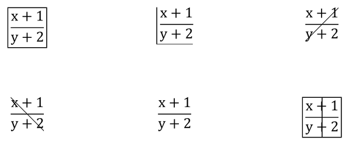

## **Översikt**

PowerPoint lagrar ekvationer som Office Math Markup Language (OMML). Med Aspose.Slides för Java kan du programatiskt skapa samma typ av matematiskt innehåll: bråk, radikaler, funktioner, gränsvärden, N‑ära operatorer, matriser, arrayer och formaterade matematiska block.

I PowerPoint lägger användare normalt till ekvationer via **Infoga > Ekvation**:


Resultatet är redigerbar matematisk text på bilden:


Aspose.Slides bygger den matematiska texten genom tre huvudobjekt:

- En matematikform, skapad med [addMathShape](https://reference.aspose.com/slides/java/com.aspose.slides/ishapecollection/#addMathShape-float-float-float-float-), är formen som innehåller ekvationen.
- [MathPortion](https://reference.aspose.com/slides/java/com.aspose.slides/mathportion/) lagrar matematiskt innehåll i formens textruta.
- [MathParagraph](https://reference.aspose.com/slides/java/com.aspose.slides/mathparagraph/) innehåller ett eller flera [MathBlock](https://reference.aspose.com/slides/java/com.aspose.slides/mathblock/)‑objekt.

De flesta exempel nedan använder [MathematicalText](https://reference.aspose.com/slides/java/com.aspose.slides/mathematicaltext/) och de flytande metoderna från [IMathElement](https://reference.aspose.com/slides/java/com.aspose.slides/imathelement/) för att hålla koden kort och läsbar.

För MathML‑exportscenarier, se [Exportera matematiska ekvationer från presentationer i Java](/slides/sv/java/exporting-math-equations/).

## **Skapa en ekvation**

Det här exemplet använder [addMathShape](https://reference.aspose.com/slides/java/com.aspose.slides/ishapecollection/#addMathShape-float-float-float-float-) för att skapa en matematikform och lägger till Pythagoras sats:


```java
import com.aspose.slides.*;

Presentation presentation = new Presentation();
try {
    ISlide slide = presentation.getSlides().get_Item(0);

    IAutoShape mathShape = slide.getShapes().addMathShape(20, 20, 700, 120);
    IMathParagraph mathParagraph = ((MathPortion) mathShape.getTextFrame().getParagraphs()
            .get_Item(0).getPortions().get_Item(0)).getMathParagraph();

    IMathBlock equation = new MathematicalText("c")
            .setSuperscript("2")
            .join("=")
            .join(new MathematicalText("a").setSuperscript("2"))
            .join("+")
            .join(new MathematicalText("b").setSuperscript("2"));

    mathParagraph.add(equation);

    presentation.save("pythagorean-theorem.pptx", SaveFormat.Pptx);
} finally {
    presentation.dispose();
}
```

{}
[addMathShape](https://reference.aspose.com/slides/java/com.aspose.slides/ishapecollection/#addMathShape-float-float-float-float-) skapar en form som redan innehåller ett matematikavsnitt. Hämta den första [MathPortion](https://reference.aspose.com/slides/java/com.aspose.slides/mathportion/), anropa [getMathParagraph](https://reference.aspose.com/slides/java/com.aspose.slides/imathportion/#getMathParagraph--), och lägg till matematiska block eller matematiska element i den.
{}

## **Lägg till bråk**

Använd [divide](https://reference.aspose.com/slides/java/com.aspose.slides/imathelement/#divide-com.aspose.slides.IMathElement-) för att skapa ett bråk. Du kan välja en bråkstil med [MathFractionTypes](https://reference.aspose.com/slides/java/com.aspose.slides/mathfractiontypes/).


```java
import com.aspose.slides.*;

Presentation presentation = new Presentation();
try {
    ISlide slide = presentation.getSlides().get_Item(0);

    IAutoShape mathShape = slide.getShapes().addMathShape(20, 20, 700, 100);
    IMathParagraph mathParagraph = ((MathPortion) mathShape.getTextFrame().getParagraphs()
            .get_Item(0).getPortions().get_Item(0)).getMathParagraph();

    IMathFraction fraction = new MathematicalText("1")
            .divide("x", MathFractionTypes.Skewed);

    mathParagraph.add(new MathBlock(fraction));

    presentation.save("fraction.pptx", SaveFormat.Pptx);
} finally {
    presentation.dispose();
}
```

För ett staplat bråk, använd [MathFractionTypes.Bar](https://reference.aspose.com/slides/java/com.aspose.slides/mathfractiontypes/#Bar):

```java
import com.aspose.slides.*;

IMathFraction stackedFraction = new MathematicalText("x + 1").divide("y - 1", MathFractionTypes.Bar);
```

## **Lägg till radikaler**

Använd [radical](https://reference.aspose.com/slides/java/com.aspose.slides/imathelement/#radical-com.aspose.slides.IMathElement-) för att skapa en kvadratrot, kubrot eller annan rot. Det aktuella elementet blir basen och argumentet blir graden.


```java
import com.aspose.slides.*;

Presentation presentation = new Presentation();
try {
    ISlide slide = presentation.getSlides().get_Item(0);

    IAutoShape mathShape = slide.getShapes().addMathShape(20, 20, 700, 100);
    IMathParagraph mathParagraph = ((MathPortion) mathShape.getTextFrame().getParagraphs()
            .get_Item(0).getPortions().get_Item(0)).getMathParagraph();

    IMathRadical radical = new MathematicalText("x")
            .radical("n");

    mathParagraph.add(new MathBlock(radical));

    presentation.save("radical.pptx", SaveFormat.Pptx);
} finally {
    presentation.dispose();
}
```

## **Lägg till funktioner och gränsvärden**

Använd [asArgumentOfFunction](https://reference.aspose.com/slides/java/com.aspose.slides/imathelement/#asArgumentOfFunction-com.aspose.slides.IMathElement-) eller [function](https://reference.aspose.com/slides/java/com.aspose.slides/imathelement/#function-com.aspose.slides.IMathElement-) för funktioner såsom `sin(x)`, `log(x)` eller egna funktionsnamn. För gränsvärden, placera `lim` i en [MathLimit](https://reference.aspose.com/slides/java/com.aspose.slides/mathlimit/) eller använd [setLowerLimit](https://reference.aspose.com/slides/java/com.aspose.slides/imathelement/#setLowerLimit-com.aspose.slides.IMathElement-).


```java
import com.aspose.slides.*;

Presentation presentation = new Presentation();
try {
    ISlide slide = presentation.getSlides().get_Item(0);

    IAutoShape mathShape = slide.getShapes().addMathShape(20, 20, 700, 100);
    IMathParagraph mathParagraph = ((MathPortion) mathShape.getTextFrame().getParagraphs()
            .get_Item(0).getPortions().get_Item(0)).getMathParagraph();

    IMathFunction limit = new MathematicalText("lim")
            .setLowerLimit("x\u2192\u221E")
            .function("x");

    mathParagraph.add(new MathBlock(limit));

    presentation.save("functions-and-limits.pptx", SaveFormat.Pptx);
} finally {
    presentation.dispose();
}
```

För ett anpassat funktionsnamn, gör funktionsnamnet till det aktuella elementet och anropa [function](https://reference.aspose.com/slides/java/com.aspose.slides/imathelement/#function-com.aspose.slides.IMathElement-) med dess argument:

```java
import com.aspose.slides.*;

IMathFunction customFunction = new MathematicalText("f").function("x + 1");
```

## **Lägg till N‑ära operatorer och integraler**

Använd [nary](https://reference.aspose.com/slides/java/com.aspose.slides/imathelement/#nary-int-com.aspose.slides.IMathElement-com.aspose.slides.IMathElement-) för summor, unioner, snitt och andra stora operatorer. Använd [integral](https://reference.aspose.com/slides/java/com.aspose.slides/imathelement/#integral-int-com.aspose.slides.IMathElement-com.aspose.slides.IMathElement-) för integraler. Båda metoderna låter dig ange lägre och övre gränser.


```java
import com.aspose.slides.*;

Presentation presentation = new Presentation();
try {
    ISlide slide = presentation.getSlides().get_Item(0);

    IAutoShape mathShape = slide.getShapes().addMathShape(20, 20, 700, 120);
    IMathParagraph mathParagraph = ((MathPortion) mathShape.getTextFrame().getParagraphs()
            .get_Item(0).getPortions().get_Item(0)).getMathParagraph();

    IMathBlock summationBase = new MathematicalText("x")
            .setSuperscript("k")
            .join(new MathematicalText("a").setSuperscript("n-k"));

    IMathNaryOperator summation = summationBase.nary(MathNaryOperatorTypes.Summation, "k=0", "n");

    mathParagraph.add(new MathBlock(summation));

    presentation.save("nary-operators.pptx", SaveFormat.Pptx);
} finally {
    presentation.dispose();
}
```

N‑ära operatorer är för stora operatorer med valfria gränser. Enkla operatorer såsom `+`, `-` och `=` läggs vanligtvis till som [MathematicalText](https://reference.aspose.com/slides/java/com.aspose.slides/mathematicaltext/) och sammanfogas i uttrycket.

För en integral, använd [integral](https://reference.aspose.com/slides/java/com.aspose.slides/imathelement/#integral-int-com.aspose.slides.IMathElement-com.aspose.slides.IMathElement-):

```java
import com.aspose.slides.*;

IMathBlock integralBase = new MathematicalText("x").join(new MathematicalText("dx").toBox());
IMathNaryOperator integral = integralBase.integral(MathIntegralTypes.Simple, "0", "1");
```

## **Lägg till matriser**

Använd [MathMatrix](https://reference.aspose.com/slides/java/com.aspose.slides/mathmatrix/) för rader och kolumner. Matriser inkluderar inte hakparenteser som standard, så omge matrisen när du behöver parenteser, hakparenteser eller klammer.


```java
import com.aspose.slides.*;

Presentation presentation = new Presentation();
try {
    ISlide slide = presentation.getSlides().get_Item(0);

    IAutoShape mathShape = slide.getShapes().addMathShape(20, 20, 700, 120);
    IMathParagraph mathParagraph = ((MathPortion) mathShape.getTextFrame().getParagraphs()
            .get_Item(0).getPortions().get_Item(0)).getMathParagraph();

    MathMatrix matrix = new MathMatrix(2, 3);
    matrix.set_Item(0, 0, new MathematicalText("1"));
    matrix.set_Item(0, 1, new MathematicalText("x"));
    matrix.set_Item(1, 0, new MathematicalText("x"));
    matrix.set_Item(1, 1, new MathematicalText("2"));
    matrix.set_Item(1, 2, new MathematicalText("y"));

    mathParagraph.add(new MathBlock(matrix));

    presentation.save("matrix.pptx", SaveFormat.Pptx);
} finally {
    presentation.dispose();
}
```

## **Lägg till ekvationsarrayer**

Använd [toMathArray](https://reference.aspose.com/slides/java/com.aspose.slides/imathelement/#toMathArray--) när du behöver justerade ekvationer eller en vertikal stapel av uttryck.


```java
import com.aspose.slides.*;

Presentation presentation = new Presentation();
try {
    ISlide slide = presentation.getSlides().get_Item(0);

    IAutoShape mathShape = slide.getShapes().addMathShape(20, 20, 700, 140);
    IMathParagraph mathParagraph = ((MathPortion) mathShape.getTextFrame().getParagraphs()
            .get_Item(0).getPortions().get_Item(0)).getMathParagraph();

    IMathArray equationArray = new MathematicalText("x")
            .join("y")
            .toMathArray();

    mathParagraph.add(new MathBlock(equationArray));

    presentation.save("equation-array.pptx", SaveFormat.Pptx);
} finally {
    presentation.dispose();
}
```

### **Justera en array med omgivande element**

[setBaseJustification](https://reference.aspose.com/slides/java/com.aspose.slides/imatharray/#setBaseJustification-int-) kontrollerar den vertikala justeringen av en array i förhållande till de matematiska elementen bredvid den. Exemplet nedan jämför justering med den första raden, mitten av arrayen och sista raden.

Följande exempel skapar tre identiska arrayer, var och en med tre rader och de intilliggande elementen `A=` och `=B`. All matematisk text använder Cambria Math i 24 punkter. Endast arrayens justering ändras.

```java
import com.aspose.slides.*;
import java.awt.Color;

class MathTextFactory {
    MathematicalText createText(String value) {
        MathematicalText text = new MathematicalText(value);
        text.getFormat().setFontHeight(24);
        text.getFormat().setLatinFont(new FontData("Cambria Math"));
        return text;
    }
}

MathTextFactory factory = new MathTextFactory();
Presentation presentation = new Presentation();
try {
    presentation.getSlideSize().setSize(780, 200, SlideSizeScaleType.DoNotScale);
    ISlide slide = presentation.getSlides().get_Item(0);
    
    int[] alignments = { MathVerticalAlignment.Top, MathVerticalAlignment.Center, MathVerticalAlignment.Bottom };
    String[] alignmentNames = { "Top", "Center", "Bottom" };

    for (int i = 0; i < alignments.length; i++) {
        IAutoShape label = slide.getShapes().addAutoShape(ShapeType.Rectangle, 20 + i * 260, 10, 240, 30);
        label.getFillFormat().setFillType(FillType.NoFill);
        label.getLineFormat().getFillFormat().setFillType(FillType.NoFill);
        label.getTextFrame().setText(alignmentNames[i]);
        IPortionFormat labelFormat = label.getTextFrame().getParagraphs().get_Item(0).getPortions().get_Item(0).getPortionFormat();
        labelFormat.setFontHeight(16);
        labelFormat.getFillFormat().setFillType(FillType.Solid);
        labelFormat.getFillFormat().getSolidFillColor().setColor(Color.BLACK);

        IAutoShape mathShape = slide.getShapes().addMathShape(20 + i * 260, 60, 240, 130);
        mathShape.getTextFrame().getTextFrameFormat().setAnchoringType(TextAnchorType.Top);
        IMathParagraph mathParagraph = ((IMathPortion) mathShape.getTextFrame().getParagraphs().get_Item(0).getPortions().get_Item(0)).getMathParagraph();
        mathParagraph.setJustification(MathJustification.LeftJustified);

        IMathElement[] rows = { factory.createText("x+y=3"), factory.createText("x-y=1"), factory.createText("x=2") };
        MathArray equationArray = new MathArray(rows[0]);
        equationArray.getArguments().add(rows[1]);
        equationArray.getArguments().add(rows[2]);
        equationArray.setBaseJustification(alignments[i]);
        MathematicalText leftText = factory.createText("A=");
        MathematicalText rightText = factory.createText("=B");
        IMathBlock equation = new MathBlock(leftText).join(equationArray).join(rightText);
        mathParagraph.add(equation);
    }

    presentation.save("equation-array-alignment.pptx", SaveFormat.Pptx);
} finally {
    presentation.dispose();
}
```

Följande jämförelse visar den sparade presentationen i PowerPoint. Notera positionen för `A=` och `=B` bredvid varje array.


### **Konfigurera radavstånd**

[setRowSpacingRule](https://reference.aspose.com/slides/java/com.aspose.slides/imatharray/#setRowSpacingRule-int-) väljer avståndsregel för rader inom arrayen. [setRowSpacing](https://reference.aspose.com/slides/java/com.aspose.slides/imatharray/#setRowSpacing-long-) ger ett numeriskt värde för en explicit avståndsregel och ignoreras av förinställda regler.

För exakt avstånd mäts värdet i punkter. För proportionellt avstånd mäts det i halvlinjer: värdet `3` i exemplet motsvarar 1,5 linjer. Ställ in båda egenskaperna när ett explicit värde anges; att bara ändra det numeriska värdet väljer ingen avståndsregel.

Exemplet nedan sparar fem presentationer med samma ekvationer, justering och teckensnittsinställningar. De första tre använder förinställningar; de två sista visar explicita värden.

```java
import com.aspose.slides.*;

class MathTextFactory {
    MathematicalText createText(String value) {
        MathematicalText text = new MathematicalText(value);
        text.getFormat().setFontHeight(24);
        text.getFormat().setLatinFont(new FontData("Cambria Math"));
        return text;
    }
}

MathTextFactory factory = new MathTextFactory();
int[] rules = { MathRowSpacingRule.SingleLineGap, MathRowSpacingRule.OneAndAHalfLineGap, MathRowSpacingRule.TwoLineGap, MathRowSpacingRule.Exactly, MathRowSpacingRule.Multiple };
int[] spacingValues = { 0, 0, 0, 20, 3 };
String[] ruleNames = { "SingleLineGap", "OneAndAHalfLineGap", "TwoLineGap", "Exactly", "Multiple" };

for (int i = 0; i < rules.length; i++) {
    String fileName = "equation-array-" + ruleNames[i] + ".pptx";
    Presentation presentation = new Presentation();
    try {
        IAutoShape mathShape = presentation.getSlides().get_Item(0).getShapes().addMathShape(20, 20, 600, 300);
        IParagraph paragraph = mathShape.getTextFrame().getParagraphs().get_Item(0);
        paragraph.getParagraphFormat().setSpaceBefore(0);
        paragraph.getParagraphFormat().setSpaceAfter(0);
        IMathParagraph mathParagraph = ((IMathPortion) paragraph.getPortions().get_Item(0)).getMathParagraph();
        mathParagraph.setJustification(MathJustification.LeftJustified);

        IMathElement[] rows = { factory.createText("x+y=3"), factory.createText("x-y=1"), factory.createText("x=2") };
        MathArray equationArray = new MathArray(rows[0]);
        equationArray.getArguments().add(rows[1]);
        equationArray.getArguments().add(rows[2]);
        equationArray.setBaseJustification(MathVerticalAlignment.Center);
        equationArray.setRowSpacingRule(rules[i]);
        equationArray.setRowSpacing(spacingValues[i]);
        MathematicalText leftText = factory.createText("A=");
        MathematicalText rightText = factory.createText("=B");
        IMathBlock equation = new MathBlock(leftText).join(equationArray).join(rightText);
        mathParagraph.add(equation);

        presentation.save(fileName, SaveFormat.Pptx);
    } finally {
        presentation.dispose();
    }
}
```

Radavstånd i en array är separat från styckeavstånd. [setSpaceBefore](https://reference.aspose.com/slides/java/com.aspose.slides/iparagraphformat/#setSpaceBefore-float-) och [setSpaceAfter](https://reference.aspose.com/slides/java/com.aspose.slides/iparagraphformat/#setSpaceAfter-float-) lägger till utrymme runt det innehållande stycket, inte mellan arrayrader. På samma sätt positionerar [IMathParagraph.setJustification](https://reference.aspose.com/slides/java/com.aspose.slides/imathparagraph/#setJustification-int-) hela matematikstycket horisontellt; det ersätter inte arrayens vertikala justeringsinställning.

## **Lägg till trigonometriska funktioner**

Använd [asArgumentOfFunction](https://reference.aspose.com/slides/java/com.aspose.slides/imathelement/#asArgumentOfFunction-com.aspose.slides.IMathElement-) när argumentet är det aktuella elementet och funktionsnamnet är känt.


```java
import com.aspose.slides.*;

Presentation presentation = new Presentation();
try {
    ISlide slide = presentation.getSlides().get_Item(0);

    IAutoShape mathShape = slide.getShapes().addMathShape(20, 20, 700, 100);
    IMathParagraph mathParagraph = ((MathPortion) mathShape.getTextFrame().getParagraphs()
            .get_Item(0).getPortions().get_Item(0)).getMathParagraph();

    IMathFunction cosine = new MathematicalText("2x")
            .asArgumentOfFunction(MathFunctionsOfOneArgument.Cos);

    mathParagraph.add(new MathBlock(cosine));

    presentation.save("trigonometric-function.pptx", SaveFormat.Pptx);
} finally {
    presentation.dispose();
}
```

## **Lägg till index och exponenter**

Använd hjälpare för index och exponenter. När indexen måste visas på vänster sida av basen, använd [setSubSuperscriptOnTheLeft](https://reference.aspose.com/slides/java/com.aspose.slides/imathelement/#setSubSuperscriptOnTheLeft-com.aspose.slides.IMathElement-com.aspose.slides.IMathElement-).


```java
import com.aspose.slides.*;

Presentation presentation = new Presentation();
try {
    ISlide slide = presentation.getSlides().get_Item(0);

    IAutoShape mathShape = slide.getShapes().addMathShape(20, 20, 700, 100);
    IMathParagraph mathParagraph = ((MathPortion) mathShape.getTextFrame().getParagraphs()
            .get_Item(0).getPortions().get_Item(0)).getMathParagraph();

    IMathLeftSubSuperscriptElement scripts = new MathematicalText("Y")
            .setSubSuperscriptOnTheLeft("1", "n");

    mathParagraph.add(new MathBlock(scripts));

    presentation.save("subscript-superscript.pptx", SaveFormat.Pptx);
} finally {
    presentation.dispose();
}
```

## **Lägg till avgränsare**

Använd [enclose](https://reference.aspose.com/slides/java/com.aspose.slides/imathelement/#enclose-char-char-) för att placera ett uttryck inom avgränsare. Du kan också ange ett separator‑tecken för avgränsare som innehåller flera element.


```java
import com.aspose.slides.*;

Presentation presentation = new Presentation();
try {
    ISlide slide = presentation.getSlides().get_Item(0);

    IAutoShape mathShape = slide.getShapes().addMathShape(20, 20, 700, 100);
    IMathParagraph mathParagraph = ((MathPortion) mathShape.getTextFrame().getParagraphs()
            .get_Item(0).getPortions().get_Item(0)).getMathParagraph();

    IMathDelimiter delimiter = new MathematicalText("x")
            .join("y")
            .join("z")
            .enclose('<', '>');
    delimiter.setSeparatorCharacter('|');

    mathParagraph.add(new MathBlock(delimiter));

    presentation.save("delimiters.pptx", SaveFormat.Pptx);
} finally {
    presentation.dispose();
}
```

### **Storlek och justering av avgränsare**

Skicka `true` till [setGrowToMatchOperandHeight](https://reference.aspose.com/slides/java/com.aspose.slides/imathdelimiter/#setGrowToMatchOperandHeight-boolean-) för att låta parenteserna växa runt en hög operand, eller skicka `false` för att behålla normal storlek. Använd [setDelimiterShape](https://reference.aspose.com/slides/java/com.aspose.slides/imathdelimiter/#setDelimiterShape-int-) med ett av två [MathDelimiterShape](https://reference.aspose.com/slides/java/com.aspose.slides/mathdelimitershape/)‑värden. `Centered` centrerar parenteserna på den matematiska axeln, som går genom mitten av likhetstecknet. `Match` justerar dem med det omslutna innehållet. Båda inställningarna påverkar endast avgränsarna. Uttrycket inuti förblir detsamma.

Exemplet placerar ett bråk i exponenten för `x` så att uttrycket sträcker sig längre ovanför baslinjen än under den. Alla fyra ekvationer använder samma parenteser och teckensnitt.

```java
import com.aspose.slides.*;

Presentation presentation = new Presentation();
try {
    ISlide slide = presentation.getSlides().get_Item(0);
    for (int row = 0; row < 2; row++) {
        for (int column = 0; column < 2; column++) {
            IMathFraction fraction = new MathematicalText("a + b").divide("c + d");
            IMathSuperscriptElement power = new MathematicalText("x").setSuperscript(fraction);
            IMathDelimiter delimiter = power.enclose('(', ')');
            delimiter.setGrowToMatchOperandHeight(row == 0);
            delimiter.setDelimiterShape(column == 0 ? MathDelimiterShape.Centered : MathDelimiterShape.Match);

            IAutoShape mathShape = slide.getShapes().addMathShape(20 + 330 * column, 20 + 120 * row, 300, 100);
            MathPortion portion = (MathPortion) mathShape.getTextFrame().getParagraphs().get_Item(0).getPortions().get_Item(0);
            portion.getPortionFormat().setFontHeight(32);
            IMathBlock equation = new MathematicalText("y = ").join(delimiter);
            portion.getMathParagraph().add(equation);
        }
    }
    presentation.save("delimiter-sizing.pptx", SaveFormat.Pptx);
} finally {
    presentation.dispose();
}
```

I PowerPoint, jämför raderna för att se effekten av tillväxt. I den övre raden växer parenteserna för att omfatta exponenten och ser likadana ut för båda formerna. I den nedre raden är tillväxt avstängd. De mindre parenteserna till vänster (`Centered`) justeras med likhetstecknet, medan de till höger (`Match`) sitter högre kring uttrycket.


## **Lägg till en kantbox**

Anropa [toBorderBox](https://reference.aspose.com/slides/java/com.aspose.slides/imathelement/#toBorderBox--) på ett bråk för att rama in hela uttrycket. Den returnerade [IMathBorderBox](https://reference.aspose.com/slides/java/com.aspose.slides/imathborderbox/) visar alla fyra sidor som standard. Använd [setHideTop](https://reference.aspose.com/slides/java/com.aspose.slides/imathborderbox/#setHideTop-boolean-), [setHideBottom](https://reference.aspose.com/slides/java/com.aspose.slides/imathborderbox/#setHideBottom-boolean-), [setHideLeft](https://reference.aspose.com/slides/java/com.aspose.slides/imathborderbox/#setHideLeft-boolean-), och [setHideRight](https://reference.aspose.com/slides/java/com.aspose.slides/imathborderbox/#setHideRight-boolean-) för att ta bort enskilda sidor.

Exemplet placerar sex kopior av samma bråk på en bild. För att visa annullering, göm alla fyra sidor och skicka `true` till [setStrikethroughBottomLeftToTopRight](https://reference.aspose.com/slides/java/com.aspose.slides/imathborderbox/#setStrikethroughBottomLeftToTopRight-boolean-) för en stigande diagonal (↗) eller [setStrikethroughTopLeftToBottomRight](https://reference.aspose.com/slides/java/com.aspose.slides/imathborderbox/#setStrikethroughTopLeftToBottomRight-boolean-) för en fallande diagonal (↘). Du kan också använda [setStrikethroughHorizontal](https://reference.aspose.com/slides/java/com.aspose.slides/imathborderbox/#setStrikethroughHorizontal-boolean-) eller [setStrikethroughVertical](https://reference.aspose.com/slides/java/com.aspose.slides/imathborderbox/#setStrikethroughVertical-boolean-) med valfri kombination av synliga sidor.

```java
import com.aspose.slides.*;

Presentation presentation = new Presentation();
try {
    presentation.getSlideSize().setSize(540, 220, SlideSizeScaleType.DoNotScale);
    ISlide slide = presentation.getSlides().get_Item(0);

    class FractionBuilder {
        IMathBorderBox addFraction(float x, float y, boolean hideBorder) {
            IMathFraction fraction = new MathematicalText("x+1").divide("y+2");
            IMathBorderBox box = fraction.toBorderBox();
            box.setHideTop(hideBorder);
            box.setHideBottom(hideBorder);
            box.setHideLeft(hideBorder);
            box.setHideRight(hideBorder);

            IAutoShape shape = slide.getShapes().addMathShape(x, y, 160, 90);
            MathPortion portion = (MathPortion) shape.getTextFrame().getParagraphs().get_Item(0).getPortions().get_Item(0);
            portion.getPortionFormat().setFontHeight(28);
            portion.getMathParagraph().add(new MathBlock(box));
            return box;
        }
    }

    FractionBuilder builder = new FractionBuilder();
    builder.addFraction(10, 10, false);

    IMathBorderBox partial = builder.addFraction(190, 10, false);
    partial.setHideTop(true);
    partial.setHideRight(true);

    builder.addFraction(370, 10, true).setStrikethroughBottomLeftToTopRight(true);
    builder.addFraction(10, 120, true).setStrikethroughTopLeftToBottomRight(true);
    builder.addFraction(190, 120, true).setStrikethroughHorizontal(true);
    builder.addFraction(370, 120, false).setStrikethroughVertical(true);

    presentation.save("border-box.pptx", SaveFormat.Pptx);
} finally {
    presentation.dispose();
}
```



På detta bråk överlappar den horisontella stråken bråkstrecket. Den vertikala stråken korsar både täljare och nämnare medan den omgivande kanten förblir synlig. Dessa linjer dekorerar hela uttrycket. Vanlig genomstrykning av text gäller för tecken i ett textrun. Efter att ha öppnat presentationen igen i PowerPoint kan du fortfarande redigera täljare och nämnare separat.

## **Styr synlighet och layout med fantomelement**

Bunta ett uttryck i [MathPhantom](https://reference.aspose.com/slides/java/com.aspose.slides/mathphantom/) för att oberoende kontrollera dess synlighet och det utrymme det bidrar med till en ekvation. Metoderna i [IMathPhantom](https://reference.aspose.com/slides/java/com.aspose.slides/imathphantom/) styr följande:

| Metod | Effekt |
| --- | --- |
| [setShow](https://reference.aspose.com/slides/java/com.aspose.slides/imathphantom/#setShow-boolean-) | `false` döljer uttrycket. Dess dimensioner bidrar fortfarande till layouten om inte motsvarande metoder nedan får `true`. |
| [setZeroWidth](https://reference.aspose.com/slides/java/com.aspose.slides/imathphantom/#setZeroWidth-boolean-) | Behandla uttryckets horisontella bredd som noll, så att intilliggande element kan komma närmare varandra. |
| [setZeroAsc](https://reference.aspose.com/slides/java/com.aspose.slides/imathphantom/#setZeroAsc-boolean-) | Behandla dess uppstigning, höjden över baslinjen, som noll. Detta kan minska utrymmet som reserveras ovanför intilliggande element. |
| [setZeroDesc](https://reference.aspose.com/slides/java/com.aspose.slides/imathphantom/#setZeroDesc-boolean-) | Behandla dess nedstigning, djupet under baslinjen, som noll. Detta kan föra ett bråkstreck eller annat innehåll under uttrycket närmare sina grannar. |

Baslinjen är referenslinjen som vanliga matematiska tecken vilar på. Att dölja innehåll tar inte bort dess dimensioner, och att behandla en dimension som noll tar inte bort uttrycket. Det underliggande uttrycket finns fortfarande tillgängligt via [getBase](https://reference.aspose.com/slides/java/com.aspose.slides/imathphantom/#getBase--). Skicka `true` till [setShow](https://reference.aspose.com/slides/java/com.aspose.slides/imathphantom/#setShow-boolean-) för att visa det igen; dimensionsinställningarna förblir oförändrade.

Exemplet nedan skapar fem varianter sida‑vid‑sida: ett synligt bråk, ett dolt bråk som reserverar utrymme och tre dolda bråk där en dimension behandlas som noll. Varje variant använder samma omgivande uttryck och Cambria Math i 24 punkter. Alla ekvationsformer har samma topposition, markerad av den grå ledlinjen. Att placera fantomen i täljaren av ett yttre bråk gör de vertikala layoutförändringarna lättare att se.

```java
import com.aspose.slides.*;
import java.awt.Color;

class MathTextFactory {
    MathematicalText createText(String value) {
        MathematicalText text = new MathematicalText(value);
        text.getFormat().setFontHeight(24);
        text.getFormat().setLatinFont(new FontData("Cambria Math"));
        return text;
    }
}

MathTextFactory factory = new MathTextFactory();
Presentation presentation = new Presentation();
try {
    presentation.getSlideSize().setSize(1000, 180, SlideSizeScaleType.DoNotScale);
    ISlide slide = presentation.getSlides().get_Item(0);

    String[] labels = { "Visible", "Hidden: reserves space", "Hidden: ZeroWidth", "Hidden: ZeroAsc", "Hidden: ZeroDesc" };

    IAutoShape guide = slide.getShapes().addAutoShape(ShapeType.Line, 10, 60, 980, 0);
    guide.getLineFormat().getFillFormat().setFillType(FillType.Solid);
    guide.getLineFormat().getFillFormat().getSolidFillColor().setColor(Color.LIGHT_GRAY);

    for (int i = 0; i < labels.length; i++) {
        int left = 10 + i * 200;

        IAutoShape label = slide.getShapes().addAutoShape(ShapeType.Rectangle, left, 10, 190, 30);
        label.getFillFormat().setFillType(FillType.NoFill);
        label.getLineFormat().getFillFormat().setFillType(FillType.NoFill);
        label.getTextFrame().setText(labels[i]);

        IPortionFormat labelFormat = label.getTextFrame().getParagraphs().get_Item(0).getPortions().get_Item(0).getPortionFormat();
        labelFormat.setFontHeight(14);
        labelFormat.getFillFormat().setFillType(FillType.Solid);
        labelFormat.getFillFormat().getSolidFillColor().setColor(Color.BLACK);

        MathematicalText fractionNumerator = factory.createText("a+b");
        MathematicalText fractionDenominator = factory.createText("c+d");
        MathFraction fraction = new MathFraction(fractionNumerator, fractionDenominator);
        MathPhantom phantom = new MathPhantom(fraction);
        phantom.setShow(i == 0);
        phantom.setZeroWidth(i == 2);
        phantom.setZeroAsc(i == 3);
        phantom.setZeroDesc(i == 4);

        MathematicalText leftText = factory.createText("x+");
        MathematicalText rightText = factory.createText("+y");
        IMathBlock numerator = new MathBlock(leftText).join(phantom).join(rightText);
        MathematicalText denominator = factory.createText("z");
        MathFraction equation = new MathFraction(numerator, denominator);

        IAutoShape shape = slide.getShapes().addMathShape(left, 60, 190, 100);
        shape.getTextFrame().getTextFrameFormat().setAnchoringType(TextAnchorType.Top);

        IMathPortion mathPortion = (IMathPortion) shape.getTextFrame().getParagraphs().get_Item(0).getPortions().get_Item(0);
        IMathParagraph mathParagraph = mathPortion.getMathParagraph();
        mathParagraph.add(new MathBlock(equation));
    }

    presentation.save("math-phantom.pptx", SaveFormat.Pptx);
} finally {
    presentation.dispose();
}
```


## **Gruppera termer**

Använd [group](https://reference.aspose.com/slides/java/com.aspose.slides/imathelement/#group-char-int-int-) för att placera ett grupperings­tecken ovanför eller under ett uttryck. Lägg till en gräns för att märka de grupperade termerna.


```java
import com.aspose.slides.*;

Presentation presentation = new Presentation();
try {
    ISlide slide = presentation.getSlides().get_Item(0);

    IAutoShape mathShape = slide.getShapes().addMathShape(20, 20, 700, 120);
    IMathParagraph mathParagraph = ((MathPortion) mathShape.getTextFrame().getParagraphs()
            .get_Item(0).getPortions().get_Item(0)).getMathParagraph();

    IMathLimit grouped = new MathematicalText("x + y")
            .group('\u23DF', MathTopBotPositions.Bottom, MathTopBotPositions.Top)
            .setLowerLimit("any text");

    mathParagraph.add(new MathBlock(grouped));

    presentation.save("grouped-terms.pptx", SaveFormat.Pptx);
} finally {
    presentation.dispose();
}
```

## **Formatera matematiska element**

Använd formateringshjälpare endast där de förtydligar formeln. Till exempel placerar [overbar](https://reference.aspose.com/slides/java/com.aspose.slides/imathelement/#overbar--) ett streck ovanför ett matematikelement.


```java
import com.aspose.slides.*;

Presentation presentation = new Presentation();
try {
    ISlide slide = presentation.getSlides().get_Item(0);

    IAutoShape mathShape = slide.getShapes().addMathShape(20, 20, 700, 100);
    IMathParagraph mathParagraph = ((MathPortion) mathShape.getTextFrame().getParagraphs()
            .get_Item(0).getPortions().get_Item(0)).getMathParagraph();

    IMathBar overbar = new MathematicalText("ABC").overbar();

    mathParagraph.add(new MathBlock(overbar));

    presentation.save("overbar.pptx", SaveFormat.Pptx);
} finally {
    presentation.dispose();
}
```

### **Formatera text i en befintlig ekvation**

För att formatera text i hela en befintlig ekvation, traversera varje matematikblocks elementträd. [IMathElement.getChildren](https://reference.aspose.com/slides/java/com.aspose.slides/imathelement/#getChildren--) returnerar endast de omedelbara barnen, så anropa den rekursivt för att nå text inuti bråk, script, radikaler och andra nästlade strukturer. Kontrollera det aktuella elementet samt dess barn för att inkludera startelementet när det är [MathematicalText](https://reference.aspose.com/slides/java/com.aspose.slides/mathematicaltext/).

Detta exempel antar att `input.pptx` innehåller en ekvation såsom `z = xᵢ / ∛y`, med ett bråk som innehåller ett index i täljaren och en radikal i nämnaren. Att enbart bearbeta blockets element på toppnivå skulle missa texten i bråket. Exemplet hittar matematiska portioner i bildtextrutor, får åtkomst till deras block via [IMathPortion.getMathParagraph](https://reference.aspose.com/slides/java/com.aspose.slides/imathportion/#getMathParagraph--), och använder [setFontHeight](https://reference.aspose.com/slides/java/com.aspose.slides/baseportionformat/#setFontHeight-float-) för att sätta teckenstorleken till 28 punkter via varje textelements [getFormat](https://reference.aspose.com/slides/java/com.aspose.slides/mathematicaltext/#getFormat--)‑metod.

```java
import com.aspose.slides.*;

class MathTextFormatter {
    void formatMathText(IMathElement element) {
        if (element instanceof MathematicalText) {
            MathematicalText text = (MathematicalText) element;
            text.getFormat().setFontHeight(28);
        }

        for (IMathElement child : element.getChildren()) {
            formatMathText(child);
        }
    }
}

MathTextFormatter formatter = new MathTextFormatter();
Presentation presentation = new Presentation("input.pptx");
try {
    for (ISlide slide : presentation.getSlides()) {
        for (IShape shape : slide.getShapes()) {
            if (!(shape instanceof IAutoShape)) {
                continue;
            }

            IAutoShape autoShape = (IAutoShape) shape;
            if (autoShape.getTextFrame() == null) {
                continue;
            }

            for (IParagraph paragraph : autoShape.getTextFrame().getParagraphs()) {
                for (IPortion portion : paragraph.getPortions()) {
                    if (portion instanceof IMathPortion) {
                        IMathPortion mathPortion = (IMathPortion) portion;
                        for (IMathBlock block : mathPortion.getMathParagraph()) {
                            formatter.formatMathText(block);
                        }
                    }
                }
            }
        }
    }

    presentation.save("formatted-equations.pptx", SaveFormat.Pptx);
} finally {
    presentation.dispose();
}
```

Den sparade presentationen innehåller den uppdaterade textformateringen på varje nivå av varje bearbetad ekvation, samtidigt som dess textinnehåll och matematiska struktur bevaras.

## **Snabbreferens**

| Uppgift | Huvud‑API |
| --- | --- |
| Skapa matematisk text | [MathematicalText](https://reference.aspose.com/slides/java/com.aspose.slides/mathematicaltext/) |
| Kombinera element | [IMathElement.join](https://reference.aspose.com/slides/java/com.aspose.slides/imathelement/#join-com.aspose.slides.IMathElement-) |
| Skapa bråk | [IMathElement.divide](https://reference.aspose.com/slides/java/com.aspose.slides/imathelement/#divide-com.aspose.slides.IMathElement-) |
| Lägg till exponent eller index | [setSuperscript](https://reference.aspose.com/slides/java/com.aspose.slides/imathelement/#setSuperscript-com.aspose.slides.IMathElement-), [setSubscript](https://reference.aspose.com/slides/java/com.aspose.slides/imathelement/#setSubscript-com.aspose.slides.IMathElement-) |
| Lägg till funktioner | [function](https://reference.aspose.com/slides/java/com.aspose.slides/imathelement/#function-com.aspose.slides.IMathElement-), [asArgumentOfFunction](https://reference.aspose.com/slides/java/com.aspose.slides/imathelement/#asArgumentOfFunction-com.aspose.slides.IMathElement-) |
| Lägg till radikaler | [IMathElement.radical](https://reference.aspose.com/slides/java/com.aspose.slides/imathelement/#radical-com.aspose.slides.IMathElement-) |
| Lägg till gränser | [setLowerLimit](https://reference.aspose.com/slides/java/com.aspose.slides/imathelement/#setLowerLimit-com.aspose.slides.IMathElement-), [setUpperLimit](https://reference.aspose.com/slides/java/com.aspose.slides/imathelement/#setUpperLimit-com.aspose.slides.IMathElement-) |
| Lägg till script på vänster sida | [setSubSuperscriptOnTheLeft](https://reference.aspose.com/slides/java/com.aspose.slides/imathelement/#setSubSuperscriptOnTheLeft-com.aspose.slides.IMathElement-com.aspose.slides.IMathElement-) |
| Lägg till summor och integraler | [nary](https://reference.aspose.com/slides/java/com.aspose.slides/imathelement/#nary-int-com.aspose.slides.IMathElement-com.aspose.slides.IMathElement-), [integral](https://reference.aspose.com/slides/java/com.aspose.slides/imathelement/#integral-int-com.aspose.slides.IMathElement-com.aspose.slides.IMathElement-) |
| Lägg till matriser | [MathMatrix](https://reference.aspose.com/slides/java/com.aspose.slides/mathmatrix/) |
| Lägg till ekvationsarrayer | [toMathArray](https://reference.aspose.com/slides/java/com.aspose.slides/imathelement/#toMathArray--) |
| Lägg till avgränsare | [enclose](https://reference.aspose.com/slides/java/com.aspose.slides/imathelement/#enclose-char-char-) |
| Lägg till streck och kanter | [overbar](https://reference.aspose.com/slides/java/com.aspose.slides/imathelement/#overbar--), [toBorderBox](https://reference.aspose.com/slides/java/com.aspose.slides/imathelement/#toBorderBox--) |
| Gruppera termer | [group](https://reference.aspose.com/slides/java/com.aspose.slides/imathelement/#group-char-int-int-) |

## **FAQ**

**Kan jag redigera en befintlig PowerPoint‑ekvation?**

Ja. Öppna presentationen, hitta formen som innehåller en [MathPortion](https://reference.aspose.com/slides/java/com.aspose.slides/mathportion/), anropa [getMathParagraph](https://reference.aspose.com/slides/java/com.aspose.slides/imathportion/#getMathParagraph--), och uppdatera matematikblocken i det avsnittet.

**Sparas ekvationer som redigerbar PowerPoint‑matematik?**

Ja. När du sparar till PPTX skriver Aspose.Slides ekvationen som redigerbart Office‑matematikinnehåll.

**Kan jag exportera ekvationer till LaTeX?**

Ja. Hämta ekvationens [IMathParagraph](https://reference.aspose.com/slides/java/com.aspose.slides/imathparagraph/) från dess [IMathPortion](https://reference.aspose.com/slides/java/com.aspose.slides/imathportion/), och anropa [IMathParagraph.toLatex](https://reference.aspose.com/slides/java/com.aspose.slides/imathparagraph/#toLatex--) för att exportera den direkt. För ett komplett exempel, se [Exportera matematiska ekvationer från presentationer i Java](/slides/sv/java/exporting-math-equations/#export-math-equations-to-latex).