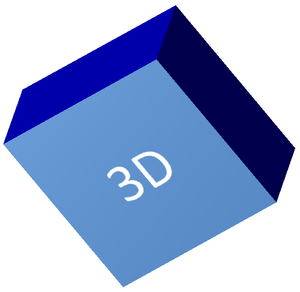

## **Översikt**

Aspose.Slides for .NET kan skapa, redigera, bevara och rendera PowerPoint‑liknande 3D‑formatering för former och text. Denna artikel täcker 3D‑effekter såsom rotation, extrudering, fasader, belysning, material, gradient‑ eller bildfyllning och 3D‑text.

{}

Denna artikel handlar om 3D‑formateringseffekter på PowerPoint‑former och text. Den handlar inte om att infoga eller redigera fristående 3D‑modelfiler. När du exporterar en bild till en bild, PDF eller HTML renderar Aspose.Slides dessa 3D‑effekter i den exporterade 2D‑utdata.

{}

## **3D‑formateringskoncept**

Använd egenskapen [IShape.ThreeDFormat](https://reference.aspose.com/slides/net/aspose.slides/ishape/properties/threedformat) för att tillämpa 3D‑formatering på en form. Egenskapen exponerar [IThreeDFormat](https://reference.aspose.com/slides/net/aspose.slides/ithreedformat), som styr 3D‑scenen för den formen.

För text, använd egenskapen [ITextFrameFormat.ThreeDFormat](https://reference.aspose.com/slides/net/aspose.slides/itextframeformat/properties/threedformat). Detta tillämpar 3D‑formatering på textramen istället för formkroppen.

De viktigaste egenskaperna är:

| Property | Vad den styr | När den ska användas |
|---|---|---|
| [Camera](https://reference.aspose.com/slides/net/aspose.slides/ithreedformat/properties/camera) | Blickpunkt, förinställd kameratyp, rotation, zoom och perspektiv. | Rotera objektet i 3D‑rum eller matcha en PowerPoint‑3D‑rotationsförinställning. |
| [LightRig](https://reference.aspose.com/slides/net/aspose.slides/ithreedformat/properties/lightrig) | Ljuset, förinställning, riktning och ljusrotation. | Ändra hur högdagrar och skuggor visas på 3D‑ytan. |
| [Material](https://reference.aspose.com/slides/net/aspose.slides/ithreedformat/properties/material) | Ytmaterial, t.ex. platt, matt, plast eller metall. | Få samma geometri att se plattare, mjukare, glansigare eller metallisk ut. |
| [ExtrusionHeight](https://reference.aspose.com/slides/net/aspose.slides/ithreedformat/properties/extrusionheight) | Hur långt formen sträcker sig bakåt från dess främre yta. | Förvandla en platt form till ett tydligt tjockt 3D‑objekt. |
| [ExtrusionColor](https://reference.aspose.com/slides/net/aspose.slides/ithreedformat/properties/extrusioncolor) | Färg på de extruderade sidorna. | Gör djupet synligt eller anpassa sidans färg efter frontal fyllning. |
| [Depth](https://reference.aspose.com/slides/net/aspose.slides/ithreedformat/properties/depth) | Ytterligare 3D‑djup som används av PowerPoint‑3D‑formatering. | Finjustera djup för former eller text, särskilt tillsammans med fasad‑ och materialinställningar. |
| [BevelTop](https://reference.aspose.com/slides/net/aspose.slides/ithreedformat/properties/beveltop) och [BevelBottom](https://reference.aspose.com/slides/net/aspose.slides/ithreedformat/properties/bevelbottom) | Upphöjda eller rundade kanter på främre och bakre ytor. | Lägg till en mjukad eller formad kant i stället för en skarp platt yta. |
| [ContourColor](https://reference.aspose.com/slides/net/aspose.slides/ithreedformat/properties/contourcolor) och [ContourWidth](https://reference.aspose.com/slides/net/aspose.slides/ithreedformat/properties/contourwidth) | Kontur runt 3D‑objektet. | Betona objektets gräns i renderad utdata. |

## **Skapa en 3D‑form**

En form behöver vanligtvis fyra typer av inställningar innan den ser övertygande 3D‑ut:

- Kamerainställningar, eftersom standardvy framifrån kan dölja extruderingen.
- Ljuseinställningar, eftersom belysning gör ytorna och sidorna läsbara.
- Materialinställningar, eftersom ytan påverkar hur ljuset renderas.
- Extruderings‑ eller djupinställningar, eftersom en platt form saknar tjocklek.

Följande exempel skapar en rektangel, lägger till text på dess främre yta och tillämpar 3D‑formatering. Kamerarotationsvärdena är i grader och extruderingshöjden är 100 punkter. Exemplet renderar bilden till en PNG‑fil med dubbla standarddimensioner och sparar presentationen som PPTX.

```csharp
using System.Drawing;
using Aspose.Slides;
using Aspose.Slides.Export;

const float imageScale = 2;

using var presentation = new Presentation();
var slide = presentation.Slides[0];

var shape = slide.Shapes.AddAutoShape(ShapeType.Rectangle, 200, 150, 200, 200);
shape.TextFrame.Text = "3D";
shape.TextFrame.Paragraphs[0].ParagraphFormat.DefaultPortionFormat.FontHeight = 64;

shape.FillFormat.FillType = FillType.Solid;
shape.FillFormat.SolidFillColor.Color = Color.CornflowerBlue;

shape.ThreeDFormat.Camera.CameraType = CameraPresetType.OrthographicFront;
shape.ThreeDFormat.Camera.SetRotation(20, 30, 40);
shape.ThreeDFormat.LightRig.LightType = LightRigPresetType.Flat;
shape.ThreeDFormat.LightRig.Direction = LightingDirection.Top;
shape.ThreeDFormat.Material = MaterialPresetType.Flat;
shape.ThreeDFormat.ExtrusionHeight = 100;
shape.ThreeDFormat.ExtrusionColor.Color = Color.Blue;

using var thumbnail = slide.GetImage(imageScale, imageScale);
thumbnail.Save("shape_3d.png");

presentation.Save("shape_3d.pptx", SaveFormat.Pptx);
```

Den renderade bildsliden visar rektangeln som ett tjockt 3D‑block:



## **Rotera en form med kameran**

I PowerPoint konfigureras 3D‑rotation via panelen 3‑D‑Rotation. Värdena för X, Y och Z‑rotation motsvarar rotationen du anger via kamera‑API:t.


I Aspose.Slides får du åtkomst till kameran via [IThreeDFormat.Camera](https://reference.aspose.com/slides/net/aspose.slides/ithreedformat/properties/camera). Detta exempel skapar en rektangel, väljer en ortografisk frontvy och sätter dess X, Y och Z‑rotationer till 20, 30 respektive 40 grader. Det konfigurerar formen i minnet utan att spara en fil:

```csharp
using Aspose.Slides;

using var presentation = new Presentation();
var slide = presentation.Slides[0];

var shape = slide.Shapes.AddAutoShape(ShapeType.Rectangle, 200, 150, 200, 200);

shape.ThreeDFormat.Camera.CameraType = CameraPresetType.OrthographicFront;
shape.ThreeDFormat.Camera.SetRotation(20, 30, 40);
```

Använd kameran när du behöver ändra hur betraktaren ser objektet. Det ändrar inte 2D‑geometrin på sliden. Det ändrar 3D‑vy­punkten som PowerPoint och Aspose.Slides använder vid rendering.

### **Kopiera kameraorientering från en mallform**

För att matcha en form i en mall, kopiera dess förinställning [CameraType](https://reference.aspose.com/slides/net/aspose.slides/icamera/cameratype/) och läs dess vinklar med [GetRotation](https://reference.aspose.com/slides/net/aspose.slides/icamera/getrotation/). Exemplet öppnar `template.pptx`, läser kameran från den första formen på den första sliden och tillämpar dess orientering på den andra formen. Båda formerna har redan 3D‑belysning, och den andra formen har ingen explicit kamerarotation.

Vinklarna är i grader. Index `0` är latitud, index `1` är longitud och index `2` är revolution. Skicka dem till [SetRotation](https://reference.aspose.com/slides/net/aspose.slides/icamera/setrotation/) i den ordningen. Om källan returnerar `null` har den ingen explicit rotation, så låt den andra formens vinklar vara oinställda. En explicit rotation av `(0, 0, 0)` returnerar tre nollor och bör kopieras.

```cs
using Aspose.Slides;
using Aspose.Slides.Export;

using var presentation = new Presentation("template.pptx");
var shapes = presentation.Slides[0].Shapes;

var sourceCamera = shapes[0].ThreeDFormat.Camera;
var destinationCamera = shapes[1].ThreeDFormat.Camera;

destinationCamera.CameraType = sourceCamera.CameraType;
var angles = sourceCamera.GetRotation();
if (angles != null)
{
    destinationCamera.SetRotation(angles[0], angles[1], angles[2]);
}

presentation.Save("camera-copy.pptx", SaveFormat.Pptx);
```

När du öppnar `camera-copy.pptx` igen har de två formerna samma kamera‑förinställning och rotation. I PowerPoint visar pilen till höger kamerautrikeringen som kopierats från rektangeln till vänster. Båda formerna använder samma belysning och extruderingsdjup.


## **Lägg till extrudering och djup**

Extrudering får en form att se tjock ut genom att den sträcker sig bakom den främre ytan. I PowerPoint styr djupkontrollen den synliga tjockleken, och färgkontrollen sätter färgen på sidoytorna.


Ange [IThreeDFormat.ExtrusionHeight](https://reference.aspose.com/slides/net/aspose.slides/ithreedformat/properties/extrusionheight) för tjockleken och [IThreeDFormat.ExtrusionColor](https://reference.aspose.com/slides/net/aspose.slides/ithreedformat/properties/extrusioncolor) för sidans färg. Detta exempel ger en rektangel en extrudering på 100 punkter med lila sidor och roterar kameran för att visa dess tjocklek. Det konfigurerar formen i minnet utan att spara en fil:

```csharp
using System.Drawing;
using Aspose.Slides;

using var presentation = new Presentation();
var slide = presentation.Slides[0];

var shape = slide.Shapes.AddAutoShape(ShapeType.Rectangle, 200, 150, 200, 200);

shape.ThreeDFormat.Camera.CameraType = CameraPresetType.OrthographicFront;
shape.ThreeDFormat.Camera.SetRotation(20, 30, 40);
shape.ThreeDFormat.LightRig.LightType = LightRigPresetType.Flat;
shape.ThreeDFormat.LightRig.Direction = LightingDirection.Top;
shape.ThreeDFormat.Material = MaterialPresetType.Flat;
shape.ThreeDFormat.ExtrusionHeight = 100;
shape.ThreeDFormat.ExtrusionColor.Color = Color.Purple;
```

Egenskapen [IThreeDFormat.Depth](https://reference.aspose.com/slides/net/aspose.slides/ithreedformat/properties/depth) sätter djupet för en 3D‑form. Egenskapen [ExtrusionHeight](https://reference.aspose.com/slides/net/aspose.slides/ithreedformat/properties/extrusionheight) styr höjden på extruderings‑effekten, som visas i detta exempel.

## **Använd gradient‑ eller bildfyllning med 3D‑effekter**

3D‑formatering är oberoende av formens fyllning. Du kan applicera en solid färg, gradient, mönster eller bildfyllning på den främre ytan och ändå använda samma kamera, ljus, material och extrudering.

Detta exempel applicerar en blå‑till‑orange gradient på den främre ytan och en mörk orange färg på den 150‑punkts‑höga extruderingen. Gradientstopp vid 0 och 100 markerar början och slutet på gradienten. Kamerarotationsvärdena är i grader. Sliden renderas till en PNG‑bild med dubbla standarddimensioner:

```csharp
using System.Drawing;
using Aspose.Slides;

const float imageScale = 2;

using var presentation = new Presentation();
var slide = presentation.Slides[0];

var shape = slide.Shapes.AddAutoShape(ShapeType.Rectangle, 200, 150, 250, 250);
shape.TextFrame.Text = "3D Gradient";
shape.TextFrame.Paragraphs[0].ParagraphFormat.DefaultPortionFormat.FontHeight = 64;

shape.FillFormat.FillType = FillType.Gradient;
shape.FillFormat.GradientFormat.GradientStops.Add(0, Color.Blue);
shape.FillFormat.GradientFormat.GradientStops.Add(100, Color.Orange);

shape.ThreeDFormat.Camera.CameraType = CameraPresetType.OrthographicFront;
shape.ThreeDFormat.Camera.SetRotation(10, 20, 30);
shape.ThreeDFormat.LightRig.LightType = LightRigPresetType.Flat;
shape.ThreeDFormat.LightRig.Direction = LightingDirection.Top;
shape.ThreeDFormat.Material = MaterialPresetType.Flat;
shape.ThreeDFormat.ExtrusionHeight = 150;
shape.ThreeDFormat.ExtrusionColor.Color = Color.DarkOrange;

using var thumbnail = slide.GetImage(imageScale, imageScale);
thumbnail.Save("gradient_3d.png");
```

Den renderade utskriften behåller gradienten på den främre ytan och renderar extruderingen separat:


För att använda en bildfyllning istället, lägg till bilden i presentationen och tilldela den till formens fyllning. Detta exempel kräver en befintlig fil med namn "image.jpg" i arbetskatalogen. Det sträcker bilden för att fylla rektangeln, applicerar en extrudering på 150 punkter och sätter kamerarotation i grader. Det konfigurerar formen i minnet utan att spara eller rendera en fil:

```csharp
using System.Drawing;
using System.IO;
using Aspose.Slides;

using var presentation = new Presentation();
var slide = presentation.Slides[0];

var shape = slide.Shapes.AddAutoShape(ShapeType.Rectangle, 200, 150, 250, 250);

var imageData = File.ReadAllBytes("image.jpg");
var image = presentation.Images.AddImage(imageData);

shape.FillFormat.FillType = FillType.Picture;
shape.FillFormat.PictureFillFormat.Picture.Image = image;
shape.FillFormat.PictureFillFormat.PictureFillMode = PictureFillMode.Stretch;

shape.ThreeDFormat.Camera.CameraType = CameraPresetType.OrthographicFront;
shape.ThreeDFormat.Camera.SetRotation(10, 20, 30);
shape.ThreeDFormat.LightRig.LightType = LightRigPresetType.Flat;
shape.ThreeDFormat.LightRig.Direction = LightingDirection.Top;
shape.ThreeDFormat.Material = MaterialPresetType.Flat;
shape.ThreeDFormat.ExtrusionHeight = 150;
shape.ThreeDFormat.ExtrusionColor.Color = Color.DarkOrange;
```

Bilden renderas på den främre ytan, medan extruderingen renderas som 3D‑sidoytan:


## **Applicera 3D‑formatering på text**

Formens 3D‑formatering påverkar formkroppen. Textens 3D‑formatering påverkar textramen. Detta är användbart för WordArt‑liknande effekter där bokstäverna själva behöver extrudering, material, belysning och kamerainställningar.

Följande exempel skapar text med ett orange‑och‑vitt rutnät‑mönster, applicerar en uppåtriktad båge och konfigurerar 3D‑inställningar via [ITextFrameFormat.ThreeDFormat](https://reference.aspose.com/slides/net/aspose.slides/itextframeformat/properties/threedformat). Extruderingshöjd och djup är i punkter, och ljusrotation i grader. Formens fyllning och kontur döljs så att endast texten syns. Exemplet renderar en PNG‑bild med dubbla standardmått och sparar presentationen som PPTX:

```csharp
using System.Drawing;
using Aspose.Slides;
using Aspose.Slides.Export;

const float imageScale = 2;

using var presentation = new Presentation();
var slide = presentation.Slides[0];

var shape = slide.Shapes.AddAutoShape(ShapeType.Rectangle, 200, 150, 250, 250);
shape.FillFormat.FillType = FillType.NoFill;
shape.LineFormat.FillFormat.FillType = FillType.NoFill;
shape.TextFrame.Text = "3D Text";

var portion = shape.TextFrame.Paragraphs[0].Portions[0];
portion.PortionFormat.FillFormat.FillType = FillType.Pattern;
portion.PortionFormat.FillFormat.PatternFormat.ForeColor.Color = Color.DarkOrange;
portion.PortionFormat.FillFormat.PatternFormat.BackColor.Color = Color.White;
portion.PortionFormat.FillFormat.PatternFormat.PatternStyle = PatternStyle.LargeGrid;

shape.TextFrame.Paragraphs[0].ParagraphFormat.DefaultPortionFormat.FontHeight = 128;

var textFrameFormat = shape.TextFrame.TextFrameFormat;
textFrameFormat.Transform = TextShapeType.ArchUp;
textFrameFormat.ThreeDFormat.ExtrusionHeight = 3.5f;
textFrameFormat.ThreeDFormat.Depth = 3;
textFrameFormat.ThreeDFormat.Material = MaterialPresetType.Plastic;
textFrameFormat.ThreeDFormat.LightRig.Direction = LightingDirection.Top;
textFrameFormat.ThreeDFormat.LightRig.LightType = LightRigPresetType.Balanced;
textFrameFormat.ThreeDFormat.LightRig.SetRotation(0, 0, 40);
textFrameFormat.ThreeDFormat.Camera.CameraType = CameraPresetType.PerspectiveContrastingRightFacing;

using var thumbnail = slide.GetImage(imageScale, imageScale);
thumbnail.Save("text_3d.png");

presentation.Save("text_3d.pptx", SaveFormat.Pptx);
```

Texten renderas som böjd, extruderad 3D‑bokstav:


## **Behåll text platt på en 3D‑form**

För att behålla läsbarhet samtidigt som du behåller en forms 3D‑utseende, sätt [ITextFrameFormat.KeepTextFlat](https://reference.aspose.com/slides/net/aspose.slides/itextframeformat/keeptextflat/) via [ITextFrame.TextFrameFormat](https://reference.aspose.com/slides/net/aspose.slides/itextframe/textframeformat/). När värdet är `true` hålls texten utanför 3D‑scenen. När det är `false` deltar texten i scenen och följer dess 3D‑orientering.

Denna inställning tar inte bort formens 3D‑formatering: dess kamera, belysning, material och extrudering förblir konfigurerade via [IShape.ThreeDFormat](https://reference.aspose.com/slides/net/aspose.slides/ishape/threedformat/). Den skiljer sig också från vanlig rotation. [IShape.Rotation](https://reference.aspose.com/slides/net/aspose.slides/ishape/rotation/) roterar formen i bildplanen, medan [ITextFrameFormat.RotationAngle](https://reference.aspose.com/slides/net/aspose.slides/itextframeformat/rotationangle/) styr textens egna rotation inom sin begränsningsruta. Att hålla texten utanför 3D‑scenen återställer inte någon av dessa vinklar.

Följande självständiga exempel skapar en blå rektangel med text och klonar den bredvid originalet. Båda formerna har samma 3D‑formatering; endast textinställningen skiljer sig: `false` till vänster och `true` till höger. Kameravinklarna är i grader och extruderingshöjden är 40 punkter. Exemplet sparar presentationen som PPTX och renderar jämförelsesliden till PNG med dubbla standarddimensioner.

```csharp
using System.Drawing;
using Aspose.Slides;
using Aspose.Slides.Export;

using var presentation = new Presentation();
var slide = presentation.Slides[0];

var shape = slide.Shapes.AddAutoShape(ShapeType.Rectangle, 70, 160, 240, 140);

shape.TextFrame.Text = "Readable text";
shape.TextFrame.Paragraphs[0].ParagraphFormat.DefaultPortionFormat.FontHeight = 28;
shape.TextFrame.Paragraphs[0].ParagraphFormat.Alignment = TextAlignment.Center;
shape.TextFrame.TextFrameFormat.AnchoringType = TextAnchorType.Center;
shape.FillFormat.FillType = FillType.Solid;
shape.FillFormat.SolidFillColor.Color = Color.CornflowerBlue;

shape.ThreeDFormat.Camera.CameraType = CameraPresetType.OrthographicFront;
shape.ThreeDFormat.Camera.SetRotation(30, 30, 0);
shape.ThreeDFormat.LightRig.LightType = LightRigPresetType.Flat;
shape.ThreeDFormat.LightRig.Direction = LightingDirection.Top;
shape.ThreeDFormat.Material = MaterialPresetType.Flat;
shape.ThreeDFormat.ExtrusionHeight = 40;
shape.ThreeDFormat.ExtrusionColor.Color = Color.RoyalBlue;
shape.TextFrame.TextFrameFormat.KeepTextFlat = false;

var flatTextShape = (IAutoShape)slide.Shapes.AddClone(shape, 400, 160);
flatTextShape.TextFrame.TextFrameFormat.KeepTextFlat = true;

presentation.Save("keep_text_flat.pptx", SaveFormat.Pptx);
using var image = slide.GetImage(2, 2);
image.Save("keep_text_flat.png");
```

Till vänster följer texten 3D‑orienteringen. Till höger förblir den platt och lättare att läsa. Båda rektanglarna behåller samma synliga extrudering och 3D‑orientering.


## **Export‑ och renderingsbeteende**

Aspose.Slides bevarar 3D‑formatering när du sparar till PowerPoint‑format som PPTX. Vid rendering eller export till fasta layoutformat rasteriseras 3D‑scenen eller ritas in i utdata som ett 2D‑resultat. Detta gäller när du renderar slidar till [PNG](/slides/sv/net/convert-powerpoint-to-png/), exporterar till [PDF](/slides/sv/net/convert-powerpoint-to-pdf/), exporterar till [HTML](/slides/sv/net/convert-powerpoint-to-html/), eller genererar ramar för [video conversion](/slides/sv/net/convert-powerpoint-to-video/).

Tänk på följande:

- Exporterade bilder och PDF‑filer är inte interaktiva. Objektet kan inte roteras av betraktaren efter export.
- Det slutliga utseendet beror på kombinationen av kamera, ljusrigg, material, extrudering, fyllning och bildskalning.
- Om du behöver inspektera ärvda eller temabaserade formateringsvärden, läs de [effective shape properties](/slides/sv/net/shape-effective-properties/).
- Vissa exportformat kan inte lagra redigerbar PowerPoint‑3D‑formatering. I de formaten renderas den visuella resultatet snarare än att bevaras som redigerbara 3D‑inställningar.

## **FAQ**

**Kan Aspose.Slides skapa interaktiva 3D‑presentationer?**

Aspose.Slides skapar och renderar PowerPoint‑3D‑effekter för former och text. Det gör inte exporterade bilder, PDF‑filer eller HTML‑sidor till interaktiva 3D‑scener som en betraktare kan rotera. I PPTX förblir 3D‑formateringen redigerbar i PowerPoint där formatet stödjer det.

**Vad är skillnaden mellan en 3D‑modell och en 3D‑effekt?**

En 3D‑modell är ett separat 3D‑objekt som infogas i en presentation. En 3D‑effekt är formatering som appliceras på en vanlig PowerPoint‑form eller text, såsom rotation, extrudering, fasad, belysning och material. Denna artikel behandlar 3D‑effekter.

**Vilka inställningar krävs för en synlig 3D‑form?**

Minst, ange en kamerarotation och antingen extrudering eller djup. I praktiken bör du också ange en ljusrigg och material så att de renderade ytorna har tydliga högdagrar och skuggor.

**Kan jag applicera 3D‑effekter på både former och text?**

Ja. Använd [IShape.ThreeDFormat](https://reference.aspose.com/slides/net/aspose.slides/ishape/properties/threedformat) för formkroppen och [ITextFrameFormat.ThreeDFormat](https://reference.aspose.com/slides/net/aspose.slides/itextframeformat/properties/threedformat) för text.

**Kommer 3D‑effekter att visas när jag exporterar till bilder, PDF, HTML eller videoram?**

Ja. Aspose.Slides renderar 3D‑effekter när den producerar bild‑utdata, PDF‑utdata, HTML‑utdata och ramar som används för video‑konvertering. Den exporterade utdata innehåller den renderade utseendet, inte ett redigerbart 3D‑objekt.

**Kan jag läsa de slutgiltiga 3D‑värdena efter att arv och temainställningar har tillämpats?**

Ja. Använd de effektiva formaterings‑API:erna beskrivna i [Shape Effective Properties](/slides/sv/net/shape-effective-properties/) för att läsa den slutgiltiga kameran, ljusriggen, fasaden och relaterade 3D‑värden.