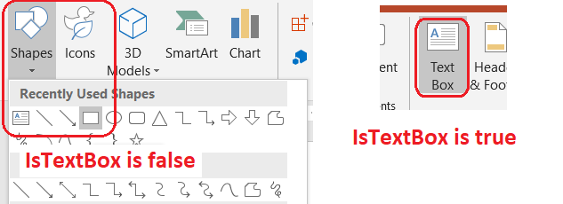

## **Introduktion**

I Aspose.Slides for .NET lagras bildtext i textramar som tillhör former. Gränssnittet [IAutoShape](https://reference.aspose.com/slides/net/aspose.slides/iautoshape/) representerar den vanligaste textbärande formen och exponerar dess text via egenskapen [IAutoShape.TextFrame](https://reference.aspose.com/slides/net/aspose.slides/iautoshape/textframe/).

{}
Varje autoform implementerar [IShape](https://reference.aspose.com/slides/net/aspose.slides/ishape/), men inte varje form är en autoform eller stöder en textram. När du bearbetar en befintlig presentation, kontrollera att en form implementerar `IAutoShape` innan du kommer åt dess text.
{}

## **Skapa en textruta på en bild**

För att skapa en textruta, lägg till en autoform på en bild, lägg till text i dess textram och spara presentationen. Följande exempel skapar en rektangulär textruta:

```csharp
using Aspose.Slides;
using Aspose.Slides.Export;

using var presentation = new Presentation();
var slide = presentation.Slides[0];
var textBox = slide.Shapes.AddAutoShape(ShapeType.Rectangle, 150, 75, 300, 50);
textBox.AddTextFrame("Aspose TextBox");

presentation.Save("TextBox.pptx", SaveFormat.Pptx);
```

Koordinaterna och dimensionerna som skickas till [IShapeCollection.AddAutoShape](https://reference.aspose.com/slides/net/aspose.slides/ishapecollection/addautoshape/) mäts i punkt. [IAutoShape.AddTextFrame](https://reference.aspose.com/slides/net/aspose.slides/iautoshape/addtextframe/) initierar textramen med den angivna texten.

## **Kontrollera om en form är en textruta**

Använd egenskapen [AutoShape.IsTextBox](https://reference.aspose.com/slides/net/aspose.slides/autoshape/istextbox/) för att avgöra om en autoform behandlas som en textruta. Detta är användbart när en presentation innehåller både textbärande och enbart grafiska autoformer.



Följande exempel undersöker varje autoform i en presentation:

```csharp
using System;
using Aspose.Slides;

using var presentation = new Presentation();
var slide = presentation.Slides[0];
var textBox = slide.Shapes.AddAutoShape(ShapeType.Rectangle, 10, 10, 120, 40);
textBox.AddTextFrame("Text box");
slide.Shapes.AddAutoShape(ShapeType.Ellipse, 150, 10, 40, 40);

foreach (var currentSlide in presentation.Slides)
{
    foreach (var shape in currentSlide.Shapes)
    {
        if (shape is IAutoShape autoShape)
        {
            Console.WriteLine(autoShape.IsTextBox ? "The shape is a text box." : "The shape is not a text box.");
        }
    }
}
```

En ny tillagd autoform betraktas inte som en textruta förrän den innehåller icke‑tom text. Du kan tillhandahålla den texten via [IAutoShape.AddTextFrame](https://reference.aspose.com/slides/net/aspose.slides/iautoshape/addtextframe/) eller [ITextFrame.Text](https://reference.aspose.com/slides/net/aspose.slides/itextframe/text/). Att lägga till eller tilldela en tom sträng lämnar `IsTextBox` inställt på `false`:

```csharp
using System;
using Aspose.Slides;

using var presentation = new Presentation();
var slide = presentation.Slides[0];

var shape1 = slide.Shapes.AddAutoShape(ShapeType.Rectangle, 10, 10, 100, 40);
shape1.AddTextFrame("Shape 1");
Console.WriteLine(shape1.IsTextBox);

var shape2 = slide.Shapes.AddAutoShape(ShapeType.Rectangle, 10, 70, 100, 40);
shape2.TextFrame.Text = "Shape 2";
Console.WriteLine(shape2.IsTextBox);

var shape3 = slide.Shapes.AddAutoShape(ShapeType.Rectangle, 10, 130, 100, 40);
shape3.AddTextFrame("");
Console.WriteLine(shape3.IsTextBox);

var shape4 = slide.Shapes.AddAutoShape(ShapeType.Rectangle, 10, 190, 100, 40);
shape4.TextFrame.Text = "";
Console.WriteLine(shape4.IsTextBox);
```

De två första anropen skriver ut `True`; de två sista skriver ut `False`.

## **Hitta formen som äger en textram**

Generisk textbearbetningskod kan få en [ITextFrame](https://reference.aspose.com/slides/net/aspose.slides/itextframe/) utan att veta vilket presentationsobjekt som innehåller den. Använd den skrivskyddade egenskapen [ITextFrame.ParentShape](https://reference.aspose.com/slides/net/aspose.slides/itextframe/parentshape/) för att navigera tillbaka till dess ägande [IShape](https://reference.aspose.com/slides/net/aspose.slides/ishape/).

För en textram som ägs av en autoform eller en annan textbärande form innehåller `ParentShape` ägaren och [ITextFrame.ParentCell](https://reference.aspose.com/slides/net/aspose.slides/itextframe/parentcell/) är `null`. Kontrollera det returnerade värdet innan du använder det. För att identifiera både form‑ och tabellcell‑ägare, inklusive former relaterade till SmartArt‑noder, se [Sök och ersätt text](/slides/sv/net/search-and-replace-text/).

## **Hämta formens textrektangel**

Från och med Aspose.Slides for .NET 26.11 returnerar [ITextFrame.GetTextRect](https://reference.aspose.com/slides/net/aspose.slides/itextframe/gettextrect/) textområdet som definieras av den överordnade formens geometri. Dess koordinater och dimensioner är i punkt, relativt formens övre vänstra hörn. Till exempel har en ellips en mindre textrektangel än dess yttre gränser.

Denna rektangel beskriver formen, inte de renderade tecknen. Att ändra texten eller marginalerna för textramen gör den inte till ett mått på upptagen text. Använd [paragrafgränser](/slides/sv/net/paragraph-bounds/) eller [delgränser](/slides/sv/net/portion-bounds/) för mått på renderad text.

Efter att ha [installera Aspose.Slides for .NET](/slides/sv/net/installation/) 26.11 eller senare, kör detta exempel för att rita geometrins textrektangel i rött. Formerna är oregerade och ogrupperade, så att lägga till deras X/Y‑position är tillräckligt för att placera överlägget på bilden.

```csharp
using System;
using System.Drawing;
using Aspose.Slides;
using Aspose.Slides.Export;

using var presentation = new Presentation();
var slide = presentation.Slides[0];

foreach (var shapeType in new[] { ShapeType.Rectangle, ShapeType.Ellipse })
{
    var x = shapeType == ShapeType.Rectangle ? 50 : 300;
    var shape = slide.Shapes.AddAutoShape(shapeType, x, 200, 200, 100);
    shape.AddTextFrame("Text area");
    var rectangle = shape.TextFrame.GetTextRect();
    Console.WriteLine($"{shapeType}: {rectangle}");

    var overlayX = shape.X + rectangle.X;
    var overlayY = shape.Y + rectangle.Y;
    var outline = slide.Shapes.AddAutoShape(ShapeType.Rectangle, overlayX, overlayY, rectangle.Width, rectangle.Height);
    outline.FillFormat.FillType = FillType.NoFill;
    outline.LineFormat.FillFormat.FillType = FillType.Solid;
    outline.LineFormat.FillFormat.SolidFillColor.Color = Color.Red;
}

presentation.Save("text-rectangles.pptx", SaveFormat.Pptx);
```

För de 200 × 100 punkt stora formerna ovan returnerar rektangeln `(0, 0, 200, 100)`; ellipsen returnerar ungefär `(29.289, 14.645, 141.421, 70.711)`. Metoden läser också en anpassad geometris deklarerade textrektangel. Den tillämpar inte bildrotation eller grupptransformeringar; ta hänsyn till dessa separat när du placerar ett överlägg. En textram utan en geometriform, såsom en tabellcellstextram, kan kasta `InvalidOperationException`.

## **Lägg till kolumner i en textruta**

Egenskapen [ITextFrameFormat.ColumnCount](https://reference.aspose.com/slides/net/aspose.slides/itextframeformat/columncount/) delar textramen i kolumner, medan [ITextFrameFormat.ColumnSpacing](https://reference.aspose.com/slides/net/aspose.slides/itextframeformat/columnspacing/) anger avståndet mellan kolumner i punkt. Båda inställningarna tillhör [ITextFrameFormat](https://reference.aspose.com/slides/net/aspose.slides/itextframeformat/) och kan ändras via textramen i en befintlig textruta. Texten flödar om mellan kolumner inom samma form; den fortsätter inte i en annan form.

Följande exempel skapar en trekolumnig textruta med 10 punkt mellan kolumnerna, sparar presentationen och läser de lagrade inställningarna från output‑filen:

```csharp
using System;
using Aspose.Slides;
using Aspose.Slides.Export;

using var presentation = new Presentation();
var slide = presentation.Slides[0];
var textBox = slide.Shapes.AddAutoShape(ShapeType.Rectangle, 100, 100, 300, 200);
textBox.AddTextFrame("This text is distributed automatically across all columns in the text box.");

var textFrameFormat = textBox.TextFrame.TextFrameFormat;
textFrameFormat.ColumnCount = 3;
textFrameFormat.ColumnSpacing = 10;

presentation.Save("TextBoxColumns.pptx", SaveFormat.Pptx);

using var savedPresentation = new Presentation("TextBoxColumns.pptx");
var savedTextBox = (IAutoShape)savedPresentation.Slides[0].Shapes[0];
var savedFormat = savedTextBox.TextFrame.TextFrameFormat;
Console.WriteLine($"Columns: {savedFormat.ColumnCount}; spacing: {savedFormat.ColumnSpacing} points");
```

## **Extrahera text från enskilda kolumner**

Använd [TextFrame.SplitTextByColumns](https://reference.aspose.com/slides/net/aspose.slides/textframe/splittextbycolumns/) för att hämta texten som tilldelats varje visuell kolumn i en befintlig textram. Metoden returnerar en sträng för varje kolumn, i kolumnbaserad läsordning. En enkollumnig textram ger en array med ett element, och en tom kolumn representeras av en tom sträng. Strängarna innehåller endast vanlig text; formatering på delnivå bevaras inte.

Detta är användbart när du behöver:
- Extrahera text samtidigt som du bevarar dess kolumnbaserade läsordning.
- Indexera eller jämföra innehållet i flerkolumns bilder.
- Exportera varje kolumn till en separat fil, databasfält eller annan destination.
- Inspektera hur text omfördelas efter att ha ändrat [ITextFrameFormat.ColumnCount](https://reference.aspose.com/slides/net/aspose.slides/itextframeformat/columncount/), [ITextFrameFormat.ColumnSpacing](https://reference.aspose.com/slides/net/aspose.slides/itextframeformat/columnspacing/), typsnittet eller textramens storlek.

Metoden rapporterar texten som distribueras inom den aktuella [ITextFrame](https://reference.aspose.com/slides/net/aspose.slides/itextframe/); den flödar inte automatiskt text mellan separata former eller textrutor. Kolumnfördelning kan bero på tillgängliga typsnitt och andra textlayout‑inställningar, så se till att de nödvändiga typsnitten är tillgängliga när konsekventa resultat är viktiga.

Följande exempel laddar en presentation, hittar den första flerkolumniga autoformen med en textram, läser dess konfigurerade kolumnantal och skriver texten från varje kolumn till en separat fil. Former som inte tillhandahåller en textram hoppas över.

```csharp
using System;
using System.IO;
using Aspose.Slides;

using var presentation = new Presentation("MultiColumnText.pptx");

IAutoShape? textBox = null;
foreach (var shape in presentation.Slides[0].Shapes)
{
    if (shape is IAutoShape autoShape && autoShape.TextFrame is not null)
    {
        var columnCount = autoShape.TextFrame.TextFrameFormat.ColumnCount;
        if (columnCount > 1)
        {
            textBox = autoShape;
            break;
        }
    }
}

if (textBox is null)
{
    Console.WriteLine("No multi-column text frame was found.");
}
else
{
    var textFrame = textBox.TextFrame;
    var configuredColumnCount = textFrame.TextFrameFormat.ColumnCount;
    var columnTexts = textFrame.SplitTextByColumns();

    Console.WriteLine($"Configured columns: {configuredColumnCount}");

    for (var columnIndex = 0; columnIndex < columnTexts.Length; columnIndex++)
    {
        var columnNumber = columnIndex + 1;
        var columnText = columnTexts[columnIndex];
        Console.WriteLine($"Column {columnNumber}: {columnText}");
        File.WriteAllText($"Column-{columnNumber}.txt", columnText);
    }
}
```

## **Uppdatera text**

För att uppdatera text i hela en presentation, iterera genom bilderna och formerna, välj autoformer och redigera sedan deras textdelar. Att arbeta på delnivå låter dig ändra både text och teckenformatering.

Följande exempel ersätter varje förekomst av `years` med `months` i autoformtext och gör varje påverkad del fet:

```csharp
using Aspose.Slides;
using Aspose.Slides.Export;

using var presentation = new Presentation("Text.pptx");

foreach (var slide in presentation.Slides)
{
    foreach (var shape in slide.Shapes)
    {
        if (shape is not IAutoShape autoShape)
        {
            continue;
        }

        foreach (var paragraph in autoShape.TextFrame.Paragraphs)
        {
            foreach (var portion in paragraph.Portions)
            {
                portion.Text = portion.Text.Replace("years", "months");
                portion.PortionFormat.FontBold = NullableBool.True;
            }
        }
    }
}

presentation.Save("TextChanged.pptx", SaveFormat.Pptx);
```

Denna traversering uppdaterar endast text i autoformer. Text lagrad i tabeller, diagram, SmartArt eller grupperade former kräver traversering av dessa objekts egna samlingar.

## **Lägg till en textruta med en hyperlänk**

En hyperlänk kan tilldelas en specifik textdel så att endast den texten fungerar som den klickbara länken. Använd [IHyperlinkManager.SetExternalHyperlinkClick](https://reference.aspose.com/slides/net/aspose.slides/ihyperlinkmanager/setexternalhyperlinkclick/) för att associera delen med en extern URL.

Följande exempel skapar länkad text och sparar den i en presentation:

```csharp
using Aspose.Slides;
using Aspose.Slides.Export;

using var presentation = new Presentation();
var slide = presentation.Slides[0];
var textBox = slide.Shapes.AddAutoShape(ShapeType.Rectangle, 150, 150, 200, 50);
textBox.AddTextFrame("Aspose.Slides");

var textPortion = textBox.TextFrame.Paragraphs[0].Portions[0];
textPortion.PortionFormat.HyperlinkManager.SetExternalHyperlinkClick("https://www.aspose.com/");

presentation.Save("Hyperlink.pptx", SaveFormat.Pptx);
```

## **Vanliga frågor**

**Vad är skillnaden mellan en textruta och en platshållare på en master‑ eller layoutbild?**

Ett [platshållare](/slides/sv/net/manage-placeholder/) kan ärva sin position och formatering från en [master‑bild](https://reference.aspose.com/slides/net/aspose.slides/masterslide/) eller en [layout‑bild](https://reference.aspose.com/slides/net/aspose.slides/layoutslide/). En vanlig textruta är en oberoende form på den bild där den skapades och får inte platshållar‑beteende när layouten ändras.

**Hur kan jag ersätta text utan att ändra text i diagram, tabeller eller SmartArt?**

Begränsa traverseringen till former som implementerar [IAutoShape](https://reference.aspose.com/slides/net/aspose.slides/iautoshape/), som visas i exemplet Uppdatera text. Diagram, tabeller och SmartArt lagrar text i sina egna objektmodeller, så de ändras inte av den loopen.