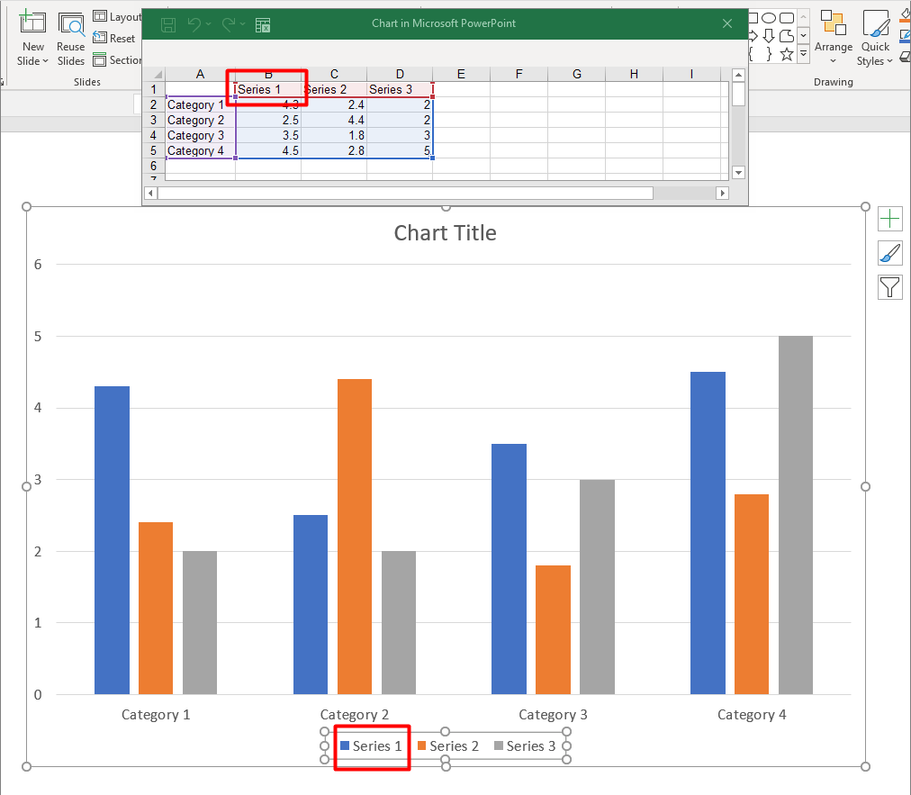

## **Översikt**

Ett diagram kan lagra sina plottade värden i arbetsboks-celler eller direkt som numeriska litteraler. En [IChartSeries](https://reference.aspose.com/slides/net/aspose.slides.charts/ichartseries/) representerar en uppsättning relaterade värden, och varje [IChartDataPoint](https://reference.aspose.com/slides/net/aspose.slides.charts/ichartdatapoint/) representerar en punkt i den serien. [IChartCategory](https://reference.aspose.com/slides/net/aspose.slides.charts/ichartcategory/) objekt tillhandahåller etiketter eller grupperingvärden som delas av serierna. I diagram som skapas med standarddata används serienamn, kategorier och punktvärden med [IChartDataCell](https://reference.aspose.com/slides/net/aspose.slides.charts/ichartdatacell/) objekt från diagrammets arbetsbok.

För ett typiskt kategoridiagram använder standardarbetsboken rad 0 för serienamn, kolumn 0 för kategorinamn, och de återstående cellerna för serievärden. Arbetsbladets, rad- och kolumnindex som skickas till [IChartDataWorkbook.GetCell](https://reference.aspose.com/slides/net/aspose.slides.charts/ichartdataworkbook/getcell/) är nollbaserade. Denna layout är användbar när du skapar ett diagram med standarddata, men anta inte att varje befintligt diagram använder den. För en inläst presentation, inspektera cellerna som refereras av serierna, kategorierna och datapunkterna innan du ändrar arbetsboksvärden.

Diagraminställningar har tre olika omfattningar:

- Inställningar på serienivå, såsom [IChartSeries.Format](https://reference.aspose.com/slides/net/aspose.slides.charts/ichartseries/format/), tillhandahåller standardutseendet för alla punkter i en serie.
- Inställningar för datapunkter, såsom [IChartDataPoint.Format](https://reference.aspose.com/slides/net/aspose.slides.charts/ichartdatapoint/format/), åsidosätter serieutseendet för en punkt.
- Gruppinställningar gäller för kompatibla serier som tillhör samma [IChartSeriesGroup](https://reference.aspose.com/slides/net/aspose.slides.charts/ichartseriesgroup/). Åtkomst till gruppen sker via [IChartSeries.ParentSeriesGroup](https://reference.aspose.com/slides/net/aspose.slides.charts/ichartseries/parentseriesgroup/) när du behöver ange alternativ som överlappning eller avstånd mellan staplar.

När ingen explicit punkt‑ eller serie‑fyllning är angiven bestämmer diagramstilen och temat det automatiska utseendet. När både serie‑ och punktformatering finns tar punktformateringen företräde för den punkten.



För ett klustrat cylinderd iagram, se hur [changing the 3D series type or bar shape](/slides/sv/net/3d-chart/#change-the-3d-series-type-and-bar-shape) påverkar den första serien.

## **Ange serievärden med numeriska litteraler**

Använd numeriska litteraler när serievärden kommer från programdata eller beräkningar och inte behöver referenser till arbetsbladceller. Ställ in [DataSourceTypeForValues](https://reference.aspose.com/slides/net/aspose.slides.charts/ichartdatapointcollection/datasourcetypeforvalues/) till [DataSourceType.DoubleLiterals](https://reference.aspose.com/slides/net/aspose.slides.charts/datasourcetype/) innan du tilldelar varje punkts [Value](https://reference.aspose.com/slides/net/aspose.slides.charts/ichartdatapoint/value/) via [AsLiteralDouble](https://reference.aspose.com/slides/net/aspose.slides.charts/idoublechartvalue/asliteraldouble/).

Samlingsinställningen styr källt typen för alla punktvärden i den serien. Varje punkts [Value.DataSourceType](https://reference.aspose.com/slides/net/aspose.slides.charts/ibasechartvalue/datasourcetype/) rapporterar den valda typen; ändra den via samlingsinställningen. Med `Worksheet` använd [AsCell](https://reference.aspose.com/slides/net/aspose.slides.charts/isinglecellchartvalue/ascell/) för att komma åt den refererade cellen. Med `DoubleLiterals` använd `AsLiteralDouble` för att läsa eller skriva talet direkt.

Följande exempel skapar ett stapeldiagram med standardserier och -kategorier, och tilldelar sedan beräknade värden 10, 20 osv till befintliga punkter i dess första serie. Det sparar presentationen, öppnar den igen och skriver ut de lagrade värdena.

```cs
using System;
using Aspose.Slides;
using Aspose.Slides.Charts;
using Aspose.Slides.Export;

using var presentation = new Presentation();
var slide = presentation.Slides[0];

var chart = slide.Shapes.AddChart(ChartType.ClusteredColumn, 20, 20, 500, 300);
var series = chart.ChartData.Series[0];

series.DataPoints.DataSourceTypeForValues = DataSourceType.DoubleLiterals;
for (var i = 0; i < series.DataPoints.Count; i++)
{
    series.DataPoints[i].Value.AsLiteralDouble = (i + 1) * 10;
}

presentation.Save("numeric_literals.pptx", SaveFormat.Pptx);

using var reopenedPresentation = new Presentation("numeric_literals.pptx");
var reopenedSlide = reopenedPresentation.Slides[0];
var reopenedChart = (IChart)reopenedSlide.Shapes[0];
var reopenedSeries = reopenedChart.ChartData.Series[0];
foreach (var point in reopenedSeries.DataPoints)
{
    Console.WriteLine(point.Value.AsLiteralDouble);
}
```

Punktvärdets källt typ är separat från [IChartData.DataSourceType](https://reference.aspose.com/slides/net/aspose.slides.charts/ichartdata/datasourcetype/), som identifierar diagrammets interna eller externa arbetsboks‑konfiguration. Att använda numeriska litteraler tar inte i sig den inbäddade arbetsboken. I detta exempel förblir arbetsboken tillgänglig för kategorietiketter, serienamn och de andra serierna. Se [Chart Workbook](/slides/sv/net/chart-workbook/) för hantering av arbetsböcker.

För spridnings‑ och bubbeldiagram, ställ in [DataSourceTypeForXValues](https://reference.aspose.com/slides/net/aspose.slides.charts/ichartdatapointcollection/datasourcetypeforxvalues/) och [DataSourceTypeForYValues](https://reference.aspose.com/slides/net/aspose.slides.charts/ichartdatapointcollection/datasourcetypeforyvalues/) för att välja källorna för [XValue](https://reference.aspose.com/slides/net/aspose.slides.charts/ichartdatapoint/xvalue/) och [YValue](https://reference.aspose.com/slides/net/aspose.slides.charts/ichartdatapoint/yvalue/). Bubbeldiagram använder dessutom [DataSourceTypeForBubbleSizes](https://reference.aspose.com/slides/net/aspose.slides.charts/ichartdatapointcollection/datasourcetypeforbubblesizes/) för [BubbleSize](https://reference.aspose.com/slides/net/aspose.slides.charts/ichartdatapoint/bubblesize/). Ställ in varje tillämplig källa till `DoubleLiterals` innan du tilldelar siffror via den värdets `AsLiteralDouble`‑egenskap.

## **Ange diagramseriens överlappning**

[IChartSeries.Overlap](https://reference.aspose.com/slides/net/aspose.slides.charts/ichartseries/overlap/) rapporterar hur mycket staplar eller kolumner överlappar i ett 2D‑diagram, från -100 till 100 procent. Det är en skrivskyddad projektion av inställningen på den överordnade serieggruppen. Ställ in [IChartSeriesGroup.Overlap](https://reference.aspose.com/slides/net/aspose.slides.charts/ichartseriesgroup/overlap/) för att uppdatera alla kompatibla serier i den gruppen. Detta alternativ gäller diagramtyper som visar grupperade staplar eller kolumner; det påverkar inte orelaterade serieggrupper i ett kombinationsdiagram.

Följande exempel sätter överlappningen för gruppen som innehåller den första serien:

```cs
using Aspose.Slides;
using Aspose.Slides.Charts;
using Aspose.Slides.Export;

const int firstSlideIndex = 0;
const int firstSeriesIndex = 0;
const sbyte overlapPercent = 30;

using var presentation = new Presentation();
var slide = presentation.Slides[firstSlideIndex];

// Det nya diagrammet innehåller exempelserier, kategorier och värden.
var chart = slide.Shapes.AddChart(ChartType.ClusteredColumn, 20, 20, 500, 200);

var series = chart.ChartData.Series[firstSeriesIndex];
series.ParentSeriesGroup.Overlap = overlapPercent;

presentation.Save("series_overlap.pptx", SaveFormat.Pptx);
```

Resultatet:


## **Ändra seriefyllningsfärgen**

Använd [IChartSeries.Format](https://reference.aspose.com/slides/net/aspose.slides.charts/ichartseries/format/) för att ange standardfyllning för en hel serie. Om en punkt redan har en explicit fyllning åsidosätter dess [IChartDataPoint.Format](https://reference.aspose.com/slides/net/aspose.slides.charts/ichartdatapoint/format/) serie­fyllningen för den punkten.

Följande exempel applicerar en enhetlig blå fyllning på den första serien:

```cs
using System.Drawing;
using Aspose.Slides;
using Aspose.Slides.Charts;
using Aspose.Slides.Export;

const int firstSlideIndex = 0;
const int firstSeriesIndex = 0;

using var presentation = new Presentation();
var slide = presentation.Slides[firstSlideIndex];

var chart = slide.Shapes.AddChart(ChartType.ClusteredColumn, 20, 20, 500, 200);

var series = chart.ChartData.Series[firstSeriesIndex];
series.Format.Fill.FillType = FillType.Solid;
series.Format.Fill.SolidFillColor.Color = Color.Blue;

presentation.Save("series_color.pptx", SaveFormat.Pptx);
```

Resultatet:


## **Ändra seriens namn**

Ett serienamn lagras i diagrammets data‑arbetsbok och visas normalt i förklaringen. I standardarbetsboken som skapas för ett klustrat stapeldiagram ligger cell B1 på rad 0, kolumn 1 och innehåller namnet på den första serien. De namngivna konstanterna i följande exempel gör den strukturen explicit:

```cs
using Aspose.Slides;
using Aspose.Slides.Charts;
using Aspose.Slides.Export;

const int firstSlideIndex = 0;
const int worksheetIndex = 0;
const int seriesNameRowIndex = 0;
const int firstSeriesColumnIndex = 1;

using var presentation = new Presentation();
var slide = presentation.Slides[firstSlideIndex];

var chart = slide.Shapes.AddChart(ChartType.ClusteredColumn, 20, 20, 500, 200);

var workbook = chart.ChartData.ChartDataWorkbook;
var seriesNameCell = workbook.GetCell(worksheetIndex, seriesNameRowIndex, firstSeriesColumnIndex);
seriesNameCell.Value = "Revenue";

presentation.Save("series_name.pptx", SaveFormat.Pptx);
```

Du kan också uppdatera cellen som redan refereras av [IChartSeries.Name](https://reference.aspose.com/slides/net/aspose.slides.charts/ichartseries/name/). Detta tillvägagångssätt undviker att anta en särskild rad och kolumn i ett befintligt diagram:

```cs
using Aspose.Slides;
using Aspose.Slides.Charts;
using Aspose.Slides.Export;

const int firstSlideIndex = 0;
const int firstSeriesIndex = 0;
const int firstNameCellIndex = 0;

using var presentation = new Presentation();
var slide = presentation.Slides[firstSlideIndex];

var chart = slide.Shapes.AddChart(ChartType.ClusteredColumn, 20, 20, 500, 200);

var series = chart.ChartData.Series[firstSeriesIndex];
var seriesNameCell = series.Name.AsCells[firstNameCellIndex];
seriesNameCell.Value = "Revenue";

presentation.Save("series_name.pptx", SaveFormat.Pptx);
```

Resultatet:


### **Skapa en serie med namn från flera celler**

Ett sammansatt serienamn är användbart när ett produktnamn och en rapportperiod lagras i separata arbetsboks‑celler. Till exempel kan du kombinera `Product A` i B1 och `2026` i C1 till ett enda serienamn samtidigt som båda delarna förblir länkade till sina källceller.

Använd [IChartDataWorkbook.GetCellCollection](https://reference.aspose.com/slides/net/aspose.slides.charts/ichartdataworkbook/getcellcollection/) för att hämta namnintervallet, och skicka sedan den samlingen till [IChartSeriesCollection.Add](https://reference.aspose.com/slides/net/aspose.slides.charts/ichartseriescollection/add/). Argumentet `skipHiddenCells` styr om dolda celler inkluderas: `true` exkluderar dem, medan `false` inkluderar dem. Detta exempel använder `false` för att inkludera varje cell i namnintervallet.

Följande exempel skapar en presentation med en serie och två datapunkter. Cellerna B1:C1 levererar endast serienamnet; A2:A3 levererar kategorietiketter, och B2:B3 levererar de numeriska värdena.

```cs
using Aspose.Slides;
using Aspose.Slides.Charts;
using Aspose.Slides.Export;

using var presentation = new Presentation();
var slide = presentation.Slides[0];

var chart = slide.Shapes.AddChart(ChartType.ClusteredColumn, 50, 50, 620, 180);

chart.ChartData.Series.Clear();
chart.ChartData.Categories.Clear();
chart.HasLegend = true;

var workbook = chart.ChartData.ChartDataWorkbook;
workbook.Clear(0);

// Dessa två celler levererar serienamnet.
workbook.GetCell(0, 0, 1, "Product A");
workbook.GetCell(0, 0, 2, "2026");
var nameCells = workbook.GetCellCollection("Sheet1!$B$1:$C$1", skipHiddenCells: false);
var series = chart.ChartData.Series.Add(nameCells, ChartType.ClusteredColumn);

// Separata celler levererar kategorierna och numeriska datapunkter.
var northCategory = workbook.GetCell(0, 1, 0, "North");
var southCategory = workbook.GetCell(0, 2, 0, "South");
chart.ChartData.Categories.Add(northCategory);
chart.ChartData.Categories.Add(southCategory);
var northValue = workbook.GetCell(0, 1, 1, 120);
var southValue = workbook.GetCell(0, 2, 1, 150);
series.DataPoints.AddDataPointForBarSeries(northValue);
series.DataPoints.AddDataPointForBarSeries(southValue);

presentation.Save("composite_series_name.pptx", SaveFormat.Pptx);
```

Det resulterande serienamnet blir `Product A 2026`, med ett mellanslag mellan de två cellvärdena. Förklaringen visar detta som ett enda inlägg för båda kolumnerna. Bilden nedan renderades från den sparade presentationen:


## **Hämta den automatiska seriefärgen**

[IChartSeries.GetAutomaticSeriesColor](https://reference.aspose.com/slides/net/aspose.slides.charts/ichartseries/getautomaticseriescolor/) returnerar färgen som beräknas utifrån serieindex och diagramstil. Detta är färgen som används när serie­fyllningen inte har definierats explicit. Att anropa metoden läser den beräknade färgen; den tilldelar ingen ny fyllning.

Följande exempel skriver ut den automatiska färgen för varje standardserie:

```cs
using System;
using Aspose.Slides;
using Aspose.Slides.Charts;

const int firstSlideIndex = 0;

using var presentation = new Presentation();
var slide = presentation.Slides[firstSlideIndex];

var chart = slide.Shapes.AddChart(ChartType.ClusteredColumn, 20, 20, 500, 200);

var seriesCount = chart.ChartData.Series.Count;
for (var seriesIndex = 0; seriesIndex < seriesCount; seriesIndex++)
{
    var series = chart.ChartData.Series[seriesIndex];
    var automaticColor = series.GetAutomaticSeriesColor();
    Console.WriteLine($"Series {seriesIndex}: {automaticColor.Name}");
}
```

Exempelutdata för standarddiagramstilen:

```text
Series 0: ff4f81bd
Series 1: ffc0504d
Series 2: ff9bbb59
```

De exakta färgerna beror på diagramstil och tema.

## **Ställ in inverterad fyllningsfärg för en diagramserie**

För stapel‑, kolumn‑ och bubbelse serier kan [IChartSeries.InvertIfNegative](https://reference.aspose.com/slides/net/aspose.slides.charts/ichartseries/invertifnegative/) visa negativa värden med en annan fyllning. Ställ in den vanliga serie­fyllningen till solid, aktivera inversion och tilldela färgen för negativa värden via [IChartSeries.InvertedSolidFillColor](https://reference.aspose.com/slides/net/aspose.slides.charts/ichartseries/invertedsolidfillcolor/). Negativa tal förblir oförändrade i arbetsboken; endast deras displayfärg ändras.

Följande exempel ersätter standarddiagramdata med en serie. Arbetsbladets rad 0 innehåller serienamnet, kolumn 0 innehåller kategorinamnen, och kolumn 1 innehåller värdena:

```cs
using System.Drawing;
using Aspose.Slides;
using Aspose.Slides.Charts;
using Aspose.Slides.Export;

const int firstSlideIndex = 0;
const int worksheetIndex = 0;
const int headerRowIndex = 0;
const int categoryColumnIndex = 0;
const int firstSeriesColumnIndex = 1;
const int firstDataRowIndex = 1;

var categoryNames = new[] { "Category 1", "Category 2", "Category 3" };
var seriesValues = new[] { -20, 50, -30 };

using var presentation = new Presentation();
var slide = presentation.Slides[firstSlideIndex];

var chart = slide.Shapes.AddChart(ChartType.ClusteredColumn, 20, 20, 500, 200);
var chartData = chart.ChartData;
var workbook = chartData.ChartDataWorkbook;

chartData.Series.Clear();
chartData.Categories.Clear();

var seriesNameCell = workbook.GetCell(worksheetIndex, headerRowIndex, firstSeriesColumnIndex, "Series 1");
var series = chartData.Series.Add(seriesNameCell, chart.Type);

for (var categoryIndex = 0; categoryIndex < categoryNames.Length; categoryIndex++)
{
    var dataRowIndex = firstDataRowIndex + categoryIndex;
    var categoryName = categoryNames[categoryIndex];
    var seriesValue = seriesValues[categoryIndex];

    var categoryCell = workbook.GetCell(worksheetIndex, dataRowIndex, categoryColumnIndex, categoryName);
    chartData.Categories.Add(categoryCell);

    var valueCell = workbook.GetCell(worksheetIndex, dataRowIndex, firstSeriesColumnIndex, seriesValue);
    series.DataPoints.AddDataPointForBarSeries(valueCell);
}

var automaticSeriesColor = series.GetAutomaticSeriesColor();
series.Format.Fill.FillType = FillType.Solid;
series.Format.Fill.SolidFillColor.Color = automaticSeriesColor;
series.InvertIfNegative = true;
series.InvertedSolidFillColor.Color = Color.Red;

presentation.Save("inverted_solid_fill_color.pptx", SaveFormat.Pptx);
```

Resultatet:


Du kan aktivera inversion för en punkt via [IChartDataPoint.InvertIfNegative](https://reference.aspose.com/slides/net/aspose.slides.charts/ichartdatapoint/invertifnegative/). I följande exempel är inversion inaktiverad för serien och endast aktiverad för den valda punkten. Punkten får också ett negativt värde så att effekten syns:

```cs
using System.Drawing;
using Aspose.Slides;
using Aspose.Slides.Charts;
using Aspose.Slides.Export;

const int firstSlideIndex = 0;
const int firstSeriesIndex = 0;
const int targetDataPointIndex = 2;
const int negativeValue = -30;

using var presentation = new Presentation();
var slide = presentation.Slides[firstSlideIndex];

var chart = slide.Shapes.AddChart(ChartType.ClusteredColumn, 20, 20, 500, 200);

var series = chart.ChartData.Series[firstSeriesIndex];
var automaticSeriesColor = series.GetAutomaticSeriesColor();
series.Format.Fill.FillType = FillType.Solid;
series.Format.Fill.SolidFillColor.Color = automaticSeriesColor;
series.InvertedSolidFillColor.Color = Color.Red;
series.InvertIfNegative = false;

var dataPoint = series.DataPoints[targetDataPointIndex];
dataPoint.YValue.AsCell.Value = negativeValue;
dataPoint.InvertIfNegative = true;

presentation.Save("data_point_invert_color_if_negative.pptx", SaveFormat.Pptx);
```

## **Rensa ett specifikt datapunktvärde**

För att göra en punkt tom utan att ta bort de andra, sätt dess underliggande arbetsboks‑cell till `null`. För ett stapeldiagram är det plottrade värdet tillgängligt via [IChartDataPoint.YValue](https://reference.aspose.com/slides/net/aspose.slides.charts/ichartdatapoint/yvalue/). Datapunkten behåller samma kategori‑position, men diagrammet behandlar dess värde som tomt enligt diagrammets inställningar för tomma värden.

Följande exempel rensar bara den andra punkten i den första serien:

```cs
using Aspose.Slides;
using Aspose.Slides.Charts;
using Aspose.Slides.Export;

const int firstSlideIndex = 0;
const int firstSeriesIndex = 0;
const int targetDataPointIndex = 1;

using var presentation = new Presentation();
var slide = presentation.Slides[firstSlideIndex];

var chart = slide.Shapes.AddChart(ChartType.ClusteredColumn, 20, 20, 500, 200);

var series = chart.ChartData.Series[firstSeriesIndex];
var dataPoint = series.DataPoints[targetDataPointIndex];
dataPoint.YValue.AsCell.Value = null;

presentation.Save("clear_data_point_value.pptx", SaveFormat.Pptx);
```

Spridningsdiagram använder separata X‑ och Y‑celler, och bubbeldiagram använder också en storlekscell. Rensa endast den cell som representerar det värde du vill ta bort. Anropa inte [IChartDataPointCollection.Clear](https://reference.aspose.com/slides/net/aspose.slides.charts/ichartdatapointcollection/clear/) när du vill behålla de andra punkterna, eftersom den metoden tar bort alla datapunkter i samlingen.

## **Styr visning av tomma celler**

Dolda celler som innehåller värden är ett separat fall från tomma celler. För att inkludera eller exkludera data från dolda arbetsbladsrader och -kolumner, se [Include Data from Hidden Rows and Columns](/slides/sv/net/chart-workbook/#include-data-from-hidden-rows-and-columns).

En tom arbetsboks‑cell representerar saknad data; en cell som innehåller `0` representerar ett känt numeriskt värde. Sätt [IChartDataCell.Value](https://reference.aspose.com/slides/net/aspose.slides.charts/ichartdatacell/value/) till `null` för att göra en cell tom. En numerisk nolla förblir en nolla oavsett inställning för tomma celler.

Använd [IChart.DisplayBlanksAs](https://reference.aspose.com/slides/net/aspose.slides.charts/ichart/displayblanksas/) för att välja hur diagrammet visar tomma celler. Denna inställning gäller för hela diagrammet. Den ändrar hur tomma värden plottas, utan att fylla den tomma arbetsboks‑cellen med noll eller ett interpolerat värde.

Följande självständiga exempel skapar ett linjediagram med en serie, rensar värdet för Dag 3 och sparar samma diagram med varje läge. Ingen indatafil behövs. [IChartDataWorkbook](https://reference.aspose.com/slides/net/aspose.slides.charts/ichartdataworkbook/) använder arbetsblad 0, kolumn 0 för kategorietiketter och kolumn 1 för värden; rad 0 innehåller serienamnet. Slutdata är `10, 20, empty, 30, 40`.

```cs
using Aspose.Slides;
using Aspose.Slides.Charts;
using Aspose.Slides.Export;

using var presentation = new Presentation();
var slide = presentation.Slides[0];

var chart = slide.Shapes.AddChart(ChartType.LineWithMarkers, 40, 40, 640, 400);
var chartData = chart.ChartData;
var workbook = chartData.ChartDataWorkbook;

chartData.Series.Clear();
chartData.Categories.Clear();

var seriesNameCell = workbook.GetCell(0, 0, 1, "Measurements");
var series = chartData.Series.Add(seriesNameCell, chart.Type);
var values = new[] { 10, 20, 25, 30, 40 };

for (var i = 0; i < values.Length; i++)
{
    var categoryCell = workbook.GetCell(0, i + 1, 0, $"Day {i + 1}");
    chartData.Categories.Add(categoryCell);
    var valueCell = workbook.GetCell(0, i + 1, 1, values[i]);
    series.DataPoints.AddDataPointForLineSeries(valueCell);
}

// Lämna dag 3 tom, samtidigt som du behåller dess kategori och datapunkt.
workbook.GetCell(0, 3, 1).Value = null;

var modes = new[] { DisplayBlanksAsType.Gap, DisplayBlanksAsType.Zero, DisplayBlanksAsType.Span };
foreach (var mode in modes)
{
    chart.DisplayBlanksAs = mode;
    presentation.Save($"empty_cells_{mode}.pptx", SaveFormat.Pptx);
}
```

Varje utdatafil lagrar det läge som tilldelats innan sparning: `empty_cells_Gap.pptx`, `empty_cells_Zero.pptx` och `empty_cells_Span.pptx`. För att spara endast en version, ange önskat läge och spara presentationen en gång istället för att iterera över lägena.

Jämförelsen nedan visar samma data i alla tre filer. Dag 3 är tom i arbetsboken i varje fall:


Den synliga effekten beror på diagramtyp. Ett linjediagram gör alla tre lägen enkla att jämföra. Stapel‑ och kolumndiagram har ingen linje att ansluta över en saknad kategori, så `Span` kan inte producera den anslutande segment som visas ovan; en saknad kolumn och en noll‑höjd kolumn kan också se lika ut. På liknande sätt har ett spridningsdiagram med endast markörer ingen anslutningslinje. Förvänta dig inte tre distinkta resultat för varje diagramtyp; kontrollera resultatet för den typ du använder.

## **Ställ in serie‑gapbredd**

Gapbredd är avståndet mellan intilliggande stapel‑ eller kolumnkluster, uttryckt i procent av stapel‑ eller kolumnbredden. Likt överlappning tillhör den den överordnade serieggruppen snarare än en enskild serie. Sätt [IChartSeriesGroup.GapWidth](https://reference.aspose.com/slides/net/aspose.slides.charts/ichartseriesgroup/gapwidth/) en gång för gruppen. Ett högre värde skapar mer utrymme mellan kluster; ett lägre värde gör dem tätare.

Följande exempel ändrar gapbredden och sparar endast den slutgiltiga presentationen:

```cs
using Aspose.Slides;
using Aspose.Slides.Charts;
using Aspose.Slides.Export;

const int firstSlideIndex = 0;
const int firstSeriesIndex = 0;
const int gapWidthPercent = 30;

using var presentation = new Presentation();
var slide = presentation.Slides[firstSlideIndex];

var chart = slide.Shapes.AddChart(ChartType.StackedColumn, 20, 20, 500, 200);

var series = chart.ChartData.Series[firstSeriesIndex];
series.ParentSeriesGroup.GapWidth = gapWidthPercent;

presentation.Save("gap_width_30.pptx", SaveFormat.Pptx);
```

Resultatet:


## **Visa eller dölja serielinjer**

Serielinjer förbinder visuellt relaterade delar av ett diagram. Använd [IChartSeriesGroup.HasSeriesLines](https://reference.aspose.com/slides/net/aspose.slides.charts/ichartseriesgroup/hasserieslines/) för att visa eller dölja dem i stödjade staplade stapel‑ och OfPie‑diagram. I tvådimensionella staplade stapel‑ och kolumndiagram ansluter de motsvarande stapelgränser över kategorier. I Pie of Pie‑ och Bar of Pie‑diagram ansluter de huvudplotten till den sekundära plotten. Denna inställning är inte en allmän kopplingsfunktion för andra diagramtyper.

Åtkomst till gruppen sker via [IChartSeries.ParentSeriesGroup](https://reference.aspose.com/slides/net/aspose.slides.charts/ichartseries/parentseriesgroup/). Inställningen gäller för varje serie i den gruppen. [IChartSeries.HasSeriesLines](https://reference.aspose.com/slides/net/aspose.slides.charts/ichartseries/hasserieslines/) är skrivskyddad och återspeglar gruppens inställning; ändra gruppens egenskap för att uppdatera den.

Följande exempel skapar ett [PieOfPie](https://reference.aspose.com/slides/net/aspose.slides.charts/charttype/) diagram med standarddata. Det sparar samma diagram med serielinjer aktiverade och sedan inaktiverade, vilket ger två presentationer för jämförelse.

```cs
using Aspose.Slides;
using Aspose.Slides.Charts;
using Aspose.Slides.Export;

using var presentation = new Presentation();
var slide = presentation.Slides[0];

var chart = slide.Shapes.AddChart(ChartType.PieOfPie, 50, 50, 600, 400);
var series = chart.ChartData.Series[0];
var seriesGroup = series.ParentSeriesGroup;

seriesGroup.HasSeriesLines = true;
presentation.Save("series_lines_enabled.pptx", SaveFormat.Pptx);

seriesGroup.HasSeriesLines = false;
presentation.Save("series_lines_disabled.pptx", SaveFormat.Pptx);
```

| Serielinjer aktiverade | Serielinjer inaktiverade |
| --- | --- |
|  |  |
| De två linjerna ansluter huvudcirkeln till den sekundära cirkeln. | Båda cirklarna förblir synliga, men de anslutande linjerna är dolda. |

Serielinjer skiljer sig från ledare‑linjer för datalabeler, som förbinder etiketter med sina datapunkter; rutnätlinjer, som markerar intervaller längs diagramaxlar; och linjer i ett linjediagram, som representerar datavärden. Denna inställning styr inte dessa element.

## **FAQ**

**Vilka diagramtyper stödjer dataserier?**

Alla diagramtyper som representeras av [ChartType](https://reference.aspose.com/slides/net/aspose.slides.charts/charttype/)-uppräkningen använder diagramdata, men deras serier har inte alla samma värdestruktur eller inställningar. Till exempel använder kategoridiagram kategorier och värden, spridningsdiagram använder X‑ och Y‑värden, och bubbeldiagram lägger till bubbelstorlekar. Använd den datapunkt‑skapande metod som matchar serietypen. Alternativ som överlappning och gapbredd gäller endast för kompatibla stapel‑ eller kolumngrupper.

**Vad är en diagramserieggrupp?**

En [IChartSeriesGroup](https://reference.aspose.com/slides/net/aspose.slides.charts/ichartseriesgroup/) innehåller kompatibla serier som delar grupp‑nivå plot‑inställningar. Ett kombinationsdiagram kan innehålla mer än en grupp, så att ändra gruppen som nås via en serie inte nödvändigtvis ändrar varje serie i diagrammet.

**Innehåller ett nyss skapat diagram standarddata?**

Ja. Som standard skapar [IShapeCollection.AddChart](https://reference.aspose.com/slides/net/aspose.slides/ishapecollection/addchart/) exempelserier, -kategorier och -värden. Du kan redigera dessa celler eller rensa både serie‑ och kategori‑samlingarna innan du lägger till en helt anpassad dataset. En overload kan även skapa ett diagram utan standarddata.

**Hur är diagramobjekt kopplade till arbetsboks‑celler?**

Serienamn, kategorietiketter och datapunktvärden refererar celler i en [IChartDataWorkbook](https://reference.aspose.com/slides/net/aspose.slides.charts/ichartdataworkbook/). Att ändra en refererad cell uppdaterar motsvarande diagram‑element. När du bygger egna data, håll kategorirader och serie‑värdesrader i linje så att varje punkt plottas under avsedd kategori.

**Hur rensar jag en punkt utan att rensa hela serien?**

Sätt den relevanta värdecellen till `null` för att behålla punktens kategori­position som en tom punkt. Använd [IChartDataPointCollection.Clear](https://reference.aspose.com/slides/net/aspose.slides.charts/ichartdatapointcollection/clear/) endast när du avser att ta bort alla punkter från den serien. Om du även tar bort kategorier, uppdatera varje serie så att deras värden förblir i linje med kategori‑samlingen.

**Hur visas tomma punkter?**

Resultatet beror på diagramtyp och [IChart.DisplayBlanksAs](https://reference.aspose.com/slides/net/aspose.slides.charts/ichart/displayblanksas/). Stödda diagram kan visa tomrum som gap, som nollvärden eller genom att ansluta grannpunkter. Välj den inställning som matchar betydelsen av saknad data i din presentation. Se [Control the Display of Empty Cells](#control-the-display-of-empty-cells) för ett komplett exempel och visuell jämförelse.

**Hur formateras negativa värden?**

För stödjade stapel‑, kolumn‑ och bubbelse‑serier, aktivera [IChartSeries.InvertIfNegative](https://reference.aspose.com/slides/net/aspose.slides.charts/ichartseries/invertifnegative/) och sätt [IChartSeries.InvertedSolidFillColor](https://reference.aspose.com/slides/net/aspose.slides.charts/ichartseries/invertedsolidfillcolor/). Du kan åsidosätta beteendet för en enskild punkt med [IChartDataPoint.InvertIfNegative](https://reference.aspose.com/slides/net/aspose.slides.charts/ichartdatapoint/invertifnegative/). Dessa egenskaper påverkar formatering, inte de lagrade numeriska värdena.

**Vilken formatering gäller när både en serie och en punkt är formaterade?**

Explicit datapunkt‑formatering har företräde för den punkten. Övriga punkter fortsätter att använda den explicita serie‑formatet eller, när serie‑formatet inte är definierat, den automatiska diagramstilen och temat. Grupp‑egenskaper som överlappning och gapbredd styr layout och är inte punkt‑nivå formaterings‑åsidosättningar.

**Finns det en begränsning för hur många serier ett diagram kan innehålla?**

Aspose.Slides påför ingen separat fast gräns för antalet serier. I praktiken bestäms en rimlig gräns av filformatets begränsningar, tillgängligt minne, renderingtid och diagrammets läsbarhet.

**Vad bör jag ändra när kolumner är för nära varandra eller för långt ifrån?**

Ställ in [IChartSeriesGroup.GapWidth](https://reference.aspose.com/slides/net/aspose.slides.charts/ichartseriesgroup/gapwidth/) på lämplig föräldraserieggrupp. Öka värdet för att bredda avståndet mellan kluster, eller minska det för att föra klustren närmare varandra.