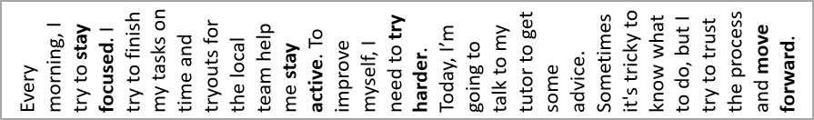

## **Översikt**

Den här artikeln visar hur man formaterar text i PowerPoint- och OpenDocument-presentationer med Aspose.Slides för Node.js via Java. Den täcker bakgrundsfärger, transparens, teckenavstånd, teckensnittsegenskaper, rotation, styckeavstånd, autofit‑beteende, textankring, tabbstopp och språkinställningar.

Om inte annat anges använder exemplen [sample.pptx](sample.pptx). Den första formen på dess första bild är en textruta, och dess första stycke innehåller texten som visas nedan. Både bild‑ och formindex är nollbaserade. Exempel som markerar feta delar använder effektiv formatering, inklusive ärvd fet formatering:


För att hitta och markera bokstavlig text eller reguljära uttryck‑träffar, se [Sök och ersätt text](/slides/sv/nodejs-java/search-and-replace-text/).

## **Ange bakgrundsfärg för text**

Använd [ParagraphFormat.getDefaultPortionFormat](https://reference.aspose.com/slides/nodejs-java/aspose.slides/paragraphformat/#getDefaultPortionFormat) för att ange standardmarkeringsfärgen för ett stycke, eller använd [BasePortionFormat.getHighlightColor](https://reference.aspose.com/slides/nodejs-java/aspose.slides/baseportionformat/#getHighlightColor) för enskilda textdelar.

Följande exempel anger en ljusgrå markering som standard för det första stycket. Explicita markeringsfärger på enskilda delar har företräde framför denna standard:

```javascript
const aspose = { slides: require("aspose.slides.via.java") };
const java = require("java");

const presentation = new aspose.slides.Presentation("sample.pptx");
try {
    const slide = presentation.getSlides().get_Item(0);

    const autoShape = slide.getShapes().get_Item(0);
    const paragraph = autoShape.getTextFrame().getParagraphs().get_Item(0);

    // Ange markeringsfärgen för hela stycket.
    paragraph.getParagraphFormat().getDefaultPortionFormat().getHighlightColor().setColor(java.getStaticFieldValue("java.awt.Color", "LIGHT_GRAY"));

    presentation.save("gray_paragraph.pptx", aspose.slides.SaveFormat.Pptx);
} finally {
    presentation.dispose();
}
```

Resultatet:


Kodexemplet nedan visar hur man anger bakgrundsfärgen för **textdelar med ett fetstilat teckensnitt**:

```javascript
const aspose = { slides: require("aspose.slides.via.java") };
const java = require("java");

const presentation = new aspose.slides.Presentation("sample.pptx");
try {
    const slide = presentation.getSlides().get_Item(0);

    const autoShape = slide.getShapes().get_Item(0);
    const paragraph = autoShape.getTextFrame().getParagraphs().get_Item(0);
    const portions = paragraph.getPortions();
    const portionCount = portions.getCount();

    for (let portionIndex = 0; portionIndex < portionCount; portionIndex++) {
        const portion = portions.get_Item(portionIndex);
        if (portion.getPortionFormat().getEffective().getFontBold()) {
            // Ange markeringsfärgen för textdelen.
            portion.getPortionFormat().getHighlightColor().setColor(java.getStaticFieldValue("java.awt.Color", "LIGHT_GRAY"));
        }
    }

    presentation.save("gray_text_portions.pptx", aspose.slides.SaveFormat.Pptx);
} finally {
    presentation.dispose();
}
```

Resultatet:


## **Justera textstycken**

Använd [ParagraphFormat.setAlignment](https://reference.aspose.com/slides/nodejs-java/aspose.slides/paragraphformat/#setAlignment) för att ange styckejustering inom en textram. Värdet kan vara centrerat, vänsterjusterat, högerjusterat, justerat osv.

Följande kodexempel visar hur man justerar stycket till **centret**:

```javascript
const aspose = { slides: require("aspose.slides.via.java") };

const presentation = new aspose.slides.Presentation("sample.pptx");
try {
    const slide = presentation.getSlides().get_Item(0);

    const autoShape = slide.getShapes().get_Item(0);
    const paragraph = autoShape.getTextFrame().getParagraphs().get_Item(0);

    // Ange styckets justering till centrerat.
    paragraph.getParagraphFormat().setAlignment(aspose.slides.TextAlignment.Center);

    presentation.save("aligned_paragraph.pptx", aspose.slides.SaveFormat.Pptx);
} finally {
    presentation.dispose();
}
```

Resultatet:


## **Justera teckensnitt inom en rad**

Använd [ParagraphFormat.setFontAlignment](https://reference.aspose.com/slides/nodejs-java/aspose.slides/paragraphformat/#setFontAlignment) för att vertikalt justera textdelar med olika teckensnittsstorlekar inom en rad. Denna inställning gäller hela stycket och styr justeringen inom varje rad.

Följande fristående exempel skapar fyra märkta textrutor på en bild. Varje stycke innehåller samma text i 18, 36 och 54 punkter, med olika teckensnittjustering. Det använder Arial, inaktiverar autofit och radbrytning, och håller textramarna tillräckligt stora för en enda rad.

```javascript
const aspose = { slides: require("aspose.slides.via.java") };
const java = require("java");

const presentation = new aspose.slides.Presentation();
try {
    const slide = presentation.getSlides().get_Item(0);

    const alignments = [aspose.slides.FontAlignment.Baseline, aspose.slides.FontAlignment.Top, aspose.slides.FontAlignment.Center, aspose.slides.FontAlignment.Bottom];
    const alignmentNames = ["Baseline", "Top", "Center", "Bottom"];
    const fontSizes = [18, 36, 54];

    for (let i = 0; i < alignments.length; i++) {
        const shape = slide.getShapes().addAutoShape(aspose.slides.ShapeType.Rectangle, 30, 20 + i * 130, 660, 120);
        shape.getFillFormat().setFillType(java.newByte(aspose.slides.FillType.NoFill));
        shape.getLineFormat().getFillFormat().setFillType(java.newByte(aspose.slides.FillType.NoFill));

        const textFrame = shape.getTextFrame();
        textFrame.getTextFrameFormat().setAnchoringType(java.newByte(aspose.slides.TextAnchorType.Top));
        textFrame.getTextFrameFormat().setAutofitType(java.newByte(aspose.slides.TextAutofitType.None));
        textFrame.getTextFrameFormat().setWrapText(java.newByte(aspose.slides.NullableBool.False));

        const label = textFrame.getParagraphs().get_Item(0);
        label.setText(alignmentNames[i]);
        label.getParagraphFormat().setAlignment(aspose.slides.TextAlignment.Left);
        label.getParagraphFormat().getDefaultPortionFormat().setFontHeight(14);
        label.getParagraphFormat().getDefaultPortionFormat().setLatinFont(new aspose.slides.FontData("Arial"));
        label.getParagraphFormat().getDefaultPortionFormat().getFillFormat().setFillType(java.newByte(aspose.slides.FillType.Solid));
        label.getParagraphFormat().getDefaultPortionFormat().getFillFormat().getSolidFillColor().setColor(java.getStaticFieldValue("java.awt.Color", "GRAY"));

        const paragraph = new aspose.slides.Paragraph();
        paragraph.getParagraphFormat().setFontAlignment(alignments[i]);
        paragraph.getParagraphFormat().setAlignment(aspose.slides.TextAlignment.Left);
        paragraph.getParagraphFormat().getDefaultPortionFormat().setLatinFont(new aspose.slides.FontData("Arial"));
        paragraph.getParagraphFormat().getDefaultPortionFormat().getFillFormat().setFillType(java.newByte(aspose.slides.FillType.Solid));
        paragraph.getParagraphFormat().getDefaultPortionFormat().getFillFormat().getSolidFillColor().setColor(java.getStaticFieldValue("java.awt.Color", "BLACK"));

        for (const fontSize of fontSizes) {
            const portion = new aspose.slides.Portion("Ag ");
            portion.getPortionFormat().setFontHeight(fontSize);
            paragraph.getPortions().add(portion);
        }

        textFrame.getParagraphs().add(paragraph);
    }

    presentation.save("font_alignment.pptx", aspose.slides.SaveFormat.Pptx);
} finally {
    presentation.dispose();
}
```

Resultatet:


Teckensnittjustering använder teckensnittsmått, så de synliga kanterna på enskilda bokstäver nödvändigtvis inte linjerar exakt. Exemplet inkluderar både en versal bokstav och en nedre påskrift för att tydligt visa skillnaden mellan baslinje‑ och bottenjustering. Tillgänglighet av teckensnitt och ersättning, de använda tecknen samt skillnaden i teckensnittsstorlekar påverkar resultatet. Ramens dimensioner, marginaler, radavstånd, radbrytning och autofit påverkar också layouten; använd samma teckensnitt och layoutinställningar när du jämför lägen.

Denna inställning skiljer sig från [ParagraphFormat.setAlignment](https://reference.aspose.com/slides/nodejs-java/aspose.slides/paragraphformat/#setAlignment), som styr horisontell styckejustering, och [TextFrameFormat.setAnchoringType](https://reference.aspose.com/slides/nodejs-java/aspose.slides/textframeformat/#setAnchoringType), som placerar textblocket vertikalt inom sin form. Upphöjd och nedsänkt formatering via [BasePortionFormat.setEscapement](https://reference.aspose.com/slides/nodejs-java/aspose.slides/baseportionformat/#setEscapement) skiftar enskilda delar i förhållande till baslinjen istället för att ställa in teckensnittjustering för styckets rader.

## **Ange transparens för text**

Texttransparens styrs genom alfakomponenten i färgen som tilldelas [BasePortionFormat.getFillFormat](https://reference.aspose.com/slides/nodejs-java/aspose.slides/baseportionformat/#getFillFormat). I exemplen nedan är `alpha = 50` ett ARGB‑alfavärde på 0–255‑skalan, inte en transparensprocent.

Kodexemplet nedan visar hur man applicerar transparens på **hela stycket**:

```javascript
const aspose = { slides: require("aspose.slides.via.java") };
const java = require("java");

const alpha = 50;
const transparentBlack = java.newInstanceSync("java.awt.Color", 0, 0, 0, alpha);
const presentation = new aspose.slides.Presentation("sample.pptx");
try {
    const slide = presentation.getSlides().get_Item(0);

    const autoShape = slide.getShapes().get_Item(0);
    const paragraph = autoShape.getTextFrame().getParagraphs().get_Item(0);
    const fillFormat = paragraph.getParagraphFormat().getDefaultPortionFormat().getFillFormat();

    // Ställ in fyllningsfärgen för texten till en transparent färg.
    fillFormat.setFillType(java.newByte(aspose.slides.FillType.Solid));
    fillFormat.getSolidFillColor().setColor(transparentBlack);

    presentation.save("transparent_paragraph.pptx", aspose.slides.SaveFormat.Pptx);
} finally {
    presentation.dispose();
}
```

Resultatet:


Följande kodexempel visar hur man applicerar transparens på **textdelar med ett fetstilat teckensnitt**:

```javascript
const aspose = { slides: require("aspose.slides.via.java") };
const java = require("java");

const alpha = 50;
const transparentBlack = java.newInstanceSync("java.awt.Color", 0, 0, 0, alpha);
const presentation = new aspose.slides.Presentation("sample.pptx");
try {
    const slide = presentation.getSlides().get_Item(0);

    const autoShape = slide.getShapes().get_Item(0);
    const paragraph = autoShape.getTextFrame().getParagraphs().get_Item(0);
    const portions = paragraph.getPortions();
    const portionCount = portions.getCount();

    for (let portionIndex = 0; portionIndex < portionCount; portionIndex++) {
        const portion = portions.get_Item(portionIndex);
        if (portion.getPortionFormat().getEffective().getFontBold()) {
            const fillFormat = portion.getPortionFormat().getFillFormat();

            // Ställ in transparensen för textdelen.
            fillFormat.setFillType(java.newByte(aspose.slides.FillType.Solid));
            fillFormat.getSolidFillColor().setColor(transparentBlack);
        }
    }

    presentation.save("transparent_text_portions.pptx", aspose.slides.SaveFormat.Pptx);
} finally {
    presentation.dispose();
}
```

Resultatet:


## **Ange teckenavstånd för text**

Använd [BasePortionFormat.setSpacing](https://reference.aspose.com/slides/nodejs-java/aspose.slides/baseportionformat/#setSpacing) för att utöka eller komprimera avståndet mellan tecken i en textruta. Exemplen lägger till 3 punkters avstånd; negativa värden komprimerar texten.

Följande JavaScript‑kod visar hur man utökar teckenavståndet i **hela stycket**:

```javascript
const aspose = { slides: require("aspose.slides.via.java") };

const presentation = new aspose.slides.Presentation("sample.pptx");
try {
    const slide = presentation.getSlides().get_Item(0);

    const autoShape = slide.getShapes().get_Item(0);
    const paragraph = autoShape.getTextFrame().getParagraphs().get_Item(0);

    // Obs: Använd negativa värden för att komprimera teckenavståndet.
    paragraph.getParagraphFormat().getDefaultPortionFormat().setSpacing(3); // Utöka teckenavståndet.

    presentation.save("character_spacing_in_paragraph.pptx", aspose.slides.SaveFormat.Pptx);
} finally {
    presentation.dispose();
}
```

Resultatet:


Kodexemplet nedan visar hur man utökar teckenavståndet i **textdelar med ett fetstilat teckensnitt**:

```javascript
const aspose = { slides: require("aspose.slides.via.java") };

const presentation = new aspose.slides.Presentation("sample.pptx");
try {
    const slide = presentation.getSlides().get_Item(0);

    const autoShape = slide.getShapes().get_Item(0);
    const paragraph = autoShape.getTextFrame().getParagraphs().get_Item(0);
    const portions = paragraph.getPortions();
    const portionCount = portions.getCount();

    for (let portionIndex = 0; portionIndex < portionCount; portionIndex++) {
        const portion = portions.get_Item(portionIndex);
        if (portion.getPortionFormat().getEffective().getFontBold()) {
            // Obs: Använd negativa värden för att komprimera teckenavståndet.
            portion.getPortionFormat().setSpacing(3); // Utöka teckenavståndet.
        }
    }

    presentation.save("character_spacing_in_text_portions.pptx", aspose.slides.SaveFormat.Pptx);
} finally {
    presentation.dispose();
}
```

Resultatet:


### **Inaktivera kerning för specifika teckensnitt**

I vissa fall kan text som renderas av Aspose.Slides se något tajtare ut än samma text i PowerPoint. Detta kan ske eftersom PowerPoint kan ignorera kerning‑data för vissa teckensnitt, även när teckensnittet innehåller giltig kerninginformation och kerning är aktiverat i PowerPoints inställningar.

För att få den renderade utdata närmare PowerPoint i sådana fall kan du inaktivera kerning för textdelar som använder det påverkade teckensnittet. Ställ in [BasePortionFormat.setKerningMinimalSize](https://reference.aspose.com/slides/nodejs-java/aspose.slides/baseportionformat/#setKerningMinimalSize) till ett värde som är större än den faktiska teckensnittsstorleken. Detta exempel kräver "presentation.pptx" med en textruta som den första formen på den första bilden. Det kontrollerar effektiva teckensnittsnamn, inklusive ärvda teckensnitt, och sätter ett tröskelvärde på 100 punkter för delar som använder Roboto. Detta inaktiverar kerning för matchande delar med en teckensnittsstorlek under 100 punkter:

```javascript
const aspose = { slides: require("aspose.slides.via.java") };

const presentation = new aspose.slides.Presentation("presentation.pptx");
try {
    const slide = presentation.getSlides().get_Item(0);

    const autoShape = slide.getShapes().get_Item(0);
    const paragraphs = autoShape.getTextFrame().getParagraphs();
    const paragraphCount = paragraphs.getCount();
    const targetFont = "Roboto";

    for (let paragraphIndex = 0; paragraphIndex < paragraphCount; paragraphIndex++) {
        const portions = paragraphs.get_Item(paragraphIndex).getPortions();
        const portionCount = portions.getCount();

        for (let portionIndex = 0; portionIndex < portionCount; portionIndex++) {
            const portion = portions.get_Item(portionIndex);
            const portionFormat = portion.getPortionFormat().getEffective();
            const latinFont = portionFormat.getLatinFont();
            const eastAsianFont = portionFormat.getEastAsianFont();
            const complexScriptFont = portionFormat.getComplexScriptFont();

            if ((latinFont !== null && latinFont.getFontName() === targetFont) ||
                (eastAsianFont !== null && eastAsianFont.getFontName() === targetFont) ||
                (complexScriptFont !== null && complexScriptFont.getFontName() === targetFont)) {
                portion.getPortionFormat().setKerningMinimalSize(100);
            }
        }
    }

    presentation.save("output.pptx", aspose.slides.SaveFormat.Pptx);
} finally {
    presentation.dispose();
}
```

För matchande text under tröskelvärdet förhindrar den här inställningen kerning och kan hjälpa till att anpassa Aspose.Slides‑renderingen till PowerPoints visuella resultat för teckensnitt som påverkas av detta PowerPoint‑specifika beteende.

## **Hantera textteckensnittsegenskaper**

Teckensnittsegenskaper kan sättas på styckelnivå via [ParagraphFormat.getDefaultPortionFormat](https://reference.aspose.com/slides/nodejs-java/aspose.slides/paragraphformat/#getDefaultPortionFormat) eller på enskilda delar via [PortionFormat](https://reference.aspose.com/slides/nodejs-java/aspose.slides/portionformat/).

Följande exempel anger det första styckets standardteckensnitt till 12‑punkts Times New Roman med fet, kursiv och streckad understrykning. Explicita formateringar på enskilda delar har företräde framför dessa standardvärden:

```javascript
const aspose = { slides: require("aspose.slides.via.java") };
const java = require("java");

const presentation = new aspose.slides.Presentation("sample.pptx");
try {
    const slide = presentation.getSlides().get_Item(0);

    const autoShape = slide.getShapes().get_Item(0);
    const paragraph = autoShape.getTextFrame().getParagraphs().get_Item(0);
    const defaultPortionFormat = paragraph.getParagraphFormat().getDefaultPortionFormat();

    // Ange teckensnittsegenskaperna för stycket.
    defaultPortionFormat.setFontHeight(12);
    defaultPortionFormat.setFontBold(java.newByte(aspose.slides.NullableBool.True));
    defaultPortionFormat.setFontItalic(java.newByte(aspose.slides.NullableBool.True));
    defaultPortionFormat.setFontUnderline(java.newByte(aspose.slides.TextUnderlineType.Dotted));
    defaultPortionFormat.setLatinFont(new aspose.slides.FontData("Times New Roman"));

    presentation.save("font_properties_for_paragraph.pptx", aspose.slides.SaveFormat.Pptx);
} finally {
    presentation.dispose();
}
```

Resultatet:


Följande exempel applicerar 13‑punkts Times New Roman, kursiv formatering och streckad understrykning på de delar vars effektiva formatering är fet:

```javascript
const aspose = { slides: require("aspose.slides.via.java") };
const java = require("java");

const presentation = new aspose.slides.Presentation("sample.pptx");
try {
    const slide = presentation.getSlides().get_Item(0);

    const autoShape = slide.getShapes().get_Item(0);
    const paragraph = autoShape.getTextFrame().getParagraphs().get_Item(0);
    const portions = paragraph.getPortions();
    const portionCount = portions.getCount();

    for (let portionIndex = 0; portionIndex < portionCount; portionIndex++) {
        const portion = portions.get_Item(portionIndex);
        if (portion.getPortionFormat().getEffective().getFontBold()) {
            const portionFormat = portion.getPortionFormat();

            // Ange teckensnittsegenskaperna för textdelen.
            portionFormat.setFontHeight(13);
            portionFormat.setFontItalic(java.newByte(aspose.slides.NullableBool.True));
            portionFormat.setFontUnderline(java.newByte(aspose.slides.TextUnderlineType.Dotted));
            portionFormat.setLatinFont(new aspose.slides.FontData("Times New Roman"));
        }
    }

    presentation.save("font_properties_for_text_portions.pptx", aspose.slides.SaveFormat.Pptx);
} finally {
    presentation.dispose();
}
```

Resultatet:


## **Styr normalisering av texthöjd**

Använd [BasePortionFormat.setNormaliseHeight](https://reference.aspose.com/slides/nodejs-java/aspose.slides/baseportionformat/#setNormaliseHeight) när du återger malltypografi eller undersöker skillnader i teckenhöjd. I PowerPoint sträcker eller komprimerar aktivering av normalisering enskilda tecken vertikalt för att ge dem en enhetlig synlig höjd inom textdelen. Det garanterar inte lika texthöjder mellan olika teckensnitt.

Ställ in egenskapen till [NullableBool.True or False](https://reference.aspose.com/slides/nodejs-java/aspose.slides/nullablebool/) för att explicit aktivera eller inaktivera normalisering. `NullableBool.NotDefined` lämnar den lokala inställningen odefinierad så att delen ärver värdet, till exempel från styckets [getDefaultPortionFormat](https://reference.aspose.com/slides/nodejs-java/aspose.slides/paragraphformat/#getDefaultPortionFormat). Det betyder inte `False`. Använd [PortionFormat.getEffective](https://reference.aspose.com/slides/nodejs-java/aspose.slides/portionformat/#getEffective) och läs [IBasePortionFormatEffectiveData.getNormaliseHeight](https://reference.aspose.com/slides/java/com.aspose.slides/ibaseportionformateffectivedata/#getNormaliseHeight--) för att erhålla det lösta booleska värdet.

Följande fristående exempel kräver **Arial** installerat. Det skapar två textblock med samma stora bokstäver, små bokstäver, nedåtriktade tecken och accentuerade tecken i 54 punkter. Båda styckena har normalisering aktiverad som standard. Den övre delen inaktiverar den explicit; den nedre ärver den. Ramstorlekar, marginaler och styckeavstånd är identiska, med radbrytning och autofit inaktiverade för att hålla jämförelsen konsekvent. Exemplet skriver ut `False: false` och `NotDefined: true` och sparar "text_height_normalization.pptx".

```javascript
const aspose = { slides: require("aspose.slides.via.java") };
const java = require("java");

const presentation = new aspose.slides.Presentation();
try {
    const slide = presentation.getSlides().get_Item(0);

    const settings = [aspose.slides.NullableBool.False, aspose.slides.NullableBool.NotDefined];
    const settingNames = ["False", "NotDefined"];

    for (let i = 0; i < settings.length; i++) {
        const shape = slide.getShapes().addAutoShape(aspose.slides.ShapeType.Rectangle, 30, 60 + i * 200, 660, 150);
        shape.getFillFormat().setFillType(java.newByte(aspose.slides.FillType.NoFill));
        shape.getLineFormat().getFillFormat().setFillType(java.newByte(aspose.slides.FillType.NoFill));

        const textFrame = shape.getTextFrame();
        textFrame.setText("Hxgjpq ÅÉ 0123");
        textFrame.getTextFrameFormat().setAutofitType(java.newByte(aspose.slides.TextAutofitType.None));
        textFrame.getTextFrameFormat().setWrapText(java.newByte(aspose.slides.NullableBool.False));
        textFrame.getTextFrameFormat().setAnchoringType(java.newByte(aspose.slides.TextAnchorType.Top));
        textFrame.getTextFrameFormat().setMarginTop(0);
        textFrame.getTextFrameFormat().setMarginLeft(0);

        const paragraph = textFrame.getParagraphs().get_Item(0);
        paragraph.getParagraphFormat().setAlignment(aspose.slides.TextAlignment.Left);
        paragraph.getParagraphFormat().setSpaceBefore(0);
        paragraph.getParagraphFormat().setSpaceAfter(0);
        paragraph.getParagraphFormat().setSpaceWithin(100);
        paragraph.getParagraphFormat().getDefaultPortionFormat().setNormaliseHeight(java.newByte(aspose.slides.NullableBool.True));

        const portion = paragraph.getPortions().get_Item(0);
        const font = new aspose.slides.FontData("Arial");
        portion.getPortionFormat().setLatinFont(font);
        portion.getPortionFormat().setFontHeight(54);
        portion.getPortionFormat().getFillFormat().setFillType(java.newByte(aspose.slides.FillType.Solid));
        const textColor = java.getStaticFieldValue("java.awt.Color", "BLACK");
        portion.getPortionFormat().getFillFormat().getSolidFillColor().setColor(textColor);
        portion.getPortionFormat().setNormaliseHeight(java.newByte(settings[i]));

        console.log(settingNames[i] + ": " + portion.getPortionFormat().getEffective().getNormaliseHeight());
    }

    presentation.save("text_height_normalization.pptx", aspose.slides.SaveFormat.Pptx);
} finally {
    presentation.dispose();
}
```

Jämförelsen nedan exporterades från den sparade presentationen. Den övre raden har normalisering inaktiverad (`False`); den nedre raden ärver den aktiverade inställningen (`NotDefined` → `True`). Behåll Arial installerat för att reproducera utseendet.


Normalisering ändrar teckenhöjd utan att ändra det tilldelade [getFontHeight](https://reference.aspose.com/slides/nodejs-java/aspose.slides/baseportionformat/#getFontHeight)-värdet, som anger teckensnittsstorlek i punkter. Stycke‑[setSpaceWithin](https://reference.aspose.com/slides/nodejs-java/aspose.slides/paragraphformat/#setSpaceWithin) styr radavstånd, medan textram‑[setAutofitType](https://reference.aspose.com/slides/nodejs-java/aspose.slides/textframeformat/#setAutofitType) styr hur text eller dess behållare justeras för att passa. Dessa inställningar har olika syften och kan påverka den övergripande layouten oberoende av varandra. För mer om styckeformatering och arv, se [Hantera stycke](/slides/sv/nodejs-java/manage-paragraph/).

## **Applicera och ta bort genomstrykning**

Använd [BasePortionFormat.setStrikethroughType](https://reference.aspose.com/slides/nodejs-java/aspose.slides/baseportionformat/#setStrikethroughType) på en textdel för att visa korrigeringar, annullerade termer eller tidigare priser utan att ta bort originaltexten. Ställ in den på [TextStrikethroughType.Single eller Double](https://reference.aspose.com/slides/nodejs-java/aspose.slides/textstrikethroughtype/) för en eller två linjer genom texten.

För att ta bort genomstrykning, skicka [TextStrikethroughType.None](https://reference.aspose.com/slides/nodejs-java/aspose.slides/textstrikethroughtype/#None). Detta inaktiverar effekten explicit, även om den omgivande formateringen anger genomstrykning. Däremot lämnar [TextStrikethroughType.NotDefined](https://reference.aspose.com/slides/nodejs-java/aspose.slides/textstrikethroughtype/#NotDefined) den lokala inställningen odefinierad, så att delen kan ärva formatering, exempelvis från stycket. Det garanterar inte att genomstrykning tas bort. Använd [PortionFormat.getEffective](https://reference.aspose.com/slides/nodejs-java/aspose.slides/portionformat/#getEffective) för att läsa den resulterande formateringen, inklusive ärvda värden.

Följande fristående exempel skapar tre prisjämförelser. Varje stycke har separata delar för etikett, tidigare pris och aktuellt pris, så endast det tidigare priset påverkas. Den första raden applicerar och sedan tar bort genomstrykning; de andra raderna behåller enkel respektive dubbel genomstrykning. Ändring av denna inställning bevarar texten och dess övriga formatering, inklusive det feta tidigare priset.

```javascript
const aspose = { slides: require("aspose.slides.via.java") };
const java = require("java");

const presentation = new aspose.slides.Presentation();
try {
    const slide = presentation.getSlides().get_Item(0);

    const shape = slide.getShapes().addAutoShape(aspose.slides.ShapeType.Rectangle, 50, 50, 620, 220);
    shape.getFillFormat().setFillType(java.newByte(aspose.slides.FillType.NoFill));
    shape.getLineFormat().getFillFormat().setFillType(java.newByte(aspose.slides.FillType.NoFill));
    shape.getTextFrame().getParagraphs().clear();

    const labels = ["None: ", "Single: ", "Double: "];

    for (const label of labels) {
        const paragraph = new aspose.slides.Paragraph();
        paragraph.getParagraphFormat().setAlignment(aspose.slides.TextAlignment.Left);
        paragraph.getParagraphFormat().setSpaceAfter(20);

        const format = paragraph.getParagraphFormat().getDefaultPortionFormat();
        format.setFontHeight(28);
        const font = new aspose.slides.FontData("Arial");
        format.setLatinFont(font);
        format.getFillFormat().setFillType(java.newByte(aspose.slides.FillType.Solid));
        const textColor = java.getStaticFieldValue("java.awt.Color", "BLACK");
        format.getFillFormat().getSolidFillColor().setColor(textColor);

        const labelPortion = new aspose.slides.Portion(label);
        paragraph.getPortions().add(labelPortion);

        const previousPrice = new aspose.slides.Portion("$100");
        previousPrice.getPortionFormat().setFontBold(java.newByte(aspose.slides.NullableBool.True));
        paragraph.getPortions().add(previousPrice);
        const currentPrice = new aspose.slides.Portion(" → $80");
        paragraph.getPortions().add(currentPrice);

        shape.getTextFrame().getParagraphs().add(paragraph);
    }

    const paragraphs = shape.getTextFrame().getParagraphs();

    // Applicera genomstrykning, och ta sedan bort den explicit från det första föregående priset.
    paragraphs.get_Item(0).getPortions().get_Item(1).getPortionFormat().setStrikethroughType(java.newByte(aspose.slides.TextStrikethroughType.Single));
    paragraphs.get_Item(0).getPortions().get_Item(1).getPortionFormat().setStrikethroughType(java.newByte(aspose.slides.TextStrikethroughType.None));

    paragraphs.get_Item(1).getPortions().get_Item(1).getPortionFormat().setStrikethroughType(java.newByte(aspose.slides.TextStrikethroughType.Single));
    paragraphs.get_Item(2).getPortions().get_Item(1).getPortionFormat().setStrikethroughType(java.newByte(aspose.slides.TextStrikethroughType.Double));

    presentation.save("strikethrough.pptx", aspose.slides.SaveFormat.Pptx);
} finally {
    presentation.dispose();
}
```

Resultatet, från topp till botten: ingen genomstrykning, enkel genomstrykning och dubbel genomstrykning.


## **Ange textrotation**

Använd [TextFrameFormat.setTextVerticalType](https://reference.aspose.com/slides/nodejs-java/aspose.slides/textframeformat/#setTextVerticalType) för att ange en fördefinierad textorientering inom en form.

Följande kodexempel ställer in textorienteringen i formen till [TextVerticalType.Vertical270](https://reference.aspose.com/slides/nodejs-java/aspose.slides/textverticaltype/), vilket roterar texten **90 grader moturs**:

```javascript
const aspose = { slides: require("aspose.slides.via.java") };
const java = require("java");

const presentation = new aspose.slides.Presentation("sample.pptx");
try {
    const slide = presentation.getSlides().get_Item(0);

    const autoShape = slide.getShapes().get_Item(0);
    autoShape.getTextFrame().getTextFrameFormat().setTextVerticalType(java.newByte(aspose.slides.TextVerticalType.Vertical270));

    presentation.save("text_rotation.pptx", aspose.slides.SaveFormat.Pptx);
} finally {
    presentation.dispose();
}
```

Resultatet:



## **Ange anpassad rotation för textramar**

Använd [TextFrameFormat.setRotationAngle](https://reference.aspose.com/slides/nodejs-java/aspose.slides/textframeformat/#setRotationAngle) för att ange en anpassad rotationsvinkel för ett [TextFrame](https://reference.aspose.com/slides/nodejs-java/aspose.slides/textframe/).

Kodexemplet nedan roterar textramen 3 grader medurs inom formen:

```javascript
const aspose = { slides: require("aspose.slides.via.java") };

const presentation = new aspose.slides.Presentation("sample.pptx");
try {
    const slide = presentation.getSlides().get_Item(0);

    const autoShape = slide.getShapes().get_Item(0);
    autoShape.getTextFrame().getTextFrameFormat().setRotationAngle(3);

    presentation.save("custom_text_rotation.pptx", aspose.slides.SaveFormat.Pptx);
} finally {
    presentation.dispose();
}
```

Resultatet:


## **Ange radavstånd för stycken**

Aspose.Slides erbjuder [ParagraphFormat.setSpaceAfter](https://reference.aspose.com/slides/nodejs-java/aspose.slides/paragraphformat/#setSpaceAfter), [ParagraphFormat.setSpaceBefore](https://reference.aspose.com/slides/nodejs-java/aspose.slides/paragraphformat/#setSpaceBefore) och [ParagraphFormat.setSpaceWithin](https://reference.aspose.com/slides/nodejs-java/aspose.slides/paragraphformat/#setSpaceWithin) för att kontrollera styckeavstånd. Dessa egenskaper används enligt följande:

* Använd ett positivt värde för att ange radavstånd som en procentandel av radhöjden.
* Använd ett negativt värde för att ange radavstånd i punkter.

Följande exempel sätter avståndet inom det första stycket till 200 % av radhöjden (dubbelradavstånd):

```javascript
const aspose = { slides: require("aspose.slides.via.java") };

const presentation = new aspose.slides.Presentation("sample.pptx");
try {
    const slide = presentation.getSlides().get_Item(0);

    const autoShape = slide.getShapes().get_Item(0);

    const paragraph = autoShape.getTextFrame().getParagraphs().get_Item(0);
    paragraph.getParagraphFormat().setSpaceWithin(200);

    presentation.save("line_spacing.pptx", aspose.slides.SaveFormat.Pptx);
} finally {
    presentation.dispose();
}
```

Resultatet:


## **Styr radbrytning**

Regler för radbrytning i stycken är användbara i smala textblock och presentationer som blandar latin och östasiatisk text. Följande metoder tillhör [ParagraphFormat](https://reference.aspose.com/slides/nodejs-java/aspose.slides/paragraphformat/), så de gäller hela stycket:

- [setLatinLineBreak](https://reference.aspose.com/slides/nodejs-java/aspose.slides/paragraphformat/#setLatinLineBreak) kontrollerar latinska radbrytningsregler. I blandad text kan förändring också ändra var intilliggande östasiatisk text och skiljetecken bryts.
- [setEastAsianLineBreak](https://reference.aspose.com/slides/nodejs-java/aspose.slides/paragraphformat/#setEastAsianLineBreak) kontrollerar östasiatiska radbrytningsregler, inklusive restriktioner för tecken i början och slutet av en rad.

Dessa regler ersätter inte [TextFrameFormat.setWrapText](https://reference.aspose.com/slides/nodejs-java/aspose.slides/textframeformat/#setWrapText), som aktiverar automatisk radbrytning inom en textram. De påverkar layouten när radbrytning sker; de infogar inte radbrytningstecken. En explicit radbrytning tvingar en ny rad i stycket oberoende av tillgänglig bredd.

Följande fristående exempel skapar ett smalt textblock som innehåller kinesisk och latinsk text. Det ställer explicit in båda radbrytningsalternativen och sparar "line_breaking.pptx". För att experimentera med någon av reglerna, ändra motsvarande värde medan de andra inställningarna hålls fasta. Exemplet använder 24‑punkts Arial och SimSun med en rambredd på 160 punkter och noll horisontella marginaler för textramen. [TextFrameFormat.setAutofitType](https://reference.aspose.com/slides/nodejs-java/aspose.slides/textframeformat/#setAutofitType) anropas med [TextAutofitType.None](https://reference.aspose.com/slides/nodejs-java/aspose.slides/textautofittype/) så att textstorlek och ramdimensioner förblir oförändrade.

```javascript
const aspose = { slides: require("aspose.slides.via.java") };
const java = require("java");

const presentation = new aspose.slides.Presentation();
try {
    const slide = presentation.getSlides().get_Item(0);

    const shape = slide.getShapes().addAutoShape(aspose.slides.ShapeType.Rectangle, 50, 50, 160, 300);
    shape.getFillFormat().setFillType(java.newByte(aspose.slides.FillType.NoFill));

    const textFrame = shape.getTextFrame();
    textFrame.getTextFrameFormat().setWrapText(java.newByte(aspose.slides.NullableBool.True));
    textFrame.getTextFrameFormat().setAutofitType(java.newByte(aspose.slides.TextAutofitType.None));
    textFrame.getTextFrameFormat().setMarginLeft(0);
    textFrame.getTextFrameFormat().setMarginRight(0);

    const paragraph = textFrame.getParagraphs().get_Item(0);
    paragraph.setText("中文排版测试，PowerPoint 中文演示。");

    const format = paragraph.getParagraphFormat();
    format.setAlignment(aspose.slides.TextAlignment.Left);
    format.getDefaultPortionFormat().setFontHeight(24);
    const latinFont = new aspose.slides.FontData("Arial");
    format.getDefaultPortionFormat().setLatinFont(latinFont);
    const eastAsianFont = new aspose.slides.FontData("SimSun");
    format.getDefaultPortionFormat().setEastAsianFont(eastAsianFont);
    format.getDefaultPortionFormat().getFillFormat().setFillType(java.newByte(aspose.slides.FillType.Solid));
    const textColor = java.getStaticFieldValue("java.awt.Color", "BLACK");
    format.getDefaultPortionFormat().getFillFormat().getSolidFillColor().setColor(textColor);
    format.setLatinLineBreak(java.newByte(aspose.slides.NullableBool.False));
    format.setEastAsianLineBreak(java.newByte(aspose.slides.NullableBool.True));

    presentation.save("line_breaking.pptx", aspose.slides.SaveFormat.Pptx);
} finally {
    presentation.dispose();
}
```

## **Styr hängande interpunktion**

[ParagraphFormat.setHangingPunctuation](https://reference.aspose.com/slides/nodejs-java/aspose.slides/paragraphformat/#setHangingPunctuation) låter berättigad interpunktion sträcka sig utanför textradens högra kant istället för att placeras på nästa rad. Det gäller hela stycket och skiljer sig från ett hängande indrag.

Följande fristående exempel aktiverar hängande interpunktion i en 100‑punkts bred textram och sparar "hanging_punctuation.pptx". Med 24‑punkts Arial och noll horisontella marginaler för textramen stannar den sista punkten efter "sentence" och sträcker sig bortom den högra kanten. Ställ in egenskapen till [NullableBool.False](https://reference.aspose.com/slides/nodejs-java/aspose.slides/nullablebool/) för att jämföra: med dessa inställningar hamnar punkten på en egen rad. Radbrytning är aktiverad och autofit inaktiverad för att hålla den tillgängliga bredden fast.

```javascript
const aspose = { slides: require("aspose.slides.via.java") };
const java = require("java");

const presentation = new aspose.slides.Presentation();
try {
    const slide = presentation.getSlides().get_Item(0);

    const shape = slide.getShapes().addAutoShape(aspose.slides.ShapeType.Rectangle, 50, 50, 100, 200);
    shape.getFillFormat().setFillType(java.newByte(aspose.slides.FillType.NoFill));

    const textFrame = shape.getTextFrame();
    textFrame.getTextFrameFormat().setWrapText(java.newByte(aspose.slides.NullableBool.True));
    textFrame.getTextFrameFormat().setAutofitType(java.newByte(aspose.slides.TextAutofitType.None));
    textFrame.getTextFrameFormat().setMarginLeft(0);
    textFrame.getTextFrameFormat().setMarginRight(0);

    const paragraph = textFrame.getParagraphs().get_Item(0);
    paragraph.setText("Simple text, next sentence.");

    const format = paragraph.getParagraphFormat();
    format.setAlignment(aspose.slides.TextAlignment.Left);
    format.getDefaultPortionFormat().setFontHeight(24);
    const latinFont = new aspose.slides.FontData("Arial");
    format.getDefaultPortionFormat().setLatinFont(latinFont);
    format.getDefaultPortionFormat().getFillFormat().setFillType(java.newByte(aspose.slides.FillType.Solid));
    const textColor = java.getStaticFieldValue("java.awt.Color", "BLACK");
    format.getDefaultPortionFormat().getFillFormat().getSolidFillColor().setColor(textColor);
    format.setHangingPunctuation(java.newByte(aspose.slides.NullableBool.True));

    presentation.save("hanging_punctuation.pptx", aspose.slides.SaveFormat.Pptx);
} finally {
    presentation.dispose();
}
```

Inte varje skiljetecken kan hänga. De [font‑ och layoutvillkor som beskrivits ovan](#control-line-breaking) gäller även för denna jämförelse: förändring av teckensnitt, tillgänglig bredd, marginaler eller autofit‑inställningar kan ta bort den synliga skillnaden.

## **Ange autofit‑typ för textramar**

[TextFrameFormat.setAutofitType](https://reference.aspose.com/slides/nodejs-java/aspose.slides/textframeformat/#setAutofitType) bestämmer hur text beter sig när den överskrider behållarens gränser. Använd den för att styra om texten krymper, flyter över eller om formen automatiskt anpassas. Följande exempel konfigurerar formen så att den ändrar storlek för att passa sin text och sparar resultatet till "autofit_type.pptx".

```javascript
const aspose = { slides: require("aspose.slides.via.java") };
const java = require("java");

const presentation = new aspose.slides.Presentation("sample.pptx");
try {
    const slide = presentation.getSlides().get_Item(0);

    const autoShape = slide.getShapes().get_Item(0);
    autoShape.getTextFrame().getTextFrameFormat().setAutofitType(java.newByte(aspose.slides.TextAutofitType.Shape));

    presentation.save("autofit_type.pptx", aspose.slides.SaveFormat.Pptx);
} finally {
    presentation.dispose();
}
```

För att räkna rader efter automatisk radbrytning och se hur text‑ eller formbredd förändrar resultatet, se [Räkna renderade rader](/slides/sv/nodejs-java/manage-paragraph/). Antal rader indikerar inte om texten överskrider sin behållare.

## **Ange ankare för textramar**

[TextFrameFormat.setAnchoringType](https://reference.aspose.com/slides/nodejs-java/aspose.slides/textframeformat/#setAnchoringType) definierar hur text placeras vertikalt inuti en form, exempelvis högst, i mitten eller längst ner. Följande exempel ankra texten till botten av den första formen och sparar resultatet till "text_anchor.pptx".

```javascript
const aspose = { slides: require("aspose.slides.via.java") };
const java = require("java");

const presentation = new aspose.slides.Presentation("sample.pptx");
try {
    const slide = presentation.getSlides().get_Item(0);

    const autoShape = slide.getShapes().get_Item(0);
    autoShape.getTextFrame().getTextFrameFormat().setAnchoringType(java.newByte(aspose.slides.TextAnchorType.Bottom));

    presentation.save("text_anchor.pptx", aspose.slides.SaveFormat.Pptx);
} finally {
    presentation.dispose();
}
```

## **Ange texttabulering**

Använd [ParagraphFormat.setDefaultTabSize](https://reference.aspose.com/slides/nodejs-java/aspose.slides/paragraphformat/#setDefaultTabSize) och [ParagraphFormat.getTabs](https://reference.aspose.com/slides/nodejs-java/aspose.slides/paragraphformat/#getTabs) för att konfigurera tabbstopp i ett stycke. Följande exempel sätter standardtabbsteg på 100 punkter och lägger till ett vänsterjusterat tabbstopp på 30 punkter. Dessa inställningar påverkar text som innehåller tabb‑tecken.

```javascript
const aspose = { slides: require("aspose.slides.via.java") };
const java = require("java");

const presentation = new aspose.slides.Presentation("sample.pptx");
try {
    const slide = presentation.getSlides().get_Item(0);

    const autoShape = slide.getShapes().get_Item(0);

    const paragraph = autoShape.getTextFrame().getParagraphs().get_Item(0);
    paragraph.getParagraphFormat().setDefaultTabSize(100);
    paragraph.getParagraphFormat().getTabs().add(30, java.newByte(aspose.slides.TabAlignment.Left));

    presentation.save("paragraph_tabs.pptx", aspose.slides.SaveFormat.Pptx);
} finally {
    presentation.dispose();
}
```

Resultatet:


## **Ange språk för rättstavning**

Aspose.Slides tillhandahåller [BasePortionFormat.setLanguageId](https://reference.aspose.com/slides/nodejs-java/aspose.slides/baseportionformat/#setLanguageId), vilket låter dig ange rättstavningsspråket för en textdel. Rättstavningsspråket bestämmer vilket språk som används för stavnings- och grammatikgranskning i PowerPoint.

Följande exempel kräver "presentation.pptx" med en textruta som den första formen på den första bilden och minst ett stycke. Det ersätter det första styckets innehåll med "1。", sätter SimSun som teckensnitt och tilldelar det förenklade kinesiska rättstavningsspråket (`zh-CN`). Det sparar resultatet till "proofing_language.pptx":

```javascript
const aspose = { slides: require("aspose.slides.via.java") };

const presentation = new aspose.slides.Presentation("presentation.pptx");
try {
    const slide = presentation.getSlides().get_Item(0);

    const autoShape = slide.getShapes().get_Item(0);

    const paragraph = autoShape.getTextFrame().getParagraphs().get_Item(0);
    paragraph.getPortions().clear();

    const font = new aspose.slides.FontData("SimSun");
    const textPortion = new aspose.slides.Portion();
    textPortion.getPortionFormat().setComplexScriptFont(font);
    textPortion.getPortionFormat().setEastAsianFont(font);
    textPortion.getPortionFormat().setLatinFont(font);

    // Ange Id för ett korrekturspråk.
    textPortion.getPortionFormat().setLanguageId("zh-CN");

    textPortion.setText("1。");
    paragraph.getPortions().add(textPortion);

    presentation.save("proofing_language.pptx", aspose.slides.SaveFormat.Pptx);
} finally {
    presentation.dispose();
}
```

### **Kopiera språkmmetadata**

När du kopierar flerspråkig text från en mall, bevara både [BasePortionFormat.getLanguageId](https://reference.aspose.com/slides/nodejs-java/aspose.slides/baseportionformat/#getLanguageId) och [BasePortionFormat.getAlternativeLanguageId](https://reference.aspose.com/slides/nodejs-java/aspose.slides/baseportionformat/#getAlternativeLanguageId). Följande fristående exempel skapar en käll-del med US English som språk och French som alternativt språk och kopierar texten och identifierarna till en del i en ny presentation.

```javascript
const aspose = { slides: require("aspose.slides.via.java") };

const source = new aspose.slides.Portion("Hello! Bonjour!");
source.getPortionFormat().setLanguageId("en-US");
source.getPortionFormat().setAlternativeLanguageId("fr-FR");

const presentation = new aspose.slides.Presentation();
try {
    const slide = presentation.getSlides().get_Item(0);

    const shape = slide.getShapes().addAutoShape(aspose.slides.ShapeType.Rectangle, 20, 20, 400, 80);
    const paragraph = shape.getTextFrame().getParagraphs().get_Item(0);
    paragraph.getPortions().clear();

    const destination = new aspose.slides.Portion();
    destination.setText(source.getText());
    destination.getPortionFormat().setLanguageId(source.getPortionFormat().getLanguageId());
    // Om källan inte har något alternativt språk, rensar null destinationsvärdet.
    destination.getPortionFormat().setAlternativeLanguageId(source.getPortionFormat().getAlternativeLanguageId());
    paragraph.getPortions().add(destination);

    presentation.save("copied_language_metadata.pptx", aspose.slides.SaveFormat.Pptx);
} finally {
    presentation.dispose();
}
```

För att prova en källa utan alternativt språk, utelämna tilldelningen av `"fr-FR"`. Det alternativa identifieraren blir då `null`, och samma kopieringsuttryck bevarar dess frånvaro utan att införa ett standardvärde, även om destinationen tidigare hade ett alternativt språk tilldelat.

Dessa identifierare lagras som språkmmetadata. Att bevara dem fastställer inte vilket lexikon PowerPoint väljer för stavnings‑ eller grammatikgranskning.

## **Ange standardspråk**

Använd [LoadOptions.setDefaultTextLanguage](https://reference.aspose.com/slides/nodejs-java/aspose.slides/loadoptions/#setDefaultTextLanguage) för att definiera standardspråket för text som skapas vid inläsning eller skapande av en presentation. Följande exempel skapar en presentation med US English som standardtextspråk, lägger till en textruta och skriver ut `en-US` för dess första textdel.

```javascript
const aspose = { slides: require("aspose.slides.via.java") };

const loadOptions = new aspose.slides.LoadOptions();
loadOptions.setDefaultTextLanguage("en-US");

const presentation = new aspose.slides.Presentation(loadOptions);
try {
    const slide = presentation.getSlides().get_Item(0);

    // Lägg till en ny rektangelform med text.
    const shape = slide.getShapes().addAutoShape(aspose.slides.ShapeType.Rectangle, 20, 20, 150, 50);
    shape.getTextFrame().setText("Sample text");

    // Kontrollera språk för den första textdelen.
    const portion = shape.getTextFrame().getParagraphs().get_Item(0).getPortions().get_Item(0);
    console.log(portion.getPortionFormat().getLanguageId());
} finally {
    presentation.dispose();
}
```

## **Ange standardtextstil**

För att tillämpa standardtextformatering på presentationsnivå, använd [Presentation.getDefaultTextStyle](https://reference.aspose.com/slides/nodejs-java/aspose.slides/presentation/#getDefaultTextStyle).

Följande exempel sätter ett 14‑punkts fet stil som standard för top‑nivåstycken i en ny presentation och sparar den till "default_text_style.pptx". Text kan ärva dessa standardvärden såvida inte mer specifik formatering åsidosätter dem.

```javascript
const aspose = { slides: require("aspose.slides.via.java") };
const java = require("java");

const presentation = new aspose.slides.Presentation();
try {
    // Hämta topnivåns styckeformat.
    const paragraphFormat = presentation.getDefaultTextStyle().getLevel(0);

    if (paragraphFormat !== null) {
        paragraphFormat.getDefaultPortionFormat().setFontHeight(14);
        paragraphFormat.getDefaultPortionFormat().setFontBold(java.newByte(aspose.slides.NullableBool.True));
    }

    presentation.save("default_text_style.pptx", aspose.slides.SaveFormat.Pptx);
} finally {
    presentation.dispose();
}
```

## **Extrahera text med stora bokstäver‑effekt**

I PowerPoint får texten med **All Caps**‑effekten att visas med stora bokstäver på bilden även om den ursprungligen skrevs med gemener. När du hämtar en sådan textdel med Aspose.Slides returnerar biblioteket exakt den text som matades in. För att matcha den visade texten, kontrollera [TextCapType](https://reference.aspose.com/slides/nodejs-java/aspose.slides/textcaptype/) och om värdet är `All`, konvertera den returnerade strängen till versaler.

Detta exempel kräver "sample2.pptx" med en textruta som den första formen på den första bilden. Dess första stycke‑första del innehåller "Hello, Aspose!" med All Caps‑effekten applicerad, som visas nedan.


Kodexemplet nedan visar hur man extraherar texten med **All Caps**‑effekten applicerad:

```javascript
const aspose = { slides: require("aspose.slides.via.java") };

const presentation = new aspose.slides.Presentation("sample2.pptx");
try {
    const slide = presentation.getSlides().get_Item(0);
    
    const autoShape = slide.getShapes().get_Item(0);
    const textPortion = autoShape.getTextFrame().getParagraphs().get_Item(0).getPortions().get_Item(0);

    console.log("Original text: " + textPortion.getText());

    const textFormat = textPortion.getPortionFormat().getEffective();
    if (textFormat.getTextCapType() === aspose.slides.TextCapType.All) {
        const text = textPortion.getText().toUpperCase();
        console.log("All-Caps effect: " + text);
    }
} finally {
    presentation.dispose();
}
```

Utdata:

```text
Original text: Hello, Aspose!
All-Caps effect: HELLO, ASPOSE!
```

## **FAQ**

**Hur ändrar jag text i en tabell på en bild?**

För att ändra text i en tabell på en bild, använd [Table](https://reference.aspose.com/slides/nodejs-java/aspose.slides/table/). Iterera genom cellerna och uppdatera varje cell via [Cell.getTextFrame](https://reference.aspose.com/slides/nodejs-java/aspose.slides/cell/#getTextFrame) och styckeformatering via [Paragraph.getParagraphFormat](https://reference.aspose.com/slides/nodejs-java/aspose.slides/paragraph/#getParagraphFormat).

**Hur applicerar jag en gradientfärg på text i en PowerPoint‑bild?**

För att applicera en gradientfärg på text, använd [BasePortionFormat.getFillFormat](https://reference.aspose.com/slides/nodejs-java/aspose.slides/baseportionformat/#getFillFormat). Ställ in [FillFormat.setFillType](https://reference.aspose.com/slides/nodejs-java/aspose.slides/fillformat/#setFillType) till [FillType.Gradient](https://reference.aspose.com/slides/nodejs-java/aspose.slides/filltype/) och konfigurera gradientstopp, riktning och transparens.