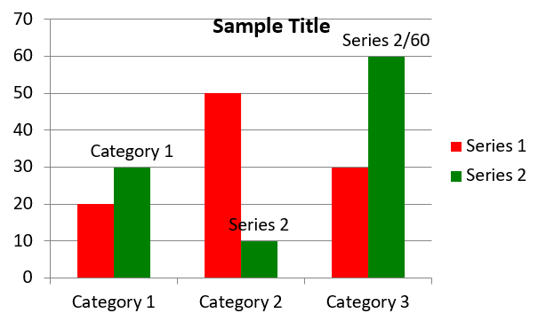

## **Översikt**

Denna artikel ger en omfattande guide om hur man skapar och anpassar diagram med Aspose.Slides för PHP via Java. Du kommer att lära dig hur du programatiskt lägger till ett diagram på en bild, fyller det med data och tillämpar olika formateringsalternativ för att matcha dina specifika designkrav. Genom artikeln illustreras varje steg med detaljerade kodexempel, från initiering av presentationen och diagramobjektet till konfiguration av serier, axlar och förklaringar. Genom att följa den här guiden får du en solid förståelse för hur du integrerar dynamisk diagramgenerering i dina PHP‑applikationer, vilket förenklar processen att skapa datadrivna presentationer.

## **Skapa ett diagram**

Diagram hjälper människor att snabbt visualisera data och få insikter som kanske inte är omedelbart uppenbara från en tabell eller kalkylblad.

**Varför skapa diagram?**

* samla, komprimera eller sammanfatta stora mängder data på en enda bild i en presentation;
* visa mönster och trender i data;
* avgöra riktning och momentum för data över tid eller i förhållande till en specifik måttenhet;
* identifiera avvikande värden, avvikelser, fel och meningslös data;
* kommunicera eller presentera komplex data.

I PowerPoint kan du skapa diagram via *Insert*-funktionen, som ger mallar för att utforma många typer av diagram. Med Aspose.Slides kan du skapa både vanliga diagram (baserade på populära diagramtyper) och anpassade diagram.

{}
Använd [ChartType](https://reference.aspose.com/slides/php-java/aspose.slides/charttype/) uppräkningen i [aspose\slides](https://reference.aspose.com/slides/php-java/aspose.slides/) namnrymden. Värdena i denna uppräkning motsvarar olika diagramtyper.
{}

### **Skapa grupperade stapeldiagram**

Det här exemplet använder [addChart](https://reference.aspose.com/slides/php-java/aspose.slides/shapecollection/addchart/) för att skapa ett grupperat stapeldiagram som jämför två serier över tre kategorier. Serierna använder röd och grön fyllning, och individuella etiketter visar kategorinamn, serienamn och värden. Kalkylbladsindex 0 hänvisar till det första bladet i den inbäddade diagramarbetsboken.

```php
use aspose\slides\ChartType;
use aspose\slides\FillType;
use aspose\slides\NullableBool;
use aspose\slides\Presentation;
use aspose\slides\SaveFormat;

$presentation = new Presentation();
try
{
    $slide = $presentation->getSlides()->get_Item(0);

    $chart = $slide->getShapes()->addChart(ChartType::ClusteredColumn, 20, 20, 500, 300);

    $chart->getChartTitle()->addTextFrameForOverriding("Sample Title");
    $chart->getChartTitle()->getTextFrameForOverriding()->getTextFrameFormat()->setCenterText(NullableBool::True);
    $chart->getChartTitle()->setHeight(20);
    $chart->setTitle(true);

    $workbook = $chart->getChartData()->getChartDataWorkbook();
    $worksheetIndex = 0;

    $chart->getChartData()->getSeries()->clear();
    $chart->getChartData()->getCategories()->clear();

    $seriesNameCell = $workbook->getCell($worksheetIndex, 0, 1, "Series 1");
    $chart->getChartData()->getSeries()->add($seriesNameCell, $chart->getType());
    $seriesNameCell = $workbook->getCell($worksheetIndex, 0, 2, "Series 2");
    $chart->getChartData()->getSeries()->add($seriesNameCell, $chart->getType());

    $categoryCell = $workbook->getCell($worksheetIndex, 1, 0, "Category 1");
    $chart->getChartData()->getCategories()->add($categoryCell);
    $categoryCell = $workbook->getCell($worksheetIndex, 2, 0, "Category 2");
    $chart->getChartData()->getCategories()->add($categoryCell);
    $categoryCell = $workbook->getCell($worksheetIndex, 3, 0, "Category 3");
    $chart->getChartData()->getCategories()->add($categoryCell);

    $series = $chart->getChartData()->getSeries()->get_Item(0);

    $valueCell = $workbook->getCell($worksheetIndex, 1, 1, 20);
    $series->getDataPoints()->addDataPointForBarSeries($valueCell);
    $valueCell = $workbook->getCell($worksheetIndex, 2, 1, 50);
    $series->getDataPoints()->addDataPointForBarSeries($valueCell);
    $valueCell = $workbook->getCell($worksheetIndex, 3, 1, 30);
    $series->getDataPoints()->addDataPointForBarSeries($valueCell);

    $series->getFormat()->getFill()->setFillType(FillType::Solid);
    $color = new Java("java.awt.Color", 255, 0, 0);
    $series->getFormat()->getFill()->getSolidFillColor()->setColor($color);

    $series = $chart->getChartData()->getSeries()->get_Item(1);

    $valueCell = $workbook->getCell($worksheetIndex, 1, 2, 30);
    $series->getDataPoints()->addDataPointForBarSeries($valueCell);
    $valueCell = $workbook->getCell($worksheetIndex, 2, 2, 10);
    $series->getDataPoints()->addDataPointForBarSeries($valueCell);
    $valueCell = $workbook->getCell($worksheetIndex, 3, 2, 60);
    $series->getDataPoints()->addDataPointForBarSeries($valueCell);

    $series->getFormat()->getFill()->setFillType(FillType::Solid);
    $color = new Java("java.awt.Color", 0, 128, 0);
    $series->getFormat()->getFill()->getSolidFillColor()->setColor($color);

    $label = $series->getDataPoints()->get_Item(0)->getLabel();
    $label->getDataLabelFormat()->setShowCategoryName(true);

    $label = $series->getDataPoints()->get_Item(1)->getLabel();
    $label->getDataLabelFormat()->setShowSeriesName(true);

    $label = $series->getDataPoints()->get_Item(2)->getLabel();
    $label->getDataLabelFormat()->setShowValue(true);
    $label->getDataLabelFormat()->setShowSeriesName(true);
    $label->getDataLabelFormat()->setSeparator("/");

    $presentation->save("AsposeChart.pptx", SaveFormat::Pptx);
}
finally
{
    $presentation->dispose();
}
```

Resultatet:



### **Skapa spridningsdiagram**

Spridningsdiagram (även kända som spridningsplot eller x‑y‑grafer) används ofta för att kontrollera mönster eller demonstrera korrelationer mellan två variabler.

Använd ett spridningsdiagram när:

* Du har parade numeriska data.
* Du har två variabler som passar bra ihop.
* Du vill avgöra om de två variablerna är relaterade.
* Du har en oberoende variabel som har flera värden för en beroende variabel.

Det här exemplet plottar två uppsättningar av x‑y‑värden. Den första serien använder raka linjer med stjärnmärken, medan den andra använder mjuka linjer med cirkelmärken; båda använder en markörstorlek på 10, konfigurerad med [setSize](https://reference.aspose.com/slides/php-java/aspose.slides/marker/setsize/). [setSymbol](https://reference.aspose.com/slides/php-java/aspose.slides/marker/setsymbol/)‑metoden styr markörformen.

```php
use aspose\slides\ChartType;
use aspose\slides\MarkerStyleType;
use aspose\slides\Presentation;
use aspose\slides\SaveFormat;

$presentation = new Presentation();
try
{
    $slide = $presentation->getSlides()->get_Item(0);

    $chart = $slide->getShapes()->addChart(ChartType::ScatterWithSmoothLines, 20, 20, 500, 300);

    $workbook = $chart->getChartData()->getChartDataWorkbook();
    $worksheetIndex = 0;

    $chart->getChartData()->getSeries()->clear();

    $seriesNameCell = $workbook->getCell($worksheetIndex, 1, 1, "Series 1");
    $chart->getChartData()->getSeries()->add($seriesNameCell, $chart->getType());
    $seriesNameCell = $workbook->getCell($worksheetIndex, 1, 3, "Series 2");
    $chart->getChartData()->getSeries()->add($seriesNameCell, $chart->getType());

    $series = $chart->getChartData()->getSeries()->get_Item(0);

    $xValueCell = $workbook->getCell($worksheetIndex, 2, 1, 1);
    $yValueCell = $workbook->getCell($worksheetIndex, 2, 2, 3);
    $series->getDataPoints()->addDataPointForScatterSeries($xValueCell, $yValueCell);

    $xValueCell = $workbook->getCell($worksheetIndex, 3, 1, 2);
    $yValueCell = $workbook->getCell($worksheetIndex, 3, 2, 10);
    $series->getDataPoints()->addDataPointForScatterSeries($xValueCell, $yValueCell);

    $series->setType(ChartType::ScatterWithStraightLinesAndMarkers);

    $series->getMarker()->setSize(10);
    $series->getMarker()->setSymbol(MarkerStyleType::Star);

    $series = $chart->getChartData()->getSeries()->get_Item(1);

    $xValueCell = $workbook->getCell($worksheetIndex, 2, 3, 5);
    $yValueCell = $workbook->getCell($worksheetIndex, 2, 4, 2);
    $series->getDataPoints()->addDataPointForScatterSeries($xValueCell, $yValueCell);

    $xValueCell = $workbook->getCell($worksheetIndex, 3, 3, 3);
    $yValueCell = $workbook->getCell($worksheetIndex, 3, 4, 1);
    $series->getDataPoints()->addDataPointForScatterSeries($xValueCell, $yValueCell);

    $xValueCell = $workbook->getCell($worksheetIndex, 4, 3, 2);
    $yValueCell = $workbook->getCell($worksheetIndex, 4, 4, 2);
    $series->getDataPoints()->addDataPointForScatterSeries($xValueCell, $yValueCell);

    $xValueCell = $workbook->getCell($worksheetIndex, 5, 3, 5);
    $yValueCell = $workbook->getCell($worksheetIndex, 5, 4, 1);
    $series->getDataPoints()->addDataPointForScatterSeries($xValueCell, $yValueCell);

    $series->getMarker()->setSize(10);
    $series->getMarker()->setSymbol(MarkerStyleType::Circle);

    $presentation->save("AsposeChart.pptx", SaveFormat::Pptx);
}
finally
{
    $presentation->dispose();
}
```

Resultatet:


### **Skapa cirkeldiagram**

Cirkeldiagram används bäst för att visa del‑till‑helhet‑förhållandet i data, särskilt när datan innehåller kategoriska etiketter med numeriska värden. Men om din data innehåller många delar eller etiketter kan det vara bättre att använda ett stapeldiagram istället.

Det här exemplet skapar ett cirkeldiagram med tre kvartalsvärden. Varje segment har en anpassad fyllning och kant, och etiketterna visar olika kombinationer av värden, procentandelar och serieinformation. Metoden [setFirstSliceAngle](https://reference.aspose.com/slides/php-java/aspose.slides/chartseriesgroup/setfirstsliceangle/) sätter det första segmentet att börja vid 180 grader.

```php
use aspose\slides\ChartType;
use aspose\slides\FillType;
use aspose\slides\LineDashStyle;
use aspose\slides\LineStyle;
use aspose\slides\NullableBool;
use aspose\slides\Presentation;
use aspose\slides\SaveFormat;

$presentation = new Presentation();
try
{
    $slide = $presentation->getSlides()->get_Item(0);

    $chart = $slide->getShapes()->addChart(ChartType::Pie, 20, 20, 500, 300);

    $chart->getChartTitle()->addTextFrameForOverriding("Sample Title");
    $chart->getChartTitle()->getTextFrameForOverriding()->getTextFrameFormat()->setCenterText(NullableBool::True);
    $chart->getChartTitle()->setHeight(20);
    $chart->setTitle(true);

    $chart->getChartData()->getSeries()->get_Item(0)->getLabels()->getDefaultDataLabelFormat()->setShowValue(true);

    $workbook = $chart->getChartData()->getChartDataWorkbook();
    $worksheetIndex = 0;

    $chart->getChartData()->getSeries()->clear();
    $chart->getChartData()->getCategories()->clear();

    $categoryCell = $workbook->getCell(0, 1, 0, "1st Qtr");
    $chart->getChartData()->getCategories()->add($categoryCell);
    $categoryCell = $workbook->getCell(0, 2, 0, "2nd Qtr");
    $chart->getChartData()->getCategories()->add($categoryCell);
    $categoryCell = $workbook->getCell(0, 3, 0, "3rd Qtr");
    $chart->getChartData()->getCategories()->add($categoryCell);

    $seriesNameCell = $workbook->getCell(0, 0, 1, "Series 1");
    $series = $chart->getChartData()->getSeries()->add($seriesNameCell, $chart->getType());

    $valueCell = $workbook->getCell($worksheetIndex, 1, 1, 20);
    $series->getDataPoints()->addDataPointForPieSeries($valueCell);
    $valueCell = $workbook->getCell($worksheetIndex, 2, 1, 50);
    $series->getDataPoints()->addDataPointForPieSeries($valueCell);
    $valueCell = $workbook->getCell($worksheetIndex, 3, 1, 30);
    $series->getDataPoints()->addDataPointForPieSeries($valueCell);

    $chart->getChartData()->getSeriesGroups()->get_Item(0)->setColorVaried(true);

    $firstSlice = $series->getDataPoints()->get_Item(0);
    $firstSlice->getFormat()->getFill()->setFillType(FillType::Solid);
    $color = new Java("java.awt.Color", 0, 255, 255);
    $firstSlice->getFormat()->getFill()->getSolidFillColor()->setColor($color);

    $firstSlice->getFormat()->getLine()->getFillFormat()->setFillType(FillType::Solid);
    $color = new Java("java.awt.Color", 128, 128, 128);
    $firstSlice->getFormat()->getLine()->getFillFormat()->getSolidFillColor()->setColor($color);
    $firstSlice->getFormat()->getLine()->setWidth(3.0);
    $firstSlice->getFormat()->getLine()->setStyle(LineStyle::ThinThick);
    $firstSlice->getFormat()->getLine()->setDashStyle(LineDashStyle::LargeDash);

    $secondSlice = $series->getDataPoints()->get_Item(1);
    $secondSlice->getFormat()->getFill()->setFillType(FillType::Solid);
    $color = new Java("java.awt.Color", 165, 42, 42);
    $secondSlice->getFormat()->getFill()->getSolidFillColor()->setColor($color);

    $secondSlice->getFormat()->getLine()->getFillFormat()->setFillType(FillType::Solid);
    $color = new Java("java.awt.Color", 0, 0, 255);
    $secondSlice->getFormat()->getLine()->getFillFormat()->getSolidFillColor()->setColor($color);
    $secondSlice->getFormat()->getLine()->setWidth(3.0);
    $secondSlice->getFormat()->getLine()->setStyle(LineStyle::Single);
    $secondSlice->getFormat()->getLine()->setDashStyle(LineDashStyle::LargeDashDot);

    $thirdSlice = $series->getDataPoints()->get_Item(2);
    $thirdSlice->getFormat()->getFill()->setFillType(FillType::Solid);
    $color = new Java("java.awt.Color", 255, 127, 80);
    $thirdSlice->getFormat()->getFill()->getSolidFillColor()->setColor($color);

    $thirdSlice->getFormat()->getLine()->getFillFormat()->setFillType(FillType::Solid);
    $color = new Java("java.awt.Color", 255, 0, 0);
    $thirdSlice->getFormat()->getLine()->getFillFormat()->getSolidFillColor()->setColor($color);
    $thirdSlice->getFormat()->getLine()->setWidth(2.0);
    $thirdSlice->getFormat()->getLine()->setStyle(LineStyle::ThinThin);
    $thirdSlice->getFormat()->getLine()->setDashStyle(LineDashStyle::LargeDashDotDot);

    $firstLabel = $series->getDataPoints()->get_Item(0)->getLabel();
    $firstLabel->getDataLabelFormat()->setShowValue(true);

    $secondLabel = $series->getDataPoints()->get_Item(1)->getLabel();
    $secondLabel->getDataLabelFormat()->setShowValue(true);
    $secondLabel->getDataLabelFormat()->setShowLegendKey(true);
    $secondLabel->getDataLabelFormat()->setShowPercentage(true);

    $thirdLabel = $series->getDataPoints()->get_Item(2)->getLabel();
    $thirdLabel->getDataLabelFormat()->setShowSeriesName(true);
    $thirdLabel->getDataLabelFormat()->setShowPercentage(true);

    $series->getLabels()->getDefaultDataLabelFormat()->setShowLeaderLines(true);

    $chart->getChartData()->getSeriesGroups()->get_Item(0)->setFirstSliceAngle(180);

    $presentation->save("PieChart.pptx", SaveFormat::Pptx);
}
finally
{
    $presentation->dispose();
}
```

Resultatet:


### **Skapa linjediagram**

Linjediagram (även kända som linjegrafer) används bäst i situationer där du vill demonstrera förändringar i värde över tid. Med ett linjediagram kan du jämföra en stor mängd data på en gång, spåra förändringar och trender över tid, markera avvikelser i dataserier och mer.

Det här exemplet använder [addChart](https://reference.aspose.com/slides/php-java/aspose.slides/shapecollection/addchart/) för att skapa ett linjediagram med standardserier och -kategorier, och sparar sedan presentationen som PPTX.

```php
use aspose\slides\ChartType;
use aspose\slides\Presentation;
use aspose\slides\SaveFormat;

$presentation = new Presentation();
try
{
    $slide = $presentation->getSlides()->get_Item(0);

    $lineChart = $slide->getShapes()->addChart(ChartType::Line, 20, 20, 500, 300);

    $presentation->save("lineChart.pptx", SaveFormat::Pptx);
}
finally
{
    $presentation->dispose();
}
```

Som standard förenas punkter i ett linjediagram med raka kontinuerliga linjer. Om du vill att punkterna ska förenas med streck istället, anropa [setDashStyle](https://reference.aspose.com/slides/php-java/aspose.slides/lineformat/setdashstyle/) med ett värde från [LineDashStyle](https://reference.aspose.com/slides/php-java/aspose.slides/linedashstyle/):

```php
use aspose\slides\ChartType;
use aspose\slides\LineDashStyle;
use aspose\slides\Presentation;

$presentation = new Presentation();
try
{
    $slide = $presentation->getSlides()->get_Item(0);

    $lineChart = $slide->getShapes()->addChart(ChartType::Line, 20, 20, 500, 300);

    for ($i = 0; $i < java_values($lineChart->getChartData()->getSeries()->size()); $i++)
    {
        $series = $lineChart->getChartData()->getSeries()->get_Item($i);
        $series->getFormat()->getLine()->setDashStyle(LineDashStyle::Dash);
    }
}
finally
{
    $presentation->dispose();
}
```

Resultatet:


### **Skapa trädkartsdiagram**

Trädkartsdiagram används bäst för försäljningsdata när du vill visa den relativa storleken på datakategorier och snabbt rikta uppmärksamheten mot poster som är stora bidragsgivare inom varje kategori.

Det här exemplet skapar ett trädkartsdiagram med åtta blad grupperade i fyra stammar och två grenar. Metoden [setGroupingItem](https://reference.aspose.com/slides/php-java/aspose.slides/chartcategorylevelsmanager/setgroupingitem/) tilldelar stammar på grupperingnivå 1 och grenar på nivå 2. Värdena bestämmer de relativa rektangelstorlekarna, medan kategorietiketter och överlappande förälderetiketter identifierar hierarkin.

```php
use aspose\slides\ChartType;
use aspose\slides\ParentLabelLayoutType;
use aspose\slides\Presentation;
use aspose\slides\SaveFormat;

$presentation = new Presentation();
try
{
    $slide = $presentation->getSlides()->get_Item(0);

    $chart = $slide->getShapes()->addChart(ChartType::Treemap, 20, 20, 500, 300);

    $chart->getChartData()->getCategories()->clear();
    $chart->getChartData()->getSeries()->clear();

    $workbook = $chart->getChartData()->getChartDataWorkbook();
    $workbook->clear(0);

    // Gren 1
    $categoryCell = $workbook->getCell(0, "C1", "Leaf1");
    $leaf = $chart->getChartData()->getCategories()->add($categoryCell);
    $leaf->getGroupingLevels()->setGroupingItem(1, "Stem1");
    $leaf->getGroupingLevels()->setGroupingItem(2, "Branch1");

    $categoryCell = $workbook->getCell(0, "C2", "Leaf2");
    $chart->getChartData()->getCategories()->add($categoryCell);

    $categoryCell = $workbook->getCell(0, "C3", "Leaf3");
    $leaf = $chart->getChartData()->getCategories()->add($categoryCell);
    $leaf->getGroupingLevels()->setGroupingItem(1, "Stem2");

    $categoryCell = $workbook->getCell(0, "C4", "Leaf4");
    $chart->getChartData()->getCategories()->add($categoryCell);

    // Gren 2
    $categoryCell = $workbook->getCell(0, "C5", "Leaf5");
    $leaf = $chart->getChartData()->getCategories()->add($categoryCell);
    $leaf->getGroupingLevels()->setGroupingItem(1, "Stem3");
    $leaf->getGroupingLevels()->setGroupingItem(2, "Branch2");

    $categoryCell = $workbook->getCell(0, "C6", "Leaf6");
    $chart->getChartData()->getCategories()->add($categoryCell);

    $categoryCell = $workbook->getCell(0, "C7", "Leaf7");
    $leaf = $chart->getChartData()->getCategories()->add($categoryCell);
    $leaf->getGroupingLevels()->setGroupingItem(1, "Stem4");

    $categoryCell = $workbook->getCell(0, "C8", "Leaf8");
    $chart->getChartData()->getCategories()->add($categoryCell);

    $series = $chart->getChartData()->getSeries()->add(ChartType::Treemap);
    $series->getLabels()->getDefaultDataLabelFormat()->setShowCategoryName(true);
    $valueCell = $workbook->getCell(0, "D1", 4);
    $series->getDataPoints()->addDataPointForTreemapSeries($valueCell);
    $valueCell = $workbook->getCell(0, "D2", 5);
    $series->getDataPoints()->addDataPointForTreemapSeries($valueCell);
    $valueCell = $workbook->getCell(0, "D3", 3);
    $series->getDataPoints()->addDataPointForTreemapSeries($valueCell);
    $valueCell = $workbook->getCell(0, "D4", 6);
    $series->getDataPoints()->addDataPointForTreemapSeries($valueCell);
    $valueCell = $workbook->getCell(0, "D5", 9);
    $series->getDataPoints()->addDataPointForTreemapSeries($valueCell);
    $valueCell = $workbook->getCell(0, "D6", 9);
    $series->getDataPoints()->addDataPointForTreemapSeries($valueCell);
    $valueCell = $workbook->getCell(0, "D7", 4);
    $series->getDataPoints()->addDataPointForTreemapSeries($valueCell);
    $valueCell = $workbook->getCell(0, "D8", 3);
    $series->getDataPoints()->addDataPointForTreemapSeries($valueCell);

    $series->setParentLabelLayout(ParentLabelLayoutType::Overlapping);

    $presentation->save("Treemap.pptx", SaveFormat::Pptx);
}
finally
{
    $presentation->dispose();
}
```

Resultatet:


### **Skapa waterfall-diagram**

Ett waterfall-diagram visar hur positiva och negativa förändringar bidrar till ett slutligt värde. Till exempel kan en vinstuppdelning börja med intäkt, dra av kostnader och lägga till annan inkomst. Ändringskolumner svävar mellan föregående och nya löpande värden, medan totalkolumner sträcker sig från noll till det ackumulerade värdet.

| Kategori | Arbetsboksvärde | Kolumntyp |
| --- | ---: | --- |
| Intäkt | 1000 | Ökning |
| Försäljningskostnad | -400 | Minskning |
| Bruttoresultat | 600 | Mellanliggande total |
| Rörelsekostnader | -200 | Minskning |
| Övriga intäkter | 50 | Ökning |
| Nettoresultat | 450 | Slutlig total |

För att markera en punkt som en mellanliggande eller slutlig total, anropa dess [setSetAsTotal](https://reference.aspose.com/slides/php-java/aspose.slides/chartdatapoint/setsetastotal/)‑metod med `true`. Ange det faktiska ackumulerade beloppet i punktens arbetsbokscell: `600` för bruttoresultat (`1000 - 400`) och `450` för nettoresultat (`600 - 200 + 50`). Metoden markerar kolumnen som en total; den beräknar eller fyller inte i cellvärdet. Använd inte noll som platshållare eller ange en annan förändring för en totalpunkt. En totalkolumn visar det ackumulerade värdet utan att lägga till det igen i det löpande värdet.

Detta kompletta PHP‑exempel skapar ett diagram med `Waterfall`‑medlemmen i [ChartType](https://reference.aspose.com/slides/php-java/aspose.slides/charttype/), rensar standarddata och fyller den inbäddade arbetsboken. Kalkylbladsindex `0` väljer det första kalkylbladet; kolumn A innehåller kategorinamnen och kolumn B innehåller värdena. Varje värdecell läggs till med [addDataPointForWaterfallSeries](https://reference.aspose.com/slides/php-java/aspose.slides/chartdatapointcollection/adddatapointforwaterfallseries/). Indextalen `2` och `5` identifierar de mellanliggande respektive slutliga totalerna. Att anropa [setShowValue](https://reference.aspose.com/slides/php-java/aspose.slides/datalabelformat/setshowvalue/) med `true` visar beloppen på kolumnerna. Ingen inmatningspresentation eller arbetsbok krävs.

```php
use aspose\slides\ChartType;
use aspose\slides\Presentation;
use aspose\slides\SaveFormat;

$presentation = new Presentation();
try
{
    $slide = $presentation->getSlides()->get_Item(0);

    $chart = $slide->getShapes()->addChart(ChartType::Waterfall, 20, 20, 680, 200);

    $chart->setTitle(true);
    $chart->getChartTitle()->addTextFrameForOverriding("Profit breakdown (USD thousands)");
    $chart->getChartTitle()->setOverlay(false);
    $chart->setLegend(false);

    $chart->getChartData()->getSeries()->clear();
    $chart->getChartData()->getCategories()->clear();

    $workbook = $chart->getChartData()->getChartDataWorkbook();
    $worksheetIndex = 0;

    $workbook->clear($worksheetIndex);

    $seriesNameCell = $workbook->getCell($worksheetIndex, 0, 1, "Profit");
    $series = $chart->getChartData()->getSeries()->add($seriesNameCell, ChartType::Waterfall);
    $categories = [ "Revenue", "Cost of sales", "Gross profit", "Operating expenses", "Other income", "Net profit" ];
    $values = [ 1000, -400, 600, -200, 50, 450 ];

    for ($i = 0; $i < count($categories); $i++)
    {
        $categoryCell = $workbook->getCell($worksheetIndex, $i + 1, 0, $categories[$i]);
        $chart->getChartData()->getCategories()->add($categoryCell);
        $valueCell = $workbook->getCell($worksheetIndex, $i + 1, 1, $values[$i]);
        $series->getDataPoints()->addDataPointForWaterfallSeries($valueCell);
    }

    // Den tredje och den sjätte punkten representerar totaler, inte ytterligare förändringar.
    $series->getDataPoints()->get_Item(2)->setSetAsTotal(true);
    $series->getDataPoints()->get_Item(5)->setSetAsTotal(true);
    $series->setShowConnectorLines(true);
    $series->getLabels()->getDefaultDataLabelFormat()->setShowValue(true);

    $presentation->save("WaterfallChart.pptx", SaveFormat::Pptx);
}
finally
{
    $presentation->dispose();
}
```

Anropa serie‑nivåns [setShowConnectorLines](https://reference.aspose.com/slides/php-java/aspose.slides/chartseries/setshowconnectorlines/)‑metod med `true` för att visa linjer som kopplar samman staplar och underlätta spårning av det löpande värdet. För att dölja dessa linjer, ersätt metodanropet i exemplet med `$series->setShowConnectorLines(false);` innan sparning. Detta ändrar endast linjens synlighet, inte data eller totaler.

Resultatet:


### **Skapa aktiediagram**

Aktiediagram används för att visa finansiella data såsom öppnings-, högsta-, lägsta- och stängningspriser, vilket underlättar analys av marknadstrender och volatilitet. De ger viktig insikt i aktiens prestation och hjälper investerare och analytiker att fatta välgrundade beslut.

Det här exemplet skapar ett öppnings‑högsta‑lägsta‑stängnings‑diagram med fyra serier i den ordningen och tre kategorier. Metoden [setUpDownBars](https://reference.aspose.com/slides/php-java/aspose.slides/updownbarsmanager/setupdownbars/) aktiverar upp/ner‑staplar, och [getHiLowLinesFormat](https://reference.aspose.com/slides/php-java/aspose.slides/chartseriesgroup/gethilowlinesformat/) styr hög‑läg‑linjerna som visar prisintervallen, medan enskilda serielinjer och mindre horisontella rutnätlinjer döljs.

```php
use aspose\slides\ChartType;
use aspose\slides\FillType;
use aspose\slides\Presentation;
use aspose\slides\SaveFormat;

$presentation = new Presentation();
try
{
    $slide = $presentation->getSlides()->get_Item(0);

    $chart = $slide->getShapes()->addChart(ChartType::OpenHighLowClose, 20, 20, 500, 300, false);

    $workbook = $chart->getChartData()->getChartDataWorkbook();

    $categoryCell = $workbook->getCell(0, 1, 0, "A");
    $chart->getChartData()->getCategories()->add($categoryCell);
    $categoryCell = $workbook->getCell(0, 2, 0, "B");
    $chart->getChartData()->getCategories()->add($categoryCell);
    $categoryCell = $workbook->getCell(0, 3, 0, "C");
    $chart->getChartData()->getCategories()->add($categoryCell);

    $seriesNameCell = $workbook->getCell(0, 0, 1, "Open");
    $chart->getChartData()->getSeries()->add($seriesNameCell, ChartType::OpenHighLowClose);
    $seriesNameCell = $workbook->getCell(0, 0, 2, "High");
    $chart->getChartData()->getSeries()->add($seriesNameCell, ChartType::OpenHighLowClose);
    $seriesNameCell = $workbook->getCell(0, 0, 3, "Low");
    $chart->getChartData()->getSeries()->add($seriesNameCell, ChartType::OpenHighLowClose);
    $seriesNameCell = $workbook->getCell(0, 0, 4, "Close");
    $chart->getChartData()->getSeries()->add($seriesNameCell, ChartType::OpenHighLowClose);

    $series = $chart->getChartData()->getSeries()->get_Item(0);
    $valueCell = $workbook->getCell(0, 1, 1, 72);
    $series->getDataPoints()->addDataPointForStockSeries($valueCell);
    $valueCell = $workbook->getCell(0, 2, 1, 25);
    $series->getDataPoints()->addDataPointForStockSeries($valueCell);
    $valueCell = $workbook->getCell(0, 3, 1, 38);
    $series->getDataPoints()->addDataPointForStockSeries($valueCell);

    $series = $chart->getChartData()->getSeries()->get_Item(1);
    $valueCell = $workbook->getCell(0, 1, 2, 172);
    $series->getDataPoints()->addDataPointForStockSeries($valueCell);
    $valueCell = $workbook->getCell(0, 2, 2, 57);
    $series->getDataPoints()->addDataPointForStockSeries($valueCell);
    $valueCell = $workbook->getCell(0, 3, 2, 57);
    $series->getDataPoints()->addDataPointForStockSeries($valueCell);

    $series = $chart->getChartData()->getSeries()->get_Item(2);
    $valueCell = $workbook->getCell(0, 1, 3, 12);
    $series->getDataPoints()->addDataPointForStockSeries($valueCell);
    $valueCell = $workbook->getCell(0, 2, 3, 12);
    $series->getDataPoints()->addDataPointForStockSeries($valueCell);
    $valueCell = $workbook->getCell(0, 3, 3, 13);
    $series->getDataPoints()->addDataPointForStockSeries($valueCell);

    $series = $chart->getChartData()->getSeries()->get_Item(3);
    $valueCell = $workbook->getCell(0, 1, 4, 25);
    $series->getDataPoints()->addDataPointForStockSeries($valueCell);
    $valueCell = $workbook->getCell(0, 2, 4, 38);
    $series->getDataPoints()->addDataPointForStockSeries($valueCell);
    $valueCell = $workbook->getCell(0, 3, 4, 50);
    $series->getDataPoints()->addDataPointForStockSeries($valueCell);

    $chart->getChartData()->getSeriesGroups()->get_Item(0)->getUpDownBars()->setUpDownBars(true);
    $chart->getChartData()->getSeriesGroups()->get_Item(0)->getHiLowLinesFormat()->getLine()->getFillFormat()->setFillType(FillType::Solid);

    for ($i = 0; $i < java_values($chart->getChartData()->getSeries()->size()); $i++)
    {
        $stockSeries = $chart->getChartData()->getSeries()->get_Item($i);
        $stockSeries->getFormat()->getLine()->getFillFormat()->setFillType(FillType::NoFill);
    }

    $chart->getAxes()->getVerticalAxis()->getMinorGridLinesFormat()->getLine()->getFillFormat()->setFillType(FillType::NoFill);

    $presentation->save("Stock-chart.pptx", SaveFormat::Pptx);
}
finally
{
    $presentation->dispose();
}
```

Resultatet:


### **Skapa låddiagram**

Låddiagram används för att visa fördelningen av data genom att sammanfatta nyckelstatistiska mått, såsom median, kvartiler och potentiella avvikare. De är särskilt användbara i utforskande dataanalys och statistiska studier för att snabbt förstå datavariabilitet och identifiera avvikelser.

Det här exemplet skapar ett låddiagram från sex värden. Metoden [setQuartileMethod](https://reference.aspose.com/slides/php-java/aspose.slides/chartseries/setquartilemethod/) väljer den exklusiva kvartilberäkningen. Exemplet aktiverar också medellinjer, medelmarkörer, inre punkter och avvikelser.

```php
use aspose\slides\ChartType;
use aspose\slides\Presentation;
use aspose\slides\QuartileMethodType;
use aspose\slides\SaveFormat;

$presentation = new Presentation();
try
{
    $slide = $presentation->getSlides()->get_Item(0);

    $chart = $slide->getShapes()->addChart(ChartType::BoxAndWhisker, 20, 20, 500, 300);

    $chart->getChartData()->getCategories()->clear();
    $chart->getChartData()->getSeries()->clear();

    $workbook = $chart->getChartData()->getChartDataWorkbook();
    $workbook->clear(0);

    $categoryCell = $workbook->getCell(0, "A1", "Category 1");
    $chart->getChartData()->getCategories()->add($categoryCell);
    $categoryCell = $workbook->getCell(0, "A2", "Category 2");
    $chart->getChartData()->getCategories()->add($categoryCell);
    $categoryCell = $workbook->getCell(0, "A3", "Category 3");
    $chart->getChartData()->getCategories()->add($categoryCell);
    $categoryCell = $workbook->getCell(0, "A4", "Category 4");
    $chart->getChartData()->getCategories()->add($categoryCell);
    $categoryCell = $workbook->getCell(0, "A5", "Category 5");
    $chart->getChartData()->getCategories()->add($categoryCell);
    $categoryCell = $workbook->getCell(0, "A6", "Category 6");
    $chart->getChartData()->getCategories()->add($categoryCell);

    $series = $chart->getChartData()->getSeries()->add(ChartType::BoxAndWhisker);

    $series->setQuartileMethod(QuartileMethodType::Exclusive);
    $series->setShowMeanLine(true);
    $series->setShowMeanMarkers(true);
    $series->setShowInnerPoints(true);
    $series->setShowOutlierPoints(true);

    $valueCell = $workbook->getCell(0, "B1", 15);
    $series->getDataPoints()->addDataPointForBoxAndWhiskerSeries($valueCell);
    $valueCell = $workbook->getCell(0, "B2", 41);
    $series->getDataPoints()->addDataPointForBoxAndWhiskerSeries($valueCell);
    $valueCell = $workbook->getCell(0, "B3", 16);
    $series->getDataPoints()->addDataPointForBoxAndWhiskerSeries($valueCell);
    $valueCell = $workbook->getCell(0, "B4", 10);
    $series->getDataPoints()->addDataPointForBoxAndWhiskerSeries($valueCell);
    $valueCell = $workbook->getCell(0, "B5", 23);
    $series->getDataPoints()->addDataPointForBoxAndWhiskerSeries($valueCell);
    $valueCell = $workbook->getCell(0, "B6", 16);
    $series->getDataPoints()->addDataPointForBoxAndWhiskerSeries($valueCell);

    $presentation->save("BoxAndWhisker.pptx", SaveFormat::Pptx);
}
finally
{
    $presentation->dispose();
}
```

### **Skapa trattdiagram**

Trattdiagram används för att visualisera processer som involverar sekventiella steg, där datavolymen minskar när den fortskrider från ett steg till nästa. De är särskilt hjälpsamma för att analysera konverteringsgrader, identifiera flaskhalsar och spåra effektiviteten i försäljnings‑ eller marknadsföringsprocesser.

Detta exempel använder [addChart](https://reference.aspose.com/slides/php-java/aspose.slides/shapecollection/addchart/) för att lägga till ett trattdiagram på den första bilden i en befintlig presentation. Det ersätter standarddata med sex kategorier och värden som sträcker sig från 50 till 500 och sparar sedan den uppdaterade presentationen. Inmatningspresentationen måste innehålla minst en bild.

```php
use aspose\slides\ChartType;
use aspose\slides\Presentation;
use aspose\slides\SaveFormat;

$presentation = new Presentation("test.pptx");
try
{
    $slide = $presentation->getSlides()->get_Item(0);

    $chart = $slide->getShapes()->addChart(ChartType::Funnel, 50, 50, 500, 400);

    $chart->getChartData()->getCategories()->clear();
    $chart->getChartData()->getSeries()->clear();

    $workbook = $chart->getChartData()->getChartDataWorkbook();
    $workbook->clear(0);

    $categoryCell = $workbook->getCell(0, "A1", "Category 1");
    $chart->getChartData()->getCategories()->add($categoryCell);
    $categoryCell = $workbook->getCell(0, "A2", "Category 2");
    $chart->getChartData()->getCategories()->add($categoryCell);
    $categoryCell = $workbook->getCell(0, "A3", "Category 3");
    $chart->getChartData()->getCategories()->add($categoryCell);
    $categoryCell = $workbook->getCell(0, "A4", "Category 4");
    $chart->getChartData()->getCategories()->add($categoryCell);
    $categoryCell = $workbook->getCell(0, "A5", "Category 5");
    $chart->getChartData()->getCategories()->add($categoryCell);
    $categoryCell = $workbook->getCell(0, "A6", "Category 6");
    $chart->getChartData()->getCategories()->add($categoryCell);

    $series = $chart->getChartData()->getSeries()->add(ChartType::Funnel);

    $valueCell = $workbook->getCell(0, "B1", 50);
    $series->getDataPoints()->addDataPointForFunnelSeries($valueCell);
    $valueCell = $workbook->getCell(0, "B2", 100);
    $series->getDataPoints()->addDataPointForFunnelSeries($valueCell);
    $valueCell = $workbook->getCell(0, "B3", 200);
    $series->getDataPoints()->addDataPointForFunnelSeries($valueCell);
    $valueCell = $workbook->getCell(0, "B4", 300);
    $series->getDataPoints()->addDataPointForFunnelSeries($valueCell);
    $valueCell = $workbook->getCell(0, "B5", 400);
    $series->getDataPoints()->addDataPointForFunnelSeries($valueCell);
    $valueCell = $workbook->getCell(0, "B6", 500);
    $series->getDataPoints()->addDataPointForFunnelSeries($valueCell);

    $presentation->save("Funnel.pptx", SaveFormat::Pptx);
}
finally
{
    $presentation->dispose();
}
```

Resultatet:


### **Skapa soluppgångsdiagram**

Soluppgångsdiagram används för att visualisera hierarkiska data, där nivåer visas som koncentriska ringar. De hjälper till att illustrera del‑till‑helhet‑relationer och är idealiska för att representera inbäddade kategorier och underkategorier i ett tydligt, kompakt format.

Det här exemplet skapar ett soluppgångsdiagram med åtta blad grupperade i fyra stammar och två grenar. Metoden [setGroupingItem](https://reference.aspose.com/slides/php-java/aspose.slides/chartcategorylevelsmanager/setgroupingitem/) tilldelar stammar på grupperingnivå 1 och grenar på nivå 2. Kategorietiketter identifierar segmenten, och värdena bestämmer deras relativa storlek.

```php
use aspose\slides\ChartType;
use aspose\slides\Presentation;
use aspose\slides\SaveFormat;

$presentation = new Presentation();
try
{
    $slide = $presentation->getSlides()->get_Item(0);

    $chart = $slide->getShapes()->addChart(ChartType::Sunburst, 20, 20, 500, 300);

    $chart->getChartData()->getCategories()->clear();
    $chart->getChartData()->getSeries()->clear();

    $workbook = $chart->getChartData()->getChartDataWorkbook();
    $workbook->clear(0);

    // Gren 1
    $categoryCell = $workbook->getCell(0, "C1", "Leaf1");
    $leaf = $chart->getChartData()->getCategories()->add($categoryCell);
    $leaf->getGroupingLevels()->setGroupingItem(1, "Stem1");
    $leaf->getGroupingLevels()->setGroupingItem(2, "Branch1");

    $categoryCell = $workbook->getCell(0, "C2", "Leaf2");
    $chart->getChartData()->getCategories()->add($categoryCell);

    $categoryCell = $workbook->getCell(0, "C3", "Leaf3");
    $leaf = $chart->getChartData()->getCategories()->add($categoryCell);
    $leaf->getGroupingLevels()->setGroupingItem(1, "Stem2");

    $categoryCell = $workbook->getCell(0, "C4", "Leaf4");
    $chart->getChartData()->getCategories()->add($categoryCell);

    // Gren 2
    $categoryCell = $workbook->getCell(0, "C5", "Leaf5");
    $leaf = $chart->getChartData()->getCategories()->add($categoryCell);
    $leaf->getGroupingLevels()->setGroupingItem(1, "Stem3");
    $leaf->getGroupingLevels()->setGroupingItem(2, "Branch2");

    $categoryCell = $workbook->getCell(0, "C6", "Leaf6");
    $chart->getChartData()->getCategories()->add($categoryCell);

    $categoryCell = $workbook->getCell(0, "C7", "Leaf7");
    $leaf = $chart->getChartData()->getCategories()->add($categoryCell);
    $leaf->getGroupingLevels()->setGroupingItem(1, "Stem4");

    $categoryCell = $workbook->getCell(0, "C8", "Leaf8");
    $chart->getChartData()->getCategories()->add($categoryCell);

    $series = $chart->getChartData()->getSeries()->add(ChartType::Sunburst);
    $series->getLabels()->getDefaultDataLabelFormat()->setShowCategoryName(true);
    $valueCell = $workbook->getCell(0, "D1", 4);
    $series->getDataPoints()->addDataPointForSunburstSeries($valueCell);
    $valueCell = $workbook->getCell(0, "D2", 5);
    $series->getDataPoints()->addDataPointForSunburstSeries($valueCell);
    $valueCell = $workbook->getCell(0, "D3", 3);
    $series->getDataPoints()->addDataPointForSunburstSeries($valueCell);
    $valueCell = $workbook->getCell(0, "D4", 6);
    $series->getDataPoints()->addDataPointForSunburstSeries($valueCell);
    $valueCell = $workbook->getCell(0, "D5", 9);
    $series->getDataPoints()->addDataPointForSunburstSeries($valueCell);
    $valueCell = $workbook->getCell(0, "D6", 9);
    $series->getDataPoints()->addDataPointForSunburstSeries($valueCell);
    $valueCell = $workbook->getCell(0, "D7", 4);
    $series->getDataPoints()->addDataPointForSunburstSeries($valueCell);
    $valueCell = $workbook->getCell(0, "D8", 3);
    $series->getDataPoints()->addDataPointForSunburstSeries($valueCell);

    $presentation->save("Sunburst.pptx", SaveFormat::Pptx);
}
finally
{
    $presentation->dispose();
}
```

Resultatet:


### **Skapa histogramdiagram**

Histogramdiagram används för att representera fördelningen av numerisk data genom att gruppera värden i intervall eller fack. De är särskilt användbara för att identifiera mönster som frekvens, skevhet och spridning samt för att upptäcka avvikelser i en dataset.

Det här exemplet skapar ett histogram från sex numeriska värden, inklusive negativa värden. Att anropa [setAggregationType](https://reference.aspose.com/slides/php-java/aspose.slides/axis/setaggregationtype/) med den automatiska aggregationstypen låter diagrammet bestämma vilka fack som ska visas för att illustrera fördelningen.

```php
use aspose\slides\AxisAggregationType;
use aspose\slides\ChartType;
use aspose\slides\Presentation;
use aspose\slides\SaveFormat;

$presentation = new Presentation();
try
{
    $slide = $presentation->getSlides()->get_Item(0);

    $chart = $slide->getShapes()->addChart(ChartType::Histogram, 20, 20, 500, 300);

    $chart->getChartData()->getCategories()->clear();
    $chart->getChartData()->getSeries()->clear();

    $workbook = $chart->getChartData()->getChartDataWorkbook();
    $workbook->clear(0);

    $series = $chart->getChartData()->getSeries()->add(ChartType::Histogram);
    $valueCell = $workbook->getCell(0, "A1", 15);
    $series->getDataPoints()->addDataPointForHistogramSeries($valueCell);
    $valueCell = $workbook->getCell(0, "A2", -41);
    $series->getDataPoints()->addDataPointForHistogramSeries($valueCell);
    $valueCell = $workbook->getCell(0, "A3", 16);
    $series->getDataPoints()->addDataPointForHistogramSeries($valueCell);
    $valueCell = $workbook->getCell(0, "A4", 10);
    $series->getDataPoints()->addDataPointForHistogramSeries($valueCell);
    $valueCell = $workbook->getCell(0, "A5", -23);
    $series->getDataPoints()->addDataPointForHistogramSeries($valueCell);
    $valueCell = $workbook->getCell(0, "A6", 16);
    $series->getDataPoints()->addDataPointForHistogramSeries($valueCell);

    $chart->getAxes()->getHorizontalAxis()->setAggregationType(AxisAggregationType::Automatic);

    $presentation->save("Histogram.pptx", SaveFormat::Pptx);
}
finally
{
    $presentation->dispose();
}
```

Resultatet:


### **Skapa radardiagram**

Radardiagram används för att visa multivariata data i ett tvådimensionellt format, vilket möjliggör enkel jämförelse av flera variabler samtidigt. De är särskilt användbara för att identifiera mönster, styrkor och svagheter över flera prestationsmått eller egenskaper.

Det här exemplet använder [addChart](https://reference.aspose.com/slides/php-java/aspose.slides/shapecollection/addchart/) för att skapa ett radardiagram med standardserier och -kategorier, och sparar sedan presentationen som PPTX.

```php
use aspose\slides\ChartType;
use aspose\slides\Presentation;
use aspose\slides\SaveFormat;

$presentation = new Presentation();
try
{
    $slide = $presentation->getSlides()->get_Item(0);

    $slide->getShapes()->addChart(ChartType::Radar, 20, 20, 500, 300);

    $presentation->save("Radar-chart.pptx", SaveFormat::Pptx);
}
finally
{
    $presentation->dispose();
}
```

Resultatet:


### **Skapa flerkategoridiagram**

Flerkategoridiagram används för att visa data som involverar mer än en kategorisk gruppering, så att du kan jämföra värden över flera dimensioner samtidigt. De är särskilt hjälpsamma när du behöver analysera trender och samband i komplexa, flerskiktsdatamängder.

Det här exemplet skapar ett grupperat stapeldiagram med åtta kategorier arrangerade i fyra par. Metoden [setGroupingItem](https://reference.aspose.com/slides/php-java/aspose.slides/chartcategorylevelsmanager/setgroupingitem/) ger varje par en gemensam etikett på grupperingnivå 1, vilket ger en kategoriaxel med både individuella och gruppetiketter.

```php
use aspose\slides\ChartType;
use aspose\slides\Presentation;
use aspose\slides\SaveFormat;

$presentation = new Presentation();
try
{
    $slide = $presentation->getSlides()->get_Item(0);

    $chart = $slide->getShapes()->addChart(ChartType::ClusteredColumn, 20, 20, 500, 300);

    $chart->getChartData()->getSeries()->clear();
    $chart->getChartData()->getCategories()->clear();

    $workbook = $chart->getChartData()->getChartDataWorkbook();
    $workbook->clear(0);

    $worksheetIndex = 0;

    $categoryCell = $workbook->getCell(0, "c2", "A");
    $category = $chart->getChartData()->getCategories()->add($categoryCell);
    $category->getGroupingLevels()->setGroupingItem(1, "Group1");
    $categoryCell = $workbook->getCell(0, "c3", "B");
    $category = $chart->getChartData()->getCategories()->add($categoryCell);

    $categoryCell = $workbook->getCell(0, "c4", "C");
    $category = $chart->getChartData()->getCategories()->add($categoryCell);
    $category->getGroupingLevels()->setGroupingItem(1, "Group2");
    $categoryCell = $workbook->getCell(0, "c5", "D");
    $category = $chart->getChartData()->getCategories()->add($categoryCell);

    $categoryCell = $workbook->getCell(0, "c6", "E");
    $category = $chart->getChartData()->getCategories()->add($categoryCell);
    $category->getGroupingLevels()->setGroupingItem(1, "Group3");
    $categoryCell = $workbook->getCell(0, "c7", "F");
    $category = $chart->getChartData()->getCategories()->add($categoryCell);

    $categoryCell = $workbook->getCell(0, "c8", "G");
    $category = $chart->getChartData()->getCategories()->add($categoryCell);
    $category->getGroupingLevels()->setGroupingItem(1, "Group4");
    $categoryCell = $workbook->getCell(0, "c9", "H");
    $category = $chart->getChartData()->getCategories()->add($categoryCell);

    $seriesNameCell = $workbook->getCell(0, "D1", "Series 1");
    $series = $chart->getChartData()->getSeries()->add($seriesNameCell, ChartType::ClusteredColumn);

    $valueCell = $workbook->getCell($worksheetIndex, "D2", 10);
    $series->getDataPoints()->addDataPointForBarSeries($valueCell);
    $valueCell = $workbook->getCell($worksheetIndex, "D3", 20);
    $series->getDataPoints()->addDataPointForBarSeries($valueCell);
    $valueCell = $workbook->getCell($worksheetIndex, "D4", 30);
    $series->getDataPoints()->addDataPointForBarSeries($valueCell);
    $valueCell = $workbook->getCell($worksheetIndex, "D5", 40);
    $series->getDataPoints()->addDataPointForBarSeries($valueCell);
    $valueCell = $workbook->getCell($worksheetIndex, "D6", 50);
    $series->getDataPoints()->addDataPointForBarSeries($valueCell);
    $valueCell = $workbook->getCell($worksheetIndex, "D7", 60);
    $series->getDataPoints()->addDataPointForBarSeries($valueCell);
    $valueCell = $workbook->getCell($worksheetIndex, "D8", 70);
    $series->getDataPoints()->addDataPointForBarSeries($valueCell);
    $valueCell = $workbook->getCell($worksheetIndex, "D9", 80);
    $series->getDataPoints()->addDataPointForBarSeries($valueCell);

    $presentation->save("AsposeChart.pptx", SaveFormat::Pptx);
}
finally
{
    $presentation->dispose();
}
```

Resultatet:


### **Skapa kartdiagram**

Kartdiagram används för att visualisera geografiska data genom att kartlägga information till specifika platser såsom länder, delstater eller städer. De är särskilt användbara för att analysera regionala trender, demografiska data och rumsliga fördelningar på ett tydligt och visuellt engagerande sätt.

Det här exemplet använder [addChart](https://reference.aspose.com/slides/php-java/aspose.slides/shapecollection/addchart/) för att skapa ett kartdiagram med standardgeografisk data och sparar det för visning i PowerPoint.

```php
use aspose\slides\ChartType;
use aspose\slides\Presentation;
use aspose\slides\SaveFormat;

$presentation = new Presentation();
try
{
    $slide = $presentation->getSlides()->get_Item(0);

    $chart = $slide->getShapes()->addChart(ChartType::Map, 20, 20, 500, 300);

    $presentation->save("mapChart.pptx", SaveFormat::Pptx);
}
finally
{
    $presentation->dispose();
}
```

Resultatet:


{}
Bilden ovan visar den sparade presentationen öppnad i PowerPoint. Aspose.Slides skriver kartdiagrammet och dess data korrekt, men det ritar inte själva kartdiagrammen: när en bild som innehåller ett sådant renderas till en bild eller konverteras till PDF eller SVG blir diagramområdet tomt. Andra former på samma bild påverkas inte.
{}

### **Skapa kombinationsdiagram**

Ett kombinationsdiagram (eller combo‑diagram) kombinerar två eller fler diagramtyper i ett enda diagram. Detta diagram låter dig framhäva, jämföra eller undersöka skillnader mellan två eller fler dataset, vilket hjälper dig att identifiera relationer mellan dem.


Detta exempel kombinerar två grupperade stapelserier med en linjeserie över fyra kategorier. Staplarna använder den primära vertikala axeln, medan [setPlotOnSecondAxis](https://reference.aspose.com/slides/php-java/aspose.slides/chartseries/setplotonsecondaxis/) placerar linjen på en sekundär vertikal axel till höger. Hjälpfunktionerna konfigurerar titel, legend, axelrubriker och rutnätlinjer.

```php
use aspose\slides\AxisPositionType;
use aspose\slides\ChartType;
use aspose\slides\CrossesType;
use aspose\slides\FillType;
use aspose\slides\LegendPositionType;
use aspose\slides\NullableBool;
use aspose\slides\Presentation;
use aspose\slides\SaveFormat;

function createComboChart()
{
    $presentation = new Presentation();
    try
    {
        $chart = createChartWithFirstSeries($presentation->getSlides()->get_Item(0));

        addSecondSeriesToChart($chart);
        addThirdSeriesToChart($chart);

        setPrimaryAxesFormat($chart);
        setSecondaryAxesFormat($chart);

        $presentation->save("combo-chart.pptx", SaveFormat::Pptx);
    }
    finally
    {
        $presentation->dispose();
    }
}

function createChartWithFirstSeries($slide)
{
    $chart = $slide->getShapes()->addChart(ChartType::ClusteredColumn, 50, 50, 600, 400);

    $chart->setTitle(true);
    $chart->getChartTitle()->addTextFrameForOverriding("Chart Title");
    $chart->getChartTitle()->setOverlay(false);
    $portionFormat = $chart->getChartTitle()->getTextFrameForOverriding()->getParagraphs()->get_Item(0)->getParagraphFormat()->getDefaultPortionFormat();
    $portionFormat->setFontBold(NullableBool::False);
    $portionFormat->setFontHeight(18);

    $chart->getLegend()->setPosition(LegendPositionType::Bottom);
    $chart->getLegend()->getTextFormat()->getPortionFormat()->setFontHeight(12);

    $chart->getChartData()->getSeries()->clear();
    $chart->getChartData()->getCategories()->clear();

    $workbook = $chart->getChartData()->getChartDataWorkbook();
    $worksheetIndex = 0;

    $categoryCell = $workbook->getCell($worksheetIndex, 1, 0, "Category 1");
    $chart->getChartData()->getCategories()->add($categoryCell);
    $categoryCell = $workbook->getCell($worksheetIndex, 2, 0, "Category 2");
    $chart->getChartData()->getCategories()->add($categoryCell);
    $categoryCell = $workbook->getCell($worksheetIndex, 3, 0, "Category 3");
    $chart->getChartData()->getCategories()->add($categoryCell);
    $categoryCell = $workbook->getCell($worksheetIndex, 4, 0, "Category 4");
    $chart->getChartData()->getCategories()->add($categoryCell);

    $seriesNameCell = $workbook->getCell($worksheetIndex, 0, 1, "Series 1");
    $series = $chart->getChartData()->getSeries()->add($seriesNameCell, $chart->getType());

    $series->getParentSeriesGroup()->setOverlap(-25);
    $series->getParentSeriesGroup()->setGapWidth(220);

    $valueCell = $workbook->getCell($worksheetIndex, 1, 1, 4.3);
    $series->getDataPoints()->addDataPointForBarSeries($valueCell);
    $valueCell = $workbook->getCell($worksheetIndex, 2, 1, 2.5);
    $series->getDataPoints()->addDataPointForBarSeries($valueCell);
    $valueCell = $workbook->getCell($worksheetIndex, 3, 1, 3.5);
    $series->getDataPoints()->addDataPointForBarSeries($valueCell);
    $valueCell = $workbook->getCell($worksheetIndex, 4, 1, 4.5);
    $series->getDataPoints()->addDataPointForBarSeries($valueCell);

    return $chart;
}

function addSecondSeriesToChart($chart)
{
    $workbook = $chart->getChartData()->getChartDataWorkbook();
    $worksheetIndex = 0;

    $seriesNameCell = $workbook->getCell($worksheetIndex, 0, 2, "Series 2");
    $series = $chart->getChartData()->getSeries()->add($seriesNameCell, ChartType::ClusteredColumn);

    $series->getParentSeriesGroup()->setOverlap(-25);
    $series->getParentSeriesGroup()->setGapWidth(220);

    $valueCell = $workbook->getCell($worksheetIndex, 1, 2, 2.4);
    $series->getDataPoints()->addDataPointForBarSeries($valueCell);
    $valueCell = $workbook->getCell($worksheetIndex, 2, 2, 4.4);
    $series->getDataPoints()->addDataPointForBarSeries($valueCell);
    $valueCell = $workbook->getCell($worksheetIndex, 3, 2, 1.8);
    $series->getDataPoints()->addDataPointForBarSeries($valueCell);
    $valueCell = $workbook->getCell($worksheetIndex, 4, 2, 2.8);
    $series->getDataPoints()->addDataPointForBarSeries($valueCell);
}

function addThirdSeriesToChart($chart)
{
    $workbook = $chart->getChartData()->getChartDataWorkbook();
    $worksheetIndex = 0;

    $seriesNameCell = $workbook->getCell($worksheetIndex, 0, 3, "Series 3");
    $series = $chart->getChartData()->getSeries()->add($seriesNameCell, ChartType::Line);

    $valueCell = $workbook->getCell($worksheetIndex, 1, 3, 2.0);
    $series->getDataPoints()->addDataPointForLineSeries($valueCell);
    $valueCell = $workbook->getCell($worksheetIndex, 2, 3, 2.0);
    $series->getDataPoints()->addDataPointForLineSeries($valueCell);
    $valueCell = $workbook->getCell($worksheetIndex, 3, 3, 3.0);
    $series->getDataPoints()->addDataPointForLineSeries($valueCell);
    $valueCell = $workbook->getCell($worksheetIndex, 4, 3, 5.0);
    $series->getDataPoints()->addDataPointForLineSeries($valueCell);

    $series->setPlotOnSecondAxis(true);
}

function setPrimaryAxesFormat($chart)
{
    $horizontalAxis = $chart->getAxes()->getHorizontalAxis();
    $horizontalAxis->getTextFormat()->getPortionFormat()->setFontHeight(12);
    $horizontalAxis->getFormat()->getLine()->getFillFormat()->setFillType(FillType::NoFill);

    setAxisTitle($horizontalAxis, "X Axis");

    $verticalAxis = $chart->getAxes()->getVerticalAxis();
    $verticalAxis->getTextFormat()->getPortionFormat()->setFontHeight(12);
    $verticalAxis->getFormat()->getLine()->getFillFormat()->setFillType(FillType::NoFill);

    setAxisTitle($verticalAxis, "Y Axis 1");

    $majorGridLinesFormat = $verticalAxis->getMajorGridLinesFormat()->getLine()->getFillFormat();
    $majorGridLinesFormat->setFillType(FillType::Solid);
    $color = new Java("java.awt.Color", 217, 217, 217);
    $majorGridLinesFormat->getSolidFillColor()->setColor($color);
}

function setSecondaryAxesFormat($chart)
{
    $secondaryHorizontalAxis = $chart->getAxes()->getSecondaryHorizontalAxis();
    $secondaryHorizontalAxis->setPosition(AxisPositionType::Bottom);
    $secondaryHorizontalAxis->setCrossType(CrossesType::Maximum);
    $secondaryHorizontalAxis->setVisible(false);
    $secondaryHorizontalAxis->getMajorGridLinesFormat()->getLine()->getFillFormat()->setFillType(FillType::NoFill);
    $secondaryHorizontalAxis->getMinorGridLinesFormat()->getLine()->getFillFormat()->setFillType(FillType::NoFill);

    $secondaryVerticalAxis = $chart->getAxes()->getSecondaryVerticalAxis();
    $secondaryVerticalAxis->setPosition(AxisPositionType::Right);
    $secondaryVerticalAxis->getTextFormat()->getPortionFormat()->setFontHeight(12);
    $secondaryVerticalAxis->getFormat()->getLine()->getFillFormat()->setFillType(FillType::NoFill);
    $secondaryVerticalAxis->getMajorGridLinesFormat()->getLine()->getFillFormat()->setFillType(FillType::NoFill);
    $secondaryVerticalAxis->getMinorGridLinesFormat()->getLine()->getFillFormat()->setFillType(FillType::NoFill);

    setAxisTitle($secondaryVerticalAxis, "Y Axis 2");
}

function setAxisTitle($axis, $axisTitle)
{
    $axis->setTitle(true);
    $axis->getTitle()->setOverlay(false);
    $titlePortionFormat = $axis->getTitle()->addTextFrameForOverriding($axisTitle)->getParagraphs()->get_Item(0)->getParagraphFormat()->getDefaultPortionFormat();
    $titlePortionFormat->setFontBold(NullableBool::False);
    $titlePortionFormat->setFontHeight(12);
}

createComboChart();
```

## **Uppdatera diagram**

Aspose.Slides för PHP via Java möjliggör att du uppdaterar PowerPoint‑diagram genom att modifiera diagramdata, formatering och stil. Denna funktion förenklar processen att hålla presentationer aktuella med dynamiskt innehåll och säkerställer att diagram exakt återspeglar aktuell data och visuella standarder.

Detta exempel uppdaterar diagrammet med namnet "My chart" på den första bilden i en befintlig presentation. Det kräver två kolumnserier med tre datapunkter vardera, med kategorietiketter i kolumn A och serienamn i den första raden i det första kalkylbladet. Exemplet använder [getCell](https://reference.aspose.com/slides/php-java/aspose.slides/chartdataworkbook/getcell/) för att ändra arbetsboks-celler, uppdaterar serievärden, lägger till en tredje serie och ändrar diagrammet till grupperade cylindrar via [setType](https://reference.aspose.com/slides/php-java/aspose.slides/chart/settype/).

```php
use aspose\slides\ChartType;
use aspose\slides\Presentation;
use aspose\slides\SaveFormat;

$chartName = "My chart";
$chartClass = new JavaClass("com.aspose.slides.IChart");

$presentation = new Presentation("ExistingChart.pptx");
try
{
    $slide = $presentation->getSlides()->get_Item(0);

    for ($i = 0; $i < java_values($slide->getShapes()->size()); $i++)
    {
        $shape = $slide->getShapes()->get_Item($i);
        if (java_instanceof($shape, $chartClass) && $chartName === java_values($shape->getName()))
        {
            $chart = $shape;
            $worksheetIndex = 0;

            $workbook = $chart->getChartData()->getChartDataWorkbook();

            $workbook->getCell($worksheetIndex, 1, 0, "Modified Category 1");
            $workbook->getCell($worksheetIndex, 2, 0, "Modified Category 2");

            $series = $chart->getChartData()->getSeries()->get_Item(0);

            $workbook->getCell($worksheetIndex, 0, 1, "New_Series 1");
            $series->getDataPoints()->get_Item(0)->getValue()->setData(90);
            $series->getDataPoints()->get_Item(1)->getValue()->setData(123);
            $series->getDataPoints()->get_Item(2)->getValue()->setData(44);

            $series = $chart->getChartData()->getSeries()->get_Item(1);

            $workbook->getCell($worksheetIndex, 0, 2, "New_Series 2");
            $series->getDataPoints()->get_Item(0)->getValue()->setData(23);
            $series->getDataPoints()->get_Item(1)->getValue()->setData(67);
            $series->getDataPoints()->get_Item(2)->getValue()->setData(99);

            $seriesNameCell = $workbook->getCell($worksheetIndex, 0, 3, "Series 3");
            $series = $chart->getChartData()->getSeries()->add($seriesNameCell, $chart->getType());

            $valueCell = $workbook->getCell($worksheetIndex, 1, 3, 20);
            $series->getDataPoints()->addDataPointForBarSeries($valueCell);
            $valueCell = $workbook->getCell($worksheetIndex, 2, 3, 50);
            $series->getDataPoints()->addDataPointForBarSeries($valueCell);
            $valueCell = $workbook->getCell($worksheetIndex, 3, 3, 30);
            $series->getDataPoints()->addDataPointForBarSeries($valueCell);

            $chart->setType(ChartType::ClusteredCylinder);
        }
    }

    $presentation->save("AsposeChartModified.pptx", SaveFormat::Pptx);
}
finally
{
    $presentation->dispose();
}
```

## **Ange dataområde för ett diagram**

För att inspektera det område som redan används av ett befintligt diagram, se [Hämta ett diagramdataområde](/slides/sv/php-java/chart-workbook/#retrieve-a-charts-data-range).

Aspose.Slides för PHP via Java ger flexibiliteten att definiera ett specifikt dataområde från ett kalkylblad som källa för diagrammets data. Detta innebär att du direkt kan mappa en del av ditt kalkylblad till diagrammet, vilket gör att du kan kontrollera vilka celler som bidrar till diagrammets serier och kategorier. Som ett resultat kan du enkelt uppdatera och synkronisera dina diagram med de senaste datainmatningarna i ditt kalkylblad, vilket säkerställer att dina PowerPoint‑presentationer återspeglar aktuell och korrekt information.

Det här exemplet använder [setRange](https://reference.aspose.com/slides/php-java/aspose.slides/chartdata/setrange/) för att sätta data källan för diagrammet med namnet "My chart" på den första bilden i en befintlig presentation till `Sheet1!A1:B4`. Diagramarbetsboken måste innehålla det kalkylbladet och ett ifyllt område med en serierubrik i den första raden, kategorietiketter i kolumn A och tre värden i kolumn B.

```php
use aspose\slides\Presentation;
use aspose\slides\SaveFormat;

$chartName = "My chart";
$chartClass = new JavaClass("com.aspose.slides.IChart");

$presentation = new Presentation("ExistingChart.pptx");
try
{
    $slide = $presentation->getSlides()->get_Item(0);

    for ($i = 0; $i < java_values($slide->getShapes()->size()); $i++)
    {
        $shape = $slide->getShapes()->get_Item($i);
        if (java_instanceof($shape, $chartClass) && $chartName === java_values($shape->getName()))
        {
            $chart = $shape;
            $chart->getChartData()->setRange("Sheet1!A1:B4");
        }
    }

    $presentation->save("SetDataRange.pptx", SaveFormat::Pptx);
}
finally
{
    $presentation->dispose();
}
```

## **Använd standardmarkörer i diagram**

När du använder standardmarkörer i diagram får varje diagramserie automatiskt en annan standardmarkörsymbol.

Det här exemplet använder [addChart](https://reference.aspose.com/slides/php-java/aspose.slides/shapecollection/addchart/) för att skapa ett diagram med två linjeserier och en legend. Markörinställningarna som nås via [getMarker](https://reference.aspose.com/slides/php-java/aspose.slides/chartseries/getmarker/) behåller de automatiskt tilldelade markörsymbolerna. Den första serien innehåller ett negativt värde och ett saknat värde, representerat av `null`, medan den andra har ett värde för varje kategori.

```php
use aspose\slides\ChartType;
use aspose\slides\Presentation;
use aspose\slides\SaveFormat;

$presentation = new Presentation();
try
{
    $slide = $presentation->getSlides()->get_Item(0);

    $chart = $slide->getShapes()->addChart(ChartType::LineWithMarkers, 10, 10, 400, 400);

    $chart->getChartData()->getSeries()->clear();
    $chart->getChartData()->getCategories()->clear();

    $workbook = $chart->getChartData()->getChartDataWorkbook();

    $seriesNameCell = $workbook->getCell(0, 0, 1, "Series 1");
    $series = $chart->getChartData()->getSeries()->add($seriesNameCell, $chart->getType());

    $categoryCell = $workbook->getCell(0, 1, 0, "C1");
    $chart->getChartData()->getCategories()->add($categoryCell);
    $valueCell = $workbook->getCell(0, 1, 1, 24);
    $series->getDataPoints()->addDataPointForLineSeries($valueCell);

    $categoryCell = $workbook->getCell(0, 2, 0, "C2");
    $chart->getChartData()->getCategories()->add($categoryCell);
    $valueCell = $workbook->getCell(0, 2, 1, 23);
    $series->getDataPoints()->addDataPointForLineSeries($valueCell);

    $categoryCell = $workbook->getCell(0, 3, 0, "C3");
    $chart->getChartData()->getCategories()->add($categoryCell);
    $valueCell = $workbook->getCell(0, 3, 1, -10);
    $series->getDataPoints()->addDataPointForLineSeries($valueCell);

    $categoryCell = $workbook->getCell(0, 4, 0, "C4");
    $chart->getChartData()->getCategories()->add($categoryCell);
    $valueCell = $workbook->getCell(0, 4, 1, null);
    $series->getDataPoints()->addDataPointForLineSeries($valueCell);

    $seriesNameCell = $workbook->getCell(0, 0, 2, "Series 2");
    $secondSeries = $chart->getChartData()->getSeries()->add($seriesNameCell, $chart->getType());

    $valueCell = $workbook->getCell(0, 1, 2, 30);
    $secondSeries->getDataPoints()->addDataPointForLineSeries($valueCell);
    $valueCell = $workbook->getCell(0, 2, 2, 10);
    $secondSeries->getDataPoints()->addDataPointForLineSeries($valueCell);
    $valueCell = $workbook->getCell(0, 3, 2, 60);
    $secondSeries->getDataPoints()->addDataPointForLineSeries($valueCell);
    $valueCell = $workbook->getCell(0, 4, 2, 40);
    $secondSeries->getDataPoints()->addDataPointForLineSeries($valueCell);

    $chart->setLegend(true);
    $chart->getLegend()->setOverlay(false);

    $presentation->save("DefaultMarkersInChart.pptx", SaveFormat::Pptx);
}
finally
{
    $presentation->dispose();
}
```

## **FAQ**

**Vilka diagramtyper stöds av Aspose.Slides för PHP via Java?**

Aspose.Slides för PHP via Java stöder ett brett spektrum av diagramtyper, inklusive stapel, linje, cirkel, area, spridning, histogram, radar och många fler. Denna flexibilitet gör att du kan välja den mest lämpliga diagramtypen för dina data‑visualiseringsbehov.

**Hur lägger jag till ett nytt diagram på en bild?**

För att lägga till ett diagram skapar du först en instans av klassen [Presentation](https://reference.aspose.com/slides/php-java/aspose.slides/presentation/), hämtar den önskade bilden med dess index och anropar sedan metoden för att lägga till ett diagram, där du specificerar diagramtypen och initiala data. Denna process integrerar diagrammet direkt i din presentation.

**Hur kan jag uppdatera data som visas i ett diagram?**

Du kan uppdatera ett diagrams data genom att komma åt dess dataarbetsbok ([ChartDataWorkbook](https://reference.aspose.com/slides/php-java/aspose.slides/chartdataworkbook/)), rensa eventuella standardserier och -kategorier och sedan lägga till din anpassade data. Detta gör att du programatiskt kan uppdatera diagrammet så att det speglar den senaste datan.

**Är det möjligt att anpassa diagrammets utseende?**

Ja, Aspose.Slides för PHP via Java erbjuder omfattande anpassningsalternativ. Du kan ändra färger, typsnitt, etiketter, legender och andra formaterings­element för att skräddarsy diagrammets utseende efter dina specifika designkrav.