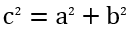

## **Översikt**

PowerPoint lagrar ekvationer som Office Math Markup Language (OMML). Med Aspose.Slides för PHP via Java kan du programatiskt skapa samma typ av matematiskt innehåll: bråk, radikaler, funktioner, gränsvärden, N-ary operatorer, matriser, arrayer och formaterade matematikblock.

I PowerPoint lägger användare normalt till ekvationer via **Insert > Equation**:


Resultatet är redigerbar matematiktext på bilden:


Aspose.Slides bygger den matematiska texten genom tre huvudobjekt:

- En matematisk form, skapad med [addMathShape](https://reference.aspose.com/slides/php-java/aspose.slides/shapecollection/#addMathShape), är formen som innehåller ekvationen.
- [MathPortion](https://reference.aspose.com/slides/php-java/aspose.slides/mathportion/) lagrar matematiskt innehåll i formens textruta.
- [MathParagraph](https://reference.aspose.com/slides/php-java/aspose.slides/mathparagraph/) innehåller ett eller flera [MathBlock](https://reference.aspose.com/slides/php-java/aspose.slides/mathblock/)-objekt.

De flesta exempel nedan använder [MathematicalText](https://reference.aspose.com/slides/php-java/aspose.slides/mathematicaltext/) och de flödande metoderna från [MathElementBase](https://reference.aspose.com/slides/php-java/aspose.slides/mathelementbase/) för att hålla koden kort och läsbar.

För MathML‑exportscenarier, se [Export Math Equations from Presentations in PHP via Java](/slides/sv/php-java/exporting-math-equations/).

## **Skapa en ekvation**

Detta exempel använder [addMathShape](https://reference.aspose.com/slides/php-java/aspose.slides/shapecollection/#addMathShape) för att skapa en matematisk form och lägger till Pythagoras sats:



```php
$presentation = new Presentation();
try {
    $slide = $presentation->getSlides()->get_Item(0);

    $mathShape = $slide->getShapes()->addMathShape(20, 20, 700, 120);
    $mathParagraph = $mathShape->getTextFrame()->getParagraphs()
        - >get_Item(0)->getPortions()->get_Item(0)->getMathParagraph();

    $equation = (new MathematicalText("c"))
        - >setSuperscript("2")
        - >join("=")
        - >join((new MathematicalText("a"))->setSuperscript("2"))
        - >join("+")
        - >join((new MathematicalText("b"))->setSuperscript("2"));

    $mathParagraph->add($equation);

    $presentation->save("pythagorean-theorem.pptx", SaveFormat::Pptx);
} finally {
    if (!java_is_null($presentation)) {
        $presentation->dispose();
    }
}
```

{}
[addMathShape](https://reference.aspose.com/slides/php-java/aspose.slides/shapecollection/#addMathShape) skapar en form som redan innehåller ett matematiskt stycke. Hämta den första [MathPortion](https://reference.aspose.com/slides/php-java/aspose.slides/mathportion/), anropa [getMathParagraph](https://reference.aspose.com/slides/php-java/aspose.slides/mathportion/#getMathParagraph) och lägg till block eller element i den.
{}

### **Kombinera matteblock**

När delar av en ekvation byggs oberoende som [MathBlock](https://reference.aspose.com/slides/php-java/aspose.slides/mathblock/)-objekt, använd [joinBlock](https://reference.aspose.com/slides/php-java/aspose.slides/mathblock/#joinBlock) för att kombinera dem. Exemplet bygger `c² =` i det vänstra blocket och `a² + b²` i det högra. [setSuperscript](https://reference.aspose.com/slides/php-java/aspose.slides/mathelementbase/#setSuperscript) skapar redigerbara exponenter för alla tre potenser.

```php
use aspose\slides\MathBlock;
use aspose\slides\MathematicalText;
use aspose\slides\Presentation;
use aspose\slides\SaveFormat;

$presentation = new Presentation();
try {
    $slide = $presentation->getSlides()->get_Item(0);

    $shape = $slide->getShapes()->addMathShape(20, 20, 600, 100);
    $mathPortion = $shape->getTextFrame()->getParagraphs()->get_Item(0)->getPortions()->get_Item(0);
    $mathParagraph = $mathPortion->getMathParagraph();

    $leftBlock = new MathBlock();
    $leftBlock->add((new MathematicalText("c"))->setSuperscript("2"));
    $leftBlock->add(new MathematicalText("="));

    $rightBlock = new MathBlock();
    $rightBlock->add((new MathematicalText("a"))->setSuperscript("2"));
    $rightBlock->add(new MathematicalText("+"));
    $rightBlock->add((new MathematicalText("b"))->setSuperscript("2"));

    $combinedBlock = $leftBlock->joinBlock($rightBlock);
    $mathParagraph->add($combinedBlock);

    $presentation->save("equation.pptx", SaveFormat::Pptx);
} finally {
    $presentation->dispose();
}
```

[joinBlock](https://reference.aspose.com/slides/php-java/aspose.slides/mathblock/#joinBlock) returnerar `$leftBlock` själv, nu innehållande båda delarna i ordning, och lämnar `$rightBlock` tomt. Lägg till det kombinerade blocket i [MathParagraph](https://reference.aspose.com/slides/php-java/aspose.slides/mathparagraph/) bara en gång. Efter att ha öppnat om `equation.pptx` innehåller stycket ett block som representerar `c² = a² + b²`, med alla tre potenser bevarade som exponenter.

Att anropa [add](https://reference.aspose.com/slides/php-java/aspose.slides/mathblock/#add) som `$leftBlock->add($rightBlock)` försöker i stället nästla ett block direkt i ett annat och kastar `InvalidOperationException`.

## **Lägg till bråk**

Använd [divide](https://reference.aspose.com/slides/php-java/aspose.slides/mathelementbase/#divide) för att skapa ett bråk. Du kan välja bråkstil med [MathFractionTypes](https://reference.aspose.com/slides/php-java/aspose.slides/mathfractiontypes/).


```php
$presentation = new Presentation();
try {
    $slide = $presentation->getSlides()->get_Item(0);

    $mathShape = $slide->getShapes()->addMathShape(20, 20, 700, 100);
    $mathParagraph = $mathShape->getTextFrame()->getParagraphs()
        - >get_Item(0)->getPortions()->get_Item(0)->getMathParagraph();

    $fraction = (new MathematicalText("1"))
        - >divide("x", MathFractionTypes::Skewed);

    $mathParagraph->add(new MathBlock($fraction));

    $presentation->save("fraction.pptx", SaveFormat::Pptx);
} finally {
    if (!java_is_null($presentation)) {
        $presentation->dispose();
    }
}
```

För ett staplat bråk, använd [MathFractionTypes::Bar](https://reference.aspose.com/slides/php-java/aspose.slides/mathfractiontypes/#Bar):

```php
$stackedFraction = (new MathematicalText("x + 1"))->divide("y - 1", MathFractionTypes::Bar);
```

## **Lägg till radikaler**

Använd [radical](https://reference.aspose.com/slides/php-java/aspose.slides/mathelementbase/#radical) för att skapa en kvadratrot, kubikrot eller annan rot. Det aktuella elementet blir basen och argumentet blir graden.


```php
$presentation = new Presentation();
try {
    $slide = $presentation->getSlides()->get_Item(0);

    $mathShape = $slide->getShapes()->addMathShape(20, 20, 700, 100);
    $mathParagraph = $mathShape->getTextFrame()->getParagraphs()
        - >get_Item(0)->getPortions()->get_Item(0)->getMathParagraph();

    $radical = (new MathematicalText("x"))
        - >radical("n");

    $mathParagraph->add(new MathBlock($radical));

    $presentation->save("radical.pptx", SaveFormat::Pptx);
} finally {
    if (!java_is_null($presentation)) {
        $presentation->dispose();
    }
}
```

### **Visa eller dölj graden av en kvadratrot**

En kvadratrot kan visa en explicit 2 eller använda den konventionella √x‑notationen. Metoden [setHideDegree](https://reference.aspose.com/slides/php-java/aspose.slides/mathradical/#setHideDegree) i [MathRadical](https://reference.aspose.com/slides/php-java/aspose.slides/mathradical/) styr vilken form som visas. Båda formerna behåller graden 2 och radikanden x i den redigerbara ekvationen.


Exemplet sparar samma kvadratrot två gånger. I `visible-degree.pptx` är 2 synlig. I `hidden-degree.pptx` är den dold.

```php
use aspose\slides\MathBlock;
use aspose\slides\MathematicalText;
use aspose\slides\Presentation;
use aspose\slides\SaveFormat;

$presentation = new Presentation();
try {
    $slide = $presentation->getSlides()->get_Item(0);
    
    $radical = (new MathematicalText("x"))->radical("2");

    $shape = $slide->getShapes()->addMathShape(20, 20, 200, 100);
    $portion = $shape->getTextFrame()->getParagraphs()->get_Item(0)->getPortions()->get_Item(0);
    $portion->getMathParagraph()->add(new MathBlock($radical));

    $radical->setHideDegree(false);
    $presentation->save("visible-degree.pptx", SaveFormat::Pptx);

    $radical->setHideDegree(true);
    $presentation->save("hidden-degree.pptx", SaveFormat::Pptx);
} finally {
    $presentation->dispose();
}
```

## **Lägg till funktioner och gränsvärden**

Använd [asArgumentOfFunction](https://reference.aspose.com/slides/php-java/aspose.slides/mathelementbase/#asArgumentOfFunction) eller [function](https://reference.aspose.com/slides/php-java/aspose.slides/mathelementbase/#function) för funktioner som `sin(x)`, `log(x)` eller egna funktionsnamn. För gränsvärden, placera `lim` i ett [MathLimit](https://reference.aspose.com/slides/php-java/aspose.slides/mathlimit/) eller använd [setLowerLimit](https://reference.aspose.com/slides/php-java/aspose.slides/mathelementbase/#setLowerLimit).


```php
$presentation = new Presentation();
try {
    $slide = $presentation->getSlides()->get_Item(0);

    $mathShape = $slide->getShapes()->addMathShape(20, 20, 700, 100);
    $mathParagraph = $mathShape->getTextFrame()->getParagraphs()
        - >get_Item(0)->getPortions()->get_Item(0)->getMathParagraph();

    $limit = (new MathematicalText("lim"))
        - >setLowerLimit("x\u{2192}\u{221E}")
        - >function("x");

    $mathParagraph->add(new MathBlock($limit));

    $presentation->save("functions-and-limits.pptx", SaveFormat::Pptx);
} finally {
    if (!java_is_null($presentation)) {
        $presentation->dispose();
    }
}
```

För ett eget funktionsnamn, gör funktionsnamnet till det aktuella elementet och anropa [function](https://reference.aspose.com/slides/php-java/aspose.slides/mathelementbase/#function) med dess argument:

```php
$customFunction = (new MathematicalText("f"))->function("x + 1");
```

## **Lägg till N-ary-operatorer och integraler**

Använd [nary](https://reference.aspose.com/slides/php-java/aspose.slides/mathelementbase/#nary) för summor, föreningar, snitt och andra stora operatorer. Använd [integral](https://reference.aspose.com/slides/php-java/aspose.slides/mathelementbase/#integral) för integraler. Båda metoderna låter dig ange nedre och övre gränser.


```php
$presentation = new Presentation();
try {
    $slide = $presentation->getSlides()->get_Item(0);

    $mathShape = $slide->getShapes()->addMathShape(20, 20, 700, 120);
    $mathParagraph = $mathShape->getTextFrame()->getParagraphs()
        - >get_Item(0)->getPortions()->get_Item(0)->getMathParagraph();

    $summationBase = (new MathematicalText("x"))
        - >setSuperscript("k")
        - >join((new MathematicalText("a"))->setSuperscript("n-k"));

    $summation = $summationBase->nary(MathNaryOperatorTypes::Summation, "k=0", "n");

    $mathParagraph->add(new MathBlock($summation));

    $presentation->save("nary-operators.pptx", SaveFormat::Pptx);
} finally {
    if (!java_is_null($presentation)) {
        $presentation->dispose();
    }
}
```

N-ary‑operatorer är för stora operatorer med valfria gränser. Enkla operatorer som `+`, `-` och `=` läggs vanligtvis till som [MathematicalText](https://reference.aspose.com/slides/php-java/aspose.slides/mathematicaltext/) och förenas i uttrycket.

För en integral, använd [integral](https://reference.aspose.com/slides/php-java/aspose.slides/mathelementbase/#integral):

```php
$integralBase = (new MathematicalText("x"))->join((new MathematicalText("dx"))->toBox());
$integral = $integralBase->integral(MathIntegralTypes::Simple, "0", "1");
```

## **Lägg till matriser**

Använd [MathMatrix](https://reference.aspose.com/slides/php-java/aspose.slides/mathmatrix/) för rader och kolumner. Matriser inkluderar inte parenteser som standard, så omge matrisen när du behöver parenteser, hakparenteser eller måsvingar.


```php
$presentation = new Presentation();
try {
    $slide = $presentation->getSlides()->get_Item(0);

    $mathShape = $slide->getShapes()->addMathShape(20, 20, 700, 120);
    $mathParagraph = $mathShape->getTextFrame()->getParagraphs()
        - >get_Item(0)->getPortions()->get_Item(0)->getMathParagraph();

    $matrix = new MathMatrix(2, 3);
    $matrix->set_Item(0, 0, new MathematicalText("1"));
    $matrix->set_Item(0, 1, new MathematicalText("x"));
    $matrix->set_Item(1, 0, new MathematicalText("x"));
    $matrix->set_Item(1, 1, new MathematicalText("2"));
    $matrix->set_Item(1, 2, new MathematicalText("y"));

    $mathParagraph->add(new MathBlock($matrix));

    $presentation->save("matrix.pptx", SaveFormat::Pptx);
} finally {
    if (!java_is_null($presentation)) {
        $presentation->dispose();
    }
}
```

### **Redigera en befintlig matris**

Anta att en lektion i linjär algebra börjar med koefficientmatrisen i `matrix.pptx`, sparad av föregående exempel. För nästa övning, behåll den första ekvationen, ersätt den andra med två nya ekvationer och revidera variabeluppsättningen. Öppna den befintliga matrisen via [MathMatrix](https://reference.aspose.com/slides/php-java/aspose.slides/mathmatrix/) för att behålla de koefficienter som fortfarande gäller.


Rad‑ och kolumnindex startar på noll och refererar till matrisen så som den ser ut vid varje anrop. Att infoga en rad före index 1 flyttar den ursprungliga andra raden till index 2. Att infoga efter index 2 lägger sedan till en rad. Att ta bort rad 2 tar bort den ursprungliga andra ekvationen och flyttar den tillagda raden upp en position. Kolumner skiftar på samma sätt.

```php
use aspose\slides\MathematicalText;
use aspose\slides\MathHorizontalAlignment;
use aspose\slides\Presentation;
use aspose\slides\SaveFormat;

$presentation = new Presentation("matrix.pptx");
try {
    $shape = $presentation->getSlides()->get_Item(0)->getShapes()->get_Item(0);
    $portion = $shape->getTextFrame()->getParagraphs()->get_Item(0)->getPortions()->get_Item(0);
    $block = $portion->getMathParagraph()->get_Item(0);
    $matrix = $block->get_Item(0);

    $matrix->insertRowBefore(1);
    $matrix->insertRowAfter(2);
    $matrix->deleteRow(2);

    $matrix->insertColumnBefore(1);
    $matrix->insertColumnAfter(3);
    $matrix->deleteColumn(3);

    // Nya celler är initialt null. Sätt de icke-nolliga koefficienterna först.
    $matrix->set_Item(1, 0, new MathematicalText("12"));
    $matrix->set_Item(1, 1, new MathematicalText("1"));
    $matrix->set_Item(2, 2, new MathematicalText("10"));
    $matrix->set_Item(2, 3, new MathematicalText("1"));
    $rowCount = java_values($matrix->getRowCount());
    $columnCount = java_values($matrix->getColumnCount());
    for ($row = 0; $row < $rowCount; $row++) {
        for ($column = 0; $column < $columnCount; $column++) {
            $coefficient = $matrix->get_Item($row, $column);
            if (java_is_null($coefficient)) {
                $matrix->set_Item($row, $column, new MathematicalText("0"));
            }
        }
    }

    $matrix->setColumnAlignment(0, MathHorizontalAlignment::Left);
    $matrix->setColumnsAlignment(1, 3, MathHorizontalAlignment::Right);

    $presentation->save("updated-matrix.pptx", SaveFormat::Pptx);
} finally {
    $presentation->dispose();
}
```

[setColumnAlignment](https://reference.aspose.com/slides/php-java/aspose.slides/mathmatrix/#setColumnAlignment) justerar den första kolumnen åt vänster. [setColumnsAlignment](https://reference.aspose.com/slides/php-java/aspose.slides/mathmatrix/#setColumnsAlignment) justerar tre på varandra följande kolumner åt höger, med start på index 1. I `updated-matrix.pptx` har matrisen tre ekvationer och fyra variabler. De ursprungliga koefficienterna `1` och `x` i första raden visas nu i första och tredje kolumnen.


## **Lägg till ekvationsarrayer**

Använd [toMathArray](https://reference.aspose.com/slides/php-java/aspose.slides/mathelementbase/#toMathArray) när du behöver inriktade ekvationer eller en vertikal stapel av uttryck.


```php
$presentation = new Presentation();
try {
    $slide = $presentation->getSlides()->get_Item(0);

    $mathShape = $slide->getShapes()->addMathShape(20, 20, 700, 140);
    $mathParagraph = $mathShape->getTextFrame()->getParagraphs()
        - >get_Item(0)->getPortions()->get_Item(0)->getMathParagraph();

    $equationArray = (new MathematicalText("x"))
        - >join("y")
        - >toMathArray();

    $mathParagraph->add(new MathBlock($equationArray));

    $presentation->save("equation-array.pptx", SaveFormat::Pptx);
} finally {
    if (!java_is_null($presentation)) {
        $presentation->dispose();
    }
}
```

### **Justera en array med omgivande element**

[setBaseJustification](https://reference.aspose.com/slides/php-java/aspose.slides/matharray/#setBaseJustification) styr den vertikala justeringen av en array i förhållande till de matematiska elementen bredvid den. Exemplet nedan jämför justering med den första raden, mitten av arrayen och den sista raden.

Följande exempel skapar tre identiska arrayer, var och en med tre rader och de omgivande elementen `A=` och `=B`. All matematisk text använder Cambria Math i 24 punkter. Endast array‑justeringen förändras.

```php
use aspose\slides\FillType;
use aspose\slides\FontData;
use aspose\slides\MathArray;
use aspose\slides\MathBlock;
use aspose\slides\MathJustification;
use aspose\slides\MathVerticalAlignment;
use aspose\slides\MathematicalText;
use aspose\slides\Presentation;
use aspose\slides\SaveFormat;
use aspose\slides\ShapeType;
use aspose\slides\SlideSizeScaleType;
use aspose\slides\TextAnchorType;

$createText = static function (string $value) {
    $text = new MathematicalText($value);
    $text->getFormat()->setFontHeight(24);
    $text->getFormat()->setLatinFont(new FontData("Cambria Math"));
    return $text;
};

$alignments = ["Top" => MathVerticalAlignment::Top, "Center" => MathVerticalAlignment::Center, "Bottom" => MathVerticalAlignment::Bottom];
$presentation = new Presentation();
try {
    $presentation->getSlideSize()->setSize(780, 200, SlideSizeScaleType::DoNotScale);
    $slide = $presentation->getSlides()->get_Item(0);
    $x = 20;
    foreach ($alignments as $name => $alignment) {
        $label = $slide->getShapes()->addAutoShape(ShapeType::Rectangle, $x, 10, 240, 30);
        $label->getFillFormat()->setFillType(FillType::NoFill);
        $label->getLineFormat()->getFillFormat()->setFillType(FillType::NoFill);
        $label->getTextFrame()->setText($name);
        $labelFormat = $label->getTextFrame()->getParagraphs()->get_Item(0)->getPortions()->get_Item(0)->getPortionFormat();
        $labelFormat->setFontHeight(16);
        $labelFormat->getFillFormat()->setFillType(FillType::Solid);
        $labelFormat->getFillFormat()->getSolidFillColor()->setColor(java("java.awt.Color")->BLACK);

        $mathShape = $slide->getShapes()->addMathShape($x, 60, 240, 130);
        $mathShape->getTextFrame()->getTextFrameFormat()->setAnchoringType(TextAnchorType::Top);
        $paragraph = $mathShape->getTextFrame()->getParagraphs()->get_Item(0);
        $mathParagraph = $paragraph->getPortions()->get_Item(0)->getMathParagraph();
        $mathParagraph->setJustification(MathJustification::LeftJustified);

        $firstRow = $createText("x+y=3");
        $equationArray = new MathArray($firstRow);
        foreach (["x-y=1", "x=2"] as $value) {
            $row = $createText($value);
            $equationArray->getArguments()->add($row);
        }
        $equationArray->setBaseJustification($alignment);
        $leftText = $createText("A=");
        $rightText = $createText("=B");
        $equation = (new MathBlock($leftText))->join($equationArray)->join($rightText);
        $mathParagraph->add($equation);
        $x += 260;
    }
    $presentation->save("equation-array-alignment.pptx", SaveFormat::Pptx);
} finally {
    $presentation->dispose();
}
```

Följande jämförelse visar den sparade presentationen i PowerPoint. Notera positionen för `A=` och `=B` bredvid varje array.


### **Konfigurera radavstånd**

[setRowSpacingRule](https://reference.aspose.com/slides/php-java/aspose.slides/matharray/#setRowSpacingRule) väljer avståndsregel för rader inom arrayen. [setRowSpacing](https://reference.aspose.com/slides/php-java/aspose.slides/matharray/#setRowSpacing) anger ett numeriskt värde för en explicit avståndsregel och ignoreras av förinställda regler.

För exakt avstånd mäts värdet i punkter. För proportionellt avstånd mäts det i halvlister: värdet `3` i exemplet motsvarar 1,5 rad. Sätt båda egenskaperna när du anger ett explicit värde; att bara ändra det numeriska värdet väljer inte en regel.

Exemplet nedan sparar fem presentationer med samma ekvationer, justering och teckensnitt. De första tre använder förinställningar; de två sista visar explicita värden.

```php
use aspose\slides\FontData;
use aspose\slides\MathArray;
use aspose\slides\MathBlock;
use aspose\slides\MathJustification;
use aspose\slides\MathRowSpacingRule;
use aspose\slides\MathVerticalAlignment;
use aspose\slides\MathematicalText;
use aspose\slides\Presentation;
use aspose\slides\SaveFormat;

$createText = static function (string $value) {
    $text = new MathematicalText($value);
    $text->getFormat()->setFontHeight(24);
    $text->getFormat()->setLatinFont(new FontData("Cambria Math"));
    return $text;
};

$settings = [
    "SingleLineGap" => [MathRowSpacingRule::SingleLineGap, 0],
    "OneAndAHalfLineGap" => [MathRowSpacingRule::OneAndAHalfLineGap, 0],
    "TwoLineGap" => [MathRowSpacingRule::TwoLineGap, 0],
    "Exactly" => [MathRowSpacingRule::Exactly, 20],
    "Multiple" => [MathRowSpacingRule::Multiple, 3],
];

foreach ($settings as $name => [$rule, $spacing]) {
    $presentation = new Presentation();
    try {
        $mathShape = $presentation->getSlides()->get_Item(0)->getShapes()->addMathShape(20, 20, 600, 300);
        $paragraph = $mathShape->getTextFrame()->getParagraphs()->get_Item(0);
        $paragraph->getParagraphFormat()->setSpaceBefore(0);
        $paragraph->getParagraphFormat()->setSpaceAfter(0);
        $mathParagraph = $paragraph->getPortions()->get_Item(0)->getMathParagraph();
        $mathParagraph->setJustification(MathJustification::LeftJustified);

        $firstRow = $createText("x+y=3");
        $equationArray = new MathArray($firstRow);
        foreach (["x-y=1", "x=2"] as $value) {
            $row = $createText($value);
            $equationArray->getArguments()->add($row);
        }
        $equationArray->setBaseJustification(MathVerticalAlignment::Center);
        $equationArray->setRowSpacingRule($rule);
        $equationArray->setRowSpacing($spacing);
        $leftText = $createText("A=");
        $rightText = $createText("=B");
        $equation = (new MathBlock($leftText))->join($equationArray)->join($rightText);
        $mathParagraph->add($equation);
        $presentation->save("equation-array-$name.pptx", SaveFormat::Pptx);
    } finally {
        $presentation->dispose();
    }
}
```

Radavstånd i en array är separat från styckeavstånd. [setSpaceBefore](https://reference.aspose.com/slides/php-java/aspose.slides/paragraphformat/#setSpaceBefore) och [setSpaceAfter](https://reference.aspose.com/slides/php-java/aspose.slides/paragraphformat/#setSpaceAfter) lägger till utrymme runt det omgivande stycket, inte mellan arrayrader. På samma sätt positionerar [MathParagraph::setJustification](https://reference.aspose.com/slides/php-java/aspose.slides/mathparagraph/#setJustification) hela matematiska stycket horisontellt; den ersätter inte arrayens vertikala justering.

## **Lägg till trigonometriska funktioner**

Använd [asArgumentOfFunction](https://reference.aspose.com/slides/php-java/aspose.slides/mathelementbase/#asArgumentOfFunction) när argumentet är det aktuella elementet och funktionsnamnet är känt.


```php
$presentation = new Presentation();
try {
    $slide = $presentation->getSlides()->get_Item(0);

    $mathShape = $slide->getShapes()->addMathShape(20, 20, 700, 100);
    $mathParagraph = $mathShape->getTextFrame()->getParagraphs()
        - >get_Item(0)->getPortions()->get_Item(0)->getMathParagraph();

    $cosine = (new MathematicalText("2x"))
        - >asArgumentOfFunction(MathFunctionsOfOneArgument::Cos);

    $mathParagraph->add(new MathBlock($cosine));

    $presentation->save("trigonometric-function.pptx", SaveFormat::Pptx);
} finally {
    if (!java_is_null($presentation)) {
        $presentation->dispose();
    }
}
```

## **Lägg till index och exponenter**

Använd hjälpfunktionerna för index och exponenter. När indexen måste visas på vänster sida om basen, använd [setSubSuperscriptOnTheLeft](https://reference.aspose.com/slides/php-java/aspose.slides/mathelementbase/#setSubSuperscriptOnTheLeft).


```php
$presentation = new Presentation();
try {
    $slide = $presentation->getSlides()->get_Item(0);

    $mathShape = $slide->getShapes()->addMathShape(20, 20, 700, 100);
    $mathParagraph = $mathShape->getTextFrame()->getParagraphs()
        - >get_Item(0)->getPortions()->get_Item(0)->getMathParagraph();

    $scripts = (new MathematicalText("Y"))
        - >setSubSuperscriptOnTheLeft("1", "n");

    $mathParagraph->add(new MathBlock($scripts));

    $presentation->save("subscript-superscript.pptx", SaveFormat::Pptx);
} finally {
    if (!java_is_null($presentation)) {
        $presentation->dispose();
    }
}
```

## **Lägg till avgränsare**

Använd [enclose](https://reference.aspose.com/slides/php-java/aspose.slides/mathelementbase/#enclose) för att placera ett uttryck inom avgränsare. Du kan även ange ett separator‑tecken för avgränsningsexpressioner som innehåller flera element.


```php
$presentation = new Presentation();
try {
    $slide = $presentation->getSlides()->get_Item(0);

    $mathShape = $slide->getShapes()->addMathShape(20, 20, 700, 100);
    $mathParagraph = $mathShape->getTextFrame()->getParagraphs()
        - >get_Item(0)->getPortions()->get_Item(0)->getMathParagraph();

    $delimiter = (new MathematicalText("x"))
        - >join("y")
        - >join("z")
        - >enclose(new Java("java.lang.Character", "<"), new Java("java.lang.Character", ">"));
    $delimiter->setSeparatorCharacter(new Java("java.lang.Character", "|"));

    $mathParagraph->add(new MathBlock($delimiter));

    $presentation->save("delimiters.pptx", SaveFormat::Pptx);
} finally {
    if (!java_is_null($presentation)) {
        $presentation->dispose();
    }
}
```

### **Storlek och justering av avgränsare**

Skicka `true` till [setGrowToMatchOperandHeight](https://reference.aspose.com/slides/php-java/aspose.slides/mathdelimiter/#setGrowToMatchOperandHeight) för att låta parenteserna växa omkring en hög operand, eller `false` för att behålla normal storlek. Använd [setDelimiterShape](https://reference.aspose.com/slides/php-java/aspose.slides/mathdelimiter/#setDelimiterShape) med ett av två [MathDelimiterShape](https://reference.aspose.com/slides/php-java/aspose.slides/mathdelimitershape/)-värden. `Centered` centrerar parenteserna på matematikaxeln, som går genom mitten av likhetstecknet. `Match` justerar dem efter det inneslutna innehållet. Båda inställningarna påverkar endast avgränsarna. Uttrycket inuti förblir oförändrat.

Exemplet placerar ett bråk i exponenten av `x` så att uttrycket sträcker sig längre ovanför baslinjen än under den. Alla fyra ekvationer använder samma parenteser och teckensnitt.

```php
use aspose\slides\MathDelimiterShape;
use aspose\slides\MathematicalText;
use aspose\slides\Presentation;
use aspose\slides\SaveFormat;

$presentation = new Presentation();
try {
    $slide = $presentation->getSlides()->get_Item(0);
    $opening = new Java("java.lang.Character", "(");
    $closing = new Java("java.lang.Character", ")");
    for ($row = 0; $row < 2; $row++) {
        for ($column = 0; $column < 2; $column++) {
            $fraction = (new MathematicalText("a + b"))->divide("c + d");
            $power = (new MathematicalText("x"))->setSuperscript($fraction);
            $delimiter = $power->enclose($opening, $closing);
            $delimiter->setGrowToMatchOperandHeight($row === 0);
            $delimiter->setDelimiterShape($column === 0 ? MathDelimiterShape::Centered : MathDelimiterShape::Match);

            $mathShape = $slide->getShapes()->addMathShape(20 + 330 * $column, 20 + 120 * $row, 300, 100);
            $portion = $mathShape->getTextFrame()->getParagraphs()->get_Item(0)->getPortions()->get_Item(0);
            $portion->getPortionFormat()->setFontHeight(32);
            $equation = (new MathematicalText("y = "))->join($delimiter);
            $portion->getMathParagraph()->add($equation);
        }
    }
    $presentation->save("delimiter-sizing.pptx", SaveFormat::Pptx);
} finally {
    $presentation->dispose();
}
```

I PowerPoint, jämför raderna för att se effekten av växande parenteser. I den översta raden växer parenteserna för att omfatta exponenten och ser lika ut för båda formerna. I den nedersta raden är växande avstängt. De mindre parenteserna till vänster (`Centered`) justeras med likhetstecknet, medan de till höger (`Match`) sitter högre omkring uttrycket.


## **Lägg till en ramruta**

Anropa [toBorderBox](https://reference.aspose.com/slides/php-java/aspose.slides/mathelementbase/#toBorderBox) på ett bråk för att rama in hela uttrycket. Den returnerade [MathBorderBox](https://reference.aspose.com/slides/php-java/aspose.slides/mathborderbox/) visar alla fyra sidor som standard. Använd [setHideTop](https://reference.aspose.com/slides/php-java/aspose.slides/mathborderbox/#setHideTop), [setHideBottom](https://reference.aspose.com/slides/php-java/aspose.slides/mathborderbox/#setHideBottom), [setHideLeft](https://reference.aspose.com/slides/php-java/aspose.slides/mathborderbox/#setHideLeft) och [setHideRight](https://reference.aspose.com/slides/php-java/aspose.slides/mathborderbox/#setHideRight) för att ta bort individuella sidor.

Exemplet placerar sex kopior av samma bråk på en bild. För att visa strykning, dölj alla fyra sidor och skicka `true` till [setStrikethroughBottomLeftToTopRight](https://reference.aspose.com/slides/php-java/aspose.slides/mathborderbox/#setStrikethroughBottomLeftToTopRight) för en stigande diagonal (↗) eller [setStrikethroughTopLeftToBottomRight](https://reference.aspose.com/slides/php-java/aspose.slides/mathborderbox/#setStrikethroughTopLeftToBottomRight) för en fallande diagonal (↘). Du kan också använda [setStrikethroughHorizontal](https://reference.aspose.com/slides/php-java/aspose.slides/mathborderbox/#setStrikethroughHorizontal) eller [setStrikethroughVertical](https://reference.aspose.com/slides/php-java/aspose.slides/mathborderbox/#setStrikethroughVertical) med valfri kombination av synliga sidor.

```php
use aspose\slides\MathBlock;
use aspose\slides\MathematicalText;
use aspose\slides\Presentation;
use aspose\slides\SaveFormat;
use aspose\slides\SlideSizeScaleType;

$presentation = new Presentation();
try {
    $presentation->getSlideSize()->setSize(540, 220, SlideSizeScaleType::DoNotScale);
    $slide = $presentation->getSlides()->get_Item(0);

    $addFraction = function ($x, $y, $hideBorder) use ($slide) {
        $fraction = (new MathematicalText("x+1"))->divide("y+2");
        $box = $fraction->toBorderBox();
        $box->setHideTop($hideBorder);
        $box->setHideBottom($hideBorder);
        $box->setHideLeft($hideBorder);
        $box->setHideRight($hideBorder);

        $shape = $slide->getShapes()->addMathShape($x, $y, 160, 90);
        $portion = $shape->getTextFrame()->getParagraphs()->get_Item(0)->getPortions()->get_Item(0);
        $portion->getPortionFormat()->setFontHeight(28);
        $mathBlock = new MathBlock($box);
        $portion->getMathParagraph()->add($mathBlock);
        return $box;
    };

    $addFraction(10, 10, false);

    $partial = $addFraction(190, 10, false);
    $partial->setHideTop(true);
    $partial->setHideRight(true);

    $addFraction(370, 10, true)->setStrikethroughBottomLeftToTopRight(true);
    $addFraction(10, 120, true)->setStrikethroughTopLeftToBottomRight(true);
    $addFraction(190, 120, true)->setStrikethroughHorizontal(true);
    $addFraction(370, 120, false)->setStrikethroughVertical(true);

    $presentation->save("border-box.pptx", SaveFormat::Pptx);
} finally {
    $presentation->dispose();
}
```


På detta bråk överlappar den horisontella streckningen bråkstrecket. Den vertikala streckningen korsar både täljaren och nämnaren medan den omgivande ramen förblir synlig. Dessa linjer dekorerar hela uttrycket. Vanlig streckning av text gäller tecken i ett textrun. Efter att ha öppnat presentationen i PowerPoint kan du fortfarande redigera täljaren och nämnaren oberoende.

## **Styr synlighet och layout med phantom‑element**

Börja innesluta ett uttryck i [MathPhantom](https://reference.aspose.com/slides/php-java/aspose.slides/mathphantom/) för att kontrollera dess synlighet och det utrymme det bidrar med till en ekvation oberoende. Metoderna i [MathPhantom](https://reference.aspose.com/slides/php-java/aspose.slides/mathphantom/) styr följande:

| Metod | Effekt |
| --- | --- |
| [setShow](https://reference.aspose.com/slides/php-java/aspose.slides/mathphantom/#setShow) | Skicka `false` för att dölja uttrycket. Dess dimensioner bidrar fortfarande till layouten om inte motsvarande metoder nedan får `true`. |
| [setZeroWidth](https://reference.aspose.com/slides/php-java/aspose.slides/mathphantom/#setZeroWidth) | Behandla uttryckets horisontella bredd som noll, så att intilliggande element kan komma närmare varandra. |
| [setZeroAsc](https://reference.aspose.com/slides/php-java/aspose.slides/mathphantom/#setZeroAsc) | Behandla dess höjd över baslinjen som noll. Detta kan minska utrymmet ovanför intilliggande element. |
| [setZeroDesc](https://reference.aspose.com/slides/php-java/aspose.slides/mathphantom/#setZeroDesc) | Behandla dess djup under baslinjen som noll. Detta kan föra en bråklinje eller annat innehåll under uttrycket närmare grannarna. |

Baslinjen är referenslinjen som vanliga matematiska bokstäver vilar på. Att dölja innehåll tar inte bort dess dimensioner, och att behandla en dimension som noll tar inte bort uttrycket. Det underliggande uttrycket finns fortfarande tillgängligt via [getBase](https://reference.aspose.com/slides/php-java/aspose.slides/mathphantom/#getBase). Skicka `true` till [setShow](https://reference.aspose.com/slides/php-java/aspose.slides/mathphantom/#setShow) för att visa det igen; dimensionerna förblir oförändrade.

Exemplet nedan skapar fem varianter sida‑vid‑sida: ett synligt bråk, ett dolt bråk som reserverar utrymme och tre dolda bråk med en dimension behandlad som noll. Varje variant använder samma omgivande uttryck och Cambria Math i 24 punkter. Alla ekvationsformer har samma top‑position, markerad av den grå guiden. Att placera phantom i täljaren av ett yttre bråk gör vertikal layout lättare att se.

```php
use aspose\slides\FillType;
use aspose\slides\FontData;
use aspose\slides\MathBlock;
use aspose\slides\MathFraction;
use aspose\slides\MathPhantom;
use aspose\slides\MathematicalText;
use aspose\slides\Presentation;
use aspose\slides\SaveFormat;
use aspose\slides\ShapeType;
use aspose\slides\SlideSizeScaleType;
use aspose\slides\TextAnchorType;

$createText = static function (string $value) {
    $text = new MathematicalText($value);
    $text->getFormat()->setFontHeight(24);
    $text->getFormat()->setLatinFont(new FontData("Cambria Math"));
    return $text;
};

$presentation = new Presentation();
try {
    $presentation->getSlideSize()->setSize(1000, 180, SlideSizeScaleType::DoNotScale);
    $slide = $presentation->getSlides()->get_Item(0);

    $labels = ["Visible", "Hidden: reserves space", "Hidden: ZeroWidth", "Hidden: ZeroAsc", "Hidden: ZeroDesc"];

    $guide = $slide->getShapes()->addAutoShape(ShapeType::Line, 10, 60, 980, 0);
    $guide->getLineFormat()->getFillFormat()->setFillType(FillType::Solid);
    $guide->getLineFormat()->getFillFormat()->getSolidFillColor()->setColor(java("java.awt.Color")->LIGHT_GRAY);

    foreach ($labels as $i => $labelText) {
        $left = 10 + $i * 200;

        $label = $slide->getShapes()->addAutoShape(ShapeType::Rectangle, $left, 10, 190, 30);
        $label->getFillFormat()->setFillType(FillType::NoFill);
        $label->getLineFormat()->getFillFormat()->setFillType(FillType::NoFill);
        $label->getTextFrame()->setText($labelText);

        $labelFormat = $label->getTextFrame()->getParagraphs()->get_Item(0)->getPortions()->get_Item(0)->getPortionFormat();
        $labelFormat->setFontHeight(14);
        $labelFormat->getFillFormat()->setFillType(FillType::Solid);
        $labelFormat->getFillFormat()->getSolidFillColor()->setColor(java("java.awt.Color")->BLACK);

        $fractionNumerator = $createText("a+b");
        $fractionDenominator = $createText("c+d");
        $fraction = new MathFraction($fractionNumerator, $fractionDenominator);
        $phantom = new MathPhantom($fraction);
        $phantom->setShow($i === 0);
        $phantom->setZeroWidth($i === 2);
        $phantom->setZeroAsc($i === 3);
        $phantom->setZeroDesc($i === 4);

        $leftText = $createText("x+");
        $rightText = $createText("+y");
        $numerator = (new MathBlock($leftText))->join($phantom)->join($rightText);
        $denominator = $createText("z");
        $equation = new MathFraction($numerator, $denominator);

        $shape = $slide->getShapes()->addMathShape($left, 60, 190, 100);
        $shape->getTextFrame()->getTextFrameFormat()->setAnchoringType(TextAnchorType::Top);

        $mathPortion = $shape->getTextFrame()->getParagraphs()->get_Item(0)->getPortions()->get_Item(0);
        $mathParagraph = $mathPortion->getMathParagraph();
        $mathBlock = new MathBlock($equation);
        $mathParagraph->add($mathBlock);
    }

    $presentation->save("math-phantom.pptx", SaveFormat::Pptx);
} finally {
    $presentation->dispose();
}
```


## **Gruppera termer**

Använd [group](https://reference.aspose.com/slides/php-java/aspose.slides/mathelementbase/#group) för att placera ett grupperingstecken ovanför eller nedanför ett uttryck. Lägg till en gräns för att märka de grupperade termerna.


```php
$presentation = new Presentation();
try {
    $slide = $presentation->getSlides()->get_Item(0);

    $mathShape = $slide->getShapes()->addMathShape(20, 20, 700, 120);
    $mathParagraph = $mathShape->getTextFrame()->getParagraphs()
        - >get_Item(0)->getPortions()->get_Item(0)->getMathParagraph();

    $grouped = (new MathematicalText("x + y"))
        - >group(new Java("java.lang.Character", "\u{23DF}"), MathTopBotPositions::Bottom, MathTopBotPositions::Top)
        - >setLowerLimit("any text");

    $mathParagraph->add(new MathBlock($grouped));

    $presentation->save("grouped-terms.pptx", SaveFormat::Pptx);
} finally {
    if (!java_is_null($presentation)) {
        $presentation->dispose();
    }
}
```

## **Formatera matematiska element**

Använd formateringshjälpmedel endast där de klargör formeln. Till exempel placerar [overbar](https://reference.aspose.com/slides/php-java/aspose.slides/mathelementbase/#overbar) en linje ovanför ett matematiskt element.


```php
$presentation = new Presentation();
try {
    $slide = $presentation->getSlides()->get_Item(0);

    $mathShape = $slide->getShapes()->addMathShape(20, 20, 700, 100);
    $mathParagraph = $mathShape->getTextFrame()->getParagraphs()
        - >get_Item(0)->getPortions()->get_Item(0)->getMathParagraph();

    $overbar = (new MathematicalText("ABC"))->overbar();

    $mathParagraph->add(new MathBlock($overbar));

    $presentation->save("overbar.pptx", SaveFormat::Pptx);
} finally {
    if (!java_is_null($presentation)) {
        $presentation->dispose();
    }
}
```

### **Formatera text i en befintlig ekvation**

För att formatera text genom hela en befintlig ekvation, traversera varje matteblocks elementträd. [MathElementBase::getChildren](https://reference.aspose.com/slides/php-java/aspose.slides/mathelementbase/#getChildren) returnerar endast omedelbara barn, så anropa den rekursivt för att nå text i bråk, script, radikaler och andra nästlade strukturer. Kontrollera både det aktuella elementet och dess barn för att inkludera startelementet när det är [MathematicalText](https://reference.aspose.com/slides/php-java/aspose.slides/mathematicaltext/).

Detta exempel antar att `input.pptx` innehåller en ekvation som `z = xᵢ / ∛y`, med ett bråk som innehåller ett index i täljaren och en radikal i nämnaren. Att endast bearbeta blockets översta element skulle missa texten i bråket. Exemplet hittar matematiska portioner i bildtextrutor, hämtar deras block via [MathPortion::getMathParagraph](https://reference.aspose.com/slides/php-java/aspose.slides/mathportion/#getMathParagraph) och använder [setFontHeight](https://reference.aspose.com/slides/php-java/aspose.slides/baseportionformat/#setFontHeight) för att sätta teckenstorlek till 28 punkter genom varje textelements [getFormat](https://reference.aspose.com/slides/php-java/aspose.slides/mathematicaltext/#getFormat)-metod.

```php
use aspose\slides\Presentation;
use aspose\slides\SaveFormat;

function formatMathText($element, $mathematicalTextClass) {
    if (java_instanceof($element, $mathematicalTextClass)) {
        $element->getFormat()->setFontHeight(28);
    }

    foreach ($element->getChildren() as $child) {
        formatMathText($child, $mathematicalTextClass);
    }
}

$mathematicalTextClass = new JavaClass("com.aspose.slides.MathematicalText");
$autoShapeClass = new JavaClass("com.aspose.slides.IAutoShape");
$mathPortionClass = new JavaClass("com.aspose.slides.IMathPortion");

$presentation = new Presentation("input.pptx");
try {
    for ($slideIndex = 0; $slideIndex < java_values($presentation->getSlides()->size()); $slideIndex++) {
        $slide = $presentation->getSlides()->get_Item($slideIndex);
        for ($shapeIndex = 0; $shapeIndex < java_values($slide->getShapes()->size()); $shapeIndex++) {
            $shape = $slide->getShapes()->get_Item($shapeIndex);
            if (!java_instanceof($shape, $autoShapeClass)) {
                continue;
            }

            $textFrame = $shape->getTextFrame();
            if (java_is_null($textFrame)) {
                continue;
            }

            for ($paragraphIndex = 0; $paragraphIndex < java_values($textFrame->getParagraphs()->getCount()); $paragraphIndex++) {
                $paragraph = $textFrame->getParagraphs()->get_Item($paragraphIndex);
                for ($portionIndex = 0; $portionIndex < java_values($paragraph->getPortions()->getCount()); $portionIndex++) {
                    $portion = $paragraph->getPortions()->get_Item($portionIndex);
                    if (java_instanceof($portion, $mathPortionClass)) {
                        for ($blockIndex = 0; $blockIndex < java_values($portion->getMathParagraph()->getCount()); $blockIndex++) {
                            $block = $portion->getMathParagraph()->get_Item($blockIndex);
                            formatMathText($block, $mathematicalTextClass);
                        }
                    }
                }
            }
        }
    }

    $presentation->save("formatted-equations.pptx", SaveFormat::Pptx);
} finally {
    $presentation->dispose();
}
```

Den sparade presentationen innehåller den uppdaterade textformateringen på varje nivå av varje behandlad ekvation, samtidigt som dess textinnehåll och matematiska struktur bevaras.

## **Snabbreferens**

| Uppgift | Huvud‑API |
| --- | --- |
| Skapa matematisk text | [MathematicalText](https://reference.aspose.com/slides/php-java/aspose.slides/mathematicaltext/) |
| Kombinera element | [join](https://reference.aspose.com/slides/php-java/aspose.slides/mathelementbase/) |
| Skapa bråk | [divide](https://reference.aspose.com/slides/php-java/aspose.slides/mathelementbase/) |
| Lägg till exponent eller index | [setSuperscript](https://reference.aspose.com/slides/php-java/aspose.slides/mathelementbase/), [setSubscript](https://reference.aspose.com/slides/php-java/aspose.slides/mathelementbase/) |
| Lägg till funktioner | [function](https://reference.aspose.com/slides/php-java/aspose.slides/mathelementbase/), [asArgumentOfFunction](https://reference.aspose.com/slides/php-java/aspose.slides/mathelementbase/) |
| Lägg till radikaler | [radical](https://reference.aspose.com/slides/php-java/aspose.slides/mathelementbase/) |
| Lägg till gränsvärden | [setLowerLimit](https://reference.aspose.com/slides/php-java/aspose.slides/mathelementbase/), [setUpperLimit](https://reference.aspose.com/slides/php-java/aspose.slides/mathelementbase/) |
| Lägg till vänstersidiga script | [setSubSuperscriptOnTheLeft](https://reference.aspose.com/slides/php-java/aspose.slides/mathelementbase/) |
| Lägg till summor och integraler | [nary](https://reference.aspose.com/slides/php-java/aspose.slides/mathelementbase/), [integral](https://reference.aspose.com/slides/php-java/aspose.slides/mathelementbase/) |
| Lägg till matriser | [MathMatrix](https://reference.aspose.com/slides/php-java/aspose.slides/mathmatrix/) |
| Lägg till ekvationsarrayer | [toMathArray](https://reference.aspose.com/slides/php-java/aspose.slides/mathelementbase/) |
| Lägg till avgränsare | [enclose](https://reference.aspose.com/slides/php-java/aspose.slides/mathelementbase/) |
| Lägg till överlinjer och ramar | [overbar](https://reference.aspose.com/slides/php-java/aspose.slides/mathelementbase/), [toBorderBox](https://reference.aspose.com/slides/php-java/aspose.slides/mathelementbase/) |
| Gruppera termer | [group](https://reference.aspose.com/slides/php-java/aspose.slides/mathelementbase/) |

## **Vanliga frågor**

**Kan jag redigera en befintlig PowerPoint‑ekvation?**

Ja. Öppna presentationen, hitta formen som innehåller en [MathPortion](https://reference.aspose.com/slides/php-java/aspose.slides/mathportion/), anropa [getMathParagraph](https://reference.aspose.com/slides/php-java/aspose.slides/mathportion/#getMathParagraph) och uppdatera de matematiska blocken i det stycket.

**Sparas ekvationer som redigerbar PowerPoint‑matematik?**

Ja. När du sparar till PPTX skriver Aspose.Slides ekvationen som redigerbart Office‑math‑innehåll.

**Kan jag exportera ekvationer till LaTeX?**

Ja. Hämta ekvationens [MathParagraph](https://reference.aspose.com/slides/php-java/aspose.slides/mathparagraph/) från dess [MathPortion](https://reference.aspose.com/slides/php-java/aspose.slides/mathportion/), och anropa [MathParagraph::toLatex](https://reference.aspose.com/slides/php-java/aspose.slides/mathparagraph/#toLatex) för att exportera den direkt. För ett komplett exempel, se [Export Math Equations from Presentations in PHP via Java](/slides/sv/php-java/exporting-math-equations/#export-math-equations-to-latex).