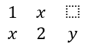

## **Översikt**

PowerPoint lagrar ekvationer som Office Math Markup Language (OMML). Med Aspose.Slides för Python via Java kan du programatiskt skapa samma typ av matematiskt innehåll: bråktal, radikaler, funktioner, gränsvärden, N‑ary‑operatorer, matriser, arrayer och formaterade matematikblock.

I PowerPoint lägger användare normalt till ekvationer från **Insert > Equation**:


Resultatet är redigerbar matematisk text på bilden:


Aspose.Slides bygger den matematiska texten med tre huvudobjekt:

- En matematisk form, skapad med [addMathShape](https://reference.aspose.com/slides/python-java/aspose.slides/shapecollection/#addMathShape), är den form som innehåller ekvationen.
- [MathPortion](https://reference.aspose.com/slides/python-java/aspose.slides/mathportion/) lagrar matematiskt innehåll i formens textruta.
- [MathParagraph](https://reference.aspose.com/slides/python-java/aspose.slides/mathparagraph/) innehåller ett eller flera [MathBlock](https://reference.aspose.com/slides/python-java/aspose.slides/mathblock/)‑objekt.

De flesta exempel nedan använder [MathematicalText](https://reference.aspose.com/slides/python-java/aspose.slides/mathematicaltext/) och de flytande metoderna från [MathElementBase](https://reference.aspose.com/slides/python-java/aspose.slides/mathelementbase/) för att hålla koden kort och läsbar.

För MathML‑exportscenarier, se [Exportera matematiska ekvationer från presentationer i Python](/slides/sv/python-java/exporting-math-equations/).

## **Skapa en ekvation**

Detta exempel använder [addMathShape](https://reference.aspose.com/slides/python-java/aspose.slides/shapecollection/#addMathShape) för att skapa en matematisk form och lägger till Pythagoras sats:


```python
import jpype
import asposeslides

if not jpype.isJVMStarted():
    jpype.startJVM()

from asposeslides.api import MathematicalText, Presentation, SaveFormat

presentation = Presentation()
try:
    slide = presentation.getSlides().get_Item(0)

    math_shape = slide.getShapes().addMathShape(20, 20, 700, 120)
    math_paragraph = math_shape.getTextFrame().getParagraphs().get_Item(0).getPortions().get_Item(0).getMathParagraph()

    a_squared = MathematicalText("a").setSuperscript("2")
    b_squared = MathematicalText("b").setSuperscript("2")
    equation = MathematicalText("c").setSuperscript("2").join("=").join(a_squared).join("+").join(b_squared)

    math_paragraph.add(equation)

    presentation.save("pythagorean-theorem.pptx", SaveFormat.Pptx)
finally:
    presentation.dispose()
```

{}
[addMathShape](https://reference.aspose.com/slides/python-java/aspose.slides/shapecollection/#addMathShape) skapar en form som redan innehåller ett matematiskt stycke. Hämta den första [MathPortion](https://reference.aspose.com/slides/python-java/aspose.slides/mathportion/), anropa [getMathParagraph](https://reference.aspose.com/slides/python-java/aspose.slides/mathportion/#getMathParagraph), och lägg till matematiska block eller matematiska element i den.
{}

## **Lägg till bråktal**

Använd [divide](https://reference.aspose.com/slides/python-java/aspose.slides/mathelementbase/#divide) för att skapa ett bråk. Du kan välja en bråktyp med [MathFractionTypes](https://reference.aspose.com/slides/python-java/aspose.slides/mathfractiontypes/).


```python
import jpype
import asposeslides

if not jpype.isJVMStarted():
    jpype.startJVM()

from asposeslides.api import MathBlock, MathFractionTypes, MathematicalText, Presentation, SaveFormat

presentation = Presentation()
try:
    slide = presentation.getSlides().get_Item(0)

    math_shape = slide.getShapes().addMathShape(20, 20, 700, 100)
    math_paragraph = math_shape.getTextFrame().getParagraphs().get_Item(0).getPortions().get_Item(0).getMathParagraph()

    fraction = MathematicalText("1").divide("x", MathFractionTypes.Skewed)

    math_block = MathBlock(fraction)
    math_paragraph.add(math_block)

    presentation.save("fraction.pptx", SaveFormat.Pptx)
finally:
    presentation.dispose()
```

För ett staplat bråk, använd [MathFractionTypes.Bar](https://reference.aspose.com/slides/python-java/aspose.slides/mathfractiontypes/#Bar):

```python
import jpype
import asposeslides

if not jpype.isJVMStarted():
    jpype.startJVM()

from asposeslides.api import MathFractionTypes, MathematicalText

stacked_fraction = MathematicalText("x + 1").divide("y - 1", MathFractionTypes.Bar)
```

## **Lägg till radikaler**

Använd [radical](https://reference.aspose.com/slides/python-java/aspose.slides/mathelementbase/#radical) för att skapa en kvadratrot, kubrot eller annan rot. Det aktuella elementet blir basen och argumentet blir graden.


```python
import jpype
import asposeslides

if not jpype.isJVMStarted():
    jpype.startJVM()

from asposeslides.api import MathBlock, MathematicalText, Presentation, SaveFormat

presentation = Presentation()
try:
    slide = presentation.getSlides().get_Item(0)

    math_shape = slide.getShapes().addMathShape(20, 20, 700, 100)
    math_paragraph = math_shape.getTextFrame().getParagraphs().get_Item(0).getPortions().get_Item(0).getMathParagraph()

    radical = MathematicalText("x").radical("n")

    math_block = MathBlock(radical)
    math_paragraph.add(math_block)

    presentation.save("radical.pptx", SaveFormat.Pptx)
finally:
    presentation.dispose()
```

### **Visa eller dölja graden av en kvadratrot**

En kvadratrot kan visa en explicit 2 eller använda den konventionella √x‑notationen. Metoden [setHideDegree](https://reference.aspose.com/slides/python-java/aspose.slides/mathradical/#setHideDegree) i [MathRadical](https://reference.aspose.com/slides/python-java/aspose.slides/mathradical/) styr vilken form som visas. Båda formerna behåller graden 2 och radikanden x i den redigerbara ekvationen.


Exemplet sparar samma kvadratrot två gånger. I `visible-degree.pptx` är 2 synlig. I `hidden-degree.pptx` är den dold.

```python
import jpype
import asposeslides

if not jpype.isJVMStarted():
    jpype.startJVM()

from asposeslides.api import MathBlock, MathematicalText, Presentation, SaveFormat

presentation = Presentation()
try:
    slide = presentation.getSlides().get_Item(0)

    radical = MathematicalText("x").radical("2")
    math_block = MathBlock(radical)

    math_shape = slide.getShapes().addMathShape(20, 20, 200, 100)
    math_paragraph = math_shape.getTextFrame().getParagraphs().get_Item(0).getPortions().get_Item(0).getMathParagraph()
    math_paragraph.add(math_block)

    radical.setHideDegree(False)
    presentation.save("visible-degree.pptx", SaveFormat.Pptx)

    radical.setHideDegree(True)
    presentation.save("hidden-degree.pptx", SaveFormat.Pptx)
finally:
    presentation.dispose()
```

## **Lägg till funktioner och gränsvärden**

Använd [asArgumentOfFunction](https://reference.aspose.com/slides/python-java/aspose.slides/mathelementbase/#asArgumentOfFunction) eller [function](https://reference.aspose.com/slides/python-java/aspose.slides/mathelementbase/#function) för funktioner som `sin(x)`, `log(x)` eller egna funktionsnamn. För gränsvärden, placera `lim` i en [MathLimit](https://reference.aspose.com/slides/python-java/aspose.slides/mathlimit/) eller använd [setLowerLimit](https://reference.aspose.com/slides/python-java/aspose.slides/mathelementbase/#setLowerLimit).


```python
import jpime
import asposeslides

if not jpype.isJVMStarted():
    jpype.startJVM()

from asposeslides.api import MathBlock, MathematicalText, Presentation, SaveFormat

presentation = Presentation()
try:
    slide = presentation.getSlides().get_Item(0)

    math_shape = slide.getShapes().addMathShape(20, 20, 700, 100)
    math_paragraph = math_shape.getTextFrame().getParagraphs().get_Item(0).getPortions().get_Item(0).getMathParagraph()

    limit = MathematicalText("lim").setLowerLimit("x\u2192\u221E").function("x")

    math_block = MathBlock(limit)
    math_paragraph.add(math_block)

    presentation.save("functions-and-limits.pptx", SaveFormat.Pptx)
finally:
    presentation.dispose()
```

För ett anpassat funktionsnamn, gör funktionsnamnet till det aktuella elementet och anropa [function](https://reference.aspose.com/slides/python-java/aspose.slides/mathelementbase/#function) med dess argument:

```python
import jpype
import asposeslides

if not jpype.isJVMStarted():
    jpype.startJVM()

from asposeslides.api import MathematicalText

custom_function = MathematicalText("f").function("x + 1")
```

## **Lägg till N‑ära operatorer och integraler**

Använd [nary](https://reference.aspose.com/slides/python-java/aspose.slides/mathelementbase/#nary) för summationer, unioner, snitt och andra stora operatorer. Använd [integral](https://reference.aspose.com/slides/python-java/aspose.slides/mathelementbase/#integral) för integraler. Båda metoderna låter dig ange lägre och övre gränser.


```python
import jpype
import asposeslides

if not jpype.isJVMStarted():
    jpype.startJVM()

from asposeslides.api import MathBlock, MathNaryOperatorTypes, MathematicalText, Presentation, SaveFormat

presentation = Presentation()
try:
    slide = presentation.getSlides().get_Item(0)

    math_shape = slide.getShapes().addMathShape(20, 20, 700, 120)
    math_paragraph = math_shape.getTextFrame().getParagraphs().get_Item(0).getPortions().get_Item(0).getMathParagraph()

    a_power = MathematicalText("a").setSuperscript("n-k")
    summation_base = MathematicalText("x").setSuperscript("k").join(a_power)

    summation = summation_base.nary(MathNaryOperatorTypes.Summation, "k=0", "n")

    math_block = MathBlock(summation)
    math_paragraph.add(math_block)

    presentation.save("nary-operators.pptx", SaveFormat.Pptx)
finally:
    presentation.dispose()
```

N‑ära operatorer är för stora operatorer med valbara gränser. Enkla operatorer såsom `+`, `-` och `=` läggs vanligtvis till som [MathematicalText](https://reference.aspose.com/slides/python-java/aspose.slides/mathematicaltext/) och sammanfogas i uttrycket.

För en integral, använd [integral](https://reference.aspose.com/slides/python-java/aspose.slides/mathelementbase/#integral):

```python
import jpype
import asposeslides

if not jpype.isJVMStarted():
    jpype.startJVM()

from asposeslides.api import MathIntegralTypes, MathematicalText

differential = MathematicalText("dx").toBox()
integral_base = MathematicalText("x").join(differential)
integral = integral_base.integral(MathIntegralTypes.Simple, "0", "1")
```

## **Lägg till matriser**

Använd [MathMatrix](https://reference.aspose.com/slides/python-java/aspose.slides/mathmatrix/) för rader och kolumner. Matriser innehåller inte parenteser som standard, så omge matrisen när du behöver parenteser, hakparenteser eller måsvingar.



```python
import jpype
import asposeslides

if not jpype.isJVMStarted():
    jpype.startJVM()

from asposeslides.api import MathBlock, MathMatrix, MathematicalText, Presentation, SaveFormat

presentation = Presentation()
try:
    slide = presentation.getSlides().get_Item(0)

    math_shape = slide.getShapes().addMathShape(20, 20, 700, 120)
    math_paragraph = math_shape.getTextFrame().getParagraphs().get_Item(0).getPortions().get_Item(0).getMathParagraph()

    matrix = MathMatrix(2, 3)
    cell_0_0 = MathematicalText("1")
    matrix.set_Item(0, 0, cell_0_0)
    cell_0_1 = MathematicalText("x")
    matrix.set_Item(0, 1, cell_0_1)
    cell_1_0 = MathematicalText("x")
    matrix.set_Item(1, 0, cell_1_0)
    cell_1_1 = MathematicalText("2")
    matrix.set_Item(1, 1, cell_1_1)
    cell_1_2 = MathematicalText("y")
    matrix.set_Item(1, 2, cell_1_2)

    math_block = MathBlock(matrix)
    math_paragraph.add(math_block)

    presentation.save("matrix.pptx", SaveFormat.Pptx)
finally:
    presentation.dispose()
```

## **Lägg till ekvationsarrayer**

Använd [toMathArray](https://reference.aspose.com/slides/python-java/aspose.slides/mathelementbase/#toMathArray) när du behöver justerade ekvationer eller en vertikal stapel av uttryck.


```python
import jpype
import asposeslides

if not jpype.isJVMStarted():
    jpype.startJVM()

from asposeslides.api import MathBlock, MathematicalText, Presentation, SaveFormat

presentation = Presentation()
try:
    slide = presentation.getSlides().get_Item(0)

    math_shape = slide.getShapes().addMathShape(20, 20, 700, 140)
    math_paragraph = math_shape.getTextFrame().getParagraphs().get_Item(0).getPortions().get_Item(0).getMathParagraph()

    equation_array = MathematicalText("x").join("y").toMathArray()

    math_block = MathBlock(equation_array)
    math_paragraph.add(math_block)

    presentation.save("equation-array.pptx", SaveFormat.Pptx)
finally:
    presentation.dispose()
```

### **Justera en array med omgivande element**

[setBaseJustification](https://reference.aspose.com/slides/python-java/aspose.slides/matharray/#setBaseJustification) styr den vertikala justeringen av en array i förhållande till de matematiska elementen bredvid. Exemplet nedan jämför justering med den första raden, arrayens centrum och den sista raden.

Följande exempel skapar tre identiska arrayer, var och en med tre rader och intilliggande element `A=` och `=B`. All matematisk text använder Cambria Math på 24 punkter. Endast arrayens justering ändras.

```python
import jpype
import asposeslides

if not jpype.isJVMStarted():
    jpype.startJVM()

from asposeslides.api import FillType, FontData, MathArray, MathBlock, MathJustification, MathematicalText, MathVerticalAlignment, Presentation, SaveFormat, ShapeType, SlideSizeScaleType, TextAnchorType
from java.awt import Color

def create_text(value):
    text = MathematicalText(value)
    text.getFormat().setFontHeight(24)
    text.getFormat().setLatinFont(FontData("Cambria Math"))
    return text


presentation = Presentation()
try:
    presentation.getSlideSize().setSize(780, 200, SlideSizeScaleType.DoNotScale)
    slide = presentation.getSlides().get_Item(0)
    
    alignments = (("Top", MathVerticalAlignment.Top), ("Center", MathVerticalAlignment.Center), ("Bottom", MathVerticalAlignment.Bottom))
    for index, (name, alignment) in enumerate(alignments):
        x = 20 + index * 260
        label = slide.getShapes().addAutoShape(ShapeType.Rectangle, x, 10, 240, 30)
        label.getFillFormat().setFillType(FillType.NoFill)
        label.getLineFormat().getFillFormat().setFillType(FillType.NoFill)
        label.getTextFrame().setText(name)
        label_format = label.getTextFrame().getParagraphs().get_Item(0).getPortions().get_Item(0).getPortionFormat()
        label_format.setFontHeight(16)
        label_format.getFillFormat().setFillType(FillType.Solid)
        label_format.getFillFormat().getSolidFillColor().setColor(Color.BLACK)

        math_shape = slide.getShapes().addMathShape(x, 60, 240, 130)
        math_shape.getTextFrame().getTextFrameFormat().setAnchoringType(TextAnchorType.Top)
        paragraph = math_shape.getTextFrame().getParagraphs().get_Item(0)
        math_paragraph = paragraph.getPortions().get_Item(0).getMathParagraph()
        math_paragraph.setJustification(MathJustification.LeftJustified)

        equation_array = MathArray(create_text("x+y=3"))
        equation_array.getArguments().add(create_text("x-y=1"))
        equation_array.getArguments().add(create_text("x=2"))
        equation_array.setBaseJustification(alignment)
        equation = MathBlock(create_text("A=")).join(equation_array).join(create_text("=B"))
        math_paragraph.add(equation)

    presentation.save("equation-array-alignment.pptx", SaveFormat.Pptx)
finally:
    presentation.dispose()
```

Följande jämförelse visar den sparade presentationen i PowerPoint. Notera positionen för `A=` och `=B` bredvid varje array.


### **Konfigurera radavstånd**

[setRowSpacingRule](https://reference.aspose.com/slides/python-java/aspose.slides/matharray/#setRowSpacingRule) väljer avståndsregeln för rader inom arrayen. [setRowSpacing](https://reference.aspose.com/slides/python-java/aspose.slides/matharray/#setRowSpacing) anger ett numeriskt värde för en explicit avståndsregel och ignoreras av förinställda regler.

För exakt avstånd mäts värdet i punkter. För proportionellt avstånd mäts det i halva rader: värdet `3` i exemplet motsvarar 1,5 rader. Ange båda egenskaperna när du specificerar ett explicit värde; att endast ändra det numeriska värdet väljer ingen avståndsregel.

Exemplet nedan sparar fem presentationer med samma ekvationer, justering och teckensnittsinställningar. De första tre använder förinställningar; de två sista visar explicita värden.

```python
import jpype
import asposeslides

if not jpype.isJVMStarted():
    jpype.startJVM()

from asposeslides.api import FontData, MathArray, MathBlock, MathJustification, MathematicalText, MathRowSpacingRule, MathVerticalAlignment, Presentation, SaveFormat

def create_text(value):
    text = MathematicalText(value)
    text.getFormat().setFontHeight(24)
    text.getFormat().setLatinFont(FontData("Cambria Math"))
    return text


settings = (("SingleLineGap", MathRowSpacingRule.SingleLineGap, 0), ("OneAndAHalfLineGap", MathRowSpacingRule.OneAndAHalfLineGap, 0), ("TwoLineGap", MathRowSpacingRule.TwoLineGap, 0), ("Exactly", MathRowSpacingRule.Exactly, 20), ("Multiple", MathRowSpacingRule.Multiple, 3))
for name, rule, spacing in settings:
    presentation = Presentation()
    try:
        slide = presentation.getSlides().get_Item(0)
        math_shape = slide.getShapes().addMathShape(20, 20, 600, 300)
        paragraph = math_shape.getTextFrame().getParagraphs().get_Item(0)
        paragraph.getParagraphFormat().setSpaceBefore(0)
        paragraph.getParagraphFormat().setSpaceAfter(0)
        math_paragraph = paragraph.getPortions().get_Item(0).getMathParagraph()
        math_paragraph.setJustification(MathJustification.LeftJustified)

        equation_array = MathArray(create_text("x+y=3"))
        equation_array.getArguments().add(create_text("x-y=1"))
        equation_array.getArguments().add(create_text("x=2"))
        equation_array.setBaseJustification(MathVerticalAlignment.Center)
        equation_array.setRowSpacingRule(rule)
        equation_array.setRowSpacing(spacing)
        equation = MathBlock(create_text("A=")).join(equation_array).join(create_text("=B"))
        math_paragraph.add(equation)

        presentation.save(f"equation-array-{name}.pptx", SaveFormat.Pptx)
    finally:
        presentation.dispose()
```

Radavstånd i en array är separerat från styckeavstånd. [setSpaceBefore](https://reference.aspose.com/slides/python-java/aspose.slides/paragraphformat/#setSpaceBefore) och [setSpaceAfter](https://reference.aspose.com/slides/python-java/aspose.slides/paragraphformat/#setSpaceAfter) lägger till utrymme runt det omgivande stycket, inte mellan arrayrader. På samma sätt positionerar [MathParagraph.setJustification](https://reference.aspose.com/slides/python-java/aspose.slides/mathparagraph/#setJustification) hela matematiska stycket horisontellt; det ersätter inte arrayens vertikala justeringsinställning.

## **Lägg till trigonometriska funktioner**

Använd [asArgumentOfFunction](https://reference.aspose.com/slides/python-java/aspose.slides/mathelementbase/#asArgumentOfFunction) när argumentet är det aktuella elementet och funktionsnamnet är känt.


```python
import jpype
import asposeslides

if not jpype.isJVMStarted():
    jpype.startJVM()

from asposeslides.api import MathBlock, MathFunctionsOfOneArgument, MathematicalText, Presentation, SaveFormat

presentation = Presentation()
try:
    slide = presentation.getSlides().get_Item(0)

    math_shape = slide.getShapes().addMathShape(20, 20, 700, 100)
    math_paragraph = math_shape.getTextFrame().getParagraphs().get_Item(0).getPortions().get_Item(0).getMathParagraph()

    cosine = MathematicalText("2x").asArgumentOfFunction(MathFunctionsOfOneArgument.Cos)

    math_block = MathBlock(cosine)
    math_paragraph.add(math_block)

    presentation.save("trigonometric-function.pptx", SaveFormat.Pptx)
finally:
    presentation.dispose()
```

## **Lägg till nedsättningar och upphöjningar**

Använd verktygen för nedsättningar och upphöjningar för index och potenser. När indexen måste visas på vänster sida av basen, använd [setSubSuperscriptOnTheLeft](https://reference.aspose.com/slides/python-java/aspose.slides/mathelementbase/#setSubSuperscriptOnTheLeft).


```python
import jpype
import asposeslides

if not jpype.isJVMStarted():
    jpype.startJVM()

from asposeslides.api import MathBlock, MathematicalText, Presentation, SaveFormat

presentation = Presentation()
try:
    slide = presentation.getSlides().get_Item(0)

    math_shape = slide.getShapes().addMathShape(20, 20, 700, 100)
    math_paragraph = math_shape.getTextFrame().getParagraphs().get_Item(0).getPortions().get_Item(0).getMathParagraph()

    scripts = MathematicalText("Y").setSubSuperscriptOnTheLeft("1", "n")

    math_block = MathBlock(scripts)
    math_paragraph.add(math_block)

    presentation.save("subscript-superscript.pptx", SaveFormat.Pptx)
finally:
    presentation.dispose()
```

## **Lägg till avgränsare**

Använd [enclose](https://reference.aspose.com/slides/python-java/aspose.slides/mathelementbase/#enclose) för att placera ett uttryck inom avgränsare. Du kan också ange ett separator‑tecken för avgränsade uttryck som innehåller flera element.


```python
import jpype
import asposeslides

if not jpype.isJVMStarted():
    jpype.startJVM()

from asposeslides.api import MathBlock, MathematicalText, Presentation, SaveFormat

presentation = Presentation()
try:
    slide = presentation.getSlides().get_Item(0)

    math_shape = slide.getShapes().addMathShape(20, 20, 700, 100)
    math_paragraph = math_shape.getTextFrame().getParagraphs().get_Item(0).getPortions().get_Item(0).getMathParagraph()

    delimiter = MathematicalText("x").join("y").join("z").enclose('<', '>')
    delimiter.setSeparatorCharacter('|')

    math_block = MathBlock(delimiter)
    math_paragraph.add(math_block)

    presentation.save("delimiters.pptx", SaveFormat.Pptx)
finally:
    presentation.dispose()
```

### **Storlek och justering av avgränsare**

Skicka `True` till [setGrowToMatchOperandHeight](https://reference.aspose.com/slides/python-java/aspose.slides/mathdelimiter/#setGrowToMatchOperandHeight) för att låta parenteserna växa runt en hög operander, eller skicka `False` för att behålla normal storlek. Använd [setDelimiterShape](https://reference.aspose.com/slides/python-java/aspose.slides/mathdelimiter/#setDelimiterShape) med ett av två [MathDelimiterShape](https://reference.aspose.com/slides/python-java/aspose.slides/mathdelimitershape/)‑värden. `Centered` centrerar parenteserna på den matematiska axeln, som går genom mitten av likhetstecknet. `Match` justerar dem efter det omslutna innehållet. Båda inställningarna påverkar endast avgränsarna. Uttrycket inuti förblir oförändrat.

Exemplet placerar ett bråk i exponenten av `x` så att uttrycket sträcker sig längre över baslinjen än under den. Alla fyra ekvationer använder samma parenteser och teckensnittsinställningar.

```python
import jpype
import asposeslides

if not jpype.isJVMStarted():
    jpype.startJVM()

from asposeslides.api import MathDelimiterShape, MathematicalText, Presentation, SaveFormat

presentation = Presentation()
try:
    slide = presentation.getSlides().get_Item(0)
    for row, grow in enumerate((True, False)):
        for column, shape in enumerate((MathDelimiterShape.Centered, MathDelimiterShape.Match)):
            fraction = MathematicalText("a + b").divide("c + d")
            power = MathematicalText("x").setSuperscript(fraction)
            delimiter = power.enclose("(", ")")
            delimiter.setGrowToMatchOperandHeight(grow)
            delimiter.setDelimiterShape(shape)

            math_shape = slide.getShapes().addMathShape(20 + 330 * column, 20 + 120 * row, 300, 100)
            portion = math_shape.getTextFrame().getParagraphs().get_Item(0).getPortions().get_Item(0)
            portion.getPortionFormat().setFontHeight(32)
            equation = MathematicalText("y = ").join(delimiter)
            portion.getMathParagraph().add(equation)

    presentation.save("delimiter-sizing.pptx", SaveFormat.Pptx)
finally:
    presentation.dispose()
```

I PowerPoint, jämför raderna för att se effekten av tillväxt. I den översta raden växer parenteserna för att omsluta exponenten och ser likadana ut för båda formerna. I den nedersta raden är tillväxten avstängd. De mindre parenteserna till vänster (`Centered`) justeras med likhetstecknet, medan de till höger (`Match`) sitter högre kring uttrycket.


## **Lägg till en ramruta**

Anropa [toBorderBox](https://reference.aspose.com/slides/python-java/aspose.slides/mathelementbase/#toBorderBox) på ett bråk för att rama in hela uttrycket. Den returnerade [MathBorderBox](https://reference.aspose.com/slides/python-java/aspose.slides/mathborderbox/) visar som standard alla fyra sidor. Använd [setHideTop](https://reference.aspose.com/slides/python-java/aspose.slides/mathborderbox/#setHideTop), [setHideBottom](https://reference.aspose.com/slides/python-java/aspose.slides/mathborderbox/#setHideBottom), [setHideLeft](https://reference.aspose.com/slides/python-java/aspose.slides/mathborderbox/#setHideLeft) och [setHideRight](https://reference.aspose.com/slides/python-java/aspose.slides/mathborderbox/#setHideRight) för att ta bort enskilda sidor.

Exemplet placerar sex kopior av samma bråk på en bild. För att visa strykning, göm alla fyra sidor och skicka `True` till [setStrikethroughBottomLeftToTopRight](https://reference.aspose.com/slides/python-java/aspose.slides/mathborderbox/#setStrikethroughBottomLeftToTopRight) för en stigande diagonal (↗) eller [setStrikethroughTopLeftToBottomRight](https://reference.aspose.com/slides/python-java/aspose.slides/mathborderbox/#setStrikethroughTopLeftToBottomRight) för en fallande diagonal (↘). Du kan även använda [setStrikethroughHorizontal](https://reference.aspose.com/slides/python-java/aspose.slides/mathborderbox/#setStrikethroughHorizontal) eller [setStrikethroughVertical](https://reference.aspose.com/slides/python-java/aspose.slides/mathborderbox/#setStrikethroughVertical) med valfri kombination av synliga sidor.

```python
import jpype
import asposeslides

if not jpype.isJVMStarted():
    jpype.startJVM()

from asposeslides.api import MathBlock, MathematicalText, Presentation, SaveFormat, SlideSizeScaleType

presentation = Presentation()
try:
    presentation.getSlideSize().setSize(540, 220, SlideSizeScaleType.DoNotScale)
    slide = presentation.getSlides().get_Item(0)

    def add_fraction(x, y, hide_border):
        fraction = MathematicalText("x+1").divide("y+2")
        box = fraction.toBorderBox()
        box.setHideTop(hide_border)
        box.setHideBottom(hide_border)
        box.setHideLeft(hide_border)
        box.setHideRight(hide_border)

        shape = slide.getShapes().addMathShape(x, y, 160, 90)
        portion = shape.getTextFrame().getParagraphs().get_Item(0).getPortions().get_Item(0)
        portion.getPortionFormat().setFontHeight(28)
        math_block = MathBlock(box)
        portion.getMathParagraph().add(math_block)
        return box

    add_fraction(10, 10, False)

    partial = add_fraction(190, 10, False)
    partial.setHideTop(True)
    partial.setHideRight(True)

    add_fraction(370, 10, True).setStrikethroughBottomLeftToTopRight(True)
    add_fraction(10, 120, True).setStrikethroughTopLeftToBottomRight(True)
    add_fraction(190, 120, True).setStrikethroughHorizontal(True)
    add_fraction(370, 120, False).setStrikethroughVertical(True)

    presentation.save("border-box.pptx", SaveFormat.Pptx)
finally:
    presentation.dispose()
```


På detta bråk överlappar den horisontella strykningen bråkstrecket. Den vertikala strykningen korsar både täljaren och nämnaren medan den omgivande ramen förblir synlig. Dessa linjer dekorerar hela uttrycket. Vanlig textgenomstrykning gäller för tecken i ett textsegment. Efter att ha öppnat presentationen igen i PowerPoint kan du fortfarande redigera täljaren och nämnaren separat.

## **Styr synlighet och layout med fantom‑element**

Omslut ett uttryck i [MathPhantom](https://reference.aspose.com/slides/python-java/aspose.slides/mathphantom/) för att oberoende kontrollera dess synlighet och det utrymme det bidrar med till en ekvation. Metoderna i [MathPhantom](https://reference.aspose.com/slides/python-java/aspose.slides/mathphantom/) styr följande:

| Metod | Effekt |
| --- | --- |
| [setShow](https://reference.aspose.com/slides/python-java/aspose.slides/mathphantom/#setShow) | Skicka `False` för att dölja uttrycket. Dess dimensioner bidrar fortfarande till layouten såvida inte motsvarande metoder nedan får `True`. |
| [setZeroWidth](https://reference.aspose.com/slides/python-java/aspose.slides/mathphantom/#setZeroWidth) | Behandla uttryckets horisontella bredd som noll, så att angränsande element kan komma närmare varandra. |
| [setZeroAsc](https://reference.aspose.com/slides/python-java/aspose.slides/mathphantom/#setZeroAsc) | Behandla dess uppstigning, höjden över baslinjen, som noll. Detta kan minska utrymmet reserverat ovanför angränsande element. |
| [setZeroDesc](https://reference.aspose.com/slides/python-java/aspose.slides/mathphantom/#setZeroDesc) | Behandla dess nedstigning, djupet under baslinjen, som noll. Detta kan flytta ett bråkstreck eller annat innehåll under uttrycket närmare sina grannar. |

Baslinjen är referenslinjen som vanliga matematiska tecken sitter på. Att dölja innehåll tar inte bort dess dimensioner, och att behandla en dimension som noll raderar inte uttrycket. Det underliggande uttrycket finns fortfarande tillgängligt via [getBase](https://reference.aspose.com/slides/python-java/aspose.slides/mathphantom/#getBase). Skicka `True` till [setShow](https://reference.aspose.com/slides/python-java/aspose.slides/mathphantom/#setShow) för att visa det igen; dimensioninställningarna förblir oförändrade.

Exemplet nedan skapar fem sida‑vid‑sidé‑varianter: ett synligt bråk, ett dolt bråk som reserverar utrymme, och tre dolda bråk med en dimension behandlad som noll. Varje variant använder samma omgivande uttryck och Cambria Math på 24 punkter. Alla ekvationsformer har samma topposition, markerad av den grå guiden. Att placera fantomen i täljaren av ett yttre bråk gör de vertikala layout‑förändringarna lättare att se.

```python
import jpype
import asposeslides

if not jpype.isJVMStarted():
    jpype.startJVM()

from asposeslides.api import FillType, FontData, MathBlock, MathFraction, MathematicalText, MathPhantom, Presentation, SaveFormat, ShapeType, SlideSizeScaleType, TextAnchorType
from java.awt import Color


def create_text(value):
    text = MathematicalText(value)
    text.getFormat().setFontHeight(24)
    text.getFormat().setLatinFont(FontData("Cambria Math"))
    return text


presentation = Presentation()
try:
    presentation.getSlideSize().setSize(1000, 180, SlideSizeScaleType.DoNotScale)
    slide = presentation.getSlides().get_Item(0)

    labels = ("Visible", "Hidden: reserves space", "Hidden: ZeroWidth", "Hidden: ZeroAsc", "Hidden: ZeroDesc")

    guide = slide.getShapes().addAutoShape(ShapeType.Line, 10, 60, 980, 0)
    guide.getLineFormat().getFillFormat().setFillType(FillType.Solid)
    guide.getLineFormat().getFillFormat().getSolidFillColor().setColor(Color.LIGHT_GRAY)

    for index, name in enumerate(labels):
        left = 10 + index * 200
        
        label = slide.getShapes().addAutoShape(ShapeType.Rectangle, left, 10, 190, 30)
        label.getFillFormat().setFillType(FillType.NoFill)
        label.getLineFormat().getFillFormat().setFillType(FillType.NoFill)
        label.getTextFrame().setText(name)
        label_format = label.getTextFrame().getParagraphs().get_Item(0).getPortions().get_Item(0).getPortionFormat()
        label_format.setFontHeight(14)
        label_format.getFillFormat().setFillType(FillType.Solid)
        label_format.getFillFormat().getSolidFillColor().setColor(Color.BLACK)

        fraction_numerator = create_text("a+b")
        fraction_denominator = create_text("c+d")
        fraction = MathFraction(fraction_numerator, fraction_denominator)
        phantom = MathPhantom(fraction)
        phantom.setShow(index == 0)
        phantom.setZeroWidth(index == 2)
        phantom.setZeroAsc(index == 3)
        phantom.setZeroDesc(index == 4)

        left_text = create_text("x+")
        right_text = create_text("+y")
        numerator = MathBlock(left_text).join(phantom).join(right_text)
        denominator = create_text("z")
        equation = MathFraction(numerator, denominator)

        shape = slide.getShapes().addMathShape(left, 60, 190, 100)
        shape.getTextFrame().getTextFrameFormat().setAnchoringType(TextAnchorType.Top)
        math_portion = shape.getTextFrame().getParagraphs().get_Item(0).getPortions().get_Item(0)
        math_paragraph = math_portion.getMathParagraph()
        math_block = MathBlock(equation)
        math_paragraph.add(math_block)

    presentation.save("math-phantom.pptx", SaveFormat.Pptx)
finally:
    presentation.dispose()
```


## **Gruppera termer**

Använd [group](https://reference.aspose.com/slides/python-java/aspose.slides/mathelementbase/#group) för att placera ett grupperingstecken ovanför eller under ett uttryck. Lägg till en gräns för att märka de grupperade termerna.


```python
import jpype
import asposeslides

if not jpype.isJVMStarted():
    jpype.startJVM()

from asposeslides.api import MathBlock, MathTopBotPositions, MathematicalText, Presentation, SaveFormat

presentation = Presentation()
try:
    slide = presentation.getSlides().get_Item(0)

    math_shape = slide.getShapes().addMathShape(20, 20, 700, 120)
    math_paragraph = math_shape.getTextFrame().getParagraphs().get_Item(0).getPortions().get_Item(0).getMathParagraph()

    grouped = MathematicalText("x + y").group('\u23DF', MathTopBotPositions.Bottom, MathTopBotPositions.Top).setLowerLimit("any text")

    math_block = MathBlock(grouped)
    math_paragraph.add(math_block)

    presentation.save("grouped-terms.pptx", SaveFormat.Pptx)
finally:
    presentation.dispose()
```

## **Formatera matematiska element**

Använd formateringshjälpmedel endast där de tydliggör formeln. Till exempel placerar [overbar](https://reference.aspose.com/slides/python-java/aspose.slides/mathelementbase/#overbar) ett streck över ett matematiskt element.


```python
import jpype
import asposeslides

if not jpype.isJVMStarted():
    jpype.startJVM()

from asposeslides.api import MathBlock, MathematicalText, Presentation, SaveFormat

presentation = Presentation()
try:
    slide = presentation.getSlides().get_Item(0)

    math_shape = slide.getShapes().addMathShape(20, 20, 700, 100)
    math_paragraph = math_shape.getTextFrame().getParagraphs().get_Item(0).getPortions().get_Item(0).getMathParagraph()

    overbar = MathematicalText("ABC").overbar()

    math_block = MathBlock(overbar)
    math_paragraph.add(math_block)

    presentation.save("overbar.pptx", SaveFormat.Pptx)
finally:
    presentation.dispose()
```

### **Formatera text i en befintlig ekvation**

För att formatera text i hela en befintlig ekvation, traversera varje math‑blocks elementträd. [MathElementBase.getChildren](https://reference.aspose.com/slides/python-java/aspose.slides/mathelementbase/#getChildren) returnerar endast de omedelbara barnen, så anropa den rekursivt för att nå text i bråk, skript, radikaler och andra nästlade strukturer. Kontrollera både det aktuella elementet och dess barn för att inkludera start‑elementet när det är [MathematicalText](https://reference.aspose.com/slides/python-java/aspose.slides/mathematicaltext/).

Detta exempel förutsätter att `input.pptx` innehåller en ekvation såsom `z = xᵢ / ∛y`, med ett bråk som innehåller en nedsättning i täljaren och en radikal i nämnaren. Att bara behandla blockens top‑level‑element skulle missa texten i bråket. Exemplet hittar matematiska portioner i bildens textramar, får åtkomst till deras block via [MathPortion.getMathParagraph](https://reference.aspose.com/slides/python-java/aspose.slides/mathportion/#getMathParagraph), och använder [setFontHeight](https://reference.aspose.com/slides/python-java/aspose.slides/baseportionformat/#setFontHeight) för att sätta teckenstorleken till 28 punkter genom varje text­elements [getFormat](https://reference.aspose.com/slides/python-java/aspose.slides/mathematicaltext/#getFormat)‑metod.

```python
import jpype
import asposeslides

if not jpype.isJVMStarted():
    jpype.startJVM()

from asposeslides.api import AutoShape, MathematicalText, MathPortion, Presentation, SaveFormat


def format_math_text(element):
    if isinstance(element, MathematicalText):
        element.getFormat().setFontHeight(28)

    for child in element.getChildren():
        format_math_text(child)


presentation = Presentation("input.pptx")
try:
    for slide in presentation.getSlides():
        for shape in slide.getShapes():
            if not isinstance(shape, AutoShape):
                continue

            if shape.getTextFrame() is None:
                continue

            for paragraph in shape.getTextFrame().getParagraphs():
                for portion in paragraph.getPortions():
                    if isinstance(portion, MathPortion):
                        for block in portion.getMathParagraph():
                            format_math_text(block)

    presentation.save("formatted-equations.pptx", SaveFormat.Pptx)
finally:
    presentation.dispose()
```

Den sparade presentationen innehåller den uppdaterade textformateringen på varje nivå av varje bearbetad ekvation, samtidigt som dess textinnehåll och matematiska struktur bevaras.

## **Snabbreferens**

| Uppgift | Huvudsakligt API |
| --- | --- |
| Skapa matematiktext | [MathematicalText](https://reference.aspose.com/slides/python-java/aspose.slides/mathematicaltext/) |
| Kombinera element | [MathElementBase.join](https://reference.aspose.com/slides/python-java/aspose.slides/mathelementbase/#join) |
| Skapa bråk | [MathElementBase.divide](https://reference.aspose.com/slides/python-java/aspose.slides/mathelementbase/#divide) |
| Lägg till upphöjning eller nedsättning | [setSuperscript](https://reference.aspose.com/slides/python-java/aspose.slides/mathelementbase/#setSuperscript), [setSubscript](https://reference.aspose.com/slides/python-java/aspose.slides/mathelementbase/#setSubscript) |
| Lägg till funktioner | [function](https://reference.aspose.com/slides/python-java/aspose.slides/mathelementbase/#function), [asArgumentOfFunction](https://reference.aspose.com/slides/python-java/aspose.slides/mathelementbase/#asArgumentOfFunction) |
| Lägg till radikaler | [MathElementBase.radical](https://reference.aspose.com/slides/python-java/aspose.slides/mathelementbase/#radical) |
| Lägg till gränsvärden | [setLowerLimit](https://reference.aspose.com/slides/python-java/aspose.slides/mathelementbase/#setLowerLimit), [setUpperLimit](https://reference.aspose.com/slides/python-java/aspose.slides/mathelementbase/#setUpperLimit) |
| Lägg till skript på vänster sida | [setSubSuperscriptOnTheLeft](https://reference.aspose.com/slides/python-java/aspose.slides/mathelementbase/#setSubSuperscriptOnTheLeft) |
| Lägg till summationer och integraler | [nary](https://reference.aspose.com/slides/python-java/aspose.slides/mathelementbase/#nary), [integral](https://reference.aspose.com/slides/python-java/aspose.slides/mathelementbase/#integral) |
| Lägg till matriser | [MathMatrix](https://reference.aspose.com/slides/python-java/aspose.slides/mathmatrix/) |
| Lägg till ekvationsarrayer | [toMathArray](https://reference.aspose.com/slides/python-java/aspose.slides/mathelementbase/#toMathArray) |
| Lägg till avgränsare | [enclose](https://reference.aspose.com/slides/python-java/aspose.slides/mathelementbase/#enclose) |
| Lägg till streck och ramar | [overbar](https://reference.aspose.com/slides/python-java/aspose.slides/mathelementbase/#overbar), [toBorderBox](https://reference.aspose.com/slides/python-java/aspose.slides/mathelementbase/#toBorderBox) |
| Gruppera termer | [group](https://reference.aspose.com/slides/python-java/aspose.slides/mathelementbase/#group) |

## **FAQ**

**Kan jag redigera en befintlig PowerPoint‑ekvation?**

Ja. Öppna presentationen, hitta formen som innehåller en [MathPortion](https://reference.aspose.com/slides/python-java/aspose.slides/mathportion/), anropa [getMathParagraph](https://reference.aspose.com/slides/python-java/aspose.slides/mathportion/#getMathParagraph) och uppdatera de matematiska blocken i det stycket.

**Sparas ekvationer som redigerbar PowerPoint‑matte?**

Ja. När du sparar till PPTX skriver Aspose.Slides ekvationen som redigerbart Office‑matematikinnehåll.

**Kan jag exportera ekvationer till LaTeX?**

Ja. Hämta ekvationens [MathParagraph](https://reference.aspose.com/slides/python-java/aspose.slides/mathparagraph/) från dess [MathPortion](https://reference.aspose.com/slides/python-java/aspose.slides/mathportion/), och anropa [MathParagraph.toLatex](https://reference.aspose.com/slides/python-java/aspose.slides/mathparagraph/#toLatex) för att exportera den direkt. För ett komplett exempel, se [Exportera matematiska ekvationer från presentationer i Python](/slides/sv/python-java/exporting-math-equations/#export-math-equations-to-latex).