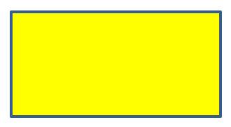

## **Introduktion**

Formatera former i PowerPoint genom att justera deras konturer, fyllningar och effekter. Aspose.Slides för Python via Java låter dig styra dessa inställningar programmässigt, inklusive transparens, rotation och 3D-formatering.


Aspose.Slides för Python via Java tillhandahåller klasser och metoder som låter dig formatera former med samma alternativ som finns i PowerPoint.

## **Formatera linjer**

Använd [Shape.getLineFormat](https://reference.aspose.com/slides/python-java/aspose.slides/shape/#getLineFormat) för att kontrollera en formes kontur. Detta exempel skapar en ofylld rektangel med en blå, streckad kontur. [LineFormat.setStyle](https://reference.aspose.com/slides/python-java/aspose.slides/lineformat/#setStyle) väljer en tjock‑tunn sammansatt linje, medan [LineFormat.setWidth](https://reference.aspose.com/slides/python-java/aspose.slides/lineformat/#setWidth) sätter dess bredd till 7 punkter och [LineFormat.setDashStyle](https://reference.aspose.com/slides/python-java/aspose.slides/lineformat/#setDashStyle) väljer dash‑mönstret.

```python
import jpype
import asposeslides

if not jpype.isJVMStarted():
    jpype.startJVM()

from asposeslides.api import FillType, LineDashStyle, LineStyle, Presentation, SaveFormat, ShapeType
from java.awt import Color

presentation = Presentation()
try:
    slide = presentation.getSlides().get_Item(0)

    shape = slide.getShapes().addAutoShape(ShapeType.Rectangle, 50, 50, 150, 75)
    shape.getFillFormat().setFillType(FillType.NoFill)
    shape.getLineFormat().setStyle(LineStyle.ThickThin)
    shape.getLineFormat().setWidth(7)
    shape.getLineFormat().setDashStyle(LineDashStyle.Dash)
    shape.getLineFormat().getFillFormat().setFillType(FillType.Solid)
    shape.getLineFormat().getFillFormat().getSolidFillColor().setColor(Color.BLUE)

    presentation.save("formatted_lines.pptx", SaveFormat.Pptx)
finally:
    presentation.dispose()
```

Resultatet:


### **Ange anpassade linjestreckmönster**

Använd [LineFormat.setCustomDashPattern](https://reference.aspose.com/slides/python-java/aspose.slides/lineformat/#setCustomDashPattern) när fördefinierade linjestilar inte ger de dash‑längder och mellanrum du behöver, till exempel för varumärkeskonturer eller tekniska diagram. Att tilldela ett mönster ändrar automatiskt linjestreckstilen till [LineDashStyle.Custom](https://reference.aspose.com/slides/python-java/aspose.slides/linedashstyle/).

Array‑elementen växlar mellan streck‑ och mellanrumslängder, med början på ett streck. Varje värde är en multipel av linjebredden: `[4, 2]` vid en bredd på 3 punkter ger ett 12‑punktigt streck följt av ett 6‑punktigt mellanrum. Använd par av ändliga, icke‑negativa värden för att definiera kompletta streck‑och‑mellanrumsegment. Exemplet använder positiva värden för att hålla varje streck och mellanrum synliga.

Detta exempel skapar fem blå linjer med samma längd och platta ändar. De första tre jämför mönster vid en bredd på 3 punkter. Den fjärde upprepar det första mönstret med dubbelt så stor bredd, vilket fördubblar både streck‑ och mellanrumslängderna. Den femte byter från ett anpassat mönster till en solid linje.

```python
import jpype
import asposeslides

if not jpype.isJVMStarted():
    jpype.startJVM()

from asposeslides.api import FillType, LineArrowheadStyle, LineCapStyle, LineDashStyle, Presentation, SaveFormat, ShapeType, SlideSizeScaleType
from java.awt import Color

presentation = Presentation()
try:
    presentation.getSlideSize().setSize(600, 300, SlideSizeScaleType.DoNotScale)
    slide = presentation.getSlides().get_Item(0)

    patterns = [
        [4, 2],
        [1, 2],
        [6, 2, 1, 2],
        [4, 2],
        [4, 2]
    ]

    for i, pattern in enumerate(patterns):
        line = slide.getShapes().addAutoShape(ShapeType.Line, 50, 50 + i * 50, 500, 0)
        line.getLineFormat().setWidth(6 if i == 3 else 3)
        line.getLineFormat().getFillFormat().setFillType(FillType.Solid)
        color = Color(0, 0, 139)
        line.getLineFormat().getFillFormat().getSolidFillColor().setColor(color)
        line.getLineFormat().setCapStyle(LineCapStyle.Flat)
        line.getLineFormat().setBeginArrowheadStyle(LineArrowheadStyle.None_)
        line.getLineFormat().setEndArrowheadStyle(LineArrowheadStyle.None_)
        line.getLineFormat().setCustomDashPattern(jpype.JArray(jpype.JFloat)(pattern))

    # Återställ den sista linjen till en solid stil.
    slide.getShapes().get_Item(4).getLineFormat().setDashStyle(LineDashStyle.Solid)

    presentation.save("custom_dash_patterns.pptx", SaveFormat.Pptx)
finally:
    presentation.dispose()
```

För att återgå till en fördefinierad streckad stil istället, skicka [LineDashStyle.Dash](https://reference.aspose.com/slides/python-java/aspose.slides/linedashstyle/) till [LineFormat.setDashStyle](https://reference.aspose.com/slides/python-java/aspose.slides/lineformat/#setDashStyle). Den valda stilen styr linjens utseende.

Resultatet i PowerPoint, från topp till botten: **{4, 2}, 3 pt**; **{1, 2}, 3 pt**; **{6, 2, 1, 2}, 3 pt**; **{4, 2}, 6 pt**; och **Solid, 3 pt**.


### **Ange linjeändar**

Använd [LineFormat.setCapStyle](https://reference.aspose.com/slides/python-java/aspose.slides/lineformat/#setCapStyle) för att ställa in ändarna på en öppen linje. Klassen [LineCapStyle](https://reference.aspose.com/slides/python-java/aspose.slides/linecapstyle/) erbjuder tre explicita ände‑stilar:

- `Flat`: Strokningen slutar vid ändpunkten.
- `Round`: En halvcirkelformad ände sträcker sig bortom ändpunkten med halva linjebredden.
- `Square`: En fyrkantig ände sträcker sig bortom ändpunkten med halva linjebredden.

Klassen innehåller också `NotDefined`, vilket betyder att ingen ände‑stil har tilldelats explicit.

Ändar är annorlunda än pilspetsar, som lägger till symboler i linjeändar, och fogar, som styr hörnen mellan linjesegment. Detta exempel inaktiverar pilspetsar via [LineFormat.setBeginArrowheadStyle](https://reference.aspose.com/slides/python-java/aspose.slides/lineformat/#setBeginArrowheadStyle) och [LineFormat.setEndArrowheadStyle](https://reference.aspose.com/slides/python-java/aspose.slides/lineformat/#setEndArrowheadStyle) så att endast ände‑formerna jämförs.

Följande exempel skapar tre annars identiska horisontella linjer, 20 punkter breda. Från topp till botten använder de platta, runda och fyrkantiga ändar. Deras ändpunkter har samma horisontella koordinater; de runda och fyrkantiga ändarna sträcker sig 10 punkter bortom varje ändpunkt.

```python
import jpype
import asposeslides

if not jpype.isJVMStarted():
    jpype.startJVM()

from asposeslides.api import FillType, LineArrowheadStyle, LineCapStyle, LineDashStyle, Presentation, SaveFormat, ShapeType, SlideSizeScaleType
from java.awt import Color

presentation = Presentation()
try:
    presentation.getSlideSize().setSize(500, 240, SlideSizeScaleType.DoNotScale)
    slide = presentation.getSlides().get_Item(0)

    cap_styles = [LineCapStyle.Flat, LineCapStyle.Round, LineCapStyle.Square]

    for i, cap_style in enumerate(cap_styles):
        line = slide.getShapes().addAutoShape(ShapeType.Line, 100, 50 + i * 70, 300, 0)
        line.getLineFormat().setWidth(20)
        line.getLineFormat().getFillFormat().setFillType(FillType.Solid)
        color = Color(0, 0, 139)
        line.getLineFormat().getFillFormat().getSolidFillColor().setColor(color)
        line.getLineFormat().setDashStyle(LineDashStyle.Solid)
        line.getLineFormat().setCapStyle(cap_style)
        line.getLineFormat().setBeginArrowheadStyle(LineArrowheadStyle.None_)
        line.getLineFormat().setEndArrowheadStyle(LineArrowheadStyle.None_)

    presentation.save("line_caps.pptx", SaveFormat.Pptx)
finally:
    presentation.dispose()
```

Resultatet i PowerPoint, från topp till botten: **Flat**, **Round**, och **Square**.


## **Applicera skiss‑effekter på formernas linjer**

En skisseffekt får en formlinje att se handritad ut. Använd [Shape.getLineFormat](https://reference.aspose.com/slides/python-java/aspose.slides/shape/#getLineFormat) för att komma åt linjeinställningarna, [LineFormat.getSketchFormat](https://reference.aspose.com/slides/python-java/aspose.slides/lineformat/#getSketchFormat) för att nå skissinställningarna, och [SketchFormat.setSketchType](https://reference.aspose.com/slides/python-java/aspose.slides/sketchformat/#setSketchType) för att välja ett värde från klassen [LineSketchType](https://reference.aspose.com/slides/python-java/aspose.slides/linesketchtype/).

Följande Python‑kod visar hur man applicerar en [LineSketchType.Curved](https://reference.aspose.com/slides/python-java/aspose.slides/linesketchtype/)‑effekt, läser det explicit tilldelade värdet, och tar bort effekten med [LineSketchType.None_](https://reference.aspose.com/slides/python-java/aspose.slides/linesketchtype/):

```python
import jpype
import asposeslides

if not jpype.isJVMStarted():
    jpype.startJVM()

from asposeslides.api import LineSketchType, Presentation, ShapeType

presentation = Presentation()
try:
    slide = presentation.getSlides().get_Item(0)

    shape = slide.getShapes().addAutoShape(ShapeType.Rectangle, 50, 50, 200, 100)

    sketch_format = shape.getLineFormat().getSketchFormat()
    sketch_format.setSketchType(LineSketchType.Curved)
    explicit_sketch_type = sketch_format.getSketchType()
    print("Explicit sketch type:", explicit_sketch_type)
    sketch_format.setSketchType(LineSketchType.None_)
finally:
    presentation.dispose()
```

Värdet som returneras av [SketchFormat.getSketchType](https://reference.aspose.com/slides/python-java/aspose.slides/sketchformat/#getSketchType) representerar inställningen som tilldelats formen direkt. Om linjeformateringen kan ärvas från ett tema, en master‑bild eller en layout‑bild, använd [LineFormat.getEffective](https://reference.aspose.com/slides/python-java/aspose.slides/lineformat/#getEffective) och läs skisstypen från den returnerade effektiva linjeformateringen, som visas nedan. Det effektiva värdet återspeglar den formatering som faktiskt tillämpas efter att arv har lösts. Detta exempel kräver en befintlig presentation med minst en form på den första bilden och skriver ut båda värdena:

```python
import jpype
import asposeslides

if not jpype.isJVMStarted():
    jpype.startJVM()

from asposeslides.api import Presentation

presentation = Presentation("presentation.pptx")
try:
    shape = presentation.getSlides().get_Item(0).getShapes().get_Item(0)

    line_format = shape.getLineFormat()
    explicit_sketch_type = line_format.getSketchFormat().getSketchType()
    effective_line_format = line_format.getEffective()
    effective_sketch_type = effective_line_format.getSketchFormat().getSketchType()

    print("Explicit sketch type:", explicit_sketch_type)
    print("Effective sketch type:", effective_sketch_type)
finally:
    presentation.dispose()
```

## **Formatera fogstilar**

Här är de tre alternativen för fogtyp:

* Round
* Miter
* Bevel

Fogstilen styr hur två kontursegment möts i ett hörn. Använd **Round** för rundade hörn, **Miter** för skarpa hörn, eller **Bevel** för avfasade hörn.


Detta exempel skapar tre svarta rektanglar med blå konturer 15 punkter breda. Det använder [LineFormat.setJoinStyle](https://reference.aspose.com/slides/python-java/aspose.slides/lineformat/#setJoinStyle) för att sätta miter‑, bevel‑ och round‑värdena för [LineJoinStyle](https://reference.aspose.com/slides/python-java/aspose.slides/linejoinstyle/) respektive, för att jämföra hur hörnen ritas.

```python
import jpype
import asposeslides

if not jpype.isJVMStarted():
    jpype.startJVM()

from asposeslides.api import FillType, LineJoinStyle, Presentation, SaveFormat, ShapeType
from java.awt import Color

presentation = Presentation()
try:
    slide = presentation.getSlides().get_Item(0)

    miter_shape = slide.getShapes().addAutoShape(ShapeType.Rectangle, 20, 20, 150, 75)
    bevel_shape = slide.getShapes().addAutoShape(ShapeType.Rectangle, 210, 20, 150, 75)
    round_shape = slide.getShapes().addAutoShape(ShapeType.Rectangle, 20, 135, 150, 75)

    miter_shape.getFillFormat().setFillType(FillType.Solid)
    miter_shape.getFillFormat().getSolidFillColor().setColor(Color.BLACK)
    bevel_shape.getFillFormat().setFillType(FillType.Solid)
    bevel_shape.getFillFormat().getSolidFillColor().setColor(Color.BLACK)
    round_shape.getFillFormat().setFillType(FillType.Solid)
    round_shape.getFillFormat().getSolidFillColor().setColor(Color.BLACK)

    miter_shape.getLineFormat().setWidth(15)
    bevel_shape.getLineFormat().setWidth(15)
    round_shape.getLineFormat().setWidth(15)

    miter_shape.getLineFormat().getFillFormat().setFillType(FillType.Solid)
    miter_shape.getLineFormat().getFillFormat().getSolidFillColor().setColor(Color.BLUE)
    bevel_shape.getLineFormat().getFillFormat().setFillType(FillType.Solid)
    bevel_shape.getLineFormat().getFillFormat().getSolidFillColor().setColor(Color.BLUE)
    round_shape.getLineFormat().getFillFormat().setFillType(FillType.Solid)
    round_shape.getLineFormat().getFillFormat().getSolidFillColor().setColor(Color.BLUE)

    miter_shape.getLineFormat().setJoinStyle(LineJoinStyle.Miter)
    bevel_shape.getLineFormat().setJoinStyle(LineJoinStyle.Bevel)
    round_shape.getLineFormat().setJoinStyle(LineJoinStyle.Round)

    miter_shape.getTextFrame().setText("Miter Join Style")
    bevel_shape.getTextFrame().setText("Bevel Join Style")
    round_shape.getTextFrame().setText("Round Join Style")

    presentation.save("join_styles.pptx", SaveFormat.Pptx)
finally:
    presentation.dispose()
```

### **Begränsa Miter‑fogar vid skarpa hörn**

Använd [LineFormat.setMiterLimit](https://reference.aspose.com/slides/python-java/aspose.slides/lineformat/#setMiterLimit) med [LineFormat.setJoinStyle](https://reference.aspose.com/slides/python-java/aspose.slides/lineformat/#setJoinStyle) satt till [LineJoinStyle.Miter](https://reference.aspose.com/slides/python-java/aspose.slides/linejoinstyle/) för att begränsa hur långt ett spetsigt hörn kan sträcka sig.

Gränsen är ett förhållande mellan avståndet mellan den inre och yttre hörnan i foggen och linjebredden. Till exempel tillåter ett värde på `8` en miter‑längd på upp till åtta gånger linjebredden; det är ingen måttangivelse i punkter. Om hörnet skulle överskrida gränsen använder PowerPoint en avfasad fog på det hörnet. En större gräns möjliggör spetsigare punkter. Inställningen påverkar endast miter‑fogar, och att ändra den har ingen synlig effekt när hörnet förblir inom båda gränserna.

Detta exempel skapar två identiska, ofyllda trianglar med konturer 20 punkter breda. Den vänstra triangeln använder en gräns på `2`, och den högra använder `8`. Varje triangel är 80 punkter bred och 160 punkter hög, vilket ger dess översta hörn ett miter‑längd‑till‑linjebredd‑förhållande på ungefär `4.12`. Följaktligen avfasar PowerPoint den vänstra spetsen och behåller den högra spetsen.

```python
import jpype
import asposeslides

if not jpype.isJVMStarted():
    jpype.startJVM()

from asposeslides.api import FillType, LineJoinStyle, Presentation, SaveFormat, ShapeType, SlideSizeScaleType
from java.awt import Color

presentation = Presentation()
try:
    presentation.getSlideSize().setSize(500, 320, SlideSizeScaleType.DoNotScale)
    slide = presentation.getSlides().get_Item(0)

    miter_limits = [2.0, 8.0]

    for i, miter_limit in enumerate(miter_limits):
        triangle = slide.getShapes().addAutoShape(ShapeType.Triangle, 90 + i * 240, 110, 80, 160)
        triangle.getFillFormat().setFillType(FillType.NoFill)
        triangle.getLineFormat().setWidth(20)
        triangle.getLineFormat().getFillFormat().setFillType(FillType.Solid)
        color = Color(0, 0, 139)
        triangle.getLineFormat().getFillFormat().getSolidFillColor().setColor(color)
        triangle.getLineFormat().setJoinStyle(LineJoinStyle.Miter)
        triangle.getLineFormat().setMiterLimit(miter_limit)

    presentation.save("miter_limits.pptx", SaveFormat.Pptx)
finally:
    presentation.dispose()
```

Resultatet i PowerPoint: **Miter limit 2** till vänster och **miter limit 8** till höger.


## **Gradientfyllning**

En gradientfyllning blandar färger över en form. Detta exempel fyller en ellips med en linjär gradient i 45‑graders vinkel från röd till lila med hjälp av [FillFormat.getGradientFormat](https://reference.aspose.com/slides/python-java/aspose.slides/fillformat/#getGradientFormat). Metoden [GradientStopCollection.addPresetColor](https://reference.aspose.com/slides/python-java/aspose.slides/gradientstopcollection/#addPresetColor) placerar färgstopp vid 0 och 1, början och slutet på gradienten. Att rensa befintliga stopp säkerställer att endast dessa två färger används.

```python
import jpype
import asposeslides

if not jpype.isJVMStarted():
    jpype.startJVM()

from asposeslides.api import FillType, GradientShape, Presentation, PresetColor, SaveFormat, ShapeType
from java.awt import Color

presentation = Presentation()
try:
    slide = presentation.getSlides().get_Item(0)

    shape = slide.getShapes().addAutoShape(ShapeType.Ellipse, 50, 50, 150, 75)
    shape.getFillFormat().setFillType(FillType.Gradient)
    shape.getFillFormat().getGradientFormat().setGradientShape(GradientShape.Linear)
    shape.getFillFormat().getGradientFormat().setLinearGradientAngle(45)
    shape.getFillFormat().getGradientFormat().getGradientStops().clear()
    shape.getFillFormat().getGradientFormat().getGradientStops().addPresetColor(1.0, PresetColor.Purple)
    shape.getFillFormat().getGradientFormat().getGradientStops().addPresetColor(0.0, PresetColor.Red)

    presentation.save("gradient_fill.pptx", SaveFormat.Pptx)
finally:
    presentation.dispose()
```

Resultatet:


Om en gradient ser annorlunda ut i en exporterad bild än i PowerPoint, se [Choose a Gradient Rendering Style](/slides/sv/python-java/convert-powerpoint-to-png/#choose-a-gradient-rendering-style). Du kan välja en renderingsstil utan att ändra gradientfyllningen som lagras i presentationen.

### **Ange vinkeln för den linjära gradienten**

Använd [GradientFormat.setLinearGradientAngle](https://reference.aspose.com/slides/python-java/aspose.slides/gradientformat/#setLinearGradientAngle) för att kontrollera orienteringen av en [GradientShape.Linear](https://reference.aspose.com/slides/python-java/aspose.slides/gradientshape/)‑fyllning. Vinkeln mäts i grader och ökar medurs: `0` går från vänster till höger, `90` från toppen till botten, `180` från höger till vänster och `270` från botten till toppen. Bråkvinklar stöds. Finitiva vinklar utanför `[0, 360)` normaliseras till en full rotation; till exempel blir `-45` till `315` och `360` till `0`.

Detta exempel skapar sex rektanglar med identiska röda, gröna och blå stopp vid positionerna `0`, `0.5` och `1`. Skalning är inaktiverad så att vinkeln kan jämföras oberoende av rektanglarnas proportioner. Vinklarna, från vänster till höger, är `0`, `45` och `90` i första raden, samt `135`, `180` och `270` i andra raden.

```python
import jpype
import asposeslides

if not jpype.isJVMStarted():
    jpype.startJVM()

from asposeslides.api import FillType, GradientShape, NullableBool, Presentation, SaveFormat, ShapeType, SlideSizeScaleType
from java.awt import Color

presentation = Presentation()
try:
    presentation.getSlideSize().setSize(720, 400, SlideSizeScaleType.DoNotScale)
    slide = presentation.getSlides().get_Item(0)

    angles = [0, 45, 90, 135, 180, 270]

    for i, angle in enumerate(angles):
        x = 30 + (i % 3) * 230
        y = 30 + (i // 3) * 190

        shape = slide.getShapes().addAutoShape(ShapeType.Rectangle, x, y, 200, 150)
        shape.getLineFormat().getFillFormat().setFillType(FillType.NoFill)
        shape.getFillFormat().setFillType(FillType.Gradient)

        gradient = shape.getFillFormat().getGradientFormat()
        gradient.setGradientShape(GradientShape.Linear)
        gradient.getGradientStops().clear()
        gradient.getGradientStops().add(0, Color.RED)
        gradient.getGradientStops().add(0.5, Color.GREEN)
        gradient.getGradientStops().add(1, Color.BLUE)
        gradient.setLinearGradientScaled(NullableBool.False_)
        gradient.setLinearGradientAngle(angle)

    presentation.save("linear_gradient_angles.pptx", SaveFormat.Pptx)
finally:
    presentation.dispose()
```

Resultatet i PowerPoint:


### **Skala en linjär gradient med formen**

[GradientFormat.setLinearGradientScaled](https://reference.aspose.com/slides/python-java/aspose.slides/gradientformat/#setLinearGradientScaled) accepterar ett [NullableBool](https://reference.aspose.com/slides/python-java/aspose.slides/nullablebool/)‑värde. Sätt det explicit till `False_` för att behålla den geometriska gradientvinkeln när formens proportioner förändras, eller till `True_` för att skala gradienten med formens bredd och höjd. Med skalning aktiverad kan den synliga vinkeln skilja sig från den tilldelade vinkeln på en icke‑kvadratisk form.

Följande exempel använder en `45`‑graders vinkel och samma färgstopp som vinkeljämförelsen. Den vänstra kolumnen använder `False_`; den högra kolumnen använder `True_`. Varje kolumn innehåller en bred rektangel ovanför en hög rektangel. Båda startar med samma breda dimensioner; förändring av den andra rektangelns bredd och höjd demonstrerar hur fyllningen svarar på storleksändring utan att ändra gradientinställningarna.

```python
import jpype
import asposeslides

if not jpype.isJVMStarted():
    jpype.startJVM()

from asposeslides.api import FillType, GradientShape, NullableBool, Presentation, SaveFormat, ShapeType, SlideSizeScaleType
from java.awt import Color

presentation = Presentation()
try:
    presentation.getSlideSize().setSize(720, 460, SlideSizeScaleType.DoNotScale)
    slide = presentation.getSlides().get_Item(0)

    scaling_options = [NullableBool.False_, NullableBool.True_]

    for column, scaled in enumerate(scaling_options):
        for row in range(2):
            x = 30 + column * 360
            y = 30 if row == 0 else 150

            shape = slide.getShapes().addAutoShape(ShapeType.Rectangle, x, y, 300, 90)
            shape.getLineFormat().getFillFormat().setFillType(FillType.NoFill)
            shape.getFillFormat().setFillType(FillType.Gradient)

            gradient = shape.getFillFormat().getGradientFormat()
            gradient.setGradientShape(GradientShape.Linear)
            gradient.getGradientStops().clear()
            gradient.getGradientStops().add(0, Color.RED)
            gradient.getGradientStops().add(0.5, Color.GREEN)
            gradient.getGradientStops().add(1, Color.BLUE)
            gradient.setLinearGradientAngle(45)
            gradient.setLinearGradientScaled(scaled)

            if row == 1:
                shape.setWidth(90)
                shape.setHeight(280)

    presentation.save("linear_gradient_scaling.pptx", SaveFormat.Pptx)
finally:
    presentation.dispose()
```

Resultatet i PowerPoint, med skalning inaktiverad till vänster och aktiverad till höger:


Med skalning inaktiverad behåller de diagonala färgbanden samma orientering i båda rektanglarna. Med skalning aktiverad sträcks banden med formens proportioner. Detta hjälper till att reproducera en mall‑gradient när en form anpassas till en annan storlek. På en kvadrat ändrar inte aktivering av skalning utseendet på denna `45`‑graders gradient.

Både vinkeln och skalningsinställningarna gäller för linjära gradienter. De styr inte [GradientShape.Radial eller GradientShape.Rectangle](https://reference.aspose.com/slides/python-java/aspose.slides/gradientshape/)‑fyllningar.

### **Kombinera vinkeln med gradientriktning**

[GradientFormat.setGradientDirection](https://reference.aspose.com/slides/python-java/aspose.slides/gradientformat/#setGradientDirection) väljer en gradientstil från klassen [GradientDirection](https://reference.aspose.com/slides/python-java/aspose.slides/gradientdirection/); det är ingen ersättning för en numerisk vinkel. För en linjär gradient kan hörnstilarna ändra området där färgerna fördelas utan att ändra vinkeln som tilldelats via [setLinearGradientAngle](https://reference.aspose.com/slides/python-java/aspose.slides/gradientformat/#setLinearGradientAngle). Behåll riktningen oförändrad när du jämför vinklar eller skalning.

```python
import jpype
import asposeslides

if not jpype.isJVMStarted():
    jpype.startJVM()

from asposeslides.api import FillType, GradientDirection, GradientShape, NullableBool, Presentation, SaveFormat, ShapeType
from java.awt import Color

presentation = Presentation()
try:
    slide = presentation.getSlides().get_Item(0)

    for i in range(2):
        shape = slide.getShapes().addAutoShape(ShapeType.Rectangle, 30, 30 + i * 140, 320, 100)
        shape.getLineFormat().getFillFormat().setFillType(FillType.NoFill)
        shape.getFillFormat().setFillType(FillType.Gradient)

        gradient = shape.getFillFormat().getGradientFormat()
        gradient.setGradientShape(GradientShape.Linear)
        gradient.getGradientStops().clear()
        gradient.getGradientStops().add(0, Color.RED)
        gradient.getGradientStops().add(0.5, Color.GREEN)
        gradient.getGradientStops().add(1, Color.BLUE)
        gradient.setLinearGradientScaled(NullableBool.True_)

        if i == 0:
            gradient.setGradientDirection(GradientDirection.FromCorner1)
            gradient.setLinearGradientAngle(30)
        else:
            gradient.setLinearGradientAngle(30)
            gradient.setGradientDirection(GradientDirection.FromCorner1)

    presentation.save("linear_gradient_direction.pptx", SaveFormat.Pptx)
finally:
    presentation.dispose()
```

## **Mönsterfyllning**

En mönsterfyllning applicerar en två‑färgsdesign, såsom prickar, ränder eller rutmönster. Detta exempel använder [PatternFormat.setPatternStyle](https://reference.aspose.com/slides/python-java/aspose.slides/patternformat/#setPatternStyle) för att välja ett spalettmönster. [PatternFormat.getBackColor](https://reference.aspose.com/slides/python-java/aspose.slides/patternformat/#getBackColor) levererar den ljusgrå bakgrunden, och [PatternFormat.getForeColor](https://reference.aspose.com/slides/python-java/aspose.slides/patternformat/#getForeColor) levererar den gula mönsterfärgen.

```python
import jpype
import asposeslides

if not jpype.isJVMStarted():
    jpype.startJVM()

from asposeslides.api import FillType, PatternStyle, Presentation, SaveFormat, ShapeType
from java.awt import Color

presentation = Presentation()
try:
    slide = presentation.getSlides().get_Item(0)

    shape = slide.getShapes().addAutoShape(ShapeType.Rectangle, 50, 50, 150, 75)
    shape.getFillFormat().setFillType(FillType.Pattern)
    shape.getFillFormat().getPatternFormat().setPatternStyle(PatternStyle.Trellis)
    shape.getFillFormat().getPatternFormat().getBackColor().setColor(Color.LIGHT_GRAY)
    shape.getFillFormat().getPatternFormat().getForeColor().setColor(Color.YELLOW)

    presentation.save("pattern_fill.pptx", SaveFormat.Pptx)
finally:
    presentation.dispose()
```

Resultatet:


## **Bildfyllning**

En bildfyllning använder en bild inuti en form. Detta exempel kräver en lokal bild och använder [Images.fromFile](https://reference.aspose.com/slides/python-java/aspose.slides/images/#fromFile) för att ladda den i presentationens bildsamling. Genom att sätta [PictureFillFormat.setPictureFillMode](https://reference.aspose.com/slides/python-java/aspose.slides/picturefillformat/#setPictureFillMode) till det tile‑läge som upprepas bilden inom rektangeln. Källbilden som används här visas nedan:


```python
import jpype
import asposeslides

if not jpype.isJVMStarted():
    jpype.startJVM()

from asposeslides.api import FillType, Images, PictureFillMode, Presentation, SaveFormat, ShapeType

presentation = Presentation()
try:
    slide = presentation.getSlides().get_Item(0)

    shape = slide.getShapes().addAutoShape(ShapeType.Rectangle, 50, 50, 255, 130)
    shape.getFillFormat().setFillType(FillType.Picture)
    shape.getFillFormat().getPictureFillFormat().setPictureFillMode(PictureFillMode.Tile)

    image = Images.fromFile("lotus.png")
    try:
        picture = presentation.getImages().addImage(image)
    finally:
        image.dispose()
    shape.getFillFormat().getPictureFillFormat().getPicture().setImage(picture)

    presentation.save("picture_fill.pptx", SaveFormat.Pptx)
finally:
    presentation.dispose()
```

Resultatet:


### **Kakelbild som textur**

Om du vill ställa in en kaklad bild som en textur och anpassa kakel‑beteendet kan du använda följande metoder i klassen [PictureFillFormat](https://reference.aspose.com/slides/python-java/aspose.slides/picturefillformat/):

- [setPictureFillMode](https://reference.aspose.com/slides/python-java/aspose.slides/picturefillformat/#setPictureFillMode): Ställer in bildfyllningsläget — antingen `Tile` eller `Stretch`.
- [setTileAlignment](https://reference.aspose.com/slides/python-java/aspose.slides/picturefillformat/#setTileAlignment): Anger justeringen av kakel inom formen.
- [setTileFlip](https://reference.aspose.com/slides/python-java/aspose.slides/picturefillformat/#setTileFlip): Styr om kaklet speglas horisontellt, vertikalt eller båda.
- [setTileOffsetX](https://reference.aspose.com/slides/python-java/aspose.slides/picturefillformat/#setTileOffsetX): Ställer in den horisontella förskjutningen av kaklet (i punkter) från formens ursprung.
- [setTileOffsetY](https://reference.aspose.com/slides/python-java/aspose.slides/picturefillformat/#setTileOffsetY): Ställer in den vertikala förskjutningen av kaklet (i punkter) från formens ursprung.
- [setTileScaleX](https://reference.aspose.com/slides/python-java/aspose.slides/picturefillformat/#setTileScaleX): Definierar den horisontella skalan av kaklet i procent.
- [setTileScaleY](https://reference.aspose.com/slides/python-java/aspose.slides/picturefillformat/#setTileScaleY): Definierar den vertikala skalan av kaklet i procent.

Detta exempel kräver en lokal bild och konfigurerar [PictureFillFormat](https://reference.aspose.com/slides/python-java/aspose.slides/picturefillformat/) för att upprepa den på 50 % av dess originalstorlek. Förskjutningar på −32 punkter flyttar kaklen horisontellt och vertikalt; justering längst ner till höger och spegling i båda riktningarna bestämmer hur den upprepade texturen arrangeras.

```python
import jpype
import asposeslides

if not jpype.isJVMStarted():
    jpype.startJVM()

from asposeslides.api import FillType, Images, PictureFillMode, Presentation, RectangleAlignment, SaveFormat, ShapeType, TileFlip

presentation = Presentation()
try:
    first_slide = presentation.getSlides().get_Item(0)

    shape = first_slide.getShapes().addAutoShape(ShapeType.Rectangle, 50, 50, 190, 95)
    shape.getFillFormat().setFillType(FillType.Picture)

    source_image = Images.fromFile("lotus.png")
    try:
        presentation_image = presentation.getImages().addImage(source_image)
    finally:
        source_image.dispose()

    picture_fill_format = shape.getFillFormat().getPictureFillFormat()
    picture_fill_format.getPicture().setImage(presentation_image)
    picture_fill_format.setPictureFillMode(PictureFillMode.Tile)
    picture_fill_format.setTileOffsetX(-32)
    picture_fill_format.setTileOffsetY(-32)
    picture_fill_format.setTileScaleX(50)
    picture_fill_format.setTileScaleY(50)
    picture_fill_format.setTileAlignment(RectangleAlignment.BottomRight)
    picture_fill_format.setTileFlip(TileFlip.FlipBoth)

    presentation.save("tile.pptx", SaveFormat.Pptx)
finally:
    presentation.dispose()
```

Resultatet:


## **Enfärgsfyllning**

En solid fyllning ger en form en enda, enhetlig färg. Detta exempel använder [FillFormat.setFillType](https://reference.aspose.com/slides/python-java/aspose.slides/fillformat/#setFillType) för att ange solid fyllningsläge och tilldelar gult via [FillFormat.getSolidFillColor](https://reference.aspose.com/slides/python-java/aspose.slides/fillformat/#getSolidFillColor), för att sedan spara rektangeln i en presentation.

```python
import jpype
import asposeslides

if not jpype.isJVMStarted():
    jpype.startJVM()

from asposeslides.api import FillType, Presentation, SaveFormat, ShapeType
from java.awt import Color

presentation = Presentation()
try:
    slide = presentation.getSlides().get_Item(0)

    shape = slide.getShapes().addAutoShape(ShapeType.Rectangle, 50, 50, 150, 75)
    shape.getFillFormat().setFillType(FillType.Solid)
    shape.getFillFormat().getSolidFillColor().setColor(Color.YELLOW)

    presentation.save("solid_color_fill.pptx", SaveFormat.Pptx)
finally:
    presentation.dispose()
```

Resultatet:



## **Använd bildbakgrund som formfyllning**

Använd [AutoShape.setUseBackgroundFill](https://reference.aspose.com/slides/python-java/aspose.slides/autoshape/#setUseBackgroundFill) när en form ska matcha bildbakgrunden, till exempel i en presentationsmall. Ställ först in [FillFormat.setFillType](https://reference.aspose.com/slides/python-java/aspose.slides/fillformat/#setFillType) till [FillType.NotDefined](https://reference.aspose.com/slides/python-java/aspose.slides/filltype/) för att ta bort eventuell explicit fyllning. Med denna kombination använder formen bildbakgrunden istället för sin stilfyllning. Att bara aktivera flaggan tar inte bort en befintlig explicit fyllning.

Detta skiljer sig från [FillType.NoFill](https://reference.aspose.com/slides/python-java/aspose.slides/filltype/): bakgrundsfyllning täcker objekt bakom formen med motsvarande område av bildbakgrunden, medan ingen fyllning lämnar dessa objekt synliga. En gradient förblir justerad med bilden snarare än att starta om i varje form.

Följande exempel skapar en huvudbakgrund som ärvs av bilden och placerar ett magentafarvet band bakom tre rektanglar. Den vänstra rektangeln använder bakgrunden, den mittersta har ingen fyllning, och den högra byter från bakgrundsfyllning till en explicit orange fyllning.

```python
import jpype
import asposeslides

if not jpype.isJVMStarted():
    jpype.startJVM()

from asposeslides.api import BackgroundType, FillType, GradientShape, Presentation, SaveFormat, ShapeType, SlideSizeScaleType
from java.awt import Color

presentation = Presentation()
try:
    presentation.getSlideSize().setSize(720, 400, SlideSizeScaleType.DoNotScale)
    slide = presentation.getSlides().get_Item(0)

    # Ärva gradienten från master.
    slide.getBackground().setType(BackgroundType.NotDefined)
    slide.getLayoutSlide().getBackground().setType(BackgroundType.NotDefined)
    background = slide.getLayoutSlide().getMasterSlide().getBackground()
    background.setType(BackgroundType.OwnBackground)
    background.getFillFormat().setFillType(FillType.Gradient)
    gradient = background.getFillFormat().getGradientFormat()
    gradient.setGradientShape(GradientShape.Linear)
    gradient.setLinearGradientAngle(0)
    gradient.getGradientStops().clear()
    color = Color(0, 0, 139)
    gradient.getGradientStops().add(0, color)
    color = Color(135, 206, 250)
    gradient.getGradientStops().add(1, color)

    # Lägg till detta objekt först så att det visas bakom rektanglarna.
    band = slide.getShapes().addAutoShape(ShapeType.Rectangle, 25, 150, 670, 100)
    band.getFillFormat().setFillType(FillType.Solid)
    band.getFillFormat().getSolidFillColor().setColor(Color.MAGENTA)
    band.getLineFormat().getFillFormat().setFillType(FillType.NoFill)

    background_shape = slide.getShapes().addAutoShape(ShapeType.Rectangle, 50, 100, 160, 200)
    background_shape.getFillFormat().setFillType(FillType.NotDefined)
    background_shape.setUseBackgroundFill(True)

    no_fill_shape = slide.getShapes().addAutoShape(ShapeType.Rectangle, 280, 100, 160, 200)
    no_fill_shape.getFillFormat().setFillType(FillType.NoFill)

    explicit_shape = slide.getShapes().addAutoShape(ShapeType.Rectangle, 510, 100, 160, 200)
    explicit_shape.getFillFormat().setFillType(FillType.NotDefined)
    explicit_shape.setUseBackgroundFill(True)

    # Inaktivera bakgrundsfyllning innan en explicit fyllning appliceras.
    explicit_shape.setUseBackgroundFill(False)
    explicit_shape.getFillFormat().setFillType(FillType.Solid)
    color = Color(255, 165, 0)
    explicit_shape.getFillFormat().getSolidFillColor().setColor(color)

    presentation.save("background_fill.pptx", SaveFormat.Pptx)
finally:
    presentation.dispose()
```

Resultatet, från vänster till höger: **background fill**, **no fill**, och **explicit fill**. Det magentafärgade bandet döljs av den vänstra och högra rektangeln men förblir synligt genom den mittersta rektangeln.


Samma beteende gäller för en bakgrund som definieras direkt på bilden eller ärvs från en layout. Formen använder bildens lösta bakgrund; exemplet lämnar både bild‑ och layoutbakgrunder odefinierade så att huvudbakgrunden levereras.

## **Ställ in transparens**

För en solid fyllning kontrollerar färgens alfakomponent opaciteten: 0 är helt transparent och 255 är helt ogenomskinlig. Detta exempel använder ett alfavärde på 128 för en gul rektangel, vilket gör den ungefär 50 % transparent så att rektangeln under förblir synlig. Färgen tilldelas via [FillFormat.getSolidFillColor](https://reference.aspose.com/slides/python-java/aspose.slides/fillformat/#getSolidFillColor).

```python
import jpype
import asposeslides

if not jpype.isJVMStarted():
    jpype.startJVM()

from asposeslides.api import FillType, Presentation, SaveFormat, ShapeType
from java.awt import Color

presentation = Presentation()
try:
    slide = presentation.getSlides().get_Item(0)

    solid_shape = slide.getShapes().addAutoShape(ShapeType.Rectangle, 50, 50, 150, 75)

    transparent_shape = slide.getShapes().addAutoShape(ShapeType.Rectangle, 80, 80, 150, 75)
    transparent_shape.getFillFormat().setFillType(FillType.Solid)
    color = Color(255, 255, 0, 128)
    transparent_shape.getFillFormat().getSolidFillColor().setColor(color)

    presentation.save("shape_transparency.pptx", SaveFormat.Pptx)
finally:
    presentation.dispose()
```

Resultatet:


## **Rotera former**

Använd [Shape.setRotation](https://reference.aspose.com/slides/python-java/aspose.slides/shape/#setRotation) för att rotera en form i bildplanet. Vinkeln mäts i grader; detta exempel roterar en rektangel 5 grader medurs och sparar presentationen.

```python
import jpype
import asposeslides

if not jpype.isJVMStarted():
    jpype.startJVM()

from asposeslides.api import Presentation, SaveFormat, ShapeType

presentation = Presentation()
try:
    slide = presentation.getSlides().get_Item(0)

    shape = slide.getShapes().addAutoShape(ShapeType.Rectangle, 50, 50, 150, 75)
    shape.setRotation(5)

    presentation.save("shape_rotation.pptx", SaveFormat.Pptx)
finally:
    presentation.dispose()
```

Resultatet:


## **Lägg till 3D‑fasadeffekter**

Använd [Shape.getThreeDFormat](https://reference.aspose.com/slides/python-java/aspose.slides/shape/#getThreeDFormat) för att ge en form djup och fasade kanter. Detta exempel skapar en grön ellips med en orange kontur, använder [ThreeDFormat.setDepth](https://reference.aspose.com/slides/python-java/aspose.slides/threedformat/#setDepth) för att sätta djupet till 4 punkter, och applicerar en cirkulär top‑bevel med bredd och höjd på 6 punkter via [ThreeDFormat.getBevelTop](https://reference.aspose.com/slides/python-java/aspose.slides/threedformat/#getBevelTop). En framåtriktad ortografisk kamera och tre‑punkt belysning gör fasaden synlig.

```python
import jpype
import asposeslides

if not jpype.isJVMStarted():
    jpype.startJVM()

from asposeslides.api import BevelPresetType, CameraPresetType, FillType, LightRigPresetType, LightingDirection, Presentation, SaveFormat, ShapeType
from java.awt import Color

presentation = Presentation()
try:
    slide = presentation.getSlides().get_Item(0)

    shape = slide.getShapes().addAutoShape(ShapeType.Ellipse, 50, 50, 100, 100)
    shape.getFillFormat().setFillType(FillType.Solid)
    color = Color(0, 128, 0)
    shape.getFillFormat().getSolidFillColor().setColor(color)
    shape.getLineFormat().getFillFormat().setFillType(FillType.Solid)
    color = Color(255, 165, 0)
    shape.getLineFormat().getFillFormat().getSolidFillColor().setColor(color)
    shape.getLineFormat().setWidth(2.0)
    shape.getThreeDFormat().setDepth(4)
    shape.getThreeDFormat().getBevelTop().setBevelType(BevelPresetType.Circle)
    shape.getThreeDFormat().getBevelTop().setHeight(6)
    shape.getThreeDFormat().getBevelTop().setWidth(6)
    shape.getThreeDFormat().getCamera().setCameraType(CameraPresetType.OrthographicFront)
    shape.getThreeDFormat().getLightRig().setLightType(LightRigPresetType.ThreePt)
    shape.getThreeDFormat().getLightRig().setDirection(LightingDirection.Top)

    presentation.save("3D_bevel_effect.pptx", SaveFormat.Pptx)
finally:
    presentation.dispose()
```

Resultatet:


## **Lägg till 3D‑rotations‑effekter**

En formes 3D‑vy styrs av dess kamerainställningar. Detta exempel använder [Camera.setRotation](https://reference.aspose.com/slides/python-java/aspose.slides/camera/#setRotation) med latitud, longitud och rotationsvinklar på 40, 35 respektive 20 grader. Det väljer en isometrisk kamera via [Camera.setCameraType](https://reference.aspose.com/slides/python-java/aspose.slides/camera/#setCameraType) och balanserad belysning via [LightRig.setLightType](https://reference.aspose.com/slides/python-java/aspose.slides/lightrig/#setLightType), för att sedan spara den formaterade rektangeln.

```python
import jpype
import asposeslides

if not jpype.isJVMStarted():
    jpype.startJVM()

from asposeslides.api import CameraPresetType, LightRigPresetType, Presentation, SaveFormat, ShapeType

presentation = Presentation()
try:
    slide = presentation.getSlides().get_Item(0)

    auto_shape = slide.getShapes().addAutoShape(ShapeType.Rectangle, 50, 50, 150, 75)
    auto_shape.getTextFrame().setText("Hello, Aspose!")
    auto_shape.getThreeDFormat().getCamera().setCameraType(CameraPresetType.IsometricLeftUp)
    auto_shape.getThreeDFormat().getCamera().setRotation(40, 35, 20)
    auto_shape.getThreeDFormat().getLightRig().setLightType(LightRigPresetType.Balanced)

    presentation.save("3D_rotation_effect.pptx", SaveFormat.Pptx)
finally:
    presentation.dispose()
```

Resultatet:


## **Styr svart‑vit rendering för former**

Metoden [Shape.setBlackWhiteMode](https://reference.aspose.com/slides/python-java/aspose.slides/shape/#setBlackWhiteMode) specificerar hur en enskild form renderas när en presentation visas eller bearbetas i svart‑vit läge. Den aktiverar inte svart‑vit visning i sig och ändrar inte formens fyllning, linje eller annan formatering i normalt färg‑läge.

Använd ett värde från klassen [BlackWhiteMode](https://reference.aspose.com/slides/python-java/aspose.slides/blackwhitemode/) för att välja önskat beteende. Till exempel låter `Automatic` renderings‑applikationen välja konvertering, `Gray` och `LightGray` använder grå färgning, `BlackWhite` använder endast svart och vitt, `Black` och `White` tvingar en enda färg, `Color` bevarar normal färgning, och `Hidden` utesluter formen i svart‑vit läge. `NotDefined` betyder att inget form‑nivå läge är tilldelat.

Detta exempel skapar en orange rektangel och använder [Shape.setBlackWhiteMode](https://reference.aspose.com/slides/python-java/aspose.slides/shape/#setBlackWhiteMode) för att sätta läget till grått. Den sparade formen behåller sin orange fyllning för normal färgvisning och begär grå färgning från program som hedrar svart‑vit visningsinställningar:

```python
import jpype
import asposeslides

if not jpype.isJVMStarted():
    jpype.startJVM()

from asposeslides.api import BlackWhiteMode, FillType, Presentation, SaveFormat, ShapeType
from java.awt import Color

presentation = Presentation()
try:
    slide = presentation.getSlides().get_Item(0)

    shape = slide.getShapes().addAutoShape(ShapeType.Rectangle, 50, 50, 200, 100)
    shape.getFillFormat().setFillType(FillType.Solid)
    color = Color(255, 165, 0)
    shape.getFillFormat().getSolidFillColor().setColor(color)
    shape.setBlackWhiteMode(BlackWhiteMode.Gray)

    presentation.save("shape_black_white_mode.pptx", SaveFormat.Pptx)
finally:
    presentation.dispose()
```

I normalt färg‑läge behåller rektangeln sin orange fyllning. I ett svart‑vitt arbetsflöde använder den grå färgning eftersom dess läge är satt till `Gray`. Detta låter dig bevara en full‑färgs‑bild samtidigt som du definierar ett separat utseende för utskrift, förhandsgranskning eller andra arbetsflöden som hedrar presentationens svart‑vita visningsinställningar.

## **Återställ formatering**

Använd [Slide.reset](https://reference.aspose.com/slides/python-java/aspose.slides/slide/#reset) för att återställa position, storlek och formatering av bild­platshållare från deras motsvarande layout‑platshållare. Detta exempel kräver en befintlig presentation med layout‑länkade platshållare och återställer varje bild innan den sparas. Former utan motsvarande layout‑platshållare återställs inte.

```python
import jpype
import asposeslides

if not jpype.isJVMStarted():
    jpype.startJVM()

from asposeslides.api import Presentation, SaveFormat

presentation = Presentation("sample.pptx")
try:
    for slide in presentation.getSlides():
        slide.reset()

    presentation.save("reset_formatting.pptx", SaveFormat.Pptx)
finally:
    presentation.dispose()
```

## **FAQ**

**Påverkar formatering av former den slutliga presentationsfilens storlek?**

Färger, linjestilar och effektinställningar lägger generellt till lite data jämfört med inbäddade bilder och media. Bildfyllningar kan öka filstorleken eftersom deras bilder lagras i presentationen.

**Hur kan jag identifiera former på en bild som har identisk formatering så att jag kan gruppera dem?**

Jämför varje forms nyckelformaterings‑egenskaper — fyllning, linje och effekter. Om alla motsvarande värden matchar, behandla deras stilar som identiska och gruppera logiskt dessa former, vilket förenklar senare stilhantering.

**Kan jag spara en uppsättning anpassade formstilar i en separat fil för återanvändning i andra presentationer?**

Ja. Förvara exempelformer med önskade stilar i en mall‑presentation eller en .POTX‑mallfil. När du skapar en ny presentation, öppna mallen, klona de stilade former du behöver, och återapplicera deras formatering där det behövs.