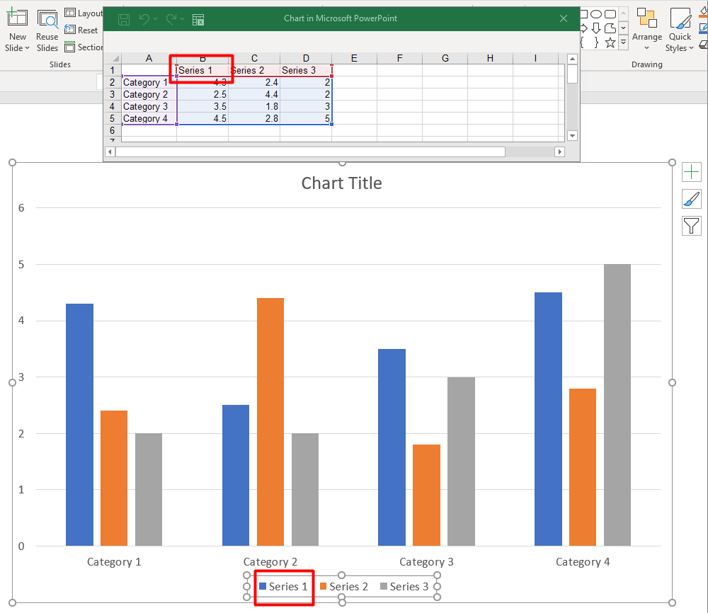

## **Översikt**

Ett diagram kan lagra sina plottade värden i arbetsbokens celler eller direkt som numeriska literalvärden. En [ChartSeries](https://reference.aspose.com/slides/python-net/aspose.slides.charts/chartseries/) representerar en uppsättning relaterade värden, och varje [ChartDataPoint](https://reference.aspose.com/slides/python-net/aspose.slides.charts/chartdatapoint/) representerar en punkt i den serien. [ChartCategory](https://reference.aspose.com/slides/python-net/aspose.slides.charts/chartcategory/)‑objekt ger etiketter eller grupperingvärden som delas av serierna. I diagram som skapats med standarddata används serienamn, kategorier och punktvärden från [ChartDataCell](https://reference.aspose.com/slides/python-net/aspose.slides.charts/chartdatacell/)‑objekt i diagrammets arbetsbok.

För ett typiskt kategoridiagram använder standardarbetsboken rad 0 för serienamn, kolumn 0 för kategorinamn och de återstående cellerna för serievärden. Arbetsblad‑, rad‑ och kolumnindex som skickas till [ChartDataWorkbook.get_cell](https://reference.aspose.com/slides/python-net/aspose.slides.charts/chartdataworkbook/get_cell/) är nollbaserade. Denna layout är användbar när du skapar ett diagram med standarddata, men anta inte att varje befintligt diagram använder den. För en inläst presentation, inspektera cellerna som refereras av serierna, kategorierna och datapunkterna innan du ändrar arbetsboksvärden.

Diagraminställningar har tre olika omfattningar:

- Inställningar på serienivå, såsom [ChartSeries.format](https://reference.aspose.com/slides/python-net/aspose.slides.charts/chartseries/format/), anger standardutseendet för alla punkter i en serie.
- Inställningar på datapunktnivå, såsom [ChartDataPoint.format](https://reference.aspose.com/slides/python-net/aspose.slides.charts/chartdatapoint/format/), åsidosätter serieutseendet för en punkt.
- Gruppinställningar gäller för kompatibla serier som tillhör samma [ChartSeriesGroup](https://reference.aspose.com/slides/python-net/aspose.slides.charts/chartseriesgroup/). Åtkomst till gruppen sker via [ChartSeries.parent_series_group](https://reference.aspose.com/slides/python-net/aspose.slides.charts/chartseries/parent_series_group/) när du behöver ange alternativ som överlappning eller gapbredd.

När ingen explicit punkt‑ eller serie‑fyllning anges bestäms det automatiska utseendet av diagramstil och tema. När både serie‑ och punktformatering finns, har punktformateringen företräde för den punkten.



För ett staplat cylinder‑diagram, se hur [changing the 3D series type or bar shape](/slides/sv/python-net/3d-chart/#change-the-3d-series-type-and-bar-shape) påverkar den första serien.

## **Ange serievärden med numeriska literalvärden**

Använd numeriska literalvärden när serievärden hämtas från applikationsdata eller beräkningar och inte behöver referenser till arbetsblads‑celler. Ställ in [data_source_type_for_values](https://reference.aspose.com/slides/python-net/aspose.slides.charts/chartdatapointcollection/data_source_type_for_values/) till [DataSourceType.DOUBLE_LITERALS](https://reference.aspose.com/slides/python-net/aspose.slides.charts/datasourcetype/) innan du tilldelar varje punkts [value](https://reference.aspose.com/slides/python-net/aspose.slides.charts/chartdatapoint/value/) via [as_literal_double](https://reference.aspose.com/slides/python-net/aspose.slides.charts/doublechartvalue/as_literal_double/).

Samlingens inställning styr källtypen för alla punktvärden i den serien. Varje punkts [value.data_source_type](https://reference.aspose.com/slides/python-net/aspose.slides.charts/basechartvalue/data_source_type/) rapporterar den valda typen; ändra den via samlingsinställningen. Med `WORKSHEET` används [as_cell](https://reference.aspose.com/slides/python-net/aspose.slides.charts/doublechartvalue/as_cell/) för att komma åt den refererade cellen. Med `DOUBLE_LITERALS` används `as_literal_double` för att läsa eller skriva talet direkt.

Följande exempel skapar ett stapeldiagram med standardserier och -kategorier och tilldelar sedan beräknade värden 10, 20 osv. till de befintliga punkterna i den första serien. Det sparar presentationen, öppnar den igen och skriver ut de lagrade värdena.

```py
import aspose.slides as slides
import aspose.slides.charts as charts

with slides.Presentation() as presentation:
    slide = presentation.slides[0]

    chart = slide.shapes.add_chart(charts.ChartType.CLUSTERED_COLUMN, 20, 20, 500, 300)
    series = chart.chart_data.series[0]

    series.data_points.data_source_type_for_values = charts.DataSourceType.DOUBLE_LITERALS
    for i in range(len(series.data_points)):
        series.data_points[i].value.as_literal_double = (i + 1) * 10

    presentation.save("numeric_literals.pptx", slides.export.SaveFormat.PPTX)

with slides.Presentation("numeric_literals.pptx") as reopened_presentation:
    reopened_slide = reopened_presentation.slides[0]
    reopened_chart = reopened_slide.shapes[0]
    reopened_series = reopened_chart.chart_data.series[0]
    for point in reopened_series.data_points:
        print(point.value.as_literal_double)
```

Punktvärdeskälltypen är separat från [ChartData.data_source_type](https://reference.aspose.com/slides/python-net/aspose.slides.charts/chartdata/data_source_type/), som identifierar diagrammets interna eller externa arbetsbokskonfiguration. Att använda numeriska literalvärden tar inte i sig den inbäddade arbetsboken. I detta exempel förblir arbetsboken tillgänglig för kategorietiketter, serienamn och de andra serierna. Se [Chart Workbook](/slides/sv/python-net/chart-workbook/) för hantering av arbetsböcker.

För spridnings‑ och bubbeldiagram, ställ in [data_source_type_for_x_values](https://reference.aspose.com/slides/python-net/aspose.slides.charts/chartdatapointcollection/data_source_type_for_x_values/) och [data_source_type_for_y_values](https://reference.aspose.com/slides/python-net/aspose.slides.charts/chartdatapointcollection/data_source_type_for_y_values/) för att välja källorna för [x_value](https://reference.aspose.com/slides/python-net/aspose.slides.charts/chartdatapoint/x_value/) respektive [y_value](https://reference.aspose.com/slides/python-net/aspose.slides.charts/chartdatapoint/y_value/). Bubbeldiagram använder också [data_source_type_for_bubble_sizes](https://reference.aspose.com/slides/python-net/aspose.slides.charts/chartdatapointcollection/data_source_type_for_bubble_sizes/) för [bubble_size](https://reference.aspose.com/slides/python-net/aspose.slides.charts/chartdatapoint/bubble_size/). Ställ in varje relevant källa till `DOUBLE_LITERALS` innan du tilldelar tal via den värdets `as_literal_double`‑egenskap.

## **Ställ in diagramseriens överlappning**

[ChartSeries.overlap](https://reference.aspose.com/slides/python-net/aspose.slides.charts/chartseries/overlap/) rapporterar hur mycket staplar eller kolumner överlappar i ett 2D‑diagram, från ‑100 till 100 procent. Det är en skrivskyddad projektion av inställningen på den överordnade seriegruppen. Ställ in [ChartSeriesGroup.overlap](https://reference.aspose.com/slides/python-net/aspose.slides.charts/chartseriesgroup/overlap/) för att uppdatera varje kompatibel serie i den gruppen. Detta alternativ gäller diagramtyper som visar grupperade staplar eller kolumner; det påverkar inte orelaterade seriegrupper i ett kombinationsdiagram.

Följande exempel sätter överlappningen för gruppen som innehåller den första serien:

```py
import aspose.slides as slides
import aspose.slides.charts as charts

first_slide_index = 0
first_series_index = 0
overlap_percent = 30

with slides.Presentation() as presentation:
    slide = presentation.slides[first_slide_index]

    # Det nya diagrammet innehåller exempelserier, kategorier och värden.
    chart = slide.shapes.add_chart(charts.ChartType.CLUSTERED_COLUMN, 20, 20, 500, 200)

    series = chart.chart_data.series[first_series_index]
    series.parent_series_group.overlap = overlap_percent

    presentation.save("series_overlap.pptx", slides.export.SaveFormat.PPTX)
```

Resultatet:


## **Ändra seriefyllningsfärgen**

Använd [ChartSeries.format](https://reference.aspose.com/slides/python-net/aspose.slides.charts/chartseries/format/) för att ange standardfyllning för en hel serie. Om en punkt redan har en explicit fyllning, åsidosätter dess [ChartDataPoint.format](https://reference.aspose.com/slides/python-net/aspose.slides.charts/chartdatapoint/format/) serie‑fyllningen för den punkten.

Följande exempel applicerar en solid blå fyllning på den första serien:

```py
import aspose.pydrawing as drawing
import aspose.slides as slides
import aspose.slides.charts as charts

first_slide_index = 0
first_series_index = 0

with slides.Presentation() as presentation:
    slide = presentation.slides[first_slide_index]

    chart = slide.shapes.add_chart(charts.ChartType.CLUSTERED_COLUMN, 20, 20, 500, 200)

    series = chart.chart_data.series[first_series_index]
    series.format.fill.fill_type = slides.FillType.SOLID
    series.format.fill.solid_fill_color.color = drawing.Color.blue

    presentation.save("series_color.pptx", slides.export.SaveFormat.PPTX)
```

Resultatet:


## **Ändra seriens namn**

Ett serienamn lagras i diagrammets arbetsbok och visas normalt i förklaringen. I standardarbetsboken som skapas för ett staplat kolumndiagram ligger cell B1 i rad 0, kolumn 1 och innehåller namnet på den första serien. De namngivna konstanterna i följande exempel gör den strukturen tydlig:

```py
import aspose.slides as slides
import aspose.slides.charts as charts

first_slide_index = 0
worksheet_index = 0
series_name_row_index = 0
first_series_column_index = 1

with slides.Presentation() as presentation:
    slide = presentation.slides[first_slide_index]

    chart = slide.shapes.add_chart(charts.ChartType.CLUSTERED_COLUMN, 20, 20, 500, 200)

    workbook = chart.chart_data.chart_data_workbook
    series_name_cell = workbook.get_cell(worksheet_index, series_name_row_index, first_series_column_index)
    series_name_cell.value = "Revenue"

    presentation.save("series_name.pptx", slides.export.SaveFormat.PPTX)
```

Du kan också uppdatera den cell som redan refereras av [ChartSeries.name](https://reference.aspose.com/slides/python-net/aspose.slides.charts/chartseries/name/). Detta tillvägagångssätt undviker antaganden om en viss rad och kolumn i ett befintligt diagram:

```py
import aspose.slides as slides
import aspose.slides.charts as charts

first_slide_index = 0
first_series_index = 0
first_name_cell_index = 0

with slides.Presentation() as presentation:
    slide = presentation.slides[first_slide_index]

    chart = slide.shapes.add_chart(charts.ChartType.CLUSTERED_COLUMN, 20, 20, 500, 200)

    series = chart.chart_data.series[first_series_index]
    series_name_cell = series.name.as_cells[first_name_cell_index]
    series_name_cell.value = "Revenue"

    presentation.save("series_name.pptx", slides.export.SaveFormat.PPTX)
```

Resultatet:


### **Skapa en serie med ett namn från flera celler**

Ett sammansatt serienamn är användbart när ett produktnamn och en rapportperiod lagras i separata arbetsbladceller. Till exempel kan du kombinera `Product A` i B1 och `2026` i C1 till ett enda serienamn samtidigt som båda delarna behåller länken till sina källceller.

Använd [ChartDataWorkbook.get_cell_collection](https://reference.aspose.com/slides/python-net/aspose.slides.charts/chartdataworkbook/get_cell_collection/) för att hämta namnintervallet och skicka sedan den samlingen till [ChartSeriesCollection.add](https://reference.aspose.com/slides/python-net/aspose.slides.charts/chartseriescollection/add/). Argumentet `skip_hidden_cells` avgör om dolda celler inkluderas: `True` exkluderar dem, `False` inkluderar dem. Detta exempel använder `False` för att inkludera varje cell i namnintervallet.

Följande exempel skapar en presentation med en serie och två datapunkter. Cellerna B1:C1 levererar endast serienamnet; A2:A3 levererar kategorietiketter, och B2:B3 levererar de numeriska värdena.

```py
import aspose.slides as slides
import aspose.slides.charts as charts

with slides.Presentation() as presentation:
    slide = presentation.slides[0]

    chart = slide.shapes.add_chart(charts.ChartType.CLUSTERED_COLUMN, 50, 50, 620, 180)

    chart.chart_data.series.clear()
    chart.chart_data.categories.clear()
    chart.has_legend = True

    workbook = chart.chart_data.chart_data_workbook
    workbook.clear(0)

    # Dessa två celler tillhandahåller seriens namn.
    workbook.get_cell(0, 0, 1, "Product A")
    workbook.get_cell(0, 0, 2, "2026")
    name_cells = workbook.get_cell_collection("Sheet1!$B$1:$C$1", False)
    series = chart.chart_data.series.add(name_cells, charts.ChartType.CLUSTERED_COLUMN)

    # Separata celler tillhandahåller kategorierna och numeriska datapunkter.
    north_category = workbook.get_cell(0, 1, 0, "North")
    south_category = workbook.get_cell(0, 2, 0, "South")
    chart.chart_data.categories.add(north_category)
    chart.chart_data.categories.add(south_category)
    north_value = workbook.get_cell(0, 1, 1, 120)
    south_value = workbook.get_cell(0, 2, 1, 150)
    series.data_points.add_data_point_for_bar_series(north_value)
    series.data_points.add_data_point_for_bar_series(south_value)

    presentation.save("composite_series_name.pptx", slides.export.SaveFormat.PPTX)
```

Det resulterande serienamnet blir `Product A 2026`, med ett mellanslag mellan de två cellvärdena. Förklaringen visar detta som ett enda objekt för båda kolumnerna. Bilden nedan renderades från den sparade presentationen:


## **Hämta den automatiska seriefyllningsfärgen**

[ChartSeries.get_automatic_series_color](https://reference.aspose.com/slides/python-net/aspose.slides.charts/chartseries/get_automatic_series_color/) returnerar färgen som beräknas från serieindexet och diagramstilen. Detta är färgen som används när seriefyllningen inte har definierats explicit. Metoden läser den beräknade färgen; den tilldelar ingen ny fyllning.

Följande exempel skriver ut den automatiska färgen för varje standardserie:

```py
import aspose.slides as slides
import aspose.slides.charts as charts

first_slide_index = 0

with slides.Presentation() as presentation:
    slide = presentation.slides[first_slide_index]

    chart = slide.shapes.add_chart(charts.ChartType.CLUSTERED_COLUMN, 20, 20, 500, 200)

    series_count = len(chart.chart_data.series)
    for series_index in range(series_count):
        series = chart.chart_data.series[series_index]
        automatic_color = series.get_automatic_series_color()
        print(f"Series {series_index}: {automatic_color.name}")
```

Exempelutdata för standarddiagramstilen:

```text
Series 0: ff4f81bd
Series 1: ffc0504d
Series 2: ff9bbb59
```

De exakta färgerna beror på diagramstil och tema.

## **Ange inverterad fyllningsfärg för en diagramserie**

För stapel‑, kolumn‑ och bubbelseries kan [ChartSeries.invert_if_negative](https://reference.aspose.com/slides/python-net/aspose.slides.charts/chartseries/invert_if_negative/) visa negativa värden med en annan fyllning. Ställ in den vanliga seriefyllningen till solid, aktivera inversion och ange den negativa färgen via [ChartSeries.inverted_solid_fill_color](https://reference.aspose.com/slides/python-net/aspose.slides.charts/chartseries/inverted_solid_fill_color/). Negativa tal förblir oförändrade i arbetsboken; endast deras visningsfärg ändras.

Följande exempel ersätter standarddiagramdata med en serie. Arbetsbladsrad 0 innehåller serienamnet, kolumn 0 innehåller kategorinamnen och kolumn 1 innehåller värdena:

```py
import aspose.pydrawing as drawing
import aspose.slides as slides
import aspose.slides.charts as charts

first_slide_index = 0
worksheet_index = 0
header_row_index = 0
category_column_index = 0
first_series_column_index = 1
first_data_row_index = 1

category_names = ["Category 1", "Category 2", "Category 3"]
series_values = [-20, 50, -30]

with slides.Presentation() as presentation:
    slide = presentation.slides[first_slide_index]

    chart = slide.shapes.add_chart(charts.ChartType.CLUSTERED_COLUMN, 20, 20, 500, 200)
    chart_data = chart.chart_data
    workbook = chart_data.chart_data_workbook

    chart_data.series.clear()
    chart_data.categories.clear()

    series_name_cell = workbook.get_cell(worksheet_index, header_row_index, first_series_column_index, "Series 1")
    series = chart_data.series.add(series_name_cell, chart.type)

    category_count = len(category_names)
    for category_index in range(category_count):
        data_row_index = first_data_row_index + category_index
        category_name = category_names[category_index]
        series_value = series_values[category_index]

        category_cell = workbook.get_cell(worksheet_index, data_row_index, category_column_index, category_name)
        chart_data.categories.add(category_cell)

        value_cell = workbook.get_cell(worksheet_index, data_row_index, first_series_column_index, series_value)
        series.data_points.add_data_point_for_bar_series(value_cell)

    automatic_series_color = series.get_automatic_series_color()
    series.format.fill.fill_type = slides.FillType.SOLID
    series.format.fill.solid_fill_color.color = automatic_series_color
    series.invert_if_negative = True
    series.inverted_solid_fill_color.color = drawing.Color.red

    presentation.save("inverted_solid_fill_color.pptx", slides.export.SaveFormat.PPTX)
```

Resultatet:


Du kan aktivera inversion för en enskild punkt via [ChartDataPoint.invert_if_negative](https://reference.aspose.com/slides/python-net/aspose.slides.charts/chartdatapoint/invert_if_negative/). I följande exempel är inversion inaktiverad för serien och endast aktiverad för den markerade punkten. Punkten tilldelas också ett negativt värde så att effekten blir synlig:

```py
import aspose.pydrawing as drawing
import aspose.slides as slides
import aspose.slides.charts as charts

first_slide_index = 0
first_series_index = 0
target_data_point_index = 2
negative_value = -30

with slides.Presentation() as presentation:
    slide = presentation.slides[first_slide_index]

    chart = slide.shapes.add_chart(charts.ChartType.CLUSTERED_COLUMN, 20, 20, 500, 200)

    series = chart.chart_data.series[first_series_index]
    automatic_series_color = series.get_automatic_series_color()
    series.format.fill.fill_type = slides.FillType.SOLID
    series.format.fill.solid_fill_color.color = automatic_series_color
    series.inverted_solid_fill_color.color = drawing.Color.red
    series.invert_if_negative = False

    data_point = series.data_points[target_data_point_index]
    data_point.value.as_cell.value = negative_value
    data_point.invert_if_negative = True

    presentation.save("data_point_invert_color_if_negative.pptx", slides.export.SaveFormat.PPTX)
```

## **Rensa ett specifikt datapunktvärde**

För att göra en punkt tom utan att ta bort de andra punkterna, sätt dess underliggande arbetsboks­cell till `None`. För ett stapeldiagram är det plottrade värdet tillgängligt via [ChartDataPoint.value](https://reference.aspose.com/slides/python-net/aspose.slides.charts/chartdatapoint/value/). Datapunkten behåller samma kategori‑position, men diagrammet behandlar värdet som tomt enligt diagrammets inställningar för tomma värden.

Följande exempel rensar endast den andra punkten i den första serien:

```py
import aspose.slides as slides
import aspose.slides.charts as charts

first_slide_index = 0
first_series_index = 0
target_data_point_index = 1

with slides.Presentation() as presentation:
    slide = presentation.slides[first_slide_index]

    chart = slide.shapes.add_chart(charts.ChartType.CLUSTERED_COLUMN, 20, 20, 500, 200)

    series = chart.chart_data.series[first_series_index]
    data_point = series.data_points[target_data_point_index]
    data_point.value.as_cell.value = None

    presentation.save("clear_data_point_value.pptx", slides.export.SaveFormat.PPTX)
```

Spridningsdiagram använder separata X‑ och Y‑celler, och bubbeldiagram använder även en storlekscell. Rensa endast den cell som representerar det värde du vill ta bort. Anropa inte [ChartDataPointCollection.clear](https://reference.aspose.com/slides/python-net/aspose.slides.charts/chartdatapointcollection/clear/) när du vill behålla de andra punkterna, eftersom den metoden tar bort alla datapunkter i samlingen.

## **Styr visning av tomma celler**

Dolda celler som innehåller värden är ett separat fall från tomma celler. För att inkludera eller exkludera data från dolda rader och kolumner i arbetsblad, se [Include Data from Hidden Rows and Columns](/slides/sv/python-net/chart-workbook/#include-data-from-hidden-rows-and-columns).

En tom arbetsboks­cell representerar saknad data; en cell med `0` representerar ett känt numeriskt värde. Sätt [ChartDataCell.value](https://reference.aspose.com/slides/python-net/aspose.slides.charts/chartdatacell/value/) till `None` för att göra en cell tom. Ett numeriskt nollvärde förblir noll oavsett inställning för tomma celler.

Använd [Chart.display_blanks_as](https://reference.aspose.com/slides/python-net/aspose.slides.charts/chart/display_blanks_as/) för att välja hur diagrammet visar tomma celler. Denna inställning gäller för hela diagrammet. Den ändrar hur tomrum plottas, utan att fylla den tomma arbetsboks­cellen med noll eller ett interpolerat värde.

Följande fristående exempel skapar ett linjediagram med en serie, rensar värdet för Dag 3 och sparar samma diagram med varje läge. Ingen indatafil krävs. [ChartDataWorkbook](https://reference.aspose.com/slides/python-net/aspose.slides.charts/chartdataworkbook/) använder arbetsblad 0, kolumn 0 för kategorietiketter och kolumn 1 för värden; rad 0 innehåller serienamnet. Slutdata blir `10, 20, empty, 30, 40`.

```py
import aspose.slides as slides
import aspose.slides.charts as charts

with slides.Presentation() as presentation:
    slide = presentation.slides[0]

    chart = slide.shapes.add_chart(charts.ChartType.LINE_WITH_MARKERS, 40, 40, 640, 400)
    chart_data = chart.chart_data
    workbook = chart_data.chart_data_workbook

    chart_data.series.clear()
    chart_data.categories.clear()

    series_name_cell = workbook.get_cell(0, 0, 1, "Measurements")
    series = chart_data.series.add(series_name_cell, chart.type)
    values = [10, 20, 25, 30, 40]

    for i, value in enumerate(values):
        category_cell = workbook.get_cell(0, i + 1, 0, f"Day {i + 1}")
        chart_data.categories.add(category_cell)
        value_cell = workbook.get_cell(0, i + 1, 1, value)
        series.data_points.add_data_point_for_line_series(value_cell)

    # Lämna dag 3 verkligen tom, samtidigt som du behåller dess kategori och datapunkt.
    workbook.get_cell(0, 3, 1).value = None

    modes = [("Gap", charts.DisplayBlanksAsType.GAP), ("Zero", charts.DisplayBlanksAsType.ZERO), ("Span", charts.DisplayBlanksAsType.SPAN)]
    for mode_name, mode in modes:
        chart.display_blanks_as = mode
        presentation.save(f"empty_cells_{mode_name}.pptx", slides.export.SaveFormat.PPTX)
```

Varje utdatafil lagrar läget som tilldelats före sparande: `empty_cells_Gap.pptx`, `empty_cells_Zero.pptx` och `empty_cells_Span.pptx`. För att spara bara en version, ange önskat läge och spara presentationen en gång istället för att iterera över lägena.

Jämförelsen nedan visar samma data i alla tre filer. Dag 3 är tom i arbetsboken i varje fall:


Den visuella effekten beror på diagramtypen. Ett linjediagram gör alla tre lägen enkla att jämföra. Stapel‑ och kolumndiagram har ingen linje att ansluta över en saknad kategori, så `SPAN` kan inte skapa den anslutande segmentet som visas ovan; en saknad kolumn och en noll‑höjd kolumn kan också se lika ut. På liknande sätt har ett spridningsdiagram med endast markörer ingen anslutningslinje. Förvänta dig inte tre tydliga resultat för varje diagramtyp; kontrollera utdata för den typ du använder.

## **Ställ in seriegapbredd**

Gapbredd är avståndet mellan intilliggande stapel‑ eller kolumnkluster, uttryckt som procent av stapel‑ eller kolumnbredden. Liksom överlappning tillhör den den överordnade seriegruppen snarare än en enskild serie. Ställ in [ChartSeriesGroup.gap_width](https://reference.aspose.com/slides/python-net/aspose.slides.charts/chartseriesgroup/gap_width/) en gång för gruppen. Ett större värde skapar mer utrymme mellan kluster; ett mindre värde gör dem tätare.

Följande exempel ändrar gapbredden och sparar endast den slutgiltiga presentationen:

```py
import aspose.slides as slides
import aspose.slides.charts as charts

first_slide_index = 0
first_series_index = 0
gap_width_percent = 30

with slides.Presentation() as presentation:
    slide = presentation.slides[first_slide_index]

    chart = slide.shapes.add_chart(charts.ChartType.STACKED_COLUMN, 20, 20, 500, 200)

    series = chart.chart_data.series[first_series_index]
    series.parent_series_group.gap_width = gap_width_percent

    presentation.save("gap_width_30.pptx", slides.export.SaveFormat.PPTX)
```

Resultatet:


## **Visa eller dölja serielinjer**

Serielinjer förbinder visuellt relaterade delar av ett diagram. Använd [ChartSeriesGroup.has_series_lines](https://reference.aspose.com/slides/python-net/aspose.slides.charts/chartseriesgroup/has_series_lines/) för att visa eller dölja dem i stödda staplade stapel‑ och OfPie‑diagram. I tvådimensionella staplade stapel‑ och kolumndiagram förbinder de motsvarande stapelgränser över kategorier. I Pie of Pie‑ och Bar of Pie‑diagram förbinder de huvudplotten med den sekundära plotten. Denna inställning är inte en generell kopplare för andra diagramtyper.

Åtkomst till gruppen sker via [ChartSeries.parent_series_group](https://reference.aspose.com/slides/python-net/aspose.slides.charts/chartseries/parent_series_group/). Inställningen gäller för varje serie i den gruppen. [ChartSeries.has_series_lines](https://reference.aspose.com/slides/python-net/aspose.slides.charts/chartseries/has_series_lines/) är skrivskyddad och speglar gruppens inställning; ändra gruppens egenskap för att uppdatera den.

Följande exempel skapar ett [ChartType.PIE_OF_PIE](https://reference.aspose.com/slides/python-net/aspose.slides.charts/charttype/)‑diagram med standarddata. Det sparar samma diagram med serielinjer aktiverade och sedan inaktiverade, vilket ger två presentationer för jämförelse.

```py
import aspose.slides as slides
import aspose.slides.charts as charts

with slides.Presentation() as presentation:
    slide = presentation.slides[0]

    chart = slide.shapes.add_chart(charts.ChartType.PIE_OF_PIE, 50, 50, 600, 400)
    series = chart.chart_data.series[0]
    series_group = series.parent_series_group

    series_group.has_series_lines = True
    presentation.save("series_lines_enabled.pptx", slides.export.SaveFormat.PPTX)

    series_group.has_series_lines = False
    presentation.save("series_lines_disabled.pptx", slides.export.SaveFormat.PPTX)
```

| Serielinjer aktiverade | Serielinjer inaktiverade |
| --- | --- |
|  |  |
| De två linjerna förbinder huvudcirkeln med den sekundära cirkeln. | Båda cirklarna förblir synliga, men anslutningslinjerna är dolda. |

Serielinjer skiljer sig från ledarelinjer för dataetiketter, som förbinder etiketter med deras datapunkter; rutnätlinjer, som markerar intervaller längs diagramaxlar; och linjer i ett linjediagram, som representerar datavärden. Denna inställning styr inte dessa element.

## **Vanliga frågor**

**Vilka diagramtyper stöder dataserier?**

Alla diagramtyper som representeras av [ChartType](https://reference.aspose.com/slides/python-net/aspose.slides.charts/charttype/)-enumerationen använder diagramdata, men deras serier har inte alla samma värdestruktur eller inställningar. Till exempel använder kategoridiagram kategorier och värden, spridningsdiagram använder X‑ och Y‑värden, och bubbeldiagram lägger till bubbelförekomst. Använd den datapunkt‑skapande metod som motsvarar serietypen. Alternativ som överlappning och gapbredd gäller endast kompatibla stapel‑ eller kolumngrupper.

**Vad är en diagramseriegrupp?**

En [ChartSeriesGroup](https://reference.aspose.com/slides/python-net/aspose.slides.charts/chartseriesgroup/) innehåller kompatibla serier som delar gruppnivå‑plottinginställningar. Ett kombinationsdiagram kan innehålla mer än en grupp, så att ändra gruppen som nås via en serie förändrar inte nödvändigtvis varje serie i diagrammet.

**Skapar ett ny‑skapat diagram standarddata?**

Ja. Som standard skapar [ShapeCollection.add_chart](https://reference.aspose.com/slides/python-net/aspose.slides/shapecollection/add_chart/) exempelserier, -kategorier och -värden. Du kan redigera dessa celler eller rensa både serie‑ och kategori‑samlingarna innan du lägger till en helt egen datamängd. En överlagring kan också skapa ett diagram utan standarddata.

**Hur är diagramobjekt kopplade till arbetsboks­celler?**

Serienamn, kategorietiketter och datapunktvärden refererar celler i en [ChartDataWorkbook](https://reference.aspose.com/slides/python-net/aspose.slides.charts/chartdataworkbook/). Att ändra en refererad cell uppdaterar motsvarande diagram‑element. När du bygger egen data, håll kategorirader och serievärdesrader i linje så att varje punkt plottas under avsedd kategori.

**Hur rensar jag en punkt utan att rensa hela serien?**

Sätt den relevanta värdecellen till `None` för att behålla punktens kategori‑position som en tom punkt. Använd [ChartDataPointCollection.clear](https://reference.aspose.com/slides/python-net/aspose.slides.charts/chartdatapointcollection/clear/) bara när du avser att ta bort alla punkter från den serien. Om du också tar bort kategorier, uppdatera varje serie så att deras värden förblir i linje med kategori­samlingen.

**Hur visas tomma punkter?**

Resultatet beror på diagramtyp och [Chart.display_blanks_as](https://reference.aspose.com/slides/python-net/aspose.slides.charts/chart/display_blanks_as/). Stödda diagram kan visa tomrum som gap, som nollvärden eller genom att ansluta grannpunkter. Välj den inställning som matchar betydelsen av saknad data i din presentation. Se [Control the Display of Empty Cells](#control-the-display-of-empty-cells) för ett komplett exempel och visuell jämförelse.

**Hur formateras negativa värden?**

För stödda stapel‑, kolumn‑ och bubbelseries, aktivera [ChartSeries.invert_if_negative](https://reference.aspose.com/slides/python-net/aspose.slides.charts/chartseries/invert_if_negative/) och ange [ChartSeries.inverted_solid_fill_color](https://reference.aspose.com/slides/python-net/aspose.slides.charts/chartseries/inverted_solid_fill_color/). Du kan åsidosätta beteendet för en enskild punkt med [ChartDataPoint.invert_if_negative](https://reference.aspose.com/slides/python-net/aspose.slides.charts/chartdatapoint/invert_if_negative/). Dessa egenskaper påverkar formatering, inte de lagrade numeriska värdena.

**Vilken formatering vinner när både en serie och en punkt är formaterade?**

Explicit datapunkt‑formatering har företräde för den punkten. Övriga punkter fortsätter att använda den explicita serie‑formatet eller, när serie‑formatet inte är definierat, den automatiska diagramstilen och temat. Grupp‑egenskaper som överlappning och gapbredd styr layout och är inte punkt‑nivå formateringsåsidosättningar.

**Finns det någon gräns för hur många serier ett diagram kan innehålla?**

Aspose.Slides har ingen separat fast gräns för antalet serier. I praktiken bestäms en användbar gräns av presentationsfilens begränsningar, tillgängligt minne, renderingstid och diagrammets läsbarhet.

**Vad ska jag ändra när kolumner är för nära varandra eller för långt ifrån?**

Ställ in [ChartSeriesGroup.gap_width](https://reference.aspose.com/slides/python-net/aspose.slides.charts/chartseriesgroup/gap_width/) på den aktuella föräldra‑seriegruppen. Öka värdet för att bredda avståndet mellan kluster, eller minska det för att föra klustren närmare varandra.