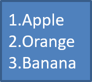

## **ภาพรวม**

Aspose.Slides for Android via Java ช่วยให้คุณสร้างและจัดรูปแบบรายการแบบมีจุดและรายการลำดับในงานนำเสนอ PowerPoint และ OpenDocument รายการหนึ่งเป็นย่อหน้าที่การตั้งค่าจุดควบคุมผ่านรูปแบบย่อหน้า

ใช้ [IParagraph.getParagraphFormat](https://reference.aspose.com/slides/androidjava/com.aspose.slides/iparagraph/#getParagraphFormat--) เพื่อเข้าถึงการตั้งค่ารายการระดับย่อหน้า จุดเข้าสู่ระบบหลักคือ [IParagraphFormat.getBullet](https://reference.aspose.com/slides/androidjava/com.aspose.slides/iparagraphformat/#getBullet--), ซึ่งจะคืนค่าอ็อบเจกต์ [IBulletFormat](https://reference.aspose.com/slides/androidjava/com.aspose.slides/ibulletformat/) ด้วยอ็อบเจกต์นี้คุณสามารถตั้งค่าชนิดสัญลักษณ์, สัญลักษณ์, รูปภาพ, สี, ขนาด, สไตล์การลำดับเลข, และจำนวนเริ่มต้นได้

บทความนี้แสดงวิธี:

- สร้างรายการแบบมีจุดด้วยสัญลักษณ์กำหนดเอง
- สร้างจุดแบบรูปภาพ
- สร้างรายการหลายระดับโดยกำหนดความลึกของย่อหน้า
- สร้างรายการลำดับเลข
- ตรวจสอบและเปลี่ยนการจัดรูปแบบรายการในงานนำเสนอที่มีอยู่
- อ่านตัวบ่งชี้รายการและเลขลำดับพร้อมกับข้อความของย่อหน้า

## **สร้างรายการแบบมีจุด**

เพื่อสร้างรายการแบบมีจุด ให้เพิ่มย่อหน้าไปยัง [ITextFrame](https://reference.aspose.com/slides/androidjava/com.aspose.slides/itextframe/) และตั้งค่า [IBulletFormat.setType](https://reference.aspose.com/slides/androidjava/com.aspose.slides/ibulletformat/#setType-byte-) ไปที่ [BulletType.Symbol](https://reference.aspose.com/slides/androidjava/com.aspose.slides/bullettype/) แล้วคุณสามารถตั้งค่า [IBulletFormat.setChar](https://reference.aspose.com/slides/androidjava/com.aspose.slides/ibulletformat/#setChar-char-), [IBulletFormat.getColor](https://reference.aspose.com/slides/androidjava/com.aspose.slides/ibulletformat/#getColor--), และ [IBulletFormat.setHeight](https://reference.aspose.com/slides/androidjava/com.aspose.slides/ibulletformat/#setHeight-float-) เพื่อควบคุมลักษณะของจุด

โค้ด Java ต่อไปนี้แสดงวิธีสร้างรายการแบบมีจุดในสไลด์:

```java
import com.aspose.slides.*;
import android.graphics.Color;

Presentation presentation = new Presentation();
try {
    ISlide slide = presentation.getSlides().get_Item(0);

    IAutoShape autoShape = slide.getShapes().addAutoShape(ShapeType.Rectangle, 20, 20, 200, 50);

    ITextFrame textFrame = autoShape.getTextFrame();
    textFrame.getParagraphs().clear();

    int bulletColor = Color.rgb(205, 92, 92);

    Paragraph paragraph1 = new Paragraph();
    paragraph1.getParagraphFormat().getBullet().setType(BulletType.Symbol);
    paragraph1.getParagraphFormat().getBullet().setChar('*');
    paragraph1.getParagraphFormat().setIndent(15);
    paragraph1.getParagraphFormat().getBullet().setBulletHardColor(NullableBool.True);
    paragraph1.getParagraphFormat().getBullet().getColor().setColor(bulletColor);
    paragraph1.getParagraphFormat().getBullet().setHeight(100);
    paragraph1.setText("The first paragraph");
    textFrame.getParagraphs().add(paragraph1);

    Paragraph paragraph2 = new Paragraph();
    paragraph2.getParagraphFormat().getBullet().setType(BulletType.Symbol);
    paragraph2.getParagraphFormat().getBullet().setChar('*');
    paragraph2.getParagraphFormat().setIndent(15);
    paragraph2.getParagraphFormat().getBullet().setBulletHardColor(NullableBool.True);
    paragraph2.getParagraphFormat().getBullet().getColor().setColor(bulletColor);
    paragraph2.getParagraphFormat().getBullet().setHeight(100);
    paragraph2.setText("The second paragraph");
    textFrame.getParagraphs().add(paragraph2);

    presentation.save("symbol_bullets.pptx", SaveFormat.Pptx);
} finally {
    presentation.dispose();
}
```

ผลลัพธ์:


## **สร้างรายการลำดับเลข**

ใช้รายการลำดับเลขเมื่อลำดับของรายการมีความสำคัญ ตั้งค่า [IBulletFormat.setType](https://reference.aspose.com/slides/androidjava/com.aspose.slides/ibulletformat/#setType-byte-) ไปที่ [BulletType.Numbered](https://reference.aspose.com/slides/androidjava/com.aspose.slides/bullettype/) คุณยังสามารถเลือกรูปแบบการลำดับเลขด้วย [IBulletFormat.setNumberedBulletStyle](https://reference.aspose.com/slides/androidjava/com.aspose.slides/ibulletformat/#setNumberedBulletStyle-byte-) หรือกำหนดค่า [IBulletFormat.setNumberedBulletStartWith](https://reference.aspose.com/slides/androidjava/com.aspose.slides/ibulletformat/#setNumberedBulletStartWith-short-) เมื่อรายการควรเริ่มจากค่าที่ไม่ใช่ 1

โค้ด Java ต่อไปนี้แสดงวิธีสร้างรายการลำดับเลขในสไลด์:

```java
import com.aspose.slides.*;

Presentation presentation = new Presentation();
try {
    ISlide slide = presentation.getSlides().get_Item(0);

    IAutoShape autoShape = slide.getShapes().addAutoShape(ShapeType.Rectangle, 20, 20, 90, 80);

    ITextFrame textFrame = autoShape.getTextFrame();
    textFrame.getParagraphs().clear();

    Paragraph paragraph1 = new Paragraph();
    paragraph1.getParagraphFormat().getBullet().setType(BulletType.Numbered);
    paragraph1.setText("Apple");
    textFrame.getParagraphs().add(paragraph1);

    Paragraph paragraph2 = new Paragraph();
    paragraph2.getParagraphFormat().getBullet().setType(BulletType.Numbered);
    paragraph2.setText("Orange");
    textFrame.getParagraphs().add(paragraph2);

    Paragraph paragraph3 = new Paragraph();
    paragraph3.getParagraphFormat().getBullet().setType(BulletType.Numbered);
    paragraph3.setText("Banana");
    textFrame.getParagraphs().add(paragraph3);

    presentation.save("numbered_bullets.pptx", SaveFormat.Pptx);
} finally {
    presentation.dispose();
}
```

ผลลัพธ์:



## **สร้างจุดแบบรูปภาพ**

Aspose.Slides ให้คุณแทนที่สัญลักษณ์จุดปกติกับรูปภาพ จุดภาพทำงานดีที่สุดกับรูปภาพที่เรียบง่ายและยังคงอ่านได้เมื่อมีขนาดเล็ก เช่น ไอคอนหรือไฟล์ PNG ที่มีพื้นหลังโปร่งใส

{}
Ideally, if you plan to replace the regular bullet symbol with an image, it's best to choose a simple graphic with a transparent background. Such images work well as custom bullet symbols.

Keep in mind that the image will be scaled down to a very small size. For that reason, we strongly recommend selecting an image that remains clear and visually effective when used as a bullet in a list.
{}

เพื่อสร้างจุดแบบรูปภาพ ให้เพิ่มรูปภาพไปยัง [Presentation.getImages](https://reference.aspose.com/slides/androidjava/com.aspose.slides/presentation/#getImages--) และกำหนดอ็อบเจกต์ [IPPImage](https://reference.aspose.com/slides/androidjava/com.aspose.slides/ippimage/) ที่ได้ให้กับ [IBulletFormat.getPicture](https://reference.aspose.com/slides/androidjava/com.aspose.slides/ibulletformat/#getPicture--). ตั้งค่า [IBulletFormat.setType](https://reference.aspose.com/slides/androidjava/com.aspose.slides/ibulletformat/#setType-byte-) ไปที่ [BulletType.Picture](https://reference.aspose.com/slides/androidjava/com.aspose.slides/bullettype/) ก่อนกำหนดรูปภาพ

สมมติว่าเรามีไฟล์ “image.png”:


โค้ด Java ต่อไปนี้แสดงวิธีสร้างจุดแบบรูปภาพในสไลด์:

```java
import com.aspose.slides.*;

Presentation presentation = new Presentation();
try {
    ISlide slide = presentation.getSlides().get_Item(0);

    IAutoShape autoShape = slide.getShapes().addAutoShape(ShapeType.Rectangle, 20, 20, 200, 50);

    ITextFrame textFrame = autoShape.getTextFrame();
    textFrame.getParagraphs().clear();

    IPPImage bulletImage = presentation.getImages().addImage(Images.fromFile("image.png"));

    Paragraph paragraph1 = new Paragraph();
    paragraph1.getParagraphFormat().getBullet().setType(BulletType.Picture);
    paragraph1.getParagraphFormat().getBullet().getPicture().setImage(bulletImage);
    paragraph1.getParagraphFormat().setIndent(15);
    paragraph1.getParagraphFormat().getBullet().setHeight(100);
    paragraph1.setText("The first paragraph");
    textFrame.getParagraphs().add(paragraph1);

    Paragraph paragraph2 = new Paragraph();
    paragraph2.getParagraphFormat().getBullet().setType(BulletType.Picture);
    paragraph2.getParagraphFormat().getBullet().getPicture().setImage(bulletImage);
    paragraph2.getParagraphFormat().setIndent(15);
    paragraph2.getParagraphFormat().getBullet().setHeight(100);
    paragraph2.setText("The second paragraph");
    textFrame.getParagraphs().add(paragraph2);

    presentation.save("picture_bullets.pptx", SaveFormat.Pptx);
} finally {
    presentation.dispose();
}
```

ผลลัพธ์:


## **สร้างรายการหลายระดับ**

ใช้ [IParagraphFormat.setDepth](https://reference.aspose.com/slides/androidjava/com.aspose.slides/iparagraphformat/#setDepth-short-) เพื่อวางรายการในระดับที่ต่างกัน ระดับ 0 คือระดับบนสุด ระดับ 1 อยู่ภายในระดับนั้นต่อไป

โค้ด Java ต่อไปนี้แสดงวิธีสร้างรายการหลายระดับ:

```java
import com.aspose.slides.*;

Presentation presentation = new Presentation();
try {
    ISlide slide = presentation.getSlides().get_Item(0);

    IAutoShape autoShape = slide.getShapes().addAutoShape(ShapeType.Rectangle, 20, 20, 260, 110);

    ITextFrame textFrame = autoShape.getTextFrame();
    textFrame.getParagraphs().clear();

    Paragraph paragraph1 = new Paragraph();
    paragraph1.getParagraphFormat().setDepth((short) 0);
    paragraph1.setText("My text - Depth 0");
    textFrame.getParagraphs().add(paragraph1);

    Paragraph paragraph2 = new Paragraph();
    paragraph2.getParagraphFormat().setDepth((short) 1);
    paragraph2.setText("My text - Depth 1");
    textFrame.getParagraphs().add(paragraph2);

    Paragraph paragraph3 = new Paragraph();
    paragraph3.getParagraphFormat().setDepth((short) 2);
    paragraph3.setText("My text - Depth 2");
    textFrame.getParagraphs().add(paragraph3);

    Paragraph paragraph4 = new Paragraph();
    paragraph4.getParagraphFormat().setDepth((short) 3);
    paragraph4.setText("My text - Depth 3");
    textFrame.getParagraphs().add(paragraph4);

    presentation.save("multilevel_bullets.pptx", SaveFormat.Pptx);
} finally {
    presentation.dispose();
}
```

ผลลัพธ์:


## **เปลี่ยนรายการที่มีอยู่**

เพื่อเปลี่ยนการจัดรูปแบบรายการในงานนำเสนอที่มีอยู่ ให้เข้าถึงย่อหน้าเป้าหมายและอัปเดตการตั้งค่า [IParagraphFormat.getBullet](https://reference.aspose.com/slides/androidjava/com.aspose.slides/iparagraphformat/#getBullet--) วิธีการเดียวกันที่ใช้สร้างรายการสามารถใช้ตรวจสอบหรือแก้ไขรายการที่โหลดจากไฟล์ PPT, PPTX หรือ ODP

โค้ด Java ต่อไปนี้เปลี่ยนย่อหน้าแรกในกรอบข้อความให้ใช้สไตล์รายการลำดับเลข:

```java
import com.aspose.slides.*;

Presentation presentation = new Presentation("input.pptx");
try {
    ISlide slide = presentation.getSlides().get_Item(0);

    IAutoShape autoShape = (IAutoShape) slide.getShapes().get_Item(0);

    IParagraph paragraph = autoShape.getTextFrame().getParagraphs().get_Item(0);
    paragraph.getParagraphFormat().getBullet().setType(BulletType.Numbered);
    paragraph.getParagraphFormat().getBullet().setNumberedBulletStyle(NumberedBulletStyle.BulletRomanUCPeriod);
    paragraph.getParagraphFormat().getBullet().setNumberedBulletStartWith((short) 1);
    paragraph.getParagraphFormat().setMarginLeft(30);
    paragraph.getParagraphFormat().setIndent(-20);

    presentation.save("updated_list.pptx", SaveFormat.Pptx);
} finally {
    presentation.dispose();
}
```

## **อ่านค่าจุดจริง**

เมื่อสกัดเนื้อหางานนำเสนอ ให้เก็บตัวบ่งชี้รายการไว้พร้อมกับข้อความของย่อหน้า เรียกใช้ [IParagraphFormat.getEffective](https://reference.aspose.com/slides/androidjava/com.aspose.slides/iparagraphformat/#getEffective--) แล้วเข้าถึง [IParagraphFormatEffectiveData.getBullet](https://reference.aspose.com/slides/androidjava/com.aspose.slides/iparagraphformateffectivedata/#getBullet--) เพื่อรับรูปแบบจุดที่มีผล ตรวจสอบ [getType](https://reference.aspose.com/slides/androidjava/com.aspose.slides/ibulletformateffectivedata/#getType--) ก่อนอ่าน [getActualBulletValue](https://reference.aspose.com/slides/androidjava/com.aspose.slides/ibulletformateffectivedata/#getActualBulletValue--)

สำหรับรายการลำดับเลข ให้แยกค่าทั้งสามนี้:

- [getNumberedBulletStyle](https://reference.aspose.com/slides/androidjava/com.aspose.slides/ibulletformateffectivedata/#getNumberedBulletStyle--) กำหนดรูปแบบ เช่น ตัวเลขอารบิกตามด้วยจุด หรืออักษรเล็กตามด้วยจุด
- [getNumberedBulletStartWith](https://reference.aspose.com/slides/androidjava/com.aspose.slides/ibulletformateffectivedata/#getNumberedBulletStartWith--) ระบุเลขเริ่มต้นสำหรับกลุ่มย่อหน้าที่มีหมายเลข
- [getActualBulletValue](https://reference.aspose.com/slides/androidjava/com.aspose.slides/ibulletformateffectivedata/#getActualBulletValue--) ส่งคืนเครื่องหมายที่จัดรูปแบบสำหรับย่อหน้าเฉพาะ ตัวอย่างเช่น รายการที่สองที่เริ่มที่ 5 จะคืนค่า `6.`

ให้คง [getDepth](https://reference.aspose.com/slides/androidjava/com.aspose.slides/iparagraphformat/#getDepth--) กับแต่ละย่อหน้าเพื่อรักษาระดับการซ้อนกันของมัน เครื่องหมายจริงไม่ได้เข้ารหัสโครงสร้างเต็ม: รายการย่อยอาจคืนค่า `c.` แทนที่จะเป็นป้ายรวมเช่น `6.c.`

ตัวอย่างที่แสดงต่อไปนี้สร้างรายการ, บันทึกเป็นงานนำเสนอ, แล้วโหลดงานนำเสนอเพื่อตรวจสอบข้อความของแต่ละย่อหน้า, ความลึก, ชนิดจุด, และค่าจริง เครื่องหมายรูปภาพสีน้ำเงินขนาดเล็กถูกสร้างจาก SVG ในบรรทัดเดียว

```java
import com.aspose.slides.*;
import android.graphics.Color;

Presentation presentation = new Presentation();
try {
    presentation.getSlideSize().setSize(720, 440, SlideSizeScaleType.DoNotScale);
    ISlide slide = presentation.getSlides().get_Item(0);

    IAutoShape shape = slide.getShapes().addAutoShape(ShapeType.Rectangle, 30, 20, 660, 400);
    shape.getFillFormat().setFillType(FillType.NoFill);
    shape.getLineFormat().getFillFormat().setFillType(FillType.NoFill);

    ITextFrame textFrame = shape.getTextFrame();
    textFrame.getParagraphs().clear();

    // สร้างตัวบ่งชี้รูปภาพโดยไม่ใช้ไฟล์รูปภาพภายนอก.
    SvgImage svg = new SvgImage("<svg xmlns='http://www.w3.org/2000/svg' width='16' height='16'><rect width='16' height='16' rx='4' fill='#0078D4'/></svg>");
    IPPImage bulletImage = presentation.getImages().addImage(svg);

    class ListBuilder {
        void addParagraph(String text, short depth, byte type, short start, byte style) {
            Paragraph paragraph = new Paragraph();
            paragraph.setText(text);

            IParagraphFormat format = paragraph.getParagraphFormat();
            format.setDepth(depth);
            format.setMarginLeft(30 + depth * 40);
            format.setIndent(-28);
            format.setSpaceAfter(8);
            format.getDefaultPortionFormat().setFontHeight(22);
            format.getDefaultPortionFormat().getFillFormat().setFillType(FillType.Solid);
            format.getDefaultPortionFormat().getFillFormat().getSolidFillColor().setColor(Color.BLACK);
            format.getBullet().setType(type);
            format.getBullet().setBulletHardColor(NullableBool.True);
            format.getBullet().getColor().setColor(Color.BLACK);
            if (type == BulletType.Numbered) {
                format.getBullet().setNumberedBulletStyle(style);
                format.getBullet().setNumberedBulletStartWith(start);
            } else if (type == BulletType.Symbol) {
                format.getBullet().setChar('\u2022');
            } else if (type == BulletType.Picture) {
                format.getBullet().getPicture().setImage(bulletImage);
            }

            textFrame.getParagraphs().add(paragraph);
        }
    }

    ListBuilder list = new ListBuilder();
    list.addParagraph("First item", (short) 0, BulletType.Numbered, (short) 5, NumberedBulletStyle.BulletArabicPeriod);
    list.addParagraph("Second item", (short) 0, BulletType.Numbered, (short) 5, NumberedBulletStyle.BulletArabicPeriod);
    list.addParagraph("Nested item", (short) 1, BulletType.Numbered, (short) 3, NumberedBulletStyle.BulletAlphaLCPeriod);
    list.addParagraph("Next nested item", (short) 1, BulletType.Numbered, (short) 3, NumberedBulletStyle.BulletAlphaLCPeriod);
    list.addParagraph("Deep item", (short) 2, BulletType.Numbered, (short) 4, NumberedBulletStyle.BulletRomanLCPeriod);
    list.addParagraph("Back to top level", (short) 0, BulletType.Numbered, (short) 5, NumberedBulletStyle.BulletArabicPeriod);
    list.addParagraph("Symbol marker", (short) 0, BulletType.Symbol, (short) 1, NumberedBulletStyle.BulletArabicPeriod);
    list.addParagraph("No bullet", (short) 0, BulletType.None, (short) 1, NumberedBulletStyle.BulletArabicPeriod);
    list.addParagraph("Picture marker", (short) 0, BulletType.Picture, (short) 1, NumberedBulletStyle.BulletArabicPeriod);
    presentation.save("actual_bullet_values.pptx", SaveFormat.Pptx);
} finally {
    presentation.dispose();
}

Presentation loadedPresentation = new Presentation("actual_bullet_values.pptx");
try {
    IAutoShape loadedShape = (IAutoShape) loadedPresentation.getSlides().get_Item(0).getShapes().get_Item(0);
    System.out.println("Text | Depth | Type | Actual value");
    for (IParagraph paragraph : loadedShape.getTextFrame().getParagraphs()) {
        IBulletFormatEffectiveData bullet = paragraph.getParagraphFormat().getEffective().getBullet();
        String marker;
        switch (bullet.getType()) {
            case BulletType.Numbered:
            case BulletType.Symbol:
                marker = bullet.getActualBulletValue();
                break;
            case BulletType.None:
                marker = bullet.getActualBulletValue() + " (no bullet)";
                break;
            case BulletType.Picture:
                marker = bullet.getActualBulletValue() + " (image required)";
                break;
            default:
                marker = "unsupported bullet type";
                break;
        }
        String typeName = BulletType.getName(BulletType.class, bullet.getType());
        System.out.println(paragraph.getText() + " | " + paragraph.getParagraphFormat().getDepth() + " | " + typeName + " | " + marker);
    }
} finally {
    loadedPresentation.dispose();
}
```

รายการต้นฉบับแสดงด้านล่าง


รายงานตรงกับเครื่องหมายที่แสดงใน PowerPoint:

```text
Text | Depth | Type | Actual value
First item | 0 | Numbered | 5.
Second item | 0 | Numbered | 6.
Nested item | 1 | Numbered | c.
Next nested item | 1 | Numbered | d.
Deep item | 2 | Numbered | iv.
Back to top level | 0 | Numbered | 7.
Symbol marker | 0 | Symbol | •
No bullet | 0 | None | null (no bullet)
Picture marker | 0 | Picture | null (image required)
```

สำหรับ [BulletType.None and BulletType.Picture](https://reference.aspose.com/slides/androidjava/com.aspose.slides/bullettype/), [getActualBulletValue](https://reference.aspose.com/slides/androidjava/com.aspose.slides/ibulletformateffectivedata/#getActualBulletValue--) คืนค่า `null` ไม่ใช่สตริงว่าง จัดการประเภทเหล่านี้แยกต่างหาก: ประเภทแรกไม่มีเครื่องหมาย, ส่วนประเภทที่สองต้องดึงรูปภาพจุดออกมานั่นเอง จุดภาพไม่สามารถสร้างใหม่ได้โดยการดึงเครื่องหมายข้อความเท่านั้น

## **คำถามที่พบบ่อย**

**สามารถส่งออกรายการแบบมีจุดและลำดับเลขเป็น PDF หรือรูปภาพได้หรือไม่?**

ได้ Aspose.Slides รักษาการจัดรูปแบบรายการเมื่อรูปแบบเป้าหมายรองรับการจัดเลย์เอาต์ข้อความและคุณลักษณะจุดที่สอดคล้องกัน

**ฉันสามารถแก้ไขรายการในงานนำเสนอที่มีอยู่ได้หรือไม่?**

ได้ โหลดงานนำเสนอ, เข้าถึงย่อเป้าหมาย, ตรวจสอบหรืออัปเดตการตั้งค่า [IParagraphFormat.getBullet](https://reference.aspose.com/slides/androidjava/com.aspose.slides/iparagraphformat/#getBullet--), แล้วบันทึกงานนำเสนอ

**รายการสามารถประกอบด้วยข้อความที่ไม่ใช่ละตินได้หรือไม่?**

ได้ ข้อความรายการสามารถมีอักขระ Unicode ได้ ดังนั้นคุณจึงสร้างรายการในงานนำเสนอหลายภาษาตามที่ต้องการ ตรวจสอบให้แน่ใจว่าแบบอักษรที่ใช้ในงานนำเสนอรองรับอักขระที่คุณต้องการ