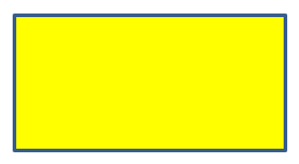

## **บทนำ**

ใน PowerPoint คุณสามารถเพิ่มรูปทรงลงในสไลด์ได้ เนื่องจากรูปทรงประกอบด้วยเส้น คุณจึงสามารถจัดรูปแบบได้โดยการแก้ไขหรือใช้เอฟเฟกต์กับเส้นขอบของพวกมัน อีกทั้งคุณยังสามารถจัดรูปแบบรูปทรงโดยระบุการตั้งค่าที่ควบคุมวิธีการเติมสีภายในของรูปทรงได้


Aspose.Slides for Android via Java มีอินเทอร์เฟซและเมธอดที่ให้คุณจัดรูปแบบรูปทรงโดยใช้ตัวเลือกเดียวกันกับใน PowerPoint

## **จัดรูปแบบเส้น**

โดยใช้ Aspose.Slides คุณสามารถระบุสไตล์เส้นที่กำหนดเองสำหรับรูปทรง ขั้นตอนต่อไปนี้สรุปวิธีการ:

1. สร้างอินสแตนซ์ของคลาส [Presentation](https://reference.aspose.com/slides/androidjava/com.aspose.slides/presentation/)
1. รับอ้างอิงไปยังสไลด์ตามดัชนีของมัน
1. เพิ่ม [IAutoShape](https://reference.aspose.com/slides/androidjava/com.aspose.slides/iautoshape/) ไปยังสไลด์
1. ตั้งค่า [สไตล์เส้น](https://reference.aspose.com/slides/androidjava/com.aspose.slides/linestyle/) ของรูปทรง
1. ตั้งค่าความกว้างของเส้น
1. ตั้งค่า [สไตล์เส้นประ](https://reference.aspose.com/slides/androidjava/com.aspose.slides/linedashstyle/) ของเส้น
1. ตั้งค่าสีของเส้นสำหรับรูปทรง
1. บันทึกงานนำเสนอที่แก้ไขเป็นไฟล์ PPTX

โค้ดต่อไปนี้แสดงวิธีจัดรูปแบบ `AutoShape` รูปสี่เหลี่ยม:

```java
import com.aspose.slides.*;
import java.awt.Color;

// สร้างอินสแตนซ์ของคลาส Presentation ซึ่งเป็นตัวแทนของไฟล์งานนำเสนอ.
Presentation presentation = new Presentation();
try {
    // ดึงสไลด์แรก.
    ISlide slide = presentation.getSlides().get_Item(0);

    // เพิ่มรูปทรงอัตโนมัติประเภท Rectangle.
    IAutoShape shape = slide.getShapes().addAutoShape(ShapeType.Rectangle, 50, 150, 150, 75);

    // ลบการเติมสีออกจากรูปทรงสี่เหลี่ยมเพื่อให้เห็นเฉพาะเส้นของมัน.
    shape.getFillFormat().setFillType(FillType.NoFill);

    // ใช้การจัดรูปแบบกับเส้นของสี่เหลี่ยม.
    shape.getLineFormat().setStyle(LineStyle.ThickThin);
    shape.getLineFormat().setWidth(7);
    shape.getLineFormat().setDashStyle(LineDashStyle.Dash);

    // ตั้งค่าสีสำหรับเส้นของสี่เหลี่ยม.
    shape.getLineFormat().getFillFormat().setFillType(FillType.Solid);
    shape.getLineFormat().getFillFormat().getSolidFillColor().setColor(Color.BLUE);

    // บันทึกไฟล์ PPTX ลงดิสก์.
    presentation.save("formatted_lines.pptx", SaveFormat.Pptx);
} finally {
    presentation.dispose();
}
```

ผลลัพธ์:


## **ใช้เอฟเฟกต์สเก็ตช์กับเส้นของรูปทรง**

เอฟเฟกต์สเก็ตช์ทำให้เส้นของรูปทรงดูเหมือนการวาดด้วยมือ ใช้ [IShape.getLineFormat](https://reference.aspose.com/slides/androidjava/com.aspose.slides/ishape/) เพื่อเข้าถึงการตั้งค่าเส้น, [ILineFormat.getSketchFormat](https://reference.aspose.com/slides/androidjava/com.aspose.slides/ilineformat/) เพื่อเข้าถึงการตั้งค่าสเก็ตช์, และ [ISketchFormat.setSketchType](https://reference.aspose.com/slides/androidjava/com.aspose.slides/isketchformat/) เพื่อเลือกค่าจากการนับจำนวน [LineSketchType](https://reference.aspose.com/slides/androidjava/com.aspose.slides/linesketchtype/)

โค้ด Java ต่อไปนี้แสดงวิธีใช้เอฟเฟกต์ [LineSketchType.Curved](https://reference.aspose.com/slides/androidjava/com.aspose.slides/linesketchtype/) อ่านค่าที่กำหนดโดยชัดเจน, และลบเอฟเฟ็กต์ด้วย [LineSketchType.None](https://reference.aspose.com/slides/androidjava/com.aspose.slides/linesketchtype/):

```java
import com.aspose.slides.*;

Presentation presentation = new Presentation();
try {
    ISlide slide = presentation.getSlides().get_Item(0);
    IAutoShape shape = slide.getShapes().addAutoShape(ShapeType.Rectangle, 50, 50, 200, 100);

    // เข้าถึงรูปแบบเส้นของรูปทรงและรูปแบบสเก็ตช์ของมัน.
    ISketchFormat sketchFormat = shape.getLineFormat().getSketchFormat();

    // ใช้เอฟเฟกต์สเก็ตช์.
    sketchFormat.setSketchType(LineSketchType.Curved);

    // อ่านเอฟเฟกต์สเก็ตช์ที่กำหนดโดยตรงให้กับรูปทรง.
    int explicitSketchType = sketchFormat.getSketchType();
    System.out.println("Explicit sketch type: " + explicitSketchType);

    // ลบเอฟเฟกต์สเก็ตช์.
    sketchFormat.setSketchType(LineSketchType.None);
} finally {
    presentation.dispose();
}
```

ค่าที่ส่งกลับโดย [ISketchFormat.getSketchType](https://reference.aspose.com/slides/androidjava/com.aspose.slides/isketchformat/) แสดงถึงการตั้งค่าที่กำหนดโดยตรงกับรูปทรง หากการจัดรูปแบบเส้นสามารถสืบทอดจากธีม, มาสเตอร์สไลด์ หรือเลเอาท์สไลด์, ใช้ [ILineFormat.getEffective](https://reference.aspose.com/slides/androidjava/com.aspose.slides/ilineformat/), เข้าถึง [ILineFormatEffectiveData.getSketchFormat](https://reference.aspose.com/slides/androidjava/com.aspose.slides/ilineformateffectivedata/), และอ่าน [ISketchFormatEffectiveData.getSketchType](https://reference.aspose.com/slides/androidjava/com.aspose.slides/isketchformateffectivedata/). ค่าที่มีผลสะท้อนการจัดรูปแบบที่ใช้จริงหลังจากการสืบทอดได้รับการแก้ไข:

```java
import com.aspose.slides.*;

Presentation presentation = new Presentation("presentation.pptx");
try {
    IShape shape = presentation.getSlides().get_Item(0).getShapes().get_Item(0);
    ILineFormat lineFormat = shape.getLineFormat();

    int explicitSketchType = lineFormat.getSketchFormat().getSketchType();
    ILineFormatEffectiveData effectiveLineFormat = lineFormat.getEffective();
    int effectiveSketchType = effectiveLineFormat.getSketchFormat().getSketchType();

    System.out.println("Explicit sketch type: " + explicitSketchType);
    System.out.println("Effective sketch type: " + effectiveSketchType);
} finally {
    presentation.dispose();
}
```

## **จัดรูปแบบสไตล์การต่อเชื่อม**

ต่อไปนี้เป็นตัวเลือกของประเภทการต่อเชื่อมสามแบบ:

* Round
* Miter
* Bevel

โดยค่าเริ่มต้น, เมื่อ PowerPoint เชื่อมเส้นสองเส้นที่มุม (เช่นที่มุมของรูปทรง) จะใช้การตั้งค่า **Round** อย่างไรก็ตาม หากคุณวาดรูปทรงที่มีมุมคม คุณอาจต้องการตัวเลือก **Miter**.


โค้ด Java ต่อไปนี้แสดงว่ารูปสี่เหลี่ยมสามรูป (ตามภาพด้านบน) ถูกสร้างโดยใช้การตั้งค่า Join Type แบบ Miter, Bevel, และ Round:

```java
import com.aspose.slides.*;
import java.awt.Color;

// สร้างอินสแตนซ์ของคลาส Presentation ซึ่งเป็นตัวแทนของไฟล์งานนำเสนอ.
Presentation presentation = new Presentation();
try {
    // ดึงสไลด์แรก.
    ISlide slide = presentation.getSlides().get_Item(0);

    // เพิ่มรูปทรงอัตโนมัติสามรูปประเภท Rectangle.
    IAutoShape shape1 = slide.getShapes().addAutoShape(ShapeType.Rectangle, 20, 20, 150, 75);
    IAutoShape shape2 = slide.getShapes().addAutoShape(ShapeType.Rectangle, 210, 20, 150, 75);
    IAutoShape shape3 = slide.getShapes().addAutoShape(ShapeType.Rectangle, 20, 135, 150, 75);

    // ตั้งค่าสีเติมสำหรับแต่ละรูปสี่เหลี่ยม.
    shape1.getFillFormat().setFillType(FillType.Solid);
    shape1.getFillFormat().getSolidFillColor().setColor(Color.BLACK);
    shape2.getFillFormat().setFillType(FillType.Solid);
    shape2.getFillFormat().getSolidFillColor().setColor(Color.BLACK);
    shape3.getFillFormat().setFillType(FillType.Solid);
    shape3.getFillFormat().getSolidFillColor().setColor(Color.BLACK);

    // ตั้งค่าความกว้างของเส้น.
    shape1.getLineFormat().setWidth(15);
    shape2.getLineFormat().setWidth(15);
    shape3.getLineFormat().setWidth(15);

    // ตั้งค่าสีสำหรับเส้นของแต่ละสี่เหลี่ยม.
    shape1.getLineFormat().getFillFormat().setFillType(FillType.Solid);
    shape1.getLineFormat().getFillFormat().getSolidFillColor().setColor(Color.BLUE);
    shape2.getLineFormat().getFillFormat().setFillType(FillType.Solid);
    shape2.getLineFormat().getFillFormat().getSolidFillColor().setColor(Color.BLUE);
    shape3.getLineFormat().getFillFormat().setFillType(FillType.Solid);
    shape3.getLineFormat().getFillFormat().getSolidFillColor().setColor(Color.BLUE);

    // ตั้งค่าสไตล์การเชื่อมต่อ.
    shape1.getLineFormat().setJoinStyle(LineJoinStyle.Miter);
    shape2.getLineFormat().setJoinStyle(LineJoinStyle.Bevel);
    shape3.getLineFormat().setJoinStyle(LineJoinStyle.Round);

    // เพิ่มข้อความลงในแต่ละสี่เหลี่ยม.
    shape1.getTextFrame().setText("Miter Join Style");
    shape2.getTextFrame().setText("Bevel Join Style");
    shape3.getTextFrame().setText("Round Join Style");

    // บันทึกไฟล์ PPTX ลงดิสก์.
    presentation.save("join_styles.pptx", SaveFormat.Pptx);
} finally {
    presentation.dispose();
}
```

## **การไล่ระดับสี (Gradient Fill)**

ใน PowerPoint, Gradient Fill เป็นตัวเลือกการจัดรูปแบบที่ให้คุณใส่การผสมสีต่อเนื่องลงในรูปทรง ตัวอย่างเช่น คุณสามารถใช้สองสีหรือมากกว่านั้นโดยให้สีหนึ่งค่อย ๆ จางไปยังอีกสีหนึ่ง

ต่อไปนี้คือวิธีการใส่การไล่ระดับสีให้กับรูปทรงโดยใช้ Aspose.Slides:

1. สร้างอินสแตนซ์ของคลาส [Presentation](https://reference.aspose.com/slides/androidjava/com.aspose.slides/presentation/)
1. รับอ้างอิงไปยังสไลด์ตามดัชนีของมัน
1. เพิ่ม [IAutoShape](https://reference.aspose.com/slides/androidjava/com.aspose.slides/iautoshape/) ไปยังสไลด์
1. ตั้งค่า [FillType](https://reference.aspose.com/slides/androidjava/com.aspose.slides/filltype/) ของรูปทรงเป็น `Gradient`
1. เพิ่มสีที่คุณต้องการสองสีพร้อมตำแหน่งที่กำหนดโดยใช้เมธอด `add` ของคอลเลกชัน gradient stop ที่เปิดเผยโดยอินเทอร์เฟซ [IGradientFormat](https://reference.aspose.com/slides/androidjava/com.aspose.slides/igradientformat/)
1. บันทึกงานนำเสนอที่แก้ไขเป็นไฟล์ PPTX

โค้ด Java ต่อไปนี้แสดงวิธีใส่เอฟเฟ็กต์การไล่ระดับสีให้กับวงรี:

```java
import com.aspose.slides.*;

// สร้างอินสแตนซ์ของคลาส Presentation ซึ่งเป็นตัวแทนของไฟล์งานนำเสนอ.
Presentation presentation = new Presentation();
try {
    // ดึงสไลด์แรก.
    ISlide slide = presentation.getSlides().get_Item(0);

    // เพิ่มรูปทรงอัตโนมัติประเภท Ellipse.
    IAutoShape shape = slide.getShapes().addAutoShape(ShapeType.Ellipse, 50, 50, 150, 75);

    // ใช้การจัดรูปแบบไล่ระดับสีกับวงรี.
    shape.getFillFormat().setFillType(FillType.Gradient);
    shape.getFillFormat().getGradientFormat().setGradientShape(GradientShape.Linear);

    // ตั้งค่าทิศทางของการไล่ระดับสี.
    shape.getFillFormat().getGradientFormat().setGradientDirection(GradientDirection.FromCorner2);

    // เพิ่มจุดหยุดไล่ระดับสีสองจุด.
    shape.getFillFormat().getGradientFormat().getGradientStops().addPresetColor((float)1.0, PresetColor.Purple);
    shape.getFillFormat().getGradientFormat().getGradientStops().addPresetColor((float)0, PresetColor.Red);

    // บันทึกไฟล์ PPTX ลงดิสก์.
    presentation.save("gradient_fill.pptx", SaveFormat.Pptx);
} finally {
    presentation.dispose();
}
```

ผลลัพธ์:


หากการไล่ระดับสีดูแตกต่างกันในภาพที่ส่งออกเทียบกับที่ PowerPoint แสดงให้ดู, ให้ดูที่ [Choose a Gradient Rendering Style](/slides/th/androidjava/convert-powerpoint-to-png/#choose-a-gradient-rendering-style). คุณสามารถเลือกสไตล์การแสดงผลโดยไม่ต้องเปลี่ยนการไล่ระดับสีที่ถูกเก็บไว้ในงานนำเสนอ

## **การเติมลายแบบ (Pattern Fill)**

ใน PowerPoint, Pattern Fill เป็นตัวเลือกการจัดรูปแบบที่ให้คุณใส่การออกแบบสองสี—เช่น จุด, ลายเส้น, เส้นตาข่าย, หรือการเช็คลาย—ลงในรูปทรง คุณสามารถเลือกสีที่กำหนดเองสำหรับสีพื้นหน้าและพื้นหลังของลาย

Aspose.Slides มีรูปแบบลายที่กำหนดไว้ล่วงหน้ามากกว่า 45 แบบที่คุณสามารถนำไปใช้กับรูปทรงเพื่อเพิ่มความน่าสนใจของการนำเสนอ แม้หลังจากเลือกลายที่กำหนดไว้แล้ว คุณก็ยังสามารถระบุสีที่แน่นอนได้

ต่อไปนี้คือตัวอย่างการใส่ Pattern Fill ให้กับรูปทรงโดยใช้ Aspose.Slides:

1. สร้างอินสแตนซ์ของคลาส [Presentation](https://reference.aspose.com/slides/androidjava/com.aspose.slides/presentation/)
1. รับอ้างอิงไปยังสไลด์ตามดัชนีของมัน
1. เพิ่ม [IAutoShape](https://reference.aspose.com/slides/androidjava/com.aspose.slides/iautoshape/) ไปยังสไลด์
1. ตั้งค่า [FillType](https://reference.aspose.com/slides/androidjava/com.aspose.slides/filltype/) ของรูปทรงเป็น `Pattern`
1. เลือกสไตล์ลายจากตัวเลือกที่กำหนดไว้ล่วงหน้า
1. ตั้งค่า [Background Color](https://reference.aspose.com/slides/androidjava/com.aspose.slides/patternformat/#getBackColor--) ของลาย
1. ตั้งค่า [Foreground Color](https://reference.aspose.com/slides/androidjava/com.aspose.slides/patternformat/#getForeColor--) ของลาย
1. บันทึกงานนำเสนอที่แก้ไขเป็นไฟล์ PPTX

โค้ด Java ต่อไปนี้แสดงวิธีใส่ Pattern Fill ให้กับสี่เหลี่ยม:

```java
import com.aspose.slides.*;
import java.awt.Color;

// สร้างอินสแตนซ์ของคลาส Presentation ซึ่งเป็นตัวแทนของไฟล์งานนำเสนอ.
Presentation presentation = new Presentation();
try {
    // ดึงสไลด์แรก.
    ISlide slide = presentation.getSlides().get_Item(0);

    // เพิ่มรูปทรงอัตโนมัติประเภท Rectangle.
    IAutoShape shape = slide.getShapes().addAutoShape(ShapeType.Rectangle, 50, 50, 150, 75);

    // ตั้งค่าชนิดการเติมเป็น Pattern.
    shape.getFillFormat().setFillType(FillType.Pattern);

    // ตั้งค่าสไตล์ลาย.
    shape.getFillFormat().getPatternFormat().setPatternStyle(PatternStyle.Trellis);

    // ตั้งค่าสีพื้นหลังและพื้นหน้าของลาย.
    shape.getFillFormat().getPatternFormat().getBackColor().setColor(Color.LIGHT_GRAY);
    shape.getFillFormat().getPatternFormat().getForeColor().setColor(Color.YELLOW);

    // บันทึกไฟล์ PPTX ลงดิสก์.
    presentation.save("pattern_fill.pptx", SaveFormat.Pptx);
} finally {
    presentation.dispose();
}
```

ผลลัพธ์:


## **การเติมรูปภาพ (Picture Fill)**

ใน PowerPoint, Picture Fill เป็นตัวเลือกการจัดรูปแบบที่ให้คุณแทรกรูปภาพภายในรูปทรง — ใช้รูปภาพเป็นพื้นหลังของรูปทรง

ต่อไปนี้เป็นวิธีใช้ Aspose.Slides เพื่อใส่ Picture Fill ให้กับรูปทรง:

1. สร้างอินสแตนซ์ของคลาส [Presentation](https://reference.aspose.com/slides/androidjava/com.aspose.slides/presentation/)
1. รับอ้างอิงไปยังสไลด์ตามดัชนีของมัน
1. เพิ่ม [IAutoShape](https://reference.aspose.com/slides/androidjava/com.aspose.slides/iautoshape/) ไปยังสไลด์
1. ตั้งค่า [FillType](https://reference.aspose.com/slides/androidjava/com.aspose.slides/filltype/) ของรูปทรงเป็น `Picture`
1. ตั้งค่าโหมดการเติมรูปเป็น `Tile` (หรือโหมดอื่นที่ต้องการ)
1. สร้างอ็อบเจ็กต์ [IPPImage](https://reference.aspose.com/slides/androidjava/com.aspose.slides/ippimage/) จากรูปที่ต้องการใช้
1. ส่งภาพไปยังเมธอด `ISlidesPicture.setImage`
1. บันทึกงานนำเสนอที่แก้ไขเป็นไฟล์ PPTX

สมมติว่าเรามีไฟล์ "lotus.png" ที่มีรูปภาพดังนี้:


โค้ด Java ต่อไปนี้แสดงวิธีเติมรูปทรงด้วยรูปภาพ:

```java
import com.aspose.slides.*;

// สร้างอินสแตนซ์ของคลาส Presentation ซึ่งเป็นตัวแทนของไฟล์งานนำเสนอ.
Presentation presentation = new Presentation();
try {
    // ดึงสไลด์แรก.
    ISlide slide = presentation.getSlides().get_Item(0);

    // เพิ่มรูปทรงอัตโนมัติประเภท Rectangle.
    IAutoShape shape = slide.getShapes().addAutoShape(ShapeType.Rectangle, 50, 50, 255, 130);
    
    // ตั้งค่าชนิดการเติมเป็น Picture.
    shape.getFillFormat().setFillType(FillType.Picture);

    // ตั้งค่าโหมดการเติมรูปภาพ.
    shape.getFillFormat().getPictureFillFormat().setPictureFillMode(PictureFillMode.Tile);

    // โหลดภาพและเพิ่มลงในทรัพยากรของงานนำเสนอ.
    IImage image = Images.fromFile("lotus.png");
    IPPImage picture = presentation.getImages().addImage(image);
    image.dispose();

    // ตั้งค่ารูปภาพ.
    shape.getFillFormat().getPictureFillFormat().getPicture().setImage(picture);

    // บันทึกไฟล์ PPTX ลงดิสก์.
    presentation.save("picture_fill.pptx", SaveFormat.Pptx);
} finally {
    presentation.dispose();
}
```

ผลลัพธ์:


### **ใช้รูปภาพแบบ Tile เป็นพื้นผิว (Texture)**

หากคุณต้องการตั้งค่ารูปภาพที่เป็นลายกระเบื้องเป็นพื้นผิวและปรับพฤติกรรมการกระเบื้อง คุณสามารถใช้เมธอดต่อไปนี้ของอินเทอร์เฟซ [IPictureFillFormat](https://reference.aspose.com/slides/androidjava/com.aspose.slides/ipicturefillformat/) และคลาส [PictureFillFormat](https://reference.aspose.com/slides/androidjava/com.aspose.slides/picturefillformat/) :

- [setPictureFillMode](https://reference.aspose.com/slides/androidjava/com.aspose.slides/ipicturefillformat/#setPictureFillMode-int-): ตั้งค่าโหมดการเติมรูป—`Tile` หรือ `Stretch`
- [setTileAlignment](https://reference.aspose.com/slides/androidjava/com.aspose.slides/ipicturefillformat/#setTileAlignment-byte-): กำหนดการจัดตำแหน่งของกระเบื้องภายในรูปทรง
- [setTileFlip](https://reference.aspose.com/slides/androidjava/com.aspose.slides/ipicturefillformat/#setTileFlip-int-): ควบคุมว่ากระเบื้องจะถูกกลับด้านแนวนอน แนวตั้ง หรือทั้งสองอย่าง
- [setTileOffsetX](https://reference.aspose.com/slides/androidjava/com.aspose.slides/ipicturefillformat/#setTileOffsetX-float-): ตั้งค่าออฟเซ็ตแนวนอนของกระเบื้อง (หน่วยเป็นจุด) จากจุดกำเนิดของรูปทรง
- [setTileOffsetY](https://reference.aspose.com/slides/androidjava/com.aspose.slides/ipicturefillformat/#setTileOffsetY-float-): ตั้งค่าออฟเซ็ตแนวตั้งของกระเบื้อง (หน่วยเป็นจุด) จากจุดกำเนิดของรูปทรง
- [setTileScaleX](https://reference.aspose.com/slides/androidjava/com.aspose.slides/ipicturefillformat/#setTileScaleX-float-): กำหนดสเกลแนวนอนของกระเบื้องเป็นเปอร์เซ็นต์
- [setTileScaleY](https://reference.aspose.com/slides/androidjava/com.aspose.slides/ipicturefillformat/#setTileScaleY-float-): กำหนดสเกลแนวตั้งของกระเบื้องเป็นเปอร์เซ็นต์

โค้ดตัวอย่างต่อไปนี้แสดงวิธีเพิ่มรูปทรงสี่เหลี่ยมที่เติมรูปด้วยรูปภาพกระเบื้องและกำหนดตัวเลือกกระเบื้อง:

```java
import com.aspose.slides.*;

// สร้างอินสแตนซ์ของคลาส Presentation ซึ่งเป็นตัวแทนของไฟล์งานนำเสนอ.
Presentation presentation = new Presentation();
try {
    // ดึงสไลด์แรก.
    ISlide firstSlide = presentation.getSlides().get_Item(0);

    // เพิ่มรูปทรงอัตโนมัติประเภท Rectangle.
    IAutoShape shape = firstSlide.getShapes().addAutoShape(ShapeType.Rectangle, 50, 50, 190, 95);

    // ตั้งค่าชนิดการเติมของรูปทรงเป็น Picture.
    shape.getFillFormat().setFillType(FillType.Picture);

    // โหลดภาพและเพิ่มลงในทรัพยากรของงานนำเสนอ.
    IImage sourceImage = Images.fromFile("lotus.png");
    IPPImage presentationImage = presentation.getImages().addImage(sourceImage);
    sourceImage.dispose();

    // กำหนดภาพให้กับรูปทรง.
    IPictureFillFormat pictureFillFormat = shape.getFillFormat().getPictureFillFormat();
    pictureFillFormat.getPicture().setImage(presentationImage);

    // กำหนดค่าโหมดการเติมรูปภาพและคุณสมบัติการกระเบื้อง.
    pictureFillFormat.setPictureFillMode(PictureFillMode.Tile);
    pictureFillFormat.setTileOffsetX(-32);
    pictureFillFormat.setTileOffsetY(-32);
    pictureFillFormat.setTileScaleX(50);
    pictureFillFormat.setTileScaleY(50);
    pictureFillFormat.setTileAlignment(RectangleAlignment.BottomRight);
    pictureFillFormat.setTileFlip(TileFlip.FlipBoth);

    // บันทึกไฟล์ PPTX ลงดิสก์.
    presentation.save("tile.pptx", SaveFormat.Pptx);
} finally {
    presentation.dispose();
}
```

ผลลัพธ์:


## **การเติมสีทึบ (Solid Color Fill)**

ใน PowerPoint, Solid Color Fill เป็นตัวเลือกการจัดรูปแบบที่เติมรูปทรงด้วยสีเดียวที่เป็นสีเดียวกัน พื้นหลังสีเดียวนี้จะถูกใช้โดยไม่มีการไล่ระดับ, ใบพื้นผิว, หรือรูปแบบลายใด ๆ

เพื่อเติมสีทึบให้กับรูปทรงโดยใช้ Aspose.Slides ทำตามขั้นตอนต่อไปนี้:

1. สร้างอินสแตนซ์ของคลาส [Presentation](https://reference.aspose.com/slides/androidjava/com.aspose.slides/presentation/)
1. รับอ้างอิงไปยังสไลด์ตามดัชนีของมัน
1. เพิ่ม [IAutoShape](https://reference.aspose.com/slides/androidjava/com.aspose.slides/iautoshape/) ไปยังสไลด์
1. ตั้งค่า [FillType](https://reference.aspose.com/slides/androidjava/com.aspose.slides/filltype/) ของรูปทรงเป็น `Solid`
1. กำหนดสีเติมที่คุณต้องการให้กับรูปทรง
1. บันทึกงานนำเสนอที่แก้ไขเป็นไฟล์ PPTX

โค้ด Java ต่อไปนี้แสดงวิธีเติมสีทึบให้กับสี่เหลี่ยมในสไลด์ PowerPoint:

```java
import com.aspose.slides.*;
import java.awt.Color;

// สร้างอินสแตนซ์ของคลาส Presentation ซึ่งเป็นตัวแทนของไฟล์งานนำเสนอ.
Presentation presentation = new Presentation();
try {
    // ดึงสไลด์แรก.
    ISlide slide = presentation.getSlides().get_Item(0);

    // เพิ่มรูปทรงอัตโนมัติประเภท Rectangle.
    IAutoShape shape = slide.getShapes().addAutoShape(ShapeType.Rectangle, 50, 50, 150, 75);

    // ตั้งค่าชนิดการเติมเป็น Solid.
    shape.getFillFormat().setFillType(FillType.Solid);

    // ตั้งค่าสีเติม.
    shape.getFillFormat().getSolidFillColor().setColor(Color.YELLOW);

    // บันทึกไฟล์ PPTX ลงดิสก์.
    presentation.save("solid_color_fill.pptx", SaveFormat.Pptx);
} finally {
    presentation.dispose();
}
```

ผลลัพธ์:



## **ตั้งค่าความโปร่งใส (Set Transparency)**

ใน PowerPoint, เมื่อคุณใส่สีทึบ, ไล่ระดับ, รูปภาพ, หรือการเติมพื้นผิวให้กับรูปทรง, คุณยังสามารถตั้งค่าระดับความโปร่งใสเพื่อควบคุมความทึบของการเติม สีที่ความโปร่งใสสูงจะทำให้รูปทรงดูโปร่งใสมากขึ้น, ทำให้พื้นหลังหรือวัตถุที่อยู่ด้านล่างมองเห็นได้บางส่วน

Aspose.Slides ให้คุณตั้งค่าความโปร่งใสโดยปรับค่าอัลฟาในสีที่ใช้สำหรับการเติม นี่คือวิธีทำ:

1. สร้างอินสแตนซ์ของคลาส [Presentation](https://reference.aspose.com/slides/androidjava/com.aspose.slides/presentation/)
1. รับอ้างอิงไปยังสไลด์ตามดัชนีของมัน
1. เพิ่ม [IAutoShape](https://reference.aspose.com/slides/androidjava/com.aspose.slides/iautoshape/) ไปยังสไลด์
1. ตั้งค่า [FillType](https://reference.aspose.com/slides/androidjava/com.aspose.slides/filltype/) เป็น `Solid`
1. ใช้ `Color` เพื่อกำหนดสีที่มีความโปร่งใส (ส่วนประกอบ `alpha` ควบคุมความโปร่งใส)
1. บันทึกงานนำเสนอ

โค้ด Java ต่อไปนี้แสดงวิธีใส่สีเติมที่มีความโปร่งใสให้กับสี่เหลี่ยม:

```java
import com.aspose.slides.*;
import java.awt.Color;

// สร้างอินสแตนซ์ของคลาส Presentation ซึ่งเป็นตัวแทนของไฟล์งานนำเสนอ.
Presentation presentation = new Presentation();
try {
    // ดึงสไลด์แรก.
    ISlide slide = presentation.getSlides().get_Item(0);

    // เพิ่มรูปสี่เหลี่ยมอัตโนมัติแบบทึบ.
    IAutoShape solidShape = slide.getShapes().addAutoShape(ShapeType.Rectangle, 50, 50, 150, 75);

    // เพิ่มรูปสี่เหลี่ยมอัตโนมัติแบบโปร่งใสทับบนรูปทึบ.
    IAutoShape transparentShape = slide.getShapes().addAutoShape(ShapeType.Rectangle, 80, 80, 150, 75);
    transparentShape.getFillFormat().setFillType(FillType.Solid);
    transparentShape.getFillFormat().getSolidFillColor().setColor(new Color(255, 255, 0, 204));

    // บันทึกไฟล์ PPTX ลงดิสก์.
    presentation.save("shape_transparency.pptx", SaveFormat.Pptx);
} finally {
    presentation.dispose();
}
```

ผลลัพธ์:


## **หมุนรูปทรง (Rotate Shapes)**

Aspose.Slides ให้คุณหมุนรูปทรงในงานนำเสนอ PowerPoint ซึ่งเป็นประโยชน์เมื่อจัดตำแหน่งองค์ประกอบภาพด้วยการจัดแนวหรือความต้องการออกแบบเฉพาะ

เพื่อหมุนรูปทรงบนสไลด์ ทำตามขั้นตอนต่อไปนี้:

1. สร้างอินสแตนซ์ของคลาส [Presentation](https://reference.aspose.com/slides/androidjava/com.aspose.slides/presentation/)
1. รับอ้างอิงไปยังสไลด์ตามดัชนีของมัน
1. เพิ่ม [IAutoShape](https://reference.aspose.com/slides/androidjava/com.aspose.slides/iautoshape/) ไปยังสไลด์
1. ตั้งค่าคุณสมบัติการหมุนของรูปทรงให้เป็นมุมที่ต้องการ
1. บันทึกงานนำเสนอ

โค้ด Java ต่อไปนี้แสดงวิธีหมุนรูปทรง 5 องศา:

```java
import com.aspose.slides.*;

// สร้างอินสแตนซ์ของคลาส Presentation ซึ่งเป็นตัวแทนของไฟล์งานนำเสนอ.
Presentation presentation = new Presentation();
try {
    // ดึงสไลด์แรก.
    ISlide slide = presentation.getSlides().get_Item(0);

    // เพิ่มรูปทรงอัตโนมัติประเภท Rectangle.
    IAutoShape shape = slide.getShapes().addAutoShape(ShapeType.Rectangle, 50, 50, 150, 75);

    // หมุนรูปทรง 5 องศา.
    shape.setRotation(5);

    // บันทึกไฟล์ PPTX ลงดิสก์.
    presentation.save("shape_rotation.pptx", SaveFormat.Pptx);
} finally {
    presentation.dispose();
}
```

ผลลัพธ์:


## **เพิ่มเอฟเฟ็กต์ 3D Bevel**

Aspose.Slides ให้คุณใช้เอฟเฟ็กต์ 3D Bevel กับรูปทรงโดยกำหนดคุณสมบัติของ [ThreeDFormat](https://reference.aspose.com/slides/androidjava/com.aspose.slides/threedformat/)

เพื่อเพิ่มเอฟเฟ็กต์ 3D Bevel ให้กับรูปทรง ทำตามขั้นตอนต่อไปนี้:

1. สร้างอินสแตนซ์ของคลาส [Presentation](https://reference.aspose.com/slides/androidjava/com.aspose.slides/presentation/)
1. รับอ้างอิงไปยังสไลด์ตามดัชนีของมัน
1. เพิ่ม [IAutoShape](https://reference.aspose.com/slides/androidjava/com.aspose.slides/iautoshape/) ไปยังสไลด์
1. กำหนดค่า [ThreeDFormat](https://reference.aspose.com/slides/androidjava/com.aspose.slides/threedformat/) ของรูปทรงเพื่อกำหนดการตั้งค่า Bevel
1. บันทึกงานนำเสนอ

โค้ด Java ต่อไปนี้แสดงวิธีใช้เอฟเฟ็กต์ 3D Bevel กับรูปทรง:

```java
import com.aspose.slides.*;
import java.awt.Color;

// สร้างอินสแตนซ์ของคลาส Presentation.
Presentation presentation = new Presentation();
try {
    ISlide slide = presentation.getSlides().get_Item(0);

    // เพิ่มรูปทรงลงในสไลด์.
    IAutoShape shape = slide.getShapes().addAutoShape(ShapeType.Ellipse, 50, 50, 100, 100);
    shape.getFillFormat().setFillType(FillType.Solid);
    shape.getFillFormat().getSolidFillColor().setColor(Color.GREEN);
    shape.getLineFormat().getFillFormat().setFillType(FillType.Solid);
    shape.getLineFormat().getFillFormat().getSolidFillColor().setColor(Color.ORANGE);
    shape.getLineFormat().setWidth(2.0);

    // ตั้งค่าคุณสมบัติ ThreeDFormat ของรูปทรง.
    shape.getThreeDFormat().setDepth(4);
    shape.getThreeDFormat().getBevelTop().setBevelType(BevelPresetType.Circle);
    shape.getThreeDFormat().getBevelTop().setHeight(6);
    shape.getThreeDFormat().getBevelTop().setWidth(6);
    shape.getThreeDFormat().getCamera().setCameraType(CameraPresetType.OrthographicFront);
    shape.getThreeDFormat().getLightRig().setLightType(LightRigPresetType.ThreePt);
    shape.getThreeDFormat().getLightRig().setDirection(LightingDirection.Top);

    // บันทึกงานนำเสนอเป็นไฟล์ PPTX.
    presentation.save("3D_bevel_effect.pptx", SaveFormat.Pptx);
} finally {
    presentation.dispose();
}
```

ผลลัพธ์:


## **เพิ่มเอฟเฟ็กต์การหมุน 3D**

Aspose.Slides ให้คุณใช้เอฟเฟ็กต์การหมุน 3D กับรูปทรงโดยกำหนดคุณสมบัติของ [ThreeDFormat](https://reference.aspose.com/slides/androidjava/com.aspose.slides/threedformat/)

เพื่อใช้การหมุน 3D กับรูปทรง:

1. สร้างอินสแตนซ์ของคลาส [Presentation](https://reference.aspose.com/slides/androidjava/com.aspose.slides/presentation/)
1. รับอ้างอิงไปยังสไลด์ตามดัชนีของมัน
1. เพิ่ม [IAutoShape](https://reference.aspose.com/slides/androidjava/com.aspose.slides/iautoshape/) ไปยังสไลด์
1. ใช้เมธอด [setCameraType](https://reference.aspose.com/slides/androidjava/com.aspose.slides/icamera/#setCameraType-int-) และ [setLightType](https://reference.aspose.com/slides/androidjava/com.aspose.slides/ilightrig/#setLightType-int-) เพื่อกำหนดการหมุน 3D
1. บันทึกงานนำเสนอ

โค้ด Java ต่อไปนี้แสดงวิธีใช้เอฟเฟ็กต์การหมุน 3D กับรูปทรง:

```java
import com.aspose.slides.*;

// สร้างอินสแตนซ์ของคลาส Presentation.
Presentation presentation = new Presentation();
try {
    ISlide slide = presentation.getSlides().get_Item(0);

    IAutoShape autoShape = slide.getShapes().addAutoShape(ShapeType.Rectangle, 50, 50, 150, 75);
    autoShape.getTextFrame().setText("Hello, Aspose!");

    autoShape.getThreeDFormat().setDepth(6);
    autoShape.getThreeDFormat().getCamera().setRotation(40, 35, 20);
    autoShape.getThreeDFormat().getCamera().setCameraType(CameraPresetType.IsometricLeftUp);
    autoShape.getThreeDFormat().getLightRig().setLightType(LightRigPresetType.Balanced);

    // บันทึกงานนำเสนอเป็นไฟล์ PPTX.
    presentation.save("3D_rotation_effect.pptx", SaveFormat.Pptx);
} finally {
    presentation.dispose();
}
```

ผลลัพธ์:


## **ควบคุมการแสดงผลสีขาว-ดำสำหรับรูปทรง**

เมธอด [IShape.setBlackWhiteMode](https://reference.aspose.com/slides/androidjava/com.aspose.slides/ishape/#setBlackWhiteMode-byte-) ระบุว่ารูปทรงแต่ละอันจะแสดงผลอย่างไรเมื่อการนำเสนอถูกดูหรือประมวลผลในโหมดสีขาว-ดำ มันไม่ได้เปิดใช้งานการแสดงผลสีขาว-ดำโดยตรงและไม่ได้เปลี่ยนการเติมสี, เส้น, หรือการจัดรูปแบบอื่น ๆ ในโหมดสีปกติ

ใช้ค่าจากคลาส [BlackWhiteMode](https://reference.aspose.com/slides/androidjava/com.aspose.slides/blackwhitemode/) เพื่อเลือกพฤติกรรมที่ต้องการ ตัวอย่างเช่น `Automatic` ให้แอปพลิเคชันการเรนเดอร์เลือกการแปลง, `Gray` และ `LightGray` ใช้สีเทา, `BlackWhite` ใช้สีดำและขาวอย่างเดียว, `Black` และ `White` บังคับใช้สีเดียว, `Color` รักษาสีปกติ, และ `Hidden` ทำให้รูปทรงไม่ปรากฏในโหมดสีขาว-ดำ, `NotDefined` หมายถึงไม่ได้กำหนดโหมดระดับรูปทรง

โค้ด Java ต่อไปนี้สร้างรูปทรงสีและทำให้มันแสดงเป็นสีเทาในโหมดการแสดงผลสีขาว-ดำ:

```java
import com.aspose.slides.*;
import android.graphics.Color;

Presentation presentation = new Presentation();
try {
    ISlide slide = presentation.getSlides().get_Item(0);

    IAutoShape shape = slide.getShapes().addAutoShape(ShapeType.Rectangle, 50, 50, 200, 100);
    shape.getFillFormat().setFillType(FillType.Solid);
    shape.getFillFormat().getSolidFillColor().setColor(Color.rgb(255, 165, 0));

    // คงการเติมสีส้มในโหมดสี, แต่เรนเดอร์รูปทรงด้วยสีเทาในโหมดสีขาว-ดำ.
    shape.setBlackWhiteMode(BlackWhiteMode.Gray);

    presentation.save("shape_black_white_mode.pptx", SaveFormat.Pptx);
} finally {
    presentation.dispose();
}
```

ในโหมดสีปกติ, สี่เหลี่ยมยังคงมีการเติมสีส้ม. ในกระบวนการแสดงผลสีขาว-ดำ, มันใช้สีเทาเพราะโหมดถูกตั้งค่าเป็น `Gray`. สิ่งนี้ทำให้คุณสามารถรักษาสไลด์สีเต็มได้ในขณะที่กำหนดลักษณะเฉพาะสำหรับการพิมพ์, การดูตัวอย่าง, หรือกระบวนการอื่น ๆ ที่เคารพการตั้งค่าแสดงผลสีขาว-ดำของงานนำเสนอ

## **รีเซ็ตการจัดรูปแบบ**

โค้ด Java ต่อไปนี้แสดงวิธีรีเซ็ตการจัดรูปแบบของสไลด์และคืนตำแหน่ง, ขนาด, และการจัดรูปแบบของรูปทรงทั้งหมดที่มี placeholder บน [LayoutSlide](https://reference.aspose.com/slides/androidjava/com.aspose.slides/layoutslide/) ไปยังการตั้งค่าเริ่มต้น:

```java
import com.aspose.slides.*;

Presentation presentation = new Presentation("sample.pptx");
try {
    for (ISlide slide : presentation.getSlides()) {
        // รีเซ็ตแต่ละรูปทรงบนสไลด์ที่มี placeholder บนเลเอาต์.
        slide.reset();
    }
    presentation.save("reset_formatting.pptx", SaveFormat.Pptx);
} finally {
    presentation.dispose();
}
```

## **คำถามที่พบบ่อย**

**การจัดรูปแบบรูปทรงส่งผลต่อขนาดไฟล์งานนำเสนอสุดท้ายหรือไม่?**

มีผลเพียงเล็กน้อย. ภาพและสื่อที่ฝังอยู่ใช้พื้นที่ส่วนใหญ่ของไฟล์, ส่วนพารามิเตอร์ของรูปทรงเช่นสี, เอฟเฟ็กต์, และการไล่ระดับสีถูกเก็บเป็นเมตาดาต้าและเพิ่มขนาดไฟล์แทบไม่มี

**ฉันจะตรวจจับรูปทรงบนสไลด์ที่มีการจัดรูปแบบเดียวกันเพื่อจะจัดกลุ่มได้อย่างไร?**

เปรียบเทียบคุณสมบัติการจัดรูปแบบหลักของแต่ละรูปทรง — การเติม, เส้น, และการตั้งค่าเอฟเฟ็กต์ หากค่าตรงกันทั้งหมด ให้ถือว่ารูปแบบเหมือนกันและจัดกลุ่มรูปทรงเหล่านั้นแบบตรรกะ ซึ่งทำให้การจัดการสไตล์ภายหลังง่ายขึ้น

**ฉันสามารถบันทึกชุดสไตล์รูปทรงที่กำหนดเองเป็นไฟล์แยกเพื่อใช้งานซ้ำในงานนำเสนออื่นได้หรือไม่?**

ได้. เก็บรูปทรงตัวอย่างที่มีสไตล์ที่ต้องการในสไลด์แม่แบบหรือไฟล์เทมเพลต .POTX. เมื่อสร้างงานนำเสนอใหม่, เปิดเทมเพลต, คัดลอกรูปทรงที่มีสไตล์ที่ต้องการ, แล้วนำการจัดรูปแบบไปใช้ใหม่ตามต้องการ