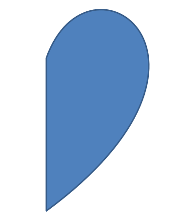

## **ภาพรวม**

บทความนี้อธิบายวิธีปรับแต่งรูปร่างการนำเสนอใน Aspose.Slides โดยการแก้ไขเรขาคณิตของรูปร่างผ่านจุดแก้ไขและเส้นทางเรขาคณิต มันแสดงวิธีใช้ [GeometryPath](https://reference.aspose.com/slides/androidjava/com.aspose.slides/geometrypath/) และ [IGeometryPath](https://reference.aspose.com/slides/androidjava/com.aspose.slides/igeometrypath/) เพื่อแก้ไขรูปร่างที่มีอยู่, ทำการดำเนินการแก้ไขเส้นทางพื้นฐาน, เพิ่มหรือเอาจุดออก, และนำเรขาคณิตที่อัปเดตกลับไปยังรูปร่าง

นอกจากนี้ยังสาธิตวิธีสร้างรูปร่างแบบกำหนดเองและแบบผสม, สร้างรูปร่างที่มีมุมโค้ง, ตรวจสอบว่ารูปร่างเรขาคณิตปิดหรือไม่, และตรวจสอบส่วนประกอบของรูปร่างโดยใช้แอร์เรย์จุดของ Android

## **เปลี่ยนรูปร่างโดยใช้จุดแก้ไข**

ใน PowerPoint, คุณสามารถใช้ **Edit Points** เพื่อแก้ไขสี่เหลี่ยมจัตุรัส:

* ย้ายมุมเข้าไปหรือออกไป
* ปรับความโค้งที่จุด
* เพิ่มจุดใหม่

การแก้ไขจุดทำให้คุณสามารถเปลี่ยนโครงร่างของรูปร่างหรือใช้รูปร่างที่มีอยู่เป็นพื้นฐานสำหรับรูปร่างใหม่ได้

## **เคล็ดลับการแก้ไขรูปร่าง**


เมื่อแก้ไขรูปร่างใน PowerPoint ให้คำนึงถึงแนวคิดต่อไปนี้:

* รูปร่าง (หรือเส้นทางของมัน) สามารถเป็นแบบปิดหรือเปิดได้
* เส้นทางของรูปร่างประกอบด้วยจุดเยื้องเชื่อมต่อกันด้วยส่วนเส้น
* ส่วนเส้นสามารถเป็นแบบตรงหรือโค้งได้ จุดเยื้อนและแฮนด์จับควบคุมกำหนดรูปทรงของมัน
* จุดเยื้อนมีอยู่ในรูปแบบจุดมุม, จุดตรง, หรือจุดเรียบ:
  * ที่จุดมุม, ส่วนเส้นที่ต่อกันอาจเจอที่มุม
  * ที่จุดเรียบ, แฮนด์จับสองตัวจะจัดแนวและห่างจากจุดเยื้อนเท่ากัน
  * ที่จุดตรง, แฮนด์จับสองตัวจะจัดแนวแต่ระยะห่างจากจุดเยื้อนอาจต่างกัน
* การย้ายจุดเยื้อนหรือปรับแฮนด์จับของมันจะเปลี่ยนโครงร่างของรูปร่าง

เพื่อแก้ไขรูปร่าง PowerPoint ผ่านจุดแก้ไข, **Aspose.Slides** ให้คลาส [GeometryPath](https://reference.aspose.com/slides/androidjava/com.aspose.slides/geometrypath/) และอินเทอร์เฟซ [IGeometryPath](https://reference.aspose.com/slides/androidjava/com.aspose.slides/igeometrypath/)

* ตัวอย่าง [GeometryPath](https://reference.aspose.com/slides/androidjava/com.aspose.slides/geometrypath/) แทนเส้นทางเรขาคณิตของวัตถุ [IGeometryShape](https://reference.aspose.com/slides/androidjava/com.aspose.slides/igeometryshape/)
* เพื่อดึง [GeometryPath](https://reference.aspose.com/slides/androidjava/com.aspose.slides/geometrypath/) จากอินสแตนซ์ของ [IGeometryShape](https://reference.aspose.com/slides/androidjava/com.aspose.slides/igeometryshape/), คุณสามารถใช้เมธอด [IGeometryShape.getGeometryPaths](https://reference.aspose.com/slides/androidjava/com.aspose.slides/igeometryshape/#getGeometryPaths--) 
* เพื่อกำหนด [GeometryPath](https://reference.aspose.com/slides/androidjava/com.aspose.slides/geometrypath/) ให้กับรูปร่าง, คุณสามารถใช้เมธอดเหล่านี้: [IGeometryShape.setGeometryPath](https://reference.aspose.com/slides/androidjava/com.aspose.slides/igeometryshape/#setGeometryPath-com.aspose.slides.IGeometryPath-) สำหรับรูปร่างที่มีเส้นทางเดียวและ [IGeometryShape.setGeometryPaths](https://reference.aspose.com/slides/androidjava/com.aspose.slides/igeometryshape/#setGeometryPaths-com.aspose.slides.IGeometryPath---) สำหรับรูปร่างที่มีหลายเส้นทาง
* เพื่อเพิ่มส่วนเส้น, คุณสามารถใช้เมธอดภายใต้ [IGeometryPath](https://reference.aspose.com/slides/androidjava/com.aspose.slides/igeometrypath/)
* ด้วยเมธอด [IGeometryPath.setStroke](https://reference.aspose.com/slides/androidjava/com.aspose.slides/igeometrypath/#setStroke-boolean-) และ [IGeometryPath.setFillMode](https://reference.aspose.com/slides/androidjava/com.aspose.slides/igeometrypath/#setFillMode-byte-), คุณสามารถกำหนดลักษณะการแสดงของเส้นทางเรขาคณิตได้
* ด้วยเมธอด [IGeometryPath.getPathData](https://reference.aspose.com/slides/androidjava/com.aspose.slides/igeometrypath/#getPathData--) คุณสามารถดึงเส้นทางเรขาคณิตของ [GeometryShape](https://reference.aspose.com/slides/androidjava/com.aspose.slides/geometryshape/) เป็นแอร์เรย์ของส่วนเส้นได้

## **การดำเนินการแก้ไขอย่างง่าย**

ใช้เมธอดต่อไปนี้เพื่อแก้ไขเส้นทางเรขาคณิต การโอเวอร์โหลดที่รับดัชนีจะใส่ส่วนเส้นที่ตำแหน่งศูนย์ฐานในแอร์เรย์ส่วนเส้นของเส้นทาง

| การดำเนินการ | วิธีการ |
| --- | --- |
| เพิ่มหรือแทรกเส้นตรง | [GeometryPath.lineTo](https://reference.aspose.com/slides/androidjava/com.aspose.slides/geometrypath/#lineTo-float-float-) |
| เพิ่มหรือแทรกเส้นโค้งเบซิเยร์แบบคิวบิกที่มีจุดควบคุมสองจุดและจุดสิ้นสุด | [GeometryPath.cubicBezierTo](https://reference.aspose.com/slides/androidjava/com.aspose.slides/geometrypath/#cubicBezierTo-float-float-float-float-float-float-) |
| เพิ่มหรือแทรกเส้นโค้งเบซิเยร์แบบควอดราติกที่มีจุดควบคุมหนึ่งจุดและจุดสิ้นสุด | [GeometryPath.quadraticBezierTo](https://reference.aspose.com/slides/androidjava/com.aspose.slides/geometrypath/#quadraticBezierTo-float-float-float-float-) |
| เพิ่มส่วนโค้งวงรีโดยกำหนดมิติและมุมเป็นองศา | [GeometryPath.arcTo](https://reference.aspose.com/slides/androidjava/com.aspose.slides/geometrypath/#arcTo-float-float-float-float-) |
| ปิดรูปภาพปัจจุบันโดยเชื่อมจุดสิ้นสุดกับจุดเริ่มต้น | [GeometryPath.closeFigure](https://reference.aspose.com/slides/androidjava/com.aspose.slides/geometrypath/#closeFigure--) |
| กำหนดจุดเริ่มต้นของรูปภาพ | [GeometryPath.moveTo](https://reference.aspose.com/slides/androidjava/com.aspose.slides/geometrypath/#moveTo-float-float-) |
| เอาส่วนเส้นออกที่ดัชนีศูนย์ฐาน | [GeometryPath.removeAt](https://reference.aspose.com/slides/androidjava/com.aspose.slides/geometrypath/#removeAt-int-) |

## **เพิ่มจุดกำหนดเองให้กับรูปร่าง**

ตัวอย่างนี้ใส่จุดสองจุดลงในรูปร่างสี่เหลี่ยมโดยใช้ [GeometryPath.lineTo](https://reference.aspose.com/slides/androidjava/com.aspose.slides/geometrypath/#lineTo-float-float-) และนำเส้นทางที่แก้ไขไปใช้กับ [IGeometryShape.setGeometryPath](https://reference.aspose.com/slides/androidjava/com.aspose.slides/igeometryshape/#setGeometryPath-com.aspose.slides.IGeometryPath-) พิกัดเป็นค่าท้องถิ่นของรูปร่าง: ทั้งสองจุดใหม่อยู่ที่กึ่งกลาง, ห่างจากด้านซ้าย 100 จุดและจากด้านบน 50 จุด ดัชนีส่วนเส้น 1 และ 4 จะวางจุดเหล่านี้บนขอบบนและขอบล่าง, ดึงขอบเหล่านั้นเข้าไป

```java
import com.aspose.slides.*;

Presentation presentation = new Presentation();
try {
    ISlide slide = presentation.getSlides().get_Item(0);

    IAutoShape shape = slide.getShapes().addAutoShape(ShapeType.Rectangle, 100, 100, 200, 100);

    IGeometryPath geometryPath = shape.getGeometryPaths()[0];
    geometryPath.lineTo(100, 50, 1);
    geometryPath.lineTo(100, 50, 4);

    shape.setGeometryPath(geometryPath);
} finally {
    presentation.dispose();
}
```


## **เอาจุดออกจากรูปร่าง**

ตัวอย่างนี้เปลี่ยนโครงร่างรูปหัวใจโดยเอาส่วนเส้นที่ดัชนีศูนย์ฐาน 2 ออกด้วย [GeometryPath.removeAt](https://reference.aspose.com/slides/androidjava/com.aspose.slides/geometrypath/#removeAt-int-) การใช้เส้นทางที่แก้ไขแล้วกับ [IGeometryShape.setGeometryPath](https://reference.aspose.com/slides/androidjava/com.aspose.slides/igeometryshape/#setGeometryPath-com.aspose.slides.IGeometryPath-) จะอัปเดตขอบของรูปร่าง

```java
import com.aspose.slides.*;

Presentation presentation = new Presentation();
try {
    ISlide slide = presentation.getSlides().get_Item(0);

    IAutoShape shape = slide.getShapes().addAutoShape(ShapeType.Heart, 100, 100, 300, 300);

    IGeometryPath path = shape.getGeometryPaths()[0];
    path.removeAt(2);

    shape.setGeometryPath(path);
} finally {
    presentation.dispose();
}
```


## **สร้างรูปร่างกำหนดเอง**

ตัวอย่างนี้สร้างดาวห้าแฉกด้วย [GeometryPath](https://reference.aspose.com/slides/androidjava/com.aspose.slides/geometrypath/) รัศมีภายนอกและภายในสลับกันที่ 100 และ 50 จุดกำหนดจุดและช่องว่าง; การขั้น 72 องศาจะเว้นระยะห่างให้ดาวห้าแฉกเท่าๆ กัน เส้นทางถูกปิดด้วย [GeometryPath.closeFigure](https://reference.aspose.com/slides/androidjava/com.aspose.slides/geometrypath/#closeFigure--) และนำไปใช้กับรูปร่างสี่เหลี่ยมโดยใช้ [IGeometryShape.setGeometryPath](https://reference.aspose.com/slides/androidjava/com.aspose.slides/igeometryshape/#setGeometryPath-com.aspose.slides.IGeometryPath-) แทนที่โครงร่างเดิม

```java
import com.aspose.slides.*;
import android.graphics.PointF;
import java.util.ArrayList;
import java.util.List;

List<PointF> points = new ArrayList<>();

float outerRadius = 100f;
float innerRadius = 50f;
int angleStep = 72;

for (int angle = -90; angle < 270; angle += angleStep)
{
    double radians = angle * (Math.PI / 180f);
    double x = outerRadius * Math.cos(radians);
    double y = outerRadius * Math.sin(radians);
    PointF point = new PointF((float)x + outerRadius, (float)y + outerRadius);
    points.add(point);

    radians = Math.PI * (angle + angleStep / 2) / 180.0;
    x = innerRadius * Math.cos(radians);
    y = innerRadius * Math.sin(radians);
    point = new PointF((float)x + outerRadius, (float)y + outerRadius);
    points.add(point);
}

GeometryPath starPath = new GeometryPath();
starPath.moveTo(points.get(0));

for (int i = 1; i < points.size(); i++)
{
    starPath.lineTo(points.get(i));
}

starPath.closeFigure();

Presentation presentation = new Presentation();
try {
    ISlide slide = presentation.getSlides().get_Item(0);

    IAutoShape shape = slide.getShapes().addAutoShape(ShapeType.Rectangle, 100, 100, outerRadius * 2, outerRadius * 2);
    shape.setGeometryPath(starPath);
} finally {
    presentation.dispose();
}
```


## **สร้างรูปร่างผสมกำหนดเอง**

ตัวอย่างนี้กำหนดสอง [GeometryPath](https://reference.aspose.com/slides/androidjava/com.aspose.slides/geometrypath/) ปิดสำหรับส่วนบนและส่วนล่างของรูปร่าง การใช้ทั้งสองเส้นทางด้วย [IGeometryShape.setGeometryPaths](https://reference.aspose.com/slides/androidjava/com.aspose.slides/igeometryshape/#setGeometryPaths-com.aspose.slides.IGeometryPath---) จะสร้างรูปร่างผสมเดียวที่มีช่องว่างอยู่กลางส่วนที่สามของรูปร่าง

```java
import com.aspose.slides.*;

Presentation presentation = new Presentation();
try {
    ISlide slide = presentation.getSlides().get_Item(0);

    IAutoShape shape = slide.getShapes().addAutoShape(ShapeType.Rectangle, 100, 100, 200, 100);

    GeometryPath topPath = new GeometryPath();
    topPath.moveTo(0, 0);
    topPath.lineTo(shape.getWidth(), 0);
    topPath.lineTo(shape.getWidth(), shape.getHeight() / 3);
    topPath.lineTo(0, shape.getHeight() / 3);
    topPath.closeFigure();

    GeometryPath bottomPath = new GeometryPath();
    bottomPath.moveTo(0, shape.getHeight() / 3 * 2);
    bottomPath.lineTo(shape.getWidth(), shape.getHeight() / 3 * 2);
    bottomPath.lineTo(shape.getWidth(), shape.getHeight());
    bottomPath.lineTo(0, shape.getHeight());
    bottomPath.closeFigure();

    shape.setGeometryPaths(new GeometryPath[] { topPath, bottomPath });
} finally {
    presentation.dispose();
}
```


## **สร้างรูปร่างกำหนดเองด้วยมุมโค้ง**

ตัวอย่างนี้ผสมส่วนเส้นตรงกับ [GeometryPath.arcTo](https://reference.aspose.com/slides/androidjava/com.aspose.slides/geometrypath/#arcTo-float-float-float-float-) เพื่อสร้างรูปร่างที่มุมโค้งเข้าด้านใน แต่ละขนาดมุมกำหนดความกว้างและความสูงของโค้งในหน่วยจุด, และการสวิง -90 องศาจะวาดส่วนสี่เหลี่ยมวงรีแบบทวนเข็มนาฬิกา เส้นทางที่สมบูรณ์จะนำไปใช้กับ [IGeometryShape.setGeometryPath](https://reference.aspose.com/slides/androidjava/com.aspose.slides/igeometryshape/#setGeometryPath-com.aspose.slides.IGeometryPath-) และการนำเสนอจะถูกบันทึกเป็นรูปแบบ PPTX

```java
import com.aspose.slides.*;
import android.graphics.PointF;

float shapeX = 20f;
float shapeY = 20f;
float shapeWidth = 300f;
float shapeHeight = 200f;

float leftTopSize = 50f;
float rightTopSize = 20f;
float rightBottomSize = 40f;
float leftBottomSize = 10f;

Presentation presentation = new Presentation();
try {
    ISlide slide = presentation.getSlides().get_Item(0);

    IAutoShape shape = slide.getShapes().addAutoShape(ShapeType.Custom, shapeX, shapeY, shapeWidth, shapeHeight);

    PointF topLeft = new PointF(leftTopSize, 0);
    PointF topRight = new PointF(shapeWidth - rightTopSize, 0);
    PointF rightBottom = new PointF(shapeWidth, shapeHeight - rightBottomSize);
    PointF bottomLeft = new PointF(leftBottomSize, shapeHeight);
    PointF leftTop = new PointF(0, leftTopSize);

    GeometryPath geometryPath = new GeometryPath();
    geometryPath.moveTo(topLeft);
    geometryPath.lineTo(topRight);
    geometryPath.arcTo(rightTopSize, rightTopSize, 180, -90);
    geometryPath.lineTo(rightBottom);
    geometryPath.arcTo(rightBottomSize, rightBottomSize, -90, -90);
    geometryPath.lineTo(bottomLeft);
    geometryPath.arcTo(leftBottomSize, leftBottomSize, 0, -90);
    geometryPath.lineTo(leftTop);
    geometryPath.arcTo(leftTopSize, leftTopSize, 90, -90);
    geometryPath.closeFigure();

    shape.setGeometryPath(geometryPath);

    presentation.save("output.pptx", SaveFormat.Pptx);
} finally {
    presentation.dispose();
}
```

## **ตรวจสอบว่ารูปร่างเรขาคณิตปิดหรือไม่**

ตัวช่วยต่อไปนี้ตรวจสอบว่าทุกเส้นทางเรขาคณิตที่ไม่ว่างเปล่าจบด้วยส่วนเส้นปิดหรือไม่ มันอ่าน [IGeometryPath.getPathData](https://reference.aspose.com/slides/androidjava/com.aspose.slides/igeometrypath/#getPathData--) และเปรียบเทียบคำสั่งของส่วนสุดท้ายด้วย [IPathSegment.getPathCommand](https://reference.aspose.com/slides/androidjava/com.aspose.slides/ipathsegment/#getPathCommand--) กับ [PathCommandType.Close](https://reference.aspose.com/slides/androidjava/com.aspose.slides/pathcommandtype/) หากไม่มีเส้นทางที่ไม่ว่างเปล่า จะคืนค่า false ตัวตรวจสอบนี้ดูคำสั่งสุดท้ายของแต่ละเส้นทาง; มันไม่ได้ตรวจสอบทุกส่วนย่อยภายในเส้นทาง ตัวอย่างพิมพ์ `true` สำหรับสี่เหลี่ยม

```java
import com.aspose.slides.*;

class GeometryInspector {
    boolean isGeometryClosed(IGeometryShape geometryShape) {
        boolean hasNonemptyPath = false;

        for (IGeometryPath geometryPath : geometryShape.getGeometryPaths()) {
            IPathSegment[] segments = geometryPath.getPathData();
            if (segments.length == 0) {
                continue;
            }

            hasNonemptyPath = true;
            IPathSegment lastSegment = segments[segments.length - 1];
            if (lastSegment.getPathCommand() != PathCommandType.Close) {
                return false;
            }
        }

        return hasNonemptyPath;
    }
}

Presentation presentation = new Presentation();
try {
    ISlide slide = presentation.getSlides().get_Item(0);

    IAutoShape shape = slide.getShapes().addAutoShape(ShapeType.Rectangle, 100, 100, 200, 100);

    GeometryInspector inspector = new GeometryInspector();
    boolean closed = inspector.isGeometryClosed(shape);
    System.out.println(closed);
} finally {
    presentation.dispose();
}
```

## **ดึงและตรวจสอบส่วนประกอบของรูปร่าง**

ใช้ [IGeometryShape.createShapeElements](https://reference.aspose.com/slides/androidjava/com.aspose.slides/igeometryshape/#createShapeElements--) เพื่อสอบสอบรูปร่างที่มีอยู่เป็นส่วนประกอบที่มีจุดเส้นทางและประเภทจุด แคสแต่ละ [IShapeElement](https://reference.aspose.com/slides/androidjava/com.aspose.slides/ishapeelement/) ที่คืนค่าเป็น [ShapeElement](https://reference.aspose.com/slides/androidjava/com.aspose.slides/shapeelement/) เพื่อดึงแอร์เรย์จุดและประเภทผ่านเมธอด [getPathPoints](https://reference.aspose.com/slides/androidjava/com.aspose.slides/shapeelement/#getPathPoints--) และ [getPathTypes](https://reference.aspose.com/slides/androidjava/com.aspose.slides/shapeelement/#getPathTypes--) การแสดงผลนี้มีประโยชน์สำหรับการวิเคราะห์โครงร่างหรือการส่งเรขาคณิตไปยังเครื่องมือวาดแบบกำหนดเอง

ตัวอย่างเปิด input.pptx, ค้นหารูปร่างเรขาคณิตแรกบนสไลด์แรกโดยตรง, แล้วพิมพ์ส่วนเส้นของมัน ใช้การนำเสนอที่มีรูปร่างที่มีส่วนเส้นตรงและส่วนเส้นโค้งเพื่อดูผลลัพธ์ทั้งสองประเภท ไม่ได้ค้นหาภายในกลุ่ม

```java
import com.aspose.slides.*;
import android.graphics.PointF;

Presentation presentation = new Presentation("input.pptx");
try {
    ISlide slide = presentation.getSlides().get_Item(0);

    IGeometryShape shape = null;
    for (IShape candidate : slide.getShapes()) {
        if (candidate instanceof IGeometryShape) {
            shape = (IGeometryShape) candidate;
            break;
        }
    }

    if (shape == null) {
        System.out.println("No geometry shape found on the first slide.");
    } else {
        for (IShapeElement element : shape.createShapeElements()) {
            ShapeElement shapeElement = (ShapeElement) element;
            PointF[] points = shapeElement.getPathPoints();
            byte[] types = shapeElement.getPathTypes();
            System.out.println("Shape element:");

            for (int i = 0; i < points.length; i++) {
                int pointType = types[i] & 0x07; // เก็บประเภทส่วนเส้น, ยกเว้นแฟล็ก.
                switch (pointType) {
                    case 0:
                        System.out.println("Start figure at " + points[i]);
                        break;
                    case 1:
                        System.out.println("Line to " + points[i]);
                        break;
                    case 3:
                        System.out.println("Cubic Bezier: controls " + points[i] + ", " + points[i + 1] + "; end " + points[i + 2]);
                        i += 2; // Consume both control points and the endpoint.
                        break;
                }

                if ((types[i] & 0x80) != 0) {
                    System.out.println("Close subpath back to its starting point.");
                }
            }
        }
    }
} finally {
    presentation.dispose();
}
```

แอร์เรย์สอดคล้องกันตามดัชนี: `points[i]` เป็นจุดและ `types[i]` บรรยายบทบาทของมัน ประเภท `0` เริ่มรูปภาพ, ประเภท `1` วาดเส้นจากจุดก่อนหน้าไปยังจุดปัจจุบัน ส่วนโค้งเบซิเยร์แบบคิวบิกเริ่มจากจุดสิ้นสุดก่อนหน้าและใช้รายการประเภท `3` สามรายการต่อเนื่อง: จุดควบคุมสองจุดตามด้วยจุดสิ้นสุดใหม่ ลูปจะรับสามรายการนี้พร้อมกันและตรวจสอบจุดสิ้นสุดเพื่อปิด

ประเภทจุดยังมีแฟล็กด้วย การทำมาสก์ด้วย `0x07` เพื่อระบุประเภทส่วนเส้น, และทดสอบ `0x80` แยกกันเพื่อค้นหาส่วนย่อยที่ปิด ตัวอย่างเช่น `129` (`0x81`) หมายถึงจุดสิ้นสุดของเส้นที่ปิดส่วนย่อย, และ `131` (`0x83`) หมายถึงจุดสิ้นสุดของเบซิเยร์ที่ปิดหนึ่งส่วน แฟล็กเหล่านี้ถูกเก็บเป็นไบต์ที่เป็นเครื่องหมายใน Java; การทำมาสก์จะรักษาค่าบิตตามที่ตั้งใจ การเปรียบเทียบค่าดิบเฉพาะ `1` หรือ `3` จะพลาดกรณีเหล่านี้ แฟล็กอื่นเช่น dash (`0x10`) และ marker (`0x20`) ไม่เปลี่ยนประเภทส่วนพื้นฐาน

**พิกัดและการแปลง** จุดวัดเป็นจุด (1/72 นิ้ว) โดย X เพิ่มไปทางขวาและ Y เพิ่มลงด้านล่าง สำหรับรูปร่างที่ไม่ได้จัดกลุ่ม, พิกัดที่ดึงออกมามีตำแหน่งที่คืนโดย [getX](https://reference.aspose.com/slides/androidjava/com.aspose.slides/shape/#getX--) และ [getY](https://reference.aspose.com/slides/androidjava/com.aspose.slides/shape/#getY--) รวมถึงความกว้างและความสูงปัจจุบัน ตัวอย่างเช่น สี่เหลี่ยมที่ไม่ได้หมุนที่ตำแหน่ง `(100, 200)` ขนาด `120 × 80` มีขอบโครงร่าง `(100, 200)`–`(220, 280)` อย่าเพิ่มตำแหน่งของรูปร่างอีกครั้ง ให้ลบ X และ Y เพื่อนำพิกัดมาเป็นค่าตามกรอบที่ไม่ได้หมุน

จุดที่ดึงออกมาไม่รวมการหมุนของรูปร่างที่คืนโดย [getRotation](https://reference.aspose.com/slides/androidjava/com.aspose.slides/shape/#getRotation--) หรือการพลิกแนวนอนและแนวตั้ง เพื่อทำให้โครงร่างที่แสดงตรงกับที่เห็น ให้ใช้การแปลงเหล่านี้รอบจุดศูนย์กลางของรูปร่าง สำหรับรูปร่างในกลุ่ม ต้องคำนึงถึงการแมปพิกัดของกลุ่มและการแปลง; อย่าสมมติว่าจุดที่ดึงออกมาคือพิกัดสุดท้ายบนสไลด์หรือทำการแปลหรือสเกลซ้ำหากมันได้สะท้อนอยู่แล้วในกรอบของลูก

**การตรวจสอบเทียบกับการแก้ไข** แอร์เรย์ที่ดึงออกมาจะบรรยายโครงร่าง; การเปลี่ยนแปลงแอร์เรย์เหล่านี้จะไม่อัปเดตรูปร่างเดิม ใช้วิธีนี้เมื่อการวิเคราะห์หรือโค้ดวาดต้องการแอร์เรย์จุด/ประเภท ใช้ [getGeometryPaths](https://reference.aspose.com/slides/androidjava/com.aspose.slides/igeometryshape/#getGeometryPaths--) หากต้องการคำสั่งเรขาคณิตในระบบพิกัดท้องถิ่นของรูปร่างหรือแก้ไขเรขาคณิตของมัน ใช้ [setGeometryPath](https://reference.aspose.com/slides/androidjava/com.aspose.slides/igeometryshape/#setGeometryPath-com.aspose.slides.IGeometryPath-) หรือ [setGeometryPaths](https://reference.aspose.com/slides/androidjava/com.aspose.slides/igeometryshape/#setGeometryPaths-com.aspose.slides.IGeometryPath---) เพื่อใช้เส้นทางที่แก้ไข

## **คำถามที่พบบ่อย**

**จะเกิดอะไรขึ้นกับการเติมสีและเส้นขอบหลังจากแทนที่เรขาคณิต?**

สไตล์จะคงอยู่กับรูปร่าง; เพียงแค่โครงร่างเปลี่ยนไป การเติมสีและเส้นขอบจะถูกนำไปใช้โดยอัตโนมัติกับเรขาคณิตใหม่

**ฉันจะหมุนรูปร่างกำหนดเองพร้อมกับเรขาคณิตอย่างถูกต้องอย่างไร?**

ใช้เมธอด [setRotation](https://reference.aspose.com/slides/androidjava/com.aspose.slides/shape/#setRotation-float-) ของรูปร่าง; เรขาคณิตจะหมุนตามรูปร่างเนื่องจากผูกกับระบบพิกัดของรูปร่างเอง

**ฉันสามารถแปลงรูปร่างกำหนดเองเป็นภาพเพื่อ "ล็อก" ผลลัพธ์ได้หรือไม่?**

ได้. ส่งออก [สไลด์](/slides/th/androidjava/convert-powerpoint-to-png/) ที่ต้องการหรือ [รูปร่าง](/slides/th/androidjava/create-shape-thumbnails/) เองเป็นรูปแบบเรสเตอร์; วิธีนี้ทำให้การทำงานต่อกับเรขาคณิตซับซ้อนง่ายขึ้น