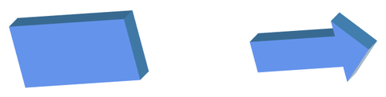

## **ภาพรวม**

Aspose.Slides for C++ สามารถสร้าง, แก้ไข, รักษา, และเรนเดอร์รูปแบบ 3D แบบ PowerPoint สำหรับรูปทรงและข้อความได้ บทความนี้ครอบคลุมเอฟเฟ็กต์ 3D เช่น การหมุน, การดึงออก, bevels, การให้แสง, วัสดุ, การไล่ระดับสีหรือการเติมรูปภาพ, และข้อความ 3D

{}
บทความนี้เกี่ยวกับเอฟเฟ็กต์การจัดรูปแบบ 3D บนรูปทรงและข้อความของ PowerPoint ไม่ได้เกี่ยวกับการแทรกหรือแก้ไขไฟล์โมเดล 3D แบบแยกส่วน เมื่อคุณส่งออกสไลด์เป็นภาพ, PDF, หรือ HTML, Aspose.Slides จะเรนเดอร์เอฟเฟ็กต์ 3D เหล่านั้นลงในผลลัพธ์ 2D ที่ส่งออก
{}

## **แนวคิดการจัดรูปแบบ 3D**

ใช้เมธอด [IShape::get_ThreeDFormat](https://reference.aspose.com/slides/cpp/aspose.slides/ishape/get_threedformat/) เพื่อใช้การจัดรูปแบบ 3D กับรูปทรง เมธอดนี้จะคืนค่า [IThreeDFormat](https://reference.aspose.com/slides/cpp/aspose.slides/ithreedformat/) ซึ่งควบคุมฉาก 3D สำหรับรูปทรงนั้น

สำหรับข้อความ ให้ใช้เมธอด [ITextFrameFormat::get_ThreeDFormat](https://reference.aspose.com/slides/cpp/aspose.slides/itextframeformat/get_threedformat/) วิธีนี้จะใช้การจัดรูปแบบ 3D กับเฟรมข้อความแทนที่ลำตัวของรูปทรง

เมธอดที่สำคัญที่สุดคือ:

| เมธอด | สิ่งที่ควบคุม | เมื่อใดควรใช้ |
|---|---|---|
| [get_Camera](https://reference.aspose.com/slides/cpp/aspose.slides/ithreedformat/get_camera/) | มุมมอง, ประเภทกล้องตั้งต้น, การหมุน, การซูม, และ Perspective | หมุนวัตถุในพื้นที่ 3D หรือจับคู่กับการตั้งค่าการหมุน 3D ของ PowerPoint |
| [get_LightRig](https://reference.aspose.com/slides/cpp/aspose.slides/ithreedformat/get_lightrig/) | การตั้งค่าแสงล่วงหน้า, ทิศทาง, และการหมุนของแสง | ปรับการแสดงไฮไลท์และเงาบนพื้นผิว 3D |
| [set_Material](https://reference.aspose.com/slides/cpp/aspose.slides/ithreedformat/set_material/) | วัสดุพื้นผิว เช่น แบน, Matt, พลาสติก, หรือเมทัล | ทำให้รูปทรงเดียวกันดูแบนกว่า, นุ่มกว่า, มันวาว หรือมีลักษณะเป็นโลหะ |
| [set_ExtrusionHeight](https://reference.aspose.com/slides/cpp/aspose.slides/ithreedformat/set_extrusionheight/) | ระยะที่รูปทรงยืดออกไปด้านหลังจากหน้าหน้า | เปลี่ยนรูปทรงแบนให้กลายเป็นวัตถุ 3D ที่มีความหนาเห็นได้ชัด |
| [get_ExtrusionColor](https://reference.aspose.com/slides/cpp/aspose.slides/ithreedformat/get_extrusioncolor/) | สีของด้านที่ดึงออก | ทำให้ความลึกมองเห็นได้หรือประสานสีด้านกับการเติมหน้าหน้า |
| [set_Depth](https://reference.aspose.com/slides/cpp/aspose.slides/ithreedformat/set_depth/) | ความลึก 3D เพิ่มเติมที่ PowerPoint ใช้ | ปรับความลึกของรูปทรงหรือข้อความโดยละเอียด โดยเฉพาะเมื่อใช้ร่วมกับ bevel และการตั้งค่าวัสดุ |
| [get_BevelTop](https://reference.aspose.com/slides/cpp/aspose.slides/ithreedformat/get_beveltop/) and [get_BevelBottom](https://reference.aspose.com/slides/cpp/aspose.slides/ithreedformat/get_bevelbottom/) | ขอบที่ยกขึ้นหรือมนบนหน้าหน้าและด้านหลัง | เพิ่มขอบที่นุ่มหรือหล่อขึ้นแทนการมีขอบแบนคม |
| [get_ContourColor](https://reference.aspose.com/slides/cpp/aspose.slides/ithreedformat/get_contourcolor/) and [set_ContourWidth](https://reference.aspose.com/slides/cpp/aspose.slides/ithreedformat/set_contourwidth/) | เส้นขอบรอบวัตถุ 3D | เน้นขอบวัตถุในผลลัพธ์ที่เรนเดอร์ |

## **สร้างรูปทรง 3D**

รูปทรงมักต้องการการตั้งค่าสี่ประเภทก่อนที่จะดูเหมือน 3D อย่างเชื่อถือได้:

- การตั้งค่ากล้อง, เนื่องจากมุมมองหน้าตั้งต้นอาจซ่อนการดึงออก
- การตั้งค่าแสง, เนื่องจากแสงทำให้พื้นผิวและด้านต่าง ๆ ดูชัดเจน
- การตั้งค่าวัสดุ, เนื่องจากพื้นผิวมีผลต่อการแสดงแสง
- การตั้งค่าการดึงออกหรือความลึก, เนื่องจากรูปทรงแบนต้องการความหนา

ตัวอย่างต่อไปนี้สร้างสี่เหลี่ยม, เพิ่มข้อความไปยังหน้าหน้า, และใช้การจัดรูปแบบ 3D ค่าองศาการหมุนของกล้องอยู่ในหน่วยองศา และความสูงการดึงออกคือ 100 points ตัวอย่างนี้เรนเดอร์สไลด์เป็นภาพ PNG ขนาดสองเท่าของขนาดเริ่มต้นและบันทึกการนำเสนอเป็น PPTX

```cpp
#include <DOM/CameraPresetType.h>
#include <DOM/FillType.h>
#include <DOM/IAutoShape.h>
#include <DOM/ICamera.h>
#include <DOM/IColorFormat.h>
#include <DOM/IFillFormat.h>
#include <DOM/ILightRig.h>
#include <DOM/IParagraph.h>
#include <DOM/IParagraphFormat.h>
#include <DOM/IPortionFormat.h>
#include <DOM/IShapeCollection.h>
#include <DOM/ISlide.h>
#include <DOM/ITextFrame.h>
#include <DOM/IThreeDFormat.h>
#include <DOM/LightRigPresetType.h>
#include <DOM/LightingDirection.h>
#include <DOM/MaterialPresetType.h>
#include <DOM/Presentation.h>
#include <DOM/ShapeType.h>
#include <Export/SaveFormat.h>
#include <IImage.h>
#include <drawing/color.h>

using namespace Aspose::Slides;
using namespace Aspose::Slides::Export;
using namespace System::Drawing;

const auto imageScale = 2.0f;

auto presentation = System::MakeObject<Presentation>();
auto slide = presentation->get_Slide(0);

auto shape = slide->get_Shapes()->AddAutoShape(ShapeType::Rectangle, 200.0f, 150.0f, 200.0f, 200.0f);

shape->get_TextFrame()->set_Text(u"3D");
shape->get_TextFrame()->get_Paragraph(0)->get_ParagraphFormat()->get_DefaultPortionFormat()->set_FontHeight(64.0f);

auto frontColor = Color::get_CornflowerBlue();
shape->get_FillFormat()->set_FillType(FillType::Solid);
shape->get_FillFormat()->get_SolidFillColor()->set_Color(frontColor);

auto extrusionColor = Color::get_Blue();
shape->get_ThreeDFormat()->get_Camera()->set_CameraType(CameraPresetType::OrthographicFront);
shape->get_ThreeDFormat()->get_Camera()->SetRotation(20.0f, 30.0f, 40.0f);
shape->get_ThreeDFormat()->get_LightRig()->set_LightType(LightRigPresetType::Flat);
shape->get_ThreeDFormat()->get_LightRig()->set_Direction(LightingDirection::Top);
shape->get_ThreeDFormat()->set_Material(MaterialPresetType::Flat);
shape->get_ThreeDFormat()->set_ExtrusionHeight(100.0);
shape->get_ThreeDFormat()->get_ExtrusionColor()->set_Color(extrusionColor);

auto thumbnail = slide->GetImage(imageScale, imageScale);
thumbnail->Save(u"shape_3d.png");
thumbnail->Dispose();

presentation->Save(u"shape_3d.pptx", SaveFormat::Pptx);
presentation->Dispose();
```

ภาพสไลด์ที่เรนเดอร์แสดงสี่เหลี่ยมเป็นบล็อก 3D หนาขึ้น:


## **หมุนรูปทรงด้วยกล้อง**

ใน PowerPoint การหมุน 3D กำหนดจากแผง 3‑D Rotation ค่าการหมุน X, Y, และ Z ตรงกับการหมุนที่คุณตั้งค่าผ่าน API ของกล้อง


ใน Aspose.Slides เข้าถึงกล้องผ่าน [IThreeDFormat::get_Camera](https://reference.aspose.com/slides/cpp/aspose.slides/ithreedformat/get_camera/) ตัวอย่างนี้สร้างสี่เหลี่ยม, เลือกมุมมองหน้ารูปแบบออร์โธกราฟิก, และตั้งค่าการหมุน X, Y, Z เป็น 20, 30, และ 40 องศาตามลำดับ ซึ่งกำหนดรูปทรงในหน่วยความจำโดยไม่บันทึกไฟล์:

```cpp
#include <DOM/CameraPresetType.h>
#include <DOM/IAutoShape.h>
#include <DOM/ICamera.h>
#include <DOM/IShapeCollection.h>
#include <DOM/ISlide.h>
#include <DOM/IThreeDFormat.h>
#include <DOM/Presentation.h>
#include <DOM/ShapeType.h>

using namespace Aspose::Slides;

auto presentation = System::MakeObject<Presentation>();
auto slide = presentation->get_Slide(0);

auto shape = slide->get_Shapes()->AddAutoShape(ShapeType::Rectangle, 200.0f, 150.0f, 200.0f, 200.0f);

shape->get_ThreeDFormat()->get_Camera()->set_CameraType(CameraPresetType::OrthographicFront);
shape->get_ThreeDFormat()->get_Camera()->SetRotation(20.0f, 30.0f, 40.0f);

presentation->Dispose();
```

ใช้กล้องเมื่อคุณต้องการเปลี่ยนวิธีที่ผู้ชมมองวัตถุ ไม่ได้เปลี่ยนรูปทรง 2D บนสไลด์ แต่เปลี่ยนมุมมอง 3D ที่ PowerPoint และ Aspose.Slides ใช้ในการเรนเดอร์

### **คัดลอกการตั้งค่าแนวกล้องจากรูปเทมเพลต**

เพื่อให้สอดคล้องกับแนวกล้องของรูปเทมเพลต, อ่านค่าที่ตั้งไว้ด้วย [get_CameraType](https://reference.aspose.com/slides/cpp/aspose.slides/icamera/get_cameratype/) และนำไปใช้ด้วย [set_CameraType](https://reference.aspose.com/slides/cpp/aspose.slides/icamera/set_cameratype/) ตัวอย่างเปิด `template.pptx` และคัดลอกแนวกล้องจากรูปแรกบนสไลด์แรกไปยังรูปที่สอง รูปทั้งสองมีการตั้งค่าแสง 3D อยู่แล้ว และรูปที่สองไม่มีการหมุนกล้องอย่างชัดเจน

[GetRotation](https://reference.aspose.com/slides/cpp/aspose.slides/icamera/getrotation/) คืนค่ามุมเป็นองศา อินเด็กซ์ `0` คือ latitude, อินเด็กซ์ `1` คือ longitude, อินเด็กซ์ `2` คือ revolution ส่งมุมเหล่านั้นไปยัง [SetRotation](https://reference.aspose.com/slides/cpp/aspose.slides/icamera/setrotation/) ตามลำดับ หากแหล่งไม่มีการหมุนอย่างชัดเจน `GetRotation` คืนค่า null pointer ดังนั้นให้ปล่อยให้มุมของรูปที่สองไม่ตั้ง ค่า rotation ชัดเจนของ `(0, 0, 0)` จะคืนอาเรย์สามศูนย์และควรคัดลอก

```cpp
#include <DOM/ICamera.h>
#include <DOM/IShape.h>
#include <DOM/ISlide.h>
#include <DOM/IThreeDFormat.h>
#include <DOM/Presentation.h>
#include <Export/SaveFormat.h>
#include <system/array.h>

using namespace Aspose::Slides;
using namespace Aspose::Slides::Export;

auto presentation = System::MakeObject<Presentation>(u"template.pptx");
auto slide = presentation->get_Slide(0);

auto sourceCamera = slide->get_Shape(0)->get_ThreeDFormat()->get_Camera();
auto destinationCamera = slide->get_Shape(1)->get_ThreeDFormat()->get_Camera();

destinationCamera->set_CameraType(sourceCamera->get_CameraType());
auto angles = sourceCamera->GetRotation();
if (angles != nullptr)
{
    destinationCamera->SetRotation(angles[0], angles[1], angles[2]);
}

presentation->Save(u"camera-copy.pptx", SaveFormat::Pptx);
presentation->Dispose();
```

เมื่อคุณเปิด `camera-copy.pptx` อีกครั้งใน PowerPoint ลูกศรทางขวาจะมีการตั้งค่ากล้องและการหมุนเหมือนสี่เหลี่ยมด้านซ้าย รูปทั้งสองใช้แสงและความลึกการดึงออกเดียวกัน



## **เพิ่มการดึงออกและความลึก**

การดึงออกทำให้รูปทรงดูหนาด้วยการยืดออกไปด้านหลังของหน้าหน้า ใน PowerPoint การควบคุมความลึกกำหนดความหนาที่มองเห็นได้และการควบคุมสีกำหนดสีของด้านข้าง


ตั้งค่า [IThreeDFormat::set_ExtrusionHeight](https://reference.aspose.com/slides/cpp/aspose.slides/ithreedformat/set_extrusionheight/) เพื่อกำหนดความหนาและ [IThreeDFormat::get_ExtrusionColor](https://reference.aspose.com/slides/cpp/aspose.slides/ithreedformat/get_extrusioncolor/) เพื่อกำหนดสีด้าน ตัวอย่างนี้ให้สี่เหลี่ยมมีการดึงออก 100 points พร้อมด้านสีม่วงและหมุนกล้องเพื่อแสดงความหนา ตัวอย่างกำหนดรูปทรงในหน่วยความจำโดยไม่บันทึกไฟล์:

```cpp
#include <DOM/CameraPresetType.h>
#include <DOM/ILightRig.h>
#include <DOM/LightRigPresetType.h>
#include <DOM/LightingDirection.h>
#include <DOM/MaterialPresetType.h>
#include <DOM/IAutoShape.h>
#include <DOM/ICamera.h>
#include <DOM/IColorFormat.h>
#include <DOM/IShapeCollection.h>
#include <DOM/ISlide.h>
#include <DOM/IThreeDFormat.h>
#include <DOM/Presentation.h>
#include <DOM/ShapeType.h>
#include <drawing/color.h>

using namespace Aspose::Slides;
using namespace System::Drawing;

auto presentation = System::MakeObject<Presentation>();
auto slide = presentation->get_Slide(0);

auto shape = slide->get_Shapes()->AddAutoShape(ShapeType::Rectangle, 200.0f, 150.0f, 200.0f, 200.0f);

shape->get_ThreeDFormat()->get_Camera()->set_CameraType(CameraPresetType::OrthographicFront);
shape->get_ThreeDFormat()->get_Camera()->SetRotation(20.0f, 30.0f, 40.0f);
shape->get_ThreeDFormat()->get_LightRig()->set_LightType(LightRigPresetType::Flat);
shape->get_ThreeDFormat()->get_LightRig()->set_Direction(LightingDirection::Top);
shape->get_ThreeDFormat()->set_Material(MaterialPresetType::Flat);
shape->get_ThreeDFormat()->set_ExtrusionHeight(100.0);

auto extrusionColor = Color::get_Purple();
shape->get_ThreeDFormat()->get_ExtrusionColor()->set_Color(extrusionColor);

presentation->Dispose();
```

เมธอด [IThreeDFormat::set_Depth](https://reference.aspose.com/slides/cpp/aspose.slides/ithreedformat/set_depth/) กำหนดความลึกของรูปทรง 3D เมธอด [set_ExtrusionHeight](https://reference.aspose.com/slides/cpp/aspose.slides/ithreedformat/set_extrusionheight/) ควบคุมความสูงของเอฟเฟ็กต์การดึงออกตามที่แสดงในตัวอย่างนี้

## **ใช้การไล่สีหรือการเติมรูปภาพกับเอฟเฟ็กต์ 3D**

การจัดรูปแบบ 3D ทำงานแยกจากการเติมรูปทรง คุณสามารถเติมสีทึบ, การไล่สี, ลวดลาย, หรือรูปภาพไปยังหน้าหน้าและยังคงใช้กล้อง, แสง, วัสดุ, และการดึงออกเดียวกันได้

ตัวอย่างนี้ใช้การไล่สีจากสีน้ำเงินไปสั่งส้มบนหน้าหน้าและสีส้มเข้มบนส่วนการดึงออก 150 points จุดหยุดไล่สีที่ 0 และ 100 กำหนดจุดเริ่มและสิ้นสุดของการไล่สี ค่าองศาการหมุนของกล้องอยู่ในหน่วยองศา สไลด์เรนเดอร์เป็นภาพ PNG ขนาดสองเท่าของขนาดเริ่มต้น:

```cpp
#include <DOM/CameraPresetType.h>
#include <DOM/FillType.h>
#include <DOM/IAutoShape.h>
#include <DOM/ICamera.h>
#include <DOM/IColorFormat.h>
#include <DOM/IFillFormat.h>
#include <DOM/IGradientFormat.h>
#include <DOM/IGradientStopCollection.h>
#include <DOM/ILightRig.h>
#include <DOM/IParagraph.h>
#include <DOM/IParagraphFormat.h>
#include <DOM/IPortionFormat.h>
#include <DOM/IShapeCollection.h>
#include <DOM/ISlide.h>
#include <DOM/ITextFrame.h>
#include <DOM/IThreeDFormat.h>
#include <DOM/LightRigPresetType.h>
#include <DOM/LightingDirection.h>
#include <DOM/MaterialPresetType.h>
#include <DOM/Presentation.h>
#include <DOM/ShapeType.h>
#include <IImage.h>
#include <drawing/color.h>

using namespace Aspose::Slides;
using namespace System::Drawing;

const auto imageScale = 2.0f;

auto presentation = System::MakeObject<Presentation>();
auto slide = presentation->get_Slide(0);

auto shape = slide->get_Shapes()->AddAutoShape(ShapeType::Rectangle, 200.0f, 150.0f, 250.0f, 250.0f);
shape->get_TextFrame()->set_Text(u"3D Gradient");
shape->get_TextFrame()->get_Paragraph(0)->get_ParagraphFormat()->get_DefaultPortionFormat()->set_FontHeight(64.0f);

auto firstGradientColor = Color::get_Blue();
auto secondGradientColor = Color::get_Orange();
shape->get_FillFormat()->set_FillType(FillType::Gradient);
shape->get_FillFormat()->get_GradientFormat()->get_GradientStops()->Add(0.0f, firstGradientColor);
shape->get_FillFormat()->get_GradientFormat()->get_GradientStops()->Add(100.0f, secondGradientColor);

auto extrusionColor = Color::get_DarkOrange();
shape->get_ThreeDFormat()->get_Camera()->set_CameraType(CameraPresetType::OrthographicFront);
shape->get_ThreeDFormat()->get_Camera()->SetRotation(10.0f, 20.0f, 30.0f);
shape->get_ThreeDFormat()->get_LightRig()->set_LightType(LightRigPresetType::Flat);
shape->get_ThreeDFormat()->get_LightRig()->set_Direction(LightingDirection::Top);
shape->get_ThreeDFormat()->set_Material(MaterialPresetType::Flat);
shape->get_ThreeDFormat()->set_ExtrusionHeight(150.0);
shape->get_ThreeDFormat()->get_ExtrusionColor()->set_Color(extrusionColor);

auto thumbnail = slide->GetImage(imageScale, imageScale);
thumbnail->Save(u"gradient_3d.png");
thumbnail->Dispose();

presentation->Dispose();
```

ผลลัพธ์ที่เรนเดอร์ยังคงการไล่สีบนหน้าหน้าและเรนเดอร์การดึงออกแยกต่างหาก:


หากต้องการใช้การเติมรูปภาพแทน, เพิ่มรูปลงในงานนำเสนอและกำหนดให้เป็นการเติมรูปของรูปทรง ตัวอย่างนี้ต้องมีไฟล์ชื่อ "image.jpg" อยู่ในไดเรกทรีทำงาน จะยืดรูปเพื่อเติมสี่เหลี่ยม, ตั้งการดึงออก 150 points, และตั้งค่าการหมุนกล้องเป็นองศา ตัวอย่างกำหนดรูปทรงในหน่วยความจำโดยไม่บันทึกหรือเรนเดอร์ไฟล์:

```cpp
#include <DOM/CameraPresetType.h>
#include <DOM/ILightRig.h>
#include <DOM/LightRigPresetType.h>
#include <DOM/LightingDirection.h>
#include <DOM/MaterialPresetType.h>
#include <DOM/FillType.h>
#include <DOM/IAutoShape.h>
#include <DOM/ICamera.h>
#include <DOM/IColorFormat.h>
#include <DOM/IFillFormat.h>
#include <DOM/IImageCollection.h>
#include <DOM/IPictureFillFormat.h>
#include <DOM/IShapeCollection.h>
#include <DOM/ISlide.h>
#include <DOM/ISlidesPicture.h>
#include <DOM/IThreeDFormat.h>
#include <DOM/PictureFillMode.h>
#include <DOM/Presentation.h>
#include <DOM/ShapeType.h>
#include <drawing/color.h>
#include <system/io/file.h>

using namespace Aspose::Slides;
using namespace System::Drawing;
using namespace System::IO;

auto presentation = System::MakeObject<Presentation>();
auto slide = presentation->get_Slide(0);

auto shape = slide->get_Shapes()->AddAutoShape(ShapeType::Rectangle, 200.0f, 150.0f, 250.0f, 250.0f);

auto imageData = File::ReadAllBytes(u"image.jpg");
auto image = presentation->get_Images()->AddImage(imageData);

shape->get_FillFormat()->set_FillType(FillType::Picture);
shape->get_FillFormat()->get_PictureFillFormat()->get_Picture()->set_Image(image);
shape->get_FillFormat()->get_PictureFillFormat()->set_PictureFillMode(PictureFillMode::Stretch);

auto extrusionColor = Color::get_DarkOrange();
shape->get_ThreeDFormat()->get_Camera()->set_CameraType(CameraPresetType::OrthographicFront);
shape->get_ThreeDFormat()->get_Camera()->SetRotation(10.0f, 20.0f, 30.0f);
shape->get_ThreeDFormat()->get_LightRig()->set_LightType(LightRigPresetType::Flat);
shape->get_ThreeDFormat()->get_LightRig()->set_Direction(LightingDirection::Top);
shape->get_ThreeDFormat()->set_Material(MaterialPresetType::Flat);
shape->get_ThreeDFormat()->set_ExtrusionHeight(150.0);
shape->get_ThreeDFormat()->get_ExtrusionColor()->set_Color(extrusionColor);

presentation->Dispose();
```

รูปภาพจะถูกเรนเดอร์บนหน้าหน้า ส่วนการดึงออกจะเรนเดอร์เป็นพื้นผิวด้านข้าง 3D:


## **ใช้การจัดรูปแบบ 3D กับข้อความ**

การจัดรูปแบบ 3D ของรูปทรงส่งผลต่อลำตัวของรูป ส่วนการจัดรูปแบบ 3D ของข้อความส่งผลต่อเฟรมข้อความ ซึ่งมีประโยชน์สำหรับเอฟเฟ็กต์แบบ WordArt ที่ตัวอักษรต้องการการดึงออก, วัสดุ, แสง, และการตั้งค่ากล้อง

ตัวอย่างต่อไปนี้สร้างข้อความด้วยลวดลายกริดสีส้มและสีขาว, ใช้การโค้งขึ้น, และกำหนดค่าการจัดรูปแบบ 3D ผ่าน [ITextFrameFormat::get_ThreeDFormat](https://reference.aspose.com/slides/cpp/aspose.slides/itextframeformat/get_threedformat/) ความสูงการดึงออกและความลึกเป็น points, การหมุนแสงเป็นองศา การเติมรูปและขอบถูกซ่อนไว้เพื่อให้เห็นเฉพาะข้อความ ตัวอย่างเรนเดอร์ภาพ PNG ขนาดสองเท่าของสไลด์เริ่มต้นและบันทึกการนำเสนอเป็น PPTX:

```cpp
#include <DOM/CameraPresetType.h>
#include <DOM/FillType.h>
#include <DOM/IAutoShape.h>
#include <DOM/ICamera.h>
#include <DOM/IColorFormat.h>
#include <DOM/IFillFormat.h>
#include <DOM/ILightRig.h>
#include <DOM/ILineFillFormat.h>
#include <DOM/ILineFormat.h>
#include <DOM/IParagraph.h>
#include <DOM/IParagraphFormat.h>
#include <DOM/IPatternFormat.h>
#include <DOM/IPortion.h>
#include <DOM/IPortionFormat.h>
#include <DOM/IShapeCollection.h>
#include <DOM/ISlide.h>
#include <DOM/ITextFrame.h>
#include <DOM/ITextFrameFormat.h>
#include <DOM/IThreeDFormat.h>
#include <DOM/LightRigPresetType.h>
#include <DOM/LightingDirection.h>
#include <DOM/MaterialPresetType.h>
#include <DOM/PatternStyle.h>
#include <DOM/Presentation.h>
#include <DOM/ShapeType.h>
#include <DOM/TextShapeType.h>
#include <Export/SaveFormat.h>
#include <IImage.h>
#include <drawing/color.h>

using namespace Aspose::Slides;
using namespace Aspose::Slides::Export;
using namespace System::Drawing;

const auto imageScale = 2.0f;

auto presentation = System::MakeObject<Presentation>();
auto slide = presentation->get_Slide(0);

auto shape = slide->get_Shapes()->AddAutoShape(ShapeType::Rectangle, 200.0f, 150.0f, 250.0f, 250.0f);

shape->get_FillFormat()->set_FillType(FillType::NoFill);
shape->get_LineFormat()->get_FillFormat()->set_FillType(FillType::NoFill);
shape->get_TextFrame()->set_Text(u"3D Text");

auto portion = shape->get_TextFrame()->get_Paragraph(0)->get_Portion(0);
portion->get_PortionFormat()->get_FillFormat()->set_FillType(FillType::Pattern);

auto foregroundColor = Color::get_DarkOrange();
auto backgroundColor = Color::get_White();
portion->get_PortionFormat()->get_FillFormat()->get_PatternFormat()->get_ForeColor()->set_Color(foregroundColor);
portion->get_PortionFormat()->get_FillFormat()->get_PatternFormat()->get_BackColor()->set_Color(backgroundColor);
portion->get_PortionFormat()->get_FillFormat()->get_PatternFormat()->set_PatternStyle(PatternStyle::LargeGrid);

shape->get_TextFrame()->get_Paragraph(0)->get_ParagraphFormat()->get_DefaultPortionFormat()->set_FontHeight(128.0f);

auto textFrameFormat = shape->get_TextFrame()->get_TextFrameFormat();
textFrameFormat->set_Transform(TextShapeType::ArchUp);
textFrameFormat->get_ThreeDFormat()->set_ExtrusionHeight(3.5);
textFrameFormat->get_ThreeDFormat()->set_Depth(3.0);
textFrameFormat->get_ThreeDFormat()->set_Material(MaterialPresetType::Plastic);
textFrameFormat->get_ThreeDFormat()->get_LightRig()->set_Direction(LightingDirection::Top);
textFrameFormat->get_ThreeDFormat()->get_LightRig()->set_LightType(LightRigPresetType::Balanced);
textFrameFormat->get_ThreeDFormat()->get_LightRig()->SetRotation(0.0f, 0.0f, 40.0f);
textFrameFormat->get_ThreeDFormat()->get_Camera()->set_CameraType(CameraPresetType::PerspectiveContrastingRightFacing);

auto thumbnail = slide->GetImage(imageScale, imageScale);
thumbnail->Save(u"text_3d.png");
thumbnail->Dispose();

presentation->Save(u"text_3d.pptx", SaveFormat::Pptx);
presentation->Dispose();
```

ข้อความถูกเรนเดอร์เป็นตัวอักษร 3D ที่โค้ง, ดึงออกและมีลวดลาย:


## **คงข้อความแบนบนรูปทรง 3D**

เพื่อให้ข้อความอ่านง่ายขณะยังคงรูปลักษณ์ 3D ของรูปทรง, เรียก [ITextFrameFormat::set_KeepTextFlat](https://reference.aspose.com/slides/cpp/aspose.slides/itextframeformat/set_keeptextflat/) ผ่าน [ITextFrame::get_TextFrameFormat](https://reference.aspose.com/slides/cpp/aspose.slides/itextframe/get_textframeformat/) เมื่อค่าตั้งเป็น `true` ข้อความจะอยู่นอกฉาก 3D เมื่อเป็น `false` ข้อความจะเป็นส่วนหนึ่งของฉากและสอดคล้องกับการหมุน 3D

การตั้งค่านี้ไม่ได้ลบการจัดรูปแบบ 3D ของรูปทรง: กล้อง, แสง, วัสดุ, และการดึงออกยังคงตั้งค่าผ่าน [IShape::get_ThreeDFormat](https://reference.aspose.com/slides/cpp/aspose.slides/ishape/get_threedformat/) นอกจากนี้ยังแตกต่างจากการหมุนทั่วไป [IShape::set_Rotation](https://reference.aspose.com/slides/cpp/aspose.slides/ishape/set_rotation/) หมุนรูปในระนาบสไลด์ ในขณะที่ [ITextFrameFormat::set_RotationAngle](https://reference.aspose.com/slides/cpp/aspose.slides/itextframeformat/set_rotationangle/) ควบคุมการหมุนเฉพาะของข้อความภายในกล่องกรอบ การคงข้อความให้อยู่ไ้นอกฉาก 3D ไม่ได้รีเซ็ตมุมใด ๆ เหล่านั้น

ตัวอย่างต่อไปนี้สร้างสี่เหลี่ยมสีน้ำเงินพร้อมข้อความและคัดลอกไว้ข้างๆ รูปต้นฉบับ ทั้งสองรูปมีการจัดรูปแบบ 3D เดียวกัน; เพียงการตั้งค่าข้อความแตกต่าง: `false` ด้านซ้ายและ `true` ด้านขวา มุมกล้องอยู่ในหน่วยองศา และความสูงการดึงออกคือ 40 points ตัวอย่างบันทึกงานนำเสนอเป็น PPTX และเรนเดอร์สไลด์เปรียบเทียบเป็น PNG ขนาดสองเท่าของขนาดเริ่มต้น

```cpp
#include <DOM/ITextFrameFormat.h>
#include <DOM/TextAlignment.h>
#include <DOM/TextAnchorType.h>
#include <DOM/CameraPresetType.h>
#include <DOM/FillType.h>
#include <DOM/IAutoShape.h>
#include <DOM/ICamera.h>
#include <DOM/IColorFormat.h>
#include <DOM/IFillFormat.h>
#include <DOM/ILightRig.h>
#include <DOM/IParagraph.h>
#include <DOM/IParagraphFormat.h>
#include <DOM/IPortionFormat.h>
#include <DOM/IShapeCollection.h>
#include <DOM/ISlide.h>
#include <DOM/ITextFrame.h>
#include <DOM/IThreeDFormat.h>
#include <DOM/LightRigPresetType.h>
#include <DOM/LightingDirection.h>
#include <DOM/MaterialPresetType.h>
#include <DOM/Presentation.h>
#include <DOM/ShapeType.h>
#include <Export/SaveFormat.h>
#include <IImage.h>
#include <drawing/color.h>

using namespace Aspose::Slides;
using namespace Aspose::Slides::Export;
using namespace System::Drawing;

auto presentation = System::MakeObject<Presentation>();
auto slide = presentation->get_Slide(0);

auto shape = slide->get_Shapes()->AddAutoShape(ShapeType::Rectangle, 70.0f, 160.0f, 240.0f, 140.0f);

shape->get_TextFrame()->set_Text(u"Readable text");
shape->get_TextFrame()->get_Paragraph(0)->get_ParagraphFormat()->get_DefaultPortionFormat()->set_FontHeight(28.0f);
shape->get_TextFrame()->get_Paragraph(0)->get_ParagraphFormat()->set_Alignment(TextAlignment::Center);
shape->get_TextFrame()->get_TextFrameFormat()->set_AnchoringType(TextAnchorType::Center);
shape->get_FillFormat()->set_FillType(FillType::Solid);
shape->get_FillFormat()->get_SolidFillColor()->set_Color(Color::get_CornflowerBlue());

shape->get_ThreeDFormat()->get_Camera()->set_CameraType(CameraPresetType::OrthographicFront);
shape->get_ThreeDFormat()->get_Camera()->SetRotation(30.0f, 30.0f, 0.0f);
shape->get_ThreeDFormat()->get_LightRig()->set_LightType(LightRigPresetType::Flat);
shape->get_ThreeDFormat()->get_LightRig()->set_Direction(LightingDirection::Top);
shape->get_ThreeDFormat()->set_Material(MaterialPresetType::Flat);
shape->get_ThreeDFormat()->set_ExtrusionHeight(40.0);
shape->get_ThreeDFormat()->get_ExtrusionColor()->set_Color(Color::get_RoyalBlue());
shape->get_TextFrame()->get_TextFrameFormat()->set_KeepTextFlat(false);

auto clonedShape = slide->get_Shapes()->AddClone(shape, 400.0f, 160.0f);
auto flatTextShape = System::ExplicitCast<IAutoShape>(clonedShape);
flatTextShape->get_TextFrame()->get_TextFrameFormat()->set_KeepTextFlat(true);

presentation->Save(u"keep_text_flat.pptx", SaveFormat::Pptx);
auto image = slide->GetImage(2.0f, 2.0f);
image->Save(u"keep_text_flat.png");
image->Dispose();
presentation->Dispose();
```

ด้านซ้ายข้อความสอดคล้องกับการหมุน 3D ด้านขวาข้อความคงแบนและอ่านง่าย ทั้งสองสี่เหลี่ยมยังคงการดึงออกและแนวกล้อง 3D ที่มองเห็นได้เหมือนกัน


## **พฤติกรรมการส่งออกและการเรนเดอร์**

Aspose.Slides รักษาการจัดรูปแบบ 3D เมื่อบันทึกเป็นรูปแบบ PowerPoint เช่น PPTX เมื่อเรนเดอร์หรือส่งออกเป็นรูปแบบแบบคงที่ ฉาก 3D จะถูกเรสเตอร์หรือวาดลงในผลลัพธ์เป็น 2D นี่เกิดขึ้นเมื่อคุณเรนเดอร์สไลด์เป็น [PNG](/slides/th/cpp/convert-powerpoint-to-png/), ส่งออกเป็น [PDF](/slides/th/cpp/convert-powerpoint-to-pdf/), ส่งออกเป็น [HTML](/slides/th/cpp/convert-powerpoint-to-html/), หรือสร้างเฟรมสำหรับ [video conversion](/slides/th/cpp/convert-powerpoint-to-video/)

ให้ใส่ใจจุดต่อไปนี้:

- ภาพและ PDF ที่ส่งออกไม่เป็นแบบโต้ตอบ วัตถุไม่สามารถหมุนได้โดยผู้ชมหลังการส่งออก
- รูปลักษณ์สุดท้ายขึ้นกับการผสมผสานของกล้อง, แสง, วัสดุ, การดึงออก, การเติม, และการสเกลสไลด์
- หากต้องการตรวจสอบค่าการจัดรูปแบบที่สืบทอดหรือจากธีม, อ่าน [effective shape properties](/slides/th/cpp/shape-effective-properties/)
- บางรูปแบบผลลัพธ์ไม่สามารถเก็บการจัดรูปแบบ 3D ของ PowerPoint ที่แก้ไขได้ ในรูปแบบเหล่านั้นผลลัพธ์จะถูกเรนเดอร์แทนที่จะเก็บเป็นการตั้งค่า 3D ที่แก้ไขได้

## **FAQ**

**Aspose.Slides สามารถสร้างการนำเสนอ 3D แบบโต้ตอบได้หรือไม่?**

Aspose.Slides สร้างและเรนเดอร์เอฟเฟ็กต์ 3D ของ PowerPoint สำหรับรูปทรงและข้อความ ไม่ได้ทำให้ภาพ, PDF, หรือหน้า HTML ที่ส่งออกเป็นฉาก 3D ที่ผู้ชมสามารถหมุนได้ ใน PPTX การจัดรูปแบบ 3D ยังคงแก้ไขได้ใน PowerPoint หากรูปแบบรองรับ

**ความแตกต่างระหว่างโมเดล 3D กับเอฟเฟ็กต์ 3D คืออะไร?**

โมเดล 3D เป็นวัตถุ 3D แยกที่แทรกเข้าไปในงานนำเสนอ ส่วนเอฟเฟ็กต์ 3D เป็นการจัดรูปแบบที่ใช้กับรูปทรงหรือข้อความธรรมดาของ PowerPoint เช่น การหมุน, การดึงออก, bevel, แสง, และวัสดุ บทความนี้ครอบคลุมเอฟเฟ็กต์ 3D เท่านั้น

**ต้องตั้งค่าอะไรบ้างเพื่อให้รูปทรง 3D ปรากฏชัด?**

อย่างน้อยต้องตั้งค่าการหมุนกล้องและการดึงออกหรือความลึก ในทางปฏิบัติควรตั้งค่าแสงและวัสดุด้วยเพื่อให้พื้นผิวที่เรนเดอร์มีเงาและไฮไลท์ที่ชัดเจน

**ฉันสามารถใช้เอฟเฟ็กต์ 3D กับทั้งรูปทรงและข้อความได้หรือไม่?**

ได้ ใช้ [IShape::get_ThreeDFormat](https://reference.aspose.com/slides/cpp/aspose.slides/ishape/get_threedformat/) สำหรับลำตัวของรูปทรงและ [ITextFrameFormat::get_ThreeDFormat](https://reference.aspose.com/slides/cpp/aspose.slides/itextframeformat/get_threedformat/) สำหรับข้อความ

**เอฟเฟ็กต์ 3D จะปรากฏเมื่อส่งออกเป็นภาพ, PDF, HTML หรือเฟรมวิดีโอหรือไม่?**

จะมีการเรนเดอร์เอฟเฟ็กต์ 3D เมื่อสร้างภาพสไลด์, PDF, HTML, หรือเฟรมสำหรับการแปลงวิดีโอ ผลลัพธ์ที่ส่งออกจะมีลักษณะที่เรนเดอร์แล้ว ไม่ใช่วัตถุ 3D ที่แก้ไขได้

**ฉันสามารถอ่านค่าการจัดรูปแบบ 3D สุดท้ายหลังจากการสืบทอดและการตั้งค่าธีมได้หรือไม่?**

ได้ ใช้ API การจัดรูปแบบที่มีประสิทธิภาพที่อธิบายไว้ใน [Shape Effective Properties](/slides/th/cpp/shape-effective-properties/) เพื่ออ่านค่ากล้อง, แสง, bevel, และค่า 3D ที่เกี่ยวข้องหลังจากการสืบทอดและการตั้งค่าธีมเสร็จสมบูรณ์