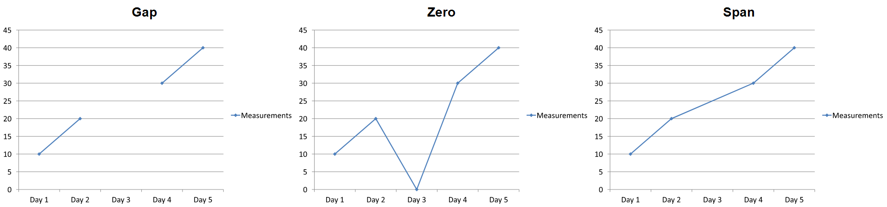

## **ภาพรวม**

แผนภูมิสามารถเก็บค่าที่พลอตไว้ในเซลล์ของเวิร์กบุ๊กหรือโดยตรงเป็นลิเทอรัลเชิงตัวเลขได้ [IChartSeries](https://reference.aspose.com/slides/cpp/aspose.slides.charts/ichartseries/) แทนชุดค่าที่เกี่ยวข้องหนึ่งชุด และแต่ละ [IChartDataPoint](https://reference.aspose.com/slides/cpp/aspose.slides.charts/ichartdatapoint/) แทนจุดหนึ่งในชุดนั้น [IChartCategory](https://reference.aspose.com/slides/cpp/aspose.slides.charts/ichartcategory/) ให้ป้ายชื่อหรือค่าการจัดกลุ่มที่ใช้ร่วมกันโดยชุดข้อมูล ในแผนภูมิที่สร้างด้วยข้อมูลเริ่มต้น ชื่อชุด, ประเภท, และค่าจุดจะใช้วัตถุ [IChartDataCell](https://reference.aspose.com/slides/cpp/aspose.slides.charts/ichartdatacell/) จากเวิร์กบุ๊กของแผนภูมิ

สำหรับแผนภูมิประเภทหมวดหมู่ทั่วไป เวิร์กบุ๊กเริ่มต้นจะใช้แถว 0 สำหรับชื่อชุด, คอลัมน์ 0 สำหรับชื่อหมวดหมู่, และเซลล์ที่เหลือสำหรับค่าชุด Worksheet, แถวและคอลัมน์ที่ส่งให้ [IChartDataWorkbook::GetCell](https://reference.aspose.com/slides/cpp/aspose.slides.charts/ichartdataworkbook/getcell/) เป็นค่าเริ่มนับจากศูนย์ การจัดเรียงนี้เป็นประโยชน์เมื่อคุณสร้างแผนภูมิด้วยข้อมูลเริ่มต้น แต่ไม่ควรสันนิษฐานว่าแผนภูมิที่มีอยู่ทั้งหมดใช้รูปแบบนี้ สำหรับงานนำเสนอที่โหลดมา ให้ตรวจสอบเซลล์ที่ชุดข้อมูล, ประเภท, และจุดข้อมูลอ้างอิงก่อนที่จะเปลี่ยนค่าในเวิร์กบุ๊ก

การตั้งค่าแผนภูมิมีสามระดับขอบเขตต่างกัน:

- การตั้งค่าที่ระดับชุด เช่น [IChartSeries::get_Format](https://reference.aspose.com/slides/cpp/aspose.slides.charts/ichartseries/get_format/) กำหนดลักษณะเริ่มต้นสำหรับทุกจุดในชุดเดียว
- การตั้งค่าระดับจุดข้อมูล เช่น [IChartDataPoint::get_Format](https://reference.aspose.com/slides/cpp/aspose.slides.charts/ichartdatapoint/get_format/) จะทับลักษณะของชุดสำหรับจุดนั้น
- การตั้งค่ากลุ่มจะใช้กับชุดที่เข้ากันได้ซึ่งเป็นส่วนหนึ่งของ [IChartSeriesGroup](https://reference.aspose.com/slides/cpp/aspose.slides.charts/ichartseriesgroup/) เข้าถึงกลุ่มผ่าน [IChartSeries::get_ParentSeriesGroup](https://reference.aspose.com/slides/cpp/aspose.slides.charts/ichartseries/get_parentseriesgroup/) เมื่อคุณต้องการตั้งค่าต่างๆ เช่น overlap หรือ gap width

เมื่อไม่ได้กำหนดการเติมจุดหรือชุดโดยชัดเจน สไตล์และธีมของแผนภูมิจะกำหนดลักษณะอัตโนมัติ หากมีการจัดรูปแบบทั้งชุดและจุดพร้อมกัน การจัดรูปแบบจุดจะมีลำดับความสำคัญสำหรับจุดนั้น


สำหรับแผนภูมิทรงกระบอกแบบจัดกลุ่ม ดูว่า [การเปลี่ยนประเภทชุด 3D หรือรูปแบบแท่ง](/slides/th/cpp/3d-chart/#change-the-3d-series-type-and-bar-shape) ส่งผลต่อชุดแรกอย่างไร

## **ตั้งค่าค่าชุดโดยใช้ลิเทอรัลเชิงตัวเลข**

ใช้ลิเทอรัลเชิงตัวเลขเมื่อค่าชุดมาจากข้อมูลหรือการคำนวณของแอปพลิเคชันและไม่จำเป็นต้องอ้างอิงเซลล์ของ worksheet เรียก [set_DataSourceTypeForValues](https://reference.aspose.com/slides/cpp/aspose.slides.charts/ichartdatapointcollection/set_datasourcetypeforvalues/) พร้อม [DataSourceType::DoubleLiterals](https://reference.aspose.com/slides/cpp/aspose.slides.charts/datasourcetype/) ก่อนที่จะกำหนดค่าที่ได้จาก [get_Value](https://reference.aspose.com/slides/cpp/aspose.slides.charts/ichartdatapoint/get_value/) ของแต่ละจุดผ่าน [set_AsLiteralDouble](https://reference.aspose.com/slides/cpp/aspose.slides.charts/idoublechartvalue/set_asliteraldouble/)

การตั้งค่าคอลเลกชันจะควบคุมประเภทแหล่งข้อมูลของค่าจุดทั้งหมดในชุดนั้น [IBaseChartValue::get_DataSourceType](https://reference.aspose.com/slides/cpp/aspose.slides.charts/ibasechartvalue/get_datasourcetype/) รายงานประเภทที่เลือก; เปลี่ยนผ่านการตั้งค่าคอลเลกชัน โดยใช้ `Worksheet` ให้เรียก [get_AsCell](https://reference.aspose.com/slides/cpp/aspose.slides.charts/isinglecellchartvalue/get_ascell/) เพื่อเข้าถึงเซลล์อ้างอิง โดยใช้ `DoubleLiterals` ให้เรียก [get_AsLiteralDouble](https://reference.aspose.com/slides/cpp/aspose.slides.charts/idoublechartvalue/get_asliteraldouble/) หรือ `set_AsLiteralDouble` เพื่ออ่านหรือเขียนตัวเลขโดยตรง

ตัวอย่างต่อไปนี้สร้างแผนภูมิคอลัมน์ด้วยชุดและประเภทเริ่มต้น แล้วกำหนดค่าที่คำนวณได้ 10, 20 และต่อ ๆ ไป ให้กับจุดที่มีอยู่ของชุดแรก บันทึกงานนำเสนอ, เปิดใหม่อีกครั้ง, และพิมพ์ค่าที่เก็บไว้

```cpp
#include <DOM/Chart/ChartType.h>
#include <DOM/Chart/DataSourceType.h>
#include <DOM/Chart/IChartData.h>
#include <DOM/Chart/IChartDataPoint.h>
#include <DOM/Chart/IChartDataPointCollection.h>
#include <DOM/Chart/IChartSeries.h>
#include <DOM/Chart/IChartSeriesCollection.h>
#include <DOM/Chart/IDoubleChartValue.h>
#include <DOM/IChart.h>
#include <DOM/IShapeCollection.h>
#include <DOM/ISlide.h>
#include <DOM/Presentation.h>
#include <Export/SaveFormat.h>
#include <system/console.h>
#include <system/object_ext.h>
#include <system/shared_ptr.h>

using namespace Aspose::Slides;
using namespace Aspose::Slides::Charts;
using namespace Aspose::Slides::Export;
using namespace System;

auto presentation = MakeObject<Presentation>();
auto slide = presentation->get_Slide(0);

auto chart = slide->get_Shapes()->AddChart(ChartType::ClusteredColumn, 20, 20, 500, 300);
auto series = chart->get_ChartData()->get_Series()->idx_get(0);

series->get_DataPoints()->set_DataSourceTypeForValues(DataSourceType::DoubleLiterals);
for (auto i = 0; i < series->get_DataPoints()->get_Count(); i++)
{
    series->get_DataPoints()->idx_get(i)->get_Value()->set_AsLiteralDouble((i + 1) * 10);
}

presentation->Save(u"numeric_literals.pptx", SaveFormat::Pptx);
presentation->Dispose();

auto reopenedPresentation = MakeObject<Presentation>(u"numeric_literals.pptx");
auto reopenedSlide = reopenedPresentation->get_Slide(0);
auto reopenedChart = ExplicitCast<IChart>(reopenedSlide->get_Shape(0));
auto reopenedSeries = reopenedChart->get_ChartData()->get_Series()->idx_get(0);
for (auto i = 0; i < reopenedSeries->get_DataPoints()->get_Count(); i++)
{
    auto point = reopenedSeries->get_DataPoints()->idx_get(i);
    Console::WriteLine(point->get_Value()->get_AsLiteralDouble());
}
reopenedPresentation->Dispose();
```

ประเภทแหล่งข้อมูลของค่าจุดแยกจาก [IChartData::get_DataSourceType](https://reference.aspose.com/slides/cpp/aspose.slides.charts/ichartdata/get_datasourcetype/) ซึ่งบ่งบอกการกำหนดค่าเวิร์กบุ๊กภายในหรือภายนอกของแผนภูมิ การใช้ลิเทอรัลเชิงตัวเลขไม่ทำให้เวิร์กบุ๊กฝังอยู่หายไป ในตัวอย่างนี้เวิร์กบุ๊กยังคงใช้สำหรับป้ายชื่อหมวดหมู่, ชื่อชุด, และชุดอื่น ๆ ดู [Chart Workbook](/slides/th/cpp/chart-workbook/) สำหรับการจัดการเวิร์กบุ๊ก

สำหรับแผนภูมิกระจายและฟองคู่ ให้เรียก [set_DataSourceTypeForXValues](https://reference.aspose.com/slides/cpp/aspose.slides.charts/ichartdatapointcollection/set_datasourcetypeforxvalues/) และ [set_DataSourceTypeForYValues](https://reference.aspose.com/slides/cpp/aspose.slides.charts/ichartdatapointcollection/set_datasourcetypeforyvalues/) เพื่อเลือกแหล่งสำหรับ [get_XValue](https://reference.aspose.com/slides/cpp/aspose.slides.charts/ichartdatapoint/get_xvalue/) และ [get_YValue](https://reference.aspose.com/slides/cpp/aspose.slides.charts/ichartdatapoint/get_yvalue/). แผนภูมิกระจายฟองยังใช้ [set_DataSourceTypeForBubbleSizes](https://reference.aspose.com/slides/cpp/aspose.slides.charts/ichartdatapointcollection/set_datasourcetypeforbubblesizes/) สำหรับ [get_BubbleSize](https://reference.aspose.com/slides/cpp/aspose.slides.charts/ichartdatapoint/get_bubblesize/). ตั้งค่าแหล่งที่เกี่ยวข้องแต่ละอย่างเป็น `DoubleLiterals` ก่อนกำหนดตัวเลขผ่านเมธอด `set_AsLiteralDouble` ของค่าเหล่านั้น

## **ตั้งค่า Overlap ของชุดแผนภูมิ**

[IChartSeries::get_Overlap](https://reference.aspose.com/slides/cpp/aspose.slides.charts/ichartseries/get_overlap/) รายงานว่าบาร์หรือคอลัมน์ทับกันเท่าใดในแผนภูมิ 2D ค่าตั้งแต่ -100 ถึง 100 เปอร์เซ็นต์ เป็นการฉายภาพแบบอ่านอย่างเดียวของการตั้งค่าในกลุ่มชุดพาเรนท์ เรียก [IChartSeriesGroup::set_Overlap](https://reference.aspose.com/slides/cpp/aspose.slides.charts/ichartseriesgroup/set_overlap/) เพื่ออัปเดตทุกชุดที่เข้ากันได้ในกลุ่มนั้น ตัวเลือกนี้ใช้กับประเภทแผนภูมิที่แสดงบาร์หรือคอลัมน์เป็นกลุ่ม; ไม่ส่งผลต่อกลุ่มชุดที่ไม่เกี่ยวข้องในแผนภูมิแบบผสม

ตัวอย่างต่อไปนี้ตั้งค่า overlap สำหรับกลุ่มที่มีชุดแรกอยู่

```cpp
#include <cstdint>
#include <DOM/Chart/ChartType.h>
#include <DOM/Chart/IChartData.h>
#include <DOM/Chart/IChartSeries.h>
#include <DOM/Chart/IChartSeriesCollection.h>
#include <DOM/Chart/IChartSeriesGroup.h>
#include <DOM/IChart.h>
#include <DOM/IShapeCollection.h>
#include <DOM/ISlide.h>
#include <DOM/Presentation.h>
#include <Export/SaveFormat.h>
#include <system/shared_ptr.h>

using Aspose::Slides::Charts::ChartType;
using Aspose::Slides::Export::SaveFormat;
using Aspose::Slides::Presentation;

const int firstSlideIndex = 0;
const int firstSeriesIndex = 0;
const int8_t overlapPercent = 30;

auto presentation = System::MakeObject<Presentation>();
auto slide = presentation->get_Slide(firstSlideIndex);

// แผนภูมิใหม่มีชุดตัวอย่าง, ประเภท, และค่า.
auto chart = slide->get_Shapes()->AddChart(ChartType::ClusteredColumn, 20.0f, 20.0f, 500.0f, 200.0f);

auto seriesCollection = chart->get_ChartData()->get_Series();
auto series = seriesCollection->idx_get(firstSeriesIndex);
series->get_ParentSeriesGroup()->set_Overlap(overlapPercent);

presentation->Save(u"series_overlap.pptx", SaveFormat::Pptx);
presentation->Dispose();
```

ผลลัพธ์:


## **เปลี่ยนสีเติมของชุด**

ใช้ [IChartSeries::get_Format](https://reference.aspose.com/slides/cpp/aspose.slides.charts/ichartseries/get_format/) เพื่อตั้งค่าสีเติมเริ่มต้นสำหรับทั้งชุด หากจุดมีการกำหนดสีเติมเฉพาะ [IChartDataPoint::get_Format](https://reference.aspose.com/slides/cpp/aspose.slides.charts/ichartdatapoint/get_format/) จะทับสีเติมของชุดสำหรับจุดนั้น

ตัวอย่างต่อไปนี้ใช้สีเติมสีฟ้าแบบทึบกับชุดแรก

```cpp
#include <DOM/Chart/ChartType.h>
#include <DOM/Chart/IChartData.h>
#include <DOM/Chart/IChartSeries.h>
#include <DOM/Chart/IChartSeriesCollection.h>
#include <DOM/Chart/IFormat.h>
#include <DOM/FillType.h>
#include <DOM/IChart.h>
#include <DOM/IColorFormat.h>
#include <DOM/IFillFormat.h>
#include <DOM/IShapeCollection.h>
#include <DOM/ISlide.h>
#include <DOM/Presentation.h>
#include <Export/SaveFormat.h>
#include <drawing/color.h>
#include <system/shared_ptr.h>

using Aspose::Slides::Charts::ChartType;
using Aspose::Slides::Export::SaveFormat;
using Aspose::Slides::FillType;
using Aspose::Slides::Presentation;
using System::Drawing::Color;

const int firstSlideIndex = 0;
const int firstSeriesIndex = 0;

auto presentation = System::MakeObject<Presentation>();
auto slide = presentation->get_Slide(firstSlideIndex);

auto chart = slide->get_Shapes()->AddChart(ChartType::ClusteredColumn, 20.0f, 20.0f, 500.0f, 200.0f);

auto seriesCollection = chart->get_ChartData()->get_Series();
auto series = seriesCollection->idx_get(firstSeriesIndex);
auto seriesColor = Color::get_Blue();
series->get_Format()->get_Fill()->set_FillType(FillType::Solid);
series->get_Format()->get_Fill()->get_SolidFillColor()->set_Color(seriesColor);

presentation->Save(u"series_color.pptx", SaveFormat::Pptx);
presentation->Dispose();
```

ผลลัพธ์:


## **เปลี่ยนชื่อชุด**

ชื่อชุดถูกเก็บในเวิร์กบุ๊กของแผนภูมิและโดยปกติจะแสดงใน legend ในเวิร์กบุ๊กเริ่มต้นที่สร้างสำหรับแผนภูมิคอลัมน์แบบจัดกลุ่ม เซลล์ B1 อยู่ที่แถว 0, คอลัมน์ 1 และบรรจุชื่อของชุดแรก ค่าคงที่ที่ตั้งชื่อในตัวอย่างต่อไปนี้ทำให้โครงสร้างนี้ชัดเจน

```cpp
#include <DOM/Chart/ChartType.h>
#include <DOM/Chart/IChartData.h>
#include <DOM/Chart/IChartDataCell.h>
#include <DOM/Chart/IChartDataWorkbook.h>
#include <DOM/IChart.h>
#include <DOM/IShapeCollection.h>
#include <DOM/ISlide.h>
#include <DOM/Presentation.h>
#include <Export/SaveFormat.h>
#include <system/object_ext.h>
#include <system/shared_ptr.h>
#include <system/string.h>

using Aspose::Slides::Charts::ChartType;
using Aspose::Slides::Export::SaveFormat;
using Aspose::Slides::Presentation;
using System::ObjectExt;
using System::String;

const int firstSlideIndex = 0;
const int worksheetIndex = 0;
const int seriesNameRowIndex = 0;
const int firstSeriesColumnIndex = 1;

auto presentation = System::MakeObject<Presentation>();
auto slide = presentation->get_Slide(firstSlideIndex);

auto chart = slide->get_Shapes()->AddChart(ChartType::ClusteredColumn, 20.0f, 20.0f, 500.0f, 200.0f);

auto workbook = chart->get_ChartData()->get_ChartDataWorkbook();
auto seriesNameCell = workbook->GetCell(worksheetIndex, seriesNameRowIndex, firstSeriesColumnIndex);
auto seriesName = ObjectExt::Box<String>(u"Revenue");
seriesNameCell->set_Value(seriesName);

presentation->Save(u"series_name.pptx", SaveFormat::Pptx);
presentation->Dispose();
```

คุณยังสามารถอัปเดตเซลล์ที่ [IChartSeries::get_Name](https://reference.aspose.com/slides/cpp/aspose.slides.charts/ichartseries/get_name/) อ้างอิงอยู่ได้ วิธีนี้หลีกเลี่ยงการสันนิษฐานเกี่ยวกับแถวและคอลัมน์เฉพาะในแผนภูมิที่มีอยู่

```cpp
#include <DOM/Chart/ChartType.h>
#include <DOM/Chart/IChartCellCollection.h>
#include <DOM/Chart/IChartData.h>
#include <DOM/Chart/IChartDataCell.h>
#include <DOM/Chart/IChartSeries.h>
#include <DOM/Chart/IChartSeriesCollection.h>
#include <DOM/Chart/IStringChartValue.h>
#include <DOM/IChart.h>
#include <DOM/IShapeCollection.h>
#include <DOM/ISlide.h>
#include <DOM/Presentation.h>
#include <Export/SaveFormat.h>
#include <system/object_ext.h>
#include <system/shared_ptr.h>
#include <system/string.h>

using Aspose::Slides::Charts::ChartType;
using Aspose::Slides::Export::SaveFormat;
using Aspose::Slides::Presentation;
using System::ObjectExt;
using System::String;

const int firstSlideIndex = 0;
const int firstSeriesIndex = 0;
const int firstNameCellIndex = 0;

auto presentation = System::MakeObject<Presentation>();
auto slide = presentation->get_Slide(firstSlideIndex);

auto chart = slide->get_Shapes()->AddChart(ChartType::ClusteredColumn, 20.0f, 20.0f, 500.0f, 200.0f);

auto seriesCollection = chart->get_ChartData()->get_Series();
auto series = seriesCollection->idx_get(firstSeriesIndex);
auto seriesNameCells = series->get_Name()->get_AsCells();
auto seriesNameCell = seriesNameCells->idx_get(firstNameCellIndex);
auto seriesName = ObjectExt::Box<String>(u"Revenue");
seriesNameCell->set_Value(seriesName);

presentation->Save(u"series_name.pptx", SaveFormat::Pptx);
presentation->Dispose();
```

ผลลัพธ์:


### **สร้างชุดด้วยชื่อจากหลายเซลล์**

ชื่อชุดเชิงประกอบมีประโยชน์เมื่อชื่อผลิตภัณฑ์และช่วงเวลาออกรายงานถูกเก็บในเซลล์เวิร์กบุ๊กแยกกัน เช่น `Product A` ใน B1 และ `2026` ใน C1 สามารถรวมเป็นชื่อชุดเดียวได้โดยยังคงเชื่อมโยงทั้งสองส่วนกับเซลล์ต้นทาง

ใช้ [IChartDataWorkbook::GetCellCollection](https://reference.aspose.com/slides/cpp/aspose.slides.charts/ichartdataworkbook/getcellcollection/) เพื่อดึงช่วงชื่อ แล้วส่งคอลเลกชันนั้นให้ [IChartSeriesCollection::Add](https://reference.aspose.com/slides/cpp/aspose.slides.charts/ichartseriescollection/add/). อาร์กิวเมนต์ `skipHiddenCells` ควบคุมว่าจะรวมเซลล์ที่ซ่อนหรือไม่: `true` ยกเว้น, `false` รวม ตัวอย่างนี้ใช้ `false` เพื่อรวมทุกเซลล์ในช่วงชื่อ

ตัวอย่างต่อไปนี้สร้างงานนำเสนอที่มีชุดหนึ่งและจุดข้อมูลสองจุด เซลล์ B1:C1 ให้เฉพาะชื่อชุด; A2:A3 ให้ป้ายชื่อหมวดหมู่, B2:B3 ให้ค่าตัวเลข

```cpp
#include <DOM/Chart/ChartType.h>
#include <DOM/Chart/IChartCategoryCollection.h>
#include <DOM/Chart/IChartCellCollection.h>
#include <DOM/Chart/IChartData.h>
#include <DOM/Chart/IChartDataCell.h>
#include <DOM/Chart/IChartDataPointCollection.h>
#include <DOM/Chart/IChartDataWorkbook.h>
#include <DOM/Chart/IChartSeries.h>
#include <DOM/Chart/IChartSeriesCollection.h>
#include <DOM/IChart.h>
#include <DOM/IShapeCollection.h>
#include <DOM/ISlide.h>
#include <DOM/Presentation.h>
#include <Export/SaveFormat.h>
#include <system/object_ext.h>
#include <system/shared_ptr.h>
#include <system/string.h>

using namespace Aspose::Slides;
using namespace Aspose::Slides::Charts;
using namespace Aspose::Slides::Export;
using System::ObjectExt;
using System::String;

auto presentation = System::MakeObject<Presentation>();
auto slide = presentation->get_Slide(0);

auto chart = slide->get_Shapes()->AddChart(ChartType::ClusteredColumn, 50.0f, 50.0f, 620.0f, 180.0f);
auto chartData = chart->get_ChartData();

chartData->get_Series()->Clear();
chartData->get_Categories()->Clear();
chart->set_HasLegend(true);

auto workbook = chartData->get_ChartDataWorkbook();
workbook->Clear(0);

// เซลล์สองเซลล์นี้ใช้เป็นชื่อชุด.
auto productName = ObjectExt::Box<String>(u"Product A");
auto reportingPeriod = ObjectExt::Box<String>(u"2026");
workbook->GetCell(0, 0, 1, productName);
workbook->GetCell(0, 0, 2, reportingPeriod);
auto nameCells = workbook->GetCellCollection(u"Sheet1!$B$1:$C$1", false);
auto series = chartData->get_Series()->Add(nameCells, ChartType::ClusteredColumn);

// เซลล์แยกกันใช้เป็นประเภทและจุดข้อมูลเชิงตัวเลข.
auto northLabel = ObjectExt::Box<String>(u"North");
auto southLabel = ObjectExt::Box<String>(u"South");
auto northCategory = workbook->GetCell(0, 1, 0, northLabel);
auto southCategory = workbook->GetCell(0, 2, 0, southLabel);
chartData->get_Categories()->Add(northCategory);
chartData->get_Categories()->Add(southCategory);
auto northAmount = ObjectExt::Box<int>(120);
auto southAmount = ObjectExt::Box<int>(150);
auto northValue = workbook->GetCell(0, 1, 1, northAmount);
auto southValue = workbook->GetCell(0, 2, 1, southAmount);
series->get_DataPoints()->AddDataPointForBarSeries(northValue);
series->get_DataPoints()->AddDataPointForBarSeries(southValue);

presentation->Save(u"composite_series_name.pptx", SaveFormat::Pptx);
presentation->Dispose();
```

ชื่อชุดที่ได้เป็น `Product A 2026` โดยมีช่องว่างคั่นระหว่างค่าจากสองเซลล์ legend จะแสดงเป็นรายการเดียวสำหรับคอลัมน์ทั้งสอง รูปด้านล่างแสดงผลลัพธ์


## **รับสีเติมอัตโนมัติของชุด**

[IChartSeries::GetAutomaticSeriesColor](https://reference.aspose.com/slides/cpp/aspose.slides.charts/ichartseries/getautomaticseriescolor/) คืนค่าสีที่คำนวณจากดัชนีชุดและสไตล์ของแผนภูมิ นี่คือสีที่ใช้เมื่อสีเติมของชุดไม่ได้กำหนดอย่างชัดเจน การเรียกเมธอดนี้อ่านสีที่คำนวณได้; ไม่ได้กำหนดสีเติมใหม่

ตัวอย่างต่อไปนี้พิมพ์สีอัตโนมัติของแต่ละชุดเริ่มต้น

```cpp
#include <DOM/Chart/ChartType.h>
#include <DOM/Chart/IChartData.h>
#include <DOM/Chart/IChartSeries.h>
#include <DOM/Chart/IChartSeriesCollection.h>
#include <DOM/IChart.h>
#include <DOM/IShapeCollection.h>
#include <DOM/ISlide.h>
#include <DOM/Presentation.h>
#include <drawing/color.h>
#include <system/console.h>
#include <system/shared_ptr.h>
#include <system/string.h>

using Aspose::Slides::Charts::ChartType;
using Aspose::Slides::Presentation;
using System::Console;
using System::String;

const int firstSlideIndex = 0;

auto presentation = System::MakeObject<Presentation>();
auto slide = presentation->get_Slide(firstSlideIndex);

auto chart = slide->get_Shapes()->AddChart(ChartType::ClusteredColumn, 20.0f, 20.0f, 500.0f, 200.0f);

auto seriesCollection = chart->get_ChartData()->get_Series();
const int seriesCount = seriesCollection->get_Count();
for (int seriesIndex = 0; seriesIndex < seriesCount; seriesIndex++)
{
    auto series = seriesCollection->idx_get(seriesIndex);
    auto automaticColor = series->GetAutomaticSeriesColor();
    auto colorName = automaticColor.get_Name();
    auto outputLine = String::Format(u"Series {0}: {1}", seriesIndex, colorName);
    Console::WriteLine(outputLine);
}

presentation->Dispose();
```

ผลลัพธ์ตัวอย่างสำหรับสไตล์แผนภูมิเบื้องต้น

```text
Series 0: ff4f81bd
Series 1: ffc0504d
Series 2: ff9bbb59
```

สีที่แน่นอนขึ้นอยู่กับสไตล์และธีมของแผนภูมิ

## **ตั้งค่าสีเติมย้อนกลับสำหรับชุดแผนภูมิ**

สำหรับชุดบาร์, คอลัมน์, และฟอง [IChartSeries::set_InvertIfNegative](https://reference.aspose.com/slides/cpp/aspose.slides.charts/ichartseries/set_invertifnegative/) สามารถแสดงค่าติดลบด้วยสีเติมที่แตกต่างกัน ตั้งค่าสีเติมของชุดเป็นสีทึบ, เปิดใช้งานการย้อนกลับ, แล้วกำหนดสีค่าติดลบผ่าน [IChartSeries::get_InvertedSolidFillColor](https://reference.aspose.com/slides/cpp/aspose.slides.charts/ichartseries/get_invertedsolidfillcolor/). ตัวเลขติดลบยังคงไม่เปลี่ยนในเวิร์กบุ๊ก; เพียงสีแสดงเท่านั้นที่เปลี่ยน

ตัวอย่างต่อไปนี้แทนที่ข้อมูลแผนภูมิเริ่มต้นด้วยชุดหนึ่ง แถว 0 ของ worksheet มีชื่อชุด, คอลัมน์ 0 มีชื่อหมวดหมู่, คอลัมน์ 1 มีค่าต่าง ๆ

```cpp
#include <DOM/Chart/ChartType.h>
#include <DOM/Chart/IChartCategoryCollection.h>
#include <DOM/Chart/IChartData.h>
#include <DOM/Chart/IChartDataCell.h>
#include <DOM/Chart/IChartDataPointCollection.h>
#include <DOM/Chart/IChartDataWorkbook.h>
#include <DOM/Chart/IChartSeries.h>
#include <DOM/Chart/IChartSeriesCollection.h>
#include <DOM/Chart/IFormat.h>
#include <DOM/FillType.h>
#include <DOM/IChart.h>
#include <DOM/IColorFormat.h>
#include <DOM/IFillFormat.h>
#include <DOM/IShapeCollection.h>
#include <DOM/ISlide.h>
#include <DOM/Presentation.h>
#include <Export/SaveFormat.h>
#include <drawing/color.h>
#include <system/object_ext.h>
#include <system/shared_ptr.h>
#include <system/string.h>

using Aspose::Slides::Charts::ChartType;
using Aspose::Slides::Export::SaveFormat;
using Aspose::Slides::FillType;
using Aspose::Slides::Presentation;
using System::Drawing::Color;
using System::ObjectExt;
using System::String;

const int firstSlideIndex = 0;
const int worksheetIndex = 0;
const int headerRowIndex = 0;
const int categoryColumnIndex = 0;
const int firstSeriesColumnIndex = 1;
const int firstDataRowIndex = 1;
const int categoryCount = 3;

const String categoryNames[] = {u"Category 1", u"Category 2", u"Category 3"};
const int seriesValues[] = {-20, 50, -30};

auto presentation = System::MakeObject<Presentation>();
auto slide = presentation->get_Slide(firstSlideIndex);

auto chart = slide->get_Shapes()->AddChart(ChartType::ClusteredColumn, 20.0f, 20.0f, 500.0f, 200.0f);
auto chartData = chart->get_ChartData();
auto workbook = chartData->get_ChartDataWorkbook();

auto seriesCollection = chartData->get_Series();
seriesCollection->Clear();
chartData->get_Categories()->Clear();

auto seriesName = ObjectExt::Box<String>(u"Series 1");
auto seriesNameCell = workbook->GetCell(worksheetIndex, headerRowIndex, firstSeriesColumnIndex, seriesName);
auto chartType = chart->get_Type();
auto series = seriesCollection->Add(seriesNameCell, chartType);

for (int categoryIndex = 0; categoryIndex < categoryCount; categoryIndex++)
{
    const int dataRowIndex = firstDataRowIndex + categoryIndex;
    auto categoryName = categoryNames[categoryIndex];
    const int seriesValue = seriesValues[categoryIndex];

    auto boxedCategoryName = ObjectExt::Box<String>(categoryName);
    auto categoryCell = workbook->GetCell(worksheetIndex, dataRowIndex, categoryColumnIndex, boxedCategoryName);
    chartData->get_Categories()->Add(categoryCell);

    auto boxedSeriesValue = ObjectExt::Box<int>(seriesValue);
    auto valueCell = workbook->GetCell(worksheetIndex, dataRowIndex, firstSeriesColumnIndex, boxedSeriesValue);
    series->get_DataPoints()->AddDataPointForBarSeries(valueCell);
}

auto automaticSeriesColor = series->GetAutomaticSeriesColor();
auto invertedSeriesColor = Color::get_Red();
series->get_Format()->get_Fill()->set_FillType(FillType::Solid);
series->get_Format()->get_Fill()->get_SolidFillColor()->set_Color(automaticSeriesColor);
series->set_InvertIfNegative(true);
series->get_InvertedSolidFillColor()->set_Color(invertedSeriesColor);

presentation->Save(u"inverted_solid_fill_color.pptx", SaveFormat::Pptx);
presentation->Dispose();
```

ผลลัพธ์:


คุณสามารถเปิดใช้งานการย้อนกลับสำหรับจุดเดียวผ่าน [IChartDataPoint::set_InvertIfNegative](https://reference.aspose.com/slides/cpp/aspose.slides.charts/ichartdatapoint/set_invertifnegative/). ในตัวอย่างต่อไปนี้ การย้อนกลับถูกปิดสำหรับชุดและเปิดเฉพาะจุดที่เลือก จุดนั้นยังได้รับค่าติดลบเพื่อให้เห็นผล

```cpp
#include <DOM/Chart/ChartType.h>
#include <DOM/Chart/IChartData.h>
#include <DOM/Chart/IChartDataCell.h>
#include <DOM/Chart/IChartDataPoint.h>
#include <DOM/Chart/IChartSeries.h>
#include <DOM/Chart/IChartSeriesCollection.h>
#include <DOM/Chart/IDoubleChartValue.h>
#include <DOM/Chart/IFormat.h>
#include <DOM/FillType.h>
#include <DOM/IChart.h>
#include <DOM/IColorFormat.h>
#include <DOM/IFillFormat.h>
#include <DOM/IShapeCollection.h>
#include <DOM/ISlide.h>
#include <DOM/Presentation.h>
#include <Export/SaveFormat.h>
#include <drawing/color.h>
#include <system/object_ext.h>
#include <system/shared_ptr.h>

using Aspose::Slides::Charts::ChartType;
using Aspose::Slides::Export::SaveFormat;
using Aspose::Slides::FillType;
using Aspose::Slides::Presentation;
using System::Drawing::Color;
using System::ObjectExt;

const int firstSlideIndex = 0;
const int firstSeriesIndex = 0;
const int targetDataPointIndex = 2;
const int negativeValue = -30;

auto presentation = System::MakeObject<Presentation>();
auto slide = presentation->get_Slide(firstSlideIndex);

auto chart = slide->get_Shapes()->AddChart(ChartType::ClusteredColumn, 20.0f, 20.0f, 500.0f, 200.0f);

auto seriesCollection = chart->get_ChartData()->get_Series();
auto series = seriesCollection->idx_get(firstSeriesIndex);
auto automaticSeriesColor = series->GetAutomaticSeriesColor();
auto invertedSeriesColor = Color::get_Red();
series->get_Format()->get_Fill()->set_FillType(FillType::Solid);
series->get_Format()->get_Fill()->get_SolidFillColor()->set_Color(automaticSeriesColor);
series->get_InvertedSolidFillColor()->set_Color(invertedSeriesColor);
series->set_InvertIfNegative(false);

auto dataPoint = series->get_DataPoint(targetDataPointIndex);
auto boxedNegativeValue = ObjectExt::Box<int>(negativeValue);
dataPoint->get_YValue()->get_AsCell()->set_Value(boxedNegativeValue);
dataPoint->set_InvertIfNegative(true);

presentation->Save(u"data_point_invert_color_if_negative.pptx", SaveFormat::Pptx);
presentation->Dispose();
```

## **ลบค่าจุดข้อมูลเฉพาะ**

เพื่อทำให้จุดหนึ่งว่างเปล่าโดยไม่ลบจุดอื่น ใหตั้งค่าเซลล์เวิร์กบุ๊กที่สนับสนุนจุดนั้นเป็น `nullptr`. สำหรับแผนภูมิคอลัมน์ ค่าที่พลอตสามารถเข้าถึงได้ผ่าน [IChartDataPoint::get_YValue](https://reference.aspose.com/slides/cpp/aspose.slides.charts/ichartdatapoint/get_yvalue/). จุดข้อมูลจะยังคงอยู่ในตำแหน่งหมวดหมู่เดียวกัน แต่แผนภูมิจะถือค่าของมันว่าเป็นค่าว่างตามการตั้งค่าค่าว่างของแผนภูมิ

ตัวอย่างต่อไปนี้ลบเฉพาะจุดที่สองในชุดแรก

```cpp
#include <DOM/Chart/ChartType.h>
#include <DOM/Chart/IChartData.h>
#include <DOM/Chart/IChartDataCell.h>
#include <DOM/Chart/IChartDataPoint.h>
#include <DOM/Chart/IChartSeries.h>
#include <DOM/Chart/IChartSeriesCollection.h>
#include <DOM/Chart/IDoubleChartValue.h>
#include <DOM/IChart.h>
#include <DOM/IShapeCollection.h>
#include <DOM/ISlide.h>
#include <DOM/Presentation.h>
#include <Export/SaveFormat.h>
#include <system/shared_ptr.h>

using Aspose::Slides::Charts::ChartType;
using Aspose::Slides::Export::SaveFormat;
using Aspose::Slides::Presentation;

const int firstSlideIndex = 0;
const int firstSeriesIndex = 0;
const int targetDataPointIndex = 1;

auto presentation = System::MakeObject<Presentation>();
auto slide = presentation->get_Slide(firstSlideIndex);

auto chart = slide->get_Shapes()->AddChart(ChartType::ClusteredColumn, 20.0f, 20.0f, 500.0f, 200.0f);

auto seriesCollection = chart->get_ChartData()->get_Series();
auto series = seriesCollection->idx_get(firstSeriesIndex);
auto dataPoint = series->get_DataPoint(targetDataPointIndex);
dataPoint->get_YValue()->get_AsCell()->set_Value(nullptr);

presentation->Save(u"clear_data_point_value.pptx", SaveFormat::Pptx);
presentation->Dispose();
```

แผนภูมิกระจายใช้เซลล์ X และ Y แยกกัน, และแผนภูมิกระจายฟองยังใช้เซลล์ขนาด ลบเฉพาะเซลล์ที่เป็นค่าที่คุณต้องการลบ อย่าเรียก [IChartDataPointCollection::Clear](https://reference.aspose.com/slides/cpp/aspose.slides.charts/ichartdatapointcollection/clear/) เมื่อคุณต้องการเก็บจุดอื่นไว้, เนื่องจากเมธอดนั้นจะลบจุดข้อมูลทั้งหมดจากคอลเลกชัน

## **ควบคุมการแสดงผลของเซลล์ว่าง**

เซลล์ที่ซ่อนอยู่แต่มีค่าเป็นกรณีแยกจากเซลล์ว่าง เพื่อรวมหรือแยกข้อมูลจากแถวและคอลัมน์ที่ซ่อนอยู่ ดู [Include Data from Hidden Rows and Columns](/slides/th/cpp/chart-workbook/#include-data-from-hidden-rows-and-columns)

เซลล์เวิร์กบุ๊กว่างแสดงถึงข้อมูลที่ขาดหาย; เซลล์ที่มีค่า `0` แสดงถึงค่าตัวเลขที่ทราบ เรียก [IChartDataCell::set_Value](https://reference.aspose.com/slides/cpp/aspose.slides.charts/ichartdatacell/set_value/) ด้วย `nullptr` เพื่อทำให้เซลล์ว่าง ศูนย์เชิงตัวเลขยังคงเป็นศูนย์ไม่ว่าการตั้งค่าความว่างของเซลล์จะเป็นอย่างไร

ใช้ [IChart::set_DisplayBlanksAs](https://reference.aspose.com/slides/cpp/aspose.slides.charts/ichart/set_displayblanksas/) เพื่อเลือกวิธีที่แผนภูมิแสดงเซลล์ว่าง การตั้งค่านี้ใช้กับแผนภูมิทั้งหมด มันเปลี่ยนวิธีการพลอตค่าว่างโดยไม่เติมเซลล์เวิร์กบุ๊กด้วยศูนย์หรือค่าที่ประมวลผล

ตัวอย่างต่อไปนี้สร้างแผนภูมิเส้นที่มีชุดหนึ่ง, ลบค่าของ Day 3, และบันทึกแผนภูมิเดียวกันในแต่ละโหมด ไม่ต้องใช้ไฟล์อินพุต [IChartDataWorkbook](https://reference.aspose.com/slides/cpp/aspose.slides.charts/ichartdataworkbook/) ใช้ worksheet 0, คอลัมน์ 0 สำหรับป้ายชื่อหมวดหมู่, และคอลัมน์ 1 สำหรับค่าต่าง ๆ; แถว 0 บรรจุชื่อชุด ข้อมูลสุดท้ายคือ `10, 20, empty, 30, 40`

```cpp
#include <array>
#include <DOM/Chart/ChartType.h>
#include <DOM/Chart/DisplayBlanksAsType.h>
#include <DOM/Chart/IChartCategoryCollection.h>
#include <DOM/Chart/IChartData.h>
#include <DOM/Chart/IChartDataCell.h>
#include <DOM/Chart/IChartDataPointCollection.h>
#include <DOM/Chart/IChartDataWorkbook.h>
#include <DOM/Chart/IChartSeries.h>
#include <DOM/Chart/IChartSeriesCollection.h>
#include <DOM/IChart.h>
#include <DOM/IShapeCollection.h>
#include <DOM/ISlide.h>
#include <DOM/Presentation.h>
#include <Export/SaveFormat.h>
#include <system/object_ext.h>
#include <system/shared_ptr.h>
#include <system/string.h>

using namespace Aspose::Slides;
using namespace Aspose::Slides::Charts;
using namespace Aspose::Slides::Export;
using System::ObjectExt;
using System::String;

auto presentation = System::MakeObject<Presentation>();
auto slide = presentation->get_Slide(0);

auto chart = slide->get_Shapes()->AddChart(ChartType::LineWithMarkers, 40.0f, 40.0f, 640.0f, 400.0f);
auto chartData = chart->get_ChartData();
auto workbook = chartData->get_ChartDataWorkbook();

chartData->get_Series()->Clear();
chartData->get_Categories()->Clear();

auto seriesName = ObjectExt::Box<String>(u"Measurements");
auto seriesNameCell = workbook->GetCell(0, 0, 1, seriesName);
auto series = chartData->get_Series()->Add(seriesNameCell, chart->get_Type());
auto values = std::array<int, 5>{10, 20, 25, 30, 40};

for (auto i = 0; i < values.size(); i++)
{
    auto categoryName = String::Format(u"Day {0}", i + 1);
    auto boxedCategoryName = ObjectExt::Box<String>(categoryName);
    auto categoryCell = workbook->GetCell(0, i + 1, 0, boxedCategoryName);
    chartData->get_Categories()->Add(categoryCell);
    auto boxedValue = ObjectExt::Box<int>(values[i]);
    auto valueCell = workbook->GetCell(0, i + 1, 1, boxedValue);
    series->get_DataPoints()->AddDataPointForLineSeries(valueCell);
}

// ปล่อยให้ Day 3 ว่างเปล่าอย่างแท้จริง โดยคงไว้ซึ่งประเภทและจุดข้อมูลของมัน.
workbook->GetCell(0, 3, 1)->set_Value(nullptr);

auto modes = std::array<DisplayBlanksAsType, 3>{DisplayBlanksAsType::Gap, DisplayBlanksAsType::Zero, DisplayBlanksAsType::Span};
for (auto mode : modes)
{
    chart->set_DisplayBlanksAs(mode);
    auto outputPath = String::Format(u"empty_cells_{0}.pptx", mode);
    presentation->Save(outputPath, SaveFormat::Pptx);
}

presentation->Dispose();
```

แต่ละไฟล์ผลลัพธ์บันทึกโหมดที่ตั้งค่าไว้ก่อนบันทึก: `empty_cells_Gap.pptx`, `empty_cells_Zero.pptx`, และ `empty_cells_Span.pptx`. เพื่อบันทึกเพียงเวอร์ชันเดียว ให้ตั้งค่าโหมดที่ต้องการแล้วบันทึกงานนำเสนอครั้งเดียวแทนการวนลูปผ่านโหมดต่าง ๆ

การเปรียบเทียบด้านล่างแสดงข้อมูลเดียวกันในไฟล์ทั้งสาม Day 3 จะเป็นค่าว่างในเวิร์กบุ๊กทุกกรณี:



ผลลัพธ์ที่มองเห็นขึ้นอยู่กับประเภทแผนภูมิ แผนภูมิเส้นทำให้สามโหมดเปรียบเทียบได้ง่าย แผนภูมิบาร์และคอลัมน์ไม่มีเส้นเชื่อมระหว่างคอลัมน์ที่ขาดหาย, ดังนั้น `Span` ไม่สามารถสร้างส่วนเชื่อมได้; คอลัมน์ที่ขาดหายและคอลัมน์ศูนย์สูงอาจดูคล้ายกัน เช่นเดียวกับแผนภูมิกระจายที่มีเครื่องหมายเท่านั้นไม่มีเส้นเชื่อม อย่าคาดหวังผลลัพธ์ที่แตกต่างสามแบบสำหรับทุกประเภทแผนภูมิ; ตรวจสอบผลลัพธ์สำหรับประเภทที่คุณใช้งาน

## **ตั้งค่าความกว้างของช่องว่างระหว่างชุด**

ความกว้างของช่องว่างคือระยะห่างระหว่างกลุ่มบาร์หรือคอลัมน์ที่อยู่ติดกัน, แสดงเป็นเปอร์เซ็นต์ของความกว้างบาร์หรือคอลัมน์ เช่นเดียวกับ overlap, ค่านี้เป็นของกลุ่มชุดพาเรนท์ ไม่ใช่ของชุดเดียว เรียก [IChartSeriesGroup::set_GapWidth](https://reference.aspose.com/slides/cpp/aspose.slides.charts/ichartseriesgroup/set_gapwidth/) ครั้งเดียวสำหรับกลุ่ม ค่าที่ใหญ่กว่าจะทำให้ช่องว่างระหว่างกลุ่มเพิ่มขึ้น, ค่าที่เล็กกว่าจะทำให้กลุ่มแน่นขึ้น

ตัวอย่างต่อไปนี้เปลี่ยนความกว้างของช่องว่างและบันทึกงานนำเสนอสุดท้ายเท่านั้น

```cpp
#include <cstdint>
#include <DOM/Chart/ChartType.h>
#include <DOM/Chart/IChartData.h>
#include <DOM/Chart/IChartSeries.h>
#include <DOM/Chart/IChartSeriesCollection.h>
#include <DOM/Chart/IChartSeriesGroup.h>
#include <DOM/IChart>
#include <DOM/IShapeCollection.h>
#include <DOM/ISlide.h>
#include <DOM/Presentation.h>
#include <Export/SaveFormat.h>
#include <system/shared_ptr.h>

using Aspose::Slides::Charts::ChartType;
using Aspose::Slides::Export::SaveFormat;
using Aspose::Slides::Presentation;

const int firstSlideIndex = 0;
const int firstSeriesIndex = 0;
const uint16_t gapWidthPercent = 30;

auto presentation = System::MakeObject<Presentation>();
auto slide = presentation->get_Slide(firstSlideIndex);

auto chart = slide->get_Shapes()->AddChart(ChartType::StackedColumn, 20.0f, 20.0f, 500.0f, 200.0f);

auto seriesCollection = chart->get_ChartData()->get_Series();
auto series = seriesCollection->idx_get(firstSeriesIndex);
series->get_ParentSeriesGroup()->set_GapWidth(gapWidthPercent);

presentation->Save(u"gap_width_30.pptx", SaveFormat::Pptx);
presentation->Dispose();
```

ผลลัพธ์:


## **แสดงหรือซ่อนเส้นชุด**

เส้นชุดเชื่อมต่อส่วนที่เกี่ยวข้องของแผนภูมิด้วยสายภาพ ใช้ [IChartSeriesGroup::set_HasSeriesLines](https://reference.aspose.com/slides/cpp/aspose.slides.charts/ichartseriesgroup/set_hasserieslines/) เพื่อแสดงหรือซ่อนเส้นเหล่านี้ในแผนภูมิแบบ stacked bar และ OfPie ที่รองรับ ในแผนภูมิ stacked bar และ column 2‑มิติ เส้นจะเชื่อมขอบส่วนสแตกที่สอดคล้องกันข้ามหมวดหมู่ ในแผนภูมิ Pie of Pie และ Bar of Pie เส้นจะเชื่อมพล็อตหลักกับพล็อตรอง การตั้งค่านี้ไม่ใช่ตัวเชื่อมทั่วไปสำหรับประเภทแผนภูมิอื่น

เข้าถึงกลุ่มผ่าน [IChartSeries::get_ParentSeriesGroup](https://reference.aspose.com/slides/cpp/aspose.slides.charts/ichartseries/get_parentseriesgroup/). การตั้งค่านี้ใช้กับทุกชุดในกลุ่ม [IChartSeries::get_HasSeriesLines](https://reference.aspose.com/slides/cpp/aspose.slides.charts/ichartseries/get_hasserieslines/) อ่านค่าเท่านั้นและสะท้อนการตั้งค่าของกลุ่มพาเรนท์; ใช้เมธอดตั้งค่ากลุ่มเพื่ออัปเดต

ตัวอย่างต่อไปนี้สร้างแผนภูมิ [ChartType::PieOfPie](https://reference.aspose.com/slides/cpp/aspose.slides.charts/charttype/) หนึ่งแบบข้อมูลเริ่มต้น บันทึกแผนภูมิเดียวกันพร้อมเส้นชุดเปิดและปิดตามลำดับ, ผลลัพธ์เป็นสองงานนำเสนอเพื่อเปรียบเทียบ

```cpp
#include <DOM/Chart/ChartType.h>
#include <DOM/Chart/IChartData.h>
#include <DOM/Chart/IChartSeries.h>
#include <DOM/Chart/IChartSeriesCollection.h>
#include <DOM/Chart/IChartSeriesGroup.h>
#include <DOM/IChart.h>
#include <DOM/IShapeCollection.h>
#include <DOM/ISlide.h>
#include <DOM/Presentation.h>
#include <Export/SaveFormat.h>
#include <system/shared_ptr.h>

using namespace Aspose::Slides;
using namespace Aspose::Slides::Charts;
using namespace Aspose::Slides::Export;

auto presentation = System::MakeObject<Presentation>();
auto slide = presentation->get_Slide(0);

auto chart = slide->get_Shapes()->AddChart(ChartType::PieOfPie, 50, 50, 600, 400);
auto series = chart->get_ChartData()->get_Series()->idx_get(0);
auto seriesGroup = series->get_ParentSeriesGroup();

seriesGroup->set_HasSeriesLines(true);
presentation->Save(u"series_lines_enabled.pptx", SaveFormat::Pptx);

seriesGroup->set_HasSeriesLines(false);
presentation->Save(u"series_lines_disabled.pptx", SaveFormat::Pptx);
presentation->Dispose();
```

| เส้นชุดเปิดใช้งาน | เส้นชุดปิดใช้งาน |
| --- | --- |
|  |  |
| สองเส้นเชื่อมพายหลักกับพายรอง | ทั้งสองพายยังคงมองเห็นได้, แต่เส้นเชื่อมถูกซ่อน |

เส้นชุดแตกต่างจากเส้นนำของป้ายข้อมูล (เชื่อมป้ายกับจุดข้อมูล), เส้นกริด (ทำเครื่องหมายช่วงบนแกน), และเส้นในแผนภูมิเส้น (แทนค่าข้อมูล) การตั้งค่านี้ไม่ควบคุมส่วนเหล่านั้น

## **FAQ**

**แผนภูมิประเภทใดรองรับชุดข้อมูล?**

ทุกประเภทแผนภูมิที่แสดงโดย enumeration [ChartType](https://reference.aspose.com/slides/cpp/aspose.slides.charts/charttype/) ใช้ข้อมูลแผนภูมิ, แต่ชุดของพวกมันไม่ได้มีโครงสร้างค่าหรือการตั้งค่าเดียวกัน เช่นแผนภูมิจัดหมวดใช้ประเภทและค่า, แผนภูมิกระจายใช้ X และ Y ค่า, แผนภูมิกระจายฟองเพิ่มขนาดฟอง ใช้วิธีการสร้างจุดข้อมูลที่สอดคล้องกับประเภทชุด ตัวเลือกเช่น overlap และ gap width ใช้กับกลุ่มบาร์หรือคอลัมน์ที่เข้ากันได้เท่านั้น

**กลุ่มชุดแผนภูมิคืออะไร?**

[IChartSeriesGroup](https://reference.aspose.com/slides/cpp/aspose.slides.charts/ichartseriesgroup/) ประกอบด้วยชุดที่เข้ากันได้ซึ่งแชร์การตั้งค่าการพลอตระดับกลุ่ม แผนภูมิผสมอาจมีมากกว่าหนึ่งกลุ่ม, ดังนั้นการเปลี่ยนกลุ่มผ่านชุดหนึ่งไม่จำเป็นต้องเปลี่ยนทุกชุดในแผนภูมิ

**แผนภูมิที่สร้างใหม่มีข้อมูลเริ่มต้นหรือไม่?**

ใช่ โดยค่าเริ่มต้น [IShapeCollection::AddChart](https://reference.aspose.com/slides/cpp/aspose.slides/ishapecollection/addchart/) จะสร้างชุดตัวอย่าง, ประเภท, และค่า คุณสามารถแก้ไขเซลล์เหล่านั้นหรือทำความสะอาดทั้งชุดและประเภทก่อนเพิ่มชุดข้อมูลที่กำหนดเองอย่างสมบูรณ์ มี overload ที่สามารถสร้างแผนภูมิโดยไม่มีข้อมูลเริ่มต้นได้เช่นกัน

**วัตถุแผนภูมิเชื่อมกับเซลล์เวิร์กบุ๊กอย่างไร?**

ชื่อชุด, ป้ายชื่อหมวด, และค่าจุดข้อมูลอ้างอิงเซลล์ใน [IChartDataWorkbook](https://reference.aspose.com/slides/cpp/aspose.slides.charts/ichartdataworkbook/). การเปลี่ยนแปลงเซลล์ที่อ้างอิงจะอัปเดตองค์ประกอบแผนภูมิที่สอดคล้อง เมื่อคุณสร้างข้อมูลที่กำหนดเอง, ให้รักษาแถวหมวดและแถวค่าชุดให้สอดคล้องกันเพื่อให้แต่ละจุดพลอตอยู่ภายใต้หมวดที่ต้องการ

**ฉันจะลบจุดเดียวแทนจะลบทั้งชุดได้อย่างไร?**

ตั้งค่าเซลล์ค่าที่เกี่ยวข้องเป็น `nullptr` เพื่อให้จุดยังคงอยู่ในตำแหน่งหมวดหมู่เป็นจุดว่าง เรียก [IChartDataPointCollection::Clear](https://reference.aspose.com/slides/cpp/aspose.slides.charts/ichartdatapointcollection/clear/) เฉพาะเมื่อคุณต้องการลบจุดทั้งหมดจากชุดนั้น หากคุณลบหมวดด้วย, ให้อัปเดตทุกชุดให้ค่าตรงกับคอลเลกชันหมวด

**จุดว่างจะแสดงอย่างไร?**

ผลลัพธ์ขึ้นอยู่กับประเภทแผนภูมิและ [IChart::get_DisplayBlanksAs](https://reference.aspose.com/slides/cpp/aspose.slides.charts/ichart/get_displayblanksas/). แผนภูมิที่รองรับสามารถแสดงค่าว่างเป็นช่องว่าง, เป็นศูนย์, หรือเชื่อมจุดใกล้เคียง เลือกการตั้งค่าที่สอดคล้องกับความหมายของข้อมูลหายในงานนำเสนอของคุณ ดู [Control the Display of Empty Cells](#control-the-display-of-empty-cells) สำหรับตัวอย่างเต็มและการเปรียบเทียบภาพ

**ค่าติดลบถูกฟอร์แมตอย่างไร?**

สำหรับชุดบาร์, คอลัมน์, และฟองที่รองรับ, เรียก [IChartSeries::set_InvertIfNegative](https://reference.aspose.com/slides/cpp/aspose.slides.charts/ichartseries/set_invertifnegative/) และตั้งค่าสีผ่าน [IChartSeries::get_InvertedSolidFillColor](https://reference.aspose.com/slides/cpp/aspose.slides.charts/ichartseries/get_invertedsolidfillcolor/). คุณสามารถละเมิดพฤติกรรมสำหรับจุดเดียวด้วย [IChartDataPoint::set_InvertIfNegative](https://reference.aspose.com/slides/cpp/aspose.slides.charts/ichartdatapoint/set_invertifnegative/). เมธอดเหล่านี้ส่งผลต่อรูปแบบการแสดง, ไม่ใช่ค่าตัวเลขที่จัดเก็บ

**การฟอร์แมตใดชนะเมื่อทั้งชุดและจุดถูกฟอร์แมต?**

การฟอร์แมตจุดข้อมูลโดยชัดเจนจะมีลำดับความสำคัญสำหรับจุดนั้น จุดอื่น ๆ จะยังคงใช้ฟอร์แมตชุดที่ชัดเจนหรือเมื่อไม่มีฟอร์แมตชุดจะใช้สไตล์และธีมแผนภูมิตามอัตโนมัติ การตั้งค่ากลุ่มเช่น overlap และ gap width ควบคุมการจัดวางและไม่ใช่การทับซ้อนระดับจุด

**มีขีดจำกัดจำนวนชุดที่แผนภูมิสามารถมีได้หรือไม่?**

Aspose.Slides ไม่ได้กำหนดขีดจำกัดจำนวนชุดแยกจากกัน ความจำกัดจริงขึ้นกับข้อจำกัดของไฟล์งานนำเสนอ, หน่วยความจำ, เวลาเรนเดอร์, และการอ่านง่ายของแผนภูมิ

**ควรเปลี่ยนอะไรเมื่อคอลัมน์ใกล้กันเกินไปหรือห่างเกินไป?**

เรียก [IChartSeriesGroup::set_GapWidth](https://reference.aspose.com/slides/cpp/aspose.slides.charts/ichartseriesgroup/set_gapwidth/) บนกลุ่มพาเรนท์ที่เหมาะสม เพิ่มค่าจะทำให้ช่องว่างระหว่างกลุ่มกว้างขึ้น, ลดค่าจะทำให้กลุ่มใกล้กันขึ้น

