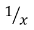

## **ภาพรวม**

PowerPoint จัดเก็บสมการในรูปแบบ Office Math Markup Language (OMML). ด้วย Aspose.Slides for Java คุณสามารถสร้างเนื้อหาคณิตศาสตร์แบบเดียวกันโดยโปรแกรมได้: เศษส่วน, ราก, ฟังก์ชัน, ขีดจำกัด, ตัวดำเนินการ N-ary, เมทริกซ์, อาเรย์, และบล็อกคณิตศาสตร์ที่ฟอร์แมตไว้

ใน PowerPoint ผู้ใช้มักเพิ่มสมการจาก **Insert > Equation**:


ผลลัพธ์คือข้อความคณิตศาสตร์ที่สามารถแก้ไขได้บนสไลด์:


Aspose.Slides สร้างข้อความคณิตศาสตร์นั้นโดยใช้วัตถุหลักสามประเภท:

- รูปร่างคณิตศาสตร์ที่สร้างด้วย [addMathShape](https://reference.aspose.com/slides/java/com.aspose.slides/ishapecollection/#addMathShape-float-float-float-float-), เป็นรูปร่างที่บรรจุสมการ
- [MathPortion](https://reference.aspose.com/slides/java/com.aspose.slides/mathportion/) เก็บเนื้อหาคณิตศาสตร์ภายในกรอบข้อความของรูปร่าง
- [MathParagraph](https://reference.aspose.com/slides/java/com.aspose.slides/mathparagraph/) ประกอบด้วยหนึ่งหรือหลายวัตถุ [MathBlock](https://reference.aspose.com/slides/java/com.aspose.slides/mathblock/)

ตัวอย่างส่วนใหญ่ด้านล่างใช้ [MathematicalText](https://reference.aspose.com/slides/java/com.aspose.slides/mathematicaltext/) และเมธอดเชิงลำดับจาก [IMathElement](https://reference.aspose.com/slides/java/com.aspose.slides/imathelement/) เพื่อให้โค้ดสั้นและอ่านง่าย

สำหรับกรณีการส่งออก MathML, ดู [Export Math Equations from Presentations in Java](/slides/th/java/exporting-math-equations/)

## **สร้างสมการ**

ตัวอย่างนี้ใช้ [addMathShape](https://reference.aspose.com/slides/java/com.aspose.slides/ishapecollection/#addMathShape-float-float-float-float-) เพื่อสร้างรูปร่างคณิตศาสตร์และเพิ่มทฤษฎีพีทาโกรัส:


```java
import com.aspose.slides.*;

Presentation presentation = new Presentation();
try {
    ISlide slide = presentation.getSlides().get_Item(0);

    IAutoShape mathShape = slide.getShapes().addMathShape(20, 20, 700, 120);
    IMathParagraph mathParagraph = ((MathPortion) mathShape.getTextFrame().getParagraphs()
            .get_Item(0).getPortions().get_Item(0)).getMathParagraph();

    IMathBlock equation = new MathematicalText("c")
            .setSuperscript("2")
            .join("=")
            .join(new MathematicalText("a").setSuperscript("2"))
            .join("+")
            .join(new MathematicalText("b").setSuperscript("2"));

    mathParagraph.add(equation);

    presentation.save("pythagorean-theorem.pptx", SaveFormat.Pptx);
} finally {
    presentation.dispose();
}
```

{}
[addMathShape](https://reference.aspose.com/slides/java/com.aspose.slides/ishapecollection/#addMathShape-float-float-float-float-) สร้างรูปร่างที่มีย่อหน้าคณิตศาสตร์อยู่แล้ว. เข้าถึง [MathPortion](https://reference.aspose.com/slides/java/com.aspose.slides/mathportion/) แรก, เรียก [getMathParagraph](https://reference.aspose.com/slides/java/com.aspose.slides/imathportion/#getMathParagraph--), และเพิ่มบล็อกคณิตศาสตร์หรือองค์ประกอบคณิตศาสตร์ลงไป
{}

### **รวมบล็อกคณิตศาสตร์**

เมื่อส่วนต่าง ๆ ของสมการถูกสร้างแยกกันเป็นวัตถุ [IMathBlock](https://reference.aspose.com/slides/java/com.aspose.slides/imathblock/) ใช้ [joinBlock](https://reference.aspose.com/slides/java/com.aspose.slides/imathblock/#joinBlock-com.aspose.slides.IMathBlock-) เพื่อรวมเข้าด้วยกัน. ตัวอย่างสร้าง `c² =` ในบล็อกด้านซ้ายและ `a² + b²` ในบล็อกด้านขวา. [setSuperscript](https://reference.aspose.com/slides/java/com.aspose.slides/imathelement/#setSuperscript-java.lang.String-) สร้างซูเปอร์สคริปต์คณิตศาสตร์ที่สามารถแก้ไขได้สำหรับกำลังทั้งสาม

```java
import com.aspose.slides.*;

Presentation presentation = new Presentation();
try {
    ISlide slide = presentation.getSlides().get_Item(0);

    IAutoShape shape = slide.getShapes().addMathShape(20, 20, 600, 100);
    IMathPortion mathPortion = (IMathPortion) shape.getTextFrame().getParagraphs().get_Item(0).getPortions().get_Item(0);
    IMathParagraph mathParagraph = mathPortion.getMathParagraph();

    MathBlock leftBlock = new MathBlock();
    leftBlock.add(new MathematicalText("c").setSuperscript("2"));
    leftBlock.add(new MathematicalText("="));

    MathBlock rightBlock = new MathBlock();
    rightBlock.add(new MathematicalText("a").setSuperscript("2"));
    rightBlock.add(new MathematicalText("+"));
    rightBlock.add(new MathematicalText("b").setSuperscript("2"));

    IMathBlock combinedBlock = leftBlock.joinBlock(rightBlock);
    mathParagraph.add(combinedBlock);

    presentation.save("equation.pptx", SaveFormat.Pptx);
} finally {
    presentation.dispose();
}
```

[joinBlock](https://reference.aspose.com/slides/java/com.aspose.slides/imathblock/#joinBlock-com.aspose.slides.IMathBlock-) คืนค่า `leftBlock` เอง, ตอนนี้บรรจุส่วนทั้งสองตามลำดับและทำให้ `rightBlock` ว่าง. เพิ่มบล็อกที่รวมแล้วลงใน [IMathParagraph](https://reference.aspose.com/slides/java/com.aspose.slides/imathparagraph/) เพียงครั้งเดียว. หลังจากเปิด `equation.pptx` อีกครั้ง ย่อหน้าจะมีบล็อกเดียวที่แสดง `c² = a² + b²`, โดยกำลังทั้งสามคงอยู่เป็นซูเปอร์สคริปต์คณิตศาสตร์

การเรียก [add](https://reference.aspose.com/slides/java/com.aspose.slides/imathelementcollection/#add-com.aspose.slides.IMathElement-) เป็น `leftBlock.add(rightBlock)` พยายามใส่บล็อกหนึ่งภายในอีกบล็อกหนึ่งโดยตรงและทำให้เกิด `InvalidOperationException`

## **เพิ่มเศษส่วน**

ใช้ [divide](https://reference.aspose.com/slides/java/com.aspose.slides/imathelement/#divide-com.aspose.slides.IMathElement-) เพื่อสร้างเศษส่วน. คุณสามารถเลือกสไตล์ของเศษส่วนด้วย [MathFractionTypes](https://reference.aspose.com/slides/java/com.aspose.slides/mathfractiontypes/)



```java
import com.aspose.slides.*;

Presentation presentation = new Presentation();
try {
    ISlide slide = presentation.getSlides().get_Item(0);

    IAutoShape mathShape = slide.getShapes().addMathShape(20, 20, 700, 100);
    IMathParagraph mathParagraph = ((MathPortion) mathShape.getTextFrame().getParagraphs()
            .get_Item(0).getPortions().get_Item(0)).getMathParagraph();

    IMathFraction fraction = new MathematicalText("1")
            .divide("x", MathFractionTypes.Skewed);

    mathParagraph.add(new MathBlock(fraction));

    presentation.save("fraction.pptx", SaveFormat.Pptx);
} finally {
    presentation.dispose();
}
```

สำหรับเศษส่วนแบบซ้อนชั้น ใช้ [MathFractionTypes.Bar](https://reference.aspose.com/slides/java/com.aspose.slides/mathfractiontypes/#Bar):

```java
import com.aspose.slides.*;

IMathFraction stackedFraction = new MathematicalText("x + 1").divide("y - 1", MathFractionTypes.Bar);
```

## **เพิ่มรากคณิตศาสตร์**

ใช้ [radical](https://reference.aspose.com/slides/java/com.aspose.slides/imathelement/#radical-com.aspose.slides.IMathElement-) เพื่อสร้างรากกำลังสอง, รากกำลังสาม หรือรากอื่น ๆ. องค์ประกอบปัจจุบันจะเป็นฐานและอาร์กิวเมนต์จะเป็นดีกรี


```java
import com.aspose.slides.*;

Presentation presentation = new Presentation();
try {
    ISlide slide = presentation.getSlides().get_Item(0);

    IAutoShape mathShape = slide.getShapes().addMathShape(20, 20, 700, 100);
    IMathParagraph mathParagraph = ((MathPortion) mathShape.getTextFrame().getParagraphs()
            .get_Item(0).getPortions().get_Item(0)).getMathParagraph();

    IMathRadical radical = new MathematicalText("x")
            .radical("n");

    mathParagraph.add(new MathBlock(radical));

    presentation.save("radical.pptx", SaveFormat.Pptx);
} finally {
    presentation.dispose();
}
```

### **แสดงหรือซ่อนดีกรีของรากกำลังสอง**

รากกำลังสองสามารถแสดงเลข 2 อย่างชัดเจนหรือใช้สัญลักษณ์ √x ตามแบบดั้งเดิม. วิธี [setHideDegree](https://reference.aspose.com/slides/java/com.aspose.slides/imathradical/#setHideDegree-boolean-) ของ [IMathRadical](https://reference.aspose.com/slides/java/com.aspose.slides/imathradical/) ควบคุมรูปแบบที่ปรากฏ. ทั้งสองรูปแบบคงดีกรี 2 และราดิกันด์ x ไว้ในสมการที่แก้ไขได้


ตัวอย่างบันทึกรากกำลังสองเดียวกันสองครั้ง. ใน `visible-degree.pptx` ตัวเลข 2 ปรากฏ. ใน `hidden-degree.pptx` ตัวเลข 2 ถูกซ่อน

```java
import com.aspose.slides.*;

Presentation presentation = new Presentation();
try {
    ISlide slide = presentation.getSlides().get_Item(0);
    
    IMathRadical radical = new MathematicalText("x").radical("2");

    IAutoShape shape = slide.getShapes().addMathShape(20, 20, 200, 100);
    IMathPortion portion = (IMathPortion) shape.getTextFrame().getParagraphs().get_Item(0).getPortions().get_Item(0);
    portion.getMathParagraph().add(new MathBlock(radical));

    radical.setHideDegree(false);
    presentation.save("visible-degree.pptx", SaveFormat.Pptx);

    radical.setHideDegree(true);
    presentation.save("hidden-degree.pptx", SaveFormat.Pptx);
} finally {
    presentation.dispose();
}
```

## **เพิ่มฟังก์ชันและขีดจำกัด**

ใช้ [asArgumentOfFunction](https://reference.aspose.com/slides/java/com.aspose.slides/imathelement/#asArgumentOfFunction-com.aspose.slides.IMathElement-) หรือ [function](https://reference.aspose.com/slides/java/com.aspose.slides/imathelement/#function-com.aspose.slides.IMathElement-) สำหรับฟังก์ชันเช่น `sin(x)`, `log(x)` หรือชื่อฟังก์ชันที่กำหนดเอง. สำหรับขีดจำกัดให้ใส่ `lim` ใน [MathLimit](https://reference.aspose.com/slides/java/com.aspose.slides/mathlimit/) หรือใช้ [setLowerLimit](https://reference.aspose.com/slides/java/com.aspose.slides/imathelement/#setLowerLimit-com.aspose.slides.IMathElement-)


```java
import com.aspose.slides.*;

Presentation presentation = new Presentation();
try {
    ISlide slide = presentation.getSlides().get_Item(0);

    IAutoShape mathShape = slide.getShapes().addMathShape(20, 20, 700, 100);
    IMathParagraph mathParagraph = ((MathPortion) mathShape.getTextFrame().getParagraphs()
            .get_Item(0).getPortions().get_Item(0)).getMathParagraph();

    IMathFunction limit = new MathematicalText("lim")
            .setLowerLimit("x\u2192\u221E")
            .function("x");

    mathParagraph.add(new MathBlock(limit));

    presentation.save("functions-and-limits.pptx", SaveFormat.Pptx);
} finally {
    presentation.dispose();
}
```

สำหรับชื่อฟังก์ชันที่กำหนดเอง ให้ทำให้ชื่อฟังก์ชันเป็นองค์ประกอบปัจจุบันและเรียก [function](https://reference.aspose.com/slides/java/com.aspose.slides/imathelement/#function-com.aspose.slides.IMathElement-) พร้อมอาร์กิวเมนต์ของมัน:

```java
import com.aspose.slides.*;

IMathFunction customFunction = new MathematicalText("f").function("x + 1");
```

## **เพิ่มตัวดำเนินการ N-ary และอินทิกรัล**

ใช้ [nary](https://reference.aspose.com/slides/java/com.aspose.slides/imathelement/#nary-int-com.aspose.slides.IMathElement-com.aspose.slides.IMathElement-) สำหรับการบวกผลรวม, ยูเนียน, อินเทอร์เซคชันและตัวดำเนินการใหญ่อื่น ๆ. ใช้ [integral](https://reference.aspose.com/slides/java/com.aspose.slides/imathelement/#integral-int-com.aspose.slides.IMathElement-com.aspose.slides.IMathElement-) สำหรับอินทิกรัล. ทั้งสองวิธีให้คุณกำหนดขีดจำกัดลัดและบน


```java
import com.aspose.slides.*;

Presentation presentation = new Presentation();
try {
    ISlide slide = presentation.getSlides().get_Item(0);

    IAutoShape mathShape = slide.getShapes().addMathShape(20, 20, 700, 120);
    IMathParagraph mathParagraph = ((MathPortion) mathShape.getTextFrame().getParagraphs()
            .get_Item(0).getPortions().get_Item(0)).getMathParagraph();

    IMathBlock summationBase = new MathematicalText("x")
            .setSuperscript("k")
            .join(new MathematicalText("a").setSuperscript("n-k"));

    IMathNaryOperator summation = summationBase.nary(MathNaryOperatorTypes.Summation, "k=0", "n");

    mathParagraph.add(new MathBlock(summation));

    presentation.save("nary-operators.pptx", SaveFormat.Pptx);
} finally {
    presentation.dispose();
}
```

ตัวดำเนินการ N-ary ใช้กับตัวดำเนินการใหญ่ที่มีขีดจำกัดได้ตามต้องการ. ตัวดำเนินการธรรมดาเช่น `+`, `-` และ `=` มักจะเพิ่มเป็น [MathematicalText](https://reference.aspose.com/slides/java/com.aspose.slides/mathematicaltext/) แล้วต่อเข้ากับนิพจน์

สำหรับอินทิกรัล ใช้ [integral](https://reference.aspose.com/slides/java/com.aspose.slides/imathelement/#integral-int-com.aspose.slides.IMathElement-com.aspose.slides.IMathElement-):

```java
import com.aspose.slides.*;

IMathBlock integralBase = new MathematicalText("x").join(new MathematicalText("dx").toBox());
IMathNaryOperator integral = integralBase.integral(MathIntegralTypes.Simple, "0", "1");
```

## **เพิ่มเมทริกซ์**

ใช้ [MathMatrix](https://reference.aspose.com/slides/java/com.aspose.slides/mathmatrix/) สำหรับแถวและคอลัมน์. เมทริกซ์ไม่มีวงเล็บโดยค่าเริ่มต้น, ดังนั้นให้ใส่วงเล็บ, กรอบหรือเครื่องหมายปีกการอบเมทริกซ์เมื่อจำเป็น


```java
import com.aspose.slides.*;

Presentation presentation = new Presentation();
try {
    ISlide slide = presentation.getSlides().get_Item(0);

    IAutoShape mathShape = slide.getShapes().addMathShape(20, 20, 700, 120);
    IMathParagraph mathParagraph = ((MathPortion) mathShape.getTextFrame().getParagraphs()
            .get_Item(0).getPortions().get_Item(0)).getMathParagraph();

    MathMatrix matrix = new MathMatrix(2, 3);
    matrix.set_Item(0, 0, new MathematicalText("1"));
    matrix.set_Item(0, 1, new MathematicalText("x"));
    matrix.set_Item(1, 0, new MathematicalText("x"));
    matrix.set_Item(1, 1, new MathematicalText("2"));
    matrix.set_Item(1, 2, new MathematicalText("y"));

    mathParagraph.add(new MathBlock(matrix));

    presentation.save("matrix.pptx", SaveFormat.Pptx);
} finally {
    presentation.dispose();
}
```

### **แก้ไขเมทริกซ์ที่มีอยู่**

สมมติว่าบทเรียนพีชคณิตเชิงเส้นเริ่มด้วยเมทริกซ์สัมประสิทธิ์ใน `matrix.pptx` ที่บันทึกโดยตัวอย่างก่อนหน้า. สำหรับแบบฝึกหัดต่อไป ให้คงสมการแรกไว้, แทนที่สมการที่สองด้วยสองสมการใหม่, และปรับชุดตัวแปรใหม่. เปิดเมทริกซ์ที่มีอยู่ผ่าน [IMathMatrix](https://reference.aspose.com/slides/java/com.aspose.slides/imathmatrix/) เพื่อคงสัมประสิทธิ์ที่ยังใช้ได้


ดัชนีแถวและคอลัมน์เริ่มต้นที่ศูนย์และอ้างอิงเมทริกซ์ตามสภาพในแต่ละคำเรียก. การแทรกแถวก่อนดัชนี 1 จะย้ายแถวที่สองเดิมไปเป็นดัชนี 2. การแทรกหลังดัชนี 2 จะเพิ่มแถวใหม่. การลบแถว 2 จะลบสมการที่สองเดิมและย้ายแถวที่เพิ่มขึ้นขึ้นหนึ่งตำแหน่ง. คอลัมน์ก็เลื่อนในลักษณะเดียวกัน

```java
import com.aspose.slides.*;

Presentation presentation = new Presentation("matrix.pptx");
try {
    IAutoShape shape = (IAutoShape) presentation.getSlides().get_Item(0).getShapes().get_Item(0);
    IMathPortion portion = (IMathPortion) shape.getTextFrame().getParagraphs().get_Item(0).getPortions().get_Item(0);
    IMathMatrix matrix = (IMathMatrix) portion.getMathParagraph().get_Item(0).get_Item(0);

    matrix.insertRowBefore(1);
    matrix.insertRowAfter(2);
    matrix.deleteRow(2);

    matrix.insertColumnBefore(1);
    matrix.insertColumnAfter(3);
    matrix.deleteColumn(3);

    // เซลล์ใหม่เริ่มต้นเป็น null. ตั้งค่าสัมประสิทธิ์ที่ไม่เป็นศูนย์ก่อน
    matrix.set_Item(1, 0, new MathematicalText("12"));
    matrix.set_Item(1, 1, new MathematicalText("1"));
    matrix.set_Item(2, 2, new MathematicalText("10"));
    matrix.set_Item(2, 3, new MathematicalText("1"));
    for (int row = 0; row < matrix.getRowCount(); row++) {
        for (int column = 0; column < matrix.getColumnCount(); column++) {
            if (matrix.get_Item(row, column) == null) {
                matrix.set_Item(row, column, new MathematicalText("0"));
            }
        }
    }

    matrix.setColumnAlignment(0, MathHorizontalAlignment.Left);
    matrix.setColumnsAlignment(1, 3, MathHorizontalAlignment.Right);

    presentation.save("updated-matrix.pptx", SaveFormat.Pptx);
} finally {
    presentation.dispose();
}
```

[setColumnAlignment](https://reference.aspose.com/slides/java/com.aspose.slides/imathmatrix/#setColumnAlignment-int-int-) จัดแนวคอลัมน์แรกไปด้านซ้าย. [setColumnsAlignment](https://reference.aspose.com/slides/java/com.aspose.slides/imathmatrix/#setColumnsAlignment-int-long-int-) จัดแนวสามคอลัมน์ต่อเนื่องไปด้านขวา, เริ่มจากดัชนี 1. ใน `updated-matrix.pptx` เมทริกซ์มีสามสมการและสี่ตัวแปร. สัมประสิทธิ์ของแถวแรกเดิม `1` และ `x` ปรากฏในคอลัมน์แรกและคอลัมน์ที่สาม


## **เพิ่มอาเรย์สมการ**

ใช้ [toMathArray](https://reference.aspose.com/slides/java/com.aspose.slides/imathelement/#toMathArray--) เมื่อคุณต้องการสมการที่จัดแนวหรือสแตกแนวดิ่งของนิพจน์


```java
import com.aspose.slides.*;

Presentation presentation = new Presentation();
try {
    ISlide slide = presentation.getSlides().get_Item(0);

    IAutoShape mathShape = slide.getShapes().addMathShape(20, 20, 700, 140);
    IMathParagraph mathParagraph = ((MathPortion) mathShape.getTextFrame().getParagraphs()
            .get_Item(0).getPortions().get_Item(0)).getMathParagraph();

    IMathArray equationArray = new MathematicalText("x")
            .join("y")
            .toMathArray();

    mathParagraph.add(new MathBlock(equationArray));

    presentation.save("equation-array.pptx", SaveFormat.Pptx);
} finally {
    presentation.dispose();
}
```

### **จัดตำแหน่งอาเรย์กับองค์ประกอบโดยรอบ**

[setBaseJustification](https://reference.aspose.com/slides/java/com.aspose.slides/imatharray/#setBaseJustification-int-) ควบคุมการจัดแนวแนวตั้งของอาเรย์เทียบกับองค์ประกอบคณิตศาสตร์ที่อยู่ข้าง ๆ. ตัวอย่างด้านล่างเปรียบเทียบการจัดแนวกับแถวแรก, ศูนย์กลางของอาเรย์, และแถวสุดท้าย

ตัวอย่างต่อไปนี้สร้างอาเรย์สามอันที่เหมือนกัน, แต่ละอันมีสามแถวและองค์ประกอบข้างเคียง `A=` และ `=B`. ข้อความคณิตศาสตร์ทั้งหมดใช้แบบอักษร Cambria Math ขนาด 24 จุด. มีเพียงการจัดแนวอาเรย์ที่เปลี่ยน

```java
import com.aspose.slides.*;
import java.awt.Color;

class MathTextFactory {
    MathematicalText createText(String value) {
        MathematicalText text = new MathematicalText(value);
        text.getFormat().setFontHeight(24);
        text.getFormat().setLatinFont(new FontData("Cambria Math"));
        return text;
    }
}

MathTextFactory factory = new MathTextFactory();
Presentation presentation = new Presentation();
try {
    presentation.getSlideSize().setSize(780, 200, SlideSizeScaleType.DoNotScale);
    ISlide slide = presentation.getSlides().get_Item(0);
    
    int[] alignments = { MathVerticalAlignment.Top, MathVerticalAlignment.Center, MathVerticalAlignment.Bottom };
    String[] alignmentNames = { "Top", "Center", "Bottom" };

    for (int i = 0; i < alignments.length; i++) {
        IAutoShape label = slide.getShapes().addAutoShape(ShapeType.Rectangle, 20 + i * 260, 10, 240, 30);
        label.getFillFormat().setFillType(FillType.NoFill);
        label.getLineFormat().getFillFormat().setFillType(FillType.NoFill);
        label.getTextFrame().setText(alignmentNames[i]);
        IPortionFormat labelFormat = label.getTextFrame().getParagraphs().get_Item(0).getPortions().get_Item(0).getPortionFormat();
        labelFormat.setFontHeight(16);
        labelFormat.getFillFormat().setFillType(FillType.Solid);
        labelFormat.getFillFormat().getSolidFillColor().setColor(Color.BLACK);

        IAutoShape mathShape = slide.getShapes().addMathShape(20 + i * 260, 60, 240, 130);
        mathShape.getTextFrame().getTextFrameFormat().setAnchoringType(TextAnchorType.Top);
        IMathParagraph mathParagraph = ((IMathPortion) mathShape.getTextFrame().getParagraphs().get_Item(0).getPortions().get_Item(0)).getMathParagraph();
        mathParagraph.setJustification(MathJustification.LeftJustified);

        IMathElement[] rows = { factory.createText("x+y=3"), factory.createText("x-y=1"), factory.createText("x=2") };
        MathArray equationArray = new MathArray(rows[0]);
        equationArray.getArguments().add(rows[1]);
        equationArray.getArguments().add(rows[2]);
        equationArray.setBaseJustification(alignments[i]);
        MathematicalText leftText = factory.createText("A=");
        MathematicalText rightText = factory.createText("=B");
        IMathBlock equation = new MathBlock(leftText).join(equationArray).join(rightText);
        mathParagraph.add(equation);
    }

    presentation.save("equation-array-alignment.pptx", SaveFormat.Pptx);
} finally {
    presentation.dispose();
}
```

การเปรียบเทียบต่อไปนี้แสดงการบันทึกการนำเสนอใน PowerPoint. สังเกตตำแหน่งของ `A=` และ `=B` ข้างแต่ละอาเรย์


### **กำหนดระยะห่างแถว**

[setRowSpacingRule](https://reference.aspose.com/slides/java/com.aspose.slides/imatharray/#setRowSpacingRule-int-) เลือกรูปแบบการเว้นระยะสำหรับแถวภายในอาเรย์. [setRowSpacing](https://reference.aspose.com/slides/java/com.aspose.slides/imatharray/#setRowSpacing-long-) ให้ค่าตัวเลขสำหรับรูปแบบการเว้นระยะแบบชัดเจนและจะถูกละเลยหากใช้รูปแบบตั้งไว้

สำหรับการเว้นระยะที่แม่นยำ ค่าจะวัดเป็นจุด. สำหรับการเว้นระยะเชิงสัดส่วน ค่าจะวัดเป็นครึ่งบรรทัด: ค่า `3` ในตัวอย่างหมายถึง 1.5 บรรทัด. ตั้งค่าทั้งสองคุณสมบัติเมื่อต้องการกำหนดค่าชัดเจน; การเปลี่ยนค่าเชิงตัวเลขอย่างเดียวจะไม่เลือกรูปแบบการเว้นระยะ

ตัวอย่างด้านล่างบันทึกการนำเสนอห้าไฟล์โดยใช้สมการเดียวกัน, การจัดแนวเดียวกัน, และการตั้งค่าฟอนต์เดียวกัน. สามไฟล์แรกใช้รูปแบบตั้งไว้; สองไฟล์สุดท้ายแสดงค่าชัดเจน

```java
import com.aspose.slides.*;

class MathTextFactory {
    MathematicalText createText(String value) {
        MathematicalText text = new MathematicalText(value);
        text.getFormat().setFontHeight(24);
        text.getFormat().setLatinFont(new FontData("Cambria Math"));
        return text;
    }
}

MathTextFactory factory = new MathTextFactory();
int[] rules = { MathRowSpacingRule.SingleLineGap, MathRowSpacingRule.OneAndAHalfLineGap, MathRowSpacingRule.TwoLineGap, MathRowSpacingRule.Exactly, MathRowSpacingRule.Multiple };
int[] spacingValues = { 0, 0, 0, 20, 3 };
String[] ruleNames = { "SingleLineGap", "OneAndAHalfLineGap", "TwoLineGap", "Exactly", "Multiple" };

for (int i = 0; i < rules.length; i++) {
    String fileName = "equation-array-" + ruleNames[i] + ".pptx";
    Presentation presentation = new Presentation();
    try {
        IAutoShape mathShape = presentation.getSlides().get_Item(0).getShapes().addMathShape(20, 20, 600, 300);
        IParagraph paragraph = mathShape.getTextFrame().getParagraphs().get_Item(0);
        paragraph.getParagraphFormat().setSpaceBefore(0);
        paragraph.getParagraphFormat().setSpaceAfter(0);
        IMathParagraph mathParagraph = ((IMathPortion) paragraph.getPortions().get_Item(0)).getMathParagraph();
        mathParagraph.setJustification(MathJustification.LeftJustified);

        IMathElement[] rows = { factory.createText("x+y=3"), factory.createText("x-y=1"), factory.createText("x=2") };
        MathArray equationArray = new MathArray(rows[0]);
        equationArray.getArguments().add(rows[1]);
        equationArray.getArguments().add(rows[2]);
        equationArray.setBaseJustification(MathVerticalAlignment.Center);
        equationArray.setRowSpacingRule(rules[i]);
        equationArray.setRowSpacing(spacingValues[i]);
        MathematicalText leftText = factory.createText("A=");
        MathematicalText rightText = factory.createText("=B");
        IMathBlock equation = new MathBlock(leftText).join(equationArray).join(rightText);
        mathParagraph.add(equation);

        presentation.save(fileName, SaveFormat.Pptx);
    } finally {
        presentation.dispose();
    }
}
```

การเว้นระยะแถวของอาเรย์แยกจากการเว้นระยะของย่อหน้า. [setSpaceBefore](https://reference.aspose.com/slides/java/com.aspose.slides/iparagraphformat/#setSpaceBefore-float-) และ [setSpaceAfter](https://reference.aspose.com/slides/java/com.aspose.slides/iparagraphformat/#setSpaceAfter-float-) เพิ่มช่องว่างรอบย่อหน้าที่บรรจุ, ไม่ได้อยู่ระหว่างแถวของอาเรย์. อีกเช่น, [IMathParagraph.setJustification](https://reference.aspose.com/slides/java/com.aspose.slides/imathparagraph/#setJustification-int-) กำหนดตำแหน่งของย่อหน้าคณิตศาสตร์ทั้งหมดในแนวนอน; ไม่ได้แทนที่การตั้งค่าการจัดแนวแนวตั้งของอาเรย์

## **เพิ่มฟังก์ชันตรีโกณมิติ**

ใช้ [asArgumentOfFunction](https://reference.aspose.com/slides/java/com.aspose.slides/imathelement/#asArgumentOfFunction-com.aspose.slides.IMathElement-) เมื่ออาร์กิวเมนต์เป็นองค์ประกอบปัจจุบันและชื่อฟังก์ชันทราบ


```java
import com.aspose.slides.*;

Presentation presentation = new Presentation();
try {
    ISlide slide = presentation.getSlides().get_Item(0);

    IAutoShape mathShape = slide.getShapes().addMathShape(20, 20, 700, 100);
    IMathParagraph mathParagraph = ((MathPortion) mathShape.getTextFrame().getParagraphs()
            .get_Item(0).getPortions().get_Item(0)).getMathParagraph();

    IMathFunction cosine = new MathematicalText("2x")
            .asArgumentOfFunction(MathFunctionsOfOneArgument.Cos);

    mathParagraph.add(new MathBlock(cosine));

    presentation.save("trigonometric-function.pptx", SaveFormat.Pptx);
} finally {
    presentation.dispose();
}
```

## **เพิ่มตัวห้อยและตัวหัว**

ใช้ตัวช่วยสำหรับตัวห้อยและตัวหัวสำหรับดัชนีและกำลัง. เมื่อดัชนีต้องแสดงทางด้านซ้ายของฐาน, ใช้ [setSubSuperscriptOnTheLeft](https://reference.aspose.com/slides/java/com.aspose.slides/imathelement/#setSubSuperscriptOnTheLeft-com.aspose.slides.IMathElement-com.aspose.slides.IMathElement-)


```java
import com.aspose.slides.*;

Presentation presentation = new Presentation();
try {
    ISlide slide = presentation.getSlides().get_Item(0);

    IAutoShape mathShape = slide.getShapes().addMathShape(20, 20, 700, 100);
    IMathParagraph mathParagraph = ((MathPortion) mathShape.getTextFrame().getParagraphs()
            .get_Item(0).getPortions().get_Item(0)).getMathParagraph();

    IMathLeftSubSuperscriptElement scripts = new MathematicalText("Y")
            .setSubSuperscriptOnTheLeft("1", "n");

    mathParagraph.add(new MathBlock(scripts));

    presentation.save("subscript-superscript.pptx", SaveFormat.Pptx);
} finally {
    presentation.dispose();
}
```

## **เพิ่มตัวคั่น**

ใช้ [enclose](https://reference.aspose.com/slides/java/com.aspose.slides/imathelement/#enclose-char-char-) เพื่อใส่นิพจน์ภายในตัวคั่น. คุณยังสามารถกำหนดอักขระคั่นสำหรับนิพจน์ตัวคั่นที่มีหลายองค์ประกอบได้


```java
import com.aspose.slides.*;

Presentation presentation = new Presentation();
try {
    ISlide slide = presentation.getSlides().get_Item(0);

    IAutoShape mathShape = slide.getShapes().addMathShape(20, 20, 700, 100);
    IMathParagraph mathParagraph = ((MathPortion) mathShape.getTextFrame().getParagraphs()
            .get_Item(0).getPortions().get_Item(0)).getMathParagraph();

    IMathDelimiter delimiter = new MathematicalText("x")
            .join("y")
            .join("z")
            .enclose('<', '>');
    delimiter.setSeparatorCharacter('|');

    mathParagraph.add(new MathBlock(delimiter));

    presentation.save("delimiters.pptx", SaveFormat.Pptx);
} finally {
    presentation.dispose();
}
```

### **ขนาดและการจัดตำแหน่งตัวคั่น**

ใส่ค่า `true` ให้กับ [setGrowToMatchOperandHeight](https://reference.aspose.com/slides/java/com.aspose.slides/imathdelimiter/#setGrowToMatchOperandHeight-boolean-) เพื่อให้วงเล็บขยายตามโอเปอแรนด์สูง, หรือใส่ค่า `false` เพื่อคงขนาดปกติ. ใช้ [setDelimiterShape](https://reference.aspose.com/slides/java/com.aspose.slides/imathdelimiter/#setDelimiterShape-int-) กับค่าหนึ่งจากสองค่าใน [MathDelimiterShape](https://reference.aspose.com/slides/java/com.aspose.slides/mathdelimitershape/). `Centered` จัดศูนย์วงเล็บบนแกนคณิตศาสตร์ซึ่งวิ่งผ่านส่วนกลางของเครื่องหมายเท่ากับ. `Match` จัดให้ตรงกับเนื้อหาที่ล้อมรอบ. ทั้งสองการตั้งค่ามีผลเฉพาะกับตัวคั่น. นิพจน์ภายในคงเดิม

ตัวอย่างใส่เศษส่วนในรูปลำดับของ `x` ทำให้นิพจน์ยืดออกเหนือฐานมากกว่าต่ำลง. ทั้งสี่สมการใช้วงเล็บและการตั้งค่าฟอนต์เดียวกัน

```java
import com.aspose.slides.*;

Presentation presentation = new Presentation();
try {
    ISlide slide = presentation.getSlides().get_Item(0);
    for (int row = 0; row < 2; row++) {
        for (int column = 0; column < 2; column++) {
            IMathFraction fraction = new MathematicalText("a + b").divide("c + d");
            IMathSuperscriptElement power = new MathematicalText("x").setSuperscript(fraction);
            IMathDelimiter delimiter = power.enclose('(', ')');
            delimiter.setGrowToMatchOperandHeight(row == 0);
            delimiter.setDelimiterShape(column == 0 ? MathDelimiterShape.Centered : MathDelimiterShape.Match);

            IAutoShape mathShape = slide.getShapes().addMathShape(20 + 330 * column, 20 + 120 * row, 300, 100);
            MathPortion portion = (MathPortion) mathShape.getTextFrame().getParagraphs().get_Item(0).getPortions().get_Item(0);
            portion.getPortionFormat().setFontHeight(32);
            IMathBlock equation = new MathematicalText("y = ").join(delimiter);
            portion.getMathParagraph().add(equation);
        }
    }
    presentation.save("delimiter-sizing.pptx", SaveFormat.Pptx);
} finally {
    presentation.dispose();
}
```

ใน PowerPoint ให้เปรียบเทียบแถวเพื่อดูผลของการขยาย. ในแถวบน, วงเล็บขยายเพื่อครอบลำดับและดูเหมือนกันสำหรับทั้งสองรูปแบบ. ในแถวล่าง, การขยายปิด. วงเล็บเล็กกว่าด้านซ้าย (`Centered`) จะจัดกับเครื่องหมายเท่ากับ, ส่วนด้านขวา (`Match`) จะอยู่สูงกว่ารอบนิพจน์


## **เพิ่มกล่องขอบ**

เรียก [toBorderBox](https://reference.aspose.com/slides/java/com.aspose.slides/imathelement/#toBorderBox--) บนเศษส่วนเพื่อใส่กรอบรอบนิพจน์ทั้งหมด. [IMathBorderBox](https://reference.aspose.com/slides/java/com.aspose.slides/imathborderbox/) ที่คืนค่ามีสี่ด้านแสดงโดยค่าเริ่มต้น. ใช้ [setHideTop](https://reference.aspose.com/slides/java/com.aspose.slides/imathborderbox/#setHideTop-boolean-), [setHideBottom](https://reference.aspose.com/slides/java/com.aspose.slides/imathborderbox/#setHideBottom-boolean-), [setHideLeft](https://reference.aspose.com/slides/java/com.aspose.slides/imathborderbox/#setHideLeft-boolean-), และ [setHideRight](https://reference.aspose.com/slides/java/com.aspose.slides/imathborderbox/#setHideRight-boolean-) เพื่อลบด้านแต่ละด้าน

ตัวอย่างวางสำเนาเศษส่วนเดียวกันหกอันบนสไลด์เดียว. เพื่อแสดงการยกเลิก, ซ่อนสี่ด้านทั้งหมดและใส่ค่า `true` ให้กับ [setStrikethroughBottomLeftToTopRight](https://reference.aspose.com/slides/java/com.aspose.slides/imathborderbox/#setStrikethroughBottomLeftToTopRight-boolean-) เพื่อให้ได้เส้นทแยงขึ้น (↗) หรือ [setStrikethroughTopLeftToBottomRight](https://reference.aspose.com/slides/java/com.aspose.slides/imathborderbox/#setStrikethroughTopLeftToBottomRight-boolean-) เพื่อให้ได้เส้นทแยงลง (↘). คุณยังสามารถใช้ [setStrikethroughHorizontal](https://reference.aspose.com/slides/java/com.aspose.slides/imathborderbox/#setStrikethroughHorizontal-boolean-) หรือ [setStrikethroughVertical](https://reference.aspose.com/slides/java/com.aspose.slides/imathborderbox/#setStrikethroughVertical-boolean-) ร่วมกับการแสดงผลของด้านใดด้านหนึ่งได้ตามต้องการ

```java
import com.aspose.slides.*;

Presentation presentation = new Presentation();
try {
    presentation.getSlideSize().setSize(540, 220, SlideSizeScaleType.DoNotScale);
    ISlide slide = presentation.getSlides().get_Item(0);

    class FractionBuilder {
        IMathBorderBox addFraction(float x, float y, boolean hideBorder) {
            IMathFraction fraction = new MathematicalText("x+1").divide("y+2");
            IMathBorderBox box = fraction.toBorderBox();
            box.setHideTop(hideBorder);
            box.setHideBottom(hideBorder);
            box.setHideLeft(hideBorder);
            box.setHideRight(hideBorder);

            IAutoShape shape = slide.getShapes().addMathShape(x, y, 160, 90);
            MathPortion portion = (MathPortion) shape.getTextFrame().getParagraphs().get_Item(0).getPortions().get_Item(0);
            portion.getPortionFormat().setFontHeight(28);
            portion.getMathParagraph().add(new MathBlock(box));
            return box;
        }
    }

    FractionBuilder builder = new FractionBuilder();
    builder.addFraction(10, 10, false);

    IMathBorderBox partial = builder.addFraction(190, 10, false);
    partial.setHideTop(true);
    partial.setHideRight(true);

    builder.addFraction(370, 10, true).setStrikethroughBottomLeftToTopRight(true);
    builder.addFraction(10, 120, true).setStrikethroughTopLeftToBottomRight(true);
    builder.addFraction(190, 120, true).setStrikethroughHorizontal(true);
    builder.addFraction(370, 120, false).setStrikethroughVertical(true);

    presentation.save("border-box.pptx", SaveFormat.Pptx);
} finally {
    presentation.dispose();
}
```


บนเศษส่วนนี้, เส้นขีดแนวนอนซ้อนกับเส้นบาร์ของเศษส่วน. เส้นขีดแนวตั้งตัดทั้งตัวเศษและส่วนหารในขณะที่กรอบรอบ ๆ ยังคงมองเห็นได้. เส้นเหล่านี้ตกแต่งนิพจน์ทั้งหมด. การขีดเส้นตรงในข้อความทั่วไปใช้กับอักขระในรันของข้อความ. หลังจากเปิดการนำเสนอใหม่ใน PowerPoint, คุณยังคงแก้ไขตัวเศษและส่วนหารได้โดยอิสระ

## **ควบคุมการมองเห็นและเลย์เอาต์ด้วยองค์ประกอบแฟนท์ม**

ห่อหุ้มนิพจน์ใน [MathPhantom](https://reference.aspose.com/slides/java/com.aspose.slides/mathphantom/) เพื่อควบคุมการมองเห็นและพื้นที่ที่มันทำให้สมการขยายโดยอิสระ. วิธีของ [IMathPhantom](https://reference.aspose.com/slides/java/com.aspose.slides/imathphantom/) ควบคุมสิ่งต่อไปนี้

| วิธี | ผล |
| --- | --- |
| [setShow](https://reference.aspose.com/slides/java/com.aspose.slides/imathphantom/#setShow-boolean-) | ใส่ค่า `false` เพื่อซ่อนนิพจน์. มิติของมันยังคงส่งผลต่อเลย์เอาต์จนกว่าวิธีต่อไปนี้จะรับค่า `true` |
| [setZeroWidth](https://reference.aspose.com/slides/java/com.aspose.slides/imathphantom/#setZeroWidth-boolean-) | ปฏิบัติต่อความกว้างแนวนอนของนิพจน์เป็นศูนย์, ทำให้องค์ประกอบใกล้เคียงย้ายเข้ามาใกล้กัน |
| [setZeroAsc](https://reference.aspose.com/slides/java/com.aspose.slides/imathphantom/#setZeroAsc-boolean-) | ปฏิบัติต่อส่วนที่ยกขึ้นเหนือเส้นฐานเป็นศูนย์, ลดพื้นที่ที่สงวนไว้เหนือองค์ประกอบใกล้เคียง |
| [setZeroDesc](https://reference.aspose.com/slides/java/com.aspose.slides/imathphantom/#setZeroDesc-boolean-) | ปฏิบัติต่อส่วนที่ลงต่ำกว่าเส้นฐานเป็นศูนย์, ทำให้บาร์ของเศษส่วนหรือเนื้อหาอื่น ๆ ที่อยู่นี่ต่ำลงและเข้าใกล้องค์ประกอบข้างเคียง |

Baseline คือเส้นอ้างอิงที่อักษรคณิตศาสตร์ปกตินั่งลงบน. การซ่อนเนื้อหาไม่ทำให้มิติหายไป, และการตั้งค่ามิติเป็นศูนย์ไม่ลบล้างนิพจน์. นิพจน์พื้นฐานยังคงเข้าถึงได้ผ่าน [getBase](https://reference.aspose.com/slides/java/com.aspose.slides/imathphantom/#getBase--). ใส่ค่า `true` ให้กับ [setShow](https://reference.aspose.com/slides/java/com.aspose.slides/imathphantom/#setShow-boolean-) เพื่อแสดงอีกครั้ง; การตั้งค่ามิติยังคงเหมือนเดิม

ตัวอย่างด้านล่างสร้างห้าแบบที่วางข้างกัน: เศษส่วนที่มองเห็น, เศษส่วนที่ซ่อนแต่สงวนพื้นที่, และสามเศษส่วนที่ซ่อนโดยตั้งค่ามิติหนึ่งเป็นศูนย์. แต่ละแบบใช้นิพจน์รอบข้างเดียวกันและ Cambria Math ขนาด 24 จุด. ทุกรูปร่างสมการมีตำแหน่งบนเดียวกัน, ทำเครื่องหมายด้วยไกด์สีเทา. การใส่ phantom ในตัวเศษของเศษส่วนภายนอกทำให้การเปลี่ยนแปลงเลย์เอาต์แนวตั้งเห็นได้ชัด

```java
import com.aspose.slides.*;
import java.awt.Color;

class MathTextFactory {
    MathematicalText createText(String value) {
        MathematicalText text = new MathematicalText(value);
        text.getFormat().setFontHeight(24);
        text.getFormat().setLatinFont(new FontData("Cambria Math"));
        return text;
    }
}

MathTextFactory factory = new MathTextFactory();
Presentation presentation = new Presentation();
try {
    presentation.getSlideSize().setSize(1000, 180, SlideSizeScaleType.DoNotScale);
    ISlide slide = presentation.getSlides().get_Item(0);

    String[] labels = { "Visible", "Hidden: reserves space", "Hidden: ZeroWidth", "Hidden: ZeroAsc", "Hidden: ZeroDesc" };

    IAutoShape guide = slide.getShapes().addAutoShape(ShapeType.Line, 10, 60, 980, 0);
    guide.getLineFormat().getFillFormat().setFillType(FillType.Solid);
    guide.getLineFormat().getFillFormat().getSolidFillColor().setColor(Color.LIGHT_GRAY);

    for (int i = 0; i < labels.length; i++) {
        int left = 10 + i * 200;

        IAutoShape label = slide.getShapes().addAutoShape(ShapeType.Rectangle, left, 10, 190, 30);
        label.getFillFormat().setFillType(FillType.NoFill);
        label.getLineFormat().getFillFormat().setFillType(FillType.NoFill);
        label.getTextFrame().setText(labels[i]);

        IPortionFormat labelFormat = label.getTextFrame().getParagraphs().get_Item(0).getPortions().get_Item(0).getPortionFormat();
        labelFormat.setFontHeight(14);
        labelFormat.getFillFormat().setFillType(FillType.Solid);
        labelFormat.getFillFormat().getSolidFillColor().setColor(Color.BLACK);

        MathematicalText fractionNumerator = factory.createText("a+b");
        MathematicalText fractionDenominator = factory.createText("c+d");
        MathFraction fraction = new MathFraction(fractionNumerator, fractionDenominator);
        MathPhantom phantom = new MathPhantom(fraction);
        phantom.setShow(i == 0);
        phantom.setZeroWidth(i == 2);
        phantom.setZeroAsc(i == 3);
        phantom.setZeroDesc(i == 4);

        MathematicalText leftText = factory.createText("x+");
        MathematicalText rightText = factory.createText("+y");
        IMathBlock numerator = new MathBlock(leftText).join(phantom).join(rightText);
        MathematicalText denominator = factory.createText("z");
        MathFraction equation = new MathFraction(numerator, denominator);

        IAutoShape shape = slide.getShapes().addMathShape(left, 60, 190, 100);
        shape.getTextFrame().getTextFrameFormat().setAnchoringType(TextAnchorType.Top);

        IMathPortion mathPortion = (IMathPortion) shape.getTextFrame().getParagraphs().get_Item(0).getPortions().get_Item(0);
        IMathParagraph mathParagraph = mathPortion.getMathParagraph();
        mathParagraph.add(new MathBlock(equation));
    }

    presentation.save("math-phantom.pptx", SaveFormat.Pptx);
} finally {
    presentation.dispose();
}
```


## **จัดกลุ่มเทอม**

ใช้ [group](https://reference.aspose.com/slides/java/com.aspose.slides/imathelement/#group-char-int-int-) เพื่อวางอักขระจัดกลุ่มเหนือหรือใต้นิพจน์. เพิ่มขีดจำกัดเพื่อทำป้ายกำกับให้กับเทอมที่จัดกลุ่ม


```java
import com.aspose.slides.*;

Presentation presentation = new Presentation();
try {
    ISlide slide = presentation.getSlides().get_Item(0);

    IAutoShape mathShape = slide.getShapes().addMathShape(20, 20, 700, 120);
    IMathParagraph mathParagraph = ((MathPortion) mathShape.getTextFrame().getParagraphs()
            .get_Item(0).getPortions().get_Item(0)).getMathParagraph();

    IMathLimit grouped = new MathematicalText("x + y")
            .group('\u23DF', MathTopBotPositions.Bottom, MathTopBotPositions.Top)
            .setLowerLimit("any text");

    mathParagraph.add(new MathBlock(grouped));

    presentation.save("grouped-terms.pptx", SaveFormat.Pptx);
} finally {
    presentation.dispose();
}
```

## **กำหนดรูปแบบองค์ประกอบคณิตศาสตร์**

ใช้ตัวช่วยการจัดรูปแบบเมื่อมันช่วยทำให้สูตรชัดเจน. ตัวอย่างเช่น, [overbar](https://reference.aspose.com/slides/java/com.aspose.slides/imathelement/#overbar--) ใส่บาร์เหนือองค์ประกอบคณิตศาสตร์


```java
import com.aspose.slides.*;

Presentation presentation = new Presentation();
try {
    ISlide slide = presentation.getSlides().get_Item(0);

    IAutoShape mathShape = slide.getShapes().addMathShape(20, 20, 700, 100);
    IMathParagraph mathParagraph = ((MathPortion) mathShape.getTextFrame().getParagraphs()
            .get_Item(0).getPortions().get_Item(0)).getMathParagraph();

    IMathBar overbar = new MathematicalText("ABC").overbar();

    mathParagraph.add(new MathBlock(overbar));

    presentation.save("overbar.pptx", SaveFormat.Pptx);
} finally {
    presentation.dispose();
}
```

### **กำหนดรูปแบบข้อความในสมการที่มีอยู่**

เพื่อกำหนดรูปแบบข้อความทั่วทั้งสมการที่มีอยู่, ให้เดินสำรวจต้นไม้ขององค์ประกอบในแต่ละบล็อกคณิตศาสตร์. [IMathElement.getChildren](https://reference.aspose.com/slides/java/com.aspose.slides/imathelement/#getChildren--) คืนค่าตัวลูกโดยตรงเท่านั้น, ดังนั้นจึงต้องเรียกแบบรีเคอร์ซีฟเพื่อเข้าถึงข้อความภายในเศษส่วน, ตัวสคริปต์, ราก, และโครงสร้างซ้อนอื่น ๆ. ตรวจสอบองค์ประกอบปัจจุบันและลูกของมันเพื่อรวมองค์ประกอบเริ่มต้นเมื่อมันเป็น [MathematicalText](https://reference.aspose.com/slides/java/com.aspose.slides/mathematicaltext/)

ตัวอย่างนี้ถือว่า `input.pptx` มีสมการเช่น `z = xᵢ / ∛y`, โดยมีเศษส่วนที่มีตัวห้อยในตัวเศษและรากในส่วนหาร. การประมวลผลเฉพาะองค์ประกอบระดับบนของบล็อกจะพลาดข้อความภายในเศษส่วน. ตัวอย่างค้นหาส่วนคณิตศาสตร์ในกรอบข้อความของสไลด์, เข้าถึงบล็อกผ่าน [IMathPortion.getMathParagraph](https://reference.aspose.com/slides/java/com.aspose.slides/imathportion/#getMathParagraph--), และใช้ [setFontHeight](https://reference.aspose.com/slides/java/com.aspose.slides/baseportionformat/#setFontHeight-float-) เพื่อตั้งขนาดฟอนต์เป็น 28 จุดผ่านวิธี [getFormat](https://reference.aspose.com/slides/java/com.aspose.slides/mathematicaltext/#getFormat--) ของแต่ละองค์ประกอบข้อความ

```java
import com.aspose.slides.*;

class MathTextFormatter {
    void formatMathText(IMathElement element) {
        if (element instanceof MathematicalText) {
            MathematicalText text = (MathematicalText) element;
            text.getFormat().setFontHeight(28);
        }

        for (IMathElement child : element.getChildren()) {
            formatMathText(child);
        }
    }
}

MathTextFormatter formatter = new MathTextFormatter();
Presentation presentation = new Presentation("input.pptx");
try {
    for (ISlide slide : presentation.getSlides()) {
        for (IShape shape : slide.getShapes()) {
            if (!(shape instanceof IAutoShape)) {
                continue;
            }

            IAutoShape autoShape = (IAutoShape) shape;
            if (autoShape.getTextFrame() == null) {
                continue;
            }

            for (IParagraph paragraph : autoShape.getTextFrame().getParagraphs()) {
                for (IPortion portion : paragraph.getPortions()) {
                    if (portion instanceof IMathPortion) {
                        IMathPortion mathPortion = (IMathPortion) portion;
                        for (IMathBlock block : mathPortion.getMathParagraph()) {
                            formatter.formatMathText(block);
                        }
                    }
                }
            }
        }
    }

    presentation.save("formatted-equations.pptx", SaveFormat.Pptx);
} finally {
    presentation.dispose();
}
```

การบันทึกการนำเสนอจะมีการจัดรูปแบบข้อความที่อัปเดตในทุกระดับของแต่ละสมการที่ประมวลผล, พร้อมคงเนื้อหาข้อความและโครงสร้างคณิตศาสตร์

## **อ้างอิงอย่างรวดเร็ว**

| งาน | API หลัก |
| --- | --- |
| สร้างข้อความคณิตศาสตร์ | [MathematicalText](https://reference.aspose.com/slides/java/com.aspose.slides/mathematicaltext/) |
| รวมองค์ประกอบ | [IMathElement.join](https://reference.aspose.com/slides/java/com.aspose.slides/imathelement/#join-com.aspose.slides.IMathElement-) |
| สร้างเศษส่วน | [IMathElement.divide](https://reference.aspose.com/slides/java/com.aspose.slides/imathelement/#divide-com.aspose.slides.IMathElement-) |
| เพิ่มตัวหัวหรือหัวย่อย | [setSuperscript](https://reference.aspose.com/slides/java/com.aspose.slides/imathelement/#setSuperscript-com.aspose.slides.IMathElement-), [setSubscript](https://reference.aspose.com/slides/java/com.aspose.slides/imathelement/#setSubscript-com.aspose.slides.IMathElement-) |
| เพิ่มฟังก์ชัน | [function](https://reference.aspose.com/slides/java/com.aspose.slides/imathelement/#function-com.aspose.slides.IMathElement-), [asArgumentOfFunction](https://reference.aspose.com/slides/java/com.aspose.slides/imathelement/#asArgumentOfFunction-com.aspose.slides.IMathElement-) |
| เพิ่มราก | [IMathElement.radical](https://reference.aspose.com/slides/java/com.aspose.slides/imathelement/#radical-com.aspose.slides.IMathElement-) |
| เพิ่มขีดจำกัด | [setLowerLimit](https://reference.aspose.com/slides/java/com.aspose.slides/imathelement/#setLowerLimit-com.aspose.slides.IMathElement-), [setUpperLimit](https://reference.aspose.com/slides/java/com.aspose.slides/imathelement/#setUpperLimit-com.aspose.slides.IMathElement-) |
| เพิ่มสคริปต์ด้านซ้าย | [setSubSuperscriptOnTheLeft](https://reference.aspose.com/slides/java/com.aspose.slides/imathelement/#setSubSuperscriptOnTheLeft-com.aspose.slides.IMathElement-com.aspose.slides.IMathElement-) |
| เพิ่มผลบวกและอินทิกรัล | [nary](https://reference.aspose.com/slides/java/com.aspose.slides/imathelement/#nary-int-com.aspose.slides.IMathElement-com.aspose.slides.IMathElement-), [integral](https://reference.aspose.com/slides/java/com.aspose.slides/imathelement/#integral-int-com.aspose.slides.IMathElement-com.aspose.slides.IMathElement-) |
| เพิ่มเมทริกซ์ | [MathMatrix](https://reference.aspose.com/slides/java/com.aspose.slides/mathmatrix/) |
| เพิ่มอาเรย์สมการ | [toMathArray](https://reference.aspose.com/slides/java/com.aspose.slides/imathelement/#toMathArray--) |
| เพิ่มตัวคั่น | [enclose](https://reference.aspose.com/slides/java/com.aspose.slides/imathelement/#enclose-char-char-) |
| เพิ่มบาร์และขอบ | [overbar](https://reference.aspose.com/slides/java/com.aspose.slides/imathelement/#overbar--), [toBorderBox](https://reference.aspose.com/slides/java/com.aspose.slides/imathelement/#toBorderBox--) |
| จัดกลุ่มเทอม | [group](https://reference.aspose.com/slides/java/com.aspose.slides/imathelement/#group-char-int-int-) |

## **คำถามที่พบบ่อย**

**ฉันสามารถแก้ไขสมการ PowerPoint ที่มีอยู่ได้หรือไม่?**

ใช่. เปิดการนำเสนอ, ค้นหารูปร่างที่บรรจุ [MathPortion](https://reference.aspose.com/slides/java/com.aspose.slides/mathportion/), เรียก [getMathParagraph](https://reference.aspose.com/slides/java/com.aspose.slides/imathportion/#getMathParagraph--), และอัปเดตบล็อกคณิตศาสตร์ในย่อหน้านั้น

**สมการถูกบันทึกเป็นคณิตศาสตร์ PowerPoint ที่แก้ไขได้หรือไม่?**

ใช่. เมื่อบันทึกเป็น PPTX, Aspose.Slides จะเขียนสมการเป็นเนื้อหา Office Math ที่สามารถแก้ไขได้

**ฉันสามารถส่งออกสมการเป็น LaTeX ได้หรือไม่?**

ใช่. รับ [IMathParagraph](https://reference.aspose.com/slides/java/com.aspose.slides/imathparagraph/) ของสมการจาก [IMathPortion](https://reference.aspose.com/slides/java/com.aspose.slides/imathportion/), แล้วเรียก [IMathParagraph.toLatex](https://reference.aspose.com/slides/java/com.aspose.slides/imathparagraph/#toLatex--) เพื่อส่งออกโดยตรง. สำหรับตัวอย่างเต็ม, ดู [Export Math Equations from Presentations in Java](/slides/th/java/exporting-math-equations/#export-math-equations-to-latex)