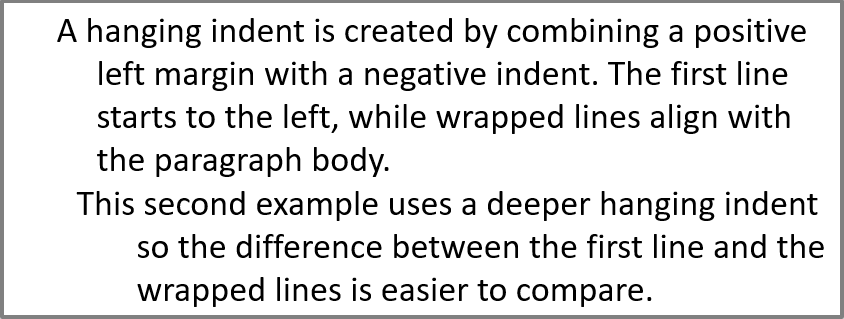

## **ภาพรวม**

Aspose.Slides for .NET แสดงข้อความเป็นลำดับชั้นของเฟรมข้อความ ย่อหน้า และส่วนย่อย:

* [ITextFrame](https://reference.aspose.com/slides/net/aspose.slides/itextframe/) แสดงคอนเทนเนอร์ข้อความในรูปทรงและให้เข้าถึงคอลเลกชันของย่อหน้า
* [IParagraph](https://reference.aspose.com/slides/net/aspose.slides/iparagraph/) แสดงย่อหน้าเดียวในเฟรมข้อความและให้เข้าถึงส่วนย่อยและการจัดรูปแบบระดับย่อหน้า
* [IPortion](https://reference.aspose.com/slides/net/aspose.slides/iportion/) แสดงชุดข้อความภายในย่อหน้า แต่ละส่วนย่อยสามารถมีข้อความและการจัดรูปแบบระดับอักขระของตนเองได้

ดังนั้น ย่อหน้าจึงสามารถมีข้อความที่ใช้แบบอักษร สี ขนาด และการจัดรูปแบบอื่น ๆ ที่ต่างกันโดยใช้หลายส่วนย่อย

## **สร้างและจัดรูปแบบย่อหน้า**

สร้างย่อหน้าในเฟรมข้อความของรูปทรงและใช้ส่วนย่อยเพื่อจัดรูปแบบชุดข้อความแต่ละชุด ส่วนนี้แสดงวิธีการรวมหลายส่วนย่อยภายในแต่ละย่อหน้าและใช้สี ขนาดแบบอักษร และสไตล์ที่แตกต่างกัน

### **สร้างย่อหน้าด้วยหลายส่วนย่อย**

ตัวอย่าง C# ด้านล่างสร้างย่อหน้า 3 รายการ แต่ละรายการมีส่วนย่อย 3 ชุดในคอลเลกชัน [IParagraph.Portions](https://reference.aspose.com/slides/net/aspose.slides/iparagraph/portions/) โดยใช้ย่อหน้าเริ่มต้นและส่วนย่อยว่างเปล่าเป็นค่าเริ่มต้น แล้วเพิ่มย่อหน้าและส่วนย่อยที่เหลือ การจัดรูปแบบทำผ่าน [IPortion.PortionFormat](https://reference.aspose.com/slides/net/aspose.slides/iportion/portionformat/) : ส่วนย่อยแรกของแต่ละย่อหน้ามีสีแดง ตัวหนา และขนาด 15 จุด; ส่วนย่อยที่สองมีสีฟ้า ตัวเอียง และขนาด 18 จุด ส่วนย่อยที่สามคงการจัดรูปแบบค่าเริ่มต้นไว้:

```csharp
using System.Drawing;
using Aspose.Slides;
using Aspose.Slides.Export;

using var presentation = new Presentation();
var slide = presentation.Slides[0];

var shape = slide.Shapes.AddAutoShape(ShapeType.Rectangle, 50, 150, 300, 150);
var textFrame = shape.TextFrame;

var firstParagraph = textFrame.Paragraphs[0];
firstParagraph.Portions.Add(new Portion());
firstParagraph.Portions.Add(new Portion());

var secondParagraph = new Paragraph();
secondParagraph.Portions.Add(new Portion());
secondParagraph.Portions.Add(new Portion());
secondParagraph.Portions.Add(new Portion());
textFrame.Paragraphs.Add(secondParagraph);

var thirdParagraph = new Paragraph();
thirdParagraph.Portions.Add(new Portion());
thirdParagraph.Portions.Add(new Portion());
thirdParagraph.Portions.Add(new Portion());
textFrame.Paragraphs.Add(thirdParagraph);

var paragraphCount = textFrame.Paragraphs.Count;
for (var paragraphIndex = 0; paragraphIndex < paragraphCount; paragraphIndex++)
{
    var paragragaph = textFrame.Paragraphs[paragraphIndex];
    var portionCount = paragragaph.Portions.Count;
    for (var portionIndex = 0; portionIndex < portionCount; portionIndex++)
    {
        var portion = paragragaph.Portions[portionIndex];
        portion.Text = $"Portion {paragraphIndex + 1}.{portionIndex + 1}";

        if (portionIndex == 0)
        {
            portion.PortionFormat.FillFormat.FillType = FillType.Solid;
            portion.PortionFormat.FillFormat.SolidFillColor.Color = Color.Red;
            portion.PortionFormat.FontBold = NullableBool.True;
            portion.PortionFormat.FontHeight = 15;
        }
        else if (portionIndex == 1)
        {
            portion.PortionFormat.FillFormat.FillType = FillType.Solid;
            portion.PortionFormat.FillFormat.SolidFillColor.Color = Color.Blue;
            portion.PortionFormat.FontItalic = NullableBool.True;
            portion.PortionFormat.FontHeight = 18;
        }
    }
}

presentation.Save("paragraphs_with_portions.pptx", SaveFormat.Pptx);
```

## **สร้างรายการแบบหัวข้อและลำดับเลข**

จัดระเบียบข้อความย่อหน้าเป็นรายการที่มีสัญลักษณ์ ตัวเลข หรือภาพกำหนดเอง ตัวอย่างในส่วนนี้ครอบคลุมการจัดรูปแบบหัวข้อ รายการหลายระดับ และการกำหนดเลขเริ่มต้นแบบกำหนดเอง

### **สร้างรายการหัวข้อหรือรายการลำดับเลข**

หัวข้อและการนับเลขทำให้รายการที่เกี่ยวข้องอ่านง่ายขึ้น ใน Aspose.Slides การตั้งค่ารายการกำหนดโดยผ่าน [IBulletFormat](https://reference.aspose.com/slides/net/aspose.slides/ibulletformat/)

ตัวอย่าง C# นี้เพิ่มหัวข้อสัญลักษณ์และรายการลำดับเลขในเฟรมข้อความเดียวกัน [IBulletFormat.Type](https://reference.aspose.com/slides/net/aspose.slides/ibulletformat/type/) เลือกประเภทหัวข้อ ส่วน [IBulletFormat.Char](https://reference.aspose.com/slides/net/aspose.slides/ibulletformat/char/) ระบุสัญลักษณ์ และ [IBulletFormat.NumberedBulletStyle](https://reference.aspose.com/slides/net/aspose.slides/ibulletformat/numberedbulletstyle/) เลือกสไตล์การนับเลข รายการทั้งสองใช้หัวข้อสีดำ ความสูง 100 เปอร์เซ็นต์ และการเยื้องย่อหน้า 25 จุด:

```csharp
using System;
using System.Drawing;
using Aspose.Slides;
using Aspose.Slides.Export;

using var presentation = new Presentation();
var slide = presentation.Slides[0];

var shape = slide.Shapes.AddAutoShape(ShapeType.Rectangle, 200, 200, 400, 200);
var textFrame = shape.TextFrame;
textFrame.Paragraphs.Clear();

var symbolParagraph = new Paragraph { Text = "Welcome to Aspose.Slides" };
symbolParagraph.ParagraphFormat.Bullet.Type = BulletType.Symbol;
symbolParagraph.ParagraphFormat.Bullet.Char = Convert.ToChar(0x2022);
symbolParagraph.ParagraphFormat.Indent = 25;
symbolParagraph.ParagraphFormat.Bullet.Color.ColorType = ColorType.RGB;
symbolParagraph.ParagraphFormat.Bullet.Color.Color = Color.Black;
symbolParagraph.ParagraphFormat.Bullet.IsBulletHardColor = NullableBool.True;
symbolParagraph.ParagraphFormat.Bullet.Height = 100;
textFrame.Paragraphs.Add(symbolParagraph);

var numberedParagraph = new Paragraph { Text = "This is a numbered item" };
numberedParagraph.ParagraphFormat.Bullet.Type = BulletType.Numbered;
numberedParagraph.ParagraphFormat.Bullet.NumberedBulletStyle = NumberedBulletStyle.BulletCircleNumWDBlackPlain;
numberedParagraph.ParagraphFormat.Indent = 25;
numberedParagraph.ParagraphFormat.Bullet.Color.ColorType = ColorType.RGB;
numberedParagraph.ParagraphFormat.Bullet.Color.Color = Color.Black;
numberedParagraph.ParagraphFormat.Bullet.IsBulletHardColor = NullableBool.True;
numberedParagraph.ParagraphFormat.Bullet.Height = 100;
textFrame.Paragraphs.Add(numberedParagraph);

presentation.Save("bulleted_and_numbered_list.pptx", SaveFormat.Pptx);
```

### **ใช้หัวข้อรูปภาพ**

หัวข้อรูปภาพทำให้คุณใช้ภาพกำหนดเองแทนสัญลักษณ์หรือเลข

ตัวอย่าง C# นี้เพิ่มภาพเข้าไปในคอลเลกชันภาพของงานนำเสนอเป็น [IPPImage](https://reference.aspose.com/slides/net/aspose.slides/ippimage/) และใช้เป็นหัวข้อย่อหน้า ตั้งค่า [IBulletFormat.Type](https://reference.aspose.com/slides/net/aspose.slides/ibulletformat/type/) ให้ใช้หัวข้อรูปภาพและกำหนดภาพผ่าน [IBulletFormat.Picture](https://reference.aspose.com/slides/net/aspose.slides/ibulletformat/picture/) ส่วน [IBulletFormat.Height](https://reference.aspose.com/slides/net/aspose.slides/ibulletformat/height/) ตั้งเป็น 100 เปอร์เซ็นต์เพื่อกำหนดขนาดหัวข้อสัมพันธ์กับข้อความย่อหน้า:

```csharp
using Aspose.Slides;
using Aspose.Slides.Export;

using var presentation = new Presentation();
var slide = presentation.Slides[0];

using var bulletImage = Images.FromFile("bullets.png");
var presentationImage = presentation.Images.AddImage(bulletImage);

var shape = slide.Shapes.AddAutoShape(ShapeType.Rectangle, 200, 200, 400, 200);
var textFrame = shape.TextFrame;
textFrame.Paragraphs.Clear();

var paragraph = new Paragraph { Text = "Welcome to Aspose.Slides" };
paragraph.ParagraphFormat.Bullet.Type = BulletType.Picture;
paragraph.ParagraphFormat.Bullet.Picture.Image = presentationImage;
paragraph.ParagraphFormat.Bullet.Height = 100;
textFrame.Paragraphs.Add(paragraph);

presentation.Save("picture_bullet.pptx", SaveFormat.Pptx);
presentation.Save("picture_bullet.ppt", SaveFormat.Ppt);
```

### **สร้างรายการหลายระดับ**

ตั้งค่า [IParagraphFormat.Depth](https://reference.aspose.com/slides/net/aspose.slides/iparagraphformat/depth/) เพื่อวางย่อหน้าในระดับต่าง ๆ ของรายการ ระดับบนสุดมีค่าลึก `0`

ตัวอย่าง C# นี้กำหนดค่าความลึก [IParagraphFormat.Depth](https://reference.aspose.com/slides/net/aspose.slides/iparagraphformat/depth/) ตั้งแต่ 0 ถึง 3 ให้กับย่อสี่รายการ สร้างลำดับชั้นภายในเฟรมข้อความเดียวกัน ย่อหน้าแต่ละรายการใช้หัวข้อสัญลักษณ์ โดยที่ [IBulletFormat.Char](https://reference.aspose.com/slides/net/aspose.slides/ibulletformat/char/) สลับระหว่างหัวข้อวงกลมและขีดเพื่อแยกระดับที่ติดกัน:

```csharp
using System;
using System.Drawing;
using Aspose.Slides;
using Aspose.Slides.Export;

using var presentation = new Presentation();
var slide = presentation.Slides[0];

var shape = slide.Shapes.AddAutoShape(ShapeType.Rectangle, 200, 200, 400, 200);
var textFrame = shape.TextFrame;
textFrame.Paragraphs.Clear();

var firstParagraph = new Paragraph { Text = "Content" };
firstParagraph.ParagraphFormat.Bullet.Type = BulletType.Symbol;
firstParagraph.ParagraphFormat.Bullet.Char = Convert.ToChar(0x2022);
firstParagraph.ParagraphFormat.DefaultPortionFormat.FillFormat.FillType = FillType.Solid;
firstParagraph.ParagraphFormat.DefaultPortionFormat.FillFormat.SolidFillColor.Color = Color.Black;
firstParagraph.ParagraphFormat.Depth = 0;

var secondParagraph = new Paragraph { Text = "Second level" };
secondParagraph.ParagraphFormat.Bullet.Type = BulletType.Symbol;
secondParagraph.ParagraphFormat.Bullet.Char = '-';
secondParagraph.ParagraphFormat.DefaultPortionFormat.FillFormat.FillType = FillType.Solid;
secondParagraph.ParagraphFormat.DefaultPortionFormat.FillFormat.SolidFillColor.Color = Color.Black;
secondParagraph.ParagraphFormat.Depth = 1;

var thirdParagraph = new Paragraph { Text = "Third level" };
thirdParagraph.ParagraphFormat.Bullet.Type = BulletType.Symbol;
thirdParagraph.ParagraphFormat.Bullet.Char = Convert.ToChar(0x2022);
thirdParagraph.ParagraphFormat.DefaultPortionFormat.FillFormat.FillType = FillType.Solid;
thirdParagraph.ParagraphFormat.DefaultPortionFormat.FillFormat.SolidFillColor.Color = Color.Black;
thirdParagraph.ParagraphFormat.Depth = 2;

var fourthParagraph = new Paragraph { Text = "Fourth level" };
fourthParagraph.ParagraphFormat.Bullet.Type = BulletType.Symbol;
fourthParagraph.ParagraphFormat.Bullet.Char = '-';
fourthParagraph.ParagraphFormat.DefaultPortionFormat.FillFormat.FillType = FillType.Solid;
fourthParagraph.ParagraphFormat.DefaultPortionFormat.FillFormat.SolidFillColor.Color = Color.Black;
fourthParagraph.ParagraphFormat.Depth = 3;

textFrame.Paragraphs.Add(firstParagraph);
textFrame.Paragraphs.Add(secondParagraph);
textFrame.Paragraphs.Add(thirdParagraph);
textFrame.Paragraphs.Add(fourthParagraph);

presentation.Save("multilevel_list.pptx", SaveFormat.Pptx);
```

### **กำหนดค่าเริ่มต้นของรายการลำดับเลขด้วยค่ากำหนดเอง**

ใช้ [IBulletFormat.NumberedBulletStartWith](https://reference.aspose.com/slides/net/aspose.slides/ibulletformat/numberedbulletstartwith/) เพื่อกำหนดเลขเริ่มต้นที่แสดงสำหรับย่อหน้าที่มีการนับเลข

ตัวอย่าง C# นี้ตั้งค่า [IBulletFormat.Type](https://reference.aspose.com/slides/net/aspose.slides/ibulletformat/type/) ให้ใช้การนับเลขสำหรับย่อหน้า 3 รายการและกำหนดค่า [IBulletFormat.NumberedBulletStartWith](https://reference.aspose.com/slides/net/aspose.slides/ibulletformat/numberedbulletstartwith/) เป็น 2, 3, และ 7 ค่าจำนวนเริ่มต้นถูกกำหนดแยกต่างหากสำหรับแต่ละย่อหน้า ทำให้เลขที่แสดงข้ามค่าบางค่าได้:

```csharp
using Aspose.Slides;
using Aspose.Slides.Export;

using var presentation = new Presentation();
var slide = presentation.Slides[0];

var shape = slide.Shapes.AddAutoShape(ShapeType.Rectangle, 200, 200, 400, 200);
var textFrame = shape.TextFrame;
textFrame.Paragraphs.Clear();

var firstParagraph = new Paragraph { Text = "Start at 2" };
firstParagraph.ParagraphFormat.Bullet.Type = BulletType.Numbered;
firstParagraph.ParagraphFormat.Bullet.NumberedBulletStartWith = 2;
textFrame.Paragraphs.Add(firstParagraph);

var secondParagraph = new Paragraph { Text = "Start at 3" };
secondParagraph.ParagraphFormat.Bullet.Type = BulletType.Numbered;
secondParagraph.ParagraphFormat.Bullet.NumberedBulletStartWith = 3;
textFrame.Paragraphs.Add(secondParagraph);

var thirdParagraph = new Paragraph { Text = "Start at 7" };
thirdParagraph.ParagraphFormat.Bullet.Type = BulletType.Numbered;
thirdParagraph.ParagraphFormat.Bullet.NumberedBulletStartWith = 7;
textFrame.Paragraphs.Add(thirdParagraph);

presentation.Save("custom_numbered_list.pptx", SaveFormat.Pptx);
```

## **ควบคุมการจัดวางและคุณสมบัติสิ้นสุดของย่อหน้า**

ปรับระยะขอบและการเยื้องของย่อหน้าเพื่อควบคุมตำแหน่งของบรรทัดแรกและบรรทัดที่หักบรรทัด คุณสามารถจัดรูปแบบเครื่องหมายสิ้นสุดของย่อหน้าแยกจากส่วนข้อความที่มองเห็นได้ด้วย

### **ตั้งค่าเยื้องบรรทัดแรก**

ใช้คุณสมบัติ [IParagraphFormat.Indent](https://reference.aspose.com/slides/net/aspose.slides/iparagraphformat/indent/) เพื่อควบคุมการเยื้องบรรทัดแรกของย่อหน้า คุณสมบัตินี้ย้ายเฉพาะบรรทัดแรกสัมพันธ์กับระยะขอบซ้ายของย่อหน้า ค่าเป็นบวกจะเลื่อนบรรทัดแรกไปทางขวา ส่วนบรรทัดที่เหลือจะอยู่ต่อกับเนื้อหาย่อหน้า

ใช้ [IParagraphFormat.MarginLeft](https://reference.aspose.com/slides/net/aspose.slides/iparagraphformat/marginleft/) เมื่อคุณต้องการย้ายย่อหน้าทั้งหมด ใช้ [IParagraphFormat.Indent](https://reference.aspose.com/slides/net/aspose.slides/iparagraphformat/indent/) เมื่อคุณต้องการย้ายเฉพาะบรรทัดแรก

ตัวอย่างต่อไปนี้ให้ย่อหน้า 3 รายการมีค่า [IParagraphFormat.MarginLeft](https://reference.aspose.com/slides/net/aspose.slides/iparagraphformat/marginleft/) เท่ากับ 20 จุดและค่า [IParagraphFormat.Indent](https://reference.aspose.com/slides/net/aspose.slides/iparagraphformat/indent/) เป็น 0, 20, และ 40 จุด บรรทัดแรกจะเริ่มที่ระยะห่างเพิ่มขึ้นอย่างต่อเนื่อง ส่วนบรรทัดที่หักบรรทัดจะคงระยะขอบซ้ายเท่าเดิม:

```csharp
using System.Drawing;
using Aspose.Slides;
using Aspose.Slides.Export;

using var presentation = new Presentation();
var slide = presentation.Slides[0];

var shape = slide.Shapes.AddAutoShape(ShapeType.Rectangle, 50, 50, 420, 220);
shape.FillFormat.FillType = FillType.NoFill;
shape.LineFormat.FillFormat.FillType = FillType.Solid;
shape.LineFormat.FillFormat.SolidFillColor.Color = Color.Gray;

var textFrame = shape.TextFrame;
textFrame.TextFrameFormat.AutofitType = TextAutofitType.Shape;
textFrame.Paragraphs.Clear();

var firstParagraph = new Paragraph { Text = "No first-line indent. Wrapped lines start at the same position as the first line." };
firstParagraph.ParagraphFormat.DefaultPortionFormat.FillFormat.FillType = FillType.Solid;
firstParagraph.ParagraphFormat.DefaultPortionFormat.FillFormat.SolidFillColor.Color = Color.Black;
firstParagraph.ParagraphFormat.MarginLeft = 20;
firstParagraph.ParagraphFormat.Indent = 0;

var secondParagraph = new Paragraph { Text = "First-line indent of 20 points. The first line moves to the right, while wrapped lines remain aligned to the paragraph body." };
secondParagraph.ParagraphFormat.DefaultPortionFormat.FillFormat.FillType = FillType.Solid;
secondParagraph.ParagraphFormat.DefaultPortionFormat.FillFormat.SolidFillColor.Color = Color.Black;
secondParagraph.ParagraphFormat.MarginLeft = 20;
secondParagraph.ParagraphFormat.Indent = 20;

var thirdParagraph = new Paragraph { Text = "First-line indent of 40 points. This paragraph shows a larger first-line offset to make the effect easier to see." };
thirdParagraph.ParagraphFormat.DefaultPortionFormat.FillFormat.FillType = FillType.Solid;
thirdParagraph.ParagraphFormat.DefaultPortionFormat.FillFormat.SolidFillColor.Color = Color.Black;
thirdParagraph.ParagraphFormat.MarginLeft = 20;
thirdParagraph.ParagraphFormat.Indent = 40;

textFrame.Paragraphs.Add(firstParagraph);
textFrame.Paragraphs.Add(secondParagraph);
textFrame.Paragraphs.Add(thirdParagraph);

presentation.Save("paragraph_indent.pptx", SaveFormat.Pptx);
```

ผลลัพธ์:


### **ตั้งค่าเยื้องลอย**

เยื้องลอยคือการจัดวางย่อหน้าที่บรรทัดแรกเริ่มอยู่ทางซ้ายของบรรทัดที่เหลือ ใน Aspose.Slides คุณสร้างเอฟเฟกต์นี้ด้วยคุณสมบัติ [IParagraphFormat.Indent](https://reference.aspose.com/slides/net/aspose.slides/iparagraphformat/indent/) ตั้งค่า `Indent` ให้เป็นค่าลบเพื่อย้ายบรรทัดแรกไปทางซ้ายสัมพันธ์กับเนื้อหาย่อหน้า

โดยปกติ [IParagraphFormat.MarginLeft](https://reference.aspose.com/slides/net/aspose.slides/iparagraphformat/marginleft/) กำหนดตำแหน่งซ้ายของเนื้อหาย่อหน้า และ [IParagraphFormat.Indent](https://reference.aspose.com/slides/net/aspose.slides/iparagraphformat/indent/) กำหนดตำแหน่งบรรทัดแรกสัมพันธ์กับระยะขอบนั้น เพื่อสร้างเยื้องลอย ให้กำหนดค่า `MarginLeft` เป็นบวกและค่า `Indent` เป็นลบ

การจัดรูปแบบนี้เป็นประโยชน์สำหรับบรรณานุกรม, แหล่งอ้างอิง, รายการอภิธานศัพท์ และย่อหน้าอื่น ๆ ที่บรรทัดที่หักบรรทัดต้องจัดแนวอยู่ใต้เนื้อหาย่อหน้า ไม่ใช่ใต้ตัวอักษรแรกของบรรทัดแรก

ตัวอย่าง C# ด้านล่างจับคู่ค่า [IParagraphFormat.MarginLeft](https://reference.aspose.com/slides/net/aspose.slides/iparagraphformat/marginleft/) ที่ 40 และ 60 จุด กับค่า [IParagraphFormat.Indent](https://reference.aspose.com/slides/net/aspose.slides/iparagraphformat/indent/) ที่ -20 และ -30 จุด ในแต่ละย่อหน้า บรรทัดแรกจะเริ่มอยู่ทางซ้ายของบรรทัดที่หักบรรทัด; ย่อหน้าที่สองมีเยื้องลอยลึกกว่า:

```csharp
using System.Drawing;
using Aspose.Slides;
using Aspose.Slides.Export;

using var presentation = new Presentation();
var slide = presentation.Slides[0];

var shape = slide.Shapes.AddAutoShape(ShapeType.Rectangle, 50, 50, 420, 220);
shape.FillFormat.FillType = FillType.NoFill;
shape.LineFormat.FillFormat.FillType = FillType.Solid;
shape.LineFormat.FillFormat.SolidFillColor.Color = Color.Gray;

var textFrame = shape.TextFrame;
textFrame.TextFrameFormat.AutofitType = TextAutofitType.Shape;
textFrame.Paragraphs.Clear();

var firstParagraph = new Paragraph { Text = "A hanging indent is created by combining a positive left margin with a negative indent. The first line starts to the left, while wrapped lines align with the paragraph body." };
firstParagraph.ParagraphFormat.DefaultPortionFormat.FillFormat.FillType = FillType.Solid;
firstParagraph.ParagraphFormat.DefaultPortionFormat.FillFormat.SolidFillColor.Color = Color.Black;
firstParagraph.ParagraphFormat.MarginLeft = 40;
firstParagraph.ParagraphFormat.Indent = -20;

var secondParagraph = new Paragraph { Text = "This second example uses a deeper hanging indent so the difference between the first line and the wrapped lines is easier to compare." };
secondParagraph.ParagraphFormat.DefaultPortionFormat.FillFormat.FillType = FillType.Solid;
secondParagraph.ParagraphFormat.DefaultPortionFormat.FillFormat.SolidFillColor.Color = Color.Black;
secondParagraph.ParagraphFormat.MarginLeft = 60;
secondParagraph.ParagraphFormat.Indent = -30;

textFrame.Paragraphs.Add(firstParagraph);
textFrame.Paragraphs.Add(secondParagraph);

presentation.Save("hanging_indent.pptx", SaveFormat.Pptx);
```

ผลลัพธ์:



### **ตั้งค่าคุณสมบัติการทำงานของส่วนสิ้นสุดย่อหน้า**

คุณสมบัติ [IParagraph.EndParagraphPortionFormat](https://reference.aspose.com/slides/net/aspose.slides/iparagraph/endparagraphportionformat/) ควบคุมการจัดรูปแบบของเครื่องหมายสิ้นสุดย่อหน้า ตัวอย่างต่อไปนี้สร้าง [PortionFormat](https://reference.aspose.com/slides/net/aspose.slides/portionformat/) ที่ตั้งค่า [IBasePortionFormat.FontHeight](https://reference.aspose.com/slides/net/aspose.slides/ibaseportionformat/fontheight/) เป็น 48 จุดและ [IBasePortionFormat.LatinFont](https://reference.aspose.com/slides/net/aspose.slides/ibaseportionformat/latinfont/) เป็น Times New Roman จากนั้นกำหนดรูปแบบนี้ให้กับเครื่องหมายสิ้นสุดของย่อหน้าที่สองโดยไม่กระทบต่อส่วนข้อความที่มองเห็น:

```csharp
using Aspose.Slides;
using Aspose.Slides.Export;

using var presentation = new Presentation("Test.pptx");
var slide = presentation.Slides[0];

var shape = slide.Shapes.AddAutoShape(ShapeType.Rectangle, 10, 10, 200, 250);
var textFrame = shape.TextFrame;
textFrame.Paragraphs.Clear();

var firstParagraph = new Paragraph();
firstParagraph.Portions.Add(new Portion("Sample text"));

var secondParagraph = new Paragraph();
secondParagraph.Portions.Add(new Portion("Sample text 2"));

var endParagraphFormat = new PortionFormat();
endParagraphFormat.FontHeight = 48;
endParagraphFormat.LatinFont = new FontData("Times New Roman");
secondParagraph.EndParagraphPortionFormat = endParagraphFormat;

textFrame.Paragraphs.Add(firstParagraph);
textFrame.Paragraphs.Add(secondParagraph);

presentation.Save("end_paragraph_format.pptx", SaveFormat.Pptx);
```

## **นับจำนวนบรรทัดที่เรนเดอร์แล้ว**

สำหรับกฎย่อหน้าที่ส่งผลต่อการหักบรรทัดอัตโนมัติและเครื่องหมายวรรคตอนที่ตำแหน่งบรรทัดสุดท้าย ดูที่ [Control Line Breaking](/slides/th/net/text-formatting/#control-line-breaking) และ [Control Hanging Punctuation](/slides/th/net/text-formatting/#control-hanging-punctuation)

ใช้ [IParagraph.GetLinesCount](https://reference.aspose.com/slides/net/aspose.slides/iparagraph/getlinescount/) เพื่อนับจำนวนบรรทัดที่ย่อหน้าใช้หลังการวางเค้าโครงข้อความ รวมถึงการหักบรรทัดอัตโนมัติ ซึ่งมีประโยชน์เมื่อทำการตรวจสอบความยาวและเค้าโครงของข้อความในแม่แบบงานนำเสนอ

ย่อหน้าเป็นหนึ่งรายการใน [ITextFrame.Paragraphs](https://reference.aspose.com/slides/net/aspose.slides/itextframe/paragraphs/) และอาจใช้หลายบรรทัดที่เรนเดอร์ การใส่การหักบรรทัดแบบชัดเจนภายในย่อหน้าจะบังคับให้เริ่มบรรทัดใหม่โดยไม่ต้องสร้างย่อหน้าใหม่ การหักบรรทัดอัตโนมัติสร้างบรรทัดตามความกว้างที่มีอยู่โดยไม่แทรกการหักบรรทัดแบบชัดเจนลงในข้อความ ดังนั้นการนับย่อหน้าหรืออักขระการหักบรรทัดจะไม่ได้ให้จำนวนบรรทัดที่เรนเดอร์จริง

ตัวอย่างต่อไปนี้สร้างรูปทรงข้อความ นับบรรทัดของมัน ทำให้รูปทรงแคบลง แล้วเปลี่ยนข้อความเป็นสตริงสั้นกว่า ตัวอย่างเปิดใช้งาน [ITextFrameFormat.WrapText](https://reference.aspose.com/slides/net/aspose.slides/itextframeformat/wraptext/) และปิด [ITextFrameFormat.AutofitType](https://reference.aspose.com/slides/net/aspose.slides/itextframeformat/autofittype/) เพื่อให้ความกว้างของรูปทรงควบคุมการหักบรรทัดโดยไม่ให้ข้อความลดขนาดหรือรูปทรงปรับขนาดใหม่ การวัดแต่ละครั้งใช้ [IParagraph.GetLinesCount](https://reference.aspose.com/slides/net/aspose.slides/iparagraph/getlinescount/). ขนาดรูปทรงเป็นจุด. สุดท้าย ตัวอย่างเพิ่มย่อหน้าอีกหนึ่งรายการและรวมจำนวนบรรทัดทั้งหมดของเฟรมข้อความ:

```csharp
using System;
using Aspose.Slides;

using var presentation = new Presentation();
var slide = presentation.Slides[0];

var shape = slide.Shapes.AddAutoShape(ShapeType.Rectangle, 50, 50, 400, 200);
var textFrame = shape.TextFrame;
textFrame.TextFrameFormat.WrapText = NullableBool.True;
textFrame.TextFrameFormat.AutofitType = TextAutofitType.None;

var paragraph = textFrame.Paragraphs[0];
paragraph.ParagraphFormat.DefaultPortionFormat.FontHeight = 20;
paragraph.Text = "This text demonstrates how automatic wrapping changes the number of rendered lines.";
Console.WriteLine($"Original width: {paragraph.GetLinesCount()}");

shape.Width = 150;
Console.WriteLine($"Narrower shape: {paragraph.GetLinesCount()}");

paragraph.Text = "Short text.";
Console.WriteLine($"Shorter text: {paragraph.GetLinesCount()}");

var secondParagraph = new Paragraph { Text = "Another paragraph." };
secondParagraph.ParagraphFormat.DefaultPortionFormat.FontHeight = 20;
textFrame.Paragraphs.Add(secondParagraph);

var totalLineCount = 0;
foreach (var currentParagraph in textFrame.Paragraphs)
{
    totalLineCount += currentParagraph.GetLinesCount();
}
Console.WriteLine($"Total lines in the text frame: {totalLineCount}");
```

โดยใช้ข้อความและขนาดเหล่านี้ การทำให้รูปทรงแคบลงจะเพิ่มจำนวนบรรทัด ส่วนการเปลี่ยนเป็นสตริงสั้นจะลดจำนวนบรรทัด จำนวนที่แน่นอนอาจแตกต่างตามความพร้อมของแบบอักษรและการทดแทน, ขนาดแบบอักษร, ระยะขอบ, การเยื้อง, การหักบรรทัดและการตั้งค่า Autofit ใช้แบบอักษรและการตั้งค่าเค้าโครงที่ตั้งใจสำหรับสภาพแวดล้อมเป้าหมายเมื่อทำการตรวจสอบแม่แบบ

จำนวนบรรทัดเพียงอย่างเดียวไม่ได้กำหนดว่าข้อความจะล้นจากคอนเทนเนอร์หรือไม่ ความสูงที่มี, ความสูงของบรรทัด, ระยะห่างระหว่างย่อหน้าและบรรทัด, และพฤติกรรม Autofit ก็สำคัญเช่นกัน; แม้แต่บรรทัดเดียวอาจเกินความกว้างที่มีเมื่อปิดการหักบรรทัด

## **นำเข้าและส่งออกเนื้อหาย่อหน้า**

ใช้ HTML เพื่อนำข้อความเข้าสู่การนำเสนอหรือส่งออกย่อหน้าเพื่อใช้ภายนอก ส่วนนี้ยังแสดงวิธีการเรนเดอร์ย่อหน้าเป็นภาพ รวมถึงย่อหน้าในเซลล์ตารางด้วย

### **นำเข้า HTML ไปยังย่อหน้า**

ใช้ [ParagraphCollection.AddFromHtml](https://reference.aspose.com/slides/net/aspose.slides/paragraphcollection/addfromhtml/) เพื่อแปลงมาร์กอัป HTML เป็นย่อหน้าและส่วนย่อยในเฟรมข้อความ

ตัวอย่าง C# นี้อ่าน HTML จากไฟล์และส่งมาร์กอัปให้กับ [ParagraphCollection.AddFromHtml](https://reference.aspose.com/slides/net/aspose.slides/paragraphcollection/addfromhtml/) แล้วลบย่อหน้าเริ่มต้นของเฟรมข้อความเพื่อให้เฟรมมีเฉพาะเนื้อหาที่นำเข้า รูปทรงสี่เหลี่ยมทิ้งระยะขอบ 10 จุดด้านทุกด้านของสไลด์:

```csharp
using System.IO;
using Aspose.Slides;
using Aspose.Slides.Export;

using var presentation = new Presentation();
var slide = presentation.Slides[0];

var shapeWidth = presentation.SlideSize.Size.Width - 20;
var shapeHeight = presentation.SlideSize.Size.Height - 20;
var shape = slide.Shapes.AddAutoShape(ShapeType.Rectangle, 10, 10, shapeWidth, shapeHeight);
shape.FillFormat.FillType = FillType.NoFill;
shape.TextFrame.Paragraphs.Clear();

using var reader = new StreamReader("file.html");
var html = reader.ReadToEnd();
shape.TextFrame.Paragraphs.AddFromHtml(html);

presentation.Save("html_text.pptx", SaveFormat.Pptx);
```

### **ส่งออกข้อความย่อหน้าเป็น HTML**

ใช้ [ParagraphCollection.ExportToHtml](https://reference.aspose.com/slides/net/aspose.slides/paragraphcollection/exporttohtml/) เพื่อส่งออกช่วงย่อหน้าที่เลือกเป็น HTML เมื่อใช้ข้อความงานนำเสนอซ้ำบนเว็บไซต์ คุณอาจต้องการเก็บการเน้นแบบท้องถิ่นโดยไม่ต้องนำแบบอักษร ขนาด หรือสไตล์กล่องข้อความของงานนำเสนอไปด้วย ตั้งค่า [TextToHtmlConversionOptions.TextInheritanceLimit](https://reference.aspose.com/slides/net/aspose.slides.export/texttohtmlconversionoptions/textinheritancelimit/) เพื่อควบคุมความลึกที่ตัวส่งออกสืบทอดการจัดรูปแบบ

ดาวน์โหลด [ตัวอย่างงานนำเสนอ](text-inheritance.pptx) แล้ววางไว้ในไดเรกทอรีทำงานของแอปพลิเคชัน สไลด์แรกมีรูปทรงข้อความหนึ่งรูปที่มีข้อความ “Inherited text; explicit red 18pt” อินพุตตั้งใจใช้หลายระดับการจัดรูปแบบ:

- สไตล์ข้อความเริ่มต้นของงานนำเสนอใช้ Calibri ขนาด 28 pt
- สไตล์ข้อความระดับแรกของเฟรมข้อความใช้สีฟ้าและตัวเอียง
- ย่อหน้ากำหนดตัวหนาโดยชัดเจน
- ส่วนย่อยที่สอง “explicit red 18pt” กำหนดสีแดงและขนาด 18 pt อย่างชัดเจน

ตัวอย่างเต็มด้านล่างส่งออกย่อหน้าเดียวกันสามครั้ง โดยส่งค่า [TextToHtmlConversionOptions](https://reference.aspose.com/slides/net/aspose.slides.export/texttohtmlconversionoptions/) ไปยังเมธอดส่งออกและบันทึกผลลัพธ์แต่ละไฟล์เป็นไฟล์ HTML UTF‑8 แยกกัน:

```csharp
using System.IO;
using System.Text;
using Aspose.Slides;
using Aspose.Slides.Export;

using var presentation = new Presentation("text-inheritance.pptx");
var textShape = (IAutoShape)presentation.Slides[0].Shapes[0];

var paragraphs = textShape.TextFrame.Paragraphs;
var modes = new[] { TextInheritanceLimit.All, TextInheritanceLimit.TextBox, TextInheritanceLimit.ParagraphOnly };

foreach (var mode in modes)
{
    var options = new TextToHtmlConversionOptions { TextInheritanceLimit = mode };

    var html = paragraphs.ExportToHtml(0, paragraphs.Count, options);
    File.WriteAllText($"{mode}.html", html, Encoding.UTF8);
}
```

HTML ที่สร้างขึ้นมี CSS ต่อไปนี้สำหรับส่วนย่อยแรก “Inherited text; ” ตารางแสดงการประกาศที่เกี่ยวข้อง; คุณสมบัติที่สร้างเพิ่มเติมจะถูกละไว้เพื่อความกระชับ

| ผลการส่งออก | CSS ที่เกี่ยวข้องสำหรับส่วนย่อยแรก | ลักษณะที่ปรากฏ |
| --- | --- | --- |
| `All.html` | `font-family:'Calibri'; font-size:28pt; color:#0000ff; font-style:italic; font-weight:bold` | ข้อความสีฟ้า ตัวหนา ตัวเอียง ขนาด 28 pt ใน Calibri (หากมีแบบอักษรนั้น) |
| `TextBox.html` | `color:#0000ff; font-style:italic; font-weight:bold` | ข้อความสีฟ้า ตัวหนา ตัวเอียง; หน้าเว็บหรือเบราว์เซอร์จะกำหนดแบบอักษรและขนาด |
| `ParagraphOnly.html` | `font-weight:bold` | ข้อความตัวหนา; หน้าเว็บหรือเบราว์เซอร์จะกำหนดแบบอักษร ขนาด สี และสไตล์เอียง |

ส่วนย่อยที่สองคง `color:#ff0000`, `font-size:18pt`, และ `font-weight:bold` ในผลลัพธ์ทั้งสาม อีกทั้งยังคงตัวเอียงในผล `All` และ `TextBox` แต่ไม่อยู่ใน `ParagraphOnly` การจำกัดการสืบทอดจึงไม่ลบการจัดรูปแบบที่กำหนดโดยตรงให้กับย่อหน้าหรือส่วนย่อย

เปิดไฟล์ในเบราว์เซอร์เดียวกันเพื่อเปรียบเทียบ ในสองโหมดที่จำกัด CSS ที่ละไว้จะถูกตีความโดยสไตล์ของหน้าเป้าหมายหรือค่าเริ่มต้นของเบราว์เซอร์ ทำให้ลักษณะที่ปรากฏขึ้นอยู่กับที่ใช้ HTML

### **เรนเดอร์ย่อหน้าเป็นภาพ**

[IParagraph.GetImage](https://reference.aspose.com/slides/net/aspose.slides/iparagraph/getimage/) เรนเดอร์ย่อหน้าเดียวโดยตรงและคืนค่า [IImage](https://reference.aspose.com/slides/net/aspose.slides/iimage/). สามารถบันทึกผลลัพธ์ลงไฟล์หรือสตรีมด้วย [IImage.Save](https://reference.aspose.com/slides/net/aspose.slides/iimage/save/). ไม่จำเป็นต้องเรนเดอร์รูปทรงที่บรรจุหรือครอบตัดบิตแมพด้วยตนเอง

[IParagraph.GetImage](https://reference.aspose.com/slides/net/aspose.slides/iparagraph/getimage/) อาจคืนค่า `null` หากไม่พบย่อหน้าในคอลเลกชันแม่, ไม่มีขอบเขตการเรนเดอร์ที่ถูกต้อง, หรือไม่สามารถเรนเดอร์ได้ ตรวจสอบผลลัพธ์ก่อนบันทึกและทำลายภาพที่คืนค่าหลังใช้งาน

#### **เรนเดอร์ย่อหน้าที่อัตราส่วนเริ่มต้น**

ตัวอย่างใช้งานนำเสนอหนึ่งสไลด์ที่มีรูปทรงข้อความหนึ่งรูปซึ่งมีย่อหน้า 3 รายการ


ตัวอย่างต่อไปนี้เลือกย่อหน้าที่สองที่ตำแหน่ง 1 และเรียก [IParagraph.GetImage](https://reference.aspose.com/slides/net/aspose.slides/iparagraph/getimage/) โดยไม่ระบุพารามิเตอร์สเกล ตรวจสอบว่ารูปทรงมีย่อหน้าที่ต้องการและการเรนเดอร์คืนภาพก่อนเรียก [IImage.Save](https://reference.aspose.com/slides/net/aspose.slides/iimage/save/) เพื่อบันทึกเป็น PNG คำสั่ง `using` จะทำลายภาพหลังการใช้เสร็จ

```csharp
using System;
using Aspose.Slides;

using var presentation = new Presentation("sample.pptx");
var shape = presentation.Slides[0].Shapes[0];

if (shape is IAutoShape textShape && 
    textShape.TextFrame != null && 
    textShape.TextFrame.Paragraphs.Count > 1)
{
    var paragraph = textShape.TextFrame.Paragraphs[1];
    using var paragraphImage = paragraph.GetImage();

    if (paragraphImage != null)
    {
        paragraphImage.Save("paragraph.png", ImageFormat.Png);
    }
    else
    {
        Console.WriteLine("The paragraph could not be rendered.");
    }
}
else
{
    Console.WriteLine("The expected text shape or paragraph was not found.");
}
```

ผลลัพธ์:


#### **เรนเดอร์ย่อหน้าในเซลล์ตารางพร้อมสเกล**

ใช้การโอเวอร์โหลดของ [IParagraph.GetImage](https://reference.aspose.com/slides/net/aspose.slides/iparagraph/getimage/) ที่รับพารามิเตอร์ `float scaleX` และ `float scaleY` เพื่อกำหนดปัจจัยสเกลแนวนอนและแนวตั้ง ตัวอย่างต่อไปนี้สร้างตาราง เรนเดอร์ย่อหน้าในเซลล์แรกที่สองเท่าของความกว้างและความสูงเริ่มต้น และบันทึกผลเป็นภาพ PNG

```csharp
using System;
using Aspose.Slides;

var scaleX = 2f;
var scaleY = 2f;

using var presentation = new Presentation();
var slide = presentation.Slides[0];

var table = slide.Shapes.AddTable(50, 50, new[] { 300d }, new[] { 80d });
var paragraph = table[0, 0].TextFrame.Paragraphs[0];
paragraph.Text = "Text in a table cell";

using var paragraphImage = paragraph.GetImage(scaleX, scaleY);
if (paragraphImage != null)
{
    paragraphImage.Save("table_paragraph.png", ImageFormat.Png);
}
else
{
    Console.WriteLine("The paragraph could not be rendered.");
}
```

ค่สเกล `1` ทำให้แกนนั้นคงขนาดพิกเซลเริ่มต้น ตัวอย่างเช่น `2` สำหรับทั้งสองค่าจะทำให้ความกว้างและความสูงของภาพประมาณสองเท่าของขนาดเดิม ส่งผลให้มีพิกเซลสี่เท่า ปัจจัยที่ใหญ่กว่ามักให้ข้อความคมชัดขึ้นสำหรับการซูมหรือเอาต์พุตความละเอียดสูง แต่จะเพิ่มการใช้หน่วยความจำและขนาดไฟล์ ปัจจัยที่ต่ำกว่า `1` จะให้ภาพเล็กลงและรายละเอียดน้อยลง ใช้ค่าปัจจัยเท่ากันเพื่อรักษาอัตราส่วนของย่อหน้า; ปัจจัยแนวนอนและแนวตั้งแตกต่างกันจะทำให้ภาพยืดตามแกนที่กำหนด

การเรนเดอร์รูปทรงทั้งหมดด้วย [IShape.GetImage](https://reference.aspose.com/slides/net/aspose.slides/ishape/getimage/) ยังคงมีประโยชน์เมื่อผลลัพธ์ต้องรวมการเติมสี ขอบ หรือบริบทภาพอื่น ๆ สำหรับภาพเฉพาะย่อหน้า ให้ใช้ [IParagraph.GetImage](https://reference.aspose.com/slides/net/aspose.slides/iparagraph/getimage/)

## **คำถามที่พบบ่อย**

**ฉันสามารถปิดการหักบรรทัดอัตโนมัติในเฟรมข้อความทั้งหมดได้หรือไม่?**

ได้. ตั้งค่า [ITextFrameFormat.WrapText](https://reference.aspose.com/slides/net/aspose.slides/itextframeformat/wraptext/) ให้ปิดการหักบรรทัดเพื่อให้บรรทัดไม่แตกที่ขอบของเฟรมข้อความ

**ฉันจะดึงขอบเขตบนสไลด์ของย่อหน้าที่ระบุได้อย่างแม่นยำอย่างไร?**

ใช้ [IParagraph.GetRect](https://reference.aspose.com/slides/net/aspose.slides/iparagraph/getrect/) เพื่อรับสี่เหลี่ยมขอบของย่อหน้า [IPortion.GetRect](https://reference.aspose.com/slides/net/aspose.slides/iportion/getrect/) ให้ขอบเขตของส่วนย่อยแต่ละส่วน

**การจัดแนวย่อหน้า (ซ้าย, ขวา, ศูนย์, หรือกระจาย) ถูกควบคุมที่ไหน?**

[IParagraphFormat.Alignment](https://reference.aspose.com/slides/net/aspose.slides/iparagraphformat/alignment/) เป็นการตั้งค่าระดับย่อหน้าและใช้กับทั้งย่อหน้าโดยไม่คำนึงถึงการจัดรูปแบบส่วนย่อยแต่ละส่วน

เพื่อจัดแนวแนวตั้งของส่วนย่อยที่มีขนาดแบบอักษรต่างกันในแต่ละบรรทัด ให้ดูที่ [Align Fonts Within a Line](/slides/th/net/text-formatting/#align-fonts-within-a-line)

**ฉันสามารถตั้งค่าภาษา proofing สำหรับส่วนหนึ่งของย่อหน้าได้หรือไม่?**

ได้. ตั้งค่า [IBasePortionFormat.LanguageId](https://reference.aspose.com/slides/net/aspose.slides/ibaseportionformat/languageid/) สำหรับส่วนย่อยแต่ละส่วน เพื่อให้ย่อหน้าเดียวสามารถมีข้อความหลายภาษาได้.