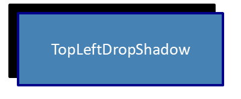

## **บทนำ**

แม้ว่าเอฟเฟกต์ใน PowerPoint จะสามารถใช้ทำให้รูปร่างโดดเด่นได้ แต่พวกมันจะแตกต่างจาก [การเติม](/slides/th/net/shape-formatting/#gradient-fill) หรือโครงร่าง การใช้เอฟเฟกต์ของ PowerPoint คุณสามารถสร้างเงาสะท้อนที่น่าเชื่อถือบนรูปร่าง กระจายแสงเรืองรอบของรูปร่าง ฯลฯ


PowerPoint มีเอฟเฟกต์ทั้งหมดหกแบบที่สามารถใช้กับรูปร่างได้ คุณสามารถใช้หนึ่งหรือหลายเอฟเฟกต์กับรูปร่างหนึ่งรูปได้

บางการผสมของเอฟเฟกต์ดูดีกว่าการผสมอื่น ๆ ด้วยเหตุนี้ PowerPoint มีตัวเลือกภายใต้ **Preset** ตัวเลือก Preset นั้นโดยพื้นฐานคือการผสมที่ดูดีและเป็นที่รู้จักของสองหรือมากกว่าเอฟเฟกต์ ด้วยวิธีนี้ การเลือก Preset จะทำให้คุณไม่ต้องเสียเวลาทดสอบหรือผสมเอฟเฟกต์ต่าง ๆ เพื่อหาแบบผสมที่ดี

Aspose.Slides ให้คุณสมบัติและเมธอดภายใต้คลาส [EffectFormat](https://reference.aspose.com/slides/net/aspose.slides/effectformat/) ที่ช่วยให้คุณใช้เอฟเฟกต์เดียวกันกับรูปร่างในงานนำเสนอ PowerPoint

## **ใช้เอฟเฟกต์เงา**

Aspose.Slides for .NET รองรับเงานอกและเงาภายในสำหรับรูปทร่าง คุณสามารถกำหนดสี ทิศทาง ระยะทาง และรัศมีเบลอร์เพื่อให้สอดคล้องกับการออกแบบงานนำเสนอของคุณ

### **ใช้เงานอก**

ใช้เงานอกเพื่อทำให้การ์ดหรือแผงเด่นขึ้นเมื่อเทียบกับพื้นหลังสไลด์ เงาจะขยายออกไปไกลกว่าสมบัติของรูปร่าง สร้างความรู้สึกว่ารูปร่างลอยอยู่เหนือสไลด์ ปรับสี ทิศทาง ระยะทาง และรัศมีเบลอร์ให้ตรงกับแสงและสไตล์ของเทมเพลต

โค้ด C# นี้แสดงวิธีใช้ [เอฟเฟกต์เงานอก](https://reference.aspose.com/slides/net/aspose.slides/effectformat/outershadoweffect/) กับสี่เหลี่ยมผืนผ้า:

```c#
using System.Drawing;
using Aspose.Slides;
using Aspose.Slides.Export;

using var presentation = new Presentation();
var slide = presentation.Slides[0];

var shape = slide.Shapes.AddAutoShape(ShapeType.RoundCornerRectangle, 20, 20, 200, 100);
shape.EffectFormat.EnableOuterShadowEffect();
shape.EffectFormat.OuterShadowEffect.ShadowColor.Color = Color.DarkGray;
shape.EffectFormat.OuterShadowEffect.Distance = 10;
shape.EffectFormat.OuterShadowEffect.Direction = 45;

presentation.Save("shadow_effect.pptx", SaveFormat.Pptx);
```


### **ใช้เงาภายใน**

เมื่อทำสำเนาโครงร่างของเทมเพลต ใช้เงาภายในเพื่อให้การ์ดหรือแผงดูเป็นร่องลึก เงานอกขยายออกนอกรูปร่างทำให้ดูลอยขึ้น ส่วนเงาภายในทำให้ขอบภายในเงา

เรียก [EnableInnerShadowEffect](https://reference.aspose.com/slides/net/aspose.slides/effectformat/enableinnershadoweffect/) แล้วกำหนดค่า [InnerShadowEffect](https://reference.aspose.com/slides/net/aspose.slides/effectformat/innershadoweffect/) ค่ามากกว่าจะทำให้ขอบนุ่มขึ้น

โค้ด C# ตัวอย่างนี้สร้างการ์ดสีฟ้าอ่อนที่มีเงาภายในสีเทาเข้มและบันทึกเป็นไฟล์ PPTX:

```csharp
using System.Drawing;
using Aspose.Slides;
using Aspose.Slides.Export;

using var presentation = new Presentation();
var slide = presentation.Slides[0];

var shape = slide.Shapes.AddAutoShape(ShapeType.Rectangle, 20, 20, 200, 100);
shape.FillFormat.FillType = FillType.Solid;
shape.FillFormat.SolidFillColor.Color = Color.LightBlue;
shape.LineFormat.FillFormat.FillType = FillType.NoFill;

shape.EffectFormat.EnableInnerShadowEffect();
var shadow = shape.EffectFormat.InnerShadowEffect;
shadow.ShadowColor.Color = Color.DimGray;
shadow.Direction = 225;
shadow.Distance = 7;
shadow.BlurRadius = 6;

presentation.Save("inner_shadow_effect.pptx", SaveFormat.Pptx);
```


หากต้องการลบเงาภายใน ให้เรียก [DisableInnerShadowEffect](https://reference.aspose.com/slides/net/aspose.slides/effectformat/disableinnershadoweffect/) บนรูปแบบเอฟเฟกต์ของรูปร่าง

### **ใช้ เปลี่ยน และลบเงา Preset**

เรียก [EnablePresetShadowEffect](https://reference.aspose.com/slides/net/aspose.slides/ieffectformat/enablepresetshadoweffect/) แล้วตั้งค่า [Preset](https://reference.aspose.com/slides/net/aspose.slides.effects/ipresetshadow/preset/) ให้เป็น [PresetShadowType](https://reference.aspose.com/slides/net/aspose.slides/presetshadowtype/) ที่กำหนดไว้ เพื่อสลับสไตล์ ให้เปลี่ยน Preset บนรูปร่างเดียวกัน เรียก [DisablePresetShadowEffect](https://reference.aspose.com/slides/net/aspose.slides/ieffectformat/disablepresetshadoweffect/) เพื่อลบเงาโดยคงการเติมและโครงร่างไว้

ตัวอย่างนี้เก็บสำเนาของสี่เหลี่ยมในแต่ละขั้นตอน ทั้งสองเงาออฟเซ็ต 10 จุด ทิศทาง 225° จะวางเงาแรกเหนือและทางด้านซ้ายของสี่เหลี่ยม และ 45° จะวางเงาที่สองด้านล่างและทางขวา

```csharp
using System.Drawing;
using Aspose.Slides;
using Aspose.Slides.Export;

using var presentation = new Presentation();
presentation.SlideSize.SetSize(800, 120, SlideSizeScaleType.DoNotScale);
var shapes = presentation.Slides[0].Shapes;

var shape = shapes.AddAutoShape(ShapeType.Rectangle, 15, 30, 170, 60);
shape.FillFormat.FillType = FillType.Solid;
shape.FillFormat.SolidFillColor.Color = Color.SteelBlue;
shape.LineFormat.FillFormat.FillType = FillType.Solid;
shape.LineFormat.FillFormat.SolidFillColor.Color = Color.DarkBlue;
shape.TextFrame.Text = "No shadow";
shape.TextFrame.Paragraphs[0].ParagraphFormat.DefaultPortionFormat.FontHeight = 14;
shapes.AddClone(shape);

shape.X += 200;
shape.EffectFormat.EnablePresetShadowEffect();
var shadow = shape.EffectFormat.PresetShadowEffect;
shadow.Preset = PresetShadowType.TopLeftDropShadow;
shadow.Distance = 10;
shadow.Direction = 225;
shape.TextFrame.Text = shadow.Preset.ToString();
shapes.AddClone(shape);

shape.X += 200;
shadow.Preset = PresetShadowType.BottomRightDropShadow;
shadow.Direction = 45;
shape.TextFrame.Text = shadow.Preset.ToString();
shapes.AddClone(shape);

shape.X += 200;
shape.EffectFormat.DisablePresetShadowEffect();
shape.TextFrame.Text = "No shadow";

presentation.Save("preset_shadows.pptx", SaveFormat.Pptx);
```

| ดั้งเดิม | Preset แรก | Preset ที่สอง | หลังการลบ |
| :---: | :---: | :---: | :---: |
|  |  |  |  |

## **ใช้เอฟเฟกต์การสะท้อน**

เพื่อใช้เอฟเฟกต์การสะท้อนใน Aspose.Slides for .NET คุณสามารถเพิ่มการสะท้อนแบบกระจกเงาให้กับรูปร่างโดยปรับพารามิเตอร์เช่น ระยะ, ความโปร่งแสง, และขนาด เอฟเฟกต์นี้ทำให้การนำเสนอของคุณดูเป็นมืออาชีพและหรูหรามากขึ้น ใช้ง่ายด้วยโค้ดง่าย ๆ ที่ทำให้คุณสามารถประยุกต์ใช้บนหลายองค์ประกอบได้อย่างสม่ำเสมอ

โค้ด C# นี้แสดงวิธีใช้ [เอฟเฟกต์การสะท้อน](https://reference.aspose.com/slides/net/aspose.slides/effectformat/reflectioneffect/) กับรูปร่าง:

```c#
using Aspose.Slides;
using Aspose.Slides.Export;

using var presentation = new Presentation();
var slide = presentation.Slides[0];

var shape = slide.Shapes.AddAutoShape(ShapeType.RoundCornerRectangle, 20, 20, 200, 100);
shape.EffectFormat.EnableReflectionEffect();
shape.EffectFormat.ReflectionEffect.RectangleAlign = RectangleAlignment.Bottom;
shape.EffectFormat.ReflectionEffect.Direction = 90;
shape.EffectFormat.ReflectionEffect.Distance = 40;
shape.EffectFormat.ReflectionEffect.BlurRadius = 2;

presentation.Save("reflection_effect.pptx", SaveFormat.Pptx);
```


## **ใช้เอฟเฟกต์เรืองแสง**

เพื่อใช้เอฟเฟกต์เรืองแสงกับรูปร่างใน Aspose.Slides for .NET คุณสามารถเพิ่มออร่านุ่ม ๆ รอบรูปร่างโดยปรับคุณสมบัติเช่น สีและขนาด เอฟเฟกต์นี้ช่วยให้รูปร่างเด่นขึ้นและเพิ่มความน่าสนใจให้การนำเสนอของคุณ ใช้ง่ายด้วยโค้ดเพียงเล็กน้อยที่ทำให้สไลด์ของคุณดูดีขึ้นอย่างมาก

โค้ด C# นี้แสดงวิธีใช้ [เอฟเฟกต์เรืองแสง](https://reference.aspose.com/slides/net/aspose.slides/effectformat/gloweffect/) กับรูปร่าง:

```c#
using System.Drawing;
using Aspose.Slides;
using Aspose.Slides.Export;

using var presentation = new Presentation();
var slide = presentation.Slides[0];

var shape = slide.Shapes.AddAutoShape(ShapeType.RoundCornerRectangle, 20, 20, 200, 100);
shape.EffectFormat.EnableGlowEffect();
shape.EffectFormat.GlowEffect.Color.Color = Color.Magenta;
shape.EffectFormat.GlowEffect.Radius = 15;

presentation.Save("glow_effect.pptx", SaveFormat.Pptx);
```


## **ใช้เอฟเฟกต์ขอบนุ่ม**

เพื่อใช้เอฟเฟกต์ขอบนุ่มใน Aspose.Slides for .NET คุณสามารถสร้างการเปลี่ยนแปลงที่นุ่มนวลและเบลอร์รอบขอบของรูปร่าง เอฟเฟกต์นี้ให้ลุคที่ละเอียดอ่อนและกลมกลืน เหมาะสำหรับการออกแบบที่ต้องการลุคอ่อนโยน คุณสามารถปรับพารามิเตอร์เช่น รัศมีได้อย่างง่ายดายเพื่อให้ได้ผลลัพธ์ที่ต้องการในรูปร่างต่าง ๆ ของงานนำเสนอของคุณ

โค้ด C# นี้แสดงวิธีใช้ [ขอบนุ่ม](https://reference.aspose.com/slides/net/aspose.slides/effectformat/softedgeeffect/) กับรูปร่าง:

```c#
using Aspose.Slides;
using Aspose.Slides.Export;

using var presentation = new Presentation();
var slide = presentation.Slides[0];

var shape = slide.Shapes.AddAutoShape(ShapeType.RoundCornerRectangle, 20, 20, 200, 150);
shape.EffectFormat.EnableSoftEdgeEffect();
shape.EffectFormat.SoftEdgeEffect.Radius = 8;

presentation.Save("soft_edges_effect.pptx", SaveFormat.Pptx);
```


## **ใช้เอฟเฟกต์เบลอ**

ใช้เบลอบนรูปร่างเพื่อทำให้การเติมและโครงร่างของรูปร่างนุ่มขึ้นในขณะที่ยังคงให้รูปทรงสามารถแก้ไขได้ เรียก [SetBlurEffect](https://reference.aspose.com/slides/net/aspose.slides/ieffectformat/setblureffect/) บนรูปแบบเอฟเฟกต์ของรูปร่าง รัศมีวัดเป็นจุด (1/72 นิ้ว): ใช้ค่าไม่เป็นลบ ค่าใหญ่กว่าจะทำให้เบลอแรงขึ้น รัศมีศูนย์จะไม่เปลี่ยนลุค

การตั้งค่า [Grow](https://reference.aspose.com/slides/net/aspose.slides.effects/iblur/grow/) ควบคุมขอบแสดงผลของเอฟเฟกต์ เมื่อ `false` เบลอจะถูกตัดให้อยู่ในขอบที่ทาด้วยเดิมรวมถึงโครงร่าง เมื่อ `true` เบลอสามารถขยายเกินขอบนั้นได้ ทั้งสองการตั้งค่าไม่ทำให้ตำแหน่งหรือขนาดของรูปร่างเปลี่ยน

การเปรียบเทียบด้านล่างใช้การเติม โครงร่าง และขนาดรูปร่างเดียวกัน ตารางบนใช้ `grow = false`; ตารางล่างใช้ `grow = true`


โค้ด C# ตัวอย่างนี้สร้างสี่เหลี่ยมสีส้มที่มีโครงร่างสีน้ำเงินเข้ม ใช้เบลอ 5 จุด แล้วอัปเดตเป็นเบลอ 15 จุดโดยเรียก [SetBlurEffect](https://reference.aspose.com/slides/net/aspose.slides/ieffectformat/setblureffect/) อีกครั้ง บันทึกสถานะเบลอทั้งสอง จากนั้นเรียก [DisableBlurEffect](https://reference.aspose.com/slides/net/aspose.slides/ieffectformat/disableblureffect/) แล้วบันทึกรูปร่างโดยไม่มีเบลอ

```csharp
using System.Drawing;
using Aspose.Slides;
using Aspose.Slides.Export;

using var presentation = new Presentation();
var slide = presentation.Slides[0];

var shape = slide.Shapes.AddAutoShape(ShapeType.Rectangle, 100, 80, 160, 100);
shape.FillFormat.FillType = FillType.Solid;
shape.FillFormat.SolidFillColor.Color = Color.Orange;
shape.LineFormat.FillFormat.FillType = FillType.Solid;
shape.LineFormat.FillFormat.SolidFillColor.Color = Color.DarkBlue;
shape.LineFormat.Width = 8;

shape.EffectFormat.SetBlurEffect(5, false);
presentation.Save("shape_blur_5.pptx", SaveFormat.Pptx);

shape.EffectFormat.SetBlurEffect(15, true);
presentation.Save("shape_blur_15.pptx", SaveFormat.Pptx);

shape.EffectFormat.DisableBlurEffect();
presentation.Save("shape_blur_removed.pptx", SaveFormat.Pptx);
```

เบลอบนรูปร่างจะทำให้การเติมและโครงร่างคล้ากัน เอฟเฟกต์ขอบนุ่มจะทำให้ขอบรูปร่างจางหาย ในขณะที่เบลอเงาจะทำให้เงานุ่มขึ้นเท่านั้น เอฟเฟกต์การแปลงภาพทำงานบนเนื้อหาภาพ; ตัวอย่างนี้ใช้เบลอโดยตรงบนรูปแบบเอฟเฟกต์ของรูปร่างโดยไม่ต้องแปลงรูปร่างเป็นภาพ

## **FAQ**

**ฉันสามารถใช้เอฟเฟกต์หลายอย่างกับรูปร่างเดียวกันได้ไหม?**

ใช่ คุณสามารถผสมเอฟเฟกต์ต่าง ๆ เช่น เงา การสะท้อน และเรืองแสงบนรูปร่างเดียวเพื่อสร้างลุคที่ไดนามิกมากขึ้น

**ฉันสามารถใช้เอฟเฟกต์กับรูปร่างใดได้บ้าง?**

คุณสามารถใช้เอฟเฟกต์กับรูปร่างหลายประเภท รวมถึงออโต้ชิป, แผนภูมิ, ตาราง, รูปภาพ, วัตถุ SmartArt, วัตถุ OLE และอื่น ๆ

**ฉันสามารถใช้เอฟเฟกต์กับรูปร่างที่จัดกลุ่มได้ไหม?**

ได้ คุณสามารถใช้เอฟเฟกต์กับรูปร่างที่จัดกลุ่มได้ เอฟเฟกต์จะถูกนำไปใช้กับกลุ่มทั้งหมด