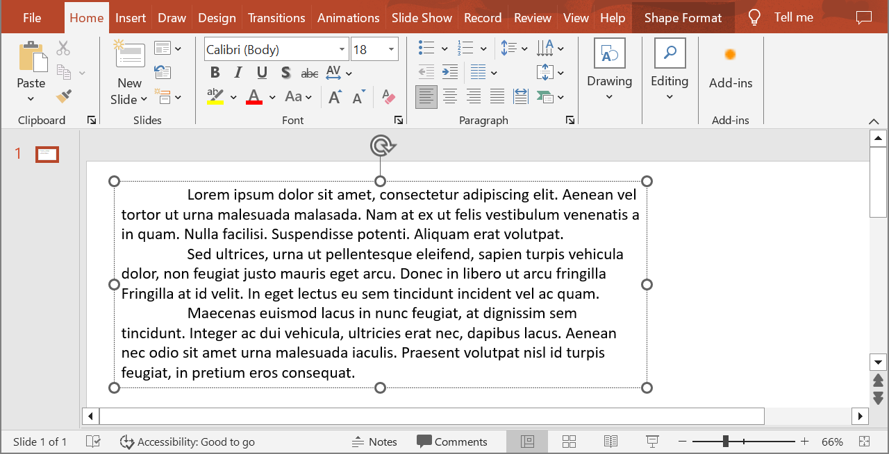

## **ภาพรวม**

Aspose.Slides for Node.js ผ่าน Java แสดงข้อความเป็นโครงสร้างลำดับชั้นของ text frames, paragraphs, และ portions:

* [TextFrame](https://reference.aspose.com/slides/nodejs-java/aspose.slides/textframe/) เป็นคอนเทนเนอร์ข้อความในรูปร่างและให้การเข้าถึงคอลเลกชันของย่อหน้า
* [Paragraph](https://reference.aspose.com/slides/nodejs-java/aspose.slides/paragraph/) แทนย่อหน้าหนึ่งใน text frame และให้การเข้าถึงส่วนย่อย (portions) และการจัดรูปแบบระดับย่อหน้า
* [Portion](https://reference.aspose.com/slides/nodejs-java/aspose.slides/portion/) แสดงส่วนของข้อความภายในย่อหน้า แต่ละ portion สามารถมีข้อความและการจัดรูปแบบระดับอักขระของตนเองได้

ดังนั้นย่อหน้าจึงสามารถมีข้อความที่ใช้ฟอนต์ สี ขนาด และการจัดรูปแบบอื่น ๆ แตกต่างกันได้โดยใช้หลาย portion

## **สร้างและกำหนดรูปแบบย่อหน้า**

สร้างย่อหน้าใน text frame ของรูปร่างและใช้ portion เพื่อจัดรูปแบบแต่ละส่วนของข้อความ ส่วนนี้จะแสดงวิธีการรวมหลาย portion ในแต่ละย่อหน้าและใช้สี ขนาดฟอนต์ และสไตล์ต่าง ๆ

### **สร้างย่อหน้าด้วยหลาย Portion**

ตัวอย่าง JavaScript ต่อไปนี้สร้างย่อหน้า 3 ย่อหน้า โดยแต่ละย่อหน้ามี portion 3 ชิ้นในคอลเลกชันที่คืนค่าจาก [Paragraph.getPortions](https://reference.aspose.com/slides/nodejs-java/aspose.slides/paragraph/getportions/). ตัวอย่างใช้ย่อหน้าเริ่มต้นและ portion ว่างที่มีอยู่แล้ว แล้วเพิ่มย่อหน้าและ portion ที่เหลือ การจัดรูปแบบทำผ่าน [Portion.getPortionFormat](https://reference.aspose.com/slides/nodejs-java/aspose.slides/portion/getportionformat/): portion แรกของแต่ละย่อหน้าจะเป็นสีแดง ตัวหนา ขนาด 15 pt; portion ที่สองเป็นสีน้ำเงิน ตัวเอียง ขนาด 18 pt; portion ที่สามคงฟอร์แมตเริ่มต้นไว้:

```javascript
var aspose = aspose || {};
aspose.slides = require("aspose.slides.via.java");
const java = require("java");

const presentation = new aspose.slides.Presentation();
try {
    const slide = presentation.getSlides().get_Item(0);

    const shape = slide.getShapes().addAutoShape(aspose.slides.ShapeType.Rectangle, 50, 150, 300, 150);
    const textFrame = shape.getTextFrame();

    const firstParagraph = textFrame.getParagraphs().get_Item(0);
    firstParagraph.getPortions().add(new aspose.slides.Portion());
    firstParagraph.getPortions().add(new aspose.slides.Portion());

    const secondParagraph = new aspose.slides.Paragraph();
    secondParagraph.getPortions().add(new aspose.slides.Portion());
    secondParagraph.getPortions().add(new aspose.slides.Portion());
    secondParagraph.getPortions().add(new aspose.slides.Portion());
    textFrame.getParagraphs().add(secondParagraph);

    const thirdParagraph = new aspose.slides.Paragraph();
    thirdParagraph.getPortions().add(new aspose.slides.Portion());
    thirdParagraph.getPortions().add(new aspose.slides.Portion());
    thirdParagraph.getPortions().add(new aspose.slides.Portion());
    textFrame.getParagraphs().add(thirdParagraph);

    const paragraphCount = textFrame.getParagraphs().getCount();
    for (let paragraphIndex = 0; paragraphIndex < paragraphCount; paragraphIndex++) {
        const paragraph = textFrame.getParagraphs().get_Item(paragraphIndex);
        const portionCount = paragraph.getPortions().getCount();
        for (let portionIndex = 0; portionIndex < portionCount; portionIndex++) {
            const portion = paragraph.getPortions().get_Item(portionIndex);
            portion.setText("Portion " + (paragraphIndex + 1) + "." + (portionIndex + 1));

            if (portionIndex === 0) {
                portion.getPortionFormat().getFillFormat().setFillType(java.newByte(aspose.slides.FillType.Solid));
                portion.getPortionFormat().getFillFormat().getSolidFillColor().setColor(java.getStaticFieldValue("java.awt.Color", "RED"));
                portion.getPortionFormat().setFontBold(java.newByte(aspose.slides.NullableBool.True));
                portion.getPortionFormat().setFontHeight(15);
            } else if (portionIndex === 1) {
                portion.getPortionFormat().getFillFormat().setFillType(java.newByte(aspose.slides.FillType.Solid));
                portion.getPortionFormat().getFillFormat().getSolidFillColor().setColor(java.getStaticFieldValue("java.awt.Color", "BLUE"));
                portion.getPortionFormat().setFontItalic(java.newByte(aspose.slides.NullableBool.True));
                portion.getPortionFormat().setFontHeight(18);
            }
        }
    }

    presentation.save("paragraphs_with_portions.pptx", aspose.slides.SaveFormat.Pptx);
} finally {
    presentation.dispose();
}
```

## **สร้างรายการหัวข้อและลำดับเลข**

จัดข้อความย่อหน้าให้เป็นรายการด้วยสัญลักษณ์ ตัวเลข หรือรูปภาพกำหนดเอง ตัวอย่างในส่วนนี้ครอบคลุมการจัดรูปแบบหัวข้อ รายการหลายระดับ และการกำหนดเลขเริ่มต้นแบบกำหนดเอง

### **สร้างรายการหัวข้อหรือรายการลำดับเลข**

หัวข้อและเลขลำดับทำให้การสแกนรายการที่เกี่ยวข้องง่ายขึ้น ใน Aspose.Slides การตั้งค่ารายการกำหนดผ่าน [BulletFormat](https://reference.aspose.com/slides/nodejs-java/aspose.slides/bulletformat/)

ตัวอย่าง JavaScript นี้เพิ่มหัวข้อสัญลักษณ์และรายการเลขใน text frame เดียวกัน [BulletFormat.setType](https://reference.aspose.com/slides/nodejs-java/aspose.slides/bulletformat/settype/) เลือกประเภทหัวข้อ, [BulletFormat.setChar](https://reference.aspose.com/slides/nodejs-java/aspose.slides/bulletformat/setchar/) ระบุสัญลักษณ์, และ [BulletFormat.setNumberedBulletStyle](https://reference.aspose.com/slides/nodejs-java/aspose.slides/bulletformat/setnumberedbulletstyle/) เลือกสไตล์การนับเลข ทั้งสองรายการใช้หัวข้อสีดำ ความสูง 100% และระยะเยื้อมันท์ของย่อหน้า 25 pt:

```javascript
var aspose = aspose || {};
aspose.slides = require("aspose.slides.via.java");
const java = require("java");

const presentation = new aspose.slides.Presentation();
try {
    const slide = presentation.getSlides().get_Item(0);

    const shape = slide.getShapes().addAutoShape(aspose.slides.ShapeType.Rectangle, 200, 200, 400, 200);
    const textFrame = shape.getTextFrame();
    textFrame.getParagraphs().clear();

    const symbolParagraph = new aspose.slides.Paragraph();
    symbolParagraph.setText("Welcome to Aspose.Slides");
    symbolParagraph.getParagraphFormat().getBullet().setType(java.newByte(aspose.slides.BulletType.Symbol));
    symbolParagraph.getParagraphFormat().getBullet().setChar(java.newChar(0x2022));
    symbolParagraph.getParagraphFormat().setIndent(25);
    symbolParagraph.getParagraphFormat().getBullet().getColor().setColorType(aspose.slides.ColorType.RGB);
    symbolParagraph.getParagraphFormat().getBullet().getColor().setColor(java.getStaticFieldValue("java.awt.Color", "BLACK"));
    symbolParagraph.getParagraphFormat().getBullet().setBulletHardColor(java.newByte(aspose.slides.NullableBool.True));
    symbolParagraph.getParagraphFormat().getBullet().setHeight(100);
    textFrame.getParagraphs().add(symbolParagraph);

    const numberedParagraph = new aspose.slides.Paragraph();
    numberedParagraph.setText("This is a numbered item");
    numberedParagraph.getParagraphFormat().getBullet().setType(java.newByte(aspose.slides.BulletType.Numbered));
    numberedParagraph.getParagraphFormat().getBullet().setNumberedBulletStyle(java.newByte(aspose.slides.NumberedBulletStyle.BulletCircleNumWDBlackPlain));
    numberedParagraph.getParagraphFormat().setIndent(25);
    numberedParagraph.getParagraphFormat().getBullet().getColor().setColorType(aspose.slides.ColorType.RGB);
    numberedParagraph.getParagraphFormat().getBullet().getColor().setColor(java.getStaticFieldValue("java.awt.Color", "BLACK"));
    numberedParagraph.getParagraphFormat().getBullet().setBulletHardColor(java.newByte(aspose.slides.NullableBool.True));
    numberedParagraph.getParagraphFormat().getBullet().setHeight(100);
    textFrame.getParagraphs().add(numberedParagraph);

    presentation.save("bulleted_and_numbered_list.pptx", aspose.slides.SaveFormat.Pptx);
} finally {
    presentation.dispose();
}
```

### **ใช้หัวข้อรูปภาพ**

หัวข้อรูปภาพทำให้คุณใช้รูปภาพกำหนดเองแทนสัญลักษณ์หรือเลข

ตัวอย่าง JavaScript นี้โหลด `image.png` จากไดเรกทอรีทำงานของแอปพลิเคชัน, เพิ่มรูปภาพไปยังคอลเลกชันรูปของงานนำเสนอเป็น [PPImage](https://reference.aspose.com/slides/nodejs-java/aspose.slides/ppimage/) และใช้เป็นหัวข้อย่อหน้าโดยเรียก [BulletFormat.setType](https://reference.aspose.com/slides/nodejs-java/aspose.slides/bulletformat/settype/) เพื่อใช้หัวข้อรูปภาพและกำหนดรูปภาพผ่าน [BulletFormat.getPicture](https://reference.aspose.com/slides/nodejs-java/aspose.slides/bulletformat/getpicture/). [BulletFormat.setHeight](https://reference.aspose.com/slides/nodejs-java/aspose.slides/bulletformat/setheight/) ตั้งเป็น 100% เพื่อให้หัวข้อมีขนาดสัมพันธ์กับข้อความย่อหน้า:

```javascript
var aspose = aspose || {};
aspose.slides = require("aspose.slides.via.java");
const java = require("java");

const presentation = new aspose.slides.Presentation();
try {
    const slide = presentation.getSlides().get_Item(0);

    const bulletImage = aspose.slides.Images.fromFile("image.png");
    let presentationImage;
    try {
        presentationImage = presentation.getImages().addImage(bulletImage);
    } finally {
        bulletImage.dispose();
    }

    const shape = slide.getShapes().addAutoShape(aspose.slides.ShapeType.Rectangle, 200, 200, 400, 200);
    const textFrame = shape.getTextFrame();
    textFrame.getParagraphs().clear();

    const paragraph = new aspose.slides.Paragraph();
    paragraph.setText("Welcome to Aspose.Slides");
    paragraph.getParagraphFormat().getBullet().setType(java.newByte(aspose.slides.BulletType.Picture));
    paragraph.getParagraphFormat().getBullet().getPicture().setImage(presentationImage);
    paragraph.getParagraphFormat().getBullet().setHeight(100);
    textFrame.getParagraphs().add(paragraph);

    presentation.save("picture_bullet.pptx", aspose.slides.SaveFormat.Pptx);
    presentation.save("picture_bullet.ppt", aspose.slides.SaveFormat.Ppt);
} finally {
    presentation.dispose();
}
```

### **สร้างรายการหลายระดับ**

ตั้งค่า [ParagraphFormat.setDepth](https://reference.aspose.com/slides/nodejs-java/aspose.slides/paragraphformat/setdepth/) เพื่อกำหนดระดับของย่อหน้าในรายการ ระดับบนสุดมีความลึก `0`

ตัวอย่าง JavaScript นี้กำหนดค่า [ParagraphFormat.setDepth](https://reference.aspose.com/slides/nodejs-java/aspose.slides/paragraphformat/setdepth/) ตั้งแต่ 0 ถึง 3 ให้กับย่อหน้า 4 ย่อหน้า สร้างลำดับชั้นภายใน text frame เดียวกัน แต่ละย่อหน้าใช้หัวข้อสัญลักษณ์ โดย [BulletFormat.setChar](https://reference.aspose.com/slides/nodejs-java/aspose.slides/bulletformat/setchar/) สลับระหว่างหัวข้อตรงและเครื่องหมายขีดเพื่อแยกระดับที่อยู่ติดกัน:

```javascript
var aspose = aspose || {};
aspose.slides = require("aspose.slides.via.java");
const java = require("java");

const presentation = new aspose.slides.Presentation();
try {
    const slide = presentation.getSlides().get_Item(0);

    const shape = slide.getShapes().addAutoShape(aspose.slides.ShapeType.Rectangle, 200, 200, 400, 200);
    const textFrame = shape.getTextFrame();
    textFrame.getParagraphs().clear();

    const firstParagraph = new aspose.slides.Paragraph();
    firstParagraph.setText("Content");
    firstParagraph.getParagraphFormat().getBullet().setType(java.newByte(aspose.slides.BulletType.Symbol));
    firstParagraph.getParagraphFormat().getBullet().setChar(java.newChar(0x2022));
    firstParagraph.getParagraphFormat().getDefaultPortionFormat().getFillFormat().setFillType(java.newByte(aspose.slides.FillType.Solid));
    firstParagraph.getParagraphFormat().getDefaultPortionFormat().getFillFormat().getSolidFillColor().setColor(java.getStaticFieldValue("java.awt.Color", "BLACK"));
    firstParagraph.getParagraphFormat().setDepth(java.newShort(0));

    const secondParagraph = new aspose.slides.Paragraph();
    secondParagraph.setText("Second level");
    secondParagraph.getParagraphFormat().getBullet().setType(java.newByte(aspose.slides.BulletType.Symbol));
    secondParagraph.getParagraphFormat().getBullet().setChar(java.newChar(45));
    secondParagraph.getParagraphFormat().getDefaultPortionFormat().getFillFormat().setFillType(java.newByte(aspose.slides.FillType.Solid));
    secondParagraph.getParagraphFormat().getDefaultPortionFormat().getFillFormat().getSolidFillColor().setColor(java.getStaticFieldValue("java.awt.Color", "BLACK"));
    secondParagraph.getParagraphFormat().setDepth(java.newShort(1));

    const thirdParagraph = new aspose.slides.Paragraph();
    thirdParagraph.setText("Third level");
    thirdParagraph.getParagraphFormat().getBullet().setType(java.newByte(aspose.slides.BulletType.Symbol));
    thirdParagraph.getParagraphFormat().getBullet().setChar(java.newChar(0x2022));
    thirdParagraph.getParagraphFormat().getDefaultPortionFormat().getFillFormat().setFillType(java.newByte(aspose.slides.FillType.Solid));
    thirdParagraph.getParagraphFormat().getDefaultPortionFormat().getFillFormat().getSolidFillColor().setColor(java.getStaticFieldValue("java.awt.Color", "BLACK"));
    thirdParagraph.getParagraphFormat().setDepth(java.newShort(2));

    const fourthParagraph = new aspose.slides.Paragraph();
    fourthParagraph.setText("Fourth level");
    fourthParagraph.getParagraphFormat().getBullet().setType(java.newByte(aspose.slides.BulletType.Symbol));
    fourthParagraph.getParagraphFormat().getBullet().setChar(java.newChar(45));
    fourthParagraph.getParagraphFormat().getDefaultPortionFormat().getFillFormat().setFillType(java.newByte(aspose.slides.FillType.Solid));
    fourthParagraph.getParagraphFormat().getDefaultPortionFormat().getFillFormat().getSolidFillColor().setColor(java.getStaticFieldValue("java.awt.Color", "BLACK"));
    fourthParagraph.getParagraphFormat().setDepth(java.newShort(3));

    textFrame.getParagraphs().add(firstParagraph);
    textFrame.getParagraphs().add(secondParagraph);
    textFrame.getParagraphs().add(thirdParagraph);
    textFrame.getParagraphs().add(fourthParagraph);

    presentation.save("multilevel_list.pptx", aspose.slides.SaveFormat.Pptx);
} finally {
    presentation.dispose();
}
```

### **เริ่มรายการลำดับเลขที่ค่ากำหนดเอง**

ใช้ [BulletFormat.setNumberedBulletStartWith](https://reference.aspose.com/slides/nodejs-java/aspose.slides/bulletformat/setnumberedbulletstartwith/) เพื่อตั้งหมายเลขเริ่มต้นของย่อหน้าลำดับเลข

ตัวอย่าง JavaScript นี้ตั้ง [BulletFormat.setType](https://reference.aspose.com/slides/nodejs-java/aspose.slides/bulletformat/settype/) ให้ใช้การนับเลขสำหรับย่อหน้า 3 ย่อหน้าและกำหนดค่า [BulletFormat.setNumberedBulletStartWith](https://reference.aspose.com/slides/nodejs-java/aspose.slides/bulletformat/setnumberedbulletstartwith/) เป็น 2, 3, และ 7 ค่าที่เริ่มต้นนี้กำหนดแยกตามย่อหน้า ทำให้หมายเลขที่แสดงข้ามค่าได้:

```javascript
var aspose = aspose || {};
aspose.slides = require("aspose.slides.via.java");
const java = require("java");

const presentation = new aspose.slides.Presentation();
try {
    const slide = presentation.getSlides().get_Item(0);

    const shape = slide.getShapes().addAutoShape(aspose.slides.ShapeType.Rectangle, 200, 200, 400, 200);
    const textFrame = shape.getTextFrame();
    textFrame.getParagraphs().clear();

    const firstParagraph = new aspose.slides.Paragraph();
    firstParagraph.setText("Start at 2");
    firstParagraph.getParagraphFormat().getBullet().setType(java.newByte(aspose.slides.BulletType.Numbered));
    firstParagraph.getParagraphFormat().getBullet().setNumberedBulletStartWith(java.newShort(2));
    textFrame.getParagraphs().add(firstParagraph);

    const secondParagraph = new aspose.slides.Paragraph();
    secondParagraph.setText("Start at 3");
    secondParagraph.getParagraphFormat().getBullet().setType(java.newByte(aspose.slides.BulletType.Numbered));
    secondParagraph.getParagraphFormat().getBullet().setNumberedBulletStartWith(java.newShort(3));
    textFrame.getParagraphs().add(secondParagraph);

    const thirdParagraph = new aspose.slides.Paragraph();
    thirdParagraph.setText("Start at 7");
    thirdParagraph.getParagraphFormat().getBullet().setType(java.newByte(aspose.slides.BulletType.Numbered));
    thirdParagraph.getParagraphFormat().getBullet().setNumberedBulletStartWith(java.newShort(7));
    textFrame.getParagraphs().add(thirdParagraph);

    presentation.save("custom_numbered_list.pptx", aspose.slides.SaveFormat.Pptx);
} finally {
    presentation.dispose();
}
```

## **ควบคุมการจัดวางย่อหน้าและคุณสมบัติสุดท้าย**

ปรับระยะขอบและระยะเยื้อมันท์ของย่อหน้าเพื่อควบคุมตำแหน่งของบรรทัดแรกและบรรทัดที่ห่อ wrap คุณยังสามารถกำหนดรูปแบบของเครื่องหมายจบย่อหน้าแยกจากส่วนข้อความที่มองเห็นได้

### **ตั้งระยะเยื้อมันท์บรรทัดแรก**

ใช้เมธอด [ParagraphFormat.setIndent](https://reference.aspose.com/slides/nodejs-java/aspose.slides/paragraphformat/setindent/) เพื่อควบคุมระยะเยื้อมันท์ของบรรทัดแรกของย่อหน้า การตั้งค่านี้จะย้ายบรรทัดแรกเท่านั้นเมื่อเทียบกับระยะขอบซ้ายของย่อหน้า ค่าเป็นบวกจะเลื่อนบรรทัดแรกไปทางขวา ส่วนบรรทัดที่เหลือคงอยู่ตรงกับเนื้อหาย่อหน้า

ใช้ [ParagraphFormat.setMarginLeft](https://reference.aspose.com/slides/nodejs-java/aspose.slides/paragraphformat/setmarginleft/) เมื่อคุณต้องการย้ายย่อหน้าทั้งหมด ใช้ [ParagraphFormat.setIndent](https://reference.aspose.com/slides/nodejs-java/aspose.slides/paragraphformat/setindent/) เมื่อคุณต้องการย้ายเฉพาะบรรทัดแรก

ตัวอย่างต่อไปนี้ให้ย่อหน้า 3 ย่อหน้ามี [ParagraphFormat.setMarginLeft](https://reference.aspose.com/slides/nodejs-java/aspose.slides/paragraphformat/setmarginleft/) เท่ากับ 20 pt และค่า [ParagraphFormat.setIndent](https://reference.aspose.com/slides/nodejs-java/aspose.slides/paragraphformat/setindent/) เป็น 0, 20, และ 40 pt ตามลำดับ บรรทัดแรกจะเริ่มที่ออฟเซ็ตที่เพิ่มขึ้นเรื่อย ๆ ในขณะที่บรรทัดที่ห่อ wrap ยังคงระยะขอบซ้ายเดียวกัน:

```javascript
var aspose = aspose || {};
aspose.slides = require("aspose.slides.via.java");
const java = require("java");

const presentation = new aspose.slides.Presentation();
try {
    const slide = presentation.getSlides().get_Item(0);

    const shape = slide.getShapes().addAutoShape(aspose.slides.ShapeType.Rectangle, 50, 50, 420, 220);
    shape.getFillFormat().setFillType(java.newByte(aspose.slides.FillType.NoFill));
    shape.getLineFormat().getFillFormat().setFillType(java.newByte(aspose.slides.FillType.Solid));
    shape.getLineFormat().getFillFormat().getSolidFillColor().setColor(java.getStaticFieldValue("java.awt.Color", "GRAY"));

    const textFrame = shape.getTextFrame();
    textFrame.getTextFrameFormat().setAutofitType(java.newByte(aspose.slides.TextAutofitType.Shape));
    textFrame.getParagraphs().clear();

    const firstParagraph = new aspose.slides.Paragraph();
    firstParagraph.setText("No first-line indent. Wrapped lines start at the same position as the first line.");
    firstParagraph.getParagraphFormat().getDefaultPortionFormat().getFillFormat().setFillType(java.newByte(aspose.slides.FillType.Solid));
    firstParagraph.getParagraphFormat().getDefaultPortionFormat().getFillFormat().getSolidFillColor().setColor(java.getStaticFieldValue("java.awt.Color", "BLACK"));
    firstParagraph.getParagraphFormat().setMarginLeft(20);
    firstParagraph.getParagraphFormat().setIndent(0);

    const secondParagraph = new aspose.slides.Paragraph();
    secondParagraph.setText("First-line indent of 20 points. The first line moves to the right, while wrapped lines remain aligned to the paragraph body.");
    secondParagraph.getParagraphFormat().getDefaultPortionFormat().getFillFormat().setFillType(java.newByte(aspose.slides.FillType.Solid));
    secondParagraph.getParagraphFormat().getDefaultPortionFormat().getFillFormat().getSolidFillColor().setColor(java.getStaticFieldValue("java.awt.Color", "BLACK"));
    secondParagraph.getParagraphFormat().setMarginLeft(20);
    secondParagraph.getParagraphFormat().setIndent(20);

    const thirdParagraph = new aspose.slides.Paragraph();
    thirdParagraph.setText("First-line indent of 40 points. This paragraph shows a larger first-line offset to make the effect easier to see.");
    thirdParagraph.getParagraphFormat().getDefaultPortionFormat().getFillFormat().setFillType(java.newByte(aspose.slides.FillType.Solid));
    thirdParagraph.getParagraphFormat().getDefaultPortionFormat().getFillFormat().getSolidFillColor().setColor(java.getStaticFieldValue("java.awt.Color", "BLACK"));
    thirdParagraph.getParagraphFormat().setMarginLeft(20);
    thirdParagraph.getParagraphFormat().setIndent(40);

    textFrame.getParagraphs().add(firstParagraph);
    textFrame.getParagraphs().add(secondParagraph);
    textFrame.getParagraphs().add(thirdParagraph);

    presentation.save("paragraph_indent.pptx", aspose.slides.SaveFormat.Pptx);
} finally {
    presentation.dispose();
}
```

ผลลัพธ์:


### **ตั้งระยะเยื้อมันท์ห้อย**

ระยะเยื้อมันท์ห้อยคือการจัดวางย่อหน้าในรูปแบบที่บรรทัดแรกเริ่มอยู่ด้านซ้ายของบรรทัดที่เหลือ ใน Aspose.Slides คุณสร้างเอฟเฟกต์นี้ด้วยเมธอด [ParagraphFormat.setIndent](https://reference.aspose.com/slides/nodejs-java/aspose.slides/paragraphformat/setindent/) ตั้งระยะเยื้อมันท์เป็นค่าลบเพื่อย้ายบรรทัดแรกไปด้านซ้ายเมื่อเทียบกับเนื้อหาย่อหน้า

โดยปฏิบัติการ [ParagraphFormat.setMarginLeft](https://reference.aspose.com/slides/nodejs-java/aspose.slides/paragraphformat/setmarginleft/) กำหนดตำแหน่งซ้ายของเนื้อหาย่อหน้า และ [ParagraphFormat.setIndent](https://reference.aspose.com/slides/nodejs-java/aspose.slides/paragraphformat/setindent/) กำหนดตำแหน่งของบรรทัดแรกเมื่อเทียบกับระยะขอบนั้น เพื่อสร้างระยะเยื้อมันท์ห้อย ให้ตั้งระยะขอบซ้ายเป็นบวกและระยะเยื้อมันท์เป็นลบ

การจัดรูปแบบนี้มีประโยชน์สำหรับบรรณานุกรม, แหล่งอ้างอิง, รายการพจนานุกรม และย่อหน้าอื่น ๆ ที่ต้องการให้บรรทัดที่ห่อ wrap เรียงตรงใต้เนื้อหาย่อหน้าไม่ใช่ใต้ตัวอักษรแรกของบรรทัดแรก

ตัวอย่าง JavaScript ต่อไปนี้จับคู่ค่า [ParagraphFormat.setMarginLeft](https://reference.aspose.com/slides/nodejs-java/aspose.slides/paragraphformat/setmarginleft/) ที่ 40 และ 60 pt กับค่า [ParagraphFormat.setIndent](https://reference.aspose.com/slides/nodejs-java/aspose.slides/paragraphformat/setindent/) ที่ -20 และ -30 pt ในแต่ละย่อหน้า บรรทัดแรกจะเริ่มอยู่ด้านซ้ายของบรรทัดที่ห่อ wrap; ย่อหน้าที่สองมีระยะเยื้อมันท์ห้อยที่ลึกกว่า:

```javascript
var aspose = aspose || {};
aspose.slides = require("aspose.slides.via.java");
const java = require("java");

const presentation = new aspose.slides.Presentation();
try {
    const slide = presentation.getSlides().get_Item(0);

    const shape = slide.getShapes().addAutoShape(aspose.slides.ShapeType.Rectangle, 50, 50, 420, 220);
    shape.getFillFormat().setFillType(java.newByte(aspose.slides.FillType.NoFill));
    shape.getLineFormat().getFillFormat().setFillType(java.newByte(aspose.slides.FillType.Solid));
    shape.getLineFormat().getFillFormat().getSolidFillColor().setColor(java.getStaticFieldValue("java.awt.Color", "GRAY"));

    const textFrame = shape.getTextFrame();
    textFrame.getTextFrameFormat().setAutofitType(java.newByte(aspose.slides.TextAutofitType.Shape));
    textFrame.getParagraphs().clear();

    const firstParagraph = new aspose.slides.Paragraph();
    firstParagraph.setText("A hanging indent is created by combining a positive left margin with a negative indent. The first line starts to the left, while wrapped lines align with the paragraph body.");
    firstParagraph.getParagraphFormat().getDefaultPortionFormat().getFillFormat().setFillType(java.newByte(aspose.slides.FillType.Solid));
    firstParagraph.getParagraphFormat().getDefaultPortionFormat().getFillFormat().getSolidFillColor().setColor(java.getStaticFieldValue("java.awt.Color", "BLACK"));
    firstParagraph.getParagraphFormat().setMarginLeft(40);
    firstParagraph.getParagraphFormat().setIndent(-20);

    const secondParagraph = new aspose.slides.Paragraph();
    secondParagraph.setText("This second example uses a deeper hanging indent so the difference between the first line and the wrapped lines is easier to compare.");
    secondParagraph.getParagraphFormat().getDefaultPortionFormat().getFillFormat().setFillType(java.newByte(aspose.slides.FillType.Solid));
    secondParagraph.getParagraphFormat().getDefaultPortionFormat().getFillFormat().getSolidFillColor().setColor(java.getStaticFieldValue("java.awt.Color", "BLACK"));
    secondParagraph.getParagraphFormat().setMarginLeft(60);
    secondParagraph.getParagraphFormat().setIndent(-30);

    textFrame.getParagraphs().add(firstParagraph);
    textFrame.getParagraphs().add(secondParagraph);

    presentation.save("hanging_indent.pptx", aspose.slides.SaveFormat.Pptx);
} finally {
    presentation.dispose();
}
```

ผลลัพธ์:


### **ตั้งคุณสมบัติการรันของย่อหน้าสุดท้าย**

เมธอด [Paragraph.setEndParagraphPortionFormat](https://reference.aspose.com/slides/nodejs-java/aspose.slides/paragraph/setendparagraphportionformat/) ควบคุมการจัดรูปแบบของเครื่องหมายจบย่อหน้า ตัวอย่างต่อไปนี้สร้าง [PortionFormat](https://reference.aspose.com/slides/nodejs-java/aspose.slides/portionformat/) ที่ตั้ง [BasePortionFormat.setFontHeight](https://reference.aspose.com/slides/nodejs-java/aspose.slides/baseportionformat/#setFontHeight) เป็น 48 pt และ [BasePortionFormat.setLatinFont](https://reference.aspose.com/slides/nodejs-java/aspose.slides/baseportionformat/#setLatinFont) เป็น Times New Roman จากนั้นกำหนดฟอร์แมตนี้ให้กับเครื่องหมายจบของย่อหน้าที่สองโดยไม่กระทบต่อส่วนข้อความที่มองเห็น:

```javascript
var aspose = aspose || {};
aspose.slides = require("aspose.slides.via.java");

const presentation = new aspose.slides.Presentation();
try {
    const slide = presentation.getSlides().get_Item(0);

    const shape = slide.getShapes().addAutoShape(aspose.slides.ShapeType.Rectangle, 10, 10, 200, 250);
    const textFrame = shape.getTextFrame();
    textFrame.getParagraphs().clear();

    const firstParagraph = new aspose.slides.Paragraph();
    firstParagraph.getPortions().add(new aspose.slides.Portion("Sample text"));

    const secondParagraph = new aspose.slides.Paragraph();
    secondParagraph.getPortions().add(new aspose.slides.Portion("Sample text 2"));

    const endParagraphFormat = new aspose.slides.PortionFormat();
    endParagraphFormat.setFontHeight(48);
    endParagraphFormat.setLatinFont(new aspose.slides.FontData("Times New Roman"));
    secondParagraph.setEndParagraphPortionFormat(endParagraphFormat);

    textFrame.getParagraphs().add(firstParagraph);
    textFrame.getParagraphs().add(secondParagraph);

    presentation.save("end_paragraph_format.pptx", aspose.slides.SaveFormat.Pptx);
} finally {
    presentation.dispose();
}
```

## **นับจำนวนบรรทัดที่แสดงผล**

สำหรับกฎของย่อหน้าที่ส่งผลต่อการห่อ wrap อัตโนมัติและการใส่เครื่องหมายวรรคตอนที่ตอนจบบรรทัด ดูที่ [Control Line Breaking](/slides/th/nodejs-java/text-formatting/#control-line-breaking) และ [Control Hanging Punctuation](/slides/th/nodejs-java/text-formatting/#control-hanging-punctuation)

ใช้ [Paragraph.getLinesCount](https://reference.aspose.com/slides/nodejs-java/aspose.slides/paragraph/#getLinesCount) เพื่อนับจำนวนบรรทัดที่ย่อหน้าใช้หลังจากการจัดวางข้อความรวมถึงการห่อ wrap อัตโนมัติ ซึ่งมีประโยชน์เมื่อทำการตรวจสอบความยาวและการจัดวางของข้อความในเทมเพลตงานนำเสนอ

ย่อหน้าเป็นรายการหนึ่งใน [TextFrame.getParagraphs](https://reference.aspose.com/slides/nodejs-java/aspose.slides/textframe/getparagraphs/), และอาจใช้หลายบรรทัดที่แสดงผล การตัดบรรทัดแบบชัดเจนภายในย่อหน้าจะบังคับให้ขึ้นบรรทัดใหม่โดยไม่สร้างย่อหน้าใหม่ การห่อ wrap อัตโนมัติสร้างบรรทัดตามความกว้างที่เหลือโดยไม่มีการแทรกบรรทัดใหม่ลงในข้อความ การนับย่อหน้าหรืออักขระตัดบรรทัดจึงไม่ได้ให้จำนวนบรรทัดที่แสดงผล

ตัวอย่างต่อไปนี้สร้างรูปร่างข้อความ, นับบรรทัดของมัน, ลดความกว้างของรูปร่าง, แล้วแทนที่ข้อความด้วยสตริงสั้นกว่า ตัวอย่างเปิดใช้งานการห่อ wrap ด้วย [TextFrameFormat.setWrapText](https://reference.aspose.com/slides/nodejs-java/aspose.slides/textframeformat/setwraptext/) และปิดการปรับขนาดอัตโนมัติด้วย [TextFrameFormat.setAutofitType](https://reference.aspose.com/slides/nodejs-java/aspose.slides/textframeformat/setautofittype/) เพื่อให้ความกว้างของรูปร่างควบคุมการห่อ wrap โดยไม่ทำให้ข้อความหรือรูปร่างลดขนาดโดยอัตโนมัติ การวัดแต่ละครั้งใช้ [Paragraph.getLinesCount](https://reference.aspose.com/slides/nodejs-java/aspose.slides/paragraph/#getLinesCount) มิติของรูปร่างเป็นหน่วยจุด สุดท้ายตัวอย่างเพิ่มย่อหน้าอีกหนึ่งย่อหน้าและรวมจำนวนบรรทัดทั้งหมดใน text frame

```javascript
var aspose = aspose || {};
aspose.slides = require("aspose.slides.via.java");
const java = require("java");

const presentation = new aspose.slides.Presentation();
try {
    const slide = presentation.getSlides().get_Item(0);

    const shape = slide.getShapes().addAutoShape(aspose.slides.ShapeType.Rectangle, 50, 50, 400, 200);
    const textFrame = shape.getTextFrame();
    textFrame.getTextFrameFormat().setWrapText(java.newByte(aspose.slides.NullableBool.True));
    textFrame.getTextFrameFormat().setAutofitType(java.newByte(aspose.slides.TextAutofitType.None));

    const paragraph = textFrame.getParagraphs().get_Item(0);
    paragraph.getParagraphFormat().getDefaultPortionFormat().setFontHeight(20);
    paragraph.setText("This text demonstrates how automatic wrapping changes the number of rendered lines.");
    console.log("Original width: " + paragraph.getLinesCount());

    shape.setWidth(150);
    console.log("Narrower shape: " + paragraph.getLinesCount());

    paragraph.setText("Short text.");
    console.log("Shorter text: " + paragraph.getLinesCount());

    const secondParagraph = new aspose.slides.Paragraph();
    secondParagraph.setText("Another paragraph.");
    secondParagraph.getParagraphFormat().getDefaultPortionFormat().setFontHeight(20);
    textFrame.getParagraphs().add(secondParagraph);

    let totalLineCount = 0;
    for (let i = 0; i < textFrame.getParagraphs().getCount(); i++) {
        const currentParagraph = textFrame.getParagraphs().get_Item(i);
        totalLineCount += currentParagraph.getLinesCount();
    }
    console.log("Total lines in the text frame: " + totalLineCount);
} finally {
    presentation.dispose();
}
```

## **นำเข้าและส่งออกเนื้อหาย่อหน้า**

ใช้ HTML เพื่อดึงข้อความเข้าสู่งานนำเสนอหรือส่งออกย่อหน้าที่มีอยู่เพื่อใช้ภายนอก ส่วนนี้ยังแสดงวิธีการเรนเดอร์ย่อหน้าแต่ละอันเป็นภาพ รวมถึงย่อหน้าที่อยู่ในเซลล์ตาราง

### **นำเข้าข้อความ HTML ไปยังย่อหน้า**

ใช้ [ParagraphCollection.addFromHtml](https://reference.aspose.com/slides/nodejs-java/aspose.slides/paragraphcollection/addfromhtml/) เพื่อแปลงมาร์กอัป HTML ให้เป็นย่อหน้าและ portion ใน text frame

ตัวอย่าง JavaScript นี้อ่าน HTML จาก `file.html` ในไดเรกทอรีทำงานของแอปพลิเคชันและส่งมาร์กอัปให้กับ [ParagraphCollection.addFromHtml](https://reference.aspose.com/slides/nodejs-java/aspose.slides/paragraphcollection/addfromhtml/). มันล้างย่อหน้าเริ่มต้นของ text frame เพื่อให้เฟรมมีเพียงเนื้อหา import เท่านั้น รูปร่างสี่เหลี่ยมทิ้งระยะขอบ 10 pt ไว้ที่ทุกด้านของสไลด์:

```javascript
var aspose = aspose || {};
aspose.slides = require("aspose.slides.via.java");
const java = require("java");
const fs = require("fs");

const presentation = new aspose.slides.Presentation();
try {
    const slide = presentation.getSlides().get_Item(0);

    const shapeWidth = presentation.getSlideSize().getSize().getWidth() - 20;
    const shapeHeight = presentation.getSlideSize().getSize().getHeight() - 20;
    const shape = slide.getShapes().addAutoShape(aspose.slides.ShapeType.Rectangle, 10, 10, shapeWidth, shapeHeight);
    shape.getFillFormat().setFillType(java.newByte(aspose.slides.FillType.NoFill));
    shape.getTextFrame().getParagraphs().clear();

    const html = fs.readFileSync("file.html", "utf8");
    shape.getTextFrame().getParagraphs().addFromHtml(html);
    presentation.save("html_text.pptx", aspose.slides.SaveFormat.Pptx);
} finally {
    presentation.dispose();
}
```

### **ส่งออกข้อความย่อหน้าเป็น HTML**

ใช้ [ParagraphCollection.exportToHtml](https://reference.aspose.com/slides/nodejs-java/aspose.slides/paragraphcollection/exporttohtml/) เพื่อส่งออกช่วงย่อหน้าที่เลือกเป็น HTML เมื่อใช้ข้อความของงานนำเสนอซ้ำบนเว็บไซต์ คุณอาจต้องการคงความเน้นในระดับท้องถิ่นโดยไม่ต้องพกฟอนต์ ขนาด หรือสไตล์ของกล่องข้อความของงานนำเสนอ ตั้งค่า [TextToHtmlConversionOptions.setTextInheritanceLimit](https://reference.aspose.com/slides/nodejs-java/aspose.slides/texttohtmlconversionoptions/settextinheritancelimit/) เพื่อควบคุมความลึกที่ตัวแปลงตามการสืบทอดฟอร์แมต

ดาวน์โหลด [ตัวอย่างงานนำเสนอ](text-inheritance.pptx) และวางไว้ในไดเรกทอรีทำงานของแอปพลิเคชัน สไลด์แรกมีรูปทรงข้อความหนึ่งรูปที่มีข้อความ "Inherited text; explicit red 18pt". อินพุตตั้งใจใช้ระดับการฟอร์แมตหลายระดับ:

- สไตล์ข้อความเริ่มต้นของงานนำเสนอใช้ฟอนต์ Calibri ขนาด 28 pt
- สไตล์ข้อความระดับแรกของ text frame ใช้ข้อความสีน้ำเงินและเป็นตัวเอียง
- ย่อหน้าตั้งค่าข้อความตัวหนาอย่างชัดเจน
- portion ที่สอง, "explicit red 18pt", ตั้งค่าสีแดงและขนาด 18 pt อย่างชัดเจน

ตัวอย่างเต็มต่อไปนี้ส่งออกย่อหน้าเดียวกันสามครั้ง โดยส่งผ่าน [TextToHtmlConversionOptions](https://reference.aspose.com/slides/nodejs-java/aspose.slides/texttohtmlconversionoptions/) ไปยังเมธอดส่งออกและเขียนผลลัพธ์แต่ละอันเป็นไฟล์ HTML UTF‑8 แยกไฟล์:

```javascript
var aspose = aspose || {};
aspose.slides = require("aspose.slides.via.java");
const java = require("java");
const fs = require("fs");

const presentation = new aspose.slides.Presentation("text-inheritance.pptx");
try {
    const shape = presentation.getSlides().get_Item(0).getShapes().get_Item(0);

    if (java.instanceOf(shape, "com.aspose.slides.IAutoShape")) {
        const textFrame = shape.getTextFrame();
        if (textFrame !== null) {
            const paragraphs = textFrame.getParagraphs();

            const modes = [aspose.slides.TextInheritanceLimit.All, aspose.slides.TextInheritanceLimit.TextBox, aspose.slides.TextInheritanceLimit.ParagraphOnly];
            const fileNames = ["All.html", "TextBox.html", "ParagraphOnly.html"];

            for (let i = 0; i < modes.length; i++) {
                const options = new aspose.slides.TextToHtmlConversionOptions();
                options.setTextInheritanceLimit(modes[i]);

                const html = paragraphs.exportToHtml(0, paragraphs.getCount(), options);
                fs.writeFileSync(fileNames[i], html, "utf8");
            }
        } else {
            console.log("The first shape does not contain a text frame.");
        }
    } else {
        console.log("The first shape is not a text shape.");
    }
} finally {
    presentation.dispose();
}
```

HTML ที่สร้างจะมี CSS ต่อไปนี้สำหรับ portion แรก, "Inherited text; ". ตารางแสดงการประกาศที่เกี่ยวข้อง; คุณสมบัติที่สร้างอื่น ๆ ถูกละเว้นเพื่อความกระจ่าง

| ผลลัพธ์ | CSS ที่เกี่ยวข้องสำหรับ portion แรก | ลักษณะ |
| --- | --- | --- |
| `All.html` | `font-family:'Calibri'; font-size:28pt; color:#0000ff; font-style:italic; font-weight:bold` | ข้อความสีน้ำเงิน ตัวหนา ตัวเอียง ขนาด 28 pt ใน Calibri หากฟอนต์นั้นมีอยู่ |
| `TextBox.html` | `color:#0000ff; font-style:italic; font-weight:bold` | ข้อความสีน้ำเงิน ตัวหนา ตัวเอียง; หน้าหรือเบราว์เซอร์จะกำหนดฟอนต์และขนาด |
| `ParagraphOnly.html` | `font-weight:bold` | ข้อความตัวหนา; หน้าหรือเบราว์เซอร์จะกำหนดฟอนต์ ขนาด สี และสไตล์เอียง |

portion ที่สองคง `color:#ff0000`, `font-size:18pt`, และ `font-weight:bold` ในทุกผลลัพธ์ ทั้งยังคงเอียงใน `All` และ `TextBox` แต่ไม่ค่อยใน `ParagraphOnly` การจำกัดการสืบทอดจึงไม่ได้ลบฟอร์แมตที่กำหนดโดยตรงให้กับย่อหน้าหรือ portion

เปิดไฟล์ในเบราว์เซอร์เดียวกันเพื่อเปรียบเทียบ ในโหมดจำกัดสองแบบ คุณสมบัติ CSS ที่ละเว้นจะถูกแก้โดยสไตล์ของหน้าเป้าหมายหรือค่าเริ่มต้นของเบราว์เซอร์ ดังนั้นผลลัพธ์ที่แสดงจึงขึ้นอยู่กับที่ใช้ HTML

### **เรนเดอร์ย่อหน้าเป็นรูปภาพ**

[Paragraph.getImage](https://reference.aspose.com/slides/nodejs-java/aspose.slides/paragraph/#getImage) เรนเดอร์ย่อหน้าเดี่ยวโดยตรงและคืนค่าเป็น [IImage](https://reference.aspose.com/slides/nodejs-java/aspose.slides/iimage/). สามารถบันทึกผลลัพธ์เป็นไฟล์หรือสตรีมด้วย [IImage.save](https://reference.aspose.com/slides/nodejs-java/aspose.slides/iimage/#save). ไม่จำเป็นต้องเรนเดอร์รูปร่างที่บรรจุหรือครอปบิตแมพด้วยตนเอง

[Paragraph.getImage](https://reference.aspose.com/slides/nodejs-java/aspose.slides/paragraph/#getImage) อาจคืนค่า `null` หากไม่พบย่อหน้าในคอลเลกชันแม่, ไม่มีขอบเขตการเรนเดอร์ที่ถูกต้อง, หรือไม่สามารถเรนเดอร์ได้ ตรวจสอบผลลัพธ์ก่อนบันทึกและกำจัดภาพที่คืนค่าหลังใช้งาน

#### **เรนเดอร์ย่อหน้าที่สเกลเริ่มต้น**

ตัวอย่างสร้างงานนำเสนอที่มีสไลด์หนึ่งซึ่งรูปร่างแรกเป็นกล่องข้อความที่มีย่อหน้า 3 ย่อหน้า



ตัวอย่างต่อไปนี้เลือกย่อหน้าที่สองที่ตำแหน่ง 1 แล้วเรียก [Paragraph.getImage](https://reference.aspose.com/slides/nodejs-java/aspose.slides/paragraph/#getImage) โดยไม่มีพารามิเตอร์สเกล ตรวจสอบว่ารูปร่างมีย่อหน้าที่ต้องการและการเรนเดอร์ให้ภาพก่อนเรียก [IImage.save](https://reference.aspose.com/slides/nodejs-java/aspose.slides/iimage/#save) เพื่อบันทึกเป็น PNG บล็อก `finally` จะกำจัดภาพหลังการใช้งาน

```javascript
var aspose = aspose || {};
aspose.slides = require("aspose.slides.via.java");
const java = require("java");

const presentation = new aspose.slides.Presentation();
try {
    const slide = presentation.getSlides().get_Item(0);

    const sourceShape = slide.getShapes().addAutoShape(aspose.slides.ShapeType.Rectangle, 20, 20, 400, 100);
    const sourceTextFrame = sourceShape.getTextFrame();
    sourceTextFrame.getParagraphs().clear();
    for (const text of ["First paragraph", "Second paragraph", "Third paragraph"]) {
        const sourceParagraph = new aspose.slides.Paragraph();
        sourceParagraph.setText(text);
        sourceTextFrame.getParagraphs().add(sourceParagraph);
    }
    const shape = slide.getShapes().get_Item(0);

    if (java.instanceOf(shape, "com.aspose.slides.IAutoShape")) {
        const textFrame = shape.getTextFrame();
        if (textFrame !== null && textFrame.getParagraphs().getCount() > 1) {
            const paragraph = textFrame.getParagraphs().get_Item(1);
            const paragraphImage = paragraph.getImage();

            if (paragraphImage !== null) {
                try {
                    paragraphImage.save("paragraph.png", aspose.slides.ImageFormat.Png);
                } finally {
                    paragraphImage.dispose();
                }
            } else {
                console.log("The paragraph could not be rendered.");
            }
        } else {
            console.log("The expected paragraph was not found.");
        }
    } else {
        console.log("The first shape is not a text shape.");
    }
} finally {
    presentation.dispose();
}
```

ผลลัพธ์:


#### **เรนเดอร์ย่อหน้าในเซลล์ตารางด้วยการสเกล**

ใช้โอเวอร์โหลดของ [Paragraph.getImage](https://reference.aspose.com/slides/nodejs-java/aspose.slides/paragraph/#getImage) ที่รับพารามิเตอร์ `scaleX` และ `scaleY` เพื่อกำหนดตัวคูณสเกลในแนวนอนและแนวตั้ง ตัวอย่างต่อไปนี้สร้างตาราง, เรนเดอร์ย่อหน้าในเซลล์แรกโดยเพิ่มความกว้างและสูงเป็นสองเท่าของค่าเริ่มต้น, แล้วบันทึกผลเป็นภาพ PNG

```javascript
var aspose = aspose || {};
aspose.slides = require("aspose.slides.via.java");
const java = require("java");

const scaleX = 2;
const scaleY = 2;

const presentation = new aspose.slides.Presentation();
try {
    const slide = presentation.getSlides().get_Item(0);
    
    const columnWidths = java.newArray("double", [300]);
    const rowHeights = java.newArray("double", [80]);
    const table = slide.getShapes().addTable(50, 50, columnWidths, rowHeights);
    const paragraph = table.get_Item(0, 0).getTextFrame().getParagraphs().get_Item(0);
    paragraph.setText("Text in a table cell");

    const paragraphImage = paragraph.getImage(scaleX, scaleY);
    if (paragraphImage !== null) {
        try {
            paragraphImage.save("table_paragraph.png", aspose.slides.ImageFormat.Png);
        } finally {
            paragraphImage.dispose();
        }
    } else {
        console.log("The paragraph could not be rendered.");
    }
} finally {
    presentation.dispose();
}
```

ค่าตัวคูณสเกล `1` จะคงแกนนั้นที่ขนาดพิก셀เริ่มต้น ตัวอย่างเช่น `2` สำหรับทั้งสองตัวคูณจะให้ภาพที่ความกว้างและสูงประมาณสองเท่าของขนาดเริ่มต้น ส่งผลให้มีพิกเซลสี่เท่า การใช้ค่าตัวคูณใหญ่กว่าจะทำให้ข้อความคมชัดขึ้นสำหรับการซูมหรือเอาต์พุตความละเอียดสูง แต่จะเพิ่มการใช้หน่วยความจำและขนาดไฟล์ ค่าตัวคูณต่ำกว่า `1` จะให้ภาพขนาดเล็กลงพร้อมรายละเอียดน้อยลง ใช้ค่าตัวคูณเท่ากันเพื่อรักษาอัตราส่วนของย่อหน้า; ค่าตัวคูณแนวนอนและแนวตั้งต่างกันจะทำให้เอาต์พุตยืดหยุ่นแต่ละทิศ

การเรนเดอร์รูปทรงทั้งหมดด้วย [Shape.getImage](https://reference.aspose.com/slides/nodejs-java/aspose.slides/shape/#getImage) ยังคงมีประโยชน์เมื่อเอาต์พุตต้องรวมการเติมพื้น, เส้นขอบ หรือบริบทภาพอื่น ๆ สำหรับภาพย่อหน้าเดียวเท่านั้น ให้ใช้ [Paragraph.getImage](https://reference.aspose.com/slides/nodejs-java/aspose.slides/paragraph/#getImage)

## **FAQ**

**ฉันสามารถปิดการตัดบรรทัดภายใน text frame ได้อย่างสมบูรณ์หรือไม่?**  
ได้. ตั้งค่า [TextFrameFormat.setWrapText](https://reference.aspose.com/slides/nodejs-java/aspose.slides/textframeformat/setwraptext/) เพื่อปิดการห่อ wrap ทำให้บรรทัดไม่ตัดที่ขอบของ text frame

**ฉันจะรับขอบเขตบนสไลด์ที่แน่นอนของย่อหน้าเฉพาะได้อย่างไร?**  
ใช้ [Paragraph.getRect](https://reference.aspose.com/slides/nodejs-java/aspose.slides/paragraph/getrect/) เพื่อดึงสี่เหลี่ยมขอบเขตของย่อหน้า [Portion.getRect](https://reference.aspose.com/slides/nodejs-java/aspose.slides/portion/getrect/) ให้ขอบเขตของ portion แต่ละอัน

**การจัดแนวย่อหน้า (ซ้าย, ขวา, กลาง หรือเต็ม) ถูกควบคุมที่ไหน?**  
[ParagraphFormat.setAlignment](https://reference.aspose.com/slides/nodejs-java/aspose.slides/paragraphformat/setalignment/) เป็นการตั้งค่าระดับย่อหน้าซึ่งใช้กับย่อหน้าทั้งหมดโดยไม่คำนึงถึงฟอร์แมตของ portion แยกต่างหาก

เพื่อจัดแนวแนวตั้งของ portion ที่มีขนาดฟอนต์ต่างกันภายในบรรทัดเดียวกัน ดูที่ [Align Fonts Within a Line](/slides/th/nodejs-java/text-formatting/#align-fonts-within-a-line)

**ฉันสามารถตั้งค่าภาษา proofing สำหรับส่วนหนึ่งของย่อหน้าได้หรือไม่?**  
ได้. ตั้งค่า [BasePortionFormat.setLanguageId](https://reference.aspose.com/slides/nodejs-java/aspose.slides/baseportionformat/#setLanguageId) สำหรับ portion แยกแต่ละอัน ทำให้ย่อหน้าหนึ่งสามารถมีข้อความหลายภาษาได้