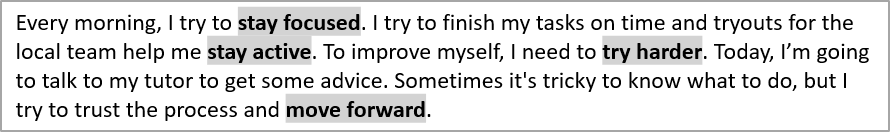

## **ภาพรวม**

บทความนี้แสดงวิธีกำหนดรูปแบบข้อความในงานนำเสนอ PowerPoint และ OpenDocument โดยใช้ Aspose.Slides for Node.js ผ่าน Java ครอบคลุมสีพื้นหลัง, ความโปร่งใส, ระยะห่างระหว่างอักขระ, คุณสมบัติของฟอนต์, การหมุน, ระยะห่างระยะย่อหน้า, พฤติกรรม autofit, การยึดเหนี่ยวข้อความ, จุดหยุดแท็บ, และการตั้งค่าภาษา

หากไม่ได้ระบุเป็นอย่างอื่น ตัวอย่างจะใช้ [sample.pptx](sample.pptx) รูปแบบแรกบนสไลด์แรกเป็นกล่องข้อความและย่อหน้แรกของมันมีข้อความที่แสดงด้านล่าง ดัชนีสไลด์และรูปร่างใช้ค่าตั้งแต่ศูนย์ ตัวอย่างที่เลือกส่วนที่เป็นตัวหนาจะใช้การจัดรูปแบบที่มีผล รวมถึงการสืบทอดการจัดรูปแบบตัวหนา:


เพื่อค้นหาและไฮไลต์ข้อความตามตัวอักษรหรือการจับคู่แบบ regular-expression ดูที่ [Search and Replace Text](/slides/th/nodejs-java/search-and-replace-text/)

## **กำหนดสีพื้นหลังของข้อความ**

ใช้ [ParagraphFormat.getDefaultPortionFormat](https://reference.aspose.com/slides/nodejs-java/aspose.slides/paragraphformat/#getDefaultPortionFormat) เพื่อกำหนดสีไฮไลต์เริ่มต้นสำหรับย่อหน้า หรือใช้ [BasePortionFormat.getHighlightColor](https://reference.aspose.com/slides/nodejs-java/aspose.slides/baseportionformat/#getHighlightColor) สำหรับส่วนข้อความแต่ละส่วน

ตัวอย่างต่อไปตั้งค่าไฮไลต์สีเทาอ่อนเป็นค่าเริ่มต้นสำหรับย่อหน้าแรก สีไฮไลต์ที่กำหนดโดยตรงบนส่วนข้อความแต่ละส่วนจะมีลำดับความสำคัญเหนือค่าเริ่มต้นนี้:

```javascript
const aspose = { slides: require("aspose.slides.via.java") };
const java = require("java");

const presentation = new aspose.slides.Presentation("sample.pptx");
try {
    const slide = presentation.getSlides().get_Item(0);

    const autoShape = slide.getShapes().get_Item(0);
    const paragraph = autoShape.getTextFrame().getParagraphs().get_Item(0);

    // กำหนดสีไฮไลท์สำหรับย่อหน้าทั้งหมด.
    paragraph.getParagraphFormat().getDefaultPortionFormat().getHighlightColor().setColor(java.getStaticFieldValue("java.awt.Color", "LIGHT_GRAY"));

    presentation.save("gray_paragraph.pptx", aspose.slides.SaveFormat.Pptx);
} finally {
    presentation.dispose();
}
```

ผลลัพธ์:


ตัวอย่างโค้ดด้านล่างแสดงวิธีตั้งค่าสีพื้นหลังสำหรับ **ส่วนข้อความที่มีฟอนต์ตัวหนา**:

```javascript
const aspose = { slides: require("aspose.slides.via.java") };
const java = require("java");

const presentation = new aspose.slides.Presentation("sample.pptx");
try {
    const slide = presentation.getSlides().get_Item(0);

    const autoShape = slide.getShapes().get_Item(0);
    const paragraph = autoShape.getTextFrame().getParagraphs().get_Item(0);
    const portions = paragraph.getPortions();
    const portionCount = portions.getCount();

    for (let portionIndex = 0; portionIndex < portionCount; portionIndex++) {
        const portion = portions.get_Item(portionIndex);
        if (portion.getPortionFormat().getEffective().getFontBold()) {
            // ตั้งค่าสีไฮไลท์สำหรับส่วนข้อความ.
            portion.getPortionFormat().getHighlightColor().setColor(java.getStaticFieldValue("java.awt.Color", "LIGHT_GRAY"));
        }
    }

    presentation.save("gray_text_portions.pptx", aspose.slides.SaveFormat.Pptx);
} finally {
    presentation.dispose();
}
```

ผลลัพธ์:



## **จัดแนวย่อหน้าข้อความ**

ใช้ [ParagraphFormat.setAlignment](https://reference.aspose.com/slides/nodejs-java/aspose.slides/paragraphformat/#setAlignment) เพื่อกำหนดการจัดแนวย่อหน้าในกรอบข้อความ ค่าที่ใช้ได้ ได้แก่ การจัดกึ่งกลาง, การจัดชิดซ้าย, การจัดชิดขวา, การจัดเต็มแนว และอื่น ๆ

ตัวอย่างโค้ดต่อไปแสดงวิธีจัดแนวย่อหน้าให้อยู่ **กึ่งกลาง**:

```javascript
const aspose = { slides: require("aspose.slides.via.java") };

const presentation = new aspose.slides.Presentation("sample.pptx");
try {
    const slide = presentation.getSlides().get_Item(0);

    const autoShape = slide.getShapes().get_Item(0);
    const paragraph = autoShape.getTextFrame().getParagraphs().get_Item(0);

    // ตั้งค่าการจัดแนวของย่อหน้าเป็นกึ่งกลาง.
    paragraph.getParagraphFormat().setAlignment(aspose.slides.TextAlignment.Center);

    presentation.save("aligned_paragraph.pptx", aspose.slides.SaveFormat.Pptx);
} finally {
    presentation.dispose();
}
```

ผลลัพธ์:


## **จัดแนวฟอนต์ภายในบรรทัด**

ใช้ [ParagraphFormat.setFontAlignment](https://reference.aspose.com/slides/nodejs-java/aspose.slides/paragraphformat/#setFontAlignment) เพื่อจัดแนวแนวดิ่งของส่วนข้อความที่มีขนาดฟอนต์แตกต่างกันภายในบรรทัด การตั้งค่านี้ใช้กับย่อหน้าทั้งหมดและควบคุมการจัดแนวภายในแต่ละบรรทัดของย่อหน้า

ตัวอย่างต่อไปเป็นโค้ดที่สร้างกล่องข้อความสี่กล่องที่มีป้ายกำกับบนสไลด์เดียว แต่ละย่อหน้ามีข้อความเดียวกันที่ขนาด 18, 36, และ 54 จุด โดยมีการจัดแนวฟอนต์ที่แตกต่างกัน ใช้ฟอนต์ Arial ปิดการทำ autofit และการตัดบรรทัด และทำให้กรอบข้อความใหญ่พอที่จะใส่บรรทัดเดียว

```javascript
const aspose = { slides: require("aspose.slides.via.java") };
const java = require("java");

const presentation = new aspose.slides.Presentation();
try {
    const slide = presentation.getSlides().get_Item(0);

    const alignments = [aspose.slides.FontAlignment.Baseline, aspose.slides.FontAlignment.Top, aspose.slides.FontAlignment.Center, aspose.slides.FontAlignment.Bottom];
    const alignmentNames = ["Baseline", "Top", "Center", "Bottom"];
    const fontSizes = [18, 36, 54];

    for (let i = 0; i < alignments.length; i++) {
        const shape = slide.getShapes().addAutoShape(aspose.slides.ShapeType.Rectangle, 30, 20 + i * 130, 660, 120);
        shape.getFillFormat().setFillType(java.newByte(aspose.slides.FillType.NoFill));
        shape.getLineFormat().getFillFormat().setFillType(java.newByte(aspose.slides.FillType.NoFill));

        const textFrame = shape.getTextFrame();
        textFrame.getTextFrameFormat().setAnchoringType(java.newByte(aspose.slides.TextAnchorType.Top));
        textFrame.getTextFrameFormat().setAutofitType(java.newByte(aspose.slides.TextAutofitType.None));
        textFrame.getTextFrameFormat().setWrapText(java.newByte(aspose.slides.NullableBool.False));

        const label = textFrame.getParagraphs().get_Item(0);
        label.setText(alignmentNames[i]);
        label.getParagraphFormat().setAlignment(aspose.slides.TextAlignment.Left);
        label.getParagraphFormat().getDefaultPortionFormat().setFontHeight(14);
        label.getParagraphFormat().getDefaultPortionFormat().setLatinFont(new aspose.slides.FontData("Arial"));
        label.getParagraphFormat().getDefaultPortionFormat().getFillFormat().setFillType(java.newByte(aspose.slides.FillType.Solid));
        label.getParagraphFormat().getDefaultPortionFormat().getFillFormat().getSolidFillColor().setColor(java.getStaticFieldValue("java.awt.Color", "GRAY"));

        const paragraph = new aspose.slides.Paragraph();
        paragraph.getParagraphFormat().setFontAlignment(alignments[i]);
        paragraph.getParagraphFormat().setAlignment(aspose.slides.TextAlignment.Left);
        paragraph.getParagraphFormat().getDefaultPortionFormat().setLatinFont(new aspose.slides.FontData("Arial"));
        paragraph.getParagraphFormat().getDefaultPortionFormat().getFillFormat().setFillType(java.newByte(aspose.slides.FillType.Solid));
        paragraph.getParagraphFormat().getDefaultPortionFormat().getFillFormat().getSolidFillColor().setColor(java.getStaticFieldValue("java.awt.Color", "BLACK"));

        for (const fontSize of fontSizes) {
            const portion = new aspose.slides.Portion("Ag ");
            portion.getPortionFormat().setFontHeight(fontSize);
            paragraph.getPortions().add(portion);
        }

        textFrame.getParagraphs().add(paragraph);
    }

    presentation.save("font_alignment.pptx", aspose.slides.SaveFormat.Pptx);
} finally {
    presentation.dispose();
}
```

ผลลัพธ์:


การจัดแนวฟอนต์ใช้ข้อมูลเมตริกของฟอนต์ ดังนั้นขอบของตัวอักษรแต่ละตัวอาจไม่ตรงกันอย่างสมบูรณ์ ตัวอย่างรวมตัวอักษรพิมพ์ใหญ่และตัวที่มีส่วนส่วนล่างเพื่อแสดงความแตกต่างระหว่าง baseline กับ bottom การมีฟอนต์และการแทนที่ฟอนต์, ตัวอักษรที่ใช้, และความแตกต่างของขนาดฟอนต์มีผลต่อผลลัพธ์ ขนาดกรอบ, ระยะขอบ, ระยะห่างบรรทัด, การตัดบรรทัด, และการทำ autofit ยังส่งผลต่อการจัดวาง; ควรใช้ฟอนต์และการตั้งค่าแนวเดียวกันเมื่อเปรียบเทียบโหมดต่าง ๆ

การตั้งค่านี้แตกต่างจาก [ParagraphFormat.setAlignment](https://reference.aspose.com/slides/nodejs-java/aspose.slides/paragraphformat/#setAlignment) ซึ่งควบคุมการจัดแนวแนวนอนของย่อหน้า และ [TextFrameFormat.setAnchoringType](https://reference.aspose.com/slides/nodejs-java/aspose.slides/textframeformat/#setAnchoringType) ซึ่งกำหนดตำแหน่งบล็อกข้อความในแนวตั้งภายในรูปร่าง การจัดรูปแบบ superscript และ subscript ผ่าน [BasePortionFormat.setEscapement](https://reference.aspose.com/slides/nodejs-java/aspose.slides/baseportionformat/#setEscapement) จะย้ายส่วนข้อความแต่ละส่วนสัมพันธ์กับ baseline แทนการตั้งค่าการจัดแนวฟอนต์ของบรรทัดย่อหน้า

## **กำหนดความโปร่งใสของข้อความ**

ความโปร่งใสของข้อความควบคุมผ่านค่าคอมโพเนนท์ alpha ของสีที่กำหนดให้กับ [BasePortionFormat.getFillFormat](https://reference.aspose.com/slides/nodejs-java/aspose.slides/baseportionformat/#getFillFormat) ตัวอย่างต่อไป `alpha = 50` เป็นค่าช่อง alpha ของ ARGB ในช่วง 0–255 ไม่ได้เป็นเปอร์เซ็นต์ความโปร่งใส

ตัวอย่างโค้ดต่อไปแสดงวิธีใช้ความโปร่งใสกับ **ย่อหน้าทั้งหมด**:

```javascript
const aspose = { slides: require("aspose.slides.via.java") };
const java = require("java");

const alpha = 50;
const transparentBlack = java.newInstanceSync("java.awt.Color", 0, 0, 0, alpha);
const presentation = new aspose.slides.Presentation("sample.pptx");
try {
    const slide = presentation.getSlides().get_Item(0);

    const autoShape = slide.getShapes().get_Item(0);
    const paragraph = autoShape.getTextFrame().getParagraphs().get_Item(0);
    const fillFormat = paragraph.getParagraphFormat().getDefaultPortionFormat().getFillFormat();

    // ตั้งค่าสีเติมของข้อความเป็นสีโปร่งใส.
    fillFormat.setFillType(java.newByte(aspose.slides.FillType.Solid));
    fillFormat.getSolidFillColor().setColor(transparentBlack);

    presentation.save("transparent_paragraph.pptx", aspose.slides.SaveFormat.Pptx);
} finally {
    presentation.dispose();
}
```

ผลลัพธ์:


ตัวอย่างโค้ดต่อไปแสดงวิธีใช้ความโปร่งใสกับ **ส่วนข้อความที่มีฟอนต์ตัวหนา**:

```javascript
const aspose = { slides: require("aspose.slides.via.java") };
const java = require("java");

const alpha = 50;
const transparentBlack = java.newInstanceSync("java.awt.Color", 0, 0, 0, alpha);
const presentation = new aspose.slides.Presentation("sample.pptx");
try {
    const slide = presentation.getSlides().get_Item(0);

    const autoShape = slide.getShapes().get_Item(0);
    const paragraph = autoShape.getTextFrame().getParagraphs().get_Item(0);
    const portions = paragraph.getPortions();
    const portionCount = portions.getCount();

    for (let portionIndex = 0; portionIndex < portionCount; portionIndex++) {
        const portion = portions.get_Item(portionIndex);
        if (portion.getPortionFormat().getEffective().getFontBold()) {
            const fillFormat = portion.getPortionFormat().getFillFormat();

            // ตั้งค่าความโปร่งใสของส่วนข้อความ.
            fillFormat.setFillType(java.newByte(aspose.slides.FillType.Solid));
            fillFormat.getSolidFillColor().setColor(transparentBlack);
        }
    }

    presentation.save("transparent_text_portions.pptx", aspose.slides.SaveFormat.Pptx);
} finally {
    presentation.dispose();
}
```

ผลลัพธ์:


## **กำหนดระยะห่างระหว่างอักขระของข้อความ**

ใช้ [BasePortionFormat.setSpacing](https://reference.aspose.com/slides/nodejs-java/aspose.slides/baseportionformat/#setSpacing) เพื่อขยายหรือย่อตัวอักษรในกล่องข้อความ ตัวอย่างเพิ่มระยะห่าง 3 จุด; ค่าติดลบทำให้ตัวอักษรถูกย่อเข้าหากัน

โค้ด JavaScript ด้านล่างแสดงวิธีขยายระยะห่างอักขระใน **ย่อหน้าทั้งหมด**:

```javascript
const aspose = { slides: require("aspose.slides.via.java") };

const presentation = new aspose.slides.Presentation("sample.pptx");
try {
    const slide = presentation.getSlides().get_Item(0);

    const autoShape = slide.getShapes().get_Item(0);
    const paragraph = autoShape.getTextFrame().getParagraphs().get_Item(0);

    // หมายเหตุ: ใช้ค่าติดลบเพื่อบีบอัดระยะห่างระหว่างอักขระ.
    paragraph.getParagraphFormat().getDefaultPortionFormat().setSpacing(3); // ขยายระยะห่างอักขระ.

    presentation.save("character_spacing_in_paragraph.pptx", aspose.slides.SaveFormat.Pptx);
} finally {
    presentation.dispose();
}
```

ผลลัพธ์:


ตัวอย่างโค้ดต่อไปแสดงวิธีขยายระยะห่างอักขระใน **ส่วนข้อความที่มีฟอนต์ตัวหนา**:

```javascript
const aspose = { slides: require("aspose.slides.via.java") };

const presentation = new aspose.slides.Presentation("sample.pptx");
try {
    const slide = presentation.getSlides().get_Item(0);

    const autoShape = slide.getShapes().get_Item(0);
    const paragraph = autoShape.getTextFrame().getParagraphs().get_Item(0);
    const portions = paragraph.getPortions();
    const portionCount = portions.getCount();

    for (let portionIndex = 0; portionIndex < portionCount; portionIndex++) {
        const portion = portions.get_Item(portionIndex);
        if (portion.getPortionFormat().getEffective().getFontBold()) {
            // หมายเหตุ: ใช้ค่าติดลบเพื่อบีบอัดระยะห่างระหว่างอักขระ.
            portion.getPortionFormat().setSpacing(3); // ขยายระยะห่างอักขระ.
        }
    }

    presentation.save("character_spacing_in_text_portions.pptx", aspose.slides.SaveFormat.Pptx);
} finally {
    presentation.dispose();
}
```

ผลลัพธ์:


### **ปิดการใช้ Kerning สำหรับฟอนต์เฉพาะ**

ในบางกรณี ข้อความที่แสดงโดย Aspose.Slides อาจดูแน่นกว่าข้อความเดียวกันที่แสดงใน PowerPoint เนื่องจาก PowerPoint อาจละเว้นข้อมูล kerning ของฟอนต์บางตัว แม้ว่าฟอนต์จะมีข้อมูล kerning ที่ถูกต้องและเปิดใช้งาน kerning ในการตั้งค่าของ PowerPoint

เพื่อให้ผลลัพธ์ที่แสดงใกล้เคียงกับ PowerPoint มากขึ้น คุณสามารถปิดการใช้ kerning สำหรับส่วนข้อความที่ใช้ฟอนต์นั้น ๆ ตั้งค่า [BasePortionFormat.setKerningMinimalSize](https://reference.aspose.com/slides/nodejs-java/aspose.slides/baseportionformat/#setKerningMinimalSize) ให้มีค่ามากกว่าขนาดฟอนต์จริง ตัวอย่างนี้ต้องใช้ไฟล์ “presentation.pptx” ที่มีกล่องข้อความเป็นรูปร่างแรกบนสไลด์แรก ตรวจสอบชื่อฟอนต์ที่มีผล รวมถึงฟอนต์ที่สืบทอด และตั้งค่าขีดจำกัด 100 จุดสำหรับส่วนที่ใช้ Roboto การตั้งค่านี้จะปิด kerning สำหรับส่วนที่ใช้ฟอนต์ขนาดต่ำกว่า 100 จุด:

```javascript
const aspose = { slides: require("aspose.slides.via.java") };

const presentation = new aspose.slides.Presentation("presentation.pptx");
try {
    const slide = presentation.getSlides().get_Item(0);

    const autoShape = slide.getShapes().get_Item(0);
    const paragraphs = autoShape.getTextFrame().getParagraphs();
    const paragraphCount = paragraphs.getCount();
    const targetFont = "Roboto";

    for (let paragraphIndex = 0; paragraphIndex < paragraphCount; paragraphIndex++) {
        const portions = paragraphs.get_Item(paragraphIndex).getPortions();
        const portionCount = portions.getCount();

        for (let portionIndex = 0; portionIndex < portionCount; portionIndex++) {
            const portion = portions.get_Item(portionIndex);
            const portionFormat = portion.getPortionFormat().getEffective();
            const latinFont = portionFormat.getLatinFont();
            const eastAsianFont = portionFormat.getEastAsianFont();
            const complexScriptFont = portionFormat.getComplexScriptFont();

            if ((latinFont !== null && latinFont.getFontName() === targetFont) ||
                (eastAsianFont !== null && eastAsianFont.getFontName() === targetFont) ||
                (complexScriptFont !== null && complexScriptFont.getFontName() === targetFont)) {
                portion.getPortionFormat().setKerningMinimalSize(100);
            }
        }
    }

    presentation.save("output.pptx", aspose.slides.SaveFormat.Pptx);
} finally {
    presentation.dispose();
}
```

สำหรับข้อความที่ตรงกับเกณฑ์นี้ การตั้งค่านี้จะป้องกันการใช้ kerning และช่วยให้การเรนเดอร์ของ Aspose.Slides สอดคล้องกับการแสดงผลของ PowerPoint สำหรับฟอนต์ที่ได้รับผลกระทบจากพฤติกรรมเฉพาะของ PowerPoint

## **จัดการคุณสมบัติฟอนต์ของข้อความ**

คุณสมบัติฟอนต์สามารถกำหนดได้ที่ระดับย่อหน้าโดยใช้ [ParagraphFormat.getDefaultPortionFormat](https://reference.aspose.com/slides/nodejs-java/aspose.slides/paragraphformat/#getDefaultPortionFormat) หรือบนส่วนข้อความแต่ละส่วนโดยใช้ [PortionFormat](https://reference.aspose.com/slides/nodejs-java/aspose.slides/portionformat/)

ตัวอย่างต่อไปกำหนดฟอนต์เริ่มต้นของย่อหน้าแรกเป็น Times New Roman ขนาด 12 จุด พร้อมตัวหนา, ตัวเอียง, และขีดเส้นจุด สีไฮไลท์บนส่วนข้อความแต่ละส่วนจะมีลำดับความสำคัญเหนือค่าเริ่มต้นเหล่านี้:

```javascript
const aspose = { slides: require("aspose.slides.via.java") };
const java = require("java");

const presentation = new aspose.slides.Presentation("sample.pptx");
try {
    const slide = presentation.getSlides().get_Item(0);

    const autoShape = slide.getShapes().get_Item(0);
    const paragraph = autoShape.getTextFrame().getParagraphs().get_Item(0);
    const defaultPortionFormat = paragraph.getParagraphFormat().getDefaultPortionFormat();

    // ตั้งค่าคุณสมบัติฟอนต์สำหรับย่อหน้า.
    defaultPortionFormat.setFontHeight(12);
    defaultPortionFormat.setFontBold(java.newByte(aspose.slides.NullableBool.True));
    defaultPortionFormat.setFontItalic(java.newByte(aspose.slides.NullableBool.True));
    defaultPortionFormat.setFontUnderline(java.newByte(aspose.slides.TextUnderlineType.Dotted));
    defaultPortionFormat.setLatinFont(new aspose.slides.FontData("Times New Roman"));

    presentation.save("font_properties_for_paragraph.pptx", aspose.slides.SaveFormat.Pptx);
} finally {
    presentation.dispose();
}
```

ผลลัพธ์:


ตัวอย่างต่อไปใช้ Times New Roman ขนาด 13 จุด, ตัวเอียง, และขีดเส้นจุดกับส่วนข้อความที่มีการจัดรูปแบบเป็นตัวหนา:

```javascript
const aspose = { slides: require("aspose.slides.via.java") };
const java = require("java");

const presentation = new aspose.slides.Presentation("sample.pptx");
try {
    const slide = presentation.getSlides().get_Item(0);

    const autoShape = slide.getShapes().get_Item(0);
    const paragraph = autoShape.getTextFrame().getParagraphs().get_Item(0);
    const portions = paragraph.getPortions();
    const portionCount = portions.getCount();

    for (let portionIndex = 0; portionIndex < portionCount; portionIndex++) {
        const portion = portions.get_Item(portionIndex);
        if (portion.getPortionFormat().getEffective().getFontBold()) {
            const portionFormat = portion.getPortionFormat();

            // ตั้งค่าคุณสมบัติฟอนต์สำหรับส่วนข้อความ.
            portionFormat.setFontHeight(13);
            portionFormat.setFontItalic(java.newByte(aspose.slides.NullableBool.True));
            portionFormat.setFontUnderline(java.newByte(aspose.slides.TextUnderlineType.Dotted));
            portionFormat.setLatinFont(new aspose.slides.FontData("Times New Roman"));
        }
    }

    presentation.save("font_properties_for_text_portions.pptx", aspose.slides.SaveFormat.Pptx);
} finally {
    presentation.dispose();
}
```

ผลลัพธ์:


## **ควบคุมการทำ Normalisation ความสูงของข้อความ**

ใช้ [BasePortionFormat.setNormaliseHeight](https://reference.aspose.com/slides/nodejs-java/aspose.slides/baseportionformat/#setNormaliseHeight) เมื่อต้องการทำ Typography ของเทมเพลตหรือศึกษาแตกต่างของความสูงอักขระ ใน PowerPoint การเปิดใช้งานการทำ Normalisation จะยืดหรือบีบอักขระแต่ละตัวในแนวตั้งเพื่อให้มีความสูงที่มองเห็นได้สม่ำเสมอภายในส่วนข้อความ ไม่ได้รับประกันว่าความสูงของข้อความจะเท่ากันระหว่างฟอนต์ต่าง ๆ

ตั้งค่าคุณสมบัตินี้เป็น [NullableBool.True หรือ False](https://reference.aspose.com/slides/nodejs-java/aspose.slides/nullablebool/) เพื่อเปิดหรือปิดการทำ Normalisation อย่างชัดเจน `NullableBool.NotDefined` จะปล่อยให้การตั้งค่าท้องถิ่นไม่ถูกกำหนด sehingga ส่วนข้อความสืบทอดค่าจาก [getDefaultPortionFormat](https://reference.aspose.com/slides/nodejs-java/aspose.slides/paragraphformat/#getDefaultPortionFormat) ของย่อหน้า ไม่ได้หมายถึง `False` ใช้ [PortionFormat.getEffective](https://reference.aspose.com/slides/nodejs-java/aspose.slides/portionformat/#getEffective) และอ่าน [IBasePortionFormatEffectiveData.getNormaliseHeight](https://reference.aspose.com/slides/java/com.aspose.slides/ibaseportionformateffectivedata/#getNormaliseHeight--) เพื่อรับค่าบูลีนที่ได้จากการวิเคราะห์

ตัวอย่างต่อไปเป็นโค้ดที่ต้องติดตั้ง **Arial** สร้างบล็อกข้อความสองบล็อกที่มีอักษรพิมพ์ใหญ่, พิมพ์เล็ก, ตัวที่มีส่วนล่าง, และอักขระที่มีเครื่องหมายขาดในขนาด 54 จุด ย่อหน้า ทั้งสองเปิดการทำ Normalisation โดยค่าเริ่มต้น ส่วนบนปิดการทำ Normalisation อย่างชัดเจน ส่วนล่างสืบทอดการตั้งค่า ขนาดกรอบ, ระยะขอบ, และระยะห่างย่อหน้าตรงกัน โดยปิดการตัดบรรทัดและการทำ autofit เพื่อให้การเปรียบเทียบคงที่ ตัวอย่างพิมพ์ `False: false` และ `NotDefined: true` แล้วบันทึกเป็น “text_height_normalization.pptx”

```javascript
const aspose = { slides: require("aspose.slides.via.java") };
const java = require("java");

const presentation = new aspose.slides.Presentation();
try {
    const slide = presentation.getSlides().get_Item(0);

    const settings = [aspose.slides.NullableBool.False, aspose.slides.NullableBool.NotDefined];
    const settingNames = ["False", "NotDefined"];

    for (let i = 0; i < settings.length; i++) {
        const shape = slide.getShapes().addAutoShape(aspose.slides.ShapeType.Rectangle, 30, 60 + i * 200, 660, 150);
        shape.getFillFormat().setFillType(java.newByte(aspose.slides.FillType.NoFill));
        shape.getLineFormat().getFillFormat().setFillType(java.newByte(aspose.slides.FillType.NoFill));

        const textFrame = shape.getTextFrame();
        textFrame.setText("Hxgjpq ÅÉ 0123");
        textFrame.getTextFrameFormat().setAutofitType(java.newByte(aspose.slides.TextAutofitType.None));
        textFrame.getTextFrameFormat().setWrapText(java.newByte(aspose.slides.NullableBool.False));
        textFrame.getTextFrameFormat().setAnchoringType(java.newByte(aspose.slides.TextAnchorType.Top));
        textFrame.getTextFrameFormat().setMarginTop(0);
        textFrame.getTextFrameFormat().setMarginLeft(0);

        const paragraph = textFrame.getParagraphs().get_Item(0);
        paragraph.getParagraphFormat().setAlignment(aspose.slides.TextAlignment.Left);
        paragraph.getParagraphFormat().setSpaceBefore(0);
        paragraph.getParagraphFormat().setSpaceAfter(0);
        paragraph.getParagraphFormat().setSpaceWithin(100);
        paragraph.getParagraphFormat().getDefaultPortionFormat().setNormaliseHeight(java.newByte(aspose.slides.NullableBool.True));

        const portion = paragraph.getPortions().get_Item(0);
        const font = new aspose.slides.FontData("Arial");
        portion.getPortionFormat().setLatinFont(font);
        portion.getPortionFormat().setFontHeight(54);
        portion.getPortionFormat().getFillFormat().setFillType(java.newByte(aspose.slides.FillType.Solid));
        const textColor = java.getStaticFieldValue("java.awt.Color", "BLACK");
        portion.getPortionFormat().getFillFormat().getSolidFillColor().setColor(textColor);
        portion.getPortionFormat().setNormaliseHeight(java.newByte(settings[i]));

        console.log(settingNames[i] + ": " + portion.getPortionFormat().getEffective().getNormaliseHeight());
    }

    presentation.save("text_height_normalization.pptx", aspose.slides.SaveFormat.Pptx);
} finally {
    presentation.dispose();
}
```

ภาพต่อไปส่งออกจากงานนำเสนอที่บันทึกไว้ แถวบนมี Normalisation ปิด (`False`) แถวล่างสืบทอดการเปิด (`NotDefined` → `True`) ให้ติดตั้ง Arial เพื่อสร้างลักษณะนี้


การทำ Normalisation เปลี่ยนความสูงของอักขระโดยไม่เปลี่ยนค่าที่กำหนดให้กับ [getFontHeight](https://reference.aspose.com/slides/nodejs-java/aspose.slides/baseportionformat/#getFontHeight) ซึ่งระบุขนาดฟอนต์ในจุด ย่อหน้า [setSpaceWithin](https://reference.aspose.com/slides/nodejs-java/aspose.slides/paragraphformat/#setSpaceWithin) ควบคุมระยะห่างบรรทัด ส่วน [setAutofitType](https://reference.aspose.com/slides/nodejs-java/aspose.slides/textframeformat/#setAutofitType) ของกรอบข้อความควบคุมวิธีที่ข้อความหรือคอนเทนเนอร์ปรับขนาดเพื่อให้พอดีกัน การตั้งค่าเหล่านี้มีจุดประสงค์ต่างกันและอาจส่งผลต่อการจัดวางโดยรวมโดยอิสระ สำหรับรายละเอียดเพิ่มเติมเกี่ยวกับการจัดรูปแบบย่อหน้าและการสืบทอด ดูที่ [Manage Paragraph](/slides/th/nodejs-java/manage-paragraph/)

## **เพิ่มและลบ Strikethrough**

ใช้ [BasePortionFormat.setStrikethroughType](https://reference.aspose.com/slides/nodejs-java/aspose.slides/baseportionformat/#setStrikethroughType) บนส่วนข้อความเพื่อแสดงการแก้ไข, คำที่ถูกยกเลิก, หรือราคาก่อนหน้าที่ไม่ต้องลบข้อความเดิม ตั้งค่าเป็น [TextStrikethroughType.Single หรือ Double](https://reference.aspose.com/slides/nodejs-java/aspose.slides/textstrikethroughtype/) เพื่อให้เส้นหนึ่งหรือสองเส้นผ่านข้อความ

เพื่อเอา Strikethrough ออก ให้ใช้ [TextStrikethroughType.None](https://reference.aspose.com/slides/nodejs-java/aspose.slides/textstrikethroughtype/#None) ซึ่งจะปิดผลกระทบนี้อย่างชัดเจน แม้ว่าการจัดรูปแบบโดยรอบจะกำหนด Strikethrough ก็ตาม ตรงกันข้ามกับ [TextStrikethroughType.NotDefined](https://reference.aspose.com/slides/nodejs-java/aspose.slides/textstrikethroughtype/#NotDefined) ซึ่งปล่อยให้การตั้งค่าท้องถิ่นไม่ถูกกำหนด ทำให้ส่วนข้อความสืบทอดการจัดรูปแบบจากย่อหน้า แต่ไม่ได้รับประกันว่าจะไม่มี Strikethrough ใช้ [PortionFormat.getEffective](https://reference.aspose.com/slides/nodejs-java/aspose.slides/portionformat/#getEffective) เพื่ออ่านการจัดรูปแบบที่ได้รวมถึงค่าที่สืบทอด

ตัวอย่างต่อไปสร้างการเปรียบเทียบราคาสามแบบ ย่อหน้าแต่ละย่อมามีส่วนข้อความแยกสำหรับป้ายกำกับ, ราคาก่อนหน้า, และราคาปัจจุบัน ทำให้เฉพาะราคาก่อนหน้าได้รับผลกระทบ แถวแรกเพิ่มและลบ Strikethrough; แถวอื่น ๆ คงไว้กับ Strikethrough แบบเดี่ยวและคู่ การเปลี่ยนการตั้งค่านี้ช่วยให้ข้อความและการจัดรูปแบบอื่น ๆ เช่น ตัวหนาของราคาก่อนหน้า ยังคงอยู่

```javascript
const aspose = { slides: require("aspose.slides.via.java") };
const java = require("java");

const presentation = new aspose.slides.Presentation();
try {
    const slide = presentation.getSlides().get_Item(0);

    const shape = slide.getShapes().addAutoShape(aspose.slides.ShapeType.Rectangle, 50, 50, 620, 220);
    shape.getFillFormat().setFillType(java.newByte(aspose.slides.FillType.NoFill));
    shape.getLineFormat().getFillFormat().setFillType(java.newByte(aspose.slides.FillType.NoFill));
    shape.getTextFrame().getParagraphs().clear();

    const labels = ["None: ", "Single: ", "Double: "];

    for (const label of labels) {
        const paragraph = new aspose.slides.Paragraph();
        paragraph.getParagraphFormat().setAlignment(aspose.slides.TextAlignment.Left);
        paragraph.getParagraphFormat().setSpaceAfter(20);

        const format = paragraph.getParagraphFormat().getDefaultPortionFormat();
        format.setFontHeight(28);
        const font = new aspose.slides.FontData("Arial");
        format.setLatinFont(font);
        format.getFillFormat().setFillType(java.newByte(aspose.slides.FillType.Solid));
        const textColor = java.getStaticFieldValue("java.awt.Color", "BLACK");
        format.getFillFormat().getSolidFillColor().setColor(textColor);

        const labelPortion = new aspose.slides.Portion(label);
        paragraph.getPortions().add(labelPortion);

        const previousPrice = new aspose.slides.Portion("$100");
        previousPrice.getPortionFormat().setFontBold(java.newByte(aspose.slides.NullableBool.True));
        paragraph.getPortions().add(previousPrice);
        const currentPrice = new aspose.slides.Portion(" → $80");
        paragraph.getPortions().add(currentPrice);

        shape.getTextFrame().getParagraphs().add(paragraph);
    }

    const paragraphs = shape.getTextFrame().getParagraphs();

    // ใช้การขีดเส้น แล้วลบออกโดยเจาะจงจากราคาก่อนหน้าตัวแรก.
    paragraphs.get_Item(0).getPortions().get_Item(1).getPortionFormat().setStrikethroughType(java.newByte(aspose.slides.TextStrikethroughType.Single));
    paragraphs.get_Item(0).getPortions().get_Item(1).getPortionFormat().setStrikethroughType(java.newByte(aspose.slides.TextStrikethroughType.None));

    paragraphs.get_Item(1).getPortions().get_Item(1).getPortionFormat().setStrikethroughType(java.newByte(aspose.slides.TextStrikethroughType.Single));
    paragraphs.get_Item(2).getPortions().get_Item(1).getPortionFormat().setStrikethroughType(java.newByte(aspose.slides.TextStrikethroughType.Double));

    presentation.save("strikethrough.pptx", aspose.slides.SaveFormat.Pptx);
} finally {
    presentation.dispose();
}
```

ผลลัพธ์จากบนลงล่าง: ไม่มี Strikethrough, Strikethrough เดียว, และ Strikethrough คู่


## **ตั้งค่าการหมุนของข้อความ**

ใช้ [TextFrameFormat.setTextVerticalType](https://reference.aspose.com/slides/nodejs-java/aspose.slides/textframeformat/#setTextVerticalType) เพื่อกำหนดทิศทางข้อความที่กำหนดล่วงหน้าในรูปร่าง

โค้ดต่อไปตั้งค่าทิศทางข้อความในรูปร่างเป็น [TextVerticalType.Vertical270](https://reference.aspose.com/slides/nodejs-java/aspose.slides/textverticaltype/) ซึ่งหมุนข้อความ **90 องศาตามเข็มนาฬิกา*** (ควรเป็น *ทวนเข็มนาฬิกา*)

```javascript
const aspose = { slides: require("aspose.slides.via.java") };
const java = require("java");

const presentation = new aspose.slides.Presentation("sample.pptx");
try {
    const slide = presentation.getSlides().get_Item(0);

    const autoShape = slide.getShapes().get_Item(0);
    autoShape.getTextFrame().getTextFrameFormat().setTextVerticalType(java.newByte(aspose.slides.TextVerticalType.Vertical270));

    presentation.save("text_rotation.pptx", aspose.slides.SaveFormat.Pptx);
} finally {
    presentation.dispose();
}
```

ผลลัพธ์:


## **ตั้งค่าการหมุนแบบกำหนดเองสำหรับกรอบข้อความ**

ใช้ [TextFrameFormat.setRotationAngle](https://reference.aspose.com/slides/nodejs-java/aspose.slides/textframeformat/#setRotationAngle) เพื่อกำหนดมุมการหมุนแบบกำหนดเองสำหรับ [TextFrame](https://reference.aspose.com/slides/nodejs-java/aspose.slides/textframe/)

โค้ดต่อไปหมุนกรอบข้อความ 3 องศาตามเข็มนาฬิกาในรูปร่าง:

```javascript
const aspose = { slides: require("aspose.slides.via.java") };

const presentation = new aspose.slides.Presentation("sample.pptx");
try {
    const slide = presentation.getSlides().get_Item(0);

    const autoShape = slide.getShapes().get_Item(0);
    autoShape.getTextFrame().getTextFrameFormat().setRotationAngle(3);

    presentation.save("custom_text_rotation.pptx", aspose.slides.SaveFormat.Pptx);
} finally {
    presentation.dispose();
}
```

ผลลัพธ์:


## **ตั้งค่าระยะห่างบรรทัดของย่อหน้า**

Aspose.Slides มี [ParagraphFormat.setSpaceAfter](https://reference.aspose.com/slides/nodejs-java/aspose.slides/paragraphformat/#setSpaceAfter), [ParagraphFormat.setSpaceBefore](https://reference.aspose.com/slides/nodejs-java/aspose.slides/paragraphformat/#setSpaceBefore), และ [ParagraphFormat.setSpaceWithin](https://reference.aspose.com/slides/nodejs-java/aspose.slides/paragraphformat/#setSpaceWithin) เพื่อควบคุมระยะห่างย่อหน้า คุณสมบัติเหล่านี้ใช้ดังนี้

* ค่าเป็นบวกระบุระยะห่างบรรทัดเป็นเปอร์เซ็นต์ของความสูงบรรทัด
* ค่าเป็นลบระบุระยะห่างบรรทัดเป็นจุด

ตัวอย่างต่อไปตั้งค่าระยะห่างภายในย่อหน้าแรกเป็น 200% ของความสูงบรรทัด (สองเท่า):

```javascript
const aspose = { slides: require("aspose.slides.via.java") };

const presentation = new aspose.slides.Presentation("sample.pptx");
try {
    const slide = presentation.getSlides().get_Item(0);

    const autoShape = slide.getShapes().get_Item(0);

    const paragraph = autoShape.getTextFrame().getParagraphs().get_Item(0);
    paragraph.getParagraphFormat().setSpaceWithin(200);

    presentation.save("line_spacing.pptx", aspose.slides.SaveFormat.Pptx);
} finally {
    presentation.dispose();
}
```

ผลลัพธ์:


## **ควบคุมการตัดบรรทัด**

กฎการตัดบรรทัดของย่อ장은มีประโยชน์ในบล็อกข้อความแคบและการนำเสนอที่ผสม Latin และ East Asian ตัววิธีต่อไปเป็นของ [ParagraphFormat](https://reference.aspose.com/slides/nodejs-java/aspose.slides/paragraphformat/) ดังนั้นจึงใช้กับย่อหน้าเต็ม:

- [setLatinLineBreak](https://reference.aspose.com/slides/nodejs-java/aspose.slides/paragraphformat/#setLatinLineBreak) ควบคุมกฎการตัดบรรทัดของ Latin ในข้อความผสมอาจทำให้การตัดบรรทัดของ East Asian และเครื่องหมายวรรคตอนเปลี่ยนไปด้วย
- [setEastAsianLineBreak](https://reference.aspose.com/slides/nodejs-java/aspose.slides/paragraphformat/#setEastAsianLineBreak) ควบคุมกฎการตัดบรรทัดของ East Asian รวมถึงการจำกัดอักขระที่ขึ้นต้นหรือลงท้ายบรรทัด

กฎเหล่านี้ไม่ทดแทน [TextFrameFormat.setWrapText](https://reference.aspose.com/slides/nodejs-java/aspose.slides/textframeformat/#setWrapText) ที่เปิดใช้งานการตัดบรรทัดอัตโนมัติภายในกรอบข้อความ พวกมันมีผลต่อการจัดวางเมื่อมีการตัดบรรทัด; ไม่ได้แทรกอักขระการตัดบรรทัด การตัดบรรทัดโดยตรงบังคับให้เกิดบรรทัดใหม่ภายในย่อหน้าโดยอิสระจากความกว้างที่มี

ตัวอย่างต่อไปสร้างบล็อกข้อความแคบที่มี Chinese และ Latin ตั้งค่าตัวเลือกการตัดบรรทัดทั้งสองอย่างชัดเจนและบันทึกเป็น “line_breaking.pptx” เพื่อทดลองเปลี่ยนกฎใดกฎหนึ่งโดยรักษาการตั้งค่าอื่นคงที่ ตัวอย่างใช้ Arial 24 จุดและ SimSun พร้อมความกว้างกรอบ 160 จุดและระยะขอบแนวนอนของกรอบข้อความเป็นศูนย์ [TextFrameFormat.setAutofitType](https://reference.aspose.com/slides/nodejs-java/aspose.slides/textframeformat/#setAutofitType) ถูกเรียกด้วย [TextAutofitType.None](https://reference.aspose.com/slides/nodejs-java/aspose.slides/textautofittype/) เพื่อให้ขนาดข้อความและขนาดกรอบคงที่

```javascript
const aspose = { slides: require("aspose.slides.via.java") };
const java = require("java");

const presentation = new aspose.slides.Presentation();
try {
    const slide = presentation.getSlides().get_Item(0);

    const shape = slide.getShapes().addAutoShape(aspose.slides.ShapeType.Rectangle, 50, 50, 160, 300);
    shape.getFillFormat().setFillType(java.newByte(aspose.slides.FillType.NoFill));

    const textFrame = shape.getTextFrame();
    textFrame.getTextFrameFormat().setWrapText(java.newByte(aspose.slides.NullableBool.True));
    textFrame.getTextFrameFormat().setAutofitType(java.newByte(aspose.slides.TextAutofitType.None));
    textFrame.getTextFrameFormat().setMarginLeft(0);
    textFrame.getTextFrameFormat().setMarginRight(0);

    const paragraph = textFrame.getParagraphs().get_Item(0);
    paragraph.setText("中文排版测试，PowerPoint 中文演示。");

    const format = paragraph.getParagraphFormat();
    format.setAlignment(aspose.slides.TextAlignment.Left);
    format.getDefaultPortionFormat().setFontHeight(24);
    const latinFont = new aspose.slides.FontData("Arial");
    format.getDefaultPortionFormat().setLatinFont(latinFont);
    const eastAsianFont = new aspose.slides.FontData("SimSun");
    format.getDefaultPortionFormat().setEastAsianFont(eastAsianFont);
    format.getDefaultPortionFormat().getFillFormat().setFillType(java.newByte(aspose.slides.FillType.Solid));
    const textColor = java.getStaticFieldValue("java.awt.Color", "BLACK");
    format.getDefaultPortionFormat().getFillFormat().getSolidFillColor().setColor(textColor);
    format.setLatinLineBreak(java.newByte(aspose.slides.NullableBool.False));
    format.setEastAsianLineBreak(java.newByte(aspose.slides.NullableBool.True));

    presentation.save("line_breaking.pptx", aspose.slides.SaveFormat.Pptx);
} finally {
    presentation.dispose();
}
```

## **ควบคุม Hanging Punctuation**

[ParagraphFormat.setHangingPunctuation](https://reference.aspose.com/slides/nodejs-java/aspose.slides/paragraphformat/#setHangingPunctuation) ทำให้เครื่องหมายวรรคตอนที่เหมาะสมยืดออกไปเหนือขอบขวาของบรรทัดข้อความ แทนที่จะอยู่บรรทัดถัดไป ใช้กับย่อหน้าทั้งหมดและต่างจาก hanging indent

ตัวอย่างต่อไปเปิดใช้งาน hanging punctuation ในกรอบข้อความกว้าง 100 จุดและบันทึกเป็น “hanging_punctuation.pptx” ด้วย Arial 24 จุดและระยะขอบแนวนอนเป็นศูนย์ จุดสุดท้ายของประโยคคงอยู่หลัง “sentence” และยืดออกไปเหนือขอบขวา ของข้อความ ตั้งค่าคุณสมบัติเป็น [NullableBool.False](https://reference.aspose.com/slides/nodejs-java/aspose.slides/nullablebool/) เพื่อตรวจสอบ: ด้วยการตั้งค่านี้ จุดสุดท้ายจะอยู่ในบรรทัดแยกออกมา การตัดบรรทัดเปิดใช้งานและ autofit ปิดเพื่อคงความกว้างที่มี

```javascript
const aspose = { slides: require("aspose.slides.via.java") };
const java = require("java");

const presentation = new aspose.slides.Presentation();
try {
    const slide = presentation.getSlides().get_Item(0);

    const shape = slide.getShapes().addAutoShape(aspose.slides.ShapeType.Rectangle, 50, 50, 100, 200);
    shape.getFillFormat().setFillType(java.newByte(aspose.slides.FillType.NoFill));

    const textFrame = shape.getTextFrame();
    textFrame.getTextFrameFormat().setWrapText(java.newByte(aspose.slides.NullableBool.True));
    textFrame.getTextFrameFormat().setAutofitType(java.newByte(aspose.slides.TextAutofitType.None));
    textFrame.getTextFrameFormat().setMarginLeft(0);
    textFrame.getTextFrameFormat().setMarginRight(0);

    const paragraph = textFrame.getParagraphs().get_Item(0);
    paragraph.setText("Simple text, next sentence.");

    const format = paragraph.getParagraphFormat();
    format.setAlignment(aspose.slides.TextAlignment.Left);
    format.getDefaultPortionFormat().setFontHeight(24);
    const latinFont = new aspose.slides.FontData("Arial");
    format.getDefaultPortionFormat().setLatinFont(latinFont);
    format.getDefaultPortionFormat().getFillFormat().setFillType(java.newByte(aspose.slides.FillType.Solid));
    const textColor = java.getStaticFieldValue("java.awt.Color", "BLACK");
    format.getDefaultPortionFormat().getFillFormat().getSolidFillColor().setColor(textColor);
    format.setHangingPunctuation(java.newByte(aspose.slides.NullableBool.True));

    presentation.save("hanging_punctuation.pptx", aspose.slides.SaveFormat.Pptx);
} finally {
    presentation.dispose();
}
```

ไม่ใช่ทุกเครื่องหมายวรรคตอนจะสามารถ hanging ได้ เงื่อนไขฟอนต์และการจัดวางตามที่อธิบายในส่วน [ควบคุมการตัดบรรทัด](#control-line-breaking) ก็มีผลต่อการเปรียบเทียบนี้: การเปลี่ยนฟอนต์, ความกว้างที่ใช้, ระยะขอบ หรือการตั้งค่า autofit สามารถทำให้ความแตกต่างที่มองเห็นหายไป

## **กำหนดประเภท Autofit สำหรับกรอบข้อความ**

[TextFrameFormat.setAutofitType](https://reference.aspose.com/slides/nodejs-java/aspose.slides/textframeformat/#setAutofitType) กำหนดวิธีที่ข้อความทำงานเมื่อเกินขอบเขตของคอนเทนเนอร์ ใช้เพื่อควบคุมว่าข้อความจะย่อ, ล้น, หรือปรับขนาดรูปร่างโดยอัตโนมัติ ตัวอย่างต่อไปกำหนดให้รูปร่างปรับขนาดเพื่อให้พอดีกับข้อความและบันทึกผลเป็น “autofit_type.pptx”

```javascript
const aspose = { slides: require("aspose.slides.via.java") };
const java = require("java");

const presentation = new aspose.slides.Presentation("sample.pptx");
try {
    const slide = presentation.getSlides().get_Item(0);

    const autoShape = slide.getShapes().get_Item(0);
    autoShape.getTextFrame().getTextFrameFormat().setAutofitType(java.newByte(aspose.slides.TextAutofitType.Shape));

    presentation.save("autofit_type.pptx", aspose.slides.SaveFormat.Pptx);
} finally {
    presentation.dispose();
}
```

เพื่อดูจำนวนบรรทัดหลังการตัดบรรทัดอัตโนมัติและสังเกตการเปลี่ยนแปลงความกว้างของข้อความหรือรูปร่าง ให้ดูที่ [Count Rendered Lines](/slides/th/nodejs-java/manage-paragraph/) จำนวนบรรทัดเพียงอย่างเดียวไม่บ่งบอกว่าข้อความล้นคอนเทนเนอร์หรือไม่

## **กำหนดจุดยึดของกรอบข้อความ**

[TextFrameFormat.setAnchoringType](https://reference.aspose.com/slides/nodejs-java/aspose.slides/textframeformat/#setAnchoringType) กำหนดว่าข้อความจะวางตำแหน่งแนวตั้งภายในรูปร่างอย่างไร เช่น ที่บน, กลาง, หรือล่าง ตัวอย่างต่อไปยึดข้อความที่ด้านล่างของรูปร่างแรกและบันทึกผลเป็น “text_anchor.pptx”

```javascript
const aspose = { slides: require("aspose.slides.via.java") };
const java = require("java");

const presentation = new aspose.slides.Presentation("sample.pptx");
try {
    const slide = presentation.getSlides().get_Item(0);

    const autoShape = slide.getShapes().get_Item(0);
    autoShape.getTextFrame().getTextFrameFormat().setAnchoringType(java.newByte(aspose.slides.TextAnchorType.Bottom));

    presentation.save("text_anchor.pptx", aspose.slides.SaveFormat.Pptx);
} finally {
    presentation.dispose();
}
```

## **กำหนด Tabulation ของข้อความ**

ใช้ [ParagraphFormat.setDefaultTabSize](https://reference.aspose.com/slides/nodejs-java/aspose.slides/paragraphformat/#setDefaultTabSize) และ [ParagraphFormat.getTabs](https://reference.aspose.com/slides/nodejs-java/aspose.slides/paragraphformat/#getTabs) เพื่อกำหนดตำแหน่ง Tab ในย่อหน้า ตัวอย่างต่อไปตั้งค่าช่วง Tab เริ่มต้นเป็น 100 จุดและเพิ่ม Tab ซ้ายจัดที่ 30 จุด การตั้งค่านี้มีผลต่อข้อความที่มีอักขระ Tab

```javascript
const aspose = { slides: require("aspose.slides.via.java") };
const java = require("java");

const presentation = new aspose.slides.Presentation("sample.pptx");
try {
    const slide = presentation.getSlides().get_Item(0);

    const autoShape = slide.getShapes().get_Item(0);

    const paragraph = autoShape.getTextFrame().getParagraphs().get_Item(0);
    paragraph.getParagraphFormat().setDefaultTabSize(100);
    paragraph.getParagraphFormat().getTabs().add(30, java.newByte(aspose.slides.TabAlignment.Left));

    presentation.save("paragraph_tabs.pptx", aspose.slides.SaveFormat.Pptx);
} finally {
    presentation.dispose();
}
```

ผลลัพธ์:


## **กำหนดภาษาการตรวจสอบ (Proofing Language)**

Aspose.Slides มี [BasePortionFormat.setLanguageId](https://reference.aspose.com/slides/nodejs-java/aspose.slides/baseportionformat/#setLanguageId) ซึ่งช่วยให้คุณตั้งค่าภาษาการตรวจสอบสำหรับส่วนข้อความ ภาษาการตรวจสอบกำหนดภาษาที่ใช้ในการตรวจสอบการสะกดและไวยากรณ์ใน PowerPoint

ตัวอย่างต่อไปต้องการไฟล์ “presentation.pptx” ที่มีกล่องข้อความเป็นรูปร่างแรกบนสไลด์แรกและมีอย่างน้อยหนึ่งย่อหน้า จะเปลี่ยนเนื้อหาในย่อหน้าแรกเป็น “1。” ตั้งค่า SimSun เป็นฟอนต์และกำหนดภาษาการตรวจสอบเป็น Simplified Chinese (`zh-CN`) แล้วบันทึกเป็น “proofing_language.pptx”

```javascript
const aspose = { slides: require("aspose.slides.via.java") };

const presentation = new aspose.slides.Presentation("presentation.pptx");
try {
    const slide = presentation.getSlides().get_Item(0);

    const autoShape = slide.getShapes().get_Item(0);

    const paragraph = autoShape.getTextFrame().getParagraphs().get_Item(0);
    paragraph.getPortions().clear();

    const font = new aspose.slides.FontData("SimSun");
    const textPortion = new aspose.slides.Portion();
    textPortion.getPortionFormat().setComplexScriptFont(font);
    textPortion.getPortionFormat().setEastAsianFont(font);
    textPortion.getPortionFormat().setLatinFont(font);

    // กำหนด Id ของภาษาการพิสูจน์อักษร.
    textPortion.getPortionFormat().setLanguageId("zh-CN");

    textPortion.setText("1。");
    paragraph.getPortions().add(textPortion);

    presentation.save("proofing_language.pptx", aspose.slides.SaveFormat.Pptx);
} finally {
    presentation.dispose();
}
```

## **กำหนดภาษาดีฟอลต์**

ใช้ [LoadOptions.setDefaultTextLanguage](https://reference.aspose.com/slides/nodejs-java/aspose.slides/loadoptions/#setDefaultTextLanguage) เพื่อกำหนดภาษาดีฟอลต์สำหรับข้อความที่สร้างขณะโหลดหรือสร้างงานนำเสนอ ตัวอย่างต่อไปสร้างงานนำเสนอที่กำหนดภาษาอังกฤษสหรัฐเป็นภาษาดีฟอลต์สำหรับข้อความ เพิ่มกล่องข้อความและพิมพ์ `en-US` สำหรับส่วนข้อความแรกของมัน

```javascript
const aspose = { slides: require("aspose.slides.via.java") };

const loadOptions = new aspose.slides.LoadOptions();
loadOptions.setDefaultTextLanguage("en-US");

const presentation = new aspose.slides.Presentation(loadOptions);
try {
    const slide = presentation.getSlides().get_Item(0);

    // เพิ่มรูปสี่เหลี่ยมผืนผ้าใหม่พร้อมข้อความ.
    const shape = slide.getShapes().addAutoShape(aspose.slides.ShapeType.Rectangle, 20, 20, 150, 50);
    shape.getTextFrame().setText("Sample text");

    // ตรวจสอบภาษาของส่วนข้อความแรก.
    const portion = shape.getTextFrame().getParagraphs().get_Item(0).getPortions().get_Item(0);
    console.log(portion.getPortionFormat().getLanguageId());
} finally {
    presentation.dispose();
}
```

## **กำหนดสไตล์ข้อความดีฟอลต์**

เพื่อใช้การจัดรูปแบบข้อความดีฟอลต์ในระดับงานนำเสนอ ใช้ [Presentation.getDefaultTextStyle](https://reference.aspose.com/slides/nodejs-java/aspose.slides/presentation/#getDefaultTextStyle)

ตัวอย่างต่อไปกำหนดฟอนต์ตัวหนา ขนาด 14 จุดเป็นดีฟอลต์สำหรับย่อหน้าระดับบนในงานนำเสนอใหม่และบันทึกเป็น “default_text_style.pptx” ข้อความสามารถสืบทอดดีฟอลต์เหล่านี้ได้ เว้นแต่การจัดรูปแบบเฉพาะจะทับซ้อน

```javascript
const aspose = { slides: require("aspose.slides.via.java") };
const java = require("java");

const presentation = new aspose.slides.Presentation();
try {
    // รับรูปแบบย่อหน้าในระดับบนสุด.
    const paragraphFormat = presentation.getDefaultTextStyle().getLevel(0);

    if (paragraphFormat !== null) {
        paragraphFormat.getDefaultPortionFormat().setFontHeight(14);
        paragraphFormat.getDefaultPortionFormat().setFontBold(java.newByte(aspose.slides.NullableBool.True));
    }

    presentation.save("default_text_style.pptx", aspose.slides.SaveFormat.Pptx);
} finally {
    presentation.dispose();
}
```

## **สกัดข้อความด้วยเอฟเฟกต์ All-Caps**

ใน PowerPoint การใช้เอฟเฟกต์ฟอนต์ **All Caps** ทำให้ข้อความแสดงเป็นตัวพิมพ์ใหญ่บนสไลด์ แม้ว่าจะพิมพ์เป็นตัวพิมพ์เล็ก ตัวอย่างเช่น เมื่อดึงส่วนข้อความดังกล่าวด้วย Aspose.Slides ไลบรารีจะคืนข้อความตามที่พิมพ์เดิม เพื่อตรงกับข้อความที่แสดง ให้ตรวจสอบ [TextCapType](https://reference.aspose.com/slides/nodejs-java/aspose.slides/textcaptype/) และแปลงสตริงที่คืนค่าเป็นตัวพิมพ์ใหญ่เมื่อค่าเป็น `All`

ตัวอย่างนี้ต้องการไฟล์ “sample2.pptx” ที่มีกล่องข้อความเป็นรูปร่างแรกบนสไลด์แรก ย่อหน้าแรกของมันมีส่วนแรกเป็น “Hello, Aspose!” พร้อมเอฟเฟกต์ All Caps ตามที่แสดงด้านล่าง


โค้ดต่อไปแสดงวิธีสกัดข้อความพร้อมเอฟเฟกต์ **All Caps** ที่ถูกใช้:

```javascript
const aspose = { slides: require("aspose.slides.via.java") };

const presentation = new aspose.slides.Presentation("sample2.pptx");
try {
    const slide = presentation.getSlides().get_Item(0);
    
    const autoShape = slide.getShapes().get_Item(0);
    const textPortion = autoShape.getTextFrame().getParagraphs().get_Item(0).getPortions().get_Item(0);

    console.log("Original text: " + textPortion.getText());

    const textFormat = textPortion.getPortionFormat().getEffective();
    if (textFormat.getTextCapType() === aspose.slides.TextCapType.All) {
        const text = textPortion.getText().toUpperCase();
        console.log("All-Caps effect: " + text);
    }
} finally {
    presentation.dispose();
}
```

ผลลัพธ์:

```text
Original text: Hello, Aspose!
All-Caps effect: HELLO, ASPOSE!
```

## **FAQ**

**ฉันจะแก้ไขข้อความในตารางบนสไลด์ได้อย่างไร?**

เพื่อแก้ไขข้อความในตารางบนสไลด์ ให้ใช้ [Table](https://reference.aspose.com/slides/nodejs-java/aspose.slides/table/) วนผ่านเซลล์และอัปเดตแต่ละเซลล์ผ่าน [Cell.getTextFrame](https://reference.aspose.com/slides/nodejs-java/aspose.slides/cell/#getTextFrame) และจัดรูปแบบย่อหน้าผ่าน [Paragraph.getParagraphFormat](https://reference.aspose.com/slides/nodejs-java/aspose.slides/paragraph/#getParagraphFormat)

**ฉันจะใช้สีไล่ระดับ (gradient) กับข้อความในสไลด์ PowerPoint ได้อย่างไร?**

เพื่อใช้สีไล่ระดับกับข้อความ ให้ใช้ [BasePortionFormat.getFillFormat](https://reference.aspose.com/slides/nodejs-java/aspose.slides/baseportionformat/#getFillFormat) ตั้งค่า [FillFormat.setFillType](https://reference.aspose.com/slides/nodejs-java/aspose.slides/fillformat/#setFillType) เป็น [FillType.Gradient](https://reference.aspose.com/slides/nodejs-java/aspose.slides/filltype/) และกำหนดจุดหยุดไล่ระดับ, ทิศทาง, และความโปร่งใส