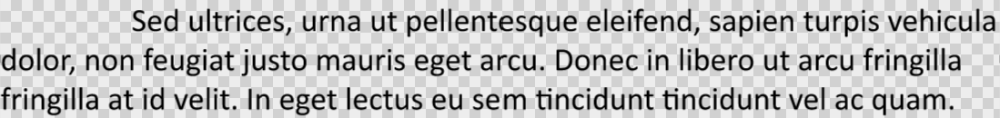

## **ภาพรวม**

Aspose.Slides for PHP via Java แสดงข้อความเป็นโครงสร้างลำดับขั้นของ text frames, paragraphs, และ portions:

* [TextFrame](https://reference.aspose.com/slides/php-java/aspose.slides/textframe/) เป็นตัวเก็บข้อความใน shape และให้เข้าถึงคอลเลกชันของ paragraph
* [Paragraph](https://reference.aspose.com/slides/php-java/aspose.slides/paragraph/) แทน paragraph หนึ่งอันใน text frame และให้เข้าถึง portions และการจัดรูปแบบระดับ paragraph
* [Portion](https://reference.aspose.com/slides/php-java/aspose.slides/portion/) แทนช่วงข้อความภายใน paragraph แต่ละ portion สามารถมีการจัดรูปแบบข้อความและอักขระของตนเองได้

ดังนั้น paragraph สามารถมีข้อความที่ใช้ฟอนต์, สี, ขนาด, และการจัดรูปแบบอื่น ๆ ที่ต่างกันโดยใช้หลาย portions

## **สร้างและจัดรูปแบบ Paragraphs**

สร้าง paragraph ใน text frame ของ shape และใช้ portions เพื่อจัดรูปแบบข้อความแต่ละรัน ส่วนนี้แสดงวิธีผสานหลาย portions ภายในแต่ละ paragraph และกำหนดสี, ขนาดฟอนต์, และสไตล์ที่แตกต่างกัน

### **สร้าง Paragraphs ด้วยหลาย Portions**

ตัวอย่าง PHP ด้านล่างสร้างสาม paragraph แต่ละอันมีสามข้อความในคอลเลกชันที่คืนค่าจาก [Paragraph::getPortions](https://reference.aspose.com/slides/php-java/aspose.slides/paragraph/#getPortions) โดยใช้ paragraph เริ่มต้นและ portion ว่างเป็นฐาน แล้วเพิ่ม paragraph และ portion ที่เหลือ การจัดรูปแบบทำผ่าน [Portion::getPortionFormat](https://reference.aspose.com/slides/php-java/aspose.slides/portion/#getPortionFormat): portion แรกของแต่ละ paragraph มีสีแดง, ตัวหนา, ขนาด 15 pt; portion ที่สองเป็นสีน้ำเงิน, ตัวเอียง, ขนาด 18 pt; portion ที่สามคงการจัดรูปแบบเริ่มต้นไว้:

```php
use aspose\slides\FillType;
use aspose\slides\NullableBool;
use aspose\slides\Paragraph;
use aspose\slides\Portion;
use aspose\slides\Presentation;
use aspose\slides\SaveFormat;
use aspose\slides\ShapeType;

$presentation = new Presentation();
try {
    $slide = $presentation->getSlides()->get_Item(0);

    $shape = $slide->getShapes()->addAutoShape(ShapeType::Rectangle, 50, 150, 300, 150);
    $textFrame = $shape->getTextFrame();

    $firstParagraph = $textFrame->getParagraphs()->get_Item(0);
    $firstParagraph->getPortions()->add(new Portion());
    $firstParagraph->getPortions()->add(new Portion());

    $secondParagraph = new Paragraph();
    $secondParagraph->getPortions()->add(new Portion());
    $secondParagraph->getPortions()->add(new Portion());
    $secondParagraph->getPortions()->add(new Portion());
    $textFrame->getParagraphs()->add($secondParagraph);

    $thirdParagraph = new Paragraph();
    $thirdParagraph->getPortions()->add(new Portion());
    $thirdParagraph->getPortions()->add(new Portion());
    $thirdParagraph->getPortions()->add(new Portion());
    $textFrame->getParagraphs()->add($thirdParagraph);

    $paragraphCount = java_values($textFrame->getParagraphs()->getCount());
    for ($paragraphIndex = 0; $paragraphIndex < $paragraphCount; $paragraphIndex++) {
        $paragraph = $textFrame->getParagraphs()->get_Item($paragraphIndex);
        $portionCount = java_values($paragraph->getPortions()->getCount());
        for ($portionIndex = 0; $portionIndex < $portionCount; $portionIndex++) {
            $portion = $paragraph->getPortions()->get_Item($portionIndex);
            $portion->setText("Portion " . ($paragraphIndex + 1) . "." . ($portionIndex + 1));

            if ($portionIndex == 0) {
                $portion->getPortionFormat()->getFillFormat()->setFillType(FillType::Solid);
                $portion->getPortionFormat()->getFillFormat()->getSolidFillColor()->setColor(java("java.awt.Color")->RED);
                $portion->getPortionFormat()->setFontBold(NullableBool::True);
                $portion->getPortionFormat()->setFontHeight(15);
            } else if ($portionIndex == 1) {
                $portion->getPortionFormat()->getFillFormat()->setFillType(FillType::Solid);
                $portion->getPortionFormat()->getFillFormat()->getSolidFillColor()->setColor(java("java.awt.Color")->BLUE);
                $portion->getPortionFormat()->setFontItalic(NullableBool::True);
                $portion->getPortionFormat()->setFontHeight(18);
            }
        }
    }

    $presentation->save("paragraphs_with_portions.pptx", SaveFormat::Pptx);
} finally {
    $presentation->dispose();
}
```

## **สร้างรายการแบบ Bullet และ Numbered**

จัดข้อความ paragraph เป็นรายการด้วยสัญลักษณ์, หมายเลข, หรือภาพที่กำหนดเอง ตัวอย่างในส่วนนี้ครอบคลุมการจัดรูปแบบ bullet, รายการหลายระดับ, และการกำหนดหมายเลขเริ่มต้นที่กำหนดเอง

### **สร้างรายการ Bullet หรือ Numbered**

Bullet และการจัดลำดับทำให้รายการที่เกี่ยวข้องอ่านง่ายขึ้น ใน Aspose.Slides การตั้งค่ารายการกำหนดผ่าน [BulletFormat](https://reference.aspose.com/slides/php-java/aspose.slides/bulletformat/)

ตัวอย่าง PHP นี้เพิ่ม bullet สัญลักษณ์และรายการลำดับเลขใน text frame เดียวกัน [BulletFormat::setType](https://reference.aspose.com/slides/php-java/aspose.slides/bulletformat/#setType) กำหนดประเภทของ bullet, while [BulletFormat::setChar](https://reference.aspose.com/slides/php-java/aspose.slides/bulletformat/#setChar) กำหนดสัญลักษณ์และ [BulletFormat::setNumberedBulletStyle](https://reference.aspose.com/slides/php-java/aspose.slides/bulletformat/#setNumberedBulletStyle) กำหนดสไตล์การจัดลำดับ ทั้งสองรายการใช้ bullet สีดำ ความสูง 100 % และการเยื้อง paragraph 25 pt:

```php
use aspose\slides\BulletType;
use aspose\slides\ColorType;
use aspose\slides\NullableBool;
use aspose\slides\NumberedBulletStyle;
use aspose\slides\Paragraph;
use aspose\slides\Presentation;
use aspose\slides\SaveFormat;
use aspose\slides\ShapeType;

$presentation = new Presentation();
try {
    $slide = $presentation->getSlides()->get_Item(0);

    $shape = $slide->getShapes()->addAutoShape(ShapeType::Rectangle, 200, 200, 400, 200);
    $textFrame = $shape->getTextFrame();
    $textFrame->getParagraphs()->clear();

    $symbolParagraph = new Paragraph();
    $symbolParagraph->setText("Welcome to Aspose.Slides");
    $symbolParagraph->getParagraphFormat()->getBullet()->setType(BulletType::Symbol);
    $symbolParagraph->getParagraphFormat()->getBullet()->setChar("•");
    $symbolParagraph->getParagraphFormat()->setIndent(25);
    $symbolParagraph->getParagraphFormat()->getBullet()->getColor()->setColorType(ColorType::RGB);
    $symbolParagraph->getParagraphFormat()->getBullet()->getColor()->setColor(java("java.awt.Color")->BLACK);
    $symbolParagraph->getParagraphFormat()->getBullet()->setBulletHardColor(NullableBool::True);
    $symbolParagraph->getParagraphFormat()->getBullet()->setHeight(100);
    $textFrame->getParagraphs()->add($symbolParagraph);

    $numberedParagraph = new Paragraph();
    $numberedParagraph->setText("This is a numbered item");
    $numberedParagraph->getParagraphFormat()->getBullet()->setType(BulletType::Numbered);
    $numberedParagraph->getParagraphFormat()->getBullet()->setNumberedBulletStyle(NumberedBulletStyle::BulletCircleNumWDBlackPlain);
    $numberedParagraph->getParagraphFormat()->setIndent(25);
    $numberedParagraph->getParagraphFormat()->getBullet()->getColor()->setColorType(ColorType::RGB);
    $numberedParagraph->getParagraphFormat()->getBullet()->getColor()->setColor(java("java.awt.Color")->BLACK);
    $numberedParagraph->getParagraphFormat()->getBullet()->setBulletHardColor(NullableBool::True);
    $numberedParagraph->getParagraphFormat()->getBullet()->setHeight(100);
    $textFrame->getParagraphs()->add($numberedParagraph);

    $presentation->save("bulleted_and_numbered_list.pptx", SaveFormat::Pptx);
} finally {
    $presentation->dispose();
}
```

### **ใช้ Picture Bullets**

Picture bullets ให้คุณใช้ภาพที่กำหนดเองแทนสัญลักษณ์หรือหมายเลข

ตัวอย่าง PHP นี้เพิ่มภาพในคอลเลกชันภาพของงานนำเสนอเป็น [PPImage](https://reference.aspose.com/slides/php-java/aspose.slides/ppimage/) แล้วใช้ภาพนั้นเป็น bullet ของ paragraph โดยเรียก [BulletFormat::setType](https://reference.aspose.com/slides/php-java/aspose.slides/bulletformat/#setType) เพื่อใช้ picture bullet และกำหนดภาพผ่าน [BulletFormat::getPicture](https://reference.aspose.com/slides/php-java/aspose.slides/bulletformat/#getPicture) [BulletFormat::setHeight](https://reference.aspose.com/slides/php-java/aspose.slides/bulletformat/#setHeight) ถูกตั้งค่าเป็น 100 % เพื่อกำหนดขนาด bullet เทียบกับข้อความใน paragraph:

```php
use aspose\slides\BulletType;
use aspose\slides\Images;
use aspose\slides\Paragraph;
use aspose\slides\Presentation;
use aspose\slides\SaveFormat;
use aspose\slides\ShapeType;

$presentation = new Presentation();
try {
    $slide = $presentation->getSlides()->get_Item(0);

    $bulletImage = Images::fromFile("bullets.png");
    try {
        $presentationImage = $presentation->getImages()->addImage($bulletImage);
    } finally {
        $bulletImage->dispose();
    }

    $shape = $slide->getShapes()->addAutoShape(ShapeType::Rectangle, 200, 200, 400, 200);
    $textFrame = $shape->getTextFrame();
    $textFrame->getParagraphs()->clear();

    $paragraph = new Paragraph();
    $paragraph->setText("Welcome to Aspose.Slides");
    $paragraph->getParagraphFormat()->getBullet()->setType(BulletType::Picture);
    $paragraph->getParagraphFormat()->getBullet()->getPicture()->setImage($presentationImage);
    $paragraph->getParagraphFormat()->getBullet()->setHeight(100);
    $textFrame->getParagraphs()->add($paragraph);

    $presentation->save("picture_bullet.pptx", SaveFormat::Pptx);
    $presentation->save("picture_bullet.ppt", SaveFormat::Ppt);
} finally {
    $presentation->dispose();
}
```

### **สร้างรายการหลายระดับ**

กำหนด [ParagraphFormat::setDepth](https://reference.aspose.com/slides/php-java/aspose.slides/paragraphformat/#setDepth) เพื่อวาง paragraph ที่ระดับต่าง ๆ ของรายการ ระดับบนสุดมีความลึก `0`

ตัวอย่าง PHP นี้กำหนดค่า [ParagraphFormat::setDepth](https://reference.aspose.com/slides/php-java/aspose.slides/paragraphformat/#setDepth) ตั้งแต่ 0 ถึง 3 ให้กับสี่ paragraph สร้างโครงสร้างลำดับชั้นภายใน text frame หนึ่งแต่ละ paragraph ใช้ bullet สัญลักษณ์ โดย [BulletFormat::setChar](https://reference.aspose.com/slides/php-java/aspose.slides/bulletformat/#setChar) สลับระหว่าง bullet กลมและ hyphen เพื่อแยกระดับที่อยู่ติดกัน:

```php
use aspose\slides\BulletType;
use aspose\slides\FillType;
use aspose\slides\Paragraph;
use aspose\slides\Presentation;
use aspose\slides\SaveFormat;
use aspose\slides\ShapeType;

$presentation = new Presentation();
try {
    $slide = $presentation->getSlides()->get_Item(0);

    $shape = $slide->getShapes()->addAutoShape(ShapeType::Rectangle, 200, 200, 400, 200);
    $textFrame = $shape->getTextFrame();
    $textFrame->getParagraphs()->clear();

    $firstParagraph = new Paragraph();
    $firstParagraph->setText("Content");
    $firstParagraph->getParagraphFormat()->getBullet()->setType(BulletType::Symbol);
    $firstParagraph->getParagraphFormat()->getBullet()->setChar("•");
    $firstParagraph->getParagraphFormat()->getDefaultPortionFormat()->getFillFormat()->setFillType(FillType::Solid);
    $firstParagraph->getParagraphFormat()->getDefaultPortionFormat()->getFillFormat()->getSolidFillColor()->setColor(java("java.awt.Color")->BLACK);
    $firstParagraph->getParagraphFormat()->setDepth(0);

    $secondParagraph = new Paragraph();
    $secondParagraph->setText("Second level");
    $secondParagraph->getParagraphFormat()->getBullet()->setType(BulletType::Symbol);
    $secondParagraph->getParagraphFormat()->getBullet()->setChar('-');
    $secondParagraph->getParagraphFormat()->getDefaultPortionFormat()->getFillFormat()->setFillType(FillType::Solid);
    $secondParagraph->getParagraphFormat()->getDefaultPortionFormat()->getFillFormat()->getSolidFillColor()->setColor(java("java.awt.Color")->BLACK);
    $secondParagraph->getParagraphFormat()->setDepth(1);

    $thirdParagraph = new Paragraph();
    $thirdParagraph->setText("Third level");
    $thirdParagraph->getParagraphFormat()->getBullet()->setType(BulletType::Symbol);
    $thirdParagraph->getParagraphFormat()->getBullet()->setChar("•");
    $thirdParagraph->getParagraphFormat()->getDefaultPortionFormat()->getFillFormat()->setFillType(FillType::Solid);
    $thirdParagraph->getParagraphFormat()->getDefaultPortionFormat()->getFillFormat()->getSolidFillColor()->setColor(java("java.awt.Color")->BLACK);
    $thirdParagraph->getParagraphFormat()->setDepth(2);

    $fourthParagraph = new Paragraph();
    $fourthParagraph->setText("Fourth level");
    $fourthParagraph->getParagraphFormat()->getBullet()->setType(BulletType::Symbol);
    $fourthParagraph->getParagraphFormat()->getBullet()->setChar('-');
    $fourthParagraph->getParagraphFormat()->getDefaultPortionFormat()->getFillFormat()->setFillType(FillType::Solid);
    $fourthParagraph->getParagraphFormat()->getDefaultPortionFormat()->getFillFormat()->getSolidFillColor()->setColor(java("java.awt.Color")->BLACK);
    $fourthParagraph->getParagraphFormat()->setDepth(3);

    $textFrame->getParagraphs()->add($firstParagraph);
    $textFrame->getParagraphs()->add($secondParagraph);
    $textFrame->getParagraphs()->add($thirdParagraph);
    $textFrame->getParagraphs()->add($fourthParagraph);

    $presentation->save("multilevel_list.pptx", SaveFormat::Pptx);
} finally {
    $presentation->dispose();
}
```

### **เริ่มรายการ Numbered ด้วยค่าเริ่มต้นที่กำหนดเอง**

ใช้ [BulletFormat::setNumberedBulletStartWith](https://reference.aspose.com/slides/php-java/aspose.slides/bulletformat/#setNumberedBulletStartWith) เพื่อตั้งค่าตัวเลขเริ่มต้นที่จะแสดงสำหรับ paragraph ที่เป็นรายการลำดับเลข

ตัวอย่าง PHP นี้ตั้งค่า [BulletFormat::setType](https://reference.aspose.com/slides/php-java/aspose.slides/bulletformat/#setType) ให้ใช้การจัดลำดับเลขสำหรับสาม paragraph และกำหนดค่า [BulletFormat::setNumberedBulletStartWith](https://reference.aspose.com/slides/php-java/aspose.slides/bulletformat/#setNumberedBulletStartWith) เป็น 2, 3, และ 7 ค่าตั้งต้นนี้กำหนดแยกต่างหากสำหรับแต่ละ paragraph ทำให้เลขที่แสดงข้ามค่าได้:

```php
use aspose\slides\BulletType;
use aspose\slides\Paragraph;
use aspose\slides\Presentation;
use aspose\slides\SaveFormat;
use aspose\slides\ShapeType;

$presentation = new Presentation();
try {
    $slide = $presentation->getSlides()->get_Item(0);

    $shape = $slide->getShapes()->addAutoShape(ShapeType::Rectangle, 200, 200, 400, 200);
    $textFrame = $shape->getTextFrame();
    $textFrame->getParagraphs()->clear();

    $firstParagraph = new Paragraph();
    $firstParagraph->setText("Start at 2");
    $firstParagraph->getParagraphFormat()->getBullet()->setType(BulletType::Numbered);
    $firstParagraph->getParagraphFormat()->getBullet()->setNumberedBulletStartWith(2);
    $textFrame->getParagraphs()->add($firstParagraph);

    $secondParagraph = new Paragraph();
    $secondParagraph->setText("Start at 3");
    $secondParagraph->getParagraphFormat()->getBullet()->setType(BulletType::Numbered);
    $secondParagraph->getParagraphFormat()->getBullet()->setNumberedBulletStartWith(3);
    $textFrame->getParagraphs()->add($secondParagraph);

    $thirdParagraph = new Paragraph();
    $thirdParagraph->setText("Start at 7");
    $thirdParagraph->getParagraphFormat()->getBullet()->setType(BulletType::Numbered);
    $thirdParagraph->getParagraphFormat()->getBullet()->setNumberedBulletStartWith(7);
    $textFrame->getParagraphs()->add($thirdParagraph);

    $presentation->save("custom_numbered_list.pptx", SaveFormat::Pptx);
} finally {
    $presentation->dispose();
}
```

## **ควบคุมเค้าโครง Paragraph และคุณสมบัติ End**

ปรับระยะขอบและการเยื้องของ paragraph เพื่อควบคุมตำแหน่งของบรรทัดแรกและบรรทัดที่หักลบ คุณยังสามารถจัดรูปแบบเครื่องหมายจบ paragraph แยกจากส่วนข้อความที่มองเห็นได้

### **ตั้งค่า First-Line Indent**

ใช้เมธอด [ParagraphFormat::setIndent](https://reference.aspose.com/slides/php-java/aspose.slides/paragraphformat/#setIndent) เพื่อควบคุมการเยื้องบรรทัดแรกของ paragraph การตั้งค่านี้ย้ายเฉพาะบรรทัดแรกเทียบกับ margin ซ้ายของ paragraph ค่าเป็นบวกทำให้บรรทัดแรกเลื่อนขวา ส่วนบรรทัดที่เหลือคงตำแหน่งเดิม

ใช้ [ParagraphFormat::setMarginLeft](https://reference.aspose.com/slides/php-java/aspose.slides/paragraphformat/#setMarginLeft) เมื่อคุณต้องการย้ายทั้ง paragraph ใช้ [ParagraphFormat::setIndent](https://reference.aspose.com/slides/php-java/aspose.slides/paragraphformat/#setIndent) เมื่อต้องการย้ายเฉพาะบรรทัดแรก

ตัวอย่างต่อไปนี้ให้สาม paragraph มี [ParagraphFormat::setMarginLeft](https://reference.aspose.com/slides/php-java/aspose.slides/paragraphformat/#setMarginLeft) ที่ 20 pt และค่า [ParagraphFormat::setIndent](https://reference.aspose.com/slides/php-java/aspose.slides/paragraphformat/#setIndent) เป็น 0, 20, และ 40 pt บรรทัดแรกเริ่มต้นที่ระยะห่างที่เพิ่มขึ้นต่อเนื่อง ส่วนบรรทัดที่หักลบคง margin ซ้ายเดียวกัน:

```php
use aspose\slides\FillType;
use aspose\slides\Paragraph;
use aspose\slides\Presentation;
use aspose\slides\SaveFormat;
use aspose\slides\ShapeType;
use aspose\slides\TextAutofitType;

$presentation = new Presentation();
try {
    $slide = $presentation->getSlides()->get_Item(0);

    $shape = $slide->getShapes()->addAutoShape(ShapeType::Rectangle, 50, 50, 420, 220);
    $shape->getFillFormat()->setFillType(FillType::NoFill);
    $shape->getLineFormat()->getFillFormat()->setFillType(FillType::Solid);
    $shape->getLineFormat()->getFillFormat()->getSolidFillColor()->setColor(java("java.awt.Color")->GRAY);

    $textFrame = $shape->getTextFrame();
    $textFrame->getTextFrameFormat()->setAutofitType(TextAutofitType::Shape);
    $textFrame->getParagraphs()->clear();

    $firstParagraph = new Paragraph();
    $firstParagraph->setText("No first-line indent. Wrapped lines start at the same position as the first line.");
    $firstParagraph->getParagraphFormat()->getDefaultPortionFormat()->getFillFormat()->setFillType(FillType::Solid);
    $firstParagraph->getParagraphFormat()->getDefaultPortionFormat()->getFillFormat()->getSolidFillColor()->setColor(java("java.awt.Color")->BLACK);
    $firstParagraph->getParagraphFormat()->setMarginLeft(20.0);
    $firstParagraph->getParagraphFormat()->setIndent(0.0);

    $secondParagraph = new Paragraph();
    $secondParagraph->setText("First-line indent of 20 points. The first line moves to the right, while wrapped lines remain aligned to the paragraph body.");
    $secondParagraph->getParagraphFormat()->getDefaultPortionFormat()->getFillFormat()->setFillType(FillType::Solid);
    $secondParagraph->getParagraphFormat()->getDefaultPortionFormat()->getFillFormat()->getSolidFillColor()->setColor(java("java.awt.Color")->BLACK);
    $secondParagraph->getParagraphFormat()->setMarginLeft(20.0);
    $secondParagraph->getParagraphFormat()->setIndent(20.0);

    $thirdParagraph = new Paragraph();
    $thirdParagraph->setText("First-line indent of 40 points. This paragraph shows a larger first-line offset to make the effect easier to see.");
    $thirdParagraph->getParagraphFormat()->getDefaultPortionFormat()->getFillFormat()->setFillType(FillType::Solid);
    $thirdParagraph->getParagraphFormat()->getDefaultPortionFormat()->getFillFormat()->getSolidFillColor()->setColor(java("java.awt.Color")->BLACK);
    $thirdParagraph->getParagraphFormat()->setMarginLeft(20.0);
    $thirdParagraph->getParagraphFormat()->setIndent(40.0);

    $textFrame->getParagraphs()->add($firstParagraph);
    $textFrame->getParagraphs()->add($secondParagraph);
    $textFrame->getParagraphs()->add($thirdParagraph);

    $presentation->save("paragraph_indent.pptx", SaveFormat::Pptx);
} finally {
    $presentation->dispose();
}
```

ผลลัพธ์:


### **ตั้งค่า Hanging Indent**

Hanging indent คือการจัด layout ของ paragraph ที่บรรทัดแรกเริ่มอยู่ซ้ายกว่าบรรทัดที่เหลือ ใน Aspose.Slides คุณสร้างเอฟเฟกต์นี้ด้วยคุณสมบัติ [ParagraphFormat::setIndent](https://reference.aspose.com/slides/php-java/aspose.slides/paragraphformat/#setIndent) ตั้งค่า `Indent` เป็นค่าลบเพื่อย้ายบรรทัดแรกซ้ายกว่าเนื้อหา paragraph

ในทางปฏิบัติ [ParagraphFormat::setMarginLeft](https://reference.aspose.com/slides/php-java/aspose.slides/paragraphformat/#setMarginLeft) กำหนดตำแหน่งซ้ายของเนื้อหา paragraph, ส่วน [ParagraphFormat::setIndent](https://reference.aspose.com/slides/php-java/aspose.slides/paragraphformat/#setIndent) กำหนดตำแหน่งของบรรทัดแรกเทียบกับ margin นั้น การสร้าง hanging indent ให้ตั้งค่า `MarginLeft` เป็นค่าบวกและ `Indent` เป็นค่าลบ

การจัดรูปแบบนี้มีประโยชน์สำหรับบรรณานุกรม, การอ้างอิง, รายการสารานุกรม, และ paragraph อื่น ๆ ที่ต้องการให้บรรทัดที่หักลบจัดชิดใต้เนื้อหา paragraph ไม่ใช่ใต้ตัวอักษรแรกของบรรทัดแรก

ตัวอย่าง PHP ด้านล่างจับคู่ค่า [ParagraphFormat::setMarginLeft](https://reference.aspose.com/slides/php-java/aspose.slides/paragraphformat/#setMarginLeft) ที่ 40 และ 60 pt กับค่า [ParagraphFormat::setIndent](https://reference.aspose.com/slides/php-java/aspose.slides/paragraphformat/#setIndent) ที่ -20 และ -30 pt ในแต่ละ paragraph บรรทัดแรกเริ่มซ้ายกว่าบรรทัดที่หักลบ; paragraph ที่สองมี hanging indent ที่ลึกกว่า:

```php
use aspose\slides\FillType;
use aspose\slides\Paragraph;
use aspose\slides\Presentation;
use aspose\slides\SaveFormat;
use aspose\slides\ShapeType;
use aspose\slides\TextAutofitType;

$presentation = new Presentation();
try {
    $slide = $presentation->getSlides()->get_Item(0);

    $shape = $slide->getShapes()->addAutoShape(ShapeType::Rectangle, 50, 50, 420, 220);
    $shape->getFillFormat()->setFillType(FillType::NoFill);
    $shape->getLineFormat()->getFillFormat()->setFillType(FillType::Solid);
    $shape->getLineFormat()->getFillFormat()->getSolidFillColor()->setColor(java("java.awt.Color")->GRAY);

    $textFrame = $shape->getTextFrame();
    $textFrame->getTextFrameFormat()->setAutofitType(TextAutofitType::Shape);
    $textFrame->getParagraphs()->clear();

    $firstParagraph = new Paragraph();
    $firstParagraph->setText("A hanging indent is created by combining a positive left margin with a negative indent. The first line starts to the left, while wrapped lines align with the paragraph body.");
    $firstParagraph->getParagraphFormat()->getDefaultPortionFormat()->getFillFormat()->setFillType(FillType::Solid);
    $firstParagraph->getParagraphFormat()->getDefaultPortionFormat()->getFillFormat()->getSolidFillColor()->setColor(java("java.awt.Color")->BLACK);
    $firstParagraph->getParagraphFormat()->setMarginLeft(40.0);
    $firstParagraph->getParagraphFormat()->setIndent(-20.0);

    $secondParagraph = new Paragraph();
    $secondParagraph->setText("This second example uses a deeper hanging indent so the difference between the first line and the wrapped lines is easier to compare.");
    $secondParagraph->getParagraphFormat()->getDefaultPortionFormat()->getFillFormat()->setFillType(FillType::Solid);
    $secondParagraph->getParagraphFormat()->getDefaultPortionFormat()->getFillFormat()->getSolidFillColor()->setColor(java("java.awt.Color")->BLACK);
    $secondParagraph->getParagraphFormat()->setMarginLeft(60.0);
    $secondParagraph->getParagraphFormat()->setIndent(-30.0);

    $textFrame->getParagraphs()->add($firstParagraph);
    $textFrame->getParagraphs()->add($secondParagraph);

    $presentation->save("hanging_indent.pptx", SaveFormat::Pptx);
} finally {
    $presentation->dispose();
}
```

ผลลัพธ์:


### **ตั้งค่าคุณสมบัติ End Paragraph Run**

เมธอด [Paragraph::setEndParagraphPortionFormat](https://reference.aspose.com/slides/php-java/aspose.slides/paragraph/#setEndParagraphPortionFormat) ควบคุมการจัดรูปแบบของเครื่องหมายจบ paragraph ตัวอย่างต่อไปนี้สร้าง [PortionFormat](https://reference.aspose.com/slides/php-java/aspose.slides/portionformat/) โดยตั้งค่า [BasePortionFormat::setFontHeight](https://reference.aspose.com/slides/php-java/aspose.slides/baseportionformat/#setFontHeight) เป็น 48 pt และ [BasePortionFormat::setLatinFont](https://reference.aspose.com/slides/php-java/aspose.slides/baseportionformat/#setLatinFont) เป็น Times New Roman แล้วกำหนดฟอร์แมตนี้ให้กับเครื่องหมายจบของ paragraph ที่สอง โดยที่ส่วนข้อความที่มองเห็นไม่เปลี่ยนแปลง:

```php
use aspose\slides\FontData;
use aspose\slides\Paragraph;
use aspose\slides\Portion;
use aspose\slides\PortionFormat;
use aspose\slides\Presentation;
use aspose\slides\SaveFormat;
use aspose\slides\ShapeType;

$presentation = new Presentation("Test.pptx");
try {
    $slide = $presentation->getSlides()->get_Item(0);

    $shape = $slide->getShapes()->addAutoShape(ShapeType::Rectangle, 10, 10, 200, 250);
    $textFrame = $shape->getTextFrame();
    $textFrame->getParagraphs()->clear();

    $firstParagraph = new Paragraph();
    $firstParagraph->getPortions()->add(new Portion("Sample text"));

    $secondParagraph = new Paragraph();
    $secondParagraph->getPortions()->add(new Portion("Sample text 2"));

    $endParagraphFormat = new PortionFormat();
    $endParagraphFormat->setFontHeight(48);
    $endParagraphFormat->setLatinFont(new FontData("Times New Roman"));
    $secondParagraph->setEndParagraphPortionFormat($endParagraphFormat);

    $textFrame->getParagraphs()->add($firstParagraph);
    $textFrame->getParagraphs()->add($secondParagraph);

    $presentation->save("end_paragraph_format.pptx", SaveFormat::Pptx);
} finally {
    $presentation->dispose();
}
```

## **นับจำนวนบรรทัดที่แสดงผล**

สำหรับกฎของ paragraph ที่มีผลต่อการห่ออัตโนมัติและเครื่องหมายวรรคตอนที่จบบรรทัด ดูที่ [Control Line Breaking](/slides/th/php-java/text-formatting/#control-line-breaking) และ [Control Hanging Punctuation](/slides/th/php-java/text-formatting/#control-hanging-punctuation)

ใช้ [Paragraph::getLinesCount](https://reference.aspose.com/slides/php-java/aspose.slides/paragraph/#getLinesCount) เพื่อให้นับจำนวนบรรทัดที่ paragraph ใช้หลังจาก layout ข้อความรวมการห่ออัตโนมัติ ซึ่งเป็นประโยชน์เมื่อเช็คความยาวและ layout ของข้อความในเทมเพลตพรีเซนเทชัน

paragraph เป็นรายการหนึ่งใน [TextFrame::getParagraphs](https://reference.aspose.com/slides/php-java/aspose.slides/textframe/#getParagraphs) และอาจใช้หลายบรรทัดที่แสดงผล การใส่ line break อย่างชัดเจนภายใน paragraph จะบังคับให้ขึ้นบรรทัดใหม่โดยไม่สร้าง paragraph ใหม่ การห่ออัตโนมัติสร้างบรรทัดตามความกว้างที่มีโดยไม่แทรก line break ลงในข้อความ ดังนั้นการนับ paragraph หรืออักขระ line‑break จะไม่ได้บอกจำนวนบรรทัดที่แสดงผลจริง

ตัวอย่างต่อไปนี้สร้าง shape ข้อความ, นับบรรทัด, ลดความกว้างของ shape, แล้วแทนที่ข้อความด้วยสตริงสั้นกว่า ตัวอย่างเปิดการห่อด้วย [TextFrameFormat::setWrapText](https://reference.aspose.com/slides/php-java/aspose.slides/textframeformat/#setWrapText) และปิด autofit ด้วย [TextFrameFormat::setAutofitType](https://reference.aspose.com/slides/php-java/aspose.slides/textframeformat/#setAutofitType) เพื่อให้ความกว้างของ shape ควบคุมการห่อโดยไม่ทำให้ข้อความหดหรือปรับขนาด shape การวัดแต่ละครั้งใช้ [Paragraph::getLinesCount](https://reference.aspose.com/slides/php-java/aspose.slides/paragraph/#getLinesCount) มิติเข้าเป็นจุด ในตอนท้ายตัวอย่างเพิ่ม paragraph อีกอันและรวมจำนวนบรรทัดของทั้ง text frame:

```php
use aspose\slides\NullableBool;
use aspose\slides\Paragraph;
use aspose\slides\Presentation;
use aspose\slides\ShapeType;
use aspose\slides\TextAutofitType;

$presentation = new Presentation();
try {
    $slide = $presentation->getSlides()->get_Item(0);

    $shape = $slide->getShapes()->addAutoShape(ShapeType::Rectangle, 50, 50, 400, 200);
    $textFrame = $shape->getTextFrame();
    $textFrame->getTextFrameFormat()->setWrapText(NullableBool::True);
    $textFrame->getTextFrameFormat()->setAutofitType(TextAutofitType::None);

    $paragraph = $textFrame->getParagraphs()->get_Item(0);
    $paragraph->getParagraphFormat()->getDefaultPortionFormat()->setFontHeight(20);
    $paragraph->setText("This text demonstrates how automatic wrapping changes the number of rendered lines.");
    echo "Original width: " . java_values($paragraph->getLinesCount()) . PHP_EOL;

    $shape->setWidth(150);
    echo "Narrower shape: " . java_values($paragraph->getLinesCount()) . PHP_EOL;

    $paragraph->setText("Short text.");
    echo "Shorter text: " . java_values($paragraph->getLinesCount()) . PHP_EOL;

    $secondParagraph = new Paragraph();
    $secondParagraph->setText("Another paragraph.");
    $secondParagraph->getParagraphFormat()->getDefaultPortionFormat()->setFontHeight(20);
    $textFrame->getParagraphs()->add($secondParagraph);

    $totalLineCount = 0;
    for ($i = 0; $i < java_values($textFrame->getParagraphs()->getCount()); $i++) {
        $currentParagraph = $textFrame->getParagraphs()->get_Item($i);
        $totalLineCount += java_values($currentParagraph->getLinesCount());
    }
    echo "Total lines in the text frame: " . $totalLineCount . PHP_EOL;
} finally {
    $presentation->dispose();
}
```

ด้วยข้อความและมิตินี้ การทำให้ shape แคบลงจะเพิ่มจำนวนบรรทัด ในขณะที่การแทนที่ด้วยสตริงสั้นจะลดจำนวนบรรทัด จำนวนที่แน่นอนอาจแตกต่างตามฟอนต์ที่มี, การทดแทน, ขนาดฟอนต์, margin, การเยื้อง, การห่อ, และการตั้งค่า autofit ใช้ฟอนต์และการตั้งค่า layout ที่ใช้ในสภาพแวดล้อมเป้าหมายเมื่อทดสอบเทมเพลต

จำนวนบรรทัดอย่างเดียวไม่บอกว่าข้อความล้นจากคอนเทนเนอร์หรือไม่ ความสูงที่มี, ความสูงของบรรทัด, ระยะห่าง paragraph และบรรทัด, และพฤติกรรม autofit ก็สำคัญ; แม้บรรทัดเดียวก็อาจเกินความกว้างที่มีเมื่อปิดการห่อ

## **นำเข้าและส่งออกเนื้อหา Paragraph**

ใช้ HTML เพื่อนำข้อความเข้าสู่พรีเซนเทชันหรือส่งออก paragraph ที่มีอยู่เพื่อใช้ภายนอก ส่วนนี้ยังแสดงวิธีเรนเดอร์ paragraph เป็นภาพรวมถึง paragraph ในเซลล์ตาราง

### **นำเข้า HTML Text เข้าไปใน Paragraphs**

ใช้ [ParagraphCollection::addFromHtml](https://reference.aspose.com/slides/php-java/aspose.slides/paragraphcollection/#addFromHtml) เพื่อแปลง markup HTML ให้เป็น paragraph และ portion ใน text frame

ตัวอย่าง PHP นี้อ่าน HTML จากไฟล์แล้วส่ง markup ไปยัง [ParagraphCollection::addFromHtml](https://reference.aspose.com/slides/php-java/aspose.slides/paragraphcollection/#addFromHtml) มันลบ paragraph เริ่มต้นของ text frame เพื่อให้เฟรมมีเฉพาะเนื้อหาที่นำเข้า shape สี่เหลี่ยมกำหนด margin 10 pt ทุกด้านของสไลด์:

```php
use aspose\slides\FillType;
use aspose\slides\Presentation;
use aspose\slides\SaveFormat;
use aspose\slides\ShapeType;

$presentation = new Presentation();
try {
    $slide = $presentation->getSlides()->get_Item(0);

    $shapeWidth = java_values($presentation->getSlideSize()->getSize()->getWidth()) - 20;
    $shapeHeight = java_values($presentation->getSlideSize()->getSize()->getHeight()) - 20;
    $shape = $slide->getShapes()->addAutoShape(ShapeType::Rectangle, 10, 10, $shapeWidth, $shapeHeight);
    $shape->getFillFormat()->setFillType(FillType::NoFill);
    $shape->getTextFrame()->getParagraphs()->clear();

    $html = file_get_contents("file.html");
    if ($html !== false) {
        $shape->getTextFrame()->getParagraphs()->addFromHtml($html);
        $presentation->save("html_text.pptx", SaveFormat::Pptx);
    } else {
        echo "The HTML file could not be read.";
    }
} finally {
    $presentation->dispose();
}
```

### **ส่งออกข้อความ Paragraph เป็น HTML**

ใช้ [ParagraphCollection::exportToHtml](https://reference.aspose.com/slides/php-java/aspose.slides/paragraphcollection/#exportToHtml) เพื่อส่งออกช่วงของ paragraph เป็น HTML เมื่อใช้ข้อความพรีเซนเทชันบนเว็บ คุณอาจต้องการรักษการเน้นโดยไม่พกฟอนต์, ขนาด, หรือสไตล์ของกล่องข้อความ ไปที่ [TextToHtmlConversionOptions::setTextInheritanceLimit](https://reference.aspose.com/slides/php-java/aspose.slides/texttohtmlconversionoptions/#setTextInheritanceLimit) เพื่อควบคุมระดับที่ exporter ตามการสืบทอดรูปแบบ

ดาวน์โหลด [ตัวอย่างพรีเซนเทชัน](text-inheritance.pptx) แล้ววางในไดเรกทอรีทำงานของแอปพลิเคชัน สไลด์แรกมี shape ข้อความหนึ่งอันที่มีข้อความ “Inherited text; explicit red 18pt” อินพุตใช้หลายระดับรูปแบบโดยเจตนา:

- สไตล์ข้อความเริ่มต้นของพรีเซนเทชันกำหนด Calibri ขนาด 28 pt
- สไตล์ข้อความระดับแรกของ text frame กำหนดสีฟ้าและตัวเอียง
- paragraph ตั้งค่าเป็นตัวหนาอย่างชัดเจน
- portion ที่สอง “explicit red 18pt” ตั้งค่าสีแดงและขนาด 18 pt อย่างชัดเจน

ตัวอย่างสมบูรณ์ต่อไปนี้ส่งออก paragraph เดียวกันสามครั้ง โดยส่ง [TextToHtmlConversionOptions](https://reference.aspose.com/slides/php-java/aspose.slides/texttohtmlconversionoptions/) ไปยังเมธอดส่งออกและเขียนผลลัพธ์แต่ละอันเป็นไฟล์ HTML UTF‑8 แยกไฟล์:

```php
use aspose\slides\Presentation;
use aspose\slides\TextInheritanceLimit;
use aspose\slides\TextToHtmlConversionOptions;

$presentation = new Presentation("text-inheritance.pptx");
try {
    $shape = $presentation->getSlides()->get_Item(0)->getShapes()->get_Item(0);

    if (java_instanceof($shape, new JavaClass("com.aspose.slides.AutoShape"))) {
        $textFrame = $shape->getTextFrame();
        if (!java_is_null($textFrame)) {
            $paragraphs = $textFrame->getParagraphs();

            $modes = array(TextInheritanceLimit::All, TextInheritanceLimit::TextBox, TextInheritanceLimit::ParagraphOnly);
            $fileNames = array("All.html", "TextBox.html", "ParagraphOnly.html");

            for ($i = 0; $i < count($modes); $i++) {
                $options = new TextToHtmlConversionOptions();
                $options->setTextInheritanceLimit($modes[$i]);

                $html = $paragraphs->exportToHtml(0, $paragraphs->getCount(), $options);
                if (file_put_contents($fileNames[$i], java_values($html)) === false) {
                    echo "The HTML file could not be written." . PHP_EOL;
                }
            }
        } else {
            echo "The first shape does not contain a text frame.";
        }
    } else {
        echo "The first shape is not a text shape.";
    }
} finally {
    $presentation->dispose();
}
```

HTML ที่สร้างขึ้นมี CSS ด้านล่างสำหรับ portion แรก “Inherited text; ” ตารางแสดงการประกาศที่เกี่ยวข้อง; คุณสมบัติที่ไม่แสดงในที่นี้ถูกละเว้นเพื่อความกระชับ

| ผลลัพธ์ | CSS ที่เกี่ยวข้องสำหรับส่วนแรก | ลักษณะ |
| --- | --- | --- |
| `All.html` | `font-family:'Calibri'; font-size:28pt; color:#0000ff; font-style:italic; font-weight:bold` | ข้อความสีน้ำเงิน, ตัวหนา, ตัวเอียง ขนาด 28 pt ใน Calibri หากฟอนต์นั้นมี |
| `TextBox.html` | `color:#0000ff; font-style:italic; font-weight:bold` | ข้อความสีน้ำเงิน, ตัวหนา, ตัวเอียง; ฟอนต์และขนาดมาจากหน้าเว็บหรือเบราว์เซอร์ |
| `ParagraphOnly.html` | `font-weight:bold` | ตัวหนา; ฟอนต์, ขนาด, สี, และสไตล์เอียงมาจากหน้าเว็บหรือเบราว์เซอร์ |

portion ที่สองคง `color:#ff0000`, `font-size:18pt`, และ `font-weight:bold` ในผลลัพธ์ทั้งสาม และคงเอียงใน `All.html` กับ `TextBox.html` แต่ไม่คงใน `ParagraphOnly.html` การจำกัดการสืบทอดจึงไม่ลบรูปแบบที่กำหนดโดยตรงให้กับ paragraph หรือ portion

เปิดไฟล์ในเบราว์เซอร์เดียวกันเพื่อเปรียบเทียบ ในโหมดที่จำกัด CSS ที่ละเว้นจะถูกใช้โดยสไตล์ของหน้าเป้าหมายหรือค่าเริ่มต้นของเบราว์เซอร์ ทำให้ลักษณะที่แสดงแตกต่างตามที่ HTML ถูกใช้งาน

### **สร้าง HTML Clipboard Fragment**

ใช้ [TextToHtmlConversionOptions::setAddClipboardFragmentHeader](https://reference.aspose.com/slides/php-java/aspose.slides/texttohtmlconversionoptions/#setAddClipboardFragmentHeader) เพื่อเลือกผลลัพธ์จาก [ParagraphCollection::exportToHtml](https://reference.aspose.com/slides/php-java/aspose.slides/paragraphcollection/#exportToHtml) เมื่อ `false` เมธอดคืนค่า HTML ปกติ เมื่อ `true` สตริงที่คืนค่าจะเริ่มด้วยหัวข้อคลิปบอร์ดของ Windows ฟิลด์ `StartHTML` และ `EndHTML` ให้ตำแหน่งไบต์ของ HTML ส่วน `StartFragment` และ `EndFragment` บ่งบอกส่วนที่ต้องวาง

ตัวอย่างนี้ส่งออกสอง paragraph ที่จัดรูปแบบเป็น HTML ปกติ (`$html`) และเป็น HTML clipboard fragment (`$clipboardHtml`) จากนั้นแอปพลิเคชันสามารถเขียน fragment ไปยังคลิปบอร์ดระบบ หาก API ของคลิปบอร์ดต้องการไบต์ดิบ ส่ง fragment เป็น UTF‑8 โดยไม่มี BOM

```php
use aspose\slides\Presentation;
use aspose\slides\ShapeType;
use aspose\slides\TextToHtmlConversionOptions;

$presentation = new Presentation();
try {
    $slide = $presentation->getSlides()->get_Item(0);
    
    $shape = $slide->getShapes()->addAutoShape(ShapeType::Rectangle, 0, 0, 400, 100);
    $paragraphs = $shape->getTextFrame()->getParagraphs();
    $paragraphs->clear();
    $paragraphs->addFromHtml("<p>Status: <b>Ready</b></p><p><i>Next steps</i></p>");

    $options = new TextToHtmlConversionOptions();
    $options->setAddClipboardFragmentHeader(false);
    $html = java_values($paragraphs->exportToHtml(0, $paragraphs->getCount(), $options));

    $options->setAddClipboardFragmentHeader(true);
    $clipboardHtml = java_values($paragraphs->exportToHtml(0, $paragraphs->getCount(), $options));
} finally {
    $presentation->dispose();
}
```

### **เรนเดอร์ Paragraph เป็น Image**

[Paragraph::getImage](https://reference.aspose.com/slides/php-java/aspose.slides/paragraph/#getImage) เรนเดอร์ paragraph เดียวโดยตรงและคืนค่า [IImage](https://reference.aspose.com/slides/php-java/aspose.slides/iimage/) สามารถบันทึกผลลัพธ์เป็นไฟล์หรือสตรีมด้วย [IImage::save](https://reference.aspose.com/slides/php-java/aspose.slides/iimage/#save) ไม่จำเป็นต้องเรนเดอร์ shape ทั้งหมดหรือครอปบิตแมปด้วยตนเอง

[Paragraph::getImage](https://reference.aspose.com/slides/php-java/aspose.slides/paragraph/#getImage) อาจคืนค่า `null` หากไม่พบ paragraph ในคอลเลกชันแม่, ไม่มีขอบเขตการเรนเดอร์ที่ถูกต้อง, หรือไม่สามารถเรนเดอร์ได้ ตรวจสอบผลลัพธ์ก่อนบันทึกและทำลายอิมเมจที่ได้หลังการใช้งาน

#### **เรนเดอร์ Paragraph ด้วยอัตราส่วนเริ่มต้น**

ตัวอย่างใช้พรีเซนเทชันที่มีสไลด์เดียว shape แรกเป็น text box มีสาม paragraph


ตัวอย่างต่อไปเลือก paragraph ที่สองที่ตำแหน่ง index 1 แล้วเรียก [Paragraph::getImage](https://reference.aspose.com/slides/php-java/aspose.slides/paragraph/#getImage) โดยไม่มีพารามิเตอร์สเกล ตรวจสอบว่า shape มี paragraph ที่ต้องการและการเรนเดอร์ได้อิมเมจก่อนเรียก [IImage::save](https://reference.aspose.com/slides/php-java/aspose.slides/iimage/#save) เพื่อบันทึกเป็น PNG ส่วน `finally` ทำลายอิมเมจหลังใช้

```php
use aspose\slides\ImageFormat;
use aspose\slides\Presentation;

$presentation = new Presentation("sample.pptx");
try {
    $shape = $presentation->getSlides()->get_Item(0)->getShapes()->get_Item(0);

    if (java_instanceof($shape, new JavaClass("com.aspose.slides.AutoShape"))) {
        $textFrame = $shape->getTextFrame();
        if (!java_is_null($textFrame) && java_values($textFrame->getParagraphs()->getCount()) > 1) {
            $paragraph = $textFrame->getParagraphs()->get_Item(1);
            $paragraphImage = $paragraph->getImage();

            if (!java_is_null($paragraphImage)) {
                try {
                    $paragraphImage->save("paragraph.png", ImageFormat::Png);
                } finally {
                    $paragraphImage->dispose();
                }
            } else {
                echo "The paragraph could not be rendered.";
            }
        } else {
            echo "The expected paragraph was not found.";
        }
    } else {
        echo "The first shape is not a text shape.";
    }
} finally {
    $presentation->dispose();
}
```

ผลลัพธ์:



#### **เรนเดอร์ Paragraph ในเซลล์ตารางพร้อมสเกล**

ใช้ overload ของ [Paragraph::getImage](https://reference.aspose.com/slides/php-java/aspose.slides/paragraph/#getImage) ที่รับพารามิเตอร์ `$scaleX` และ `$scaleY` เพื่อกำหนดอัตราส่วนแนวนอนและแนวดิ่ง ตัวอย่างต่อไปสร้างตาราง, เรนเดอร์ paragraph ในเซลล์แรกด้วยความกว้างและความสูงเท่ากับสองเท่าของค่าเริ่มต้น, แล้วบันทึกเป็น PNG

```php
use aspose\slides\ImageFormat;
use aspose\slides\Presentation;

$scaleX = 2;
$scaleY = 2;

$presentation = new Presentation();
try {
    $slide = $presentation->getSlides()->get_Item(0);
    
    $table = $slide->getShapes()->addTable(50, 50, array(300), array(80));
    $paragraph = $table->get_Item(0, 0)->getTextFrame()->getParagraphs()->get_Item(0);
    $paragraph->setText("Text in a table cell");

    $paragraphImage = $paragraph->getImage($scaleX, $scaleY);
    if (!java_is_null($paragraphImage)) {
        try {
            $paragraphImage->save("table_paragraph.png", ImageFormat::Png);
        } finally {
            $paragraphImage->dispose();
        }
    } else {
        echo "The paragraph could not be rendered.";
    }
} finally {
    $presentation->dispose();
}
```

ค่า `1` รักษาขนาดพิกเซลเริ่มต้นของแกนนั้น ตัวอย่างเช่น `2` สำหรับทั้งสองแกนให้ภาพที่กว้างและสูงประมาณสองเท่าของมิติเริ่มต้น ซึ่งทำให้พิกเซลเพิ่มสี่เท่า ปัจจัยที่ใหญ่กว่ามักให้ข้อความคมชัดขึ้นสำหรับการซูมหรือเอาต์พุตความละเอียดสูง แต่ก็ใช้หน่วยความจำและไฟล์ขนาดใหญ่ขึ้น ปัจจัยที่ต่ำกว่า `1` ให้ภาพเล็กกว่าและรายละเอียดน้อยลง ใช้ปัจจัยเท่ากันเพื่อคงอัตราส่วนของ paragraph; ปัจจัยแนวนอนและแนวดิ่งต่างกันจะยืดภาพแยกกัน

การเรนเดอร์ shape ทั้งหมดด้วย [Shape::getImage](https://reference.aspose.com/slides/php-java/aspose.slides/shape/#getImage) ยังมีประโยชน์เมื่อต้องการรวมการเติมสี, เส้นขอบ, หรือบริบทภาพอื่น ๆ สำหรับภาพที่มีเฉพาะ paragraph ให้ใช้ [Paragraph::getImage](https://reference.aspose.com/slides/php-java/aspose.slides/paragraph/#getImage)

## **คำถามที่พบบ่อย**

**ฉันสามารถปิดการห่อข้อความภายใน text frame ได้อย่างสมบูรณ์หรือไม่?**

ได้. ตั้งค่า [TextFrameFormat::setWrapText](https://reference.aspose.com/slides/php-java/aspose.slides/textframeformat/#setWrapText) เพื่อปิดการห่อให้บรรทัดไม่ตัดที่ขอบของ text frame

**ฉันจะได้ขอบเขตบนสไลด์ของ paragraph เฉพาะอย่างไร?**

ใช้ [Paragraph::getRect](https://reference.aspose.com/slides/php-java/aspose.slides/paragraph/#getRect) เพื่อดึงสี่เหลี่ยมขอบของ paragraph [Portion::getRect](https://reference.aspose.com/slides/php-java/aspose.slides/portion/#getRect) ให้ขอบเขตของ portion เฉพาะ

**การจัดแนว paragraph (ซ้าย, ขวา, ศูนย์, จัดเต็ม) ถูกควบคุมที่ไหน?**

[ParagraphFormat::setAlignment](https://reference.aspose.com/slides/php-java/aspose.slides/paragraphformat/#setAlignment) เป็นการตั้งค่าระดับ paragraph และใช้กับทั้ง paragraph ไม่ว่าจะมีการจัดรูปแบบ portion แยกต่างหาก

เพื่อจัดแนวแนวตั้งของ portions ที่มีขนาดฟอนต์ต่างกันภายในแต่ละบรรทัด โปรดดู [Align Fonts Within a Line](/slides/th/php-java/text-formatting/#align-fonts-within-a-line)

**ฉันสามารถตั้งค่าภาษา proofing ให้กับส่วนของ paragraph ได้หรือไม่?**

ได้. ตั้งค่า [BasePortionFormat::setLanguageId](https://reference.aspose.com/slides/php-java/aspose.slides/baseportionformat/#setLanguageId) สำหรับ portions แยกต่างหาก เพื่อให้ paragraph หนึ่งสามารถมีข้อความหลายภาษาได้.