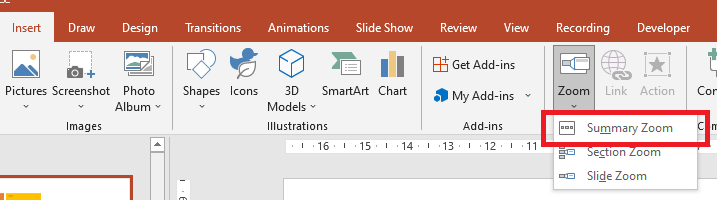

## **บทนำ**

PowerPoint Zoom ให้คุณนำทางระหว่างสไลด์และส่วนเฉพาะระหว่างการแสดงสไลด์. ด้วย Aspose.Slides for PHP via Java คุณสามารถสร้าง Slide Zoom, Section Zoom และ Summary Zoom และปรับแต่งการแสดงตัวอย่าง, เส้นขอบ, และการเปลี่ยนภาพได้.


* เพื่อสรุปการนำเสนอทั้งหมดบนสไลด์เดียว, ให้ใช้ [Summary Zoom](#summary-zoom).
* เพื่อแสดงสไลด์ที่เลือกเท่านั้น, ให้ใช้ [Slide Zoom](#slide-zoom).
* เพื่อแสดงส่วนเดียวเท่านั้น, ให้ใช้ [Section Zoom](#section-zoom).

## **Zoom สไลด์**

Slide Zoom สามารถทำให้การนำเสนอของคุณมีความไดนามิกมากขึ้น, ให้คุณนำทางระหว่างสไลด์ตามลำดับใดก็ได้โดยไม่ต้องหยุดการไหลของการนำเสนอ. Slide Zoom เหมาะสำหรับการนำเสนอสั้น ๆ ที่ไม่มีหลายส่วน, แต่คุณก็สามารถใช้ในสถานการณ์การนำเสนออื่น ๆ ได้เช่นกัน.

Slide Zoom ทำให้คุณสำรวจข้อมูลที่เกี่ยวข้องจากสไลด์ภาพรวมเดียว.


สำหรับวัตถุ Slide Zoom, Aspose.Slides มี enumeration [ZoomImageType](https://reference.aspose.com/slides/php-java/aspose.slides/zoomimagetype/), class [ZoomFrame](https://reference.aspose.com/slides/php-java/aspose.slides/zoomframe/), และเมธอดบน class [ShapeCollection](https://reference.aspose.com/slides/php-java/aspose.slides/shapecollection/).

### **สร้าง Zoom Frame**

ใช้ [ShapeCollection::addZoomFrame](https://reference.aspose.com/slides/php-java/aspose.slides/shapecollection/#addZoomFrame) เพื่อวางลิงก์ไปยังสไลด์แต่ละสไลด์บนสไลด์ภาพรวม. ตัวอย่างนี้สร้างสไลด์เป้าหมายสองสไลด์ที่มีพื้นหลังและป้ายกำกับแตกต่างกัน, จากนั้นเพิ่มการแสดงตัวอย่างของแต่ละสไลด์บนสไลด์แรกและบันทึกการนำเสนอเป็น PPTX. ตำแหน่งและขนาดของเฟรมระบุเป็นจุด.

```php
use aspose\slides\BackgroundType;
use aspose\slides\FillType;
use aspose\slides\Presentation;
use aspose\slides\SaveFormat;
use aspose\slides\ShapeType;

$presentation = new Presentation();
try {
    $overviewSlide = $presentation->getSlides()->get_Item(0);

    $secondSlide = $presentation->getSlides()->addEmptySlide($overviewSlide->getLayoutSlide());
    $thirdSlide = $presentation->getSlides()->addEmptySlide($overviewSlide->getLayoutSlide());

    $secondSlide->getBackground()->setType(BackgroundType::OwnBackground);
    $secondSlide->getBackground()->getFillFormat()->setFillType(FillType::Solid);
    $secondSlide->getBackground()->getFillFormat()->getSolidFillColor()->setColor(java("java.awt.Color")->CYAN);

    $textBox = $secondSlide->getShapes()->addAutoShape(ShapeType::Rectangle, 100, 200, 500, 200);
    $textBox->getTextFrame()->setText("Second Slide");

    $thirdSlide->getBackground()->setType(BackgroundType::OwnBackground);
    $thirdSlide->getBackground()->getFillFormat()->setFillType(FillType::Solid);
    $color = new Java("java.awt.Color", 189, 183, 107);
    $thirdSlide->getBackground()->getFillFormat()->getSolidFillColor()->setColor($color);

    $textBox = $thirdSlide->getShapes()->addAutoShape(ShapeType::Rectangle, 100, 200, 500, 200);
    $textBox->getTextFrame()->setText("Third Slide");

    $overviewSlide->getShapes()->addZoomFrame(20, 20, 250, 200, $secondSlide);
    $overviewSlide->getShapes()->addZoomFrame(200, 250, 250, 200, $thirdSlide);

    $presentation->save("presentation.pptx", SaveFormat::Pptx);
} finally {
    $presentation->dispose();
}
```

### **สร้าง Zoom Frame ด้วยรูปภาพกำหนดเอง**

ส่งรูปภาพกำหนดเองไปยัง [ShapeCollection::addZoomFrame](https://reference.aspose.com/slides/php-java/aspose.slides/shapecollection/#addZoomFrame) เพื่อแทนที่การแสดงตัวอย่างเริ่มต้นของสไลด์เป้าหมาย. ตัวอย่างนี้ต้องการรูปภาพในเครื่อง, โหลดด้วย [Images::fromFile](https://reference.aspose.com/slides/php-java/aspose.slides/images/#fromFile), และเพิ่มเข้าการนำเสนอด้วย [ImageCollection::addImage](https://reference.aspose.com/slides/php-java/aspose.slides/imagecollection/#addImage). เฟรมที่ได้จะแสดงรูปภาพนั้นในขณะที่ยังลิงก์ไปยังสไลด์ที่สอง.

```php
use aspose\slides\BackgroundType;
use aspose\slides\FillType;
use aspose\slides\Images;
use aspose\slides\Presentation;
use aspose\slides\SaveFormat;
use aspose\slides\ShapeType;

$presentation = new Presentation();
try {
    $overviewSlide = $presentation->getSlides()->get_Item(0);

    $slide = $presentation->getSlides()->addEmptySlide($overviewSlide->getLayoutSlide());
    $slide->getBackground()->setType(BackgroundType::OwnBackground);
    $slide->getBackground()->getFillFormat()->setFillType(FillType::Solid);
    $slide->getBackground()->getFillFormat()->getSolidFillColor()->setColor(java("java.awt.Color")->CYAN);

    $textBox = $slide->getShapes()->addAutoShape(ShapeType::Rectangle, 100, 200, 500, 200);
    $textBox->getTextFrame()->setText("Second Slide");
    $image = Images::fromFile("image.png");
    try {
        $previewImage = $presentation->getImages()->addImage($image);
    } finally {
        $image->dispose();
    }

    $overviewSlide->getShapes()->addZoomFrame(20, 20, 300, 200, $slide, $previewImage);

    $presentation->save("presentation.pptx", SaveFormat::Pptx);
} finally {
    $presentation->dispose();
}
```

### **กำหนดรูปแบบ Zoom Frame**

ตัวอย่างนี้ปรับแต่ง Zoom Frame สองเฟรม. มันกำหนดรูปภาพในเครื่องให้กับเฟรมแรกผ่าน [ZoomObject::setZoomImage](https://reference.aspose.com/slides/php-java/aspose.slides/zoomobject/#setZoomImage), และให้เฟรมที่สองมีเส้นขอบสีชมพู dash‑dot หน่วย 5 จุดผ่าน [Shape::getLineFormat](https://reference.aspose.com/slides/php-java/aspose.slides/shape/#getLineFormat). การส่งค่า `false` ไปยัง [ZoomObject::setShowBackground](https://reference.aspose.com/slides/php-java/aspose.slides/zoomobject/#setShowBackground) จะซ่อนพื้นหลังของเฟรมที่สอง. ต้องการรูปภาพในเครื่องสำหรับการแสดงตัวอย่างแบบกำหนดเอง; ทั้งสองเฟรมยังคงเชื่อมต่อกับสไลด์เป้าหมายในไฟล์ PPTX ที่บันทึกไว้.

```php
use aspose\slides\BackgroundType;
use aspose\slides\FillType;
use aspose\slides\Images;
use aspose\slides\LineDashStyle;
use aspose\slides\Presentation;
use aspose\slides\SaveFormat;
use aspose\slides\ShapeType;

$presentation = new Presentation();
try {
    $overviewSlide = $presentation->getSlides()->get_Item(0);

    $secondSlide = $presentation->getSlides()->addEmptySlide($overviewSlide->getLayoutSlide());
    $thirdSlide = $presentation->getSlides()->addEmptySlide($overviewSlide->getLayoutSlide());

    $secondSlide->getBackground()->setType(BackgroundType::OwnBackground);
    $secondSlide->getBackground()->getFillFormat()->setFillType(FillType::Solid);
    $secondSlide->getBackground()->getFillFormat()->getSolidFillColor()->setColor(java("java.awt.Color")->CYAN);

    $textBox = $secondSlide->getShapes()->addAutoShape(ShapeType::Rectangle, 100, 200, 500, 200);
    $textBox->getTextFrame()->setText("Second Slide");

    $thirdSlide->getBackground()->setType(BackgroundType::OwnBackground);
    $thirdSlide->getBackground()->getFillFormat()->setFillType(FillType::Solid);
    $color = new Java("java.awt.Color", 189, 183, 107);
    $thirdSlide->getBackground()->getFillFormat()->getSolidFillColor()->setColor($color);

    $textBox = $thirdSlide->getShapes()->addAutoShape(ShapeType::Rectangle, 100, 200, 500, 200);
    $textBox->getTextFrame()->setText("Third Slide");

    $firstZoomFrame = $overviewSlide->getShapes()->addZoomFrame(20, 20, 250, 200, $secondSlide);
    $secondZoomFrame = $overviewSlide->getShapes()->addZoomFrame(200, 250, 250, 200, $thirdSlide);
    $image = Images::fromFile("image.png");
    try {
        $previewImage = $presentation->getImages()->addImage($image);
    } finally {
        $image->dispose();
    }

    $firstZoomFrame->setZoomImage($previewImage);

    $secondZoomFrame->getLineFormat()->setWidth(5);
    $secondZoomFrame->getLineFormat()->getFillFormat()->setFillType(FillType::Solid);
    $color = new Java("java.awt.Color", 255, 105, 180);
    $secondZoomFrame->getLineFormat()->getFillFormat()->getSolidFillColor()->setColor($color);
    $secondZoomFrame->getLineFormat()->setDashStyle(LineDashStyle::DashDot);

    $secondZoomFrame->setShowBackground(false);

    $presentation->save("presentation.pptx", SaveFormat::Pptx);
} finally {
    $presentation->dispose();
}
```

## **Zoom ส่วน**

Section Zoom เชื่อมโยงไปยังส่วนหนึ่งในการนำเสนอของคุณ. ใช้เพื่อกลับไปยังหัวข้อเดิมหรือแสดงว่าต่างส่วนของการนำเสนอเชื่อมต่อกันอย่างไร.


สำหรับวัตถุ Section Zoom, Aspose.Slides มี class [SectionZoomFrame](https://reference.aspose.com/slides/php-java/aspose.slides/sectionzoomframe/) และเมธอดบน class [ShapeCollection](https://reference.aspose.com/slides/php-java/aspose.slides/shapecollection/).

### **สร้าง Section Zoom Frame**

สร้างส่วนด้วย [SectionCollection::addSection](https://reference.aspose.com/slides/php-java/aspose.slides/sectioncollection/#addSection), แล้วส่งส่วนที่คืนค่ามาให้กับ [ShapeCollection::addSectionZoomFrame](https://reference.aspose.com/slides/php-java/aspose.slides/shapecollection/#addSectionZoomFrame). ตัวอย่างนี้วาง Section Zoom บนสไลด์แรกและลิงก์ไปยังส่วนที่เริ่มด้วยสไลด์สี. ตำแหน่งและขนาดของเฟรมระบุเป็นจุด, และการนำเสนอจะบันทึกเป็น PPTX.

```php
use aspose\slides\BackgroundType;
use aspose\slides\FillType;
use aspose\slides\Presentation;
use aspose\slides\SaveFormat;

$presentation = new Presentation();
try {
    $overviewSlide = $presentation->getSlides()->get_Item(0);

    $slide = $presentation->getSlides()->addEmptySlide($overviewSlide->getLayoutSlide());
    $slide->getBackground()->getFillFormat()->setFillType(FillType::Solid);
    $color = new Java("java.awt.Color", 154, 205, 50);
    $slide->getBackground()->getFillFormat()->getSolidFillColor()->setColor($color);
    $slide->getBackground()->setType(BackgroundType::OwnBackground);

    $section = $presentation->getSections()->addSection("Section 1", $slide);
    $sectionZoomFrame = $overviewSlide->getShapes()->addSectionZoomFrame(20, 20, 300, 200, $section);

    $presentation->save("presentation.pptx", SaveFormat::Pptx);
} finally {
    $presentation->dispose();
}
```

### **สร้าง Section Zoom Frame ด้วยรูปภาพกำหนดเอง**

การ overload รูปภาพของ [ShapeCollection::addSectionZoomFrame](https://reference.aspose.com/slides/php-java/aspose.slides/shapecollection/#addSectionZoomFrame) ให้คุณแสดงการแสดงตัวอย่างแบบกำหนดเองโดยไม่เปลี่ยนส่วนปลายทาง. ตัวอย่างนี้ต้องการรูปภาพในเครื่อง, โหลดด้วย [Images::fromFile](https://reference.aspose.com/slides/php-java/aspose.slides/images/#fromFile) และเพิ่มผ่าน [ImageCollection::addImage](https://reference.aspose.com/slides/php-java/aspose.slides/imagecollection/#addImage). การนำเสนอที่บันทึกจะมี Section Zoom บนสไลด์แรกที่ลิงก์ไปยังส่วนที่สร้างใหม่.

```php
use aspose\slides\BackgroundType;
use aspose\slides\FillType;
use aspose\slides\Images;
use aspose\slides\Presentation;
use aspose\slides\SaveFormat;

$presentation = new Presentation();
try {
    $overviewSlide = $presentation->getSlides()->get_Item(0);

    $slide = $presentation->getSlides()->addEmptySlide($overviewSlide->getLayoutSlide());
    $slide->getBackground()->getFillFormat()->setFillType(FillType::Solid);
    $color = new Java("java.awt.Color", 154, 205, 50);
    $slide->getBackground()->getFillFormat()->getSolidFillColor()->setColor($color);
    $slide->getBackground()->setType(BackgroundType::OwnBackground);
    $image = Images::fromFile("image.png");
    try {
        $previewImage = $presentation->getImages()->addImage($image);
    } finally {
        $image->dispose();
    }

    $section = $presentation->getSections()->addSection("Section 1", $slide);
    $sectionZoomFrame = $overviewSlide->getShapes()->addSectionZoomFrame(20, 20, 300, 200, $section, $previewImage);

    $presentation->save("presentation.pptx", SaveFormat::Pptx);
} finally {
    $presentation->dispose();
}
```

### **เปลี่ยนส่วนเป้าหมายของ Section Zoom**

ใช้ [SectionZoomFrame::setTargetSection](https://reference.aspose.com/slides/php-java/aspose.slides/sectionzoomframe/#setTargetSection) เพื่อเปลี่ยน Section Zoom ที่มีอยู่โดยไม่ต้องสร้างใหม่. เลือกส่วนที่มีสไลด์จากคอลเลกชัน [Presentation::getSections](https://reference.aspose.com/slides/php-java/aspose.slides/presentation/#getSections) ของการนำเสนอเดียวกัน. การกำหนดส่วนว่างจะทำให้เป้าหมายปัจจุบันคงเดิม, ดังนั้นควรตรวจสอบ [Section::getSlidesListOfSection](https://reference.aspose.com/slides/php-java/aspose.slides/section/#getSlidesListOfSection) ก่อนกำหนด. ดูที่ [Manage Slide Sections](/slides/th/php-java/slide-section/) สำหรับข้อมูลเพิ่มเติมเกี่ยวกับส่วน.

ตัวอย่างต่อไปนี้โหลดไฟล์การนำเสนอที่ต้องมีหลายส่วนที่มีสไลด์, มี Section Zoom ที่ชื่อ `Section navigation`, และมีส่วนที่มีชื่อเฉพาะ `Results`. มันค้นหาทุกสไลด์เพื่อหา Zoom และหาปลายทางโดยชื่อแทนการใช้ดัชนีคอลเลกชันที่อาจเปลี่ยนเมื่อจัดเรียงส่วนใหม่. หากชื่อไม่เป็นเอกลักษณ์, ให้ใช้ [Section::getSectionId](https://reference.aspose.com/slides/php-java/aspose.slides/section/#getSectionId) เพื่อระบุปลายทางแทน.

```php
use aspose\slides\Presentation;
use aspose\slides\SaveFormat;

$presentation = new Presentation("section-zoom.pptx");
try {
    $zoom = null;
    $slideCount = java_values($presentation->getSlides()->size());
    for ($i = 0; $i < $slideCount; $i++) {
        $slide = $presentation->getSlides()->get_Item($i);
        $shapeCount = java_values($slide->getShapes()->size());
        for ($j = 0; $j < $shapeCount; $j++) {
            $shape = $slide->getShapes()->get_Item($j);
            if (java_instanceof($shape, new JavaClass("com.aspose.slides.ISectionZoomFrame")) && java_values($shape->getName()) === "Section navigation") {
                $zoom = $shape;
                break;
            }
        }
        if ($zoom != null) {
            break;
        }
    }

    $targetSection = null;
    $sectionCount = java_values($presentation->getSections()->size());
    for ($i = 0; $i < $sectionCount; $i++) {
        $section = $presentation->getSections()->get_Item($i);
        if (java_values($section->getName()) === "Results") {
            $targetSection = $section;
            break;
        }
    }

    if ($zoom == null || $targetSection == null) {
        echo "The section zoom or destination section was not found.", PHP_EOL;
    } else if (java_values($targetSection->getSlidesListOfSection()->size()) == 0) {
        echo "The destination section is empty.", PHP_EOL;
    } else {
        $currentSection = $zoom->getTargetSection();
        echo "Current section: " . (java_is_null($currentSection) ? "" : java_values($currentSection->getName())), PHP_EOL;
        $zoom->setTargetSection($targetSection);
        $presentation->save("section-zoom-updated.pptx", SaveFormat::Pptx);
    }
} finally {
    $presentation->dispose();
}
```

### **กำหนดรูปแบบ Section Zoom Frame**

ตัวอย่างนี้ย้ายและปรับขนาด Section Zoom ไปที่ 100x75 จุด, กำหนดรูปภาพในเครื่องผ่าน [ZoomObject::setZoomImage](https://reference.aspose.com/slides/php-java/aspose.slides/zoomobject/#setZoomImage), และใช้เส้นขอบสีน้ำตาล dash‑dot หน่วย 2.5 จุด. มันเปิดใช้งาน [ZoomObject::setReturnToParent](https://reference.aspose.com/slides/php-java/aspose.slides/zoomobject/#setReturnToParent) เพื่อกลับไปยังสไลด์ต้นทางหลังจากส่วน, ปิดการแสดงพื้นหลังด้วย [ZoomObject::setShowBackground](https://reference.aspose.com/slides/php-java/aspose.slides/zoomobject/#setShowBackground), และตั้งค่า [ZoomObject::setTransitionDuration](https://reference.aspose.com/slides/php-java/aspose.slides/zoomobject/#setTransitionDuration) เป็น 1.5 วินาที. ต้องการรูปภาพในเครื่องสำหรับการแสดงตัวอย่างแบบกำหนดเอง.

```php
use aspose\slides\BackgroundType;
use aspose\slides\FillType;
use aspose\slides\Images;
use aspose\slides\LineDashStyle;
use aspose\slides\Presentation;
use aspose\slides\SaveFormat;

$presentation = new Presentation();
try {
    $overviewSlide = $presentation->getSlides()->get_Item(0);

    $slide = $presentation->getSlides()->addEmptySlide($overviewSlide->getLayoutSlide());
    $slide->getBackground()->getFillFormat()->setFillType(FillType::Solid);
    $color = new Java("java.awt.Color", 154, 205, 50);
    $slide->getBackground()->getFillFormat()->getSolidFillColor()->setColor($color);
    $slide->getBackground()->setType(BackgroundType::OwnBackground);

    $section = $presentation->getSections()->addSection("Section 1", $slide);

    $sectionZoomFrame = $overviewSlide->getShapes()->addSectionZoomFrame(20, 20, 300, 200, $section);
    $sectionZoomFrame->setX(100);
    $sectionZoomFrame->setY(300);
    $sectionZoomFrame->setWidth(100);
    $sectionZoomFrame->setHeight(75);
    $image = Images::fromFile("image.png");
    try {
        $previewImage = $presentation->getImages()->addImage($image);
    } finally {
        $image->dispose();
    }

    $sectionZoomFrame->setZoomImage($previewImage);

    $sectionZoomFrame->setReturnToParent(true);
    $sectionZoomFrame->setShowBackground(false);

    $sectionZoomFrame->getLineFormat()->getFillFormat()->setFillType(FillType::Solid);
    $color = new Java("java.awt.Color", 165, 42, 42);
    $sectionZoomFrame->getLineFormat()->getFillFormat()->getSolidFillColor()->setColor($color);
    $sectionZoomFrame->getLineFormat()->setDashStyle(LineDashStyle::DashDot);
    $sectionZoomFrame->getLineFormat()->setWidth(2.5);

    $sectionZoomFrame->setTransitionDuration(1.5);

    $presentation->save("presentation.pptx", SaveFormat::Pptx);
} finally {
    $presentation->dispose();
}
```

## **Zoom สรุป**

Summary Zoom ให้ภาพรวมของส่วนต่าง ๆ ของการนำเสนอ. ระหว่างการแสดงสไลด์, คุณสามารถใช้มันเพื่อกระโดดไปยังส่วน, ข้ามหน้า, หรือกลับไปยังหัวข้อโดยไม่ต้องตามลำดับสไลด์.



สำหรับวัตถุ Summary Zoom, Aspose.Slides มี class [SummaryZoomFrame](https://reference.aspose.com/slides/php-java/aspose.slides/summaryzoomframe/), [SummaryZoomSection](https://reference.aspose.com/slides/php-java/aspose.slides/summaryzoomsection/), และ [SummaryZoomSectionCollection](https://reference.aspose.com/slides/php-java/aspose.slides/summaryzoomsectioncollection/) พร้อมเมธอดบน class [ShapeCollection](https://reference.aspose.com/slides/php-java/aspose.slides/shapecollection/).

### **สร้าง Summary Zoom**

ใช้ [ShapeCollection::addSummaryZoomFrame](https://reference.aspose.com/slides/php-java/aspose.slides/shapecollection/#addSummaryZoomFrame) เพื่อสร้างภาพรวมของส่วนการนำเสนอ. ตัวอย่างนี้สร้างสี่ส่วนที่มีพื้นหลังสไลด์แตกต่างกันและเพิ่ม Summary Zoom ไปยังสไลด์แรก. ตำแหน่งและขนาดของเฟรมระบุเป็นจุด, และภาพรวมที่ได้จะบันทึกเป็นไฟล์ PPTX.

```php
use aspose\slides\BackgroundType;
use aspose\slides\FillType;
use aspose\slides\Presentation;
use aspose\slides\SaveFormat;

$presentation = new Presentation();
try {
    $overviewSlide = $presentation->getSlides()->get_Item(0);

    $slide = $presentation->getSlides()->addEmptySlide($overviewSlide->getLayoutSlide());
    $slide->getBackground()->getFillFormat()->setFillType(FillType::Solid);
    $color = new Java("java.awt.Color", 165, 42, 42);
    $slide->getBackground()->getFillFormat()->getSolidFillColor()->setColor($color);
    $slide->getBackground()->setType(BackgroundType::OwnBackground);

    $presentation->getSections()->addSection("Section 1", $slide);

    $slide = $presentation->getSlides()->addEmptySlide($overviewSlide->getLayoutSlide());
    $slide->getBackground()->getFillFormat()->setFillType(FillType::Solid);
    $slide->getBackground()->getFillFormat()->getSolidFillColor()->setColor(java("java.awt.Color")->CYAN);
    $slide->getBackground()->setType(BackgroundType::OwnBackground);

    $presentation->getSections()->addSection("Section 2", $slide);

    $slide = $presentation->getSlides()->addEmptySlide($overviewSlide->getLayoutSlide());
    $slide->getBackground()->getFillFormat()->setFillType(FillType::Solid);
    $color = new Java("java.awt.Color", 127, 255, 0);
    $slide->getBackground()->getFillFormat()->getSolidFillColor()->setColor($color);
    $slide->getBackground()->setType(BackgroundType::OwnBackground);

    $presentation->getSections()->addSection("Section 3", $slide);

    $slide = $presentation->getSlides()->addEmptySlide($overviewSlide->getLayoutSlide());
    $slide->getBackground()->getFillFormat()->setFillType(FillType::Solid);
    $color = new Java("java.awt.Color", 0, 100, 0);
    $slide->getBackground()->getFillFormat()->getSolidFillColor()->setColor($color);
    $slide->getBackground()->setType(BackgroundType::OwnBackground);

    $presentation->getSections()->addSection("Section 4", $slide);

    $summaryZoomFrame = $overviewSlide->getShapes()->addSummaryZoomFrame(150, 50, 300, 200);

    $presentation->save("presentation.pptx", SaveFormat::Pptx);
} finally {
    $presentation->dispose();
}
```

### **เพิ่มและลบ Section ใน Summary Zoom**

Summary Zoom เก็บวัตถุ [SummaryZoomSection](https://reference.aspose.com/slides/php-java/aspose.slides/summaryzoomsection/) ใน [SummaryZoomFrame::getSummaryZoomCollection](https://reference.aspose.com/slides/php-java/aspose.slides/summaryzoomframe/#getSummaryZoomCollection). ตัวอย่างนี้สร้างภาพรวมของสองส่วน, เพิ่มส่วนที่สามโดยใช้ [SummaryZoomSectionCollection::addSummaryZoomSection](https://reference.aspose.com/slides/php-java/aspose.slides/summaryzoomsectioncollection/#addSummaryZoomSection), และลบรายการของส่วนแรกด้วย [SummaryZoomSectionCollection::removeSummaryZoomSection](https://reference.aspose.com/slides/php-java/aspose.slides/summaryzoomsectioncollection/#removeSummaryZoomSection). การลบรายการจะทำให้ส่วนการนำเสนอและสไลด์ของมันคงอยู่.

```php
use aspose\slides\BackgroundType;
use aspose\slides\FillType;
use aspose\slides\Presentation;
use aspose\slides\SaveFormat;

$presentation = new Presentation();
try {
    $overviewSlide = $presentation->getSlides()->get_Item(0);

    $slide = $presentation->getSlides()->addEmptySlide($overviewSlide->getLayoutSlide());
    $slide->getBackground()->getFillFormat()->setFillType(FillType::Solid);
    $color = new Java("java.awt.Color", 165, 42, 42);
    $slide->getBackground()->getFillFormat()->getSolidFillColor()->setColor($color);
    $slide->getBackground()->setType(BackgroundType::OwnBackground);

    $firstSection = $presentation->getSections()->addSection("Section 1", $slide);

    $slide = $presentation->getSlides()->addEmptySlide($overviewSlide->getLayoutSlide());
    $slide->getBackground()->getFillFormat()->setFillType(FillType::Solid);
    $slide->getBackground()->getFillFormat()->getSolidFillColor()->setColor(java("java.awt.Color")->CYAN);
    $slide->getBackground()->setType(BackgroundType::OwnBackground);

    $presentation->getSections()->addSection("Section 2", $slide);

    $summaryZoomFrame = $overviewSlide->getShapes()->addSummaryZoomFrame(150, 50, 300, 200);

    $slide = $presentation->getSlides()->addEmptySlide($overviewSlide->getLayoutSlide());
    $slide->getBackground()->getFillFormat()->setFillType(FillType::Solid);
    $color = new Java("java.awt.Color", 127, 255, 0);
    $slide->getBackground()->getFillFormat()->getSolidFillColor()->setColor($color);
    $slide->getBackground()->setType(BackgroundType::OwnBackground);

    $thirdSection = $presentation->getSections()->addSection("Section 3", $slide);

    $summaryZoomFrame->getSummaryZoomCollection()->addSummaryZoomSection($thirdSection);

    $summaryZoomFrame->getSummaryZoomCollection()->removeSummaryZoomSection($firstSection);

    $presentation->save("presentation.pptx", SaveFormat::Pptx);
} finally {
    $presentation->dispose();
}
```

### **กำหนดรูปแบบ Section ใน Summary Zoom**

ตัวอย่างนี้กำหนดรูปแบบรายการแรกใน [SummaryZoomFrame::getSummaryZoomCollection](https://reference.aspose.com/slides/php-java/aspose.slides/summaryzoomframe/#getSummaryZoomCollection) โดยใช้ดัชนีเริ่มจากศูนย์ `0`. ต้องใช้รูปภาพในเครื่องสำหรับ [ZoomObject::setZoomImage](https://reference.aspose.com/slides/php-java/aspose.slides/zoomobject/#setZoomImage), ใส่เส้นขอบสีดำ dash‑dot หน่วย 1.5 จุด, และตั้งค่า [ZoomObject::setTransitionDuration](https://reference.aspose.com/slides/php-java/aspose.slides/zoomobject/#setTransitionDuration) เป็น 1.5 วินาที. การส่งค่า `false` ไปยัง [ZoomObject::setReturnToParent](https://reference.aspose.com/slides/php-java/aspose.slides/zoomobject/#setReturnToParent) จะปิดการกลับอัตโนมัติไปยังสไลด์สรุปสำหรับรายการนี้.

```php
use aspose\slides\BackgroundType;
use aspose\slides\FillType;
use aspose\slides\Images;
use aspose\slides\LineDashStyle;
use aspose\slides\Presentation;
use aspose\slides\SaveFormat;

$presentation = new Presentation();
try {
    $overviewSlide = $presentation->getSlides()->get_Item(0);

    $slide = $presentation->getSlides()->addEmptySlide($overviewSlide->getLayoutSlide());
    $slide->getBackground()->getFillFormat()->setFillType(FillType::Solid);
    $color = new Java("java.awt.Color", 165, 42, 42);
    $slide->getBackground()->getFillFormat()->getSolidFillColor()->setColor($color);
    $slide->getBackground()->setType(BackgroundType::OwnBackground);

    $presentation->getSections()->addSection("Section 1", $slide);

    $slide = $presentation->getSlides()->addEmptySlide($overviewSlide->getLayoutSlide());
    $slide->getBackground()->getFillFormat()->setFillType(FillType::Solid);
    $slide->getBackground()->getFillFormat()->getSolidFillColor()->setColor(java("java.awt.Color")->CYAN);
    $slide->getBackground()->setType(BackgroundType::OwnBackground);

    $presentation->getSections()->addSection("Section 2", $slide);

    $summaryZoomFrame = $overviewSlide->getShapes()->addSummaryZoomFrame(150, 50, 300, 200);

    $summarySection = $summaryZoomFrame->getSummaryZoomCollection()->get_Item(0);
    $image = Images::fromFile("image.png");
    try {
        $previewImage = $presentation->getImages()->addImage($image);
    } finally {
        $image->dispose();
    }

    $summarySection->setZoomImage($previewImage);
    $summarySection->setReturnToParent(false);

    $summarySection->getLineFormat()->getFillFormat()->setFillType(FillType::Solid);
    $summarySection->getLineFormat()->getFillFormat()->getSolidFillColor()->setColor(java("java.awt.Color")->BLACK);
    $summarySection->getLineFormat()->setDashStyle(LineDashStyle::DashDot);
    $summarySection->getLineFormat()->setWidth(1.5);

    $summarySection->setTransitionDuration(1.5);

    $presentation->save("presentation.pptx", SaveFormat::Pptx);
} finally {
    $presentation->dispose();
}
```

## **คำถามที่พบบ่อย**

**ฉันสามารถควบคุมการกลับไปยังสไลด์ “แม่” หลังจากแสดงเป้าหมายได้หรือไม่?**

ได้. เรียก [ZoomObject::setReturnToParent](https://reference.aspose.com/slides/php-java/aspose.slides/zoomobject/#setReturnToParent) พร้อมค่า `true` เพื่อกลับไปยังสไลด์ต้นทางหลังจากแสดงเนื้อหาเป้าหมาย.

**ฉันสามารถปรับ “ความเร็ว” หรือระยะเวลาการเปลี่ยนภาพของ Zoom ได้หรือไม่?**

ได้. ใช้ [ZoomObject::setTransitionDuration](https://reference.aspose.com/slides/php-java/aspose.slides/zoomobject/#setTransitionDuration) เพื่อควบคุมระยะเวลาการเปลี่ยนภาพเป็นวินาที.

**มีข้อจำกัดเรื่องจำนวนวัตถุ Zoom ที่การนำเสนอสามารถมีได้หรือไม่?**

ไม่มีข้อจำกัดระดับ API ที่กำหนดไว้เป็นเอกสาร. ขีดจำกัดเชิงปฏิบัติดูจากความซับซ้อนของการนำเสนอทั้งหมดและประสิทธิภาพของผู้ชม. คุณสามารถเพิ่ม Zoom Frame ได้หลาย ๆ ตัว, แต่ควรพิจารณาขนาดไฟล์และเวลาเรนเดอร์.