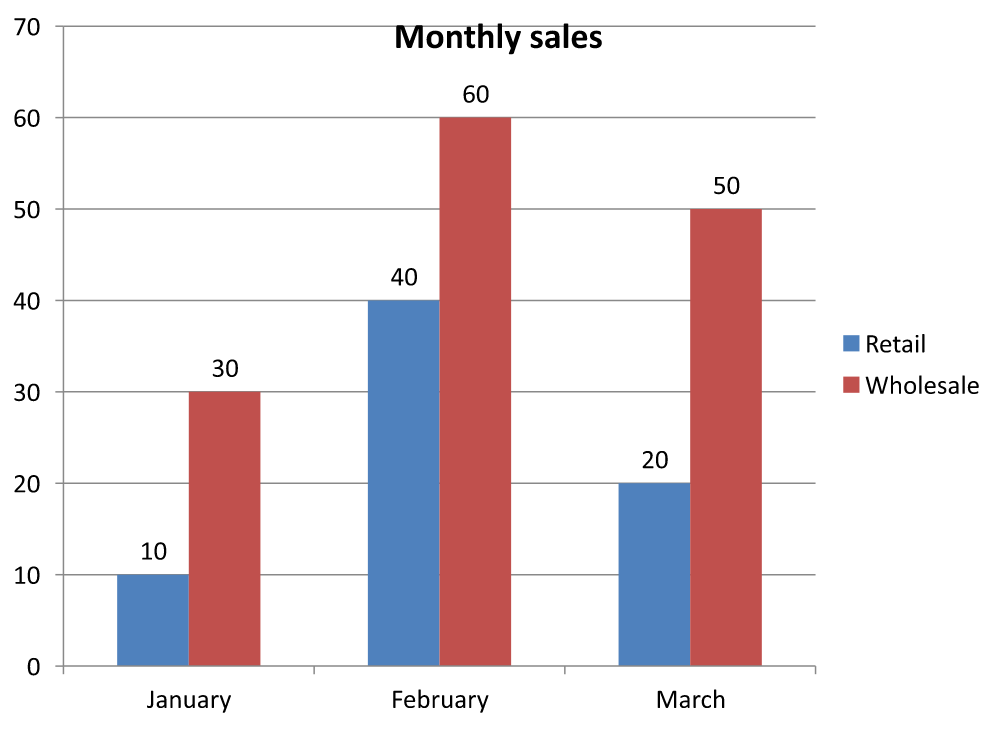

## **ภาพรวม**

บทความนี้อธิบายวิธีทำงานกับเวิร์กบุ๊กแผนภูมิใน Aspose.Slides แสดงวิธีอ่านและเขียนข้อมูลแผนภูมิผ่านสตรีมเวิร์กบุ๊ก ใช้เซลล์เวิร์กบุ๊กเป็นป้ายกำกับข้อมูลแผนภูมิ เข้าถึงคอลเลกชันแผ่นงาน และระบุประเภทแหล่งข้อมูลสำหรับค่าของแผนภูมิ

มันยังครอบคลุมการทำงานกับเวิร์กบุ๊กภายนอกเป็นแหล่งข้อมูลของแผนภูมิ ตัวอย่างแสดงวิธีสร้างและกำหนดเวิร์กบุ๊กภายนอก ดึงเส้นทางของเวิร์กบุ๊กภายนอกที่เชื่อมโยงกับแผนภูมิ และแก้ไขข้อมูลแผนภูมิเมื่อเวิร์กบุ๊กพร้อมใช้งาน

สำหรับเซลล์เวิร์กบุ๊กที่แทนค่าขาดหาย ดูที่ [ควบคุมการแสดงเซลล์ว่าง](/slides/th/php-java/chart-series/) เพื่อเปรียบเทียบความแตกต่างระหว่างเซลล์ว่างกับศูนย์ และดูการเปรียบเทียบแบบกราฟเส้นของโหมดการแสดงผลที่มีให้เลือก

## **รวมข้อมูลจากแถวและคอลัมน์ที่ซ่อนอยู่**

ใช้ [Chart::setPlotVisibleCellsOnly](https://reference.aspose.com/slides/php-java/aspose.slides/chart/setplotvisiblecellsonly/) เพื่อควบคุมว่าแผนภูมิจะพล็อตข้อมูลจากแถวและคอลัมน์แผ่นงานที่ซ่อนอยู่หรือไม่ ตั้งค่าเป็น `true` เพื่อพล็อตเฉพาะเซลล์ที่มองเห็นได้ หรือ `false` เพื่อรวมทั้งเซลล์ที่มองเห็นและที่ซ่อน การตั้งค่านี้ควบคุมการพล็อตของแผนภูมิ; ไม่ได้ทำการซ่อนหรือแสดงแถวหรือคอลัมน์ของแผ่นงาน

[ตัวอย่างงานนำเสนอ](hidden-source-data.pptx) มีแผนภูมิคอลัมน์เป็นรูปทรงแรกบนสไลด์แรกของไฟล์ แผ่นงานฝังอยู่ `Sheet1` มีช่วงข้อมูลต้นทาง `A1:C4` แถว 3 และคอลัมน์ C ถูกซ่อนอยู่ แต่เซลล์ของพวกมันยังคงมีค่า

| แถวแผ่นงาน | A: เดือน | B: ค้าปลีก | C: ขายส่ง (คอลัมน์ที่ซ่อน) |
| --- | --- | --- | --- |
| 2 | มกราคม | 10 | 30 |
| 3 (แถวที่ซ่อน) | กุมภาพันธ์ | 40 | 60 |
| 4 | มีนาคม | 20 | 50 |

เข้าถึงเซลล์ต้นทางผ่าน [ChartData::getChartDataWorkbook](https://reference.aspose.com/slides/php-java/aspose.slides/chartdata/getchartdataworkbook/) และอ่าน [ChartDataCell::isHidden](https://reference.aspose.com/slides/php-java/aspose.slides/chartdatacell/ishidden/) เพื่อสอบถามสถานะการซ่อนของเซลล์ วิธีนี้รายงานสถานะการซ่อนโดยไม่เปลี่ยนแปลงค่า ในไฟล์นี้ B2 มองเห็นได้, B3 อยู่ในแถวที่ซ่อน, และ C2 อยู่ในคอลัมน์ที่ซ่อน; ตัวอย่างพิมพ์ค่า `false`, `true`, และ `true` ตามลำดับ

สำหรับตัวอย่างนี้ ให้รีเฟรชข้อมูลแผนภูมิหลังจากเปลี่ยนการตั้งค่าการพล็อต: คงเวิร์กบุ๊กฝังไว้ด้วย [readWorkbookStream](https://reference.aspose.com/slides/php-java/aspose.slides/chartdata/readworkbookstream/) แล้วโหลดใหม่ด้วย [writeWorkbookStream](https://reference.aspose.com/slides/php-java/aspose.slides/chartdata/writeworkbookstream/) เมื่อรวมทุกเซลล์ให้ใช้ [setRange](https://reference.aspose.com/slides/php-java/aspose.slides/chartdata/setrange/) เพื่อคืนช่วงทั้งหมดรวมถึงประเภทเดือนกุมภาพันธ์ที่ซ่อนอยู่ การเปลี่ยนค่าแฟล็กอย่างเดียวไม่เพียงพอในการรีเฟรชข้อมูลแผนภูมิที่แคชไว้และป้ายชื่อประเภทในตัวอย่างนี้

```php
use aspose\slides\Presentation;
use aspose\slides\SaveFormat;

$presentation = new Presentation("hidden-source-data.pptx");
try {
    $slide = $presentation->getSlides()->get_Item(0);

    $shapeCount = java_values($slide->getShapes()->size());
    if ($shapeCount > 0 && java_instanceof($slide->getShapes()->get_Item(0), new JavaClass("com.aspose.slides.IChart"))) {
        $chart = $slide->getShapes()->get_Item(0);
        $workbook = $chart->getChartData()->getChartDataWorkbook();
        echo "B2 hidden: " . (java_values($workbook->getCell(0, "B2")->isHidden()) ? "true" : "false"), PHP_EOL;
        echo "B3 hidden: " . (java_values($workbook->getCell(0, "B3")->isHidden()) ? "true" : "false"), PHP_EOL;
        echo "C2 hidden: " . (java_values($workbook->getCell(0, "C2")->isHidden()) ? "true" : "false"), PHP_EOL;

        $workbookData = $chart->getChartData()->readWorkbookStream();
        foreach ([true, false] as $visibleOnly) {
            $chart->setPlotVisibleCellsOnly($visibleOnly);

            // รีเฟรชข้อมูลแผนภูมิจากเวิร์กบุ๊กฝังอยู่.
            $chart->getChartData()->writeWorkbookStream($workbookData);
            if (!$visibleOnly) {
                // คืนช่วงต้นทางทั้งหมด รวมถึงประเภทที่ซ่อนอยู่.
                $chart->getChartData()->setRange('Sheet1!$A$1:$C$4');
            }

            $presentation->save("hidden_cells_" . ($visibleOnly ? "true" : "false") . ".pptx", SaveFormat::Pptx);
        }
    } else {
        echo "The first shape is not a chart.", PHP_EOL;
    }
} finally {
    $presentation->dispose();
}
```

ตัวอย่างบันทึกสองเวอร์ชันของงานนำเสนอ: หนึ่งเวอร์ชันมีเฉพาะค่าค้าปลีกที่มองเห็นได้ (10 และ 20) อีกหนึ่งเวอร์ชันมีค่าทั้งหกค่า รูปภาพด้านล่างแสดงโหมดการพล็อตสองแบบ แถว 3 และคอลัมน์ C ยังคงซ่อนอยู่ในทั้งสองเวิร์กบุ๊กฝัง

| เซลล์ที่มองเห็นได้ (`true`) | เซลล์ทั้งหมด (`false`) |
| --- | --- |
|  |  |

เซลล์ที่ซ่อนและมีค่าไม่เหมือนกับเซลล์ว่าง [Chart::setDisplayBlanksAs](https://reference.aspose.com/slides/php-java/aspose.slides/chart/setdisplayblanksas/) ควบคุมวิธีการแสดงค่าที่หายไป; ไม่ได้รวมหรือยกเว้นข้อมูลต้นทางที่ซ่อน ดูที่ [ควบคุมการแสดงเซลล์ว่าง](/slides/th/php-java/chart-series/#control-the-display-of-empty-cells) เพื่อดูตัวอย่าง

## **ดึงช่วงข้อมูลของแผนภูมิ**

ก่อนอัปเดตข้อมูลเวิร์กบุ๊กในงานนำเสนอที่มีอยู่ ให้ตรวจสอบช่วงต้นทางเพื่อระบุว่าแผ่นงานแต่ละเซลล์ที่แผนภูมิกำลังใช้คืออะไร วิธี [ChartData::getRange](https://reference.aspose.com/slides/php-java/aspose.slides/chartdata/getrange/) คืนค่าช่วงข้อมูลปัจจุบันในรูปสูตรที่อ้างอิงแผ่นงาน เช่น `Sheet1!$A$1:$D$5` ที่นี่ `Sheet1` คือชื่อแผ่นงาน, `!` แยกจากช่วงเซลล์, และ `$A$1:$D$5` ระบุเซลล์จาก A1 ถึง D5 รวมถึงสัญลักษณ์ `$` แสดงการอ้างอิงแบบคงที่

วิธีนี้อ่านช่วงปัจจุบันโดยไม่เปลี่ยนแปลงแผนภูมิหรือเวิร์กบุ๊กของมัน หากแผนภูมิไม่ได้ใช้เวิร์กบุ๊กเป็นแหล่งข้อมูล จะเกิดข้อยกเว้น ดูข้อมูลเพิ่มเติมที่ [อ้างอิง API ของ ChartData](https://reference.aspose.com/slides/php-java/aspose.slides/chartdata/)

ตัวอย่างนี้เปิดงานนำเสนอและตรวจสอบรูปทรงบนแต่ละสไลด์เพื่อหากราฟ พิมพ์ชื่อและช่วงต้นทางของแต่ละแผนภูมิ หากแผนภูมิไม่ใช้เวิร์กบุ๊ก จะพิมพ์ข้อความและดำเนินการต่อไปยังแผนภูมิดังต่อไป

```php
use aspose\slides\Presentation;

$presentation = new Presentation("presentation.pptx");
try {
    $slideCount = java_values($presentation->getSlides()->size());
    for ($slideIndex = 0; $slideIndex < $slideCount; $slideIndex++) {
        $slide = $presentation->getSlides()->get_Item($slideIndex);
        $shapeCount = java_values($slide->getShapes()->size());
        for ($shapeIndex = 0; $shapeIndex < $shapeCount; $shapeIndex++) {
            $shape = $slide->getShapes()->get_Item($shapeIndex);
            if (java_instanceof($shape, new JavaClass("com.aspose.slides.IChart"))) {
                $chart = $shape;
                try {
                    $range = $chart->getChartData()->getRange();
                    echo $chart->getName() . ": " . $range, PHP_EOL;
                } catch (JavaException $exception) {
                    if (java_instanceof($exception, new JavaClass("com.aspose.slides.exceptions.InvalidOperationException"))) {
                        echo $chart->getName() . ": The chart does not use a workbook as its data source.", PHP_EOL;
                    } else {
                        echo $chart->getName() . ": " . $exception->getMessage(), PHP_EOL;
                    }
                }
            }
        }
    }
} finally {
    $presentation->dispose();
}
```

## **อ่านและเขียนข้อมูลแผนภูมิจากเวิร์กบุ๊ก**

Aspose.Slides for PHP via Java ให้วิธีการ [readWorkbookStream](https://reference.aspose.com/slides/php-java/aspose.slides/chartdata/readworkbookstream/) และ [writeWorkbookStream](https://reference.aspose.com/slides/php-java/aspose.slides/chartdata/writeworkbookstream/) ที่ช่วยให้คุณอ่านและเขียนเวิร์กบุ๊กข้อมูลแผนภูมิ (ซึ่งอาจแก้ไขด้วย Aspose.Cells) **หมายเหตุ** ข้อมูลแผนภูมิต้องจัดเรียงในลักษณะเดียวกันหรือมีโครงสร้างคล้ายกับแหล่งข้อมูลต้นฉบับ

ตัวอย่างนี้ใช้งานนำเสนอที่มีแผนภูมิเป็นรูปทรงแรกบนสไลด์แรก อ่านเวิร์กบุ๊กฝังเป็นอาเรย์ไบต์ ลบซีรีส์และประเภทเดิมออก แล้วเขียนเวิร์กบุ๊กเดิมกลับไป การเปลี่ยนแปลงอยู่ในหน่วยความจำ; ตัวอย่างไม่ได้บันทึกงานนำเสนอ

```php
use aspose\slides\Presentation;

$presentation = new Presentation("chart.pptx");
try {
    $slide = $presentation->getSlides()->get_Item(0);

    $shapeCount = java_values($slide->getShapes()->size());
    if ($shapeCount > 0 && java_instanceof($slide->getShapes()->get_Item(0), new JavaClass("com.aspose.slides.IChart"))) {
        $chart = $slide->getShapes()->get_Item(0);
        $chartData = $chart->getChartData();
        $workbookData = $chartData->readWorkbookStream();

        $chartData->getSeries()->clear();
        $chartData->getCategories()->clear();

        $chartData->writeWorkbookStream($workbookData);
    } else {
        echo "The first shape is not a chart.", PHP_EOL;
    }
} finally {
    $presentation->dispose();
}
```

### **ตรวจสอบเค้าโครงแผนภูมิหลังการแก้ไขเวิร์กบุ๊ก**

เมื่อคุณแทนที่เวิร์กบุ๊กฝังด้วยเวิร์กบุ๊กที่แก้ไขแล้ว แผนภูมิจะยังคงคอลเลกชันซีรีส์และประเภทเดิมไว้ ความไม่สอดคล้องนี้อาจทำให้ [Chart::validateChartLayout](https://reference.aspose.com/slides/php-java/aspose.slides/chart/validatechartlayout/) ล้มเหลวด้วยข้อผิดพลาด index-out-of-range ให้ลบซีรีส์และประเภทเดิมออกก่อนเขียนเวิร์กบุ๊กอัปเดตกลับไปยังแผนภูมิ ตัวอย่างนี้ใช้แผนภูมิที่เป็นรูปทรงแรกบนสไลด์แรก คอมเมนต์ระบุจุดที่การแก้ไขเวิร์กบุ๊กจะเกิดขึ้น; ตัวอย่างทำงานเขียนเวิร์กบุ๊กเดิมกลับและตรวจสอบเค้าโครงในหน่วยความจำ

```php
use aspose\slides\Presentation;

$presentation = new Presentation("chart.pptx");
try {
    $slide = $presentation->getSlides()->get_Item(0);

    $shapeCount = java_values($slide->getShapes()->size());
    if ($shapeCount > 0 && java_instanceof($slide->getShapes()->get_Item(0), new JavaClass("com.aspose.slides.IChart"))) {
        $chart = $slide->getShapes()->get_Item(0);
        $chartData = $chart->getChartData();
        $workbookData = $chartData->readWorkbookStream();

        // แก้ไขไบต์ของเวิร์กบุ๊กที่นี่, ตัวอย่างเช่น ใช้ Aspose.Cells.

        $chartData->getSeries()->clear();
        $chartData->getCategories()->clear();

        $chartData->writeWorkbookStream($workbookData);
        $chart->validateChartLayout();
    } else {
        echo "The first shape is not a chart.", PHP_EOL;
    }
} finally {
    $presentation->dispose();
}
```

การลบคอลเลกชันจะกำจัดการอ้างอิงข้อมูลเก่าก่อนที่เวิร์กบุ๊กจะถูกเขียนกลับ สร้างการแมปซีรีส์และประเภทใหม่ตามเวิร์กบุ๊กที่อัปเดตก่อนใช้แผนภูมิ

## **กำหนดรูปแบบตัวเลขแบบกำหนดเองสำหรับเซลล์เวิร์กบุ๊ก**

ใช้ [ChartDataCell::setCustomNumberFormat](https://reference.aspose.com/slides/php-java/aspose.slides/chartdatacell/setcustomnumberformat/) เพื่อควบคุมวิธีการแสดงค่าตัวเลขในเวิร์กบุ๊กฝังของแผนภูมิ ตัวอย่างเช่น รายงานอาจต้องแสดงอัตราการแปลงเป็นเปอร์เซ็นต์ด้วยทศนิยมสี่ตำแหน่งและค่าสัมประสิทธิ์ด้วยทศนิยมห้าตำแหน่ง ค่าทั้งสองควรเป็นตัวเลขเพื่อให้ยังคงใช้ในการคำนวณและการพล็อตแผนภูมิได้

รูปแบบตัวเลขเปลี่ยนการแสดงผล ไม่ได้เปลี่ยนค่าที่เก็บไว้ รูปแบบ `0.0000%` จะทำให้ `0.125` แสดงเป็น `12.5000%`; ไม่ได้แทนที่ค่าที่เก็บด้วย `12.5` เช่นเดียวกัน `0.00000` จะทำให้ `0.1234567` แสดงเป็น `0.12346` โดยไม่มีการปัดเศษค่าที่เก็บไว้ หากรูปแบบกำหนดเองเป็นสตริงว่าง (`""`) ระบบจะใช้รูปแบบที่คืนโดย [getPresetNumberFormat](https://reference.aspose.com/slides/php-java/aspose.slides/chartdatacell/getpresetnumberformat/)

ตัวอย่างต่อไปสร้างแผนภูมิคอลัมน์และเข้าถึงเซลล์ผ่าน [getChartDataWorkbook](https://reference.aspose.com/slides/php-java/aspose.slides/chartdata/getchartdataworkbook/) บนแผ่นงาน 0, B2 มีอัตราการแปลงและ C2 มีค่าสัมประสิทธิ์ ทั้งสองเซลล์เป็นแหล่งข้อมูลของแผนภูมิ ตัวอย่างยังเปิดใช้งานป้ายกำกับค่าเชื่อมโยงกับรูปแบบต้นทาง

```php
use aspose\slides\Presentation;
use aspose\slides\ChartType;
use aspose\slides\SlideSizeScaleType;
use aspose\slides\SaveFormat;

$presentation = new Presentation();
try {
    $presentation->getSlideSize()->setSize(720, 270, SlideSizeScaleType::DoNotScale);
    $slide = $presentation->getSlides()->get_Item(0);

    $chart = $slide->getShapes()->addChart(ChartType::ClusteredColumn, 50, 20, 620, 210);
    $chart->setTitle(false);

    $chart->getAxes()->getVerticalAxis()->setNumberFormatLinkedToSource(false);
    $chart->getAxes()->getVerticalAxis()->setNumberFormat("0.00");
    $chart->getAxes()->getVerticalAxis()->setAutomaticMinValue(false);
    $chart->getAxes()->getVerticalAxis()->setMinValue(0);

    $chart->getChartData()->getSeries()->clear();
    $chart->getChartData()->getCategories()->clear();

    $workbook = $chart->getChartData()->getChartDataWorkbook();
    $workbook->clear(0);

    $categoryCell = $workbook->getCell(0, "A2", "Sample");
    $chart->getChartData()->getCategories()->add($categoryCell);

    $percentageCell = $workbook->getCell(0, "B2", 0.125);
    $percentageCell->setCustomNumberFormat("0.0000%");
    $percentageName = $workbook->getCell(0, "B1", "Conversion rate");
    $percentageSeries = $chart->getChartData()->getSeries()->add($percentageName, $chart->getType());
    $percentageSeries->getDataPoints()->addDataPointForBarSeries($percentageCell);

    $precisionCell = $workbook->getCell(0, "C2", 0.1234567);
    $precisionCell->setCustomNumberFormat("0.00000");
    $precisionName = $workbook->getCell(0, "C1", "Coefficient");
    $precisionSeries = $chart->getChartData()->getSeries()->add($precisionName, $chart->getType());
    $precisionSeries->getDataPoints()->addDataPointForBarSeries($precisionCell);

    for ($seriesIndex = 0; $seriesIndex < java_values($chart->getChartData()->getSeries()->size()); $seriesIndex++) {
        $series = $chart->getChartData()->getSeries()->get_Item($seriesIndex);
        $labelFormat = $series->getDataPoints()->get_Item(0)->getLabel()->getDataLabelFormat();
        $labelFormat->setShowValue(true);
        $labelFormat->setNumberFormatLinkedToSource(true);
    }

    $presentation->save("CustomCellFormats.pptx", SaveFormat::Pptx);
} finally {
    $presentation->dispose();
}
```

รูปแบบเซลล์เวิร์กบุ๊กแตกต่างจากรูปแบบที่ตั้งโดยตรงบนแกนหรือป้ายกำกับข้อมูล ในตัวอย่างนี้แต่ละป้ายกำกับจะแสดงค่าจากเซลล์ต้นทางเพราะ [setShowValue](https://reference.aspose.com/slides/php-java/aspose.slides/datalabelformat/setshowvalue/) ถูกตั้งเป็น `true` และตามรูปแบบตัวเลขของเซลล์ต้นทางเพราะ [setNumberFormatLinkedToSource](https://reference.aspose.com/slides/php-java/aspose.slides/datalabelformat/setnumberformatlinkedtosource/) ถูกตั้งเป็น `true` หลังจากบันทึกและเปิดงานนำเสนอใหม่ ป้ายกำกับจะแสดง `12.5000%` และ `0.12346` ตามที่แสดงด้านล่าง แกนแนวตั้งใช้รูปแบบตัวเลขของตนเอง ที่กำหนดด้วย [setNumberFormat](https://reference.aspose.com/slides/php-java/aspose.slides/axis/setnumberformat/) เป็น `0.00` พร้อมกับ [setNumberFormatLinkedToSource](https://reference.aspose.com/slides/php-java/aspose.slides/axis/setnumberformatlinkedtosource/) ตั้งเป็น `false`

หากต้องการจัดรูปแบบป้ายกำกับข้อมูลแยกจากแหล่ง ให้ตั้งค่าสถานะเชื่อมโยงต้นทางเป็น `false` แล้วกำหนดรูปแบบด้วย [setNumberFormat](https://reference.aspose.com/slides/php-java/aspose.slides/datalabelformat/setnumberformat/) วิธีนี้ไม่ทำให้รูปแบบของเซลล์เวิร์กบุ๊กเปลี่ยน ตัวอย่างเช่น รูปแบบป้ายกำกับแยก `0.00` จะทำให้ค่าแรกแสดงเป็น `0.13` ในขณะที่ B2 ยังแสดง `12.5000%` ดูที่ [Chart Data Labels](/slides/th/php-java/chart-data-label/#set-percentage-sign-with-chart-data-labels) สำหรับการจัดรูปแบบป้ายกำกับโดยตรง

ภาพต่อไปแสดงจากงานนำเสนอที่บันทึกแล้วและเปิดใหม่อีกครั้ง:


## **กำหนดเซลล์เวิร์กบุ๊กเป็นป้ายกำกับข้อมูลของแผนภูมิ**

คุณสามารถใช้ข้อความจากเซลล์เวิร์กบุ๊กเป็นป้ายกำกับข้อมูลของแผนภูมิได้

ตัวอย่างนี้เพิ่มแผนภูมิบับเบิลที่มีข้อมูลเริ่มต้นบนสไลด์แรกของงานนำเสนอที่มีอยู่ ใช้เซลล์ A10:A12 บนแผ่นงาน 0 สำหรับสามป้ายกำกับแรกในซีรีส์แรก เปิดใช้งานป้ายกำกับจากเซลล์และบันทึกงานนำเสนอที่ได้อัปเดต

```php
use aspose\slides\Presentation;
use aspose\slides\ChartType;
use aspose\slides\SaveFormat;

$presentation = new Presentation("chart2.pptx");
try {
    $slide = $presentation->getSlides()->get_Item(0);

    $chart = $slide->getShapes()->addChart(ChartType::Bubble, 50, 50, 600, 400, true);
    $series = $chart->getChartData()->getSeries()->get_Item(0);
    $workbook = $chart->getChartData()->getChartDataWorkbook();

    $series->getLabels()->getDefaultDataLabelFormat()->setShowLabelValueFromCell(true);
    $series->getLabels()->get_Item(0)->setValueFromCell($workbook->getCell(0, "A10", "Label 0 cell value"));
    $series->getLabels()->get_Item(1)->setValueFromCell($workbook->getCell(0, "A11", "Label 1 cell value"));
    $series->getLabels()->get_Item(2)->setValueFromCell($workbook->getCell(0, "A12", "Label 2 cell value"));

    $presentation->save("resultchart.pptx", SaveFormat::Pptx);
} finally {
    $presentation->dispose();
}
```

## **จัดการแผ่นงาน**

วิธี [ChartDataWorkbook::getWorksheets](https://reference.aspose.com/slides/php-java/aspose.slides/chartdataworkbook/getworksheets/) ให้เข้าถึงแผ่นงานในเวิร์กบุ๊กของแผนภูมิ ตัวอย่างนี้สร้างแผนภูมิพายที่มีข้อมูลเริ่มต้นและพิมพ์ชื่อแต่ละแผ่นงานไปยังคอนโซล

```php
use aspose\slides\Presentation;
use aspose\slides\ChartType;

$presentation = new Presentation();
try {
    $slide = $presentation->getSlides()->get_Item(0);

    $chart = $slide->getShapes()->addChart(ChartType::Pie, 50, 50, 400, 500);
    $workbook = $chart->getChartData()->getChartDataWorkbook();

    for ($i = 0; $i < java_values($workbook->getWorksheets()->size()); $i++) {
        echo $workbook->getWorksheets()->get_Item($i)->getName(), PHP_EOL;
    }
} finally {
    $presentation->dispose();
}
```

## **ระบุประเภทแหล่งข้อมูล**

ตัวอย่างนี้สร้างแผนภูมิคอลัมน์ 3 มิติที่มีข้อมูลเริ่มต้นและตั้งชื่อซีรีส์สองชื่อโดยใช้แหล่งข้อมูลที่ต่างกัน ชื่อแรกใช้สตริงแบบลิตเทอรัล; ชื่อที่สองใช้เซลล์ C1 บนแผ่นงาน 0 ค่อนไทป์ [DataSourceType](https://reference.aspose.com/slides/php-java/aspose.slides/datasourcetype/) กำหนดแหล่งสำหรับแต่ละชื่อ ตัวอย่างบันทึกงานนำเสนอพร้อมชื่อซีรีส์ที่อัปเดต

```php
use aspose\slides\Presentation;
use aspose\slides\ChartType;
use aspose\slides\SaveFormat;
use aspose\slides\DataSourceType;

$presentation = new Presentation();
try {
    $slide = $presentation->getSlides()->get_Item(0);

    $chart = $slide->getShapes()->addChart(ChartType::Column3D, 50, 50, 600, 400, true);
    $literalName = $chart->getChartData()->getSeries()->get_Item(0)->getName();

    $literalName->setDataSourceType(DataSourceType::StringLiterals);
    $literalName->setData("LiteralString");

    $cellName = $chart->getChartData()->getSeries()->get_Item(1)->getName();
    $nameCell = $chart->getChartData()->getChartDataWorkbook()->getCell(0, "C1", "NewCell");
    $cellName->setDataSourceType(DataSourceType::Worksheet);
    $cellName->setData($nameCell);

    $presentation->save("pres.pptx", SaveFormat::Pptx);
} finally {
    $presentation->dispose();
}
```

## **ตรวจจับรูปแบบเวิร์กบุ๊กฝังที่ไม่สนับสนุน**

Aspose.Slides ไม่สนับสนุนรูปแบบเวิร์กบุ๊ก Excel แบบไบนารี (.xlsb) ที่อาจฝังอยู่ในบางแผนภูมิ คุณสามารถใช้เมธอด `getEmbeddedWorkbookType` บน [ChartData](https://reference.aspose.com/slides/php-java/aspose.slides/chartdata/) ร่วมกับไอเทม [WorkbookType](https://reference.aspose.com/slides/php-java/aspose.slides/workbooktype/) เพื่อตรวจจับรูปแบบที่ไม่สนับสนุนและข้ามแผนภูมินั้น ตัวอย่างตรวจสอบรูปทรงบนสไลด์แรกของงานนำเสนอที่มีอยู่ ข้ามรูปทรงที่ไม่ใช่แผนภูมิและพิมพ์ข้อความวินิจฉัยสำหรับแต่ละแผนภูมิที่มีเวิร์กบุ๊ก .xlsb ฝังอยู่

```php
use aspose\slides\Presentation;
use aspose\slides\ChartDataSourceType;
use aspose\slides\WorkbookType;

$presentation = new Presentation("sample.pptx");
try {
    $slide = $presentation->getSlides()->get_Item(0);

    $shapeCount = java_values($slide->getShapes()->size());
    for ($shapeIndex = 0; $shapeIndex < $shapeCount; $shapeIndex++) {
        $shape = $slide->getShapes()->get_Item($shapeIndex);
        if (!java_instanceof($shape, new JavaClass("com.aspose.slides.IChart"))) {
            continue;
        }

        $chart = $shape;
        $chartData = $chart->getChartData();
        $isInternalWorkbook = java_values($chartData->getDataSourceType()) == ChartDataSourceType::InternalWorkbook;
        $isBinaryMacro = java_values($chartData->getEmbeddedWorkbookType()) == WorkbookType::WorkbookBinaryMacro;

        if ($isInternalWorkbook && $isBinaryMacro) {
            echo "Skipping a chart with an unsupported .xlsb workbook.", PHP_EOL;
            continue;
        }

        // อ่านหรือแก้ไขข้อมูลเวิร์กบุ๊กแผนภูมิที่สนับสนุนที่นี่.
    }
} finally {
    $presentation->dispose();
}
```

## **เวิร์กบุ๊กภายนอก**

Aspose.Slides รองรับการใช้เวิร์กบุ๊กภายนอกเป็นแหล่งข้อมูลของแผนภูมิ

### **สร้างเวิร์กบุ๊กภายนอก**

ใช้ [readWorkbookStream](https://reference.aspose.com/slides/php-java/aspose.slides/chartdata/readworkbookstream/) และ [setExternalWorkbook](https://reference.aspose.com/slides/php-java/aspose.slides/chartdata/setexternalworkbook/) เพื่อส่งออกเวิร์กบุ๊กแผนภูมิฝังเป็นไฟล์และเชื่อมโยงแผนภูมิกับเวิร์กบุ๊กภายนอกนั้น

ตัวอย่างนี้สร้างแผนภูมิเพายที่มีข้อมูลเริ่มต้นและส่งออกเวิร์กบุ๊กของมัน ทำการเขียนไฟล์ให้เสร็จก่อนกำหนดเวิร์กบุ๊กภายนอกเป็นแหล่งข้อมูลของแผนภูมิ แล้วบันทึกงานนำเสนอที่เชื่อมโยง

```php
use aspose\slides\Presentation;
use aspose\slides\ChartType;
use aspose\slides\SaveFormat;

$presentation = new Presentation();
try {
    $slide = $presentation->getSlides()->get_Item(0);

    $chart = $slide->getShapes()->addChart(ChartType::Pie, 50, 50, 400, 600);
    $workbookPath = new Java("java.io.File", "externalWorkbook1.xlsx");
    $workbookData = $chart->getChartData()->readWorkbookStream();
    try {
        $fileStream = new Java("java.io.FileOutputStream", $workbookPath);
        try {
            $fileStream->write($workbookData);
        } finally {
            $fileStream->close();
        }
        $chart->getChartData()->setExternalWorkbook($workbookPath->getAbsolutePath());
        
        $presentation->save("externalWorkbook.pptx", SaveFormat::Pptx);
    } catch (JavaException $exception) {
        echo "Could not write the external workbook: " . $exception->getMessage(), PHP_EOL;
    }
} finally {
    $presentation->dispose();
}
```

### **กำหนดเวิร์กบุ๊กภายนอก**

โดยใช้เมธอด [setExternalWorkbook](https://reference.aspose.com/slides/php-java/aspose.slides/chartdata/setexternalworkbook/) คุณสามารถกำหนดเวิร์กบุ๊กภายนอกให้กับแผนภูมิเป็นแหล่งข้อมูลได้ เมธอดนี้ยังสามารถใช้เพื่ออัปเดตเส้นทางไปยังเวิร์กบุ๊กภายนอก (หากไฟล์ถูกย้าย)

แม้ว่าคุณจะไม่สามารถแก้ไขข้อมูลในเวิร์กบุ๊กที่จัดเก็บในตำแหน่งห่างไกลหรือทรัพยากรได้ คุณก็ยังสามารถใช้เวิร์กบุ๊กเหล่านั้นเป็นแหล่งข้อมูลภายนอกได้ หากระบุเส้นทางสัมพันธ์สำหรับเวิร์กบุ๊กภายนอก ระบบจะเปลี่ยนเป็นเส้นทางเต็มโดยอัตโนมัติ

ตัวอย่างนี้ใช้เวิร์กบุ๊กภายนอกที่แผ่นงานชื่อ `Sheet1` มีชื่อซีรีส์ใน B1, ชื่อประเภทใน A2:A4, และค่าตัวเลขใน B2:B4 ตัวอย่างสร้างแผนภูมิเพาย, เชื่อมโยงเวิร์กบุ๊ก, และใช้ [setRange](https://reference.aspose.com/slides/php-java/aspose.slides/chartdata/setrange/) เพื่อแมป A1:B4 เป็นหนึ่งซีรีส์และสามประเภท ส่งงานนำเสนอพร้อมแผนภูมิที่เชื่อมโยง

```php
use aspose\slides\Presentation;
use aspose\slides\ChartType;
use aspose\slides\SaveFormat;

$presentation = new Presentation();
try {
    $slide = $presentation->getSlides()->get_Item(0);

    $chart = $slide->getShapes()->addChart(ChartType::Pie, 50, 50, 400, 600, true);
    $chartData = $chart->getChartData();
    $workbookFile = new Java("java.io.File", "externalWorkbook.xlsx");
    $workbookPath = $workbookFile->getAbsolutePath();

    $chartData->setExternalWorkbook($workbookPath);
    $chartData->setRange('Sheet1!$A$1:$B$4');

    $presentation->save("Presentation_with_externalWorkbook.pptx", SaveFormat::Pptx);
} finally {
    $presentation->dispose();
}
```

พารามิเตอร์ `updateChartData` ของ [setExternalWorkbook](https://reference.aspose.com/slides/php-java/aspose.slides/chartdata/setexternalworkbook/) ควบคุมว่ามีการโหลดเวิร์กบุ๊กหรือไม่

* เมื่อ `updateChartData` เป็น `false` จะอัปเดตเฉพาะเส้นทางของเวิร์กบุ๊ก ข้อมูลแผนภูมิจะไม่ถูกโหลดหรืออัปเดตจากเวิร์กบุ๊กเป้าหมาย ดังนั้นเวิร์กบุ๊กอาจไม่มีอยู่
* เมื่อ `updateChartData` เป็น `true` ข้อมูลแผนภูมิจะอัปเดตจากเวิร์กบุ๊กเป้าหมาย

ตัวอย่างต่อไปกำหนด URL ตัวอักษรแทนที่พร้อม `updateChartData` ตั้งเป็น `false` คงข้อมูลเริ่มต้นของแผนภูมิเพายและบันทึกงานนำเสนอโดยไม่โหลดเวิร์กบุ๊กที่ไม่สามารถเข้าถึงได้

```php
use aspose\slides\Presentation;
use aspose\slides\ChartType;
use aspose\slides\SaveFormat;

$presentation = new Presentation();
try {
    $slide = $presentation->getSlides()->get_Item(0);

    $chart = $slide->getShapes()->addChart(ChartType::Pie, 50, 50, 400, 600, true);
    $chart->getChartData()->setExternalWorkbook("https://example.com/unavailable-workbook.xlsx", false);

    $presentation->save("SetExternalWorkbookWithUpdateChartData.pptx", SaveFormat::Pptx);
} finally {
    $presentation->dispose();
}
```

### **รับเส้นทางเวิร์กบุ๊กแหล่งข้อมูลภายนอกของแผนภูมิ**

เพื่อระบุเวิร์กบุ๊กที่เชื่อมโยงกับแผนภูมิ ตรวจสอบว่าแผนภูมิใช้แหล่งข้อมูลภายนอกหรือไม่และดึงเส้นทางเวิร์กบุ๊กของมัน

ตัวอย่างนี้ตรวจสอบรูปทรงแรกบนสไลด์แรกของงานนำเสนอที่มีเวิร์กบุ๊กภายนอกเชื่อมโยง หากเป็นแผนภูมิที่เชื่อมโยงกับเวิร์กบุ๊กภายนอก ตัวอย่างพิมพ์ [getExternalWorkbookPath](https://reference.aspose.com/slides/php-java/aspose.slides/chartdata/getexternalworkbookpath/) ไปยังคอนโซลแล้วบันทึกสำเนาของงานนำเสนอ

```php
use aspose\slides\Presentation;
use aspose\slides\SaveFormat;
use aspose\slides\ChartDataSourceType;

$presentation = new Presentation("externalWorkbook.pptx");
try {
    $slide = $presentation->getSlides()->get_Item(0);

    $shapeCount = java_values($slide->getShapes()->size());
    if ($shapeCount > 0 && java_instanceof($slide->getShapes()->get_Item(0), new JavaClass("com.aspose.slides.IChart"))) {
        $chart = $slide->getShapes()->get_Item(0);
        $chartData = $chart->getChartData();
        if (java_values($chartData->getDataSourceType()) == ChartDataSourceType::ExternalWorkbook) {
            echo $chartData->getExternalWorkbookPath(), PHP_EOL;
        } else {
            echo "The chart does not use an external workbook.", PHP_EOL;
        }
    } else {
        echo "The first shape is not a chart.", PHP_EOL;
    }

    $presentation->save("Result.pptx", SaveFormat::Pptx);
} finally {
    $presentation->dispose();
}
```

### **แก้ไขข้อมูลแผนภูมิ**

คุณสามารถแก้ไขข้อมูลในเวิร์กบุ๊กภายนอกได้เช่นเดียวกับการเปลี่ยนแปลงในเวิร์กบุ๊กภายใน เมื่อเวิร์กบุ๊กภายนอกไม่สามารถโหลดได้ จะเกิดข้อยกเว้น

ตัวอย่างนี้ใช้แผนภูมิที่เป็นรูปทรงแรกบนสไลด์แรกและเชื่อมโยงกับเวิร์กบุ๊กภายนอกที่เข้าถึงได้ ตั้งค่าค่าที่อยู่ในเซลล์ของจุดข้อมูลแรกในซีรีส์แรกเป็น 100 และบันทึกงานนำเสนอที่อัปเดต การแก้ไขค่าจากเซลล์อาจอัปเดตไฟล์ XLSX ภายนอกที่เชื่อมโยง จึงควรใช้สำเนาหากต้องการเก็บเวิร์กบุ๊กต้นฉบับไว้

```php
use aspose\slides\Presentation;
use aspose\slides\SaveFormat;

$presentation = new Presentation("presentation.pptx");
try {
    $slide = $presentation->getSlides()->get_Item(0);

    $shapeCount = java_values($slide->getShapes()->size());
    if ($shapeCount > 0 && java_instanceof($slide->getShapes()->get_Item(0), new JavaClass("com.aspose.slides.IChart"))) {
        $chart = $slide->getShapes()->get_Item(0);
        $series = $chart->getChartData()->getSeries();
        if (java_values($series->size()) > 0 && java_values($series->get_Item(0)->getDataPoints()->size()) > 0) {
            $valueCell = $series->get_Item(0)->getDataPoints()->get_Item(0)->getValue()->getAsCell();
            if (!java_is_null($valueCell)) {
                $valueCell->setValue(100);
                $presentation->save("presentation_out.pptx", SaveFormat::Pptx);
            } else {
                echo "The first data point is not linked to a workbook cell.", PHP_EOL;
            }
        } else {
            echo "The chart has no data points to edit.", PHP_EOL;
        }
    } else {
        echo "The first shape is not a chart.", PHP_EOL;
    }
} finally {
    $presentation->dispose();
}
```

### **กู้คืนเวิร์กบุ๊กจากแคชของแผนภูมิ**

หากแผนภูมิใช้เวิร์กบุ๊กภายนอกที่หายไปหรือไม่พร้อมใช้งาน Aspose.Slides สามารถสร้างเวิร์กบุ๊กแผนภูมิจากข้อมูลที่แคชไว้ในงานนำเสนอได้ สร้าง [LoadOptions](https://reference.aspose.com/slides/php-java/aspose.slides/loadoptions/), เรียก [LoadOptions::setSpreadsheetOptions](https://reference.aspose.com/slides/php-java/aspose.slides/loadoptions/setspreadsheetoptions/), และตั้งค่า [SpreadsheetOptions::setRecoverWorkbookFromChartCache](https://reference.aspose.com/slides/php-java/aspose.slides/spreadsheetoptions/setrecoverworkbookfromchartcache/) เป็น `true` ก่อนเปิดงานนำเสนอ

ตัวอย่าง PHP ต่อไปกู้คืนข้อมูลเวิร์กบุ๊กสำหรับแผนภูมิที่เป็นรูปทรงแรกบนสไลด์แรกและอ้างอิงเวิร์กบุ๊กภายนอกที่ไม่สามารถเข้าถึงได้ เข้าถึงข้อมูลที่กู้คืนผ่าน [Chart::getChartData](https://reference.aspose.com/slides/php-java/aspose.slides/chart/getchartdata/) และ [ChartData::getChartDataWorkbook](https://reference.aspose.com/slides/php-java/aspose.slides/chartdata/getchartdataworkbook/):

```php
use aspose\slides\Presentation;
use aspose\slides\SpreadsheetOptions;
use aspose\slides\LoadOptions;

$spreadsheetOptions = new SpreadsheetOptions();
$spreadsheetOptions->setRecoverWorkbookFromChartCache(true);

$loadOptions = new LoadOptions();
$loadOptions->setSpreadsheetOptions($spreadsheetOptions);

$presentation = new Presentation("presentation.pptx", $loadOptions);
try {
    $slide = $presentation->getSlides()->get_Item(0);

    $shapeCount = java_values($slide->getShapes()->size());
    if ($shapeCount > 0 && java_instanceof($slide->getShapes()->get_Item(0), new JavaClass("com.aspose.slides.IChart"))) {
        $chart = $slide->getShapes()->get_Item(0);
        $recoveredWorkbook = $chart->getChartData()->getChartDataWorkbook();

        // อ่านหรือแก้ไขข้อมูลเวิร์กบุ๊กที่กู้คืนที่นี่.
    } else {
        echo "The first shape is not a chart.", PHP_EOL;
    }
} finally {
    $presentation->dispose();
}
```

หากเวิร์กบุ๊กภายนอกไม่พร้อมใช้งานและการกู้คืนถูกปิดใช้งาน Aspose.Slides จะโยนข้อยกเว้น ให้เปิดการกู้คืนเฉพาะเมื่อการใช้ข้อมูลแคชของแผนภูมิเป็นทางเลือกที่ยอมรับได้ เนื่องจากแคชอาจไม่มีการเปลี่ยนแปลงที่ทำในเวิร์กบุ๊กภายนอกหลังจากที่งานนำเสนออัปเดตครั้งล่าสุด

## **FAQ**

**ฉันจะตรวจสอบได้หรือไม่ว่าแผนภูมิใดเชื่อมโยงกับเวิร์กบุ๊กภายนอกหรือเวิร์กบุ๊กฝัง?**

ได้. แผนภูมิมี [data source type](https://reference.aspose.com/slides/php-java/aspose.slides/chartdata/getdatasourcetype/) และ [path to an external workbook](https://reference.aspose.com/slides/php-java/aspose.slides/chartdata/getexternalworkbookpath/); หากแหล่งเป็นเวิร์กบุ๊กภายนอก คุณสามารถอ่านเส้นทางเต็มเพื่อยืนยันว่ามีการใช้ไฟล์ภายนอก

**รองรับเส้นทางสัมพันธ์ไปยังเวิร์กบุ๊กภายนอกหรือไม่ และเก็บอย่างไร?**

ใช่. หากคุณระบุเส้นทางสัมพันธ์ ระบบจะเปลี่ยนอัตโนมัติเป็นเส้นทางเต็ม งานนำเสนอเก็บเส้นทางเต็มในไฟล์ PPTX ดังนั้นการย้ายเวิร์กบุ๊กอาจต้องอัปเดตลิงก์

**ฉันสามารถใช้เวิร์กบุ๊กที่อยู่บนทรัพยากรเครือข่าย/แชร์ได้หรือไม่?**

ได้, เวิร์กบุ๊กเหล่านั้นสามารถใช้เป็นแหล่งข้อมูลภายนอกได้ อย่างไรก็ตาม การแก้ไขเวิร์กบุ๊กระยะไกลโดยตรงจาก Aspose.Slides ไม่รองรับ — สามารถใช้เป็นแหล่งข้อมูลเท่านั้น

**Aspose.Slides จะเขียนทับไฟล์ XLSX ภายนอกเมื่อบันทึกงานนำเสนอหรือไม่?**

งานนำเสนอเก็บ [link to the external file](https://reference.aspose.com/slides/php-java/aspose.slides/chartdata/getexternalworkbookpath/) การแก้ไขข้อมูลแผนภูมิที่อิงจากเซลล์อาจอัปเดตไฟล์ XLSX ภายนอกที่เชื่อมโยง ใช้สำเนาเวิร์กบุ๊กหากต้องการให้ไฟล์ต้นฉบับคงอยู่โดยไม่เปลี่ยนแปลง

**ควรทำอย่างไรหากไฟล์ภายนอกถูกป้องกันด้วยรหัสผ่าน?**

Aspose.Slides ไม่รับรหัสผ่านเมื่อลิงก์ วิธีทั่วไปคือถอดการป้องกันล่วงหน้าหรือเตรียมสำเนาที่ถอดรหัสแล้ว (เช่น ใช้ [Aspose.Cells](https://reference.aspose.com/cells/java/)) แล้วเชื่อมโยงไปยังสำเนานั้น

**หลายแผนภูมิสามารถอ้างอิงเวิร์กบุ๊กภายนอกเดียวกันได้หรือไม่?**

ได้. แต่ละแผนภูมิเก็บลิงก์ของตนเอง หากทั้งหมดชี้ไปที่ไฟล์เดียวกัน การอัปเดตไฟล์นั้นจะสะท้อนในแต่ละแผนภูมิเมื่อตัวข้อมูลถูกโหลดครั้งต่อไป