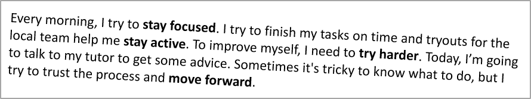

## **ภาพรวม**

บทความนี้แสดงวิธีการจัดรูปแบบข้อความในงานนำเสนอ PowerPoint และ OpenDocument โดยใช้ Aspose.Slides for Python via .NET ครอบคลุมสีพื้นหลัง, ความโปร่งใส, ระยะห่างระหว่างอักขระ, คุณสมบัติของฟอนต์, การหมุน, ระยะห่างระหว่างย่อหน้า, พฤติกรรม autofit, การจัดตำแหน่งข้อความ, จุดหยุดแท็บ, และการตั้งค่าภาษา

หากไม่ได้ระบุเป็นอย่างอื่น ตัวอย่างจะใช้ [sample.pptx](sample.pptx) รูปทรงแรกบนสไลด์แรกเป็นกล่องข้อความ และย่อหน้าแรกของมันประกอบด้วยข้อความที่แสดงด้านล่าง ดัชนีสไลด์และรูปทรงเป็นศูนย์ ตัวอย่างที่เลือกส่วนที่เป็นตัวหนาจะใช้การจัดรูปแบบที่มีผลรวม, รวมถึงการจัดรูปแบบตัวหนาที่สืบทอด:


เพื่อค้นหาและเน้นข้อความลiteral หรือผลการจับคู่ด้วย regular‑expression, ดูที่ [Search and Replace Text](/slides/th/python-net/search-and-replace-text/).

## **กำหนดสีพื้นหลังของข้อความ**

ใช้ [ParagraphFormat.default_portion_format](https://reference.aspose.com/slides/python-net/aspose.slides/paragraphformat/default_portion_format/) เพื่อกำหนดสีไฮไลท์เริ่มต้นสำหรับย่อหน้า, หรือใช้ [BasePortionFormat.highlight_color](https://reference.aspose.com/slides/python-net/aspose.slides/baseportionformat/highlight_color/) สำหรับส่วนข้อความแต่ละส่วน

ตัวอย่างต่อไปนี้กำหนดไฮไลท์สีเทาอ่อนเป็นค่าเริ่มต้นสำหรับย่อหน้าแรก สีไฮไลท์ที่ระบุบนส่วนข้อความแต่ละส่วนจะมีค่าสูงกว่าเริ่มต้นนี้:

```python
import aspose.pydrawing as draw
import aspose.slides as slides

with slides.Presentation("sample.pptx") as presentation:
    slide = presentation.slides[0]

    auto_shape = slide.shapes[0]
    paragraph = auto_shape.text_frame.paragraphs[0]

    # ตั้งค่าสีไฮไลท์สำหรับย่อหน้าเต็ม.
    paragraph.paragraph_format.default_portion_format.highlight_color.color = draw.Color.light_gray

    presentation.save("gray_paragraph.pptx", slides.export.SaveFormat.PPTX)
```

ผลลัพธ์:


ตัวอย่างโค้ดด้านล่างแสดงวิธีการกำหนดสีพื้นหลังสำหรับ **ส่วนข้อความที่มีฟอนต์หนา**:

```python
import aspose.pydrawing as draw
import aspose.slides as slides

with slides.Presentation("sample.pptx") as presentation:
    slide = presentation.slides[0]

    auto_shape = slide.shapes[0]
    paragraph = auto_shape.text_frame.paragraphs[0]

    for portion in paragraph.portions:
        if portion.portion_format.get_effective().font_bold:
            # ตั้งค่าสีไฮไลท์สำหรับส่วนข้อความ.
            portion.portion_format.highlight_color.color = draw.Color.light_gray

    presentation.save("gray_text_portions.pptx", slides.export.SaveFormat.PPTX)
```

ผลลัพธ์:


## **จัดแนวย่อหน้าข้อความ**

ใช้ [ParagraphFormat.alignment](https://reference.aspose.com/slides/python-net/aspose.slides/paragraphformat/alignment/) เพื่อกำหนดการจัดแนวย่อหน้าภายในกรอบข้อความ ค่าอาจเป็น centered, left‑aligned, right‑aligned, justified เป็นต้น

ตัวอย่างโค้ดต่อไปนี้แสดงวิธีการจัดแนวย่อหน้าให้ **อยู่ตรงกลาง**:

```python
import aspose.slides as slides

with slides.Presentation("sample.pptx") as presentation:
    slide = presentation.slides[0]

    auto_shape = slide.shapes[0]
    paragraph = auto_shape.text_frame.paragraphs[0]

    # ตั้งค่าการจัดแนวของย่อหน้าเป็นศูนย์กลาง.
    paragraph.paragraph_format.alignment = slides.TextAlignment.CENTER

    presentation.save("aligned_paragraph.pptx", slides.export.SaveFormat.PPTX)
```

ผลลัพธ์:


## **จัดแนวฟอนต์ภายในบรรทัด**

ใช้ [ParagraphFormat.font_alignment](https://reference.aspose.com/slides/python-net/aspose.slides/paragraphformat/font_alignment/) เพื่อจัดแนวแนวตั้งของส่วนข้อความที่มีฟอนต์ขนาดต่างกันภายในบรรทัด การตั้งค่านี้ใช้กับย่อหน้าทั้งหมดและควบคุมการจัดแนวภายในแต่ละบรรทัดของย่อหน้า

ตัวอย่างต่อไปนี้สร้างกล่องข้อความสี่กล่องที่มีป้ายกำกับบนสไลด์เดียว แต่ละย่อหน้ามีข้อความเดียวกันที่ขนาด 18, 36, และ 54 พอยต์ โดยมีการจัดแนวฟอนต์ที่แตกต่างกัน ใช้ Arial, ปิดการใช้ autofit และ wrapping, และทำให้กรอบข้อความใหญ่พอที่จะบรรจุบรรทัดเดียว

```python
import aspose.pydrawing as draw
import aspose.slides as slides

with slides.Presentation() as presentation:
    slide = presentation.slides[0]

    alignments = [slides.FontAlignment.BASELINE, slides.FontAlignment.TOP, slides.FontAlignment.CENTER, slides.FontAlignment.BOTTOM]
    font_sizes = [18, 36, 54]

    for i, alignment in enumerate(alignments):
        shape = slide.shapes.add_auto_shape(slides.ShapeType.RECTANGLE, 30, 20 + i * 130, 660, 120)
        shape.fill_format.fill_type = slides.FillType.NO_FILL
        shape.line_format.fill_format.fill_type = slides.FillType.NO_FILL

        text_frame = shape.text_frame
        text_frame.text_frame_format.anchoring_type = slides.TextAnchorType.TOP
        text_frame.text_frame_format.autofit_type = slides.TextAutofitType.NONE
        text_frame.text_frame_format.wrap_text = slides.NullableBool.FALSE

        label = text_frame.paragraphs[0]
        label.text = alignment.name.title()
        label.paragraph_format.alignment = slides.TextAlignment.LEFT
        label.paragraph_format.default_portion_format.font_height = 14
        label.paragraph_format.default_portion_format.latin_font = slides.FontData("Arial")
        label.paragraph_format.default_portion_format.fill_format.fill_type = slides.FillType.SOLID
        label.paragraph_format.default_portion_format.fill_format.solid_fill_color.color = draw.Color.gray

        paragraph = slides.Paragraph()
        paragraph.paragraph_format.font_alignment = alignment
        paragraph.paragraph_format.alignment = slides.TextAlignment.LEFT
        paragraph.paragraph_format.default_portion_format.latin_font = slides.FontData("Arial")
        paragraph.paragraph_format.default_portion_format.fill_format.fill_type = slides.FillType.SOLID
        paragraph.paragraph_format.default_portion_format.fill_format.solid_fill_color.color = draw.Color.black

        for font_size in font_sizes:
            portion = slides.Portion("Ag ")
            portion.portion_format.font_height = font_size
            paragraph.portions.add(portion)

        text_frame.paragraphs.add(paragraph)

    presentation.save("font_alignment.pptx", slides.export.SaveFormat.PPTX)
```

ผลลัพธ์:


การจัดแนวฟอนต์ใช้เมตริกฟอนต์, ดังนั้นขอบของตัวอักษรแต่ละตัวอาจไม่ตรงกันอย่างสมบูรณ์ ตัวอย่างรวมอักษรตัวพิมพ์ใหญ่และตัวที่มีส่วนย้อยเพื่อแสดงความแตกต่างระหว่าง baseline กับ bottom การเลือกฟอนต์และการแทนที่ฟอนต์, ตัวอักษรที่ใช้, และความต่างของขนาดฟอนต์ส่งผลต่อผลลัพธ์ ขนาดกรอบ, ระยะขอบ, ระยะห่างบรรทัด, การห่อข้อความ, และการใช้ autofit ก็มีผลต่อการจัดวางเช่นกัน; ใช้ฟอนต์และการตั้งค่าเดียวกันเมื่อต้องการเปรียบเทียบโหมด

การตั้งค่านี้แตกต่างจาก [ParagraphFormat.alignment](https://reference.aspose.com/slides/python-net/aspose.slides/paragraphformat/alignment/), ซึ่งควบคุมการจัดแนวแนวนอนของย่อหน้า, และ [TextFrameFormat.anchoring_type](https://reference.aspose.com/slides/python-net/aspose.slides/textframeformat/anchoring_type/), ซึ่งกำหนดตำแหน่งแนวตั้งของบล็อกข้อความภายในรูปร่าง การจัดรูปแบบ superscript และ subscript ผ่าน [BasePortionFormat.escapement](https://reference.aspose.com/slides/python-net/aspose.slides/baseportionformat/escapement/) จะย้ายส่วนข้อความแต่ละส่วนสัมพันธ์กับ baseline แทนการตั้งค่าการจัดแนวฟอนต์สำหรับบรรทัดของย่อหน้า

## **กำหนดความโปร่งใสสำหรับข้อความ**

ความโปร่งใสของข้อความถูกควบคุมผ่านส่วน alpha ของสีที่กำหนดให้กับ [BasePortionFormat.fill_format](https://reference.aspose.com/slides/python-net/aspose.slides/baseportionformat/fill_format/) ในตัวอย่างด้านล่าง `alpha = 50` คือค่า alpha ของ ARGB ในช่วง 0–255, ไม่ใช่เปอร์เซ็นต์ความโปร่งใส

ตัวอย่างโค้ดด้านล่างแสดงวิธีการใช้ความโปร่งใสกับ **ย่อหน้าทั้งหมด**:

```python
import aspose.pydrawing as draw
import aspose.slides as slides

alpha = 50

with slides.Presentation("sample.pptx") as presentation:
    slide = presentation.slides[0]

    auto_shape = slide.shapes[0]
    paragraph = auto_shape.text_frame.paragraphs[0]

    # ตั้งค่าสีเติมสีดำกึ่งโปร่งใสสำหรับข้อความ.
    paragraph.paragraph_format.default_portion_format.fill_format.fill_type = slides.FillType.SOLID
    paragraph.paragraph_format.default_portion_format.fill_format.solid_fill_color.color = draw.Color.from_argb(alpha, draw.Color.black)

    presentation.save("transparent_paragraph.pptx", slides.export.SaveFormat.PPTX)
```

ผลลัพธ์:


ตัวอย่างโค้ดต่อไปนี้แสดงวิธีการใช้ความโปร่งใสกับ **ส่วนข้อความที่มีฟอนต์หนา**:

```python
import aspose.pydrawing as draw
import aspose.slides as slides

alpha = 50

with slides.Presentation("sample.pptx") as presentation:
    slide = presentation.slides[0]

    auto_shape = slide.shapes[0]
    paragraph = auto_shape.text_frame.paragraphs[0]

    for portion in paragraph.portions:
        if portion.portion_format.get_effective().font_bold:
            # ตั้งค่าความโปร่งใสของส่วนข้อความ.
            portion.portion_format.fill_format.fill_type = slides.FillType.SOLID
            portion.portion_format.fill_format.solid_fill_color.color = draw.Color.from_argb(alpha, draw.Color.black)

    presentation.save("transparent_text_portions.pptx", slides.export.SaveFormat.PPTX)
```

ผลลัพธ์:


## **กำหนดระยะห่างระหว่างอักขระสำหรับข้อความ**

ใช้ [BasePortionFormat.spacing](https://reference.aspose.com/slides/python-net/aspose.slides/baseportionformat/spacing/) เพื่อขยายหรือบีบอัดระยะห่างระหว่างอักขระในกล่องข้อความ ตัวอย่างเพิ่มระยะห่าง 3 พอยต์; ค่าลบจะบีบอัดข้อความ

โค้ด Python ต่อไปนี้แสดงวิธีการขยายระยะห่างอักขระใน **ย่อหน้าทั้งหมด**:

```python
import aspose.slides as slides

with slides.Presentation("sample.pptx") as presentation:
    slide = presentation.slides[0]

    auto_shape = slide.shapes[0]
    paragraph = auto_shape.text_frame.paragraphs[0]

    # หมายเหตุ: ใช้ค่าติดลบเพื่อลดระยะห่างของอักขระ.
    paragraph.paragraph_format.default_portion_format.spacing = 3  # ขยายระยะห่างอักขระ.

    presentation.save("character_spacing_in_paragraph.pptx", slides.export.SaveFormat.PPTX)
```

ผลลัพธ์:


ตัวอย่างโค้ดด้านล่างแสดงวิธีการขยายระยะห่างอักขระใน **ส่วนข้อความที่มีฟอนต์หนา**:

```python
import aspose.slides as slides

with slides.Presentation("sample.pptx") as presentation:
    slide = presentation.slides[0]

    auto_shape = slide.shapes[0]
    paragraph = auto_shape.text_frame.paragraphs[0]

    for portion in paragraph.portions:
        if portion.portion_format.get_effective().font_bold:
            # หมายเหตุ: ใช้ค่าติดลบเพื่อลดระยะห่างของอักขระ.
            portion.portion_format.spacing = 3  # ขยายระยะห่างอักขระ.

    presentation.save("character_spacing_in_text_portions.pptx", slides.export.SaveFormat.PPTX)
```

ผลลัพธ์:


### **ปิดการใช้ Kerning สำหรับฟอนต์เฉพาะ**

ในบางกรณี ข้อความที่แสดงโดย Aspose.Slides อาจดูแคบกว่าข้อความเดียวกันใน PowerPoint นี่อาจเกิดจาก PowerPoint เพิกเฉยต่อข้อมูล kerning ของฟอนต์บางตัว แม้ว่าฟอนต์จะมีข้อมูล kerning ที่ถูกต้องและเปิดใช้งานในการตั้งค่า PowerPoint

เพื่อทำให้ผลลัพธ์ที่แสดงใกล้เคียงกับ PowerPoint มากขึ้น คุณสามารถปิดการใช้ kerning สำหรับส่วนข้อความที่ใช้ฟอนต์ที่ได้รับผลกระทบได้ ตั้งค่า [BasePortionFormat.kerning_minimal_size](https://reference.aspose.com/slides/python-net/aspose.slides/baseportionformat/kerning_minimal_size/) ให้มีค่ามากกว่าขนาดฟอนต์จริง ตัวอย่างนี้ต้องใช้ “presentation.pptx” ที่มีกล่องข้อความเป็นรูปทรงแรกบนสไลด์แรก มันตรวจสอบชื่อฟอนต์ที่มีผลรวม, รวมถึงฟอนต์ที่สืบทอด, และกำหนดเกณฑ์ 100 พอยต์สำหรับส่วนที่ใช้ Roboto การทำเช่นนี้จะปิด kerning สำหรับส่วนที่ใช้ฟอนต์ขนาดต่ำกว่า 100 พอยต์:

```python
import aspose.slides as slides

with slides.Presentation("presentation.pptx") as presentation:
    slide = presentation.slides[0]

    auto_shape = slide.shapes[0]
    target_font = "Roboto"

    for paragraph in auto_shape.text_frame.paragraphs:
        for portion in paragraph.portions:
            text_format = portion.portion_format.get_effective()
            fonts = (text_format.latin_font, text_format.east_asian_font, text_format.complex_script_font)
            uses_target_font = any(font is not None and font.font_name == target_font for font in fonts)

            if uses_target_font:
                portion.portion_format.kerning_minimal_size = 100

    presentation.save("output.pptx", slides.export.SaveFormat.PPTX)
```

สำหรับข้อความที่ตรงกับเกณฑ์และขนาดต่ำกว่า การตั้งค่านี้จะป้องกันการใช้ kerning และอาจช่วยให้การแสดงผลของ Aspose.Slides ใกล้เคียงกับผลลัพธ์ใน PowerPoint สำหรับฟอนต์ที่ได้รับผลกระทบจากพฤติกรรมเฉพาะของ PowerPoint นี้

## **จัดการคุณสมบัติดัชนีฟอนต์ของข้อความ**

คุณสมบัติของฟอนต์สามารถตั้งค่าที่ระดับย่อหน้าได้ผ่าน [ParagraphFormat.default_portion_format](https://reference.aspose.com/slides/python-net/aspose.slides/paragraphformat/default_portion_format/) หรือบนส่วนข้อความแต่ละส่วนผ่าน [PortionFormat](https://reference.aspose.com/slides/python-net/aspose.slides/portionformat/)

ตัวอย่างต่อไปนี้ตั้งค่าฟอนต์เริ่มต้นของย่อหน้าแรกเป็น Times New Roman ขนาด 12 พอยต์ พร้อมตัวหนา, ตัวเอน, และขีดจุด การจัดรูปแบบที่ระบุบนส่วนข้อความแต่ละส่วนจะมีลำดับความสำคัญเหนือค่าดั้งเดิมเหล่านี้:

```python
import aspose.slides as slides

with slides.Presentation("sample.pptx") as presentation:
    slide = presentation.slides[0]

    auto_shape = slide.shapes[0]
    paragraph = auto_shape.text_frame.paragraphs[0]

    # ตั้งค่าคุณสมบัติฟอนต์สำหรับย่อหน้า.
    portion_format = paragraph.paragraph_format.default_portion_format
    portion_format.font_height = 12
    portion_format.font_bold = slides.NullableBool.TRUE
    portion_format.font_italic = slides.NullableBool.TRUE
    portion_format.font_underline = slides.TextUnderlineType.DOTTED
    portion_format.latin_font = slides.FontData("Times New Roman")

    presentation.save("font_properties_for_paragraph.pptx", slides.export.SaveFormat.PPTX)
```

ผลลัพธ์:


ตัวอย่างต่อไปนี้ใช้ Times New Roman ขนาด 13 พอยต์, ตัวเอน, และขีดจุดกับส่วนข้อความที่มีการจัดรูปแบบผลรวมเป็นตัวหนา:

```python
import aspose.slides as slides

with slides.Presentation("sample.pptx") as presentation:
    slide = presentation.slides[0]

    auto_shape = slide.shapes[0]
    paragraph = auto_shape.text_frame.paragraphs[0]

    for portion in paragraph.portions:
        if portion.portion_format.get_effective().font_bold:
            # ตั้งค่าคุณสมบัติฟอนต์สำหรับส่วนข้อความ.
            portion.portion_format.font_height = 13
            portion.portion_format.font_italic = slides.NullableBool.TRUE
            portion.portion_format.font_underline = slides.TextUnderlineType.DOTTED
            portion.portion_format.latin_font = slides.FontData("Times New Roman")

    presentation.save("font_properties_for_text_portions.pptx", slides.export.SaveFormat.PPTX)
```

ผลลัพธ์:


## **ควบคุมการทำ Normalize ความสูงของข้อความ**

ใช้ [BasePortionFormat.normalise_height](https://reference.aspose.com/slides/python-net/aspose.slides/baseportionformat/normalise_height/) เมื่อทำสำเนาตัวอักษรตามเทมเพลตหรือวิเคราะห์ความแตกต่างของความสูงอักขระ ใน PowerPoint, การเปิดใช้งานการ normalize จะยืดหรือบีบอัดอักขระแต่ละตัวในแนวตั้งให้มีความสูงที่มองเห็นได้สอดคล้องกันภายในส่วนข้อความ การทำเช่นนี้ไม่รับประกันว่าข้อความในฟอนต์ต่างกันจะมีความสูงเท่ากัน

ตั้งค่าคุณสมบัตินี้เป็น [NullableBool.TRUE หรือ FALSE](https://reference.aspose.com/slides/python-net/aspose.slides/nullablebool/) เพื่อเปิดหรือปิดการ normalize อย่างชัดเจน `NullableBool.NOT_DEFINED` จะปล่อยให้การตั้งค่าท้องถิ่นเป็นค่าไม่กำหนดเพื่อให้ส่วนข้อความสืบทอดค่าจากย่อหน้า เช่น จาก [default_portion_format](https://reference.aspose.com/slides/python-net/aspose.slides/paragraphformat/default_portion_format/) มันไม่ได้หมายความว่าเป็น `False` ใช้ [PortionFormat.get_effective](https://reference.aspose.com/slides/python-net/aspose.slides/portionformat/get_effective/) และอ่าน [IBasePortionFormatEffectiveData.normalise_height](https://reference.aspose.com/slides/python-net/aspose.slides/ibaseportionformateffectivedata/normalise_height/) เพื่อรับค่าบูลีนที่สรุปแล้ว

ตัวอย่างต่อไปนี้ต้องมี **Arial** ติดตั้งไว้ มันสร้างบล็อกข้อความสองบล็อกที่มีอักษรพิมพ์ใหญ่, พิมพ์เล็ก, ตัวย้อย, และอักขระมีสำเนียงเดียวกันที่ขนาด 54 พอยต์ ย่อหน้าทั้งสองเปิดการ normalize ตามค่าเริ่มต้น ส่วนบนปิดการ normalize อย่างชัดเจน; ส่วนล่างสืบทอดการเปิดใช้งาน ค่าเฟรม, ระยะขอบ, และระยะห่างย่อหน้าตรงกัน, พร้อมการปิด wrapping และ autofit เพื่อให้เปรียบเทียบได้สม่ำเสมอ ตัวอย่างพิมพ์ `FALSE: False` และ `NOT_DEFINED: True` แล้วบันทึกเป็น “text_height_normalization.pptx”

```python
import aspose.slides as slides

with slides.Presentation() as presentation:
    slide = presentation.slides[0]

    settings = [slides.NullableBool.FALSE, slides.NullableBool.NOT_DEFINED]

    for i, setting in enumerate(settings):
        shape = slide.shapes.add_auto_shape(slides.ShapeType.RECTANGLE, 30, 60 + i * 200, 660, 150)
        shape.fill_format.fill_type = slides.FillType.NO_FILL
        shape.line_format.fill_format.fill_type = slides.FillType.NO_FILL

        text_frame = shape.text_frame
        text_frame.text = "Hxgjpq ÅÉ 0123"
        text_frame.text_frame_format.autofit_type = slides.TextAutofitType.NONE
        text_frame.text_frame_format.wrap_text = slides.NullableBool.FALSE
        text_frame.text_frame_format.anchoring_type = slides.TextAnchorType.TOP
        text_frame.text_frame_format.margin_top = 0
        text_frame.text_frame_format.margin_left = 0

        paragraph = text_frame.paragraphs[0]
        paragraph.paragraph_format.alignment = slides.TextAlignment.LEFT
        paragraph.paragraph_format.space_before = 0
        paragraph.paragraph_format.space_after = 0
        paragraph.paragraph_format.space_within = 100
        paragraph.paragraph_format.default_portion_format.normalise_height = slides.NullableBool.TRUE

        portion = paragraph.portions[0]
        portion.portion_format.latin_font = slides.FontData("Arial")
        portion.portion_format.font_height = 54
        portion.portion_format.fill_format.fill_type = slides.FillType.SOLID
        portion.portion_format.fill_format.solid_fill_color.color = "black"
        portion.portion_format.normalise_height = setting

        print(f"{setting.name}: {portion.portion_format.get_effective().normalise_height}")

    presentation.save("text_height_normalization.pptx", slides.export.SaveFormat.PPTX)
```

การเปรียบเทียบด้านล่างส่งออกจากการบันทึกงานนำเสนอ แถวบนมีการ normalize ปิด (`FALSE`); แถวล่างสืบทอดการเปิด (`NOT_DEFINED` → `True`) ควรติดตั้ง Arial เพื่อให้ได้ลักษณะเดียวกัน


การ normalize เปลี่ยนความสูงของอักขระโดยไม่เปลี่ยนค่า [font_height](https://reference.aspose.com/slides/python-net/aspose.slides/baseportionformat/font_height/) ที่ระบุขนาดฟอนต์ในพอยต์ ย่อหน้า [space_within](https://reference.aspose.com/slides/python-net/aspose.slides/paragraphformat/space_within/) ควบคุมระยะห่างบรรทัด, ส่วน [autofit_type](https://reference.aspose.com/slides/python-net/aspose.slides/textframeformat/autofit_type/) ของกรอบข้อความควบคุมวิธีที่ข้อความหรือคอนเทนเนอร์ปรับขนาดเพื่อพอดี การตั้งค่าเหล่านี้ทำงานต่างกันและอาจส่งผลต่อการจัดวางโดยรวม เพื่อเรียนรู้เพิ่มเติมเกี่ยวกับการจัดรูปแบบย่อหน้าและการสืบทอด ดูที่ [Manage Paragraph](/slides/th/python-net/manage-paragraph/)

## **ใช้และลบ Strikethrough**

ใช้ [BasePortionFormat.strikethrough_type](https://reference.aspose.com/slides/python-net/aspose.slides/baseportionformat/strikethrough_type/) บนส่วนข้อความเพื่อแสดงการแก้ไข, คำที่ถูกยกเลิก, หรือราคาก่อนหน้าโดยไม่ต้องลบข้อความเดิม ตั้งค่าเป็น [TextStrikethroughType.SINGLE หรือ DOUBLE](https://reference.aspose.com/slides/python-net/aspose.slides/textstrikethroughtype/) เพื่อสร้างเส้นหนึ่งหรือสองเส้นผ่านข้อความ

เพื่อเอา strikethrough ออก ให้กำหนด `TextStrikethroughType.NONE` ซึ่งจะปิดผลลัพธ์โดยชัดเจน แม้ว่าการจัดรูปแบบรอบข้างจะกำหนด strikethrough ก็ตาม ตรงกันข้าม `TextStrikethroughType.NOT_DEFINED` จะปล่อยให้การตั้งค่าท้องถิ่นไม่มีค่า ทำให้ส่วนข้อความสืบทอดการจัดรูปแบบจากย่อหน้า เช่น จากย่อหน้า แต่ไม่ได้รับประกันว่าจะไม่มี strikethrough ใช้ [PortionFormat.get_effective](https://reference.aspose.com/slides/python-net/aspose.slides/portionformat/get_effective/) เพื่ออ่านการจัดรูปแบบที่ได้รวมถึงค่าที่สืบทอด

ตัวอย่างต่อไปนี้สร้างการเปรียบเทียบราคาสามรายการ แต่ละย่อหน้ามีส่วนที่แยกสำหรับป้าย, ราคาก่อนหน้า, และราคาปัจจุบัน ดังนั้นเฉพาะราคาก่อนหน้าจะได้รับผลกระทบ แถวแรกใช้และลบ strikethrough; แถวอื่นคงรักษา strikethrough แบบ single และ double การเปลี่ยนแปลงคุณสมบัตินี้จะรักษาข้อความและการจัดรูปแบบอื่น ๆ รวมถึงตัวหนาของราคาก่อนหน้า

```python
import aspose.pydrawing as draw
import aspose.slides as slides

with slides.Presentation() as presentation:
    slide = presentation.slides[0]

    shape = slide.shapes.add_auto_shape(slides.ShapeType.RECTANGLE, 50, 50, 620, 220)
    shape.fill_format.fill_type = slides.FillType.NO_FILL
    shape.line_format.fill_format.fill_type = slides.FillType.NO_FILL
    shape.text_frame.paragraphs.clear()

    labels = ["None: ", "Single: ", "Double: "]

    for label in labels:
        paragraph = slides.Paragraph()
        paragraph.paragraph_format.alignment = slides.TextAlignment.LEFT
        paragraph.paragraph_format.space_after = 20

        portion_format = paragraph.paragraph_format.default_portion_format
        portion_format.font_height = 28
        portion_format.latin_font = slides.FontData("Arial")
        portion_format.fill_format.fill_type = slides.FillType.SOLID
        portion_format.fill_format.solid_fill_color.color = draw.Color.black

        paragraph.portions.add(slides.Portion(label))

        previous_price = slides.Portion("$100")
        previous_price.portion_format.font_bold = slides.NullableBool.TRUE
        paragraph.portions.add(previous_price)
        paragraph.portions.add(slides.Portion(" → $80"))

        shape.text_frame.paragraphs.add(paragraph)

    paragraphs = shape.text_frame.paragraphs

    # ใช้เส้นขีดฆ่า, จากนั้นลบอย่างชัดเจนจากราคาก่อนหน้าตัวแรก.
    paragraphs[0].portions[1].portion_format.strikethrough_type = slides.TextStrikethroughType.SINGLE
    paragraphs[0].portions[1].portion_format.strikethrough_type = slides.TextStrikethroughType.NONE

    paragraphs[1].portions[1].portion_format.strikethrough_type = slides.TextStrikethroughType.SINGLE
    paragraphs[2].portions[1].portion_format.strikethrough_type = slides.TextStrikethroughType.DOUBLE

    presentation.save("strikethrough.pptx", slides.export.SaveFormat.PPTX)
```

ผลลัพธ์จากบนลงล่าง: ไม่มี strikethrough, strikethrough แบบ single, และ strikethrough แบบ double


## **กำหนดการหมุนของข้อความ**

ใช้ [TextFrameFormat.text_vertical_type](https://reference.aspose.com/slides/python-net/aspose.slides/textframeformat/text_vertical_type/) เพื่อกำหนดการวางแนวข้อความที่กำหนดไว้ล่วงหน้าในรูปทรง

ตัวอย่างโค้ดต่อไปนี้ตั้งค่าการวางแนวข้อความในรูปทรงเป็น [TextVerticalType.VERTICAL270](https://reference.aspose.com/slides/python-net/aspose.slides/textverticaltype/), ซึ่งจะหมุนข้อความ **90 องศาในทิศทวนเข็มนาฬิกา**:

```python
import aspose.slides as slides

with slides.Presentation("sample.pptx") as presentation:
    slide = presentation.slides[0]

    auto_shape = slide.shapes[0]

    auto_shape.text_frame.text_frame_format.text_vertical_type = slides.TextVerticalType.VERTICAL270

    presentation.save("text_rotation.pptx", slides.export.SaveFormat.PPTX)
```

ผลลัพธ์:


## **กำหนดการหมุนแบบกำหนดเองสำหรับกรอบข้อความ**

ใช้ [TextFrameFormat.rotation_angle](https://reference.aspose.com/slides/python-net/aspose.slides/textframeformat/rotation_angle/) เพื่อกำหนดมุมการหมุนแบบกำหนดเองสำหรับ [TextFrame](https://reference.aspose.com/slides/python-net/aspose.slides/textframe/)

ตัวอย่างโค้ดด้านล่างหมุนกรอบข้อความ 3 องศาตามเข็มนาฬิกาภายในรูปทรง:

```python
import aspose.slides as slides

with slides.Presentation("sample.pptx") as presentation:
    slide = presentation.slides[0]

    auto_shape = slide.shapes[0]

    auto_shape.text_frame.text_frame_format.rotation_angle = 3

    presentation.save("custom_text_rotation.pptx", slides.export.SaveFormat.PPTX)
```

ผลลัพธ์:



## **กำหนดระยะห่างบรรทัดของย่อหน้า**

Aspose.Slides มี [ParagraphFormat.space_after](https://reference.aspose.com/slides/python-net/aspose.slides/paragraphformat/space_after/), [ParagraphFormat.space_before](https://reference.aspose.com/slides/python-net/aspose.slides/paragraphformat/space_before/), และ [ParagraphFormat.space_within](https://reference.aspose.com/slides/python-net/aspose.slides/paragraphformat/space_within/) เพื่อควบคุมระยะห่างของย่อหน้า คุณสมบัติเหล่านี้ใช้ดังนี้

* ค่าเป็นบวกระบุระยะห่างบรรทัดเป็นเปอร์เซ็นต์ของความสูงบรรทัด
* ค่าเป็นลบระบุระยะห่างบรรทัดเป็นพอยต์

ตัวอย่างต่อไปนี้ตั้งค่าระยะห่างภายในย่อหน้าแรกเป็น 200% ของความสูงบรรทัด (double spacing):

```python
import aspose.slides as slides

with slides.Presentation("sample.pptx") as presentation:
    slide = presentation.slides[0]

    auto_shape = slide.shapes[0]
    paragraph = auto_shape.text_frame.paragraphs[0]

    paragraph.paragraph_format.space_within = 200

    presentation.save("line_spacing.pptx", slides.export.SaveFormat.PPTX)
```

ผลลัพธ์:


## **ควบคุมการตัดบรรทัด**

กฎการตัดบรรทัดของย่อหน้ามีประโยชน์ในบล็อกข้อความแคบและงานนำเสนอที่ผสมผสานข้อความละตินและเอเชียตะวันออก ตัวคุณสมบัติเหล่านี้เป็นส่วนของ [ParagraphFormat](https://reference.aspose.com/slides/python-net/aspose.slides/paragraphformat/), ดังนั้นจึงใช้กับย่อหน้าเต็ม:

- [latin_line_break](https://reference.aspose.com/slides/python-net/aspose.slides/paragraphformat/latin_line_break/) ควบคุมกฎการตัดบรรทัดของละติน ในข้อความผสม การเปลี่ยนค่านี้อาจส่งผลต่อการตัดบรรทัดของข้อความเอเชียตะวันออกและเครื่องหมายวรรคตอนที่อยู่ใกล้เคียง
- [east_asian_line_break](https://reference.aspose.com/slides/python-net/aspose.slides/paragraphformat/east_asian_line_break/) ควบคุมกฎการตัดบรรทัดของเอเชียตะวันออก, รวมถึงข้อจำกัดของอักขระที่ต้นหรือปลายบรรทัด

กฎเหล่านี้ไม่ทดแทน [TextFrameFormat.wrap_text](https://reference.aspose.com/slides/python-net/aspose.slides/textframeformat/wrap_text/), ซึ่งเปิดใช้งานการห่อข้อความอัตโนมัติในกรอบข้อความ พวกมันมีผลต่อการจัดวางเมื่อมีการห่อข้อความ; พวกมันไม่ได้แทรกอักขระการตัดบรรทัด การตัดบรรทัดโดยชัดเจนจะบังคับให้ขึ้นบรรทัดใหม่ภายในย่อหน้าโดยไม่คำนึงถึงความกว้างที่มี

ตัวอย่างต่อไปนี้สร้างบล็อกข้อความแคบที่มีภาษาจีนและละติน พร้อมตั้งค่ากฎการตัดบรรทัดทั้งสองอย่างชัดเจนและบันทึกเป็น “line_breaking.pptx” เพื่อทดลองกับกฎใดกฎหนึ่ง ให้เปลี่ยนค่าคุณสมบัตินั้นในขณะที่คงการตั้งค่าอื่นไว้ ตัวอย่างใช้ Arial ขนาด 24 พอยต์และ SimSun บนเฟรมกว้าง 160 พอยต์และระยะขอบกรอบข้อความแนวนอนเป็นศูนย์ [TextFrameFormat.autofit_type](https://reference.aspose.com/slides/python-net/aspose.slides/textframeformat/autofit_type/) ตั้งเป็น [TextAutofitType.NONE](https://reference.aspose.com/slides/python-net/aspose.slides/textautofittype/) เพื่อให้ขนาดข้อความและมิติของเฟรมคงที่

```python
import aspose.pydrawing as draw
import aspose.slides as slides

with slides.Presentation() as presentation:
    slide = presentation.slides[0]

    shape = slide.shapes.add_auto_shape(slides.ShapeType.RECTANGLE, 50, 50, 160, 300)
    shape.fill_format.fill_type = slides.FillType.NO_FILL

    text_frame = shape.text_frame
    text_frame.text_frame_format.wrap_text = slides.NullableBool.TRUE
    text_frame.text_frame_format.autofit_type = slides.TextAutofitType.NONE
    text_frame.text_frame_format.margin_left = 0
    text_frame.text_frame_format.margin_right = 0

    paragraph = text_frame.paragraphs[0]
    paragraph.text = "中文排版测试，PowerPoint 中文演示。"

    paragraph_format = paragraph.paragraph_format
    paragraph_format.alignment = slides.TextAlignment.LEFT
    paragraph_format.default_portion_format.font_height = 24
    paragraph_format.default_portion_format.latin_font = slides.FontData("Arial")
    paragraph_format.default_portion_format.east_asian_font = slides.FontData("SimSun")
    paragraph_format.default_portion_format.fill_format.fill_type = slides.FillType.SOLID
    paragraph_format.default_portion_format.fill_format.solid_fill_color.color = draw.Color.black
    paragraph_format.latin_line_break = slides.NullableBool.FALSE
    paragraph_format.east_asian_line_break = slides.NullableBool.TRUE

    presentation.save("line_breaking.pptx", slides.export.SaveFormat.PPTX)
```

## **ควบคุมการแขวนเครื่องหมายวรรคตอน**

[ParagraphFormat.hanging_punctuation](https://reference.aspose.com/slides/python-net/aspose.slides/paragraphformat/hanging_punctuation/) อนุญาตให้เครื่องหมายวรรคตอนที่มีคุณสมบัติเหมาะสมยื่นออกไปเหนือขอบขวาของบรรทัดข้อความแทนที่จะอยู่ในบรรทัดต่อไป มันใช้กับย่อหน้าทั้งหมดและแตกต่างจากการเยื้องแบบ hanging

ตัวอย่างต่อไปนี้เปิดใช้การแขวนเครื่องหมายวรรคตอนในกรอบข้อความกว้าง 100 พอยต์และบันทึกเป็น “hanging_punctuation.pptx” ด้วย Arial ขนาด 24 พอยต์และระยะขอบกรอบข้อความแนวนอนเป็นศูนย์ จุดจบประโยคสุดท้ายจะคงอยู่หลังคำ “sentence” และยื่นออกไปเหนือขอบขวาของข้อความ ตั้งค่าคุณสมบัติเป็น [NullableBool.FALSE](https://reference.aspose.com/slides/python-net/aspose.slides/nullablebool/) เพื่อเปรียบเทียบ: กับการตั้งค่านี้ จุดจบจะอยู่บนบรรทัดแยก การห่อข้อความเปิดและ autofit ปิดเพื่อคงความกว้างคงที่

```python
import aspose.pydrawing as draw
import aspose.slides as slides

with slides.Presentation() as presentation:
    slide = presentation.slides[0]

    shape = slide.shapes.add_auto_shape(slides.ShapeType.RECTANGLE, 50, 50, 100, 200)
    shape.fill_format.fill_type = slides.FillType.NO_FILL

    text_frame = shape.text_frame
    text_frame.text_frame_format.wrap_text = slides.NullableBool.TRUE
    text_frame.text_frame_format.autofit_type = slides.TextAutofitType.NONE
    text_frame.text_frame_format.margin_left = 0
    text_frame.text_frame_format.margin_right = 0

    paragraph = text_frame.paragraphs[0]
    paragraph.text = "Simple text, next sentence."

    paragraph_format = paragraph.paragraph_format
    paragraph_format.alignment = slides.TextAlignment.LEFT
    paragraph_format.default_portion_format.font_height = 24
    paragraph_format.default_portion_format.latin_font = slides.FontData("Arial")
    paragraph_format.default_portion_format.fill_format.fill_type = slides.FillType.SOLID
    paragraph_format.default_portion_format.fill_format.solid_fill_color.color = draw.Color.black
    paragraph_format.hanging_punctuation = slides.NullableBool.TRUE

    presentation.save("hanging_punctuation.pptx", slides.export.SaveFormat.PPTX)
```

ไม่ใช่ทุกเครื่องหมายวรรคตอนที่สามารถแขวนได้ ผลลัพธ์ที่มองเห็นขึ้นอยู่กับ [สภาพฟอนต์และการจัดวาง](#control-line-breaking): การเปลี่ยนฟอนต์, ความกว้างที่มี, ระยะขอบ, หรือการตั้งค่า autofit สามารถทำให้ความแตกต่างที่มองเห็นหายไป

## **กำหนดประเภท Autofit สำหรับกรอบข้อความ**

[TextFrameFormat.autofit_type](https://reference.aspose.com/slides/python-net/aspose.slides/textframeformat/autofit_type/) กำหนดวิธีที่ข้อความทำงานเมื่อเกินขอบเขตของคอนเทนเนอร์ ใช้เพื่อควบคุมว่าข้อความจะหด, ล้น, หรือปรับขนาดรูปร่างโดยอัตโนมัติ ตัวอย่างต่อไปนี้กำหนดให้รูปร่างปรับขนาดเพื่อให้พอดีกับข้อความและบันทึกผลเป็น “autofit_type.pptx”

```python
import aspose.slides as slides

with slides.Presentation("sample.pptx") as presentation:
    slide = presentation.slides[0]

    auto_shape = slide.shapes[0]

    auto_shape.text_frame.text_frame_format.autofit_type = slides.TextAutofitType.SHAPE

    presentation.save("autofit_type.pptx", slides.export.SaveFormat.PPTX)
```

เพื่อดูจำนวนบรรทัดหลังการห่ออัตโนมัติและเห็นว่าความกว้างของข้อความหรือรูปร่างเปลี่ยนแปลงอย่างไร ดูที่ [Count Rendered Lines](/slides/th/python-net/manage-paragraph/) จำนวนบรรทัดเพียงอย่างเดียวไม่บ่งบอกว่าข้อความล้นคอนเทนเนอร์หรือไม่

## **กำหนดจุดหน่วงของกรอบข้อความ**

[TextFrameFormat.anchoring_type](https://reference.aspose.com/slides/python-net/aspose.slides/textframeformat/anchoring_type/) กำหนดว่าข้อความตั้งอยู่แนวตั้งในรูปร่างอย่างไร เช่น ที่ด้านบน, กลาง, หรือด้านล่าง ตัวอย่างต่อไปนี้หน่วงข้อความไว้ที่ด้านล่างของรูปทรงแรกและบันทึกผลเป็น “text_anchor.pptx”

```python
import aspose.slides as slides

with slides.Presentation("sample.pptx") as presentation:
    slide = presentation.slides[0]

    auto_shape = slide.shapes[0]

    auto_shape.text_frame.text_frame_format.anchoring_type = slides.TextAnchorType.BOTTOM

    presentation.save("text_anchor.pptx", slides.export.SaveFormat.PPTX)
```

## **กำหนดการตั้งค่า Tab ของข้อความ**

ใช้ [ParagraphFormat.default_tab_size](https://reference.aspose.com/slides/python-net/aspose.slides/paragraphformat/default_tab_size/) และ [ParagraphFormat.tabs](https://reference.aspose.com/slides/python-net/aspose.slides/paragraphformat/tabs/) เพื่อกำหนดตำแหน่งหยุดแท็บในย่อหน้า ตัวอย่างต่อไปนี้ตั้งค่าช่วงแท็บเริ่มต้นเป็น 100 พอยต์และเพิ่มจุดหยุดแท็บซ้ายที่ 30 พอยต์ การตั้งค่าเหล่านี้มีผลต่อข้อความที่มีอักขระแท็บ

```python
import aspose.slides as slides

with slides.Presentation("sample.pptx") as presentation:
    slide = presentation.slides[0]

    auto_shape = slide.shapes[0]
    paragraph = auto_shape.text_frame.paragraphs[0]

    paragraph.paragraph_format.default_tab_size = 100
    paragraph.paragraph_format.tabs.add(30, slides.TabAlignment.LEFT)

    presentation.save("paragraph_tabs.pptx", slides.export.SaveFormat.PPTX)
```

ผลลัพธ์:


## **กำหนดภาษาการตรวจสอบ**

Aspose.Slides มี [BasePortionFormat.language_id](https://reference.aspose.com/slides/python-net/aspose.slides/baseportionformat/language_id/) ซึ่งให้คุณตั้งค่าภาษา proofing สำหรับส่วนข้อความ ภาษา proofing กำหนดภาษาที่ใช้ในการตรวจสอบการสะกดและไวยากรณ์ใน PowerPoint

ตัวอย่างต่อไปนี้ต้องใช้ “presentation.pptx” ที่มีกล่องข้อความเป็นรูปทรงแรกบนสไลด์แรกและมีอย่างน้อยหนึ่งย่อหน้า มันแทนที่เนื้อหาของย่อหน้าแรกด้วย “1。” ตั้งค่า SimSun เป็นฟอนต์และกำหนดภาษาการตรวจสอบเป็น Simplified Chinese (`zh-CN`) แล้วบันทึกผลเป็น “proofing_language.pptx”

```python
import aspose.slides as slides

with slides.Presentation("presentation.pptx") as presentation:
    slide = presentation.slides[0]

    auto_shape = slide.shapes[0]

    paragraph = auto_shape.text_frame.paragraphs[0]
    paragraph.portions.clear()

    font = slides.FontData("SimSun")

    text_portion = slides.Portion()
    text_portion.portion_format.complex_script_font = font
    text_portion.portion_format.east_asian_font = font
    text_portion.portion_format.latin_font = font

    # ตั้งค่าภาษาตรวจสอบเป็นภาษาจีนตัวย่อ.
    text_portion.portion_format.language_id = "zh-CN"

    text_portion.text = "1。"
    paragraph.portions.add(text_portion)

    presentation.save("proofing_language.pptx", slides.export.SaveFormat.PPTX)
```

## **กำหนดภาษาตั้งต้น**

ใช้ [LoadOptions.default_text_language](https://reference.aspose.com/slides/python-net/aspose.slides/loadoptions/default_text_language/) เพื่อกำหนดภาษาตั้งต้นสำหรับข้อความที่สร้างระหว่างการโหลดหรือสร้างงานนำเสนอ ตัวอย่างต่อไปนี้สร้างงานนำเสนอโดยกำหนดภาษาอังกฤษสหรัฐเป็นภาษาข้อความตั้งต้น, เพิ่มกล่องข้อความ, แล้วพิมพ์ `en-US` สำหรับส่วนข้อความแรก

```python
import aspose.slides as slides

load_options = slides.LoadOptions()
load_options.default_text_language = "en-US"

with slides.Presentation(load_options) as presentation:
    slide = presentation.slides[0]

    # เพิ่มรูปสี่เหลี่ยมใหม่พร้อมข้อความ.
    shape = slide.shapes.add_auto_shape(slides.ShapeType.RECTANGLE, 20, 20, 150, 50)
    shape.text_frame.text = "Sample text"

    # ตรวจสอบภาษาของส่วนแรก.
    portion = shape.text_frame.paragraphs[0].portions[0]
    print(portion.portion_format.language_id)
```

## **กำหนดสไตล์ข้อความตั้งต้น**

เพื่อใช้การจัดรูปแบบข้อความตั้งต้นระดับงานนำเสนอ, ใช้ [Presentation.default_text_style](https://reference.aspose.com/slides/python-net/aspose.slides/presentation/default_text_style/)

ตัวอย่างต่อไปนี้ตั้งค่าฟอนต์หนาขนาด 14 พอยต์เป็นค่าเริ่มต้นสำหรับย่อหน้าระดับบนในงานนำเสนอใหม่และบันทึกเป็น “default_text_style.pptx” ข้อความสามารถสืบทอดค่าเริ่มต้นเหล่านี้ได้ เว้นแต่การจัดรูปแบบที่เจาะจงมากกว่าจะทับ

```python
import aspose.slides as slides

with slides.Presentation() as presentation:
    # รับรูปแบบย่อหน้าในระดับบนสุด.
    paragraph_format = presentation.default_text_style.get_level(0)

    if paragraph_format is not None:
        paragraph_format.default_portion_format.font_height = 14
        paragraph_format.default_portion_format.font_bold = slides.NullableBool.TRUE

    presentation.save("default_text_style.pptx", slides.export.SaveFormat.PPTX)
```

## **ดึงข้อความด้วยเอฟเฟกต์ All‑Caps**

ใน PowerPoint, การใช้เอฟเฟกต์ฟอนต์ **All Caps** ทำให้ข้อความแสดงเป็นอักษรพิมพ์ใหญ่บนสไลด์แม้ว่าจะพิมพ์เป็นอักษรเล็ก เมื่อต้องดึงส่วนข้อความเช่นนี้ด้วย Aspose.Slides, ไลบรารีจะคืนค่าข้อความตามที่พิมพ์ไว้ เพื่อให้ตรงกับข้อความที่แสดง, ตรวจสอบ [TextCapType](https://reference.aspose.com/slides/python-net/aspose.slides/textcaptype/) และแปลงสตริงที่คืนค่าเป็นอักษรพิมพ์ใหญ่เมื่อค่าเป็น `ALL`

ตัวอย่างนี้ต้องใช้ “sample2.pptx” ที่มีกล่องข้อความเป็นรูปทรงแรกบนสไลด์แรก ย่อหน้าแรกของมันมีส่วนแรกเป็น “Hello, Aspose!” พร้อมเอฟเฟกต์ All Caps ตามที่แสดงด้านลบ


โค้ดตัวอย่างด้านล่างแสดงวิธีดึงข้อความพร้อมเอฟเฟกต์ **All Caps** ที่ใช้:

```python
import aspose.slides as slides

with slides.Presentation("sample2.pptx") as presentation:
    slide = presentation.slides[0]

    auto_shape = slide.shapes[0]
    text_portion = auto_shape.text_frame.paragraphs[0].portions[0]

    print("Original text:", text_portion.text)

    text_format = text_portion.portion_format.get_effective()
    if text_format.text_cap_type == slides.TextCapType.ALL:
        text = text_portion.text.upper()
        print("All-Caps effect:", text)
```

ผลลัพธ์:

```text
Original text: Hello, Aspose!
All-Caps effect: HELLO, ASPOSE!
```

## **FAQ**

**ฉันจะแก้ไขข้อความในตารางบนสไลด์ได้อย่างไร?**

เพื่อแก้ไขข้อความในตารางบนสไลด์, ใช้ [Table](https://reference.aspose.com/slides/python-net/aspose.slides/table/) วนผ่านเซลล์และอัพเดตแต่ละเซลล์ผ่าน [Cell.text_frame](https://reference.aspose.com/slides/python-net/aspose.slides/cell/text_frame/) และจัดรูปแบบย่อหน้าผ่าน [Paragraph.paragraph_format](https://reference.aspose.com/slides/python-net/aspose.slides/paragraph/paragraph_format/)

**ฉันจะใส่สีไล่ระดับให้กับข้อความบนสไลด์ PowerPoint ได้อย่างไร?**

เพื่อใส่สีไล่ระดับให้กับข้อความ, ใช้ [BasePortionFormat.fill_format](https://reference.aspose.com/slides/python-net/aspose.slides/baseportionformat/fill_format/) ตั้งค่า [FillFormat.fill_type](https://reference.aspose.com/slides/python-net/aspose.slides/fillformat/fill_type/) เป็น [FillType.GRADIENT](https://reference.aspose.com/slides/python-net/aspose.slides/filltype/) แล้วกำหนดจุดไล่ระดับ, ทิศทาง, และความโปร่งใส

ฟีเจอร์ที่เกี่ยวข้อง: [Format text within slides](/slides/th/features/text-formatting/).