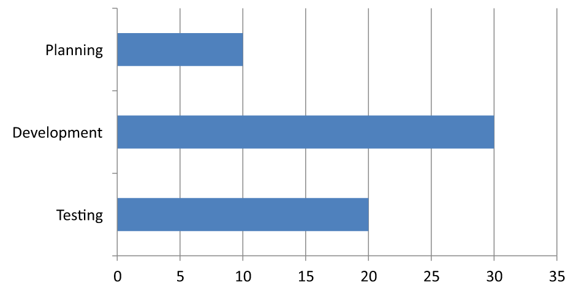

## **ภาพรวม**

บทความนี้อธิบายวิธีปรับแต่งแกนแผนภูมิด้วย Aspose.Slides สำหรับ Python ผ่าน .NET รวมถึงค่าของแกนที่คำนวณได้, การสลับแถวและคอลัมน์ของแผนภูมิ, การแสดงหรือซ่อนแกน, ช่วงเวลาของป้ายหมวดและเครื่องหมายติ๊ก, หมวดหมู่วันที่และการจัดรูปแบบ, การหมุนหัวเรื่อง, การกำหนดตำแหน่งแกน, หน่วยแสดงผล, และการสเกลแบบลอการิทึม

## **รับค่าสูงสุดบนแกนแนวตั้งของแผนภูมิ**

สร้าง [Presentation](https://reference.aspose.com/slides/python-net/aspose.slides/presentation/) และเพิ่มแผนภูมิพื้นที่ด้วยข้อมูลเริ่มต้น. เรียก [validate_chart_layout](https://reference.aspose.com/slides/python-net/aspose.slides.charts/chart/validate_chart_layout/) ก่อนอ่านค่าของแกนที่คำนวณ เพื่อให้โครงร่างแผนภูมิเป็นปัจจุบัน.

อ่าน [actual_max_value](https://reference.aspose.com/slides/python-net/aspose.slides.charts/axis/actual_max_value/) และ [actual_min_value](https://reference.aspose.com/slides/python-net/aspose.slides.charts/axis/actual_min_value/) เพื่อรับขอบเขตของแกน, และ [actual_major_unit](https://reference.aspose.com/slides/python-net/aspose.slides.charts/axis/actual_major_unit/) และ [actual_minor_unit](https://reference.aspose.com/slides/python-net/aspose.slides.charts/axis/actual_minor_unit/) เพื่อรับช่วงของเครื่องหมายติ๊ก. [actual_major_unit_scale](https://reference.aspose.com/slides/python-net/aspose.slides.charts/axis/actual_major_unit_scale/) และ [actual_minor_unit_scale](https://reference.aspose.com/slides/python-net/aspose.slides.charts/axis/actual_minor_unit_scale/) ให้มาตราส่วนหน่วยเวลา, ซึ่งเกี่ยวข้องกับแกนวันที่. ตัวอย่างนี้เก็บค่าเหล่านี้ในตัวแปรท้องถิ่นและบันทึกแผนภูมิ.

```python
import aspose.slides as slides
import aspose.slides.charts as charts

with slides.Presentation() as presentation:
    slide = presentation.slides[0]

    chart = slide.shapes.add_chart(charts.ChartType.AREA, 100, 100, 500, 350)
    chart.validate_chart_layout()

    max_value = chart.axes.vertical_axis.actual_max_value
    min_value = chart.axes.vertical_axis.actual_min_value

    major_unit = chart.axes.vertical_axis.actual_major_unit
    minor_unit = chart.axes.vertical_axis.actual_minor_unit

    major_unit_scale = chart.axes.vertical_axis.actual_major_unit_scale
    minor_unit_scale = chart.axes.vertical_axis.actual_minor_unit_scale

    presentation.save("AxisValues_out.pptx", slides.export.SaveFormat.PPTX)
```

## **สลับข้อมูลระหว่างแกน**

Use [switch_row_column](https://reference.aspose.com/slides/python-net/aspose.slides.charts/chartdata/switch_row_column/) เพื่อสลับบทบาทของซีรีส์และหมวดหมู่ในข้อมูลแผนภูมิ. แต่ละหมวดหมู่เดิมจะกลายเป็นซีรีส์, และแต่ละซีรีส์เดิมจะกลายเป็นหมวดหมู่. การกระทำนี้เปลี่ยนวิธีการจัดกลุ่มข้อมูล; ไม่ได้สลับแกนแนวนอนและแนวตั้ง. ตัวอย่างใช้ [set_range](https://reference.aspose.com/slides/python-net/aspose.slides.charts/chartdata/set_range/) เพื่อผูกข้อมูลเริ่มต้นกับ `Sheet1!A1:D5`, รวมถึงแถวหัวตารางและคอลัมน์หมวดหมู่, ก่อนสลับแถวและคอลัมน์. จะบันทึกแผนภูมิที่มีสี่ซีรีส์และสามหมวดหมู่.

```python
import aspose.slides as slides
import aspose.slides.charts as charts

with slides.Presentation() as presentation:
    slide = presentation.slides[0]

    chart = slide.shapes.add_chart(charts.ChartType.CLUSTERED_COLUMN, 100, 100, 400, 300)

    chart.chart_data.set_range("Sheet1!A1:D5")
    chart.chart_data.switch_row_column()

    presentation.save("SwitchChartRowColumns_out.pptx", slides.export.SaveFormat.PPTX)
```

## **ย้อนลำดับการวาดของแกน**

Use [is_plot_order_reversed](https://reference.aspose.com/slides/python-net/aspose.slides.charts/axis/is_plot_order_reversed/) เพื่อย้อนลำดับของแกนหมวดหมู่หรือแกนค่า. ตัวอย่างเช่น, แผนภูมิแท่งแนวนอนสามารถแสดงขั้นตอนของโครงการจากบนลงล่างในลำดับเดียวกับในแผ่นงาน: Planning, Development, Testing. การย้อนแกนเปลี่ยนทิศทางการวาด; ไม่ได้จัดเรียงหรือปรับลำดับข้อมูลในเวิร์กบุ๊ก. ในการเปรียบเทียบ, [switch_row_column](https://reference.aspose.com/slides/python-net/aspose.slides.charts/chartdata/switch_row_column/) สลับบทบาทของซีรีส์และหมวดหมู่.

ตัวอย่างต่อไปนี้สร้างแผนภูมิแท่งแนวนอนที่มีสามขั้นตอนและหนึ่งซีรีส์. จะบันทึกงานนำเสนอที่มีสามสไลด์: ลำดับปกติ, หมวดหมู่ที่ย้อน, และค่าที่ย้อน. แต่ละสำเนาใช้ชุดข้อมูลเดียวกัน, และแต่ละสำเนาจะย้อนแกนเพียงหนึ่งแกน.

```python
import aspose.slides as slides
import aspose.slides.charts as charts

with slides.Presentation() as presentation:
    slide = presentation.slides[0]

    chart = slide.shapes.add_chart(charts.ChartType.CLUSTERED_BAR, 50, 40, 620, 320)
    chart.has_legend = False

    chart.chart_data.categories.clear()
    chart.chart_data.series.clear()

    workbook = chart.chart_data.chart_data_workbook
    workbook.clear(0)

    series = chart.chart_data.series.add(charts.ChartType.CLUSTERED_BAR)
    stages = ["Planning", "Development", "Testing"]
    values = [10, 30, 20]
    for i, stage in enumerate(stages):
        category_cell = workbook.get_cell(0, i + 1, 0, stage)
        chart.chart_data.categories.add(category_cell)
        value_cell = workbook.get_cell(0, i + 1, 1, values[i])
        series.data_points.add_data_point_for_bar_series(value_cell)

    # สไลด์ 2: แสดงหมวดแรกที่ด้านบน.
    category_slide = presentation.slides.add_clone(slide)
    category_chart = category_slide.shapes[0]
    category_chart.axes.vertical_axis.is_plot_order_reversed = True
    # คงแกนค่าตั้งแนวนอนที่ด้านล่าง.
    category_chart.axes.vertical_axis.cross_type = charts.CrossesType.MAXIMUM

    # สไลด์ 3: ย้อนสเกลเชิงตัวเลขแนวนอนเท่านั้น.
    value_slide = presentation.slides.add_clone(slide)
    value_chart = value_slide.shapes[0]
    value_chart.axes.horizontal_axis.is_plot_order_reversed = True

    presentation.save("ReversedAxes.pptx", slides.export.SaveFormat.PPTX)
```

การย้อนแกนยังสามารถย้ายแกนตั้งฉากไปยังด้านตรงข้ามของพื้นที่แผนภูมิ. [cross_type](https://reference.aspose.com/slides/python-net/aspose.slides.charts/axis/cross_type/) ควบคุมตำแหน่งที่แกนอื่นตัดกับแกนที่กำลังตั้งค่า. ในสไลด์ที่ 2, การตั้งค่าเป็น `MAXIMUM` บนแกนหมวดที่ย้อนจะทำให้แกนค่าตั้งแนวนอนอยู่ที่ด้านล่าง. สำหรับจุดตัดที่กำหนด, ใช้ [cross_at](https://reference.aspose.com/slides/python-net/aspose.slides.charts/axis/cross_at/). ตรวจสอบการตั้งค่าตัดเมื่อเปลี่ยนทิศทาง, โดยเฉพาะหากแผนภูมิมีจุดตัดที่กำหนดเองอยู่แล้ว. ตั้งค่า `is_plot_order_reversed` กลับเป็น `False` เพื่อคืนทิศทางการวาดปกติ; การตั้งค่าตัดเป็นเรื่องแยกจากกัน.

| ลำดับปกติ (สไลด์ 1) | หมวดหมู่ที่ย้อน (สไลด์ 2) | ค่าที่ย้อน (สไลด์ 3) |
| --- | --- | --- |
|  |  |  |
| หมวดหมู่ไหลจากล่างขึ้นบน; ค่าจะเพิ่มจากซ้ายไปขวา. | Planning, Development และ Testing ไหลจากบนลงล่าง. ค่และลำดับแถวในเวิร์กบุ๊กไม่มีการเปลี่ยนแปลง. | หมวดหมู่คงลำดับปกติ; ค่าจะเพิ่มจากขวาไปซ้าย. แกนหมวดตัดที่ศูนย์ทางด้านขวา. |

## **ปิดการแสดงแกนแนวตั้งสำหรับแผนภูมิเส้น**

ตั้งค่า [is_visible](https://reference.aspose.com/slides/python-net/aspose.slides.charts/axis/is_visible/) เป็น `False` บนแกนแนวตั้งเพื่อซ่อนมัน. ตัวอย่างสร้างแผนภูมิเส้นด้วยข้อมูลเริ่มต้นและบันทึกโดยซ่อนแกนแนวตั้ง.

```python
import aspose.slides as slides
import aspose.slides.charts as charts

with slides.Presentation() as presentation:
    slide = presentation.slides[0]

    chart = slide.shapes.add_chart(charts.ChartType.LINE, 100, 100, 400, 300)
    chart.axes.vertical_axis.is_visible = False

    presentation.save("HiddenVerticalAxis.pptx", slides.export.SaveFormat.PPTX)
```

## **ปิดการแสดงแกนแนวนอนสำหรับแผนภูมิเส้น**

ตั้งค่า [is_visible](https://reference.aspose.com/slides/python-net/aspose.slides.charts/axis/is_visible/) เป็น `False` บนแกนแนวนอนเพื่อซ่อนมัน. ตัวอย่างสร้างแผนภูมิเส้นด้วยข้อมูลเริ่มต้นและบันทึกโดยซ่อนแกนแนวนอน.

```python
import aspose.slides as slides
import aspose.slides.charts as charts

with slides.Presentation() as presentation:
    slide = presentation.slides[0]

    chart = slide.shapes.add_chart(charts.ChartType.LINE, 100, 100, 400, 300)
    chart.axes.horizontal_axis.is_visible = False

    presentation.save("HiddenHorizontalAxis.pptx", slides.export.SaveFormat.PPTX)
```

## **แสดงหรือซ่อนเส้นกริดของแผนภูมิ**

อ่าน [show_major_grid_lines](https://reference.aspose.com/slides/python-net/aspose.slides.charts/axis/show_major_grid_lines/) และ [show_minor_grid_lines](https://reference.aspose.com/slides/python-net/aspose.slides.charts/axis/show_minor_grid_lines/) เพื่อตรวจสอบว่าแกนแสดงเส้นกริดใด. ทั้งสองคุณสมบัติเพียงอ่านได้. เพื่อแสดงเส้นกริดย่อย, ตั้งการเติมสีใน [minor_grid_lines_format](https://reference.aspose.com/slides/python-net/aspose.slides.charts/axis/minor_grid_lines_format/) ให้เป็นสีทึบและเลือกสีที่มองเห็นได้. เพื่อซ่อน, ตั้งประเภทการเติมเป็น `FillType.NO_FILL`. สำหรับเส้นกริดหลัก, ใช้ [major_grid_lines_format](https://reference.aspose.com/slides/python-net/aspose.slides.charts/axis/major_grid_lines_format/)`.line.fill_format`. การเปลี่ยนการเติมสีจะคงการมองเห็นของแกนและเครื่องหมายติ๊ก.

แกนแนวตั้งของแผนภูมิคอลัมน์แบบกลุ่มนี้เริ่มต้นด้วยเส้นกริดหลักที่มองเห็นและเส้นกริดย่อยที่ซ่อนอยู่. ตัวอย่างแสดงเส้นกริดย่อยเป็นส้ม, จากนั้นซ่อนอีกครั้งก่อนบันทึกงานนำเสนอ.

```python
import aspose.slides as slides
import aspose.slides.charts as charts

with slides.Presentation() as presentation:
    slide = presentation.slides[0]
    
    chart = slide.shapes.add_chart(charts.ChartType.CLUSTERED_COLUMN, 30, 30, 660, 230)
    axis = chart.axes.vertical_axis
    print(f"Initial: major={axis.show_major_grid_lines}, minor={axis.show_minor_grid_lines}")

    minor_fill = axis.minor_grid_lines_format.line.fill_format
    minor_fill.fill_type = slides.FillType.SOLID
    minor_fill.solid_fill_color.color = slides.Color.dark_orange
    print(f"Enabled: minor={axis.show_minor_grid_lines}")

    minor_fill.fill_type = slides.FillType.NO_FILL
    print(f"Hidden: major={axis.show_major_grid_lines}, minor={axis.show_minor_grid_lines}")

    presentation.save("ChartGridlines.pptx", slides.export.SaveFormat.PPTX)
```

| เส้นกริดย่อยที่เปิดใช้งาน | เส้นกริดย่อยที่ซ่อน |
| --- | --- |
|  |  |

## **เปลี่ยนแกนหมวด**

ตั้งค่า [category_axis_type](https://reference.aspose.com/slides/python-net/aspose.slides.charts/axis/category_axis_type/) เพื่อเลือกแกนหมวดวันที่หรือข้อความ. ตัวอย่างนี้ต้องใช้ `ExistingChart.pptx`, โดยมีแผนภูมิเป็นรูปแบบแรกบนสไลด์แรกและเซลล์หมวดมีค่าตัวเลขวันที่ของ Excel. จะเปลี่ยนแกนแนวนอนเป็นแกนวันที่. ตั้งค่า [is_automatic_major_unit](https://reference.aspose.com/slides/python-net/aspose.slides.charts/axis/is_automatic_major_unit/) เป็น `False`, [major_unit](https://reference.aspose.com/slides/python-net/aspose.slides.charts/axis/major_unit/) เป็น `1`, และ [major_unit_scale](https://reference.aspose.com/slides/python-net/aspose.slides.charts/axis/major_unit_scale/) เป็นเดือน เพื่อวางเครื่องหมายหลักที่ช่วงหนึ่งเดือน.

```python
import aspose.slides as slides
import aspose.slides.charts as charts

with slides.Presentation("ExistingChart.pptx") as presentation:
    slide = presentation.slides[0]

    chart = slide.shapes[0]
    chart.axes.horizontal_axis.category_axis_type = charts.CategoryAxisType.DATE
    chart.axes.horizontal_axis.is_automatic_major_unit = False
    chart.axes.horizontal_axis.major_unit = 1
    chart.axes.horizontal_axis.major_unit_scale = charts.TimeUnitType.MONTHS

    presentation.save("ChangeChartCategoryAxis_out.pptx", slides.export.SaveFormat.PPTX)
```

### **กำหนดประเภทแกนหมวดจากข้อมูล**

เรียก [set_category_axis_type_automatically](https://reference.aspose.com/slides/python-net/aspose.slides.charts/axis/set_category_axis_type_automatically/) หลังจากเติมหมวด, จากนั้นอ่าน [category_axis_type](https://reference.aspose.com/slides/python-net/aspose.slides.charts/axis/category_axis_type/) เพื่อตรวจสอบการเลือก. นี้มีประโยชน์เมื่อแผนภูมิเดียวกันอาจได้ป้ายข้อความหรือค่าตัวเลขของวันที่. วิธีการกำหนดประเภทเมื่อเรียกใช้; ไม่เปิดโหมดคงที่ที่ประเมินข้อมูลใหม่ในภายหลัง. เรียกอีกครั้งหลังจากเปลี่ยนหมวด.

ตัวอย่างต่อไปนี้สร้างแผนภูมิที่มีหมวดเป็นข้อความและพิมพ์ `TEXT`. จากนั้นแทนค่าของเซลล์หมวดด้วยวันที่และเรียกวิธีอีกครั้ง, ซึ่งพิมพ์ `DATE`. วันที่ถูกเก็บเป็นค่าตัวเลข OLE Automation, คำนวณเป็นจำนวนวันตั้งแต่ 30 ธันวาคม 1899, ไม่ได้เป็นสตริงของวันที่. [custom_number_format](https://reference.aspose.com/slides/python-net/aspose.slides.charts/chartdatacell/custom_number_format/) ควบคุมการแสดงค่าดังกล่าว; ไม่ได้แปลงข้อความเป็นวันที่ตัวเลข. ดูข้อมูลเพิ่มเติมเกี่ยวกับเซลล์หมวดที่ [Chart Workbook](/slides/th/python-net/chart-workbook/).

ใช้การกำหนดอัตโนมัติเมื่ออินพุตทราบว่ามีหมวดข้อความหรือวันที่ตัวเลข, เช่นในตัวอย่างนี้. สำหรับป้ายตัวเลขทั่วไป, หมวดผสม, หรือข้อมูลว่าง, ให้ตั้งค่า [category_axis_type](https://reference.aspose.com/slides/python-net/aspose.slides.charts/axis/category_axis_type/) อย่างชัดเจนให้ตรงกับความหมายที่ตั้งใจ. ค่าตัวเลขเพียงอย่างเดียวไม่ได้บ่งบอกว่าหมวดเป็นวันที่.

```python
from datetime import date

import aspose.slides as slides
import aspose.slides.charts as charts

with slides.Presentation() as presentation:
    slide = presentation.slides[0]

    chart = slide.shapes.add_chart(charts.ChartType.CLUSTERED_COLUMN, 30, 40, 660, 320)

    chart.chart_data.categories.clear()
    chart.chart_data.series.clear()

    workbook = chart.chart_data.chart_data_workbook
    workbook.clear(0)

    series_name = workbook.get_cell(0, 0, 1, "Sales")
    series = chart.chart_data.series.add(series_name, chart.type)
    labels = ["First", "Second", "Third"]

    for i, label in enumerate(labels):
        category_cell = workbook.get_cell(0, i + 1, 0, label)
        chart.chart_data.categories.add(category_cell)

        value_cell = workbook.get_cell(0, i + 1, 1, (i + 1) * 10)
        series.data_points.add_data_point_for_bar_series(value_cell)

    axis = chart.axes.horizontal_axis
    axis.set_category_axis_type_automatically()
    print(axis.category_axis_type.name)  # ข้อความ

    dates = [date(2026, 1, 1), date(2026, 1, 2), date(2026, 2, 1)]

    for i, category_date in enumerate(dates):
        category_cell = workbook.get_cell(0, i + 1, 0)
        category_cell.value = float((category_date - date(1899, 12, 30)).days)
        category_cell.custom_number_format = "yyyy-mm-dd"

    axis.set_category_axis_type_automatically()
    print(axis.category_axis_type.name)  # วันที่

    presentation.save("AutomaticCategoryAxis.pptx", slides.export.SaveFormat.PPTX)
```

## **ควบคุมช่วงเวลาของป้ายแกนหมวด**

เมื่อแผนภูมิมีหลายหมวด, ลดจำนวนป้ายแกนที่มองเห็นได้โดยไม่ต้องลบหมวดหรือจุดข้อมูล. ตั้งค่า [is_automatic_tick_label_spacing](https://reference.aspose.com/slides/python-net/aspose.slides.charts/axis/is_automatic_tick_label_spacing/) เป็น `False`, จากนั้นตั้งค่า [tick_label_spacing](https://reference.aspose.com/slides/python-net/aspose.slides.charts/axis/tick_label_spacing/) เป็นช่วงเวลาของหมวดที่ต้องการ. สำหรับหมวดข้อความในลำดับปกติ, การนับเริ่มจากหมวดแรก:

| ช่วง | ป้ายที่แสดงในตัวอย่าง |
| --- | --- |
| `1` | หมวด 1, หมวด 2, หมวด 3, ... หมวด 24 |
| `2` | หมวด 1, หมวด 3, หมวด 5, ... หมวด 23 |
| `3` | หมวด 1, หมวด 4, หมวด 7, ... หมวด 22 |

ช่วง `3` จะทำให้แสดงป้ายที่สามทุกครั้ง, ค้างป้ายสองอันที่ซ่อนไว้ระหว่างป้ายที่แสดง. มันไม่ได้ลบคอลัมน์ที่สอดคล้อง. การจัดระยะห่างอัตโนมัติเลือกช่วงตามพื้นที่ที่มี; ไม่ได้จำเป็นต้องแสดงทุกป้าย.

เครื่องหมายติ๊กมีการควบคุมแยกกัน. ตั้งค่า [is_automatic_tick_marks_spacing](https://reference.aspose.com/slides/python-net/aspose.slides.charts/axis/is_automatic_tick_marks_spacing/) เป็น `False` และใช้ [tick_marks_spacing](https://reference.aspose.com/slides/python-net/aspose.slides.charts/axis/tick_marks_spacing/) เพื่อตั้งช่วงของมัน. ตัวอย่างเช่น, `1` จะทำให้มีเครื่องหมายติ๊กที่ทุกช่วงหมวดแม้ป้ายจะแสดงเพียงทุกหมวดที่สาม. ตั้งค่า [major_tick_mark](https://reference.aspose.com/slides/python-net/aspose.slides.charts/axis/major_tick_mark/) เป็นสไตล์ที่มองเห็นได้เพื่อเห็นผลลัพธ์. การตั้งค่าคุณสมบัติจัดระยะอัตโนมัติใด ๆ กลับเป็น `True` จะให้แผนภูมิตัดสินใจเลือกช่วงนั้นใหม่.

ตัวอย่างอิสระต่อไปนี้สร้าง 24 หมวดและหนึ่งซีรีส์, จากนั้นบันทึกสามสไลด์ใน `CategoryAxisIntervals.pptx`: การจัดระยะอัตโนมัติ, การจัดระยะป้ายแบบมือด้วยเครื่องหมายติ๊กอิสระ, และการคืนค่าเป็นการจัดระยะอัตโนมัติ. สองสำเนารักษาข้อมูลแผนภูดิดั้งเดิม. ไม่จำเป็นต้องมีงานนำเสนอเข้า. ข้อความป้ายแนวนอนทำให้เห็นความหนาแน่นต่างกันได้ชัดเจน.

```python
import aspose.slides as slides
import aspose.slides.charts as charts

with slides.Presentation() as presentation:
    slide = presentation.slides[0]

    chart = slide.shapes.add_chart(charts.ChartType.CLUSTERED_COLUMN, 30, 40, 660, 320)

    chart.has_legend = False
    chart.chart_data.categories.clear()
    chart.chart_data.series.clear()

    workbook = chart.chart_data.chart_data_workbook
    workbook.clear(0)

    series = chart.chart_data.series.add(charts.ChartType.CLUSTERED_COLUMN)
    for i in range(24):
        category_cell = workbook.get_cell(0, i + 1, 0, f"Category {i + 1}")
        chart.chart_data.categories.add(category_cell)
        value_cell = workbook.get_cell(0, i + 1, 1, 10 + i % 6 * 5)
        series.data_points.add_data_point_for_bar_series(value_cell)

    axis = chart.axes.horizontal_axis
    axis.category_axis_type = charts.CategoryAxisType.TEXT
    axis.text_format.text_block_format.rotation_angle = 0
    axis.text_format.portion_format.font_height = 12
    axis.major_tick_mark = charts.TickMarkType.OUTSIDE
    axis.is_automatic_tick_label_spacing = True
    axis.is_automatic_tick_marks_spacing = True

    # Slide 2: แสดงป้ายทุกสามตำแหน่ง, แต่ยังคงมีเครื่องหมายติ๊กสำหรับทุกหมวด.
    manual_slide = presentation.slides.add_clone(slide)
    manual_chart = manual_slide.shapes[0]
    manual_axis = manual_chart.axes.horizontal_axis
    manual_axis.is_automatic_tick_label_spacing = False
    manual_axis.tick_label_spacing = 3
    manual_axis.is_automatic_tick_marks_spacing = False
    manual_axis.tick_marks_spacing = 1

    # Slide 3: ให้แผนภูมิเลือกช่วงทั้งสองใหม่อีกครั้ง.
    restored_slide = presentation.slides.add_clone(manual_slide)
    restored_chart = restored_slide.shapes[0]
    restored_chart.axes.horizontal_axis.is_automatic_tick_label_spacing = True
    restored_chart.axes.horizontal_axis.is_automatic_tick_marks_spacing = True

    presentation.save("CategoryAxisIntervals.pptx", slides.export.SaveFormat.PPTX)
```

**การจัดระยะอัตโนมัติ (สไลด์ 1):** ในการแสดงผลนี้, ป้ายหมวดทุกสองตำแหน่งจะแสดงและตัดบรรทัดเป็นสองบรรทัด. ผลลัพธ์อัตโนมัติอาจแตกต่างตามขนาดแผนภูมิ, ฟอนต์, และเครื่องมือแสดงผล.


**การจัดระยะด้วยมือ (สไลด์ 2):** ป้ายที่สามทุกอันจะแสดงในหนึ่งบรรทัด, ขณะเดียวกันเครื่องหมายติ๊กยังคงอยู่ที่ทุกช่วงหมวด. คอลัมน์ทั้ง 24 คอลัมน์, รวมถึงที่ไม่มีป้าย, ยังคงมองเห็นได้พร้อมค่าที่เหมือนกัน. สไลด์ 3 คืนลักษณะอัตโนมัติที่แสดงด้านบน.


### **เลือกแกนและช่วงที่ถูกต้อง**

ใช้ช่วงจำนวนหมวดนี้สำหรับแกนหมวดข้อความ, เช่นแกนหมวดของแผนภูมิคอลัมน์, เส้น, พื้นที่ หรือแท่ง. ในแผนภูมิคอลัมน์, มันเป็นแกนแนวนอน. ในแผนภูมิแท่งแนวนอน, แกนหมวดเป็นแนวตั้ง, ดังนั้นให้ใช้การตั้งค่าเหล่านี้กับ [vertical_axis](https://reference.aspose.com/slides/python-net/aspose.slides.charts/axesmanager/vertical_axis/). การจัดระยะเครื่องหมายติ๊กยังใช้กับแกนซีรีส์ในแผนภูมิที่มีแกนซีรีส์.

ห้ามใช้การจัดระยะป้ายหมวดเพื่อกำหนดสเกลเชิงตัวเลขของแกนค่า. บนแกนค่า, [major_unit](https://reference.aspose.com/slides/python-net/aspose.slides.charts/axis/major_unit/) ระบุความต่างของค่า: ตัวอย่างเช่น, หน่วยหลัก `10` จะทำให้มีเครื่องหมายติ๊กที่ 0, 10, 20 เป็นต้นเมื่อแกนเริ่มที่ศูนย์. ช่วงป้ายหมวด `3` จะนับตำแหน่งหมวดแทน, ไม่คำนึงถึงค่าข้อมูล. แผนภูมิกระจายและบับเบิลใช้แกนค่าแทนแกนหมวดข้อความ. สำหรับแกนวันที่, ใช้หน่วยหลักและสเกลตามเวลาอย่างที่อธิบายใน [Change a Category Axis](#change-a-category-axis).

## **ตั้งรูปแบบวันที่สำหรับค่าของแกนหมวด**

ตัวอย่างนี้แทนที่ข้อมูลแผนภูมิเริ่มต้นด้วยค่าประจำปีสี่ค่า. วันที่ถูกเก็บเป็นหมายเลขลำดับ OLE Automation ในแผ่นงานแรก (ดัชนี `0`). ตั้งค่า [category_axis_type](https://reference.aspose.com/slides/python-net/aspose.slides.charts/axis/category_axis_type/) เป็นแกนวันที่, ปิด [is_number_format_linked_to_source](https://reference.aspose.com/slides/python-net/aspose.slides.charts/axis/is_number_format_linked_to_source/), และกำหนดค่า `yyyy` ให้กับ [number_format](https://reference.aspose.com/slides/python-net/aspose.slides.charts/axis/number_format/) เพื่อให้ป้ายหมวดแสดงปีสิงห์ที่มีสี่หลักโดยอิสระจากการจัดรูปแบบของเซลล์.

```python
from datetime import date

import aspose.slides as slides
import aspose.slides.charts as charts

with slides.Presentation() as presentation:
    slide = presentation.slides[0]

    chart = slide.shapes.add_chart(charts.ChartType.LINE, 50, 50, 450, 300)

    chart.chart_data.categories.clear()
    chart.chart_data.series.clear()

    workbook = chart.chart_data.chart_data_workbook
    workbook.clear(0)

    series = chart.chart_data.series.add(charts.ChartType.LINE)
    for i in range(4):
        category_date = date(2015 + i, 1, 1)
        serial_date = (category_date - date(1899, 12, 30)).days
        category_cell = workbook.get_cell(0, i + 1, 0, serial_date)
        chart.chart_data.categories.add(category_cell)

        value_cell = workbook.get_cell(0, i + 1, 1, i + 1)
        series.data_points.add_data_point_for_line_series(value_cell)

    chart.axes.horizontal_axis.category_axis_type = charts.CategoryAxisType.DATE
    chart.axes.horizontal_axis.is_number_format_linked_to_source = False
    chart.axes.horizontal_axis.number_format = "yyyy"

    presentation.save("DateAxisFormat.pptx", slides.export.SaveFormat.PPTX)
```

## **ตั้งค่ามุมการหมุนสำหรับหัวเรื่องของแกนแผนภูมิ**

เปิดใช้งาน [has_title](https://reference.aspose.com/slides/python-net/aspose.slides.charts/axis/has_title/) บนแกนแนวตั้ง, ใส่ข้อความหัวเรื่อง, และตั้งค่า [rotation_angle](https://reference.aspose.com/slides/python-net/aspose.slides/textframeformat/rotation_angle/) เพื่อหมุนหัวเรื่อง. มุมวัดเป็นองศา; ตัวอย่างนี้บันทึกแผนภูมิคอลัมน์ที่หัวเรื่องแกนค่าที่หมุน 90 องศา.

```python
import aspose.slides as slides
import aspose.slides.charts as charts

with slides.Presentation() as presentation:
    slide = presentation.slides[0]

    chart = slide.shapes.add_chart(charts.ChartType.CLUSTERED_COLUMN, 50, 50, 450, 300)
    chart.axes.vertical_axis.has_title = True
    chart.axes.vertical_axis.title.add_text_frame_for_overriding("Value")
    chart.axes.vertical_axis.title.text_format.text_block_format.rotation_angle = 90

    presentation.save("RotatedAxisTitle.pptx", slides.export.SaveFormat.PPTX)
```

## **ตั้งตำแหน่งแกนบนแกนหมวดหรือแกนค่า**

ใช้ [axis_between_categories](https://reference.aspose.com/slides/python-net/aspose.slides.charts/axis/axis_between_categories/) เพื่อควบคุมว่าแกนค่าตัดผ่านแกนหมวดระหว่างหมวดหรือที่เครื่องหมายติ๊กของหมวด. คุณสมบัตินี้ใช้กับแกนหมวด. ตัวอย่างตั้งค่าเป็น `True` บนแกนหมวดแนวนอนของแผนภูมิคอลัมน์และบันทึกผลลัพธ์.

```python
import aspose.slides as slides
import aspose.slides.charts as charts

with slides.Presentation() as presentation:
    slide = presentation.slides[0]

    chart = slide.shapes.add_chart(charts.ChartType.CLUSTERED_COLUMN, 50, 50, 450, 300)
    chart.axes.horizontal_axis.axis_between_categories = True

    presentation.save("AxisBetweenCategories.pptx", slides.export.SaveFormat.PPTX)
```

## **ตั้งหน่วยแสดงบนแกนค่าของแผนภูมิ**

ตั้งค่า [display_unit](https://reference.aspose.com/slides/python-net/aspose.slides.charts/axis/display_unit/) เพื่อสเกลป้ายบนแกนค่าโดยไม่เปลี่ยนข้อมูลพื้นฐาน. เมื่อ [DisplayUnitType](https://reference.aspose.com/slides/python-net/aspose.slides.charts/displayunittype/) ตั้งเป็น `MILLIONS`, ค่า 60,000,000 จะแสดงเป็น 60. ตัวอย่างสร้างแผนภูมิคอลัมน์และใช้หน่วยแสดงเป็นล้านบนแกนแนวตั้งของมัน.

```python
import aspose.slides as slides
import aspose.slides.charts as charts

with slides.Presentation() as presentation:
    slide = presentation.slides[0]

    chart = slide.shapes.add_chart(charts.ChartType.CLUSTERED_COLUMN, 50, 50, 450, 300)
    chart.axes.vertical_axis.display_unit = charts.DisplayUnitType.MILLIONS

    presentation.save("Result.pptx", slides.export.SaveFormat.PPTX)
```

## **กำหนดค่าตัวแกนค่าลอการิทึม**

แกนค่าลอการิทึมมีประโยชน์เมื่อค่าบวกมีช่วงหลายระดับขนาด. ตัวอย่างเช่น, บริการอาจได้รับคำขอ 10, 100, 1,000, 10,000 และ 100,000 ครั้งในห้าช่วงเวลา. บนสเกลเชิงเส้น, ค่าที่เล็กจะอยู่ใกล้กันที่ศูนย์. สเกลลอการิทึมทำให้การเปรียบเทียบการเติบโตสัมพันธ์ง่ายขึ้น: ระยะเท่ากันแสดงอัตราส่วนเท่าเดิมแทนความแตกต่างที่เท่าเดิม.

ตั้งค่า [is_logarithmic](https://reference.aspose.com/slides/python-net/aspose.slides.charts/axis/is_logarithmic/) เป็น `True` บนแกนค่าและใช้ [log_base](https://reference.aspose.com/slides/python-net/aspose.slides.charts/axis/log_base/) เพื่อเลือกฐาน. การตั้งค่านี้เปลี่ยนวิธีการแสดงค่าที่มีอยู่; ไม่ได้เปลี่ยนข้อมูลหรือเพิ่มเส้นแนวโน้มลอการิทึม. เส้นแนวโน้มเป็นการแสดงความสัมพันธ์ที่ฟิตกับข้อมูลและเป็นฟีเจอร์แยกต่างหาก.

### **เลือกแกนค่าและฐาน**

สำหรับแผนภูมิเส้นหรือคอลัมน์, แกนค่าคือ [vertical_axis](https://reference.aspose.com/slides/python-net/aspose.slides.charts/axesmanager/vertical_axis/). สำหรับแผนภูมิแท่งแนวนอน, แกนค่าคือ [horizontal_axis](https://reference.aspose.com/slides/python-net/aspose.slides.charts/axesmanager/horizontal_axis/). แผนภูมิกระจายและบับเบิลมีแกนค่าสองแกน, ดังนั้นเลือกแกนแนวนอนสำหรับค่า X, แกนแนวตั้งสำหรับค่า Y, หรือทั้งสอง. อย่าใช้การสเกลลอการิทึมกับแกนหมวด.

ฐานลอการิทึมเริ่มต้นคือ `10`. สำหรับแผนภูมิ PPTX, ใช้ฐานตั้งแต่ `2` ถึง `1000` รวมถึง; ฐานเศษส่วนเช่น `2.5` ก็รองรับ. ด้วยฐาน `10`, พลังต่อเนื่องเช่น 10, 100, 1,000, และ 10,000 จะถูกจัดระยะห่างเท่ากัน.

### **เปรียบเทียบการสเกลเชิงเส้นและลอการิทึม**

ตัวอย่างอิสระต่อไปนี้สร้างแผนภูมิเส้นที่มีจำนวนคำขอห้าครั้งบนสไลด์แรก, จากนั้นคัดลอกสไลด์นั้นและเปิดใช้งานแกนค่าลอการิทึมฐาน 10 บนสไลด์ที่สอง. สไลด์ทั้งสองรักษาข้อมูลเดิม.

```python
import aspose.slides as slides
import aspose.slides.charts as charts

with slides.Presentation() as presentation:
    slide = presentation.slides[0]

    chart = slide.shapes.add_chart(charts.ChartType.LINE, 30, 40, 660, 200)

    chart.has_legend = False

    chart.chart_data.categories.clear()
    chart.chart_data.series.clear()

    workbook = chart.chart_data.chart_data_workbook
    workbook.clear(0)

    series = chart.chart_data.series.add(charts.ChartType.LINE)
    values = [10, 100, 1000, 10000, 100000]

    for i, value in enumerate(values):
        category_cell = workbook.get_cell(0, i + 1, 0, f"Period {i + 1}")
        chart.chart_data.categories.add(category_cell)

        value_cell = workbook.get_cell(0, i + 1, 1, value)
        series.data_points.add_data_point_for_line_series(value_cell)

    # คงสไลด์แรกเป็นเชิงเส้นและเปลี่ยนเฉพาะสเกลแกนค่าของสำเนาเท่านั้น.
    logarithmic_slide = presentation.slides.add_clone(slide)
    logarithmic_chart = logarithmic_slide.shapes[0]
    value_axis = logarithmic_chart.axes.vertical_axis
    value_axis.is_logarithmic = True
    value_axis.log_base = 10

    presentation.save("LogarithmicAxis.pptx", slides.export.SaveFormat.PPTX)
```

**สเกลเชิงเส้น (สไลด์ 1):** ระยะทางแนวตั้งที่เท่ากันแสดงความต่างที่เท่ากันของจำนวนคำขอ. ค่ามากสุดครอบคลุมแผนภูมิ, ทำให้ค่าที่เล็กกว่าดูแยกยาก.


**สเกลลอการิทึม (สไลด์ 2):** ระยะแนวตั้งที่เท่ากันแสดงอัตราส่วนที่เท่ากัน. แต่ละช่วงมีจำนวนคำขอมากกว่าช่วงก่อนหน้าเป็นสิบเท่า, ดังนั้นจุดจะสร้างเส้นตรงที่ขึ้นบนสเกลฐาน 10. ป้ายแกนยังคงแสดงจำนวนคำขอเดิม.


### **จัดการค่าศูนย์และค่าติดลบ**

สเกลลอการิทึมสามารถแสดงได้เฉพาะค่าบวกเท่านั้น. ตรวจสอบข้อมูลก่อนเปิดใช้งาน. หากค่าศูนย์หรือค่าลบมีความหมาย, ให้คงสเกลเชิงเส้นหรือแสดงแยกออก. หากการยกเว้นค่าดังกล่าวเหมาะสมกับการวิเคราะห์, ควรอธิบายเหตุผล. อย่าแทนที่ค่าดังกล่าวโดยเงียบ ๆ ด้วยเลขบวกเล็ก ๆ, เพราะจะเปลี่ยนความหมายของข้อมูล. ค่าต่ำสุดหรือค่าสูงสุดที่กำหนดด้วยตนเองสำหรับแกนลอการิทึมก็ต้องเป็นค่าบวก.

## **คำถามที่พบบ่อย**

**ฉันจะตั้งค่าค่าที่แกนหนึ่งตัดแกนอื่นได้อย่างไร (การตัดแกน)?**  
ใช้ [cross_type](https://reference.aspose.com/slides/python-net/aspose.slides.charts/axis/cross_type/) เพื่อเลือกพฤติกรรมการตัด. เพื่อระบุค่าตัดเชิงตัวเลข, ตั้งค่า [cross_at](https://reference.aspose.com/slides/python-net/aspose.slides.charts/axis/cross_at/). การตั้งค่าเหล่านี้ช่วยให้คุณย้ายจุดตัดแกนไปยังฐานที่เหมาะสม.

**ฉันจะกำหนดตำแหน่งป้ายเครื่องหมายติ๊กสัมพันธ์กับแกนได้อย่างไร?**  
ตั้งค่า [tick_label_position](https://reference.aspose.com/slides/python-net/aspose.slides.charts/axis/tick_label_position/) ด้วย [TickLabelPositionType](https://reference.aspose.com/slides/python-net/aspose.slides.charts/ticklabelpositiontype/): `LOW`, `HIGH`, `NEXT_TO`, หรือ `NONE`. เพื่อควบคุมเครื่องหมายติ๊กเอง, ใช้ [major_tick_mark](https://reference.aspose.com/slides/python-net/aspose.slides.charts/axis/major_tick_mark/) หรือ [minor_tick_mark](https://reference.aspose.com/slides/python-net/aspose.slides.charts/axis/minor_tick_mark/); สิ่งเหล่านี้แยกจากการกำหนดตำแหน่งของป้าย.