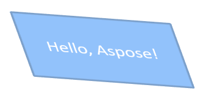

## **บทนำ**

จัดรูปแบบรูปร่างใน PowerPoint โดยปรับเส้นรอบรูป การเติมสี และเอฟเฟกต์ต่าง ๆ Aspose.Slides for Python via .NET ทำให้คุณควบคุมการตั้งค่าเหล่านี้ด้วยโปรแกรมได้ รวมถึงความโปร่งใส การหมุน และการจัดรูปแบบ 3 มิติ


Aspose.Slides for Python via .NET มีคลาสและคุณสมบัติที่ให้คุณจัดรูปแบบรูปร่างโดยใช้ตัวเลือกเดียวกับที่มีใน PowerPoint

## **จัดรูปแบบเส้น**

ใช้ [Shape.line_format](https://reference.aspose.com/slides/python-net/aspose.slides/shape/line_format/) เพื่อควบคุมโครงรอบของรูปร่าง ตัวอย่างนี้สร้างสี่เหลี่ยมผืนผ้าที่ไม่มีการเติมสีโดยมีเส้นรอบสีน้ำเงินและรูปแบบเส้นประ [LineFormat.style](https://reference.aspose.com/slides/python-net/aspose.slides/lineformat/style/) เลือกเส้นแบบผสมหนา-บาง ขณะเดียวกัน [LineFormat.width](https://reference.aspose.com/slides/python-net/aspose.slides/lineformat/width/) ตั้งความกว้างเป็น 7 พอยต์และ [LineFormat.dash_style](https://reference.aspose.com/slides/python-net/aspose.slides/lineformat/dash_style/) เลือกรูปแบบเส้นประ

```python
import aspose.slides as slides
import aspose.pydrawing as draw

with slides.Presentation() as presentation:
    slide = presentation.slides[0]

    shape = slide.shapes.add_auto_shape(slides.ShapeType.RECTANGLE, 50, 50, 150, 75)
    shape.fill_format.fill_type = slides.FillType.NO_FILL
    shape.line_format.style = slides.LineStyle.THICK_THIN
    shape.line_format.width = 7
    shape.line_format.dash_style = slides.LineDashStyle.DASH
    shape.line_format.fill_format.fill_type = slides.FillType.SOLID
    shape.line_format.fill_format.solid_fill_color.color = draw.Color.blue

    presentation.save("formatted_lines.pptx", slides.export.SaveFormat.PPTX)
```

ผลลัพธ์:


### **ตั้งค่ารูปแบบเส้นประแบบกำหนดเอง**

ใช้ [LineFormat.custom_dash_pattern](https://reference.aspose.com/slides/python-net/aspose.slides/lineformat/custom_dash_pattern/) เมื่อรูปแบบเส้นที่กำหนดล่วงหน้าไม่ให้ความยาวและช่องว่างที่ต้องการ เช่น สำหรับโครงรอบแบรนด์หรือไดอะแกรมเชิงเทคนิค การกำหนดรูปแบบจะตั้งค่า [LineFormat.dash_style](https://reference.aspose.com/slides/python-net/aspose.slides/lineformat/dash_style/) ให้เป็น [LineDashStyle.CUSTOM](https://reference.aspose.com/slides/python-net/aspose.slides/linedashstyle/)

รายการค่าจะสลับกันระหว่างความยาวของเส้นและช่องว่าง เริ่มจากเส้นแต่ละค่าคือหลายเท่าของความกว้างของเส้น: `[4, 2]` ที่ความกว้าง 3 พอยต์จะได้เส้นประ 12 พอยต์ตามด้วยช่องว่าง 6 พอยต์ ใช้คู่ค่าที่เป็นจำนวนเต็ม ไม่เป็นลบเพื่อกำหนดส่วนเส้นประ-ช่องว่างอย่างครบถ้วน ตัวอย่างใช้ค่าบวกเพื่อให้เส้นและช่องว่างทั้งหมดมองเห็นได้

ตัวอย่างนี้สร้างเส้นสีน้ำเงิน 5 เส้นที่มีความยาวเท่ากันและหัวเส้นเรียบ เส้นสามแรกเปรียบเทียบรูปแบบที่ความกว้าง 3 พอยต์ เส้นที่สี่ทำซ้ำรูปแบบแรกที่สองเท่าของความกว้าง ทำให้เส้นและช่องว่างเพิ่มเป็นสองเท่า เส้นที่ห้าสลับจากรูปแบบกำหนดเองเป็นเส้นสีเดียว

```python
import aspose.slides as slides

with slides.Presentation() as presentation:
    presentation.slide_size.set_size(600, 300, slides.SlideSizeScaleType.DO_NOT_SCALE)
    slide = presentation.slides[0]

    patterns = [
        [4, 2],
        [1, 2],
        [6, 2, 1, 2],
        [4, 2],
        [4, 2]
    ]

    for i, pattern in enumerate(patterns):
        line = slide.shapes.add_auto_shape(slides.ShapeType.LINE, 50, 50 + i * 50, 500, 0)
        line.line_format.width = 6 if i == 3 else 3
        line.line_format.fill_format.fill_type = slides.FillType.SOLID
        line.line_format.fill_format.solid_fill_color.preset_color = slides.PresetColor.DARK_BLUE
        line.line_format.cap_style = slides.LineCapStyle.FLAT
        line.line_format.begin_arrowhead_style = slides.LineArrowheadStyle.NONE
        line.line_format.end_arrowhead_style = slides.LineArrowheadStyle.NONE
        line.line_format.custom_dash_pattern = pattern

    # เปลี่ยนเส้นสุดท้ายให้เป็นสไตล์เส้นทึบ.
    slide.shapes[4].line_format.dash_style = slides.LineDashStyle.SOLID

    presentation.save("custom_dash_patterns.pptx", slides.export.SaveFormat.PPTX)
```

หากต้องการกลับไปใช้รูปแบบเส้นประที่กำหนดไว้ล่วงหน้า ให้กำหนด [LineDashStyle.DASH](https://reference.aspose.com/slides/python-net/aspose.slides/linedashstyle/) ให้กับ [LineFormat.dash_style](https://reference.aspose.com/slides/python-net/aspose.slides/lineformat/dash_style/) รูปแบบที่เลือกจะควบคุมการแสดงผลของเส้น

ผลลัพธ์ใน PowerPoint จากบนลงล่าง: **{4, 2}, 3 pt**; **{1, 2}, 3 pt**; **{6, 2, 1, 2}, 3 pt**; **{4, 2}, 6 pt**; และ **Solid, 3 pt**


### **ตั้งค่าหัวเส้น**

ใช้ [LineFormat.cap_style](https://reference.aspose.com/slides/python-net/aspose.slides/lineformat/cap_style/) เพื่อกำหนดปลายของเส้นที่เปิดอยู่ [LineCapStyle](https://reference.aspose.com/slides/python-net/aspose.slides/linecapstyle/) มีสามรูปแบบหัวเส้นที่กำหนดอย่างชัดเจน:

- `FLAT`: เส้นหยุดที่จุดสิ้นสุด
- `ROUND`: หัวเส้นครึ่งวงกลมยืดออกนอกจุดสิ้นสุดครึ่งความกว้างของเส้น
- `SQUARE`: หัวเส้นสี่เหลี่ยมยืดออกนอกจุดสิ้นสุดครึ่งความกว้างของเส้น

นอกจากนี้ยังมีค่า `NOT_DEFINED` ซึ่งหมายความว่าไม่ได้กำหนดรูปแบบหัวเส้นใด ๆ

หัวเส้นแตกต่างจากหัวลูกศรที่เพิ่มสัญลักษณ์ที่ปลายเส้นและจุดเชื่อมที่ควบคุมมุมระหว่างส่วนเส้น ตัวอย่างนี้ปิดการใช้งานหัวลูกศรผ่าน [LineFormat.begin_arrowhead_style](https://reference.aspose.com/slides/python-net/aspose.slides/lineformat/begin_arrowhead_style/) และ [LineFormat.end_arrowhead_style](https://reference.aspose.com/slides/python-net/aspose.slides/lineformat/end_arrowhead_style/) เพื่อให้เปรียบเทียบเฉพาะรูปแบบหัวเส้น

ตัวอย่างต่อไปนี้สร้างเส้นแนวนอนสามเส้นที่เหมือนกันทั้งหมด ความกว้าง 20 พอยต์ จากบนลงล่างใช้หัวเส้นแบบ flat, round, และ square ตามลำดับ จุดปลายของเส้นมีพิกัดแนวนอนเท่ากัน แต่หัวเส้นแบบ round และ square ยืดออกนอกจุดสิ้นสุด 10 พอยต์

```python
import aspose.slides as slides

with slides.Presentation() as presentation:
    presentation.slide_size.set_size(500, 240, slides.SlideSizeScaleType.DO_NOT_SCALE)
    slide = presentation.slides[0]

    cap_styles = [slides.LineCapStyle.FLAT, slides.LineCapStyle.ROUND, slides.LineCapStyle.SQUARE]

    for i, cap_style in enumerate(cap_styles):
        line = slide.shapes.add_auto_shape(slides.ShapeType.LINE, 100, 50 + i * 70, 300, 0)
        line.line_format.width = 20
        line.line_format.fill_format.fill_type = slides.FillType.SOLID
        line.line_format.fill_format.solid_fill_color.preset_color = slides.PresetColor.DARK_BLUE
        line.line_format.dash_style = slides.LineDashStyle.SOLID
        line.line_format.cap_style = cap_style
        line.line_format.begin_arrowhead_style = slides.LineArrowheadStyle.NONE
        line.line_format.end_arrowhead_style = slides.LineArrowheadStyle.NONE

    presentation.save("line_caps.pptx", slides.export.SaveFormat.PPTX)
```

ผลลัพธ์ใน PowerPoint จากบนลงล่าง: **Flat**, **Round**, และ **Square**


## **ใช้เอฟเฟกต์สเก็ตช์กับเส้นของรูปร่าง**

เอฟเฟกต์สเก็ตช์ทำให้เส้นของรูปร่างดูเหมือนวาดด้วยมือ ใช้ [Shape.line_format](https://reference.aspose.com/slides/python-net/aspose.slides/shape/line_format/) เพื่อเข้าถึงการตั้งค่าเส้น, [LineFormat.sketch_format](https://reference.aspose.com/slides/python-net/aspose.slides/lineformat/sketch_format/) เพื่อเข้าถึงการตั้งค่าสเก็ตช์, และ [SketchFormat.sketch_type](https://reference.aspose.com/slides/python-net/aspose.slides/sketchformat/sketch_type/) เพื่อเลือกค่าใน enumeration [LineSketchType](https://reference.aspose.com/slides/python-net/aspose.slides/linesketchtype/)

โค้ด Python ด้านล่างแสดงวิธีการใช้เอฟเฟกต์ [LineSketchType.CURVED](https://reference.aspose.com/slides/python-net/aspose.slides/linesketchtype/) อ่านค่าที่กำหนดโดยตรง และลบเอฟเฟกต์ด้วย [LineSketchType.NONE](https://reference.aspose.com/slides/python-net/aspose.slides/linesketchtype/):

```python
import aspose.slides as slides

with slides.Presentation() as presentation:
    slide = presentation.slides[0]

    shape = slide.shapes.add_auto_shape(slides.ShapeType.RECTANGLE, 50, 50, 200, 100)

    sketch_format = shape.line_format.sketch_format
    sketch_format.sketch_type = slides.LineSketchType.CURVED
    explicit_sketch_type = sketch_format.sketch_type
    print(f"Explicit sketch type: {explicit_sketch_type}")
    sketch_format.sketch_type = slides.LineSketchType.NONE
```

ค่าที่ส่งกลับจาก [SketchFormat.sketch_type](https://reference.aspose.com/slides/python-net/aspose.slides/sketchformat/sketch_type/) แสดงการตั้งค่าที่กำหนดโดยตรงให้กับรูปร่าง หากการจัดรูปแบบเส้นมาจากธีม สไลด์แม่ หรือสไลด์เลเอว์ท ให้ใช้ [LineFormat.get_effective](https://reference.aspose.com/slides/python-net/aspose.slides/lineformat/get_effective/), เข้าถึง [ILineFormatEffectiveData.sketch_format](https://reference.aspose.com/slides/python-net/aspose.slides/ilineformateffectivedata/sketch_format/), และอ่าน [ISketchFormatEffectiveData.sketch_type](https://reference.aspose.com/slides/python-net/aspose.slides/isketchformateffectivedata/sketch_type/) ค่าที่มีผลสะท้อนการจัดรูปแบบที่ใช้จริงหลังจากการสืบทอดเสร็จ ตัวอย่างนี้ต้องมีการนำเสนอที่มีรูปร่างอย่างน้อยหนึ่งรูปบนสไลด์แรกและพิมพ์ค่าทั้งสอง:

```python
import aspose.slides as slides

with slides.Presentation("presentation.pptx") as presentation:
    shape = presentation.slides[0].shapes[0]

    line_format = shape.line_format
    explicit_sketch_type = line_format.sketch_format.sketch_type
    effective_line_format = line_format.get_effective()
    effective_sketch_type = effective_line_format.sketch_format.sketch_type

    print(f"Explicit sketch type: {explicit_sketch_type}")
    print(f"Effective sketch type: {effective_sketch_type}")
```

## **จัดรูปแบบสไตล์การเชื่อมต่อ**

นี่คือสามตัวเลือกประเภทการเชื่อมต่อ:

* Round
* Miter
* Bevel

สไตล์การเชื่อมต่อควบคุมวิธีที่ส่วนโครงรอบสองส่วนมาบรรจบกันที่มุม ใช้ **Round** สำหรับมุมโค้ง, **Miter** สำหรับมุมแหลม, หรือ **Bevel** สำหรับมุมเรียบ


ตัวอย่างนี้สร้างสี่เหลี่ยมสีดำสามรูปที่มีโครงรอบสีน้ำเงินความกว้าง 15 พอยต์ ตั้งค่า [LineFormat.join_style](https://reference.aspose.com/slides/python-net/aspose.slides/lineformat/join_style/) เป็นค่ามิตเตอร์, เบเวล, และราวนด์ ของ [LineJoinStyle](https://reference.aspose.com/slides/python-net/aspose.slides/linejoinstyle/) ตามลำดับ เพื่อเปรียบเทียบการวาดมุม

```python
import aspose.slides as slides
import aspose.pydrawing as draw

with slides.Presentation() as presentation:
    slide = presentation.slides[0]

    miter_shape = slide.shapes.add_auto_shape(slides.ShapeType.RECTANGLE, 20, 20, 150, 75)
    bevel_shape = slide.shapes.add_auto_shape(slides.ShapeType.RECTANGLE, 210, 20, 150, 75)
    round_shape = slide.shapes.add_auto_shape(slides.ShapeType.RECTANGLE, 20, 135, 150, 75)

    miter_shape.fill_format.fill_type = slides.FillType.SOLID
    miter_shape.fill_format.solid_fill_color.color = draw.Color.black
    bevel_shape.fill_format.fill_type = slides.FillType.SOLID
    bevel_shape.fill_format.solid_fill_color.color = draw.Color.black
    round_shape.fill_format.fill_type = slides.FillType.SOLID
    round_shape.fill_format.solid_fill_color.color = draw.Color.black

    miter_shape.line_format.width = 15
    bevel_shape.line_format.width = 15
    round_shape.line_format.width = 15

    miter_shape.line_format.fill_format.fill_type = slides.FillType.SOLID
    miter_shape.line_format.fill_format.solid_fill_color.color = draw.Color.blue
    bevel_shape.line_format.fill_format.fill_type = slides.FillType.SOLID
    bevel_shape.line_format.fill_format.solid_fill_color.color = draw.Color.blue
    round_shape.line_format.fill_format.fill_type = slides.FillType.SOLID
    round_shape.line_format.fill_format.solid_fill_color.color = draw.Color.blue

    miter_shape.line_format.join_style = slides.LineJoinStyle.MITER
    bevel_shape.line_format.join_style = slides.LineJoinStyle.BEVEL
    round_shape.line_format.join_style = slides.LineJoinStyle.ROUND

    miter_shape.text_frame.text = "Miter Join Style"
    bevel_shape.text_frame.text = "Bevel Join Style"
    round_shape.text_frame.text = "Round Join Style"

    presentation.save("join_styles.pptx", slides.export.SaveFormat.PPTX)
```

### **จำกัดมิตเตอร์จุดเชื่อมที่มุมแหลม**

ใช้ [LineFormat.miter_limit](https://reference.aspose.com/slides/python-net/aspose.slides/lineformat/miter_limit/) กับ [LineFormat.join_style](https://reference.aspose.com/slides/python-net/aspose.slides/lineformat/join_style/) ตั้งเป็น [LineJoinStyle.MITER](https://reference.aspose.com/slides/python-net/aspose.slides/linejoinstyle/) เพื่อจำกัดระยะที่มุมแหลมสามารถยืดออกได้

ค่าจำกัดเป็นอัตราส่วนของระยะระหว่างมุมในและนอกของการเชื่อมต่อต่อความกว้างของเส้น เช่น ค่า `8` อนุญาตให้ความยาวมิตเตอร์สูงสุดถึงแปดเท่าของความกว้างของเส้น; ไม่ใช่หน่วยพอยต์ หากมุมเกินขีดจำกัด PowerPoint จะใช้การเชื่อมแบบเบเวลที่มุมนั้น ขีดจำกัดที่ใหญ่ขึ้นทำให้จุดแหลมคมกว้าง การตั้งค่านี้มีผลต่อการเชื่อมแบบมิตเตอร์เท่านั้น และการเปลี่ยนแปลงจะไม่มีผลเมื่อมุมยังอยู่ในขีดจำกัดทั้งสอง

ตัวอย่างนี้สร้างสามเหลี่ยมไม่มีการเติมสีสองรูปที่มีโครงรอบความกว้าง 20 พอยต์ ด้านซ้ายใช้ค่าจำกัด `2` และด้านขวาใช้ `8` แต่ละสามเหลี่ยมกว้าง 80 พอยต์ สูง 160 พอยต์ ทำให้มุมบนมีอัตราส่วนความยาวมิตเตอร์ต่อความกว้างของเส้นประมาณ `4.12` ดังนั้น PowerPoint จะทำเบเวลที่ยอดซ้ายและรักษายอดขวาไว้

```python
import aspose.slides as slides

with slides.Presentation() as presentation:
    presentation.slide_size.set_size(500, 320, slides.SlideSizeScaleType.DO_NOT_SCALE)
    slide = presentation.slides[0]

    miter_limits = [2.0, 8.0]

    for i, miter_limit in enumerate(miter_limits):
        triangle = slide.shapes.add_auto_shape(slides.ShapeType.TRIANGLE, 90 + i * 240, 110, 80, 160)
        triangle.fill_format.fill_type = slides.FillType.NO_FILL
        triangle.line_format.width = 20
        triangle.line_format.fill_format.fill_type = slides.FillType.SOLID
        triangle.line_format.fill_format.solid_fill_color.preset_color = slides.PresetColor.DARK_BLUE
        triangle.line_format.join_style = slides.LineJoinStyle.MITER
        triangle.line_format.miter_limit = miter_limit

    presentation.save("miter_limits.pptx", slides.export.SaveFormat.PPTX)
```

ผลลัพธ์ใน PowerPoint: **Miter limit 2** ทางซ้ายและ **miter limit 8** ทางขวา


## **ไล่สีเติม**

ไล่สีเติมผสมสีทั่วรูปร่าง ตัวอย่างนี้เติมรูปร่างวงรีด้วยไล่สีเชิงเส้นที่มุม 45 องศาจากสีแดงไปสีม่วงโดยใช้ [FillFormat.gradient_format](https://reference.aspose.com/slides/python-net/aspose.slides/fillformat/gradient_format/) วิธี [GradientStopCollection.add](https://reference.aspose.com/slides/python-net/aspose.slides/gradientstopcollection/add/) เพิ่มจุดสีที่ 0 และ 1 ซึ่งเป็นจุดเริ่มต้นและสิ้นสุดของไล่สี การลบจุดสีเดิมทำให้ใช้เพียงสองสีนี้เท่านั้น

```python
import aspose.slides as slides

with slides.Presentation() as presentation:
    slide = presentation.slides[0]

    shape = slide.shapes.add_auto_shape(slides.ShapeType.ELLIPSE, 50, 50, 150, 75)
    shape.fill_format.fill_type = slides.FillType.GRADIENT
    shape.fill_format.gradient_format.gradient_shape = slides.GradientShape.LINEAR
    shape.fill_format.gradient_format.linear_gradient_angle = 45
    shape.fill_format.gradient_format.gradient_stops.clear()
    shape.fill_format.gradient_format.gradient_stops.add(1.0, slides.PresetColor.PURPLE)
    shape.fill_format.gradient_format.gradient_stops.add(0.0, slides.PresetColor.RED)

    presentation.save("gradient_fill.pptx", slides.export.SaveFormat.PPTX)
```

ผลลัพธ์:


หากไล่สีแสดงผลต่างกันในภาพที่ส่งออกเมื่อเทียบกับใน PowerPoint โปรดดู [Choose a Gradient Rendering Style](/slides/th/python-net/convert-powerpoint-to-png/#choose-a-gradient-rendering-style) คุณสามารถเลือกสไตล์การเรนเดอร์โดยไม่ต้องเปลี่ยนการไล่สีที่บันทึกในงานนำเสนอ

### **ตั้งค่ามุมไล่สีเชิงเส้น**

ใช้ [GradientFormat.linear_gradient_angle](https://reference.aspose.com/slides/python-net/aspose.slides/gradientformat/linear_gradient_angle/) เพื่อควบคุมทิศทางของการเติม [GradientShape.LINEAR](https://reference.aspose.com/slides/python-net/aspose.slides/gradientshape/) มุมวัดเป็นองศาและเพิ่มตามเข็มนาฬิกา: `0` จากซ้ายไปขวา, `90` จากบนลงล่าง, `180` จากขวาไปซ้าย, `270` จากล่างขึ้นบน สามารถใช้มุมที่เป็นเศษส่วนได้ มุมที่อยู่นอกช่วง `[0, 360)` จะทำให้เป็นหนึ่งรอบใหม่; ตัวอย่างเช่น `-45` กลายเป็น `315` และ `360` กลายเป็น `0`

ตัวอย่างนี้สร้างสี่เหลี่ยมหกรูปที่มีจุดสีแดง เขียว และน้ำเงินเดียวกันที่ตำแหน่ง `0`, `0.5`, และ `1` ปิดการสเกลเพื่อให้เปรียบเทียบมุมได้โดยอิสระจากอัตราส่วนของสี่เหลี่ยม มุมจากซ้ายไปขวาในแถวแรกคือ `0`, `45`, และ `90` และในแถวที่สองคือ `135`, `180`, และ `270`

```python
import aspose.slides as slides

with slides.Presentation() as presentation:
    presentation.slide_size.set_size(720, 400, slides.SlideSizeScaleType.DO_NOT_SCALE)
    slide = presentation.slides[0]

    angles = [0, 45, 90, 135, 180, 270]

    for i, angle in enumerate(angles):
        x = 30 + (i % 3) * 230
        y = 30 + (i // 3) * 190

        shape = slide.shapes.add_auto_shape(slides.ShapeType.RECTANGLE, x, y, 200, 150)
        shape.line_format.fill_format.fill_type = slides.FillType.NO_FILL
        shape.fill_format.fill_type = slides.FillType.GRADIENT

        gradient = shape.fill_format.gradient_format
        gradient.gradient_shape = slides.GradientShape.LINEAR
        gradient.gradient_stops.clear()
        gradient.gradient_stops.add(0.0, slides.PresetColor.RED)
        gradient.gradient_stops.add(0.5, slides.PresetColor.LIME)
        gradient.gradient_stops.add(1.0, slides.PresetColor.BLUE)
        gradient.linear_gradient_scaled = slides.NullableBool.FALSE
        gradient.linear_gradient_angle = angle

    presentation.save("linear_gradient_angles.pptx", slides.export.SaveFormat.PPTX)
```

ผลลัพธ์ใน PowerPoint:


### **สเกลไล่สีเชิงเส้นกับรูปร่าง**

[GradientFormat.linear_gradient_scaled](https://reference.aspose.com/slides/python-net/aspose.slides/gradientformat/linear_gradient_scaled/) รับค่า [NullableBool](https://reference.aspose.com/slides/python-net/aspose.slides/nullablebool/) ตั้งค่าเป็น `FALSE` อย่างชัดเจนเพื่อคงมุมไล่สีเรขาคณิตเมื่อรูปทรงเปลี่ยนสัดส่วน, หรือเป็น `TRUE` เพื่อสเกลไล่สีพร้อมกับความกว้างและความสูงของรูปร่าง หากเปิดใช้สเกล มุมที่มองเห็นอาจแตกต่างจากมุมที่กำหนดบนรูปทรงที่ไม่เป็นสี่เหลี่ยมจัตุรัส

ตัวอย่างต่อไปนี้ใช้มุม `45` องศาและจุดสีเดียวกับการเปรียบเทียบมุม คอลัมน์ซ้ายตั้งเป็น `FALSE`; คอลัมน์ขวาตั้งเป็น `TRUE` แต่ละคอลัมน์มีสี่เหลี่ยมกว้างอยู่ด้านบนและสี่เหลี่ยมสูงอยู่ด้านล่าง ทั้งสองเริ่มด้วยขนาดกว้างเดียวกัน; การเปลี่ยนความกว้างและความสูงของสี่เหลี่ยมที่สองแสดงว่าการเติมตอบสนองต่อการปรับขนาดอย่างไรโดยไม่เปลี่ยนการตั้งค่าไล่สี

```python
import aspose.slides as slides

with slides.Presentation() as presentation:
    presentation.slide_size.set_size(720, 460, slides.SlideSizeScaleType.DO_NOT_SCALE)
    slide = presentation.slides[0]

    scaling_options = [slides.NullableBool.FALSE, slides.NullableBool.TRUE]

    for column, scaling in enumerate(scaling_options):
        for row in range(2):
            x = 30 + column * 360
            y = 30 if row == 0 else 150

            shape = slide.shapes.add_auto_shape(slides.ShapeType.RECTANGLE, x, y, 300, 90)
            shape.line_format.fill_format.fill_type = slides.FillType.NO_FILL
            shape.fill_format.fill_type = slides.FillType.GRADIENT

            gradient = shape.fill_format.gradient_format
            gradient.gradient_shape = slides.GradientShape.LINEAR
            gradient.gradient_stops.clear()
            gradient.gradient_stops.add(0.0, slides.PresetColor.RED)
            gradient.gradient_stops.add(0.5, slides.PresetColor.LIME)
            gradient.gradient_stops.add(1.0, slides.PresetColor.BLUE)
            gradient.linear_gradient_angle = 45
            gradient.linear_gradient_scaled = scaling

            if row == 1:
                shape.width = 90
                shape.height = 280

    presentation.save("linear_gradient_scaling.pptx", slides.export.SaveFormat.PPTX)
```

ผลลัพธ์ใน PowerPoint โดยปิดสเกลด้านซ้ายและเปิดสเกลด้านขวา:


เมื่อปิดสเกล แถบสีทแยงคงทิศทางเดียวกันในทั้งสองสี่เหลี่ยม เมื่อเปิดสเกล แถบสีจะยืดตามสัดส่วนของรูปร่าง ช่วยให้สามารถทำสำเนาไล่สีของแม่แบบเมื่อปรับรูปร่างเป็นขนาดอื่น ๆ บนสี่เหลี่ยมจัตุรัส การเปิดสเกลไม่ทำให้ไล่สี `45` องศานี้เปลี่ยนรูปร่าง

มุมและการตั้งค่าสเกลใช้กับไล่สีเชิงเส้นเท่านั้น ไม่ควบคุมการเติม [GradientShape.RADIAL หรือ GradientShape.RECTANGLE](https://reference.aspose.com/slides/python-net/aspose.slides/gradientshape/)

### **รวมมุมกับทิศทางไล่สี**

[GradientFormat.gradient_direction](https://reference.aspose.com/slides/python-net/aspose.slides/gradientformat/gradient_direction/) เลือกสไตล์ไล่สีจาก enumeration [GradientDirection](https://reference.aspose.com/slides/python-net/aspose.slides/gradientdirection/) ไม่เป็นการทดแทนมุมเชิงตัวเลข สำหรับไล่สีเชิงเส้น สไตล์มุมสามารถเปลี่ยนพื้นที่ที่สีกระจายโดยไม่ต้องเปลี่ยน [linear_gradient_angle](https://reference.aspose.com/slides/python-net/aspose.slides/gradientformat/linear_gradient_angle/) ให้คงทิศทางเดิมเมื่อเปรียบเทียบมุมหรือสเกล

ตัวอย่างต่อไปนี้นำการตั้งค่าเดียวกันไปใช้ในลำดับตรงกันข้าม สี่เหลี่ยมสองรูปมีรูปลักษณ์เดียวกัน: การกำหนดทิศทางก่อนหรือหลังมุมไม่ทำให้ผลลัพธ์เปลี่ยน

```python
import aspose.slides as slides

with slides.Presentation() as presentation:
    slide = presentation.slides[0]

    for i in range(2):
        shape = slide.shapes.add_auto_shape(slides.ShapeType.RECTANGLE, 30, 30 + i * 140, 320, 100)
        shape.line_format.fill_format.fill_type = slides.FillType.NO_FILL
        shape.fill_format.fill_type = slides.FillType.GRADIENT

        gradient = shape.fill_format.gradient_format
        gradient.gradient_shape = slides.GradientShape.LINEAR
        gradient.gradient_stops.clear()
        gradient.gradient_stops.add(0.0, slides.PresetColor.RED)
        gradient.gradient_stops.add(0.5, slides.PresetColor.LIME)
        gradient.gradient_stops.add(1.0, slides.PresetColor.BLUE)
        gradient.linear_gradient_scaled = slides.NullableBool.TRUE

        if i == 0:
            gradient.gradient_direction = slides.GradientDirection.FROM_CORNER1
            gradient.linear_gradient_angle = 30
        else:
            gradient.linear_gradient_angle = 30
            gradient.gradient_direction = slides.GradientDirection.FROM_CORNER1

    presentation.save("linear_gradient_direction.pptx", slides.export.SaveFormat.PPTX)
```

## **ไล่ลายเติม**

ไล่ลายเติมใช้การออกแบบสองสี เช่น จุด, เส้นขาว, หรือการตรวจสอบ ตัวอย่างนี้ใช้ [PatternFormat.pattern_style](https://reference.aspose.com/slides/python-net/aspose.slides/patternformat/pattern_style/) เพื่อเลือกลาย trellis [PatternFormat.back_color](https://reference.aspose.com/slides/python-net/aspose.slides/patternformat/back_color/) ให้พื้นหลังสีเทาอ่อนและ [PatternFormat.fore_color](https://reference.aspose.com/slides/python-net/aspose.slides/patternformat/fore_color/) ให้สีเหลืองเป็นลาย

```python
import aspose.slides as slides
import aspose.pydrawing as draw

with slides.Presentation() as presentation:
    slide = presentation.slides[0]

    shape = slide.shapes.add_auto_shape(slides.ShapeType.RECTANGLE, 50, 50, 150, 75)
    shape.fill_format.fill_type = slides.FillType.PATTERN
    shape.fill_format.pattern_format.pattern_style = slides.PatternStyle.TRELLIS
    shape.fill_format.pattern_format.back_color.color = draw.Color.light_gray
    shape.fill_format.pattern_format.fore_color.color = draw.Color.yellow

    presentation.save("pattern_fill.pptx", slides.export.SaveFormat.PPTX)
```

ผลลัพธ์:


## **เติมรูปภาพ**

การเติมรูปภาพใช้ภาพภายในรูปร่าง ตัวอย่างนี้ต้องการภาพท้องถิ่นและใช้ [Images.from_file](https://reference.aspose.com/slides/python-net/aspose.slides/images/from_file/) เพื่อโหลดเข้าคอลเลกชันภาพของงานนำเสนอ ตั้งค่า [PictureFillFormat.picture_fill_mode](https://reference.aspose.com/slides/python-net/aspose.slides/picturefillformat/picture_fill_mode/) เป็นโหมดต่อเรียงภาพทำให้ภาพซ้ำภายในสี่เหลี่ยม ภาพต้นฉบับที่ใช้แสดงด้านล่าง:


```python
import aspose.slides as slides

with slides.Presentation() as presentation:
    slide = presentation.slides[0]

    shape = slide.shapes.add_auto_shape(slides.ShapeType.RECTANGLE, 50, 50, 255, 130)
    shape.fill_format.fill_type = slides.FillType.PICTURE
    shape.fill_format.picture_fill_format.picture_fill_mode = slides.PictureFillMode.TILE

    with slides.Images.from_file("lotus.png") as image:
        presentation_image = presentation.images.add_image(image)
    shape.fill_format.picture_fill_format.picture.image = presentation_image

    presentation.save("picture_fill.pptx", slides.export.SaveFormat.PPTX)
```

ผลลัพธ์:


### **ต่อภาพเป็นพื้นผิวการเรียงต่อ**

หากต้องการตั้งค่าภาพต่อเรียงเป็นพื้นผิวและกำหนดพฤติกรรมการต่อเรียง สามารถใช้คุณสมบัติดังต่อไปนี้ของคลาส [PictureFillFormat](https://reference.aspose.com/slides/python-net/aspose.slides/picturefillformat/) :

- [picture_fill_mode](https://reference.aspose.com/slides/python-net/aspose.slides/picturefillformat/picture_fill_mode/): ตั้งโหมดการเติมภาพ—`TILE` หรือ `STRETCH`
- [tile_alignment](https://reference.aspose.com/slides/python-net/aspose.slides/picturefillformat/tile_alignment/): ระบุตำแหน่งการจัดเรียงของภาพภายในรูปร่าง
- [tile_flip](https://reference.aspose.com/slides/python-net/aspose.slides/picturefillformat/tile_flip/): ควบคุมว่าภาพถูกกลับแนวนอน แนวตั้ง หรือทั้งสองอย่าง
- [tile_offset_x](https://reference.aspose.com/slides/python-net/aspose.slides/picturefillformat/tile_offset_x/): ตั้งค่าออฟเซ็ตแนวนอนของภาพ (เป็นพอยต์) จากต้นกำเนิดของรูปร่าง
- [tile_offset_y](https://reference.aspose.com/slides/python-net/aspose.slides/picturefillformat/tile_offset_y/): ตั้งค่าออฟเซ็ตแนวตั้งของภาพ (เป็นพอยต์) จากต้นกำเนิดของรูปร่าง
- [tile_scale_x](https://reference.aspose.com/slides/python-net/aspose.slides/picturefillformat/tile_scale_x/): กำหนดสเกลแนวนอนของภาพเป็นเปอร์เซ็นต์
- [tile_scale_y](https://reference.aspose.com/slides/python-net/aspose.slides/picturefillformat/tile_scale_y/): กำหนดสเกลแนวตั้งของภาพเป็นเปอร์เซ็นต์

ตัวอย่างนี้ต้องการภาพท้องถี่และกำหนด [PictureFillFormat](https://reference.aspose.com/slides/python-net/aspose.slides/picturefillformat/) ให้ทำซ้ำที่ 50% ของขนาดต้นฉบับ ค่าออฟเซ็ต −32 พอยต์เลื่อนภาพแนวนอนและแนวตั้ง; การจัดตำแหน่งด้านล่าง‑ขวาและการพลิกภาพสองทิศทางกำหนดวิธีการจัดเรียงพื้นผิวที่ทำซ้ำ

```python
import aspose.slides as slides

with slides.Presentation() as presentation:
    first_slide = presentation.slides[0]

    shape = first_slide.shapes.add_auto_shape(slides.ShapeType.RECTANGLE, 50, 50, 190, 95)
    shape.fill_format.fill_type = slides.FillType.PICTURE

    with slides.Images.from_file("lotus.png") as source_image:
        presentation_image = presentation.images.add_image(source_image)

    picture_fill_format = shape.fill_format.picture_fill_format
    picture_fill_format.picture.image = presentation_image
    picture_fill_format.picture_fill_mode = slides.PictureFillMode.TILE
    picture_fill_format.tile_offset_x = -32
    picture_fill_format.tile_offset_y = -32
    picture_fill_format.tile_scale_x = 50
    picture_fill_format.tile_scale_y = 50
    picture_fill_format.tile_alignment = slides.RectangleAlignment.BOTTOM_RIGHT
    picture_fill_format.tile_flip = slides.TileFlip.FLIP_BOTH

    presentation.save("tile.pptx", slides.export.SaveFormat.PPTX)
```

ผลลัพธ์:


## **เติมสีทึบ**

การเติมสีทึบให้รูปร่างสีเดียวสม่ำเสมอ ตัวอย่างนี้ตั้งค่า [FillFormat.fill_type](https://reference.aspose.com/slides/python-net/aspose.slides/fillformat/fill_type/) เป็นโหมดเติมสีทึบและกำหนดสีเหลืองผ่าน [FillFormat.solid_fill_color](https://reference.aspose.com/slides/python-net/aspose.slides/fillformat/solid_fill_color/) จากนั้นบันทึกสี่เหลี่ยมในงานนำเสนอ

```python
import aspose.slides as slides
import aspose.pydrawing as draw

with slides.Presentation() as presentation:
    slide = presentation.slides[0]

    shape = slide.shapes.add_auto_shape(slides.ShapeType.RECTANGLE, 50, 50, 150, 75)
    shape.fill_format.fill_type = slides.FillType.SOLID
    shape.fill_format.solid_fill_color.color = draw.Color.yellow

    presentation.save("solid_color_fill.pptx", slides.export.SaveFormat.PPTX)
```

ผลลัพธ์:


## **ใช้พื้นหลังสไลด์เป็นการเติมรูปร่าง**

ใช้ [AutoShape.use_background_fill](https://reference.aspose.com/slides/python-net/aspose.slides/autoshape/use_background_fill/) เมื่อรูปร่างควรตรงกับพื้นหลังสไลด์ เช่น ในแม่แบบงานนำเสนอ ตั้งค่า [FillFormat.fill_type](https://reference.aspose.com/slides/python-net/aspose.slides/fillformat/fill_type/) เป็น [FillType.NOT_DEFINED](https://reference.aspose.com/slides/python-net/aspose.slides/filltype/) ก่อนเพื่อเอาการเติมที่กำหนดไว้โดยชัดเจนออก การรวมกันนี้ทำให้รูปร่างใช้พื้นหลังสไลด์แทนการเติมสไตล์ของตน การเปิดค่าสถานะนี้โดยเดียวไม่ทำให้การเติมที่ชัดเจนเดิมหายไป

ส่วนนี้ต่างจาก [FillType.NO_FILL](https://reference.aspose.com/slides/python-net/aspose.slides/filltype/) : การเติมพื้นหลังปกคลุมวัตถุที่อยู่ด้านหลังรูปร่างด้วยพื้นที่ของพื้นหลังสไลด์ ในขณะที่ไม่มีการเติมทำให้วัตถุเหล่านั้นมองเห็นได้ ไล่สียังคงจัดแนวกับสไลด์แทนการเริ่มใหม่ในแต่ละรูปร่าง

ตัวอย่างต่อไปนี้สร้างพื้นหลังแม่แบบที่สืบทอดโดยสไลด์และวางแถบสีมะม่วงด้านหลังสี่เหลี่ยมสามรูป สี่เหลี่ยมซ้ายใช้พื้นหลัง, สี่เหลี่ยมกลางไม่มีการเติม, และสี่เหลี่ยมขวาสลับจากการเติมพื้นหลังเป็นการเติมสีส้มโดยชัดเจน

```python
import aspose.slides as slides
import aspose.pydrawing as draw

with slides.Presentation() as presentation:
    presentation.slide_size.set_size(720, 400, slides.SlideSizeScaleType.DO_NOT_SCALE)
    slide = presentation.slides[0]

    # สืบทอดไล่สีจากมาสเตอร์.
    slide.background.type = slides.BackgroundType.NOT_DEFINED
    slide.layout_slide.background.type = slides.BackgroundType.NOT_DEFINED
    background = slide.layout_slide.master_slide.background
    background.type = slides.BackgroundType.OWN_BACKGROUND
    background.fill_format.fill_type = slides.FillType.GRADIENT
    gradient = background.fill_format.gradient_format
    gradient.gradient_shape = slides.GradientShape.LINEAR
    gradient.linear_gradient_angle = 0
    gradient.gradient_stops.clear()
    gradient.gradient_stops.add(0, draw.Color.dark_blue)
    gradient.gradient_stops.add(1, draw.Color.light_sky_blue)

    # เพิ่มอ็อบเจ็กต์นี้ก่อนเพื่อให้แสดงอยู่ด้านหลังสี่เหลี่ยม.
    band = slide.shapes.add_auto_shape(slides.ShapeType.RECTANGLE, 25, 150, 670, 100)
    band.fill_format.fill_type = slides.FillType.SOLID
    band.fill_format.solid_fill_color.color = draw.Color.magenta
    band.line_format.fill_format.fill_type = slides.FillType.NO_FILL

    background_shape = slide.shapes.add_auto_shape(slides.ShapeType.RECTANGLE, 50, 100, 160, 200)
    background_shape.fill_format.fill_type = slides.FillType.NOT_DEFINED
    background_shape.use_background_fill = True

    no_fill_shape = slide.shapes.add_auto_shape(slides.ShapeType.RECTANGLE, 280, 100, 160, 200)
    no_fill_shape.fill_format.fill_type = slides.FillType.NO_FILL

    explicit_shape = slide.shapes.add_auto_shape(slides.ShapeType.RECTANGLE, 510, 100, 160, 200)
    explicit_shape.fill_format.fill_type = slides.FillType.NOT_DEFINED
    explicit_shape.use_background_fill = True

    # ปิดการเติมพื้นหลังก่อนทำการเติมแบบชัดเจน.
    explicit_shape.use_background_fill = False
    explicit_shape.fill_format.fill_type = slides.FillType.SOLID
    explicit_shape.fill_format.solid_fill_color.color = draw.Color.orange

    presentation.save("background_fill.pptx", slides.export.SaveFormat.PPTX)
```

ผลลัพธ์จากซ้ายไปขวา: **การเติมพื้นหลัง**, **ไม่มีการเติม**, และ **การเติมแบบกำหนดเอง** แถบสีมะม่วงถูกซ่อนโดยสี่เหลี่ยมซ้ายและขวาแต่ยังมองเห็นได้ผ่านสี่เหลี่ยมกลาง


พฤติกรรมเดียวกันใช้กับพื้นหลังที่กำหนดโดยตรงบนสไลด์หรือสืบทอดจากเลเอว์ท์ รูปร่างใช้พื้นหลังที่แก้ไขของสไลด์; ตัวอย่างนี้ปล่อยให้ทั้งสไลด์และเลเอว์ท์ไม่มีการกำหนดพื้นหลังเพื่อให้แม่แบบจัดเตรียมให้

## **ตั้งค่าความโปร่งใส**

สำหรับการเติมสีทึบ ส่วนประกอบอัลฟาของสีควบคุมความทึบแสง: 0 แสดงโปร่งใสเต็มที่และ 255 แสดงทึบเต็มที่ ตัวอย่างนี้ใช้ค่าอัลฟา 128 กับสี่เหลี่ยมสีเหลือง ทำให้โปร่งใสประมาณ 50% เพื่อให้สี่เหลี่ยมด้านล่างมองเห็นได้ สีถูกกำหนดผ่าน [FillFormat.solid_fill_color](https://reference.aspose.com/slides/python-net/aspose.slides/fillformat/solid_fill_color/)

```python
import aspose.slides as slides
import aspose.pydrawing as draw

alpha = 128

with slides.Presentation() as presentation:
    slide = presentation.slides[0]

    solid_shape = slide.shapes.add_auto_shape(slides.ShapeType.RECTANGLE, 50, 50, 150, 75)

    transparent_shape = slide.shapes.add_auto_shape(slides.ShapeType.RECTANGLE, 80, 80, 150, 75)
    transparent_shape.fill_format.fill_type = slides.FillType.SOLID
    transparent_shape.fill_format.solid_fill_color.color = draw.Color.from_argb(alpha, draw.Color.yellow)

    presentation.save("shape_transparency.pptx", slides.export.SaveFormat.PPTX)
```

ผลลัพธ์:


## **หมุนรูปร่าง**

ใช้ [Shape.rotation](https://reference.aspose.com/slides/python-net/aspose.slides/shape/rotation/) เพื่อหมุนรูปร่างในระนาบสไลด์ มุมวัดเป็นองศา; ตัวอย่างนี้หมุนสี่เหลี่ยม 5 องศาตามเข็มนาฬิกาและบันทึกงานนำเสนอ

```python
import aspose.slides as slides

with slides.Presentation() as presentation:
    slide = presentation.slides[0]

    shape = slide.shapes.add_auto_shape(slides.ShapeType.RECTANGLE, 50, 50, 150, 75)
    shape.rotation = 5

    presentation.save("shape_rotation.pptx", slides.export.SaveFormat.PPTX)
```

ผลลัพธ์:


## **เพิ่มเอฟเฟกต์บีเวล 3 มิติ**

ใช้ [Shape.three_d_format](https://reference.aspose.com/slides/python-net/aspose.slides/shape/three_d_format/) เพื่อให้รูปร่างมีความลึกและขอบบีเวล ตัวอย่างนี้สร้างวงรีสีเขียวที่มีโครงรอบสีส้ม ตั้งค่า [ThreeDFormat.depth](https://reference.aspose.com/slides/python-net/aspose.slides/threedformat/depth/) เป็น 4 พอยต์และใช้บีเวลด้านบนแบบวงกลมที่มีความกว้างและความสูง 6 พอยต์ผ่าน [ThreeDFormat.bevel_top](https://reference.aspose.com/slides/python-net/aspose.slides/threedformat/bevel_top/) กล้องออร์โธกราฟิกที่หันหน้าและแสงสามจุดทำให้บีเวลมองเห็นได้

```python
import aspose.slides as slides
import aspose.pydrawing as draw

with slides.Presentation() as presentation:
    slide = presentation.slides[0]

    shape = slide.shapes.add_auto_shape(slides.ShapeType.ELLIPSE, 50, 50, 100, 100)
    shape.fill_format.fill_type = slides.FillType.SOLID
    shape.fill_format.solid_fill_color.color = draw.Color.green
    shape.line_format.fill_format.fill_type = slides.FillType.SOLID
    shape.line_format.fill_format.solid_fill_color.color = draw.Color.orange
    shape.line_format.width = 2.0
    shape.three_d_format.depth = 4
    shape.three_d_format.bevel_top.bevel_type = slides.BevelPresetType.CIRCLE
    shape.three_d_format.bevel_top.height = 6
    shape.three_d_format.bevel_top.width = 6
    shape.three_d_format.camera.camera_type = slides.CameraPresetType.ORTHOGRAPHIC_FRONT
    shape.three_d_format.light_rig.light_type = slides.LightRigPresetType.THREE_PT
    shape.three_d_format.light_rig.direction = slides.LightingDirection.TOP

    presentation.save("3D_bevel_effect.pptx", slides.export.SaveFormat.PPTX)
```

ผลลัพธ์:


## **เพิ่มเอฟเฟกต์การหมุน 3 มิติ**

การมองเห็น 3 มิติของรูปร่างควบคุมโดยการตั้งค่ากล้อง ตัวอย่างนี้ใช้ [Camera.set_rotation](https://reference.aspose.com/slides/python-net/aspose.slides/camera/set_rotation/) พร้อมมุมละติจูด, ลองจิจูด, และมุมการหมุน 40, 35, และ 20 องศาตามลำดับ เลือกกล้องไอซอเมตริกผ่าน [Camera.camera_type](https://reference.aspose.com/slides/python-net/aspose.slides/camera/camera_type/) และแสงสมดุลผ่าน [LightRig.light_type](https://reference.aspose.com/slides/python-net/aspose.slides/lightrig/light_type/) จากนั้นบันทึกสี่เหลี่ยมที่จัดรูปแบบ

```python
import aspose.slides as slides

with slides.Presentation() as presentation:
    slide = presentation.slides[0]

    auto_shape = slide.shapes.add_auto_shape(slides.ShapeType.RECTANGLE, 50, 50, 150, 75)
    auto_shape.text_frame.text = "Hello, Aspose!"
    auto_shape.three_d_format.camera.camera_type = slides.CameraPresetType.ISOMETRIC_LEFT_UP
    auto_shape.three_d_format.camera.set_rotation(40, 35, 20)
    auto_shape.three_d_format.light_rig.light_type = slides.LightRigPresetType.BALANCED

    presentation.save("3D_rotation_effect.pptx", slides.export.SaveFormat.PPTX)
```

ผลลัพธ์:



## **ควบคุมการแสดงผลขาว‑ดำสำหรับรูปร่าง**

คุณสมบัติ [Shape.black_white_mode](https://reference.aspose.com/slides/python-net/aspose.slides/shape/black_white_mode/) ระบุวิธีที่รูปร่างแต่ละรายการจะถูกแสดงเมื่อดูหรือประมวลผลงานนำเสนอในโหมดขาว‑ดำ มันไม่ได้เปิดโหมดแสดงผลขาว‑ดำโดยอัตโนมัติและไม่ได้เปลี่ยนการเติม, เส้น หรือการจัดรูปแบบอื่น ๆ ของรูปร่างในโหมดสีปกติ

ใช้ค่าจาก enumeration [BlackWhiteMode](https://reference.aspose.com/slides/python-net/aspose.slides/blackwhitemode/) เพื่อเลือกพฤติกรรมที่ต้องการ ตัวอย่างเช่น `AUTOMATIC` ให้แอปพลิเคชันแปลง, `GRAY` และ `LIGHT_GRAY` ใช้สีเทา, `BLACK_WHITE` ใช้เฉพาะสีดำและขาว, `BLACK` และ `WHITE` บังคับสีเดียว, `COLOR` รักษาสีปกติ, และ `HIDDEN` ลบรูปร่างในโหมดขาว‑ดำ `NOT_DEFINED` หมายถึงไม่ได้กำหนดโหมดระดับรูปร่าง

ตัวอย่างนี้สร้างสี่เหลี่ยมสีส้มและตั้งค่า [Shape.black_white_mode](https://reference.aspose.com/slides/python-net/aspose.slides/shape/black_white_mode/) เป็นสีเทา รูปร่างที่บันทึกยังคงสีส้มสำหรับการแสดงผลสีปกติและขอให้แอปพลิเคชันที่ honor โหมดแสดงผลขาว‑ดำใช้สีเทา:

```python
import aspose.slides as slides
import aspose.pydrawing as draw

with slides.Presentation() as presentation:
    slide = presentation.slides[0]

    shape = slide.shapes.add_auto_shape(slides.ShapeType.RECTANGLE, 50, 50, 200, 100)
    shape.fill_format.fill_type = slides.FillType.SOLID
    shape.fill_format.solid_fill_color.color = draw.Color.orange
    shape.black_white_mode = slides.BlackWhiteMode.GRAY

    presentation.save("shape_black_white_mode.pptx", slides.export.SaveFormat.PPTX)
```

ในโหมดสีปกติ สี่เหลี่ยมยังคงสีส้ม ในกระบวนการแสดงผลขาว‑ดำ จะใช้สีเทาเพราะโหมดถูกตั้งเป็น `GRAY` นี้ทำให้คุณสามารถรักษาสไลด์สีเต็มไว้ขณะกำหนดลักษณะการแสดงผลที่แตกต่างสำหรับการพิมพ์, การพรีวิว หรือกระบวนการอื่นที่ honor การตั้งค่าแสดงผลขาว‑ดำของงานนำเสนอ

## **รีเซ็ตการจัดรูปแบบ**

ใช้ [Slide.reset](https://reference.aspose.com/slides/python-net/aspose.slides/slide/reset/) เพื่อกู้คืนตำแหน่ง, ขนาด, และการจัดรูปแบบของเพลสโฮลเดอร์สไลด์จากเพลสโฮลเดอร์เลเอว์ท์ที่สอดคล้องกัน ตัวอย่างนี้ต้องการงานนำเสนอที่มีเพลสโฮลเดอร์เชื่อมโยงกับเลเอว์ท์และรีเซ็ตทุกสไลด์ก่อนบันทึก รูปร่างที่ไม่มีเพลสโฮลเดอร์เลเอว์ท์สอดคล้องกันจะไม่ได้รับการรีเซ็ต

```python
import aspose.slides as slides

with slides.Presentation("sample.pptx") as presentation:
    for slide in presentation.slides:
        slide.reset()

    presentation.save("reset_formatting.pptx", slides.export.SaveFormat.PPTX)
```

## **FAQ**

**การจัดรูปแบบรูปร่างมีผลต่อขนาดไฟล์งานนำเสนอสุดท้ายหรือไม่?**

สี, รูปแบบเส้น, และการตั้งค่าเอฟเฟกต์โดยทั่วไปเพิ่มข้อมูลเพียงเล็กน้อยเมื่อเทียบกับภาพและสื่อที่ฝังไว้ การเติมรูปภาพอาจทำให้ไฟล์ขนาดใหญ่ขึ้นเพราะภาพจะถูกเก็บไว้ในงานนำเสนอ

**ฉันจะตรวจจับรูปร่างบนสไลด์ที่มีการจัดรูปแบบเดียวกันเพื่อจัดกลุ่มได้อย่างไร?**

เปรียบเทียบคุณสมบัติการจัดรูปแบบหลักของแต่ละรูปร่าง—การเติม, เส้น, และการตั้งค่าเอฟเฟกต์ หากค่าที่สอดคล้องกันทั้งหมดตรงกัน ให้ถือว่าสไตล์เดียวกันและจัดกลุ่มรูปร่างเหล่านั้นโดยตรรกะ ซึ่งจะทำให้การจัดการสไตล์ต่อมาเป็นเรื่องง่าย

**ฉันสามารถบันทึกชุดสไตล์รูปร่างกำหนดเองเป็นไฟล์แยกเพื่อใช้งานซ้ำในงานนำเสนออื่นได้หรือไม่?**

ได้. เก็บรูปร่างตัวอย่างที่มีสไตล์ที่ต้องการในสไลด์แม่แบบหรือไฟล์เทมเพลต .POTX เมื่อสร้างงานนำเสนอใหม่ ให้เปิดเทมเพลต, คัดลอกรูปร่างที่สไตล์ต้องการ, และนำการจัดรูปแบบไปใช้ใหม่ตามที่ต้องการ