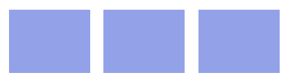

## **บทนำ**

จัดรูปแบบรูปร่างใน PowerPoint โดยการปรับขอบ, การเติมสี, และเอฟเฟกต์ต่าง ๆ Aspose.Slides for Python via .NET ช่วยให้คุณควบคุมการตั้งค่าเหล่านี้ได้โดยโปรแกรม รวมถึงความโปร่งใส, การหมุน, และการจัดรูปแบบ 3 มิติ.


Aspose.Slides for Python via .NET จัดเตรียมคลาสและคุณสมบัติที่ทำให้คุณสามารถจัดรูปแบบรูปร่างโดยใช้ตัวเลือกเดียวกับที่มีใน PowerPoint.

## **จัดรูปแบบเส้น**

ใช้ [Shape.line_format](https://reference.aspose.com/slides/python-net/aspose.slides/shape/line_format/) เพื่อควบคุมขอบของรูปร่าง ตัวอย่างนี้สร้างสี่เหลี่ยมไม่มีการเติมสีที่มีขอบสีฟ้าลายประ [LineFormat.style](https://reference.aspose.com/slides/python-net/aspose.slides/lineformat/style/) เลือกเส้นแบบหนา‑บางประกอบ, ขณะที่ [LineFormat.width](https://reference.aspose.com/slides/python-net/aspose.slides/lineformat/width/) กำหนดความกว้างเป็น 7 จุดและ [LineFormat.dash_style](https://reference.aspose.com/slides/python-net/aspose.slides/lineformat/dash_style/) เลือกรูปแบบลายประ.

```python
import aspose.slides as slides
import aspose.pydrawing as draw

with slides.Presentation() as presentation:
    slide = presentation.slides[0]

    shape = slide.shapes.add_auto_shape(slides.ShapeType.RECTANGLE, 50, 50, 150, 75)
    shape.fill_format.fill_type = slides.FillType.NO_FILL
    shape.line_format.style = slides.LineStyle.THICK_THIN
    shape.line_format.width = 7
    shape.line_format.dash_style = slides.LineDashStyle.DASH
    shape.line_format.fill_format.fill_type = slides.FillType.SOLID
    shape.line_format.fill_format.solid_fill_color.color = draw.Color.blue

    presentation.save("formatted_lines.pptx", slides.export.SaveFormat.PPTX)
```

ผลลัพธ์:


### **ตั้งค่ารูปแบบลายประกำหนดเอง**

ใช้ [LineFormat.custom_dash_pattern](https://reference.aspose.com/slides/python-net/aspose.slides/lineformat/custom_dash_pattern/) เมื่อสไตล์เส้นที่กำหนดไว้ล่วงหน้าไม่สามารถให้ความยาวของลายประและช่องว่างที่ต้องการได้ เช่น สำหรับขอบเครื่องหมายการค้า หรือแผนภาพเชิงเทคนิค การกำหนดรูปแบบจะตั้งค่า [LineFormat.dash_style](https://reference.aspose.com/slides/python-net/aspose.slides/lineformat/dash_style/) เป็น [LineDashStyle.CUSTOM](https://reference.aspose.com/slides/python-net/aspose.slides/linedashstyle/) โดยอัตโนมัติ

รายการค่าจะสลับระหว่างความยาวของลายประและช่องว่าง เริ่มจากลายประ แต่ละค่าจะเป็นหลายเท่าของความกว้างของเส้น: `[4, 2]` ที่ความกว้าง 3 จุดจะทำให้ได้ลายประ 12 จุดตามด้วยช่องว่าง 6 จุด ใช้คู่ของค่าจำกัดจำนวนที่เป็นจำนวนเต็มและไม่เป็นลบเพื่อกำหนดส่วนลายประ‑ช่องว่างที่สมบูรณ์ ตัวอย่างใช้ค่าบวกเพื่อให้ลายประและช่องว่างทุกส่วนมองเห็นได้

ตัวอย่างนี้สร้างเส้นสีน้ำเงิน 5 เส้นที่มีความยาวเท่ากันและปลายเส้นแบบแบน เส้นสามแรกเปรียบเทียบรูปแบบที่ความกว้าง 3 จุด เส้นที่สี่ทำซ้ำรูปแบบแรกที่ความกว้างสองเท่า ทำให้ความยาวของลายประและช่องว่างเพิ่มเป็นสองเท่า เส้นที่ห้าสลับจากรูปแบบกำหนดเองเป็นเส้นทึบ

```python
import aspose.slides as slides

with slides.Presentation() as presentation:
    presentation.slide_size.set_size(600, 300, slides.SlideSizeScaleType.DO_NOT_SCALE)
    slide = presentation.slides[0]

    patterns = [
        [4, 2],
        [1, 2],
        [6, 2, 1, 2],
        [4, 2],
        [4, 2]
    ]

    for i, pattern in enumerate(patterns):
        line = slide.shapes.add_auto_shape(slides.ShapeType.LINE, 50, 50 + i * 50, 500, 0)
        line.line_format.width = 6 if i == 3 else 3
        line.line_format.fill_format.fill_type = slides.FillType.SOLID
        line.line_format.fill_format.solid_fill_color.preset_color = slides.PresetColor.DARK_BLUE
        line.line_format.cap_style = slides.LineCapStyle.FLAT
        line.line_format.begin_arrowhead_style = slides.LineArrowheadStyle.NONE
        line.line_format.end_arrowhead_style = slides.LineArrowheadStyle.NONE
        line.line_format.custom_dash_pattern = pattern

    # คืนค่าเส้นสุดท้ายให้เป็นสไตล์ทึบ.
    slide.shapes[4].line_format.dash_style = slides.LineDashStyle.SOLID

    presentation.save("custom_dash_patterns.pptx", slides.export.SaveFormat.PPTX)
```

หากต้องการกลับไปใช้สไตล์เส้นประที่กำหนดไว้ล่วงหน้า ให้กำหนดค่า [LineDashStyle.DASH](https://reference.aspose.com/slides/python-net/aspose.slides/linedashstyle/) ให้กับ [LineFormat.dash_style](https://reference.aspose.com/slides/python-net/aspose.slides/lineformat/dash_style/) สไตล์ที่เลือกจะควบคุมลักษณะของเส้น

ผลลัพธ์ใน PowerPoint จากบนลงล่าง: **{4, 2}, 3 pt**; **{1, 2}, 3 pt**; **{6, 2, 1, 2}, 3 pt**; **{4, 2}, 6 pt**; และ **Solid, 3 pt**.


### **ตั้งค่าปลายเส้น**

ใช้ [LineFormat.cap_style](https://reference.aspose.com/slides/python-net/aspose.slides/lineformat/cap_style/) เพื่อกำหนดปลายของเส้นเปิด ตัวนับจำนวน [LineCapStyle](https://reference.aspose.com/slides/python-net/aspose.slides/linecapstyle/) มีสามสไตล์ชัดเจน:

- `FLAT`: เส้นหยุดที่จุดสิ้นสุด
- `ROUND`: ปลายรูปครึ่งวงกลมยืดออกนอกจุดสิ้นสุดครึ่งความกว้างของเส้น
- `SQUARE`: ปลายรูปสี่เหลี่ยมยืดออกนอกจุดสิ้นสุดครึ่งความกว้างของเส้น

นับจำนวนยังมีค่า `NOT_DEFINED` ซึ่งหมายความว่าไม่มีการกำหนดสไตล์ปลายแบบใดโดยเฉพาะ

ปลายเส้นแตกต่างจากหัวลูกศรซึ่งเพิ่มสัญลักษณ์ที่ปลายเส้น และจากการเชื่อมต่อซึ่งควบคุมมุมระหว่างส่วนของเส้น ตัวอย่างนี้ปิดการใช้หัวลูกศรผ่าน [LineFormat.begin_arrowhead_style](https://reference.aspose.com/slides/python-net/aspose.slides/lineformat/begin_arrowhead_style/) และ [LineFormat.end_arrowhead_style](https://reference.aspose.com/slides/python-net/aspose.slides/lineformat/end_arrowhead_style/) เพื่อให้เปรียบเทียบเฉพาะรูปแบบปลายเส้นเท่านั้น

ตัวอย่างต่อไปสร้างเส้นแนวนอนสามเส้นที่เหมือนกันทั้งหมด ความกว้าง 20 จุด จากบนลงล่างใช้ปลายเส้นแบบแบน, กลม, และสี่เหลี่ยมตามลำดับ จุดสิ้นสุดของเส้นทั้งสามมีพิกัดแนวนอนเดียวกัน; ปลายเส้นแบบกลมและสี่เหลี่ยมยืดออกนอกจุดสิ้นสุดเพิ่มเติม 10 จุด

```python
import aspose.slides as slides

with slides.Presentation() as presentation:
    presentation.slide_size.set_size(500, 240, slides.SlideSizeScaleType.DO_NOT_SCALE)
    slide = presentation.slides[0]

    cap_styles = [slides.LineCapStyle.FLAT, slides.LineCapStyle.ROUND, slides.LineCapStyle.SQUARE]

    for i, cap_style in enumerate(cap_styles):
        line = slide.shapes.add_auto_shape(slides.ShapeType.LINE, 100, 50 + i * 70, 300, 0)
        line.line_format.width = 20
        line.line_format.fill_format.fill_type = slides.FillType.SOLID
        line.line_format.fill_format.solid_fill_color.preset_color = slides.PresetColor.DARK_BLUE
        line.line_format.dash_style = slides.LineDashStyle.SOLID
        line.line_format.cap_style = cap_style
        line.line_format.begin_arrowhead_style = slides.LineArrowheadStyle.NONE
        line.line_format.end_arrowhead_style = slides.LineArrowheadStyle.NONE

    presentation.save("line_caps.pptx", slides.export.SaveFormat.PPTX)
```

ผลลัพธ์ใน PowerPoint จากบนลงล่าง: **Flat**, **Round**, and **Square**.


## **นำเอฟเฟกต์สเก็ตช์ไปใช้กับเส้นของรูปร่าง**

เอฟเฟกต์สเก็ตช์ทำให้เส้นของรูปร่างดูเหมือนวาดด้วยมือ ใช้ [Shape.line_format](https://reference.aspose.com/slides/python-net/aspose.slides/shape/line_format/) เพื่อเข้าถึงการตั้งค่าเส้น, [LineFormat.sketch_format](https://reference.aspose.com/slides/python-net/aspose.slides/lineformat/sketch_format/) เพื่อเข้าถึงการตั้งค่าสเก็ตช์, และ [SketchFormat.sketch_type](https://reference.aspose.com/slides/python-net/aspose.slides/sketchformat/sketch_type/) เพื่อเลือกค่าจากนับจำนวน [LineSketchType](https://reference.aspose.com/slides/python-net/aspose.slides/linesketchtype/)

โค้ด Python ด้านล่างแสดงวิธีการใช้เอฟเฟกต์ [LineSketchType.CURVED](https://reference.aspose.com/slides/python-net/aspose.slides/linesketchtype/) อ่านค่าที่กำหนดอย่างชัดเจน, และลบเอฟเฟกต์ด้วย [LineSketchType.NONE](https://reference.aspose.com/slides/python-net/aspose.slides/linesketchtype/):

```python
import aspose.slides as slides

with slides.Presentation() as presentation:
    slide = presentation.slides[0]

    shape = slide.shapes.add_auto_shape(slides.ShapeType.RECTANGLE, 50, 50, 200, 100)

    sketch_format = shape.line_format.sketch_format
    sketch_format.sketch_type = slides.LineSketchType.CURVED
    explicit_sketch_type = sketch_format.sketch_type
    print(f"Explicit sketch type: {explicit_sketch_type}")
    sketch_format.sketch_type = slides.LineSketchType.NONE
```

ค่าที่คืนจาก [SketchFormat.sketch_type](https://reference.aspose.com/slides/python-net/aspose.slides/sketchformat/sketch_type/) แสดงถึงการตั้งค่าที่กำหนดโดยตรงให้กับรูปร่าง หากการจัดรูปแบบเส้นสามารถสืบทอดจากธีม, สไลด์มาสเตอร์, หรือสไลด์เลย์เอาต์ได้ ให้ใช้ [LineFormat.get_effective](https://reference.aspose.com/slides/python-net/aspose.slides/lineformat/get_effective/), เข้าถึง [ILineFormatEffectiveData.sketch_format](https://reference.aspose.com/slides/python-net/aspose.slides/ilineformateffectivedata/sketch_format/), และอ่าน [ISketchFormatEffectiveData.sketch_type](https://reference.aspose.com/slides/python-net/aspose.slides/isketchformateffectivedata/sketch_type/) ค่าที่มีผลสะท้อนการจัดรูปแบบที่ใช้งานจริงหลังจากที่การสืบทอดได้รับการแก้ไข ตัวอย่างนี้ต้องการงานนำเสนอที่มีอย่างน้อยหนึ่งรูปร่างบนสไลด์แรกและพิมพ์ค่าทั้งสอง:

```python
import aspose.slides as slides

with slides.Presentation("presentation.pptx") as presentation:
    shape = presentation.slides[0].shapes[0]

    line_format = shape.line_format
    explicit_sketch_type = line_format.sketch_format.sketch_type
    effective_line_format = line_format.get_effective()
    effective_sketch_type = effective_line_format.sketch_format.sketch_type

    print(f"Explicit sketch type: {explicit_sketch_type}")
    print(f"Effective sketch type: {effective_sketch_type}")
```

## **จัดรูปแบบสไตล์การเชื่อมต่อ**

ต่อไปนี้คือสามตัวเลือกของประเภทการเชื่อมต่อ:

* โค้ง
* มิตเตอร์
* บีเวล

สไตล์การเชื่อมต่อควบคุมวิธีที่สองส่วนของขอบมาบรรจบกันที่มุม ใช้ **โค้ง** สำหรับมุมโค้ง, **มิตเตอร์** สำหรับมุมคม, หรือ **บีเวล** สำหรับมุมแบน


ตัวอย่างนี้สร้างสี่เหลี่ยมสีดำ 3 อันที่มีขอบสีน้ำเงินกว้าง 15 จุด ตั้งค่า [LineFormat.join_style](https://reference.aspose.com/slides/python-net/aspose.slides/lineformat/join_style/) เป็นค่า miter, bevel, และ round ของ [LineJoinStyle](https://reference.aspose.com/slides/python-net/aspose.slides/linejoinstyle/) ตามลำดับ เพื่อเปรียบเทียบว่ามุมจะถูกวาดอย่างไร

```python
import aspose.slides as slides
import aspose.pydrawing as draw

with slides.Presentation() as presentation:
    slide = presentation.slides[0]

    miter_shape = slide.shapes.add_auto_shape(slides.ShapeType.RECTANGLE, 20, 20, 150, 75)
    bevel_shape = slide.shapes.add_auto_shape(slides.ShapeType.RECTANGLE, 210, 20, 150, 75)
    round_shape = slide.shapes.add_auto_shape(slides.ShapeType.RECTANGLE, 20, 135, 150, 75)

    miter_shape.fill_format.fill_type = slides.FillType.SOLID
    miter_shape.fill_format.solid_fill_color.color = draw.Color.black
    bevel_shape.fill_format.fill_type = slides.FillType.SOLID
    bevel_shape.fill_format.solid_fill_color.color = draw.Color.black
    round_shape.fill_format.fill_type = slides.FillType.SOLID
    round_shape.fill_format.solid_fill_color.color = draw.Color.black

    miter_shape.line_format.width = 15
    bevel_shape.line_format.width = 15
    round_shape.line_format.width = 15

    miter_shape.line_format.fill_format.fill_type = slides.FillType.SOLID
    miter_shape.line_format.fill_format.solid_fill_color.color = draw.Color.blue
    bevel_shape.line_format.fill_format.fill_type = slides.FillType.SOLID
    bevel_shape.line_format.fill_format.solid_fill_color.color = draw.Color.blue
    round_shape.line_format.fill_format.fill_type = slides.FillType.SOLID
    round_shape.line_format.fill_format.solid_fill_color.color = draw.Color.blue

    miter_shape.line_format.join_style = slides.LineJoinStyle.MITER
    bevel_shape.line_format.join_style = slides.LineJoinStyle.BEVEL
    round_shape.line_format.join_style = slides.LineJoinStyle.ROUND

    miter_shape.text_frame.text = "Miter Join Style"
    bevel_shape.text_frame.text = "Bevel Join Style"
    round_shape.text_frame.text = "Round Join Style"

    presentation.save("join_styles.pptx", slides.export.SaveFormat.PPTX)
```

### **จำกัดการเชื่อมต่อแบบมิตเตอร์ที่มุมคม**

ใช้ [LineFormat.miter_limit](https://reference.aspose.com/slides/python-net/aspose.slides/lineformat/miter_limit/) ร่วมกับ [LineFormat.join_style](https://reference.aspose.com/slides/python-net/aspose.slides/lineformat/join_style/) ที่ตั้งค่าเป็น [LineJoinStyle.MITER](https://reference.aspose.com/slides/python-net/aspose.slides/linejoinstyle/) เพื่อจำกัดระยะที่มุมคมสามารถขยายออกไปได้

ค่าจำกัดคืออัตราส่วนของระยะห่างระหว่างมุมในและนอกของการเชื่อมต่อต่อความกว้างของเส้น ตัวอย่างเช่น ค่า `8` อนุญาตให้ความยาวมิตเตอร์สูงสุดถึงแปดเท่าของความกว้างของเส้น; ไม่ได้เป็นหน่วยจุด หากมุมเกินค่าจำกัด PowerPoint จะใช้การเชื่อมต่อแบบบีเวลที่มุมนั้น ค่าจำกัดที่ใหญ่ขึ้นทำให้จุดคมกว้างขึ้น การตั้งค่านี้มีผลต่อการเชื่อมต่อแบบมิตเตอร์เท่านั้นและการเปลี่ยนแปลงจะไม่มีผลต่อมุมที่ยังอยู่ภายในขอบเขตของทั้งสองค่า

ตัวอย่างนี้สร้างสามเหลี่ยมไม่มีการเติมสีที่มีขอบกว้าง 20 จุด สามเหลี่ยมซ้ายใช้ค่าจำกัด `2`, ขวาใช้ `8` แต่ละสามเหลี่ยมกว้าง 80 จุด สูง 160 จุด ทำให้มุมบนมีอัตราส่วนความยาวมิตเตอร์ต่อความกว้างของเส้นประมาณ `4.12` ผลลัพธ์คือ PowerPoint ทำให้มุมซ้ายเป็นบีเวลและมุมขวาเก็บรูปแบบจุดคมไว้

```python
import aspose.slides as slides

with slides.Presentation() as presentation:
    presentation.slide_size.set_size(500, 320, slides.SlideSizeScaleType.DO_NOT_SCALE)
    slide = presentation.slides[0]

    miter_limits = [2.0, 8.0]

    for i, miter_limit in enumerate(miter_limits):
        triangle = slide.shapes.add_auto_shape(slides.ShapeType.TRIANGLE, 90 + i * 240, 110, 80, 160)
        triangle.fill_format.fill_type = slides.FillType.NO_FILL
        triangle.line_format.width = 20
        triangle.line_format.fill_format.fill_type = slides.FillType.SOLID
        triangle.line_format.fill_format.solid_fill_color.preset_color = slides.PresetColor.DARK_BLUE
        triangle.line_format.join_style = slides.LineJoinStyle.MITER
        triangle.line_format.miter_limit = miter_limit

    presentation.save("miter_limits.pptx", slides.export.SaveFormat.PPTX)
```

ผลลัพธ์ใน PowerPoint: **Miter limit 2** ทางซ้ายและ **miter limit 8** ทางขวา.


## **การเติมสีไล่ระดับ**

การเติมสีไล่ระดับทำให้สีไหลราบรื่นภายในรูปร่าง ตัวอย่างนี้เติมวงรีด้วยไล่ระดับเชิงเส้นที่มุม 45 องศาจากสีแดงไปสีม่วงโดยใช้ [FillFormat.gradient_format](https://reference.aspose.com/slides/python-net/aspose.slides/fillformat/gradient_format/). วิธีการ [GradientStopCollection.add](https://reference.aspose.com/slides/python-net/aspose.slides/gradientstopcollection/add/) เพิ่มจุดหยุดสีที่ตำแหน่ง 0 และ 1 ซึ่งเป็นจุดเริ่มต้นและสิ้นสุดของไล่ระดับ การล้างจุดหยุดเดิมทำให้ใช้สีสองสีนี้เท่านั้น

```python
import aspose.slides as slides

with slides.Presentation() as presentation:
    slide = presentation.slides[0]

    shape = slide.shapes.add_auto_shape(slides.ShapeType.ELLIPSE, 50, 50, 150, 75)
    shape.fill_format.fill_type = slides.FillType.GRADIENT
    shape.fill_format.gradient_format.gradient_shape = slides.GradientShape.LINEAR
    shape.fill_format.gradient_format.linear_gradient_angle = 45
    shape.fill_format.gradient_format.gradient_stops.clear()
    shape.fill_format.gradient_format.gradient_stops.add(1.0, slides.PresetColor.PURPLE)
    shape.fill_format.gradient_format.gradient_stops.add(0.0, slides.PresetColor.RED)

    presentation.save("gradient_fill.pptx", slides.export.SaveFormat.PPTX)
```

ผลลัพธ์:


หากไล่ระดับแสดงผลต่างกันในภาพที่ส่งออกเมื่อเทียบกับใน PowerPoint ให้ดูที่ [Choose a Gradient Rendering Style](/slides/th/python-net/convert-powerpoint-to-png/#choose-a-gradient-rendering-style). คุณสามารถเลือกสไตล์การเรนเดอร์โดยไม่ต้องเปลี่ยนการเติมสีไล่ระดับที่เก็บอยู่ในงานนำเสนอ

### **ตั้งค่ามุมของการไล่ระดับเชิงเส้น**

ใช้ [GradientFormat.linear_gradient_angle](https://reference.aspose.com/slides/python-net/aspose.slides/gradientformat/linear_gradient_angle/) เพื่อควบคุมทิศทางของการเติม [GradientShape.LINEAR](https://reference.aspose.com/slides/python-net/aspose.slides/gradientshape/) มุมวัดเป็นอองศาและเพิ่มตามเข็มนาฬิกา: `0` จากซ้ายไปขวา, `90` จากบนลงล่าง, `180` จากขวาไปซ้าย, `270` จากล่างขึ้นบน มุมที่เป็นเศษส่วนก็รองรับ มุมที่อยู่นอกช่วง `[0, 360)` จะทำให้เป็นมุมหนึ่งรอบใหม่; ตัวอย่างเช่น `-45` จะกลายเป็น `315` และ `360` จะเป็น `0`

ตัวอย่างนี้สร้างสี่เหลี่ยม 6 อันที่มีจุดหยุดสีแดง, เขียว, น้ำเงินที่ตำแหน่ง `0`, `0.5`, และ `1` เหมือนกัน ปิดการสเกลเพื่อให้มุมไล่ระดับเปรียบเทียบได้โดยอิสระจากสัดส่วนของสี่เหลี่ยม มุมจากซ้ายไปขวา: `0`, `45`, `90` ในแถวแรก, และ `135`, `180`, `270` ในแถวที่สอง

```python
import aspose.slides as slides

with slides.Presentation() as presentation:
    presentation.slide_size.set_size(720, 400, slides.SlideSizeScaleType.DO_NOT_SCALE)
    slide = presentation.slides[0]

    angles = [0, 45, 90, 135, 180, 270]

    for i, angle in enumerate(angles):
        x = 30 + (i % 3) * 230
        y = 30 + (i // 3) * 190

        shape = slide.shapes.add_auto_shape(slides.ShapeType.RECTANGLE, x, y, 200, 150)
        shape.line_format.fill_format.fill_type = slides.FillType.NO_FILL
        shape.fill_format.fill_type = slides.FillType.GRADIENT

        gradient = shape.fill_format.gradient_format
        gradient.gradient_shape = slides.GradientShape.LINEAR
        gradient.gradient_stops.clear()
        gradient.gradient_stops.add(0.0, slides.PresetColor.RED)
        gradient.gradient_stops.add(0.5, slides.PresetColor.LIME)
        gradient.gradient_stops.add(1.0, slides.PresetColor.BLUE)
        gradient.linear_gradient_scaled = slides.NullableBool.FALSE
        gradient.linear_gradient_angle = angle

    presentation.save("linear_gradient_angles.pptx", slides.export.SaveFormat.PPTX)
```

ผลลัพธ์ใน PowerPoint:


### **ปรับสเกลการไล่ระดับเชิงเส้นกับรูปร่าง**

[GradientFormat.linear_gradient_scaled](https://reference.aspose.com/slides/python-net/aspose.slides/gradientformat/linear_gradient_scaled/) รับค่า [NullableBool](https://reference.aspose.com/slides/python-net/aspose.slides/nullablebool/) ตั้งค่าเป็น `FALSE` เพื่อให้มุมไล่ระดับเชิงเรขาคณิตคงที่เมื่อสัดส่วนของรูปร่างเปลี่ยน, หรือ `TRUE` เพื่อให้สเกลไล่ระดับตามความกว้างและความสูงของรูปร่าง เมื่อเปิดการสเกล มุมที่มองเห็นอาจแตกต่างจากมุมที่กำหนดไว้บนรูปร่างที่ไม่เป็นสี่เหลี่ยมจัตุรัส

ตัวอย่างต่อไปใช้มุม `45` องศาและจุดหยุดสีเดียวกันกับการเปรียบเทียบมุม คอลัมน์ซ้ายตั้งค่าเป็น `FALSE`; คอลัมน์ขวาตั้งค่าเป็น `TRUE` แต่ละคอลัมน์มีสี่เหลี่ยมกว้างอยู่เหนือสี่เหลี่ยมสูง ทั้งสองเริ่มด้วยขนาดกว้างเดียวกัน; การเปลี่ยนความกว้างและความสูงของสี่เหลี่ยมที่สองแสดงให้เห็นว่าการเติมสีตอบสนองต่อการปรับขนาดอย่างไรโดยไม่ต้องเปลี่ยนการตั้งค่าไล่ระดับ

```python
import aspose.slides as slides

with slides.Presentation() as presentation:
    presentation.slide_size.set_size(720, 460, slides.SlideSizeScaleType.DO_NOT_SCALE)
    slide = presentation.slides[0]

    scaling_options = [slides.NullableBool.FALSE, slides.NullableBool.TRUE]

    for column, scaling in enumerate(scaling_options):
        for row in range(2):
            x = 30 + column * 360
            y = 30 if row == 0 else 150

            shape = slide.shapes.add_auto_shape(slides.ShapeType.RECTANGLE, x, y, 300, 90)
            shape.line_format.fill_format.fill_type = slides.FillType.NO_FILL
            shape.fill_format.fill_type = slides.FillType.GRADIENT

            gradient = shape.fill_format.gradient_format
            gradient.gradient_shape = slides.GradientShape.LINEAR
            gradient.gradient_stops.clear()
            gradient.gradient_stops.add(0.0, slides.PresetColor.RED)
            gradient.gradient_stops.add(0.5, slides.PresetColor.LIME)
            gradient.gradient_stops.add(1.0, slides.PresetColor.BLUE)
            gradient.linear_gradient_angle = 45
            gradient.linear_gradient_scaled = scaling

            if row == 1:
                shape.width = 90
                shape.height = 280

    presentation.save("linear_gradient_scaling.pptx", slides.export.SaveFormat.PPTX)
```

ผลลัพธ์ใน PowerPoint, โดยซ้ายสเกลปิดและขวาเปิดสเกล:


เมื่อสเกลปิด แถบสีทแยงมุมจะคงแนวเดียวกันในทั้งสองสี่เหลี่ยม เมื่อสเกลเปิด แถบสีจะยืดตามสัดส่วนของรูปร่าง นี่ช่วยให้คัดลอกไล่ระดับของเทมเพลตเมื่อปรับรูปร่างให้มีขนาดต่างกัน บนสี่เหลี่ยมจัตุรัส การเปิดสเกลไม่ทำให้ไล่ระดับ `45` องศาเปลี่ยนแปลงรูปลักษณ์

มุมและการสเกลใช้ได้กับไล่ระดับเชิงเส้นเท่านั้น ไม่ควบคุมการเติมแบบ [GradientShape.RADIAL หรือ GradientShape.RECTANGLE](https://reference.aspose.com/slides/python-net/aspose.slides/gradientshape/)

### **รวมมุมกับทิศทางของการไล่ระดับ**

[GradientFormat.gradient_direction](https://reference.aspose.com/slides/python-net/aspose.slides/gradientformat/gradient_direction/) เลือกสไตล์การไล่ระดับจากนับจำนวน [GradientDirection](https://reference.aspose.com/slides/python-net/aspose.slides/gradientdirection/) ซึ่งไม่ใช่การทดแทนมุมเชิงตัวเลข สำหรับไล่ระดับเชิงเส้น การตั้งค่าสไตล์มุมสามารถเปลี่ยนพื้นที่ที่สีกระจายโดยไม่ต้องเปลี่ยน [linear_gradient_angle](https://reference.aspose.com/slides/python-net/aspose.slides/gradientformat/linear_gradient_angle/) ควรคงทิศทางไว้เมื่อเปรียบเทียบมุมหรือสเกล

ตัวอย่างต่อไปใช้การตั้งค่าเดียวกันแต่สั่งลำดับกันตรงกันข้าม สี่เหลี่ยมสองอันจะแสดงผลเหมือนกัน: การกำหนดทิศทางก่อนหรือหลังมุมไม่ทำให้ผลลัพธ์เปลี่ยน

```python
import aspose.slides as slides

with slides.Presentation() as presentation:
    slide = presentation.slides[0]

    for i in range(2):
        shape = slide.shapes.add_auto_shape(slides.ShapeType.RECTANGLE, 30, 30 + i * 140, 320, 100)
        shape.line_format.fill_format.fill_type = slides.FillType.NO_FILL
        shape.fill_format.fill_type = slides.FillType.GRADIENT

        gradient = shape.fill_format.gradient_format
        gradient.gradient_shape = slides.GradientShape.LINEAR
        gradient.gradient_stops.clear()
        gradient.gradient_stops.add(0.0, slides.PresetColor.RED)
        gradient.gradient_stops.add(0.5, slides.PresetColor.LIME)
        gradient.gradient_stops.add(1.0, slides.PresetColor.BLUE)
        gradient.linear_gradient_scaled = slides.NullableBool.TRUE

        if i == 0:
            gradient.gradient_direction = slides.GradientDirection.FROM_CORNER1
            gradient.linear_gradient_angle = 30
        else:
            gradient.linear_gradient_angle = 30
            gradient.gradient_direction = slides.GradientDirection.FROM_CORNER1

    presentation.save("linear_gradient_direction.pptx", slides.export.SaveFormat.PPTX)
```

## **การเติมลวดลาย**

การเติมลวดลายใช้การออกแบบสองสี เช่น จุด, แนวนอน, หรือการเช็ก ตัวอย่างนี้ใช้ [PatternFormat.pattern_style](https://reference.aspose.com/slides/python-net/aspose.slides/patternformat/pattern_style/) เพื่อเลือกลวดลายตะแกรง [PatternFormat.back_color](https://reference.aspose.com/slides/python-net/aspose.slides/patternformat/back_color/) ให้พื้นหลังเทาอ่อน, และ [PatternFormat.fore_color](https://reference.aspose.com/slides/python-net/aspose.slides/patternformat/fore_color/) ให้สีเหลืองของลวดลาย

```python
import aspose.slides as slides
import aspose.pydrawing as draw

with slides.Presentation() as presentation:
    slide = presentation.slides[0]

    shape = slide.shapes.add_auto_shape(slides.ShapeType.RECTANGLE, 50, 50, 150, 75)
    shape.fill_format.fill_type = slides.FillType.PATTERN
    shape.fill_format.pattern_format.pattern_style = slides.PatternStyle.TRELLIS
    shape.fill_format.pattern_format.back_color.color = draw.Color.light_gray
    shape.fill_format.pattern_format.fore_color.color = draw.Color.yellow

    presentation.save("pattern_fill.pptx", slides.export.SaveFormat.PPTX)
```

ผลลัพธ์:


## **การเติมภาพ**

การเติมภาพใช้รูปภาพภายในรูปร่าง ตัวอย่างนี้ต้องการภาพภายในเครื่องและใช้ [Images.from_file](https://reference.aspose.com/slides/python-net/aspose.slides/images/from_file/) เพื่อโหลดเข้าไปในคอลเลกชันภาพของงานนำเสนอ ตั้งค่า [PictureFillFormat.picture_fill_mode](https://reference.aspose.com/slides/python-net/aspose.slides/picturefillformat/picture_fill_mode/) เป็นโหมดปูกระเบื้องเพื่อทำซ้ำภาพภายในสี่เหลี่ยม ภาพต้นฉบับที่ใช้แสดงด้านล่าง:


```python
import aspose.slides as slides

with slides.Presentation() as presentation:
    slide = presentation.slides[0]

    shape = slide.shapes.add_auto_shape(slides.ShapeType.RECTANGLE, 50, 50, 255, 130)
    shape.fill_format.fill_type = slides.FillType.PICTURE
    shape.fill_format.picture_fill_format.picture_fill_mode = slides.PictureFillMode.TILE

    with slides.Images.from_file("lotus.png") as image:
        presentation_image = presentation.images.add_image(image)
    shape.fill_format.picture_fill_format.picture.image = presentation_image

    presentation.save("picture_fill.pptx", slides.export.SaveFormat.PPTX)
```

ผลลัพธ์:


### **ทำภาพเป็นไทล์เป็นพื้นผิว**

หากต้องการตั้งค่าภาพเป็นไทล์เป็นพื้นผิวและปรับพฤติกรรมการทำไทล์ สามารถใช้คุณสมบัติดังต่อไปของคลาส [PictureFillFormat](https://reference.aspose.com/slides/python-net/aspose.slides/picturefillformat/) :

- [picture_fill_mode](https://reference.aspose.com/slides/python-net/aspose.slides/picturefillformat/picture_fill_mode/): กำหนดโหมดการเติมภาพ — `TILE` หรือ `STRETCH`
- [tile_alignment](https://reference.aspose.com/slides/python-net/aspose.slides/picturefillformat/tile_alignment/): ระบุตำแหน่งจัดเรียงของไทล์ภายในรูปร่าง
- [tile_flip](https://reference.aspose.com/slides/python-net/aspose.slides/picturefillformat/tile_flip/): ควบคุมว่าภาพไทล์จะถูกพลิกแนวนอน แนวตั้ง หรือทั้งสองอย่าง
- [tile_offset_x](https://reference.aspose.com/slides/python-net/aspose.slides/picturefillformat/tile_offset_x/): กำหนดการเลื่อนแนวนอนของไทล์ (หน่วยจุด) จากจุดเริ่มต้นของรูปร่าง
- [tile_offset_y](https://reference.aspose.com/slides/python-net/aspose.slides/picturefillformat/tile_offset_y/): กำหนดการเลื่อนแนวตั้งของไทล์ (หน่วยจุด) จากจุดเริ่มต้นของรูปร่าง
- [tile_scale_x](https://reference.aspose.com/slides/python-net/aspose.slides/picturefillformat/tile_scale_x/): กำหนดสเกลแนวนอนของไทล์เป็นเปอร์เซ็นต์
- [tile_scale_y](https://reference.aspose.com/slides/python-net/aspose.slides/picturefillformat/tile_scale_y/): กำหนดสเกลแนวตั้งของไทล์เป็นเปอร์เซ็นต์

ตัวอย่างนี้ต้องการภาพภายในเครื่องและกำหนดค่า [PictureFillFormat](https://reference.aspose.com/slides/python-net/aspose.slides/picturefillformat/) ให้ทำซ้ำที่ขนาด 50% ของขนาดต้นฉบับ การเลื่อน `−32` จุดทำให้ไทล์เลื่อนแนวนอนและแนวตั้ง; การจัดตำแหน่งด้านล่าง‑ขวาและการพลิกทั้งสองทิศทางกำหนดวิธีจัดเรียงพื้นผิวที่ทำซ้ำ

```python
import aspose.slides as slides

with slides.Presentation() as presentation:
    first_slide = presentation.slides[0]

    shape = first_slide.shapes.add_auto_shape(slides.ShapeType.RECTANGLE, 50, 50, 190, 95)
    shape.fill_format.fill_type = slides.FillType.PICTURE

    with slides.Images.from_file("lotus.png") as source_image:
        presentation_image = presentation.images.add_image(source_image)

    picture_fill_format = shape.fill_format.picture_fill_format
    picture_fill_format.picture.image = presentation_image
    picture_fill_format.picture_fill_mode = slides.PictureFillMode.TILE
    picture_fill_format.tile_offset_x = -32
    picture_fill_format.tile_offset_y = -32
    picture_fill_format.tile_scale_x = 50
    picture_fill_format.tile_scale_y = 50
    picture_fill_format.tile_alignment = slides.RectangleAlignment.BOTTOM_RIGHT
    picture_fill_format.tile_flip = slides.TileFlip.FLIP_BOTH

    presentation.save("tile.pptx", slides.export.SaveFormat.PPTX)
```

ผลลัพธ์:


## **การเติมสีทึบ**

การเติมสีทึบทำให้รูปร่างมีสีเดียวที่สม่ำเสมอ ตัวอย่างนี้ตั้งค่า [FillFormat.fill_type](https://reference.aspose.com/slides/python-net/aspose.slides/fillformat/fill_type/) เป็นโหมดการเติมสีทึบและกำหนดสีเหลืองผ่าน [FillFormat.solid_fill_color](https://reference.aspose.com/slides/python-net/aspose.slides/fillformat/solid_fill_color/), จากนั้นบันทึกสี่เหลี่ยมในงานนำเสนอ

```python
import aspose.slides as slides
import aspose.pydrawing as draw

with slides.Presentation() as presentation:
    slide = presentation.slides[0]

    shape = slide.shapes.add_auto_shape(slides.ShapeType.RECTANGLE, 50, 50, 150, 75)
    shape.fill_format.fill_type = slides.FillType.SOLID
    shape.fill_format.solid_fill_color.color = draw.Color.yellow

    presentation.save("solid_color_fill.pptx", slides.export.SaveFormat.PPTX)
```

ผลลัพธ์:


### **คัดลอกรหัสสีพร้อมคงการอ้างอิงธีม**

ใช้ [ColorFormat.copy_from](https://reference.aspose.com/slides/python-net/aspose.slides/colorformat/copy_from/) เพื่อคัดลอกรายละเอียดสีรวมถึงประเภทสี, การอ้างอิงธีม, และการแปลงค่า ซึ่งมีประโยชน์เมื่อย้ายสีเติมระหว่างรูปร่างที่ต้องการให้ยังคงตามธีมของงานนำเสนอ วิธีนี้คัดลอกเฉพาะสีเท่านั้น ไม่คัดลอกประเภทการเติม, ขอบ, หรือการจัดรูปแบบอื่น ๆ ให้ตั้งค่า [FillFormat.fill_type](https://reference.aspose.com/slides/python-net/aspose.slides/fillformat/fill_type/) ของเป้าหมายอย่างชัดเจน

ตัวอย่างนี้สร้างสี่เหลี่ยมสามอันจากซ้ายไปขวา: แหล่งที่มา, คัดลอกที่คำนึงถึงธีม, และคัดลอกเป็น RGB คงที่ แหล่งที่มาใช้ [ColorFormat.scheme_color](https://reference.aspose.com/slides/python-net/aspose.slides/colorformat/scheme_color/) เพื่ออ้างอิงสีสำคัญแรกและเพิ่มสีเทาโดย [ColorOperationCollection.add](https://reference.aspose.com/slides/python-net/aspose.slides/coloroperationcollection/add/). คัดลอกเป็น RGB ใช้สีเติมที่มีผลจริงของแหล่งที่มา ทำให้ทั้งสามอันดูเหมือนกันในตอนแรก การกำหนดค่า [ColorFormat.color](https://reference.aspose.com/slides/python-net/aspose.slides/colorformat/color/) จะตั้งค่าเป็น RGB คงที่และลบการแปลงสีใด ๆ ที่มีอยู่

```python
import aspose.slides as slides
import aspose.pydrawing as draw

with slides.Presentation() as presentation:
    presentation.slide_size.set_size(660, 220, slides.SlideSizeScaleType.DO_NOT_SCALE)
    slide = presentation.slides[0]

    presentation.master_theme.color_scheme.accent1.color = draw.Color.royal_blue

    source = slide.shapes.add_auto_shape(slides.ShapeType.RECTANGLE, 30, 40, 180, 140)
    theme_copy = slide.shapes.add_auto_shape(slides.ShapeType.RECTANGLE, 240, 40, 180, 140)
    rgb_copy = slide.shapes.add_auto_shape(slides.ShapeType.RECTANGLE, 450, 40, 180, 140)

    for shape in (source, theme_copy, rgb_copy):
        shape.fill_format.fill_type = slides.FillType.SOLID
        shape.line_format.fill_format.fill_type = slides.FillType.NO_FILL

    source_color = source.fill_format.solid_fill_color
    source_color.scheme_color = slides.SchemeColor.ACCENT1
    source_color.color_transform.add(slides.ColorTransformOperation.TINT, 0.75)

    theme_copy.fill_format.solid_fill_color.copy_from(source_color)
    rgb_copy.fill_format.solid_fill_color.color = source.fill_format.get_effective().solid_fill_color

    with slide.get_image(1.0, 1.0) as before:
        before.save("color-copy-before.png", slides.ImageFormat.PNG)

    # อ้างอิงธีมตามสีสำคัญใหม่; ค่ RGB คงที่ไม่เปลี่ยนแปลง.
    presentation.master_theme.color_scheme.accent1.color = draw.Color.orange_red

    with slide.get_image(1.0, 1.0) as after:
        after.save("color-copy-after.png", slides.ImageFormat.PNG)
    presentation.save("copied_colors.pptx", slides.export.SaveFormat.PPTX)
```

ก่อนการเปลี่ยนธีม ทั้งสามการเติมสีตรงกัน:



หลังการเปลี่ยนธีม แหล่งที่มาและคัดลอกที่คำนึงถึงธีมจะตามสีสำคัญใหม่และคงสีเทาไว้ ส่วนคัดลอก RGB คงที่ยังคงเป็นสีน้ำเงิน:


คัดลอกคำนิยามจะเป็นอิสระจากแหล่งที่มา การเปลี่ยนแปลงธีมของแหล่งที่มา, การกำหนดสีใหม่, หรือการเพิ่ม/ลบการแปลงสีของแหล่งที่มา จะไม่กระทบต่อปลายทาง การเปลี่ยนธีมยังคงส่งผลต่อทั้งสองรูปร่างเนื่องจากแต่ละรูปร่างอ้างอิงสีธีมเดียวกัน

การบันทึกและเปิดไฟล์ PPTX อีกครั้งจะคง [ColorFormat.color_type](https://reference.aspose.com/slides/python-net/aspose.slides/colorformat/color_type/), การอ้างอิงธีม, และคอลเลกชัน [ColorFormat.color_transform](https://reference.aspose.com/slides/python-net/aspose.slides/colorformat/color_transform/) ไว้; จะไม่แปลงคำนิยามเป็น RGB

เมื่อคัดลอกจากบริบทธีมที่ต่างกัน เช่น งานนำเสนอที่มีพาเลตสีสำคัญต่างกัน คำอ้างอิงที่คัดลอกจะอิงตามธีมของปลายทาง ดังนั้นการอ้างอิงและการแปลงเดียวกันอาจทำให้สีที่มองเห็นแตกต่าง ดูเพิ่มเติมที่ [Presentation Theme](/slides/th/python-net/presentation-theme/) เพื่อเรียนรู้การกำหนดสีธีม

## **ใช้พื้นหลังสไลด์เป็นการเติมสีของรูปร่าง**

ใช้ [AutoShape.use_background_fill](https://reference.aspose.com/slides/python-net/aspose.slides/autoshape/use_background_fill/) เมื่อรูปร่างต้องการตรงกับพื้นหลังสไลด์ เช่น ในเทมเพลตงานนำเสนอ ตั้งค่า [FillFormat.fill_type](https://reference.aspose.com/slides/python-net/aspose.slides/fillformat/fill_type/) เป็น [FillType.NOT_DEFINED](https://reference.aspose.com/slides/python-net/aspose.slides/filltype/) ก่อนเพื่อเอาการเติมสีโดยเจตนาออก เมื่อใช้การตั้งค่านี้ รูปร่างจะใช้พื้นหลังสไลด์แทนการเติมสีของสไตล์เอง การเปิดแฟล็กนี้อย่างเดียวจะไม่ลบการเติมสีที่มีอยู่แล้ว

ซึ่งแตกต่างจาก [FillType.NO_FILL](https://reference.aspose.com/slides/python-net/aspose.slides/filltype/): การเติมสีพื้นหลังจะคลุมวัตถุที่อยู่หลังรูปร่างด้วยพื้นที่พื้นหลังสไลด์ที่สอดคล้องกัน ขณะที่ไม่มีการเติมสีทำให้วัตถุนั้นมองเห็นได้ การไล่ระดับยังคงจัดตำแหน่งตามสไลด์แทนที่จะเริ่มใหม่ภายในแต่ละรูปร่าง

ตัวอย่างต่อไปสร้างพื้นหลังมาสเตอร์ที่สืบทอดโดยสไลด์และวางแถบสีชมพูไว้ด้านหลังสี่เหลี่ยมสามอัน สี่เหลี่ยมซ้ายใช้พื้นหลัง, กลางไม่มีการเติมสี, และขวาสลับจากพื้นหลังเป็นการเติมสีส้มโดยเจตนา

```python
import aspose.slides as slides
import aspose.pydrawing as draw

with slides.Presentation() as presentation:
    presentation.slide_size.set_size(720, 400, slides.SlideSizeScaleType.DO_NOT_SCALE)
    slide = presentation.slides[0]

    # สืบทอดไล่ระดับจากมาสเตอร์.
    slide.background.type = slides.BackgroundType.NOT_DEFINED
    slide.layout_slide.background.type = slides.BackgroundType.NOT_DEFINED
    background = slide.layout_slide.master_slide.background
    background.type = slides.BackgroundType.OWN_BACKGROUND
    background.fill_format.fill_type = slides.FillType.GRADIENT
    gradient = background.fill_format.gradient_format
    gradient.gradient_shape = slides.GradientShape.LINEAR
    gradient.linear_gradient_angle = 0
    gradient.gradient_stops.clear()
    gradient.gradient_stops.add(0, draw.Color.dark_blue)
    gradient.gradient_stops.add(1, draw.Color.light_sky_blue)

    # เพิ่มวัตถุนี้ก่อนเพื่อให้แสดงอยู่เบื้องหลังสี่เหลี่ยม.
    band = slide.shapes.add_auto_shape(slides.ShapeType.RECTANGLE, 25, 150, 670, 100)
    band.fill_format.fill_type = slides.FillType.SOLID
    band.fill_format.solid_fill_color.color = draw.Color.magenta
    band.line_format.fill_format.fill_type = slides.FillType.NO_FILL

    background_shape = slide.shapes.add_auto_shape(slides.ShapeType.RECTANGLE, 50, 100, 160, 200)
    background_shape.fill_format.fill_type = slides.FillType.NOT_DEFINED
    background_shape.use_background_fill = True

    no_fill_shape = slide.shapes.add_auto_shape(slides.ShapeType.RECTANGLE, 280, 100, 160, 200)
    no_fill_shape.fill_format.fill_type = slides.FillType.NO_FILL

    explicit_shape = slide.shapes.add_auto_shape(slides.ShapeType.RECTANGLE, 510, 100, 160, 200)
    explicit_shape.fill_format.fill_type = slides.FillType.NOT_DEFINED
    explicit_shape.use_background_fill = True

    # ปิดการเติมพื้นหลังก่อนที่จะกำหนดการเติมแบบเจตนา.
    explicit_shape.use_background_fill = False
    explicit_shape.fill_format.fill_type = slides.FillType.SOLID
    explicit_shape.fill_format.solid_fill_color.color = draw.Color.orange

    presentation.save("background_fill.pptx", slides.export.SaveFormat.PPTX)
```

ผลลัพธ์จากซ้ายไปขวา: **การเติมสีพื้นหลัง**, **ไม่มีการเติมสี**, และ **การเติมสีโดยเจตนา** แถบสีชมพูถูกซ่อนโดยสี่เหลี่ยมซ้ายและขวาแต่ยังคงมองเห็นผ่านสี่เหลี่ยมกลาง


พฤติกรรมเดียวกันใช้กับพื้นหลังที่กำหนดโดยตรงบนสไลด์หรือสืบทอดจากเลย์เอาต์ รูปร่างใช้พื้นหลังที่ได้จากการแก้ไขสไลด์; ตัวอย่างนี้ทิ้งพื้นหลังของสไลด์และเลย์เอาต์ให้ไม่ได้กำหนดเพื่อให้มาสเตอร์จัดหาให้

## **ตั้งค่าความโปร่งใส**

สำหรับการเติมสีทึบ ค่าส่วนประกอบอัลฟ่า (alpha) ของสีควบคุมความทึบแสง: 0 คือโปร่งใสเต็มที่และ 255 คือทึบเต็มที่ ตัวอย่างนี้ใช้ค่าอัลฟ่า 128 สำหรับสี่เหลี่ยมสีเหลือง ทำให้โปร่งใสประมาณ 50% เพื่อให้สี่เหลี่ยมที่อยู่ด้านล่างมองเห็นได้ สีถูกกำหนดผ่าน [FillFormat.solid_fill_color](https://reference.aspose.com/slides/python-net/aspose.slides/fillformat/solid_fill_color/)

```python
import aspose.slides as slides
import aspose.pydrawing as draw

alpha = 128

with slides.Presentation() as presentation:
    slide = presentation.slides[0]

    solid_shape = slide.shapes.add_auto_shape(slides.ShapeType.RECTANGLE, 50, 50, 150, 75)

    transparent_shape = slide.shapes.add_auto_shape(slides.ShapeType.RECTANGLE, 80, 80, 150, 75)
    transparent_shape.fill_format.fill_type = slides.FillType.SOLID
    transparent_shape.fill_format.solid_fill_color.color = draw.Color.from_argb(alpha, draw.Color.yellow)

    presentation.save("shape_transparency.pptx", slides.export.SaveFormat.PPTX)
```

ผลลัพธ์:


## **หมุนรูปร่าง**

ใช้ [Shape.rotation](https://reference.aspose.com/slides/python-net/aspose.slides/shape/rotation/) เพื่อหมุนรูปร่างในระนาบสไลด์ มุมวัดเป็นอองศา; ตัวอย่างนี้หมุนสี่เหลี่ยม 5 องศาตามเข็มนาฬิกาและบันทึกงานนำเสนอ

```python
import aspose.slides as slides

with slides.Presentation() as presentation:
    slide = presentation.slides[0]

    shape = slide.shapes.add_auto_shape(slides.ShapeType.RECTANGLE, 50, 50, 150, 75)
    shape.rotation = 5

    presentation.save("shape_rotation.pptx", slides.export.SaveFormat.PPTX)
```

ผลลัพธ์:


## **เพิ่มเอฟเฟกต์ขอบ 3 มิติ**

ใช้ [Shape.three_d_format](https://reference.aspose.com/slides/python-net/aspose.slides/shape/three_d_format/) เพื่อให้รูปร่างมีความลึกและขอบแบบเบเวล ตัวอย่างนี้สร้างวงรีสีเขียวที่มีขอบสีส้ม ตั้งค่า [ThreeDFormat.depth](https://reference.aspose.com/slides/python-net/aspose.slides/threedformat/depth/) เป็น 4 จุด และใช้เบเวลด้านบนแบบวงกลมที่กว้างและสูง 6 จุดผ่าน [ThreeDFormat.bevel_top](https://reference.aspose.com/slides/python-net/aspose.slides/threedformat/bevel_top/). กล้องออร์โธกราฟิกหน้าตรงและแสงสามจุดทำให้เบเวลมองเห็นชัดเจน

```python
import aspose.slides as slides
import aspose.pydrawing as draw

with slides.Presentation() as presentation:
    slide = presentation.slides[0]

    shape = slide.shapes.add_auto_shape(slides.ShapeType.ELLIPSE, 50, 50, 100, 100)
    shape.fill_format.fill_type = slides.FillType.SOLID
    shape.fill_format.solid_fill_color.color = draw.Color.green
    shape.line_format.fill_format.fill_type = slides.FillType.SOLID
    shape.line_format.fill_format.solid_fill_color.color = draw.Color.orange
    shape.line_format.width = 2.0
    shape.three_d_format.depth = 4
    shape.three_d_format.bevel_top.bevel_type = slides.BevelPresetType.CIRCLE
    shape.three_d_format.bevel_top.height = 6
    shape.three_d_format.bevel_top.width = 6
    shape.three_d_format.camera.camera_type = slides.CameraPresetType.ORTHOGRAPHIC_FRONT
    shape.three_d_format.light_rig.light_type = slides.LightRigPresetType.THREE_PT
    shape.three_d_format.light_rig.direction = slides.LightingDirection.TOP

    presentation.save("3D_bevel_effect.pptx", slides.export.SaveFormat.PPTX)
```

ผลลัพธ์:


## **เพิ่มเอฟเฟกต์การหมุน 3 มิติ**

มุมมอง 3 มิติของรูปร่างถูกควบคุมโดยการตั้งค่ากล้อง ตัวอย่างนี้ใช้ [Camera.set_rotation](https://reference.aspose.com/slides/python-net/aspose.slides/camera/set_rotation/) โดยกำหนดมุมละติจูด, ลองจิจูด, และรอบการหมุนเป็น 40°, 35°, และ 20° ตามลำดับ เลือกกล้องแบบอิสอเมตริกผ่าน [Camera.camera_type](https://reference.aspose.com/slides/python-net/aspose.slides/camera/camera_type/) และแสงแบบสมดุลผ่าน [LightRig.light_type](https://reference.aspose.com/slides/python-net/aspose.slides/lightrig/light_type/), จากนั้นบันทึกสี่เหลี่ยมที่จัดรูปแบบ

```python
import aspose.slides as slides

with slides.Presentation() as presentation:
    slide = presentation.slides[0]

    auto_shape = slide.shapes.add_auto_shape(slides.ShapeType.RECTANGLE, 50, 50, 150, 75)
    auto_shape.text_frame.text = "Hello, Aspose!"
    auto_shape.three_d_format.camera.camera_type = slides.CameraPresetType.ISOMETRIC_LEFT_UP
    auto_shape.three_d_format.camera.set_rotation(40, 35, 20)
    auto_shape.three_d_format.light_rig.light_type = slides.LightRigPresetType.BALANCED

    presentation.save("3D_rotation_effect.pptx", slides.export.SaveFormat.PPTX)
```

ผลลัพธ์:


## **ควบคุมการเรนเดอร์สีขาว‑ดำสำหรับรูปร่าง**

คุณสมบัติ [Shape.black_white_mode](https://reference.aspose.com/slides/python-net/aspose.slides/shape/black_white_mode/) ระบุวิธีที่รูปร่างเดี่ยวจะถูกเรนเดอร์เมื่อดูหรือประมวลผลงานนำเสนอในโหมดสีขาว‑ดำ ไม่ได้เปิดใช้งานการแสดงผลสีขาว‑ดำด้วยตนเอง และไม่ได้เปลี่ยนการเติมสี, เส้น, หรือการจัดรูปแบบอื่น ๆ ของรูปร่างในโหมดสีปกติ

ใช้ค่าจากนับจำนวน [BlackWhiteMode](https://reference.aspose.com/slides/python-net/aspose.slides/blackwhitemode/) เพื่อเลือกพฤติกรรมที่ต้องการ ตัวอย่างเช่น `AUTOMATIC` ให้แอปพลิเคชันเลือกรูปแบบการแปลง, `GRAY` และ `LIGHT_GRAY` ใช้สีเทา, `BLACK_WHITE` ใช้เฉพาะสีดำและขาว, `BLACK` และ `WHITE` บังคับสีเดียว, `COLOR` คงสีปกติ, `HIDDEN` ลบรูปร่างออกในโหมดสีขาว‑ดำ, `NOT_DEFINED` หมายถึงไม่มีการกำหนดโหมดระดับรูปร่าง

ตัวอย่างนี้สร้างสี่เหลี่ยมสีส้มและกำหนด [Shape.black_white_mode](https://reference.aspose.com/slides/python-net/aspose.slides/shape/black_white_mode/) เป็นสีเทา รูปร่างที่บันทึกจะคงสีส้มสำหรับการแสดงผลสีปกติและร้องขอการแสดงผลเป็นสีเทาจากแอปพลิเคชันที่เคารพการตั้งค่าสีขาว‑ดำ:

```python
import aspose.slides as slides
import aspose.pydrawing as draw

with slides.Presentation() as presentation:
    slide = presentation.slides[0]

    shape = slide.shapes.add_auto_shape(slides.ShapeType.RECTANGLE, 50, 50, 200, 100)
    shape.fill_format.fill_type = slides.FillType.SOLID
    shape.fill_format.solid_fill_color.color = draw.Color.orange
    shape.black_white_mode = slides.BlackWhiteMode.GRAY

    presentation.save("shape_black_white_mode.pptx", slides.export.SaveFormat.PPTX)
```

ในโหมดสีปกติ สี่เหลี่ยมคงสีส้มไว้ ในกระบวนการแสดงผลสีขาว‑ดำ มันใช้สีเทาเพราะโหมดตั้งเป็น `GRAY` ทำให้คุณสามารถคงสไลด์สีเต็มในขณะที่กำหนดลักษณะที่แตกต่างสำหรับการพิมพ์, การแสดงตัวอย่าง, หรือกระบวนการอื่น ๆ ที่เคารพการตั้งค่าสีขาว‑ดำของงานนำเสนอ

## **รีเซ็ตการจัดรูปแบบ**

ใช้ [Slide.reset](https://reference.aspose.com/slides/python-net/aspose.slides/slide/reset/) เพื่อคืนตำแหน่ง, ขนาด, และการจัดรูปแบบของตัวแทนตัวยึดบนสไลด์จากตัวแทนตัวยึดบนเลย์เอาต์ที่สอดคล้องกัน ตัวอย่างนี้ต้องการงานนำเสนอที่มีตัวแทนตัวยึดเชื่อมโยงกับเลย์เอาต์และรีเซ็ตทุกสไลด์ก่อนบันทึก รูปร่างที่ไม่มีตัวแทนตัวยึดบนเลย์เอาต์จะไม่ถูกรีเซ็ต

```python
import aspose.slides as slides

with slides.Presentation("sample.pptx") as presentation:
    for slide in presentation.slides:
        slide.reset()

    presentation.save("reset_formatting.pptx", slides.export.SaveFormat.PPTX)
```

## **คำถามที่พบบ่อย**

**การจัดรูปแบบรูปร่างส่งผลต่อขนาดไฟล์ของงานนำเสนอสุดท้ายหรือไม่?**

สี, สไตล์เส้น, และการตั้งค่าเอฟเฟกต์ทั่วไปเพิ่มข้อมูลเพียงเล็กน้อยเมื่อเทียบกับภาพและสื่อที่ฝังอยู่ การเติมภาพอาจทำให้ไฟล์ขนาดเพิ่มขึ้นเนื่องจากภาพจะถูกเก็บในงานนำเสนอ

**ฉันจะตรวจจับรูปร่างบนสไลด์ที่มีการจัดรูปแบบเดียวกันเพื่อจัดกลุ่มได้อย่างไร?**

เปรียบเทียบคุณสมบัติการจัดรูปแบบหลักของแต่ละรูปร่าง — การเติมสี, เส้น, และการตั้งค่าเอฟเฟกต์ หากค่าทั้งหมดตรงกันให้ถือว่ารูปร่างมีสไตล์เดียวกันและจัดกลุ่มตรรกะเหล่านั้น ซึ่งจะทำให้การจัดการสไตล์ในภายหลังง่ายขึ้น

**ฉันสามารถบันทึกชุดสไตล์รูปร่างแบบกำหนดเองเป็นไฟล์แยกเพื่อใช้ใหม่ในงานนำเสนออื่นได้หรือไม่?**

ได้. เก็บรูปร่างตัวอย่างที่มีสไตล์ที่ต้องการในสไลด์เทมเพลตหรือไฟล์เทมเพลต .POTX เมื่อสร้างงานนำเสนอใหม่ ให้เปิดเทมเพลต, คัดลอกรูปร่างที่สไตล์ต้องการ, และนำไปใช้ใหม่ตามต้องการ