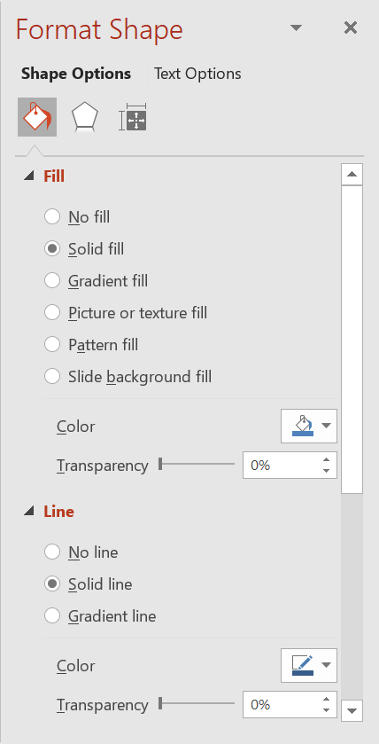

## **บทนำ**

ใน PowerPoint คุณสามารถเพิ่มรูปร่างลงในสไลด์ได้ เนื่องจากรูปร่างประกอบด้วยเส้น คุณจึงสามารถจัดรูปแบบได้โดยการแก้ไขหรือใช้เอฟเฟกต์กับโครงร่างของมัน นอกจากนี้ คุณยังสามารถจัดรูปแบบรูปร่างโดยระบุการตั้งค่าที่ควบคุมวิธีการเติมสีภายในของรูปร่าง



Aspose.Slides for Python มีคลาสและคุณสมบัติที่ทำให้คุณสามารถจัดรูปแบบรูปร่างโดยใช้ตัวเลือกเดียวกับที่มีใน PowerPoint

## **จัดรูปแบบเส้น**

โดยใช้ Aspose.Slides คุณสามารถกำหนดรูปแบบเส้นแบบกำหนดเองสำหรับรูปร่างได้ ขั้นตอนต่อไปนี้อธิบายวิธีการ:

1. สร้างอินสแตนซ์ของคลาส [Presentation](https://reference.aspose.com/slides/python-net/aspose.slides/presentation/) 
1. รับอ้างอิงไปยังสไลด์โดยใช้ดัชนีของมัน
1. เพิ่ม [AutoShape](https://reference.aspose.com/slides/python-net/aspose.slides/autoshape/) ไปยังสไลด์
1. กำหนด [รูปแบบเส้น](https://reference.aspose.com/slides/python-net/aspose.slides/linestyle/) ของรูปร่าง
1. ตั้งค่าความกว้างของเส้น
1. กำหนด [รูปแบบเส้นประ](https://reference.aspose.com/slides/python-net/aspose.slides/linedashstyle/) ของรูปร่าง
1. ตั้งค่าสีของเส้นสำหรับรูปร่าง
1. บันทึกงานนำเสนอที่ปรับแต่งแล้วเป็นไฟล์ PPTX

โค้ด Python ด้านล่างนี้จะแสดงวิธีจัดรูปแบบ `AutoShape` สี่เหลี่ยมผืนผ้า:

```python
import aspose.slides as slides
import aspose.pydrawing as draw

# สร้างอินสแตนซ์ของคลาส Presentation ที่แทนไฟล์งานนำเสนอ
with slides.Presentation() as presentation:

    # ดึงสไลด์แรก
    slide = presentation.slides[0]

    # เพิ่มรูปร่างอัตโนมัติประเภทสี่เหลี่ยม
    shape = slide.shapes.add_auto_shape(slides.ShapeType.RECTANGLE, 50, 150, 150, 75)

    # ลบการเติมสีจากรูปร่างสี่เหลี่ยมเพื่อให้เห็นเฉพาะเส้น
    shape.fill_format.fill_type = slides.FillType.NO_FILL

    # ใช้การจัดรูปแบบกับเส้นของสี่เหลี่ยม
    shape.line_format.style = slides.LineStyle.THICK_THIN
    shape.line_format.width = 7
    shape.line_format.dash_style = slides.LineDashStyle.DASH

    # ตั้งค่าสีสำหรับเส้นของสี่เหลี่ยม
    shape.line_format.fill_format.fill_type = slides.FillType.SOLID
    shape.line_format.fill_format.solid_fill_color.color = draw.Color.blue

    # บันทึกไฟล์ PPTX ลงดิสก์
    presentation.save("formatted_lines.pptx", slides.export.SaveFormat.PPTX)
```

ผลลัพธ์:


## **ใช้เอฟเฟกต์สเก็ตช์กับเส้นของรูปร่าง**

เอฟเฟกต์สเก็ตช์ทำให้เส้นของรูปร่างดูเหมือนถูกวาดด้วยมือ ใช้ [Shape.line_format](https://reference.aspose.com/slides/python-net/aspose.slides/shape/line_format/) เพื่อเข้าถึงการตั้งค่าเส้น, [LineFormat.sketch_format](https://reference.aspose.com/slides/python-net/aspose.slides/lineformat/sketch_format/) เพื่อเข้าถึงการตั้งค่าสเก็ตช์, และ [SketchFormat.sketch_type](https://reference.aspose.com/slides/python-net/aspose.slides/sketchformat/sketch_type/) เพื่อเลือกค่าจากการ перечисление [LineSketchType](https://reference.aspose.com/slides/python-net/aspose.slides/linesketchtype/)

โค้ด Python ด้านล่างนี้แสดงวิธีใช้เอฟเฟ็กต์ [LineSketchType.CURVED](https://reference.aspose.com/slides/python-net/aspose.slides/linesketchtype/) อ่านค่าที่กำหนดอย่างชัดเจน, และลบเอฟเฟกต์ด้วย [LineSketchType.NONE](https://reference.aspose.com/slides/python-net/aspose.slides/linesketchtype/):

```python
import aspose.slides as slides

with slides.Presentation() as presentation:
    slide = presentation.slides[0]
    shape = slide.shapes.add_auto_shape(slides.ShapeType.RECTANGLE, 50, 50, 200, 100)

    # เข้าถึงรูปแบบเส้นของรูปร่างและรูปแบบสเก็ตช์ของมัน.
    sketch_format = shape.line_format.sketch_format

    # ใช้เอฟเฟ็กต์สเก็ตช์.
    sketch_format.sketch_type = slides.LineSketchType.CURVED

    # อ่านเอฟเฟ็กต์สเก็ตช์ที่กำหนดโดยตรงให้กับรูปร่าง.
    explicit_sketch_type = sketch_format.sketch_type
    print(f"Explicit sketch type: {explicit_sketch_type}")

    # ลบเอฟเฟ็กต์สเก็ตช์.
    sketch_format.sketch_type = slides.LineSketchType.NONE
```

ค่าที่คืนจาก `SketchFormat.sketch_type` แสดงการตั้งค่าที่กำหนดโดยตรงกับรูปร่าง หากการจัดรูปแบบเส้นสามารถสืบทอดจากธีม, มาสเตอร์สไลด์ หรือเลย์เอาต์สไลด์ ให้ใช้ [LineFormat.get_effective](https://reference.aspose.com/slides/python-net/aspose.slides/lineformat/get_effective/) เข้าถึงคุณสมบัติ `sketch_format` ของอ็อบเจ็กต์ที่คืนค่าและอ่านคุณสมบัติ `sketch_type` ของมัน ค่าที่ได้แสดงการจัดรูปแบบที่ใช้จริงหลังจากการสืบทอดได้รับการแก้ไขแล้ว:

```python
import aspose.slides as slides

with slides.Presentation("presentation.pptx") as presentation:
    shape = presentation.slides[0].shapes[0]
    line_format = shape.line_format

    explicit_sketch_type = line_format.sketch_format.sketch_type
    effective_line_format = line_format.get_effective()
    effective_sketch_type = effective_line_format.sketch_format.sketch_type

    print(f"Explicit sketch type: {explicit_sketch_type}")
    print(f"Effective sketch type: {effective_sketch_type}")
```

## **จัดรูปแบบรูปแบบการเชื่อมต่อ**

นี่คือ 3 ตัวเลือกของประเภทการเชื่อมต่อ:

* โค้ง
* Miter
* Bevel

โดยค่าเริ่มต้น เมื่อ PowerPoint เชื่อมสองเส้นที่มุม (เช่นที่มุมของรูปร่าง) จะใช้การตั้งค่า **โค้ง** แต่หากคุณกำลังวาดรูปร่างที่มีมุมคม คุณอาจต้องการตัวเลือก **Miter**.


โค้ด Python ด้านล่างนี้จะแสดงวิธีที่สามสี่เหลี่ยม (ตามภาพข้างต้น) ถูกสร้างโดยใช้การตั้งค่าแบบเชื่อมต่อ Miter, Bevel และ โค้ง:

```python
import aspose.slides as slides
import aspose.pydrawing as draw

# สร้างอินสแตนซ์ของคลาส Presentation ที่แทนไฟล์งานนำเสนอ
with slides.Presentation() as presentation:

	# ดึงสไลด์แรก
	slide = presentation.slides[0]

	# เพิ่มรูปร่างอัตโนมัติสามรูปแบบประเภทสี่เหลี่ยม
	shape1 = slide.shapes.add_auto_shape(slides.ShapeType.RECTANGLE, 20, 20, 150, 75)
	shape2 = slide.shapes.add_auto_shape(slides.ShapeType.RECTANGLE, 210, 20, 150, 75)
	shape3 = slide.shapes.add_auto_shape(slides.ShapeType.RECTANGLE, 20, 135, 150, 75)

	# ตั้งค่าสีเติมสำหรับแต่ละรูปร่างสี่เหลี่ยม
	shape1.fill_format.fill_type = slides.FillType.SOLID
	shape1.fill_format.solid_fill_color.color = draw.Color.black
	shape2.fill_format.fill_type = slides.FillType.SOLID
	shape2.fill_format.solid_fill_color.color = draw.Color.black
	shape3.fill_format.fill_type = slides.FillType.SOLID
	shape3.fill_format.solid_fill_color.color = draw.Color.black

	# ตั้งค่าความกว้างของเส้น
	shape1.line_format.width = 15
	shape2.line_format.width = 15
	shape3.line_format.width = 15

	# ตั้งค่าสีสำหรับเส้นของแต่ละสี่เหลี่ยม
	shape1.line_format.fill_format.fill_type = slides.FillType.SOLID
	shape1.line_format.fill_format.solid_fill_color.color = draw.Color.blue
	shape2.line_format.fill_format.fill_type = slides.FillType.SOLID
	shape2.line_format.fill_format.solid_fill_color.color = draw.Color.blue
	shape3.line_format.fill_format.fill_type = slides.FillType.SOLID
	shape3.line_format.fill_format.solid_fill_color.color = draw.Color.blue

	# ตั้งค่าสไตล์การเชื่อมต่อ
	shape1.line_format.join_style = slides.LineJoinStyle.MITER
	shape2.line_format.join_style = slides.LineJoinStyle.BEVEL
	shape3.line_format.join_style = slides.LineJoinStyle.ROUND

	# เพิ่มข้อความให้แต่ละสี่เหลี่ยม
	shape1.text_frame.text = "Miter Join style"
	shape2.text_frame.text = "Bevel Join style"
	shape3.text_frame.text = "Round Join style"

	# บันทึกไฟล์ PPTX ลงดิสก์
	presentation.save("join_styles.pptx", slides.export.SaveFormat.PPTX)
```

## **การเติมสีแบบไล่สี**

ใน PowerPoint การเติมสีแบบไล่สีเป็นตัวเลือกการจัดรูปแบบที่ช่วยให้คุณสามารถใช้การผสมสีต่อเนื่องกับรูปร่างได้ ตัวอย่างเช่น คุณสามารถใส่สีสองสีหรือมากกว่าที่สีหนึ่งค่อย ๆ จางลงสู่สีอื่น

วิธีการใช้การเติมสีแบบไล่สีกับรูปร่างโดยใช้ Aspose.Slides:

1. สร้างอินสแตนซ์ของคลาส [Presentation](https://reference.aspose.com/slides/python-net/aspose.slides/presentation/) 
1. รับอ้างอิงไปยังสไลด์โดยใช้ดัชนีของมัน
1. เพิ่ม [AutoShape](https://reference.aspose.com/slides/python-net/aspose.slides/autoshape/) ไปยังสไลด์
1. ตั้งค่า [FillType](https://reference.aspose.com/slides/python-net/aspose.slides/filltype/) ของรูปร่างเป็น `GRADIENT`
1. เพิ่มสีที่คุณต้องการสองสีด้วยตำแหน่งที่กำหนดโดยใช้เมธอด `add` ของคอลเลกชัน `gradient_stops` ที่เปิดเผยโดยคลาส [GradientFormat](https://reference.aspose.com/slides/python-net/aspose.slides/gradientformat/)
1. บันทึกงานนำเสนอที่ปรับแต่งแล้วเป็นไฟล์ PPTX

โค้ด Python ด้านล่างนี้จะแสดงวิธีใช้เอฟเฟกต์การเติมสีแบบไล่สีกับวงรี:

```python
import aspose.slides as slides

# สร้างอินสแตนซ์ของคลาส Presentation ที่แทนไฟล์งานนำเสนอ
with slides.Presentation() as presentation:

    # ดึงสไลด์แรก
    slide = presentation.slides[0]

    # เพิ่มรูปร่างอัตโนมัติประเภทวงรี
    shape = slide.shapes.add_auto_shape(slides.ShapeType.ELLIPSE, 50, 50, 150, 75)

    # ใช้การจัดรูปแบบไล่สีกับวงรี
    shape.fill_format.fill_type = slides.FillType.GRADIENT
    shape.fill_format.gradient_format.gradient_shape = slides.GradientShape.LINEAR

    # ตั้งค่าทิศทางของไล่สี
    shape.fill_format.gradient_format.gradient_direction = slides.GradientDirection.FROM_CORNER2

    # เพิ่มจุดหยุดไล่สีสองจุด
    shape.fill_format.gradient_format.gradient_stops.add(1.0, slides.PresetColor.PURPLE)
    shape.fill_format.gradient_format.gradient_stops.add(0, slides.PresetColor.RED)

    # บันทึกไฟล์ PPTX ลงดิสก์
    presentation.save("gradient_fill.pptx", slides.export.SaveFormat.PPTX)
```

ผลลัพธ์:


หากการไล่สีดูต่างกันในภาพที่ส่งออกเมื่อเทียบกับใน PowerPoint โปรดดู [Choose a Gradient Rendering Style](/slides/th/python-net/convert-powerpoint-to-png/#choose-a-gradient-rendering-style) คุณสามารถเลือกสไตล์การเรนเดอร์โดยไม่ต้องเปลี่ยนการเติมสีไล่สีที่เก็บในงานนำเสนอ

## **การเติมสีแบบลวดลาย**

ใน PowerPoint การเติมสีแบบลวดลายเป็นตัวเลือกการจัดรูปแบบที่ให้คุณสามารถใช้การออกแบบสองสี—เช่น จุด, ลายเส้น, ลายกริด หรือ ลายตรวจสอบ—กับรูปร่างได้ คุณสามารถเลือกสีที่กำหนดเองสำหรับพื้นหน้าและพื้นหลังของลวดลาย

Aspose.Slides มีลวดลายที่กำหนดล่วงหน้าเกิน 45 แบบที่คุณสามารถใช้กับรูปร่างเพื่อเพิ่มความสวยงามให้กับงานนำเสนอของคุณ แม้ว่าจะเลือกลวดลายที่กำหนดล่วงหน้าแล้ว คุณยังสามารถระบุสีที่แน่นอนได้

วิธีการใช้การเติมลวดลายกับรูปร่างโดยใช้ Aspose.Slides:

1. สร้างอินสแตนซ์ของคลาส [Presentation](https://reference.aspose.com/slides/python-net/aspose.slides/presentation/) 
1. รับอ้างอิงไปยังสไลด์โดยใช้ดัชนีของมัน
1. เพิ่ม [AutoShape](https://reference.aspose.com/slides/python-net/aspose.slides/autoshape/) ไปยังสไลด์
1. ตั้งค่า [FillType](https://reference.aspose.com/slides/python-net/aspose.slides/filltype/) ของรูปร่างเป็น `PATTERN`
1. เลือกสไตล์ลวดลายจากตัวเลือกที่กำหนดล่วงหน้า
1. ตั้งค่า [back_color](https://reference.aspose.com/slides/python-net/aspose.slides/patternformat/back_color/) ของลวดลาย
1. ตั้งค่า [fore_color](https://reference.aspose.com/slides/python-net/aspose.slides/patternformat/fore_color/) ของลวดลาย
1. บันทึกงานนำเสนอที่ปรับแต่งแล้วเป็นไฟล์ PPTX

โค้ด Python ด้านล่างนี้จะแสดงวิธีใช้การเติมลวดลายกับสี่เหลี่ยม:

```python
import aspose.slides as slides
import aspose.pydrawing as draw

# สร้างอินสแตนซ์ของคลาส Presentation ที่แทนไฟล์งานนำเสนอ
with slides.Presentation() as presentation:

    # ดึงสไลด์แรก
    slide = presentation.slides[0]

    # เพิ่มรูปร่างอัตโนมัติประเภทสี่เหลี่ยม
    shape = slide.shapes.add_auto_shape(slides.ShapeType.RECTANGLE, 50, 50, 150, 75)

    # ตั้งค่าชนิดการเติมเป็น Pattern
    shape.fill_format.fill_type = slides.FillType.PATTERN

    # ตั้งค่าสไตล์ลวดลาย
    shape.fill_format.pattern_format.pattern_style = slides.PatternStyle.TRELLIS

    # ตั้งค่าสีพื้นหลังและสีพื้นหน้าของลวดลาย
    shape.fill_format.pattern_format.back_color.color = draw.Color.light_gray
    shape.fill_format.pattern_format.fore_color.color = draw.Color.yellow

    # บันทึกไฟล์ PPTX ลงดิสก์
    presentation.save("pattern_fill.pptx", slides.export.SaveFormat.PPTX)
```

ผลลัพธ์:


## **การเติมภาพ**

ใน PowerPoint การเติมภาพเป็นตัวเลือกการจัดรูปแบบที่ให้คุณแทรกรูปภาพภายในรูปร่าง—โดยใช้รูปภาพเป็นพื้นหลังของรูปร่าง

วิธีการใช้ Aspose.Slides เพื่อเติมภาพในรูปร่าง:

1. สร้างอินสแตนซ์ของคลาส [Presentation](https://reference.aspose.com/slides/python-net/aspose.slides/presentation/) 
1. รับอ้างอิงไปยังสไลด์โดยใช้ดัชนีของมัน
1. เพิ่ม [AutoShape](https://reference.aspose.com/slides/python-net/aspose.slides/autoshape/) ไปยังสไลด์
1. ตั้งค่า [FillType](https://reference.aspose.com/slides/python-net/aspose.slides/filltype/) ของรูปร่างเป็น `PICTURE`
1. ตั้งค่าโหมดการเติมภาพเป็น `TILE` (หรือโหมดอื่นที่ต้องการ)
1. สร้างอ็อบเจ็กต์ [PPImage](https://reference.aspose.com/slides/python-net/aspose.slides/ppimage/) จากภาพที่คุณต้องการใช้
1. กำหนดภาพนี้ให้กับคุณสมบัติ `picture.image` ของ `picture_fill_format` ของรูปร่าง
1. บันทึกงานนำเสนอที่ปรับแต่งแล้วเป็นไฟล์ PPTX

สมมติว่าเรามีไฟล์ "lotus.png" พร้อมรูปภาพต่อไปนี้:


โค้ด Python ด้านล่างนี้จะแสดงวิธีเติมรูปร่างด้วยภาพ:

```python
import aspose.slides as slides

# สร้างอินสแตนซ์ของคลาส Presentation ที่แทนไฟล์งานนำเสนอ
with slides.Presentation() as presentation:

    # ดึงสไลด์แรก
    slide = presentation.slides[0]

    # เพิ่มรูปร่างอัตโนมัติประเภทสี่เหลี่ยม
    shape = slide.shapes.add_auto_shape(slides.ShapeType.RECTANGLE, 50, 50, 192, 95)

    # ตั้งค่าชนิดการเติมเป็น Picture
    shape.fill_format.fill_type = slides.FillType.PICTURE

    # ตั้งค่าโหมดการเติมภาพ
    shape.fill_format.picture_fill_format.picture_fill_mode = slides.PictureFillMode.TILE

    # โหลดภาพและเพิ่มลงในทรัพยากรของงานนำเสนอ
    with slides.Images.from_file("lotus.png") as image:
        presentation_image = presentation.images.add_image(image)

    # ตั้งค่าภาพ
    shape.fill_format.picture_fill_format.picture.image = presentation_image

    # บันทึกไฟล์ PPTX ลงดิสก์
    presentation.save("picture_fill.pptx", slides.export.SaveFormat.PPTX)
```

ผลลัพธ์:


### **การใช้ภาพต่อเป็นพื้นผิว**

หากคุณต้องการตั้งค่าภาพต่อเป็นพื้นผิวและปรับแต่งพฤติกรรมการต่อ คุณสามารถใช้คุณสมบัติดังต่อไปนี้ของคลาส [PictureFillFormat](https://reference.aspose.com/slides/python-net/aspose.slides/picturefillformat/):

- [picture_fill_mode](https://reference.aspose.com/slides/python-net/aspose.slides/picturefillformat/picture_fill_mode/): กำหนดโหมดการเติมภาพ—`TILE` หรือ `STRETCH`
- [tile_alignment](https://reference.aspose.com/slides/python-net/aspose.slides/picturefillformat/tile_alignment/): ระบุตำแหน่งการจัดวางของแผ่นต่อภายในรูปร่าง
- [tile_flip](https://reference.aspose.com/slides/python-net/aspose.slides/picturefillformat/tile_flip/): ควบคุมว่าภาพต่อจะถูกกลับแนวนอน แนวตั้ง หรือทั้งสองอย่าง
- [tile_offset_x](https://reference.aspose.com/slides/python-net/aspose.slides/picturefillformat/tile_offset_x/): ตั้งค่าการเลื่อนแนวนอนของภาพต่อ (หน่วยเป็นจุด) จากจุดกำเนิดของรูปร่าง
- [tile_offset_y](https://reference.aspose.com/slides/python-net/aspose.slides/picturefillformat/tile_offset_y/): ตั้งค่าการเลื่อนแนวตั้งของภาพต่อ (หน่วยเป็นจุด) จากจุดกำเนิดของรูปร่าง
- [tile_scale_x](https://reference.aspose.com/slides/python-net/aspose.slides/picturefillformat/tile_scale_x/): กำหนดสเกลแนวนอนของภาพต่อเป็นเปอร์เซ็นต์
- [tile_scale_y](https://reference.aspose.com/slides/python-net/aspose.slides/picturefillformat/tile_scale_y/): กำหนดสเกลแนวตั้งของภาพต่อเป็นเปอร์เซ็นต์

โค้ดตัวอย่างด้านล่างนี้แสดงวิธีเพิ่มรูปร่างสี่เหลี่ยมที่มีการเติมภาพต่อและกำหนดตัวเลือกการต่อ:

```py
import aspose.slides as slides

# สร้างอินสแตนซ์ของคลาส Presentation ที่แทนไฟล์งานนำเสนอ
with slides.Presentation() as presentation:

    # ดึงสไลด์แรก
    first_slide = presentation.slides[0]

    # เพิ่มรูปร่างอัตโนมัติประเภทสี่เหลี่ยม
    shape = first_slide.shapes.add_auto_shape(slides.ShapeType.RECTANGLE, 50, 50, 190, 95)

    # ตั้งค่าชนิดการเติมของรูปร่างเป็น Picture
    shape.fill_format.fill_type = slides.FillType.PICTURE

    # โหลดภาพและเพิ่มลงในทรัพยากรของงานนำเสนอ
    with slides.Images.from_file("lotus.png") as source_image:
        presentation_image = presentation.images.add_image(source_image)

    # กำหนดภาพให้กับรูปร่าง
    picture_fill_format = shape.fill_format.picture_fill_format
    picture_fill_format.picture.image = presentation_image

    # กำหนดค่าโหมดการเติมภาพและคุณสมบัติการต่อภาพ
    picture_fill_format.picture_fill_mode = slides.PictureFillMode.TILE
    picture_fill_format.tile_offset_x = -32
    picture_fill_format.tile_offset_y = -32
    picture_fill_format.tile_scale_x = 50
    picture_fill_format.tile_scale_y = 50
    picture_fill_format.tile_alignment = slides.RectangleAlignment.BOTTOM_RIGHT
    picture_fill_format.tile_flip = slides.TileFlip.FLIP_BOTH

    # บันทึกไฟล์ PPTX ลงดิสก์
    presentation.save("tile.pptx", slides.export.SaveFormat.PPTX)
```

ผลลัพธ์:


## **การเติมสีทึบ**

ใน PowerPoint การเติมสีทึบเป็นตัวเลือกการจัดรูปแบบที่เติมรูปร่างด้วยสีเดียวที่สม่ำเสมอ สีพื้นหลังแบบนี้จะไม่รวมการไล่สี, เนื้อผิว, หรือ ลวดลายใด ๆ

เพื่อเติมสีทึบให้กับรูปร่างโดยใช้ Aspose.Slides ทำตามขั้นตอนต่อไปนี้:

1. สร้างอินสแตนซ์ของคลาส [Presentation](https://reference.aspose.com/slides/python-net/aspose.slides/presentation/) 
1. รับอ้างอิงไปยังสไลด์โดยใช้ดัชนีของมัน
1. เพิ่ม [AutoShape](https://reference.aspose.com/slides/python-net/aspose.slides/autoshape/) ไปยังสไลด์
1. ตั้งค่า [FillType](https://reference.aspose.com/slides/python-net/aspose.slides/filltype/) ของรูปร่างเป็น `SOLID`
1. กำหนดสีเติมที่คุณต้องการให้กับรูปร่าง
1. บันทึกงานนำเสนอที่ปรับแต่งแล้วเป็นไฟล์ PPTX

โค้ด Python ด้านล่างนี้จะแสดงวิธีเติมสีทึบให้กับสี่เหลี่ยมในสไลด์ PowerPoint:

```python
import aspose.slides as slides
import aspose.pydrawing as draw

# สร้างอินสแตนซ์ของคลาส Presentation ที่แทนไฟล์งานนำเสนอ
with slides.Presentation() as presentation:

    # ดึงสไลด์แรก
    slide = presentation.slides[0]

    # เพิ่มรูปร่างอัตโนมัติประเภทสี่เหลี่ยม
    shape = slide.shapes.add_auto_shape(slides.ShapeType.RECTANGLE, 50, 50, 150, 75)

    # ตั้งค่าชนิดการเติมเป็น Solid
    shape.fill_format.fill_type = slides.FillType.SOLID

    # ตั้งค่าสีเติม
    shape.fill_format.solid_fill_color.color = draw.Color.yellow

    # บันทึกไฟล์ PPTX ลงดิสก์
    presentation.save("solid_color_fill.pptx", slides.export.SaveFormat.PPTX)
```

ผลลัพธ์:


## **ตั้งค่าความโปร่งใส**

ใน PowerPoint เมื่อคุณใช้การเติมสีทึบ, ไล่สี, ภาพ หรือเนื้อผิวกับรูปร่าง คุณสามารถตั้งค่าระดับความโปร่งใสเพื่อควบคุมความทึบของการเติมได้ ค่าความโปร่งใสที่สูงทำให้รูปร่างดูโปร่งใสมากขึ้น ทำให้พื้นหลังหรือวัตถุที่อยู่ด้านหลังมองเห็นได้บางส่วน

Aspose.Slides ให้คุณตั้งค่าระดับความโปร่งใสโดยการปรับค่า alpha ในสีที่ใช้สำหรับการเติม วิธีทำดังนี้:

1. สร้างอินสแตนซ์ของคลาส [Presentation](https://reference.aspose.com/slides/python-net/aspose.slides/presentation/) 
1. รับอ้างอิงไปยังสไลด์โดยใช้ดัชนีของมัน
1. เพิ่ม [AutoShape](https://reference.aspose.com/slides/python-net/aspose.slides/autoshape/) ไปยังสไลด์
1. ตั้งค่าแบบเติมเป็น `SOLID`
1. ใช้ `Color.from_argb` เพื่อกำหนดสีที่มีความโปร่งใส (ส่วน `alpha` ควบคุมความโปร่งใส)
1. บันทึกงานนำเสนอ

โค้ด Python ด้านล่างนี้จะแสดงวิธีเติมสีโปร่งใสให้กับสี่เหลี่ยม:

```python
import aspose.pydrawing as draw
import aspose.slides as slides

# สร้างอินสแตนซ์ของคลาส Presentation ที่แทนไฟล์งานนำเสนอ.
with slides.Presentation() as presentation:

    # ดึงสไลด์แรก.
    slide = presentation.slides[0]
    
    # เพิ่มรูปร่างอัตโนมัติสี่เหลี่ยมทึบ.
    slide.shapes.add_auto_shape(slides.ShapeType.RECTANGLE, 50, 50, 150, 75)

    # เพิ่มรูปร่างอัตโนมัติสี่เหลี่ยมโปร่งใสเหนือรูปร่างทึบ.
    shape = slide.shapes.add_auto_shape(slides.ShapeType.RECTANGLE, 80, 80, 150, 75)
    shape.fill_format.fill_type = slides.FillType.SOLID
    shape.fill_format.solid_fill_color.color = draw.Color.from_argb(128, 204, 102, 0)
    
    presentation.save("shape_transparency.pptx", slides.export.SaveFormat.PPTX)
```

ผลลัพธ์:


## **การหมุนรูปร่าง**

Aspose.Slides ให้คุณหมุนรูปร่างในงานนำเสนอ PowerPoint ซึ่งมีประโยชน์เมื่อจัดตำแหน่งองค์ประกอบภาพด้วยการจัดแนวหรือการออกแบบเฉพาะ

เพื่อหมุนรูปร่างบนสไลด์ ทำตามขั้นตอนต่อไปนี้:

1. สร้างอินสแตนซ์ของคลาส [Presentation](https://reference.aspose.com/slides/python-net/aspose.slides/presentation/) 
1. รับอ้างอิงไปยังสไลด์โดยใช้ดัชนีของมัน
1. เพิ่ม [AutoShape](https://reference.aspose.com/slides/python-net/aspose.slides/autoshape/) ไปยังสไลด์
1. ตั้งค่าคุณสมบัติ `rotation` ของรูปร่างเป็นมุมที่ต้องการ
1. บันทึกงานนำเสนอ

โค้ด Python ด้านล่างนี้แสดงวิธีหมุนรูปร่างโดย 5 องศา:

```python
import aspose.slides as slides

# สร้างอินสแตนซ์ของคลาส Presentation ที่แทนไฟล์งานนำเสนอ.
with slides.Presentation() as presentation:

    # ดึงสไลด์แรก.
    slide = presentation.slides[0]

    # เพิ่มรูปร่างอัตโนมัติประเภทสี่เหลี่ยม.
    shape = slide.shapes.add_auto_shape(slides.ShapeType.RECTANGLE, 50, 50, 150, 75)

    # หมุนรูปร่างโดย 5 องศา.
    shape.rotation = 5

    # บันทึกไฟล์ PPTX ลงดิสก์.
    presentation.save("shape_rotation.pptx", slides.export.SaveFormat.PPTX)
```

ผลลัพธ์:


## **เพิ่มเอฟเฟกต์ bevel 3 มิติ**

Aspose.Slides อนุญาตให้คุณใช้เอฟเฟกต์ bevel 3 มิติบนรูปร่างโดยกำหนดคุณสมบัติ [ThreeDFormat](https://reference.aspose.com/slides/python-net/aspose.slides/threedformat/)

เพื่อเพิ่มเอฟเฟกต์ bevel 3 มิติให้กับรูปร่าง ทำตามขั้นตอนต่อไปนี้:

1. สร้างอินสแตนซ์ของคลาส [Presentation](https://reference.aspose.com/slides/python-net/aspose.slides/presentation/) 
1. รับอ้างอิงไปยังสไลด์โดยใช้ดัชนีของมัน
1. เพิ่ม [AutoShape](https://reference.aspose.com/slides/python-net/aspose.slides/autoshape/) ไปยังสไลด์
1. กำหนดค่า [ThreeDFormat](https://reference.aspose.com/slides/python-net/aspose.slides/threedformat/) ของรูปร่างเพื่อระบุการตั้งค่า bevel
1. บันทึกงานนำเสนอ

โค้ด Python ด้านล่างนี้แสดงวิธีใช้เอฟเฟกต์ bevel 3 มิติบนรูปร่าง:

```python
import aspose.slides as slides
import aspose.pydrawing as draw

# สร้างอินสแตนซ์ของคลาส Presentation.
with slides.Presentation() as presentation:

    slide = presentation.slides[0]

    # เพิ่มรูปร่างลงในสไลด์.
    shape = slide.shapes.add_auto_shape(slides.ShapeType.ELLIPSE, 50, 50, 100, 100)
    shape.fill_format.fill_type = slides.FillType.SOLID
    shape.fill_format.solid_fill_color.color = draw.Color.green
    shape.line_format.fill_format.fill_type = slides.FillType.SOLID
    shape.line_format.fill_format.solid_fill_color.color = draw.Color.orange
    shape.line_format.width = 2.0

    # ตั้งค่าคุณสมบัติ ThreeDFormat ของรูปร่าง.
    shape.three_d_format.depth = 4
    shape.three_d_format.bevel_top.bevel_type = slides.BevelPresetType.CIRCLE
    shape.three_d_format.bevel_top.height = 6
    shape.three_d_format.bevel_top.width = 6
    shape.three_d_format.camera.camera_type = slides.CameraPresetType.ORTHOGRAPHIC_FRONT
    shape.three_d_format.light_rig.light_type = slides.LightRigPresetType.THREE_PT
    shape.three_d_format.light_rig.direction = slides.LightingDirection.TOP

    # บันทึกงานนำเสนอเป็นไฟล์ PPTX.
    presentation.save("3D_bevel_effect.pptx", slides.export.SaveFormat.PPTX)
```

ผลลัพธ์:


## **เพิ่มเอฟเฟกต์การหมุน 3 มิติ**

Aspose.Slides อนุญาตให้คุณใช้เอฟเฟกต์การหมุน 3 มิติบนรูปร่างโดยกำหนดคุณสมบัติ [ThreeDFormat](https://reference.aspose.com/slides/python-net/aspose.slides/threedformat/)

เพื่อใช้การหมุน 3 มิติบนรูปร่าง:

1. สร้างอินสแตนซ์ของคลาส [Presentation](https://reference.aspose.com/slides/python-net/aspose.slides/presentation/) 
1. รับอ้างอิงไปยังสไลด์โดยใช้ดัชนีของมัน
1. เพิ่ม [AutoShape](https://reference.aspose.com/slides/python-net/aspose.slides/autoshape/) ไปยังสไลด์
1. ตั้งค่า [camera_type](https://reference.aspose.com/slides/python-net/aspose.slides/camera/camera_type/) และ [light_type](https://reference.aspose.com/slides/python-net/aspose.slides/lightrig/light_type/) ของรูปร่างเพื่อกำหนดการหมุน 3 มิติ
1. บันทึกงานนำเสนอ

โค้ด Python ด้านล่างนี้แสดงวิธีใช้เอฟเฟกต์การหมุน 3 มิติบนรูปร่าง:

```python
import aspose.slides as slides

# สร้างอินสแตนซ์ของคลาส Presentation.
with slides.Presentation() as presentation:

    slide = presentation.slides[0]

    auto_shape = slide.shapes.add_auto_shape(slides.ShapeType.RECTANGLE, 50, 50, 150, 75)
    auto_shape.text_frame.text = "Hello, Aspose!"

    auto_shape.three_d_format.depth = 6
    auto_shape.three_d_format.camera.set_rotation(40, 35, 20)
    auto_shape.three_d_format.camera.camera_type = slides.CameraPresetType.ISOMETRIC_LEFT_UP
    auto_shape.three_d_format.light_rig.light_type = slides.LightRigPresetType.BALANCED

    # บันทึกงานนำเสนอเป็นไฟล์ PPTX.      
    presentation.save("3D_rotation_effect.pptx", slides.export.SaveFormat.PPTX)
```

ผลลัพธ์:


## **ควบคุมการแสดงผลสีขาว-ดำสำหรับรูปร่าง**

คุณสมบัติ [Shape.black_white_mode](https://reference.aspose.com/slides/python-net/aspose.slides/shape/black_white_mode/) กำหนดวิธีที่รูปร่างแต่ละชิ้นถูกเรนเดอร์เมื่อดูหรือประมวลผลงานนำเสนอในโหมดสีขาว-ดำ มันไม่ได้เปิดใช้งานการแสดงผลสีขาว-ดำโดยอัตโนมัติและไม่ได้เปลี่ยนการเติม, เส้น หรือการจัดรูปแบบอื่น ๆ ของรูปร่างในโหมดสีปกติ

ใช้ค่าจากการ перечисление [BlackWhiteMode](https://reference.aspose.com/slides/python-net/aspose.slides/blackwhitemode/) เพื่อเลือกพฤติกรรมที่ต้องการ ตัวอย่างเช่น `AUTOMATIC` ให้แอปพลิเคชันเรนเดอร์เลือกการแปลง, `GRAY` และ `LIGHT_GRAY` ใช้สีเทา, `BLACK_WHITE` ใช้สีดำและขาวเท่านั้น, `BLACK` และ `WHITE` บังคับสีเดียว, `COLOR` รักษาสีปกติ, และ `HIDDEN` ไม่แสดงรูปร่างในโหมดสีขาว-ดำ, `NOT_DEFINED` หมายความว่าไม่ได้กำหนดโหมดระดับรูปร่าง

โค้ด Python ด้านล่างนี้สร้างรูปร่างสีส้มและทำให้ปรากฏเป็นสีเทาเมื่อแสดงในโหมดสีขาว-ดำ:

```python
import aspose.slides as slides
import aspose.pydrawing as draw

with slides.Presentation() as presentation:
    slide = presentation.slides[0]

    shape = slide.shapes.add_auto_shape(slides.ShapeType.RECTANGLE, 50, 50, 200, 100)
    shape.fill_format.fill_type = slides.FillType.SOLID
    shape.fill_format.solid_fill_color.color = draw.Color.orange

    # คงการเติมสีส้มในโหมดสี แต่เรนเดอร์รูปร่างด้วยสีเทาในโหมดสีขาว-ดำ.
    shape.black_white_mode = slides.BlackWhiteMode.GRAY

    presentation.save("shape_black_white_mode.pptx", slides.export.SaveFormat.PPTX)
```

ในโหมดสีปกติ สี่เหลี่ยมยังคงสีส้มอยู่ ในกระบวนการทำงานแสดงผลสีขาว-ดำ มันใช้สีเทาเนื่องจากโหมดถูกตั้งเป็น `GRAY` ซึ่งช่วยให้คุณเก็บสไลด์สีเต็มได้ในขณะกำหนดรูปลักษณ์ที่แตกต่างสำหรับการพิมพ์, ดูตัวอย่าง หรือกระบวนการอื่น ๆ ที่เคารพการตั้งค่าสีขาว-ดำของงานนำเสนอ

## **รีเซ็ตการจัดรูปแบบ**

โค้ด Python ด้านล่างนี้แสดงวิธีรีเซ็ตการจัดรูปแบบของสไลด์และคืนตำแหน่ง, ขนาด, และการจัดรูปแบบของทุกรูปร่างที่มีตัวแสดงตำแหน่งบน [LayoutSlide](https://reference.aspose.com/slides/python-net/aspose.slides/layoutslide/) ไปยังการตั้งค่าเริ่มต้น:

```python
import aspose.slides as slides

with slides.Presentation("sample.pptx") as presentation:

    for slide in presentation.slides:
        # รีเซ็ตรูปร่างแต่ละชิ้นบนสไลด์ที่มี placeholder บนเลย์เอาต์.
        slide.reset()

    presentation.save("reset_formatting.pptx", slides.export.SaveFormat.PPTX)
```

## **FAQ**

**การจัดรูปแบบรูปร่างมีผลต่อขนาดไฟล์ของงานนำเสนอสุดท้ายหรือไม่?**

เพียงเล็กน้อย ภาพและสื่อที่ฝังอยู่เป็นส่วนใหญ่ของขนาดไฟล์ ส่วนพารามิเตอร์ของรูปร่าง เช่น สี, เอฟเฟกต์, และไล่สี จะถูกเก็บเป็นเมทาดาต้าและแทบไม่มีขนาดเพิ่มขึ้น

**ฉันจะตรวจจับรูปร่างบนสไลด์ที่มีการจัดรูปแบบเดียวกันเพื่อที่จะจัดกลุ่มได้อย่างไร?**

เปรียบเทียบคุณสมบัติการจัดรูปแบบหลักของแต่ละรูปร่าง—การเติม, เส้น, และการตั้งค่าเอฟเฟกต์ หากค่าทั้งหมดตรงกัน ให้นำสไตล์เหล่านั้นถือเป็นแบบเดียวกันและจัดกลุ่มตรรกะเพื่ออำนวยความสะดวกในการจัดการสไตล์ในภายหลัง

**ฉันสามารถบันทึกชุดสไตล์รูปร่างที่กำหนดเองเป็นไฟล์แยกเพื่อใช้ซ้ำในงานนำเสนออื่นได้หรือไม่?**

ได้ ให้เก็บรูปร่างตัวอย่างพร้อมสไตล์ที่ต้องการในสไลด์เทมเพลตหรือไฟล์เทมเพลต .POTX เมื่อสร้างงานนำเสนอใหม่ เปิดเทมเพลต, คัดลอกรูปร่างที่สไตล์ต้องการ, และนำการจัดรูปแบบไปใช้ใหม่ตามที่ต้องการ