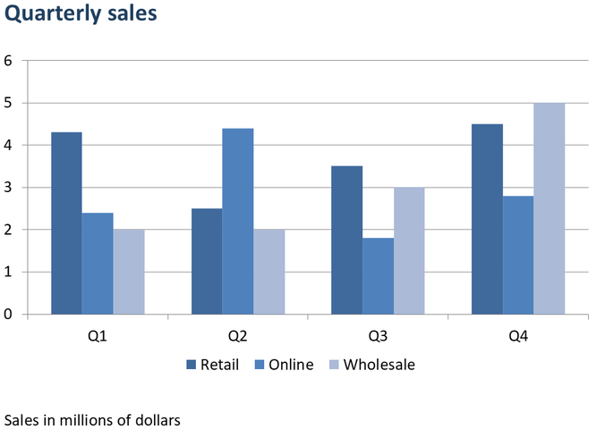

## **Genel Bakış**

Bu makale, Aspose.Slides kullanarak PowerPoint sunumlarında grafikleri nasıl biçimlendireceğinizi açıklar. Eksenler, ızgara çizgileri, başlıklar, açıklamalar, çizi alanı ve duvar doldurmaları gibi temel grafik öğelerini özelleştirerek grafik verilerinin görünümünü ve okunabilirliğini artırmayı gösterir.

Ayrıca grafik metni için yazı tipi özelliklerini nasıl ayarlayacağınızı, grafik verilerine önceden tanımlı sayısal biçimleri nasıl uygulayacağınızı ve grafik alanı için yuvarlak köşeleri nasıl etkinleştireceğinizi gösterir. Bu örnekler bir arada, bir sunumdaki grafiklerin hem görsel stilini hem de veri sunumunu nasıl kontrol edeceğinizi gösterir.

Yükselen ve düşen aralıklar için ayrı doldurmalar ve kenarlıklar hakkında, bakınız [hisse senedi grafik örneği](/slides/tr/java/create-chart/#create-stock-charts).

## **Grafik Varlıklarını Biçimlendirme**

Grafik başlıklarını, eksenleri, ızgara çizgilerini, açıklamaları ve çizim alanını biçimlendirmek için [IChart](https://reference.aspose.com/slides/java/com.aspose.slides/ichart/) kullanın. Bu örnek, işaretçili ve varsayılan verilerle bir çizgi grafik oluşturur, ardından değer ve kategori eksenlerine ayrı metin ve çizgi stilleri uygular. Yazı tipi boyutları ve çizgi kalınlıkları puan cinsinden belirtilir; kategori etiketleri 45 derece döndürülür.

Değer ekseni, kaynak hücrelerden bağımsız olarak [setNumberFormat](https://reference.aspose.com/slides/java/com.aspose.slides/iaxis/#setNumberFormat-java.lang.String-) kullanır. Ölçeği -2 ile 15 arasında, ana aralıkları 2 ve yan aralıkları 0,5 olarak belirlenir. Örnek, yüzde biçimlendirmesini binler için ayarlanmış [setDisplayUnit](https://reference.aspose.com/slides/java/com.aspose.slides/iaxis/#setDisplayUnit-int-) ile birleştirir; bu ayarları verinizin anlamına ve büyüklüğüne göre uyarlayın. Açıklama, [setOverlay](https://reference.aspose.com/slides/java/com.aspose.slides/ilegend/#setOverlay-boolean-) `false` ile çağrıldığı için çizim alanının dışında kalır. Arka duvar ve zemin doldurmaları [getBackWall](https://reference.aspose.com/slides/java/com.aspose.slides/ichart/#getBackWall--) ve [getFloor](https://reference.aspose.com/slides/java/com.aspose.slides/ichart/#getFloor--) aracılığıyla yapılandırılır, ancak bu yüzeyler yalnızca 3B grafiklerde görünür.

```java
import com.aspose.slides.*;
import java.awt.Color;

Presentation presentation = new Presentation();
try {
    ISlide slide = presentation.getSlides().get_Item(0);

    IChart chart = slide.getShapes().addChart(ChartType.LineWithMarkers, 50, 50, 500, 400);

    chart.setTitle(true);
    chart.getChartTitle().addTextFrameForOverriding("");
    IPortion chartTitle = chart.getChartTitle().getTextFrameForOverriding().getParagraphs().get_Item(0).getPortions().get_Item(0);
    chartTitle.setText("Sample Chart");
    chartTitle.getPortionFormat().getFillFormat().setFillType(FillType.Solid);
    chartTitle.getPortionFormat().getFillFormat().getSolidFillColor().setColor(Color.GRAY);
    chartTitle.getPortionFormat().setFontHeight(20);
    chartTitle.getPortionFormat().setFontBold(NullableBool.True);
    chartTitle.getPortionFormat().setFontItalic(NullableBool.True);

    chart.getAxes().getVerticalAxis().getMajorGridLinesFormat().getLine().getFillFormat().setFillType(FillType.Solid);
    chart.getAxes().getVerticalAxis().getMajorGridLinesFormat().getLine().getFillFormat().getSolidFillColor().setColor(Color.BLUE);
    chart.getAxes().getVerticalAxis().getMajorGridLinesFormat().getLine().setWidth(5);
    chart.getAxes().getVerticalAxis().getMajorGridLinesFormat().getLine().setDashStyle(LineDashStyle.DashDot);

    chart.getAxes().getVerticalAxis().getMinorGridLinesFormat().getLine().getFillFormat().setFillType(FillType.Solid);
    chart.getAxes().getVerticalAxis().getMinorGridLinesFormat().getLine().getFillFormat().getSolidFillColor().setColor(Color.RED);
    chart.getAxes().getVerticalAxis().getMinorGridLinesFormat().getLine().setWidth(3);

    chart.getAxes().getVerticalAxis().setNumberFormatLinkedToSource(false);
    chart.getAxes().getVerticalAxis().setDisplayUnit(DisplayUnitType.Thousands);
    chart.getAxes().getVerticalAxis().setNumberFormat("0.0%");

    chart.getAxes().getVerticalAxis().setAutomaticMajorUnit(false);
    chart.getAxes().getVerticalAxis().setAutomaticMaxValue(false);
    chart.getAxes().getVerticalAxis().setAutomaticMinorUnit(false);
    chart.getAxes().getVerticalAxis().setAutomaticMinValue(false);

    chart.getAxes().getVerticalAxis().setMaxValue(15f);
    chart.getAxes().getVerticalAxis().setMinValue(-2f);
    chart.getAxes().getVerticalAxis().setMinorUnit(0.5f);
    chart.getAxes().getVerticalAxis().setMajorUnit(2.0f);

    IChartPortionFormat valueAxisText = chart.getAxes().getVerticalAxis().getTextFormat().getPortionFormat();
    valueAxisText.setFontBold(NullableBool.True);
    valueAxisText.setFontHeight(16);
    valueAxisText.setFontItalic(NullableBool.True);
    valueAxisText.getFillFormat().setFillType(FillType.Solid);
    valueAxisText.getFillFormat().getSolidFillColor().setPresetColor(PresetColor.DarkGreen);
    valueAxisText.setLatinFont(new FontData("Times New Roman"));

    chart.getAxes().getVerticalAxis().setTitle(true);
    chart.getAxes().getVerticalAxis().getTitle().addTextFrameForOverriding("");
    IPortion valueAxisTitle = chart.getAxes().getVerticalAxis().getTitle().getTextFrameForOverriding().getParagraphs().get_Item(0).getPortions().get_Item(0);
    valueAxisTitle.setText("Primary Axis");
    valueAxisTitle.getPortionFormat().getFillFormat().setFillType(FillType.Solid);
    valueAxisTitle.getPortionFormat().getFillFormat().getSolidFillColor().setColor(Color.GRAY);
    valueAxisTitle.getPortionFormat().setFontHeight(20);
    valueAxisTitle.getPortionFormat().setFontBold(NullableBool.True);
    valueAxisTitle.getPortionFormat().setFontItalic(NullableBool.True);

    chart.getAxes().getHorizontalAxis().getMajorGridLinesFormat().getLine().getFillFormat().setFillType(FillType.Solid);
    chart.getAxes().getHorizontalAxis().getMajorGridLinesFormat().getLine().getFillFormat().getSolidFillColor().setColor(new Color(0, 128, 0));
    chart.getAxes().getHorizontalAxis().getMajorGridLinesFormat().getLine().setWidth(5);

    chart.getAxes().getHorizontalAxis().getMinorGridLinesFormat().getLine().getFillFormat().setFillType(FillType.Solid);
    chart.getAxes().getHorizontalAxis().getMinorGridLinesFormat().getLine().getFillFormat().getSolidFillColor().setColor(Color.YELLOW);
    chart.getAxes().getHorizontalAxis().getMinorGridLinesFormat().getLine().setWidth(3);

    IChartPortionFormat categoryAxisText = chart.getAxes().getHorizontalAxis().getTextFormat().getPortionFormat();
    categoryAxisText.setFontBold(NullableBool.True);
    categoryAxisText.setFontHeight(16);
    categoryAxisText.setFontItalic(NullableBool.True);
    categoryAxisText.getFillFormat().setFillType(FillType.Solid);
    categoryAxisText.getFillFormat().getSolidFillColor().setColor(Color.BLUE);
    categoryAxisText.setLatinFont(new FontData("Arial"));

    chart.getAxes().getHorizontalAxis().setTitle(true);
    chart.getAxes().getHorizontalAxis().getTitle().addTextFrameForOverriding("");

    IPortion categoryAxisTitle = chart.getAxes().getHorizontalAxis().getTitle().getTextFrameForOverriding().getParagraphs().get_Item(0).getPortions().get_Item(0);
    categoryAxisTitle.setText("Sample Category");
    categoryAxisTitle.getPortionFormat().getFillFormat().setFillType(FillType.Solid);
    categoryAxisTitle.getPortionFormat().getFillFormat().getSolidFillColor().setColor(Color.GRAY);
    categoryAxisTitle.getPortionFormat().setFontHeight(20);
    categoryAxisTitle.getPortionFormat().setFontBold(NullableBool.True);
    categoryAxisTitle.getPortionFormat().setFontItalic(NullableBool.True);

    chart.getAxes().getHorizontalAxis().setTickLabelPosition(TickLabelPositionType.Low);
    chart.getAxes().getHorizontalAxis().setTickLabelRotationAngle(45);

    IChartPortionFormat legendText = chart.getLegend().getTextFormat().getPortionFormat();
    legendText.setFontBold(NullableBool.True);
    legendText.setFontHeight(16);
    legendText.setFontItalic(NullableBool.True);
    legendText.getFillFormat().setFillType(FillType.Solid);
    legendText.getFillFormat().getSolidFillColor().setPresetColor(PresetColor.DarkRed);

    chart.getLegend().setOverlay(false);

    chart.getBackWall().setThickness(1);
    chart.getBackWall().getFormat().getFill().setFillType(FillType.Solid);
    chart.getBackWall().getFormat().getFill().getSolidFillColor().setColor(new Color(255, 165, 0));

    chart.getFloor().getFormat().getFill().setFillType(FillType.Solid);
    chart.getFloor().getFormat().getFill().getSolidFillColor().setColor(Color.RED);

    chart.getPlotArea().getFormat().getFill().setFillType(FillType.Solid);
    chart.getPlotArea().getFormat().getFill().getSolidFillColor().setPresetColor(PresetColor.LightCyan);

    presentation.save("FormattedChart_out.pptx", SaveFormat.Pptx);
} finally {
    presentation.dispose();
}
```

## **Grafik için Yazı Tipi Özelliklerini Ayarlama**

Grafik metni için varsayılan yazı tipi boyutunu [Chart.getTextFormat](https://reference.aspose.com/slides/java/com.aspose.slides/chart/#getTextFormat--) aracılığıyla ayarlayın. Örnek, 20 puanlık bir yazı tipiyle bir küme sütun grafiği oluşturur ve ilk seri için değer etiketlerini [setShowValue](https://reference.aspose.com/slides/java/com.aspose.slides/idatalabelformat/#setShowValue-boolean-) ile etkinleştirir. Kendi açık yazı tipi ayarlarına sahip metin öğeleri, grafiğin varsayılanını geçersiz kılabilir.

```java
import com.aspose.slides.*;

Presentation presentation = new Presentation();
try {
    ISlide slide = presentation.getSlides().get_Item(0);

    IChart chart = slide.getShapes().addChart(ChartType.ClusteredColumn, 100, 100, 500, 400);
    chart.getTextFormat().getPortionFormat().setFontHeight(20);
    chart.getChartData().getSeries().get_Item(0).getLabels().getDefaultDataLabelFormat().setShowValue(true);

    presentation.save("FontPropertiesForChart.pptx", SaveFormat.Pptx);
} finally {
    presentation.dispose();
}
```

## **Grafik Açıklaması İçin Metin Çerçevesi Biçimlendirmesini Yeniden Kullanma**

Bir açıklamayı slayt başlığıyla eşleştirmek için, başlığın yazı tipini ilk paragrafta [getDefaultPortionFormat](https://reference.aspose.com/slides/java/com.aspose.slides/iparagraphformat/#getDefaultPortionFormat--) ile ayarlayın. Açıklamanın [getTextFormat](https://reference.aspose.com/slides/java/com.aspose.slides/iformattedtextcontainer/#getTextFormat--) tarafından döndürülen format üzerinde [copyFrom](https://reference.aspose.com/slides/java/com.aspose.slides/icharttextformat/#copyFrom-com.aspose.slides.ITextFrame-) çağrısı yapın. Bu, metin çerçevesi ayarlarını, ilk paragrafın biçimlendirmesini ve o paragrafın varsayılan yazı tipi özelliklerini kopyalar. Doğrudan bireysel bölümlere ya da sonraki paragraflara uygulanan biçimlendirme kaynağa yerel kalır.

Örnek, koyu, 26 puanlık Calibri başlığını lacivert renkli bir şablon olarak kullanır. Açıklamayı biçimlendirdikten sonra, aynı biçimlendirmeyi ayrı bir başlığa uygulamak için [copyTo](https://reference.aspose.com/slides/java/com.aspose.slides/icharttextformat/#copyTo-com.aspose.slides.ITextFrame-) çağrısı yapar.

```java
import com.aspose.slides.*;
import java.awt.Color;

Presentation presentation = new Presentation();
try {
    IShapeCollection shapes = presentation.getSlides().get_Item(0).getShapes();
    
    IAutoShape heading = shapes.addAutoShape(ShapeType.Rectangle, 40, 20, 640, 40, false);
    ITextFrame sourceTextFrame = heading.addTextFrame("Quarterly sales");
    IPortionFormat font = sourceTextFrame.getParagraphs().get_Item(0).getParagraphFormat().getDefaultPortionFormat();
    font.setLatinFont(new FontData("Calibri"));
    font.setFontHeight(26);
    font.setFontBold(NullableBool.True);
    font.getFillFormat().setFillType(FillType.Solid);
    font.getFillFormat().getSolidFillColor().setColor(new Color(32, 64, 96));

    IChart chart = shapes.addChart(ChartType.ClusteredColumn, 40, 75, 640, 360);
    chart.setStyle(StyleType.Style3);
    IChartDataWorkbook workbook = chart.getChartData().getChartDataWorkbook();
    workbook.getCell(0, 0, 1).setValue("Retail");
    workbook.getCell(0, 0, 2).setValue("Online");
    workbook.getCell(0, 0, 3).setValue("Wholesale");
    for (int quarter = 1; quarter <= 4; quarter++) {
        workbook.getCell(0, quarter, 0).setValue("Q" + quarter);
    }

    chart.setLegend(true);
    chart.getLegend().setPosition(LegendPositionType.Bottom);
    IChartTextFormat legendFormat = chart.getLegend().getTextFormat();
    legendFormat.copyFrom(sourceTextFrame);

    IAutoShape caption = shapes.addAutoShape(ShapeType.Rectangle, 40, 460, 640, 40, false);
    ITextFrame captionTextFrame = caption.addTextFrame("Sales in millions of dollars");
    legendFormat.copyTo(captionTextFrame);

    presentation.save("legend-formatting.pptx", SaveFormat.Pptx);
} finally {
    presentation.dispose();
}
```

Kaydedilen sunumda, açıklama ve başlık boyut, kalınlık ve renk bakımından başlıkla eşleşir. Açıklama hâlâ seri adlarını gösterir ve başlık kendi metnini korur. Başlıktaki bir bölüm zaten açık bir yazı tipi boyutuna sahipse, bu boyut kopyalanan paragraf varsayılanının önüne geçer.

| Kopyalamadan önce | Kopyaladıktan sonra |
| --- | --- |
|  |  |

## **Sayısal Biçimi Ayarlama**

[IChartDataCell.setPresetNumberFormat](https://reference.aspose.com/slides/java/com.aspose.slides/ichartdatacell/#setPresetNumberFormat-byte-) kullanarak grafiğin çalışma kitabı hücrelerine yerleşik bir sayı biçimi uygulayın. Bu örnek, varsayılan hücre tabanlı verilerle bir küme sütun grafiği oluşturur ve her seri değer hücresine format dizini 10 (`0.00%`) uygular. Bu, temel sayıları değiştirmeden değerlerin çalışma kitabında nasıl gösterildiğini değiştirir; örneğin, 0.25 değeri 25,00% olarak gösterilir. Eksen ve veri etiketi biçimleri ayrı ayrı yapılandırılabilir.

```java
import com.aspose.slides.*;

Presentation presentation = new Presentation();
try {
    ISlide slide = presentation.getSlides().get_Item(0);

    IChart chart = slide.getShapes().addChart(ChartType.ClusteredColumn, 50, 50, 500, 400);
    IChartSeriesCollection series = chart.getChartData().getSeries();

    for (IChartSeries chartSeries : series)
    {
        for (IChartDataPoint dataPoint : chartSeries.getDataPoints())
        {
            dataPoint.getValue().getAsCell().setPresetNumberFormat((byte) 10); // 0.00%
        }
    }

    presentation.save("PresetNumberFormat_out.pptx", SaveFormat.Pptx);
} finally {
    presentation.dispose();
}
```

Aşağıdaki tablo, İngiliz (Amerika Birleşik Devletleri) yereline ait temsilci Excel biçimleriyle yerleşik sayı biçimi dizinlerini listeler. Tam biçim dizgileri ve gösterimleri uygulamaya ve yerel ayara göre değişebilir, özellikle para birimi ve tarih formatları için. Bazı Excel biçimleri, OOXML standardındaki varsayılanlardan da farklıdır; bu, [Microsoft'un sayı biçimi uygulama notlarında](https://learn.microsoft.com/en-us/openspecs/office_standards/ms-oi29500/17d11129-219b-4e2c-88db-45844d21e528) açıklanmıştır.

| Dizin | Biçim |
| --- | --- |
| 0 | `General` |
| 1 | `0` |
| 2 | `0.00` |
| 3 | `#,##0` |
| 4 | `#,##0.00` |
| 5 | `"$"#,##0_);("$"#,##0)` |
| 6 | `"$"#,##0_);[Red]("$"#,##0)` |
| 7 | `"$"#,##0.00_);("$"#,##0.00)` |
| 8 | `"$"#,##0.00_);[Red]("$"#,##0.00)` |
| 9 | `0%` |
| 10 | `0.00%` |
| 11 | `0.00E+00` |
| 12 | `# ?/?` |
| 13 | `# ??/??` |
| 14 | `m/d/yyyy` |
| 15 | `d-mmm-yy` |
| 16 | `d-mmm` |
| 17 | `mmm-yy` |
| 18 | `h:mm AM/PM` |
| 19 | `h:mm:ss AM/PM` |
| 20 | `h:mm` |
| 21 | `h:mm:ss` |
| 22 | `m/d/yyyy h:mm` |
| 37 | `#,##0_);(#,##0)` |
| 38 | `#,##0_);[Red](#,##0)` |
| 39 | `#,##0.00_);(#,##0.00)` |
| 40 | `#,##0.00_);[Red](#,##0.00)` |
| 41 | `_(* #,##0_);_(* (#,##0);_(* "-"_);_(@_)` |
| 42 | `_("$"* #,##0_);_("$"* (#,##0);_("$"* "-"_);_(@_)` |
| 43 | `_(* #,##0.00_);_(* (#,##0.00);_(* "-"??_);_(@_)` |
| 44 | `_("$"* #,##0.00_);_("$"* (#,##0.00);_("$"* "-"??_);_(@_)` |
| 45 | `mm:ss` |
| 46 | `[h]:mm:ss` |
| 47 | `mm:ss.0` |
| 48 | `##0.0E+0` |
| 49 | `@` |

## **Grafik Alanı Yuvarlak Kenarlıklarını Ayarlama**

[IChart.setRoundedCorners](https://reference.aspose.com/slides/java/com.aspose.slides/ichart/#setRoundedCorners-boolean-) yöntemini `true` olarak çağırarak grafik alanının köşelerini yuvarlatın. Örnek, bir küme sütun grafiği oluşturur ve sunumu kaydetmeden önce çevresine katı gri renkli ve tek satır stilinde bir kontur vermek için [getLineFormat](https://reference.aspose.com/slides/java/com.aspose.slides/ishape/#getLineFormat--) kullanır.

```java
import com.aspose.slides.*;
import java.awt.Color;

Presentation presentation = new Presentation();
try {
    ISlide slide = presentation.getSlides().get_Item(0);

    IChart chart = slide.getShapes().addChart(ChartType.ClusteredColumn, 20, 100, 600, 400);
    chart.getLineFormat().getFillFormat().setFillType(FillType.Solid);
    chart.getLineFormat().getFillFormat().getSolidFillColor().setColor(Color.GRAY);
    chart.getLineFormat().setStyle(LineStyle.Single);
    chart.setRoundedCorners(true);

    presentation.save("out.pptx", SaveFormat.Pptx);
} finally {
    presentation.dispose();
}
```

## **Mevcut Grafik Açıklamalarını Düzenleme**

Bir grafik, bir raporun durumunu açıklayan metin açıklaması gibi özel şekiller içerebilir. Bu şekillere [IChart.getUserShapes](https://reference.aspose.com/slides/java/com.aspose.slides/ichart/#getUserShapes--) aracılığıyla erişilir; bu aynı zamanda Chart API Referansında [Chart.getUserShapes](https://reference.aspose.com/slides/java/com.aspose.slides/chart/#getUserShapes--) altında listelenir. [getShapes](https://reference.aspose.com/slides/java/com.aspose.slides/igroupshape/#getShapes--) tarafından döndürülen koleksiyon, grafik tarafından sahip olunan şekilleri içerir.

Bir grafiğin üzerine yerleştirilen sıradan bir metin kutusu, grafik parçası gibi görünse de slayta aittir. [Slide.getShapes](https://reference.aspose.com/slides/java/com.aspose.slides/baseslide/#getShapes--) üzerinde döngü yapıldığında grafik ve sıradan slayt şekilleri bulunur, ancak grafiğin içinde yer alan bireysel şekiller listelenmez. Grafik başlıkları ve veri etiketleri ayrı grafik öğeleridir, bu koleksiyonda özel açıklama olarak yer almaz.

[chart-annotations.pptx](chart-annotations.pptx) dosyasını indirin ve uygulamanın çalışma dizinine yerleştirin. İlk slaytı, gruplandırılmamış “İlkel sonuçlar” metni içeren bir açıklama, grafiğe ait bir çizgi ve “Slayt üzerine” metni içeren sıradan bir slayt metin kutusu bulunan bir grafik içerir. Örnek, bu slayttaki ilk grafiği bulur ve rapor yayınlanmaya hazır olduğunda açıklamayı “Sonuçlar” olarak değiştirir. Boş bir koleksiyon olup olmadığını kontrol eder ve sadece [IAutoShape](https://reference.aspose.com/slides/java/com.aspose.slides/iautoshape/) üzerindeki [getTextFrame](https://reference.aspose.com/slides/java/com.aspose.slides/iautoshape/#getTextFrame--) ile dönen null olmayan bir metin çerçevesi ve beklenen metni içeren şekli düzenler.

```java
import com.aspose.slides.*;

Presentation presentation = new Presentation("chart-annotations.pptx");
try {
    ISlide slide = presentation.getSlides().get_Item(0);

    IChart chart = null;
    for (IShape shape : slide.getShapes()) {
        if (shape instanceof IChart) {
            chart = (IChart) shape;
            break;
        }
    }

    if (chart == null || chart.getUserShapes().getShapes().size() == 0) {
        System.out.println("No chart or chart-owned shapes found.");
        return;
    }

    boolean updated = false;
    for (IShape shape : chart.getUserShapes().getShapes()) {
        if (shape instanceof IAutoShape) {
            IAutoShape annotation = (IAutoShape) shape;
            if (annotation.getTextFrame() != null && "Preliminary results".equals(annotation.getTextFrame().getText())) {
                annotation.getTextFrame().setText("Final results");
                updated = true;
                break;
            }
        }
    }

    if (updated) {
        presentation.save("chart-annotations-updated.pptx", SaveFormat.Pptx);
    } else {
        System.out.println("No matching text annotation found.");
    }
} finally {
    presentation.dispose();
}
```

Çizgi ve slayt metin kutusu değişmeden kalır. Aşağıdaki görseller giriş ve kaydedilip yeniden açılan sonucu gösterir:

| Düzenlemeden önce | Düzenledikten sonra |
| --- | --- |
|  |  |

{}
Örnek yalnızca üst düzey grafik‑sahibi şekilleri inceler. Bir açıklama bir [IGroupShape](https://reference.aspose.com/slides/java/com.aspose.slides/igroupshape/) içinde ise, o grubun [getShapes](https://reference.aspose.com/slides/java/com.aspose.slides/igroupshape/#getShapes--) koleksiyonunu da inceleyin. İç içe gruplar için bu işlemi özyinelemeli olarak tekrarlayın ve aynı metin kontrollerini alt şekillere uygulayın. Bir grup kendisi bir kapsayıcıdır; onu bir metin kutusu olarak değerlendirmeyin.
{}

## **SSS**

**Sütunlar/alanlar için yarı şeffaf doldurmalar ayarlayıp kenarlığı opak tutabilir miyim?**

Evet. Dolgu şeffaflığı ve kontur ayrı ayrı yapılandırılır. Bu, yoğun görselleştirmelerde ızgara ve verilerin okunabilirliğini artırmak için faydalıdır.

**Veri etiketleri üst üste geldiğinde nasıl başa çıkabilirim?**

Yazı tipi boyutunu küçültün, gereksiz etiket bileşenlerini devre dışı bırakın (örneğin, kategorileri), etiket konumunu ayarlayın, gerekirse yalnızca seçili noktalar için etiketleri gösterin veya biçimi "değer + açıklama" olarak değiştirin.

**Serilere degrade veya desen dolgu uygulayabilir miyim?**

Evet. Seriler katı, degrade ve desen dolgularını destekler. Pratikte, degradeleri az kullanın ve ızgara ve metinle arasındaki kontrastı azaltan kombinasyonlardan kaçının.