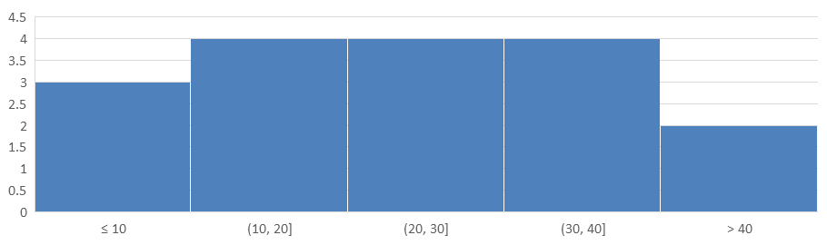

## **Genel Bakış**

Bu makale, Aspose.Slides for .NET kullanarak grafik oluşturma ve özelleştirme konusunda kapsamlı bir rehber sunar. Bir slayta programlı olarak grafik eklemeyi, verilerle doldurmayı ve belirli tasarım gereksinimlerinize uygun çeşitli biçimlendirme seçeneklerini uygulamayı öğreneceksiniz. Makale boyunca, sunumu ve grafik nesnesini başlatmaktan seriler, eksenler ve açıklamaları yapılandırmaya kadar her adımı ayrıntılı kod örnekleriyle gösterir. Bu rehberi izleyerek, .NET uygulamalarınıza dinamik grafik oluşturmayı entegre etmeyi ve veri odaklı sunumlar oluşturma sürecini hızlandırmayı sağlam bir şekilde öğreneceksiniz.

## **Grafik Oluşturma**

Grafikler, verileri hızlı bir şekilde görselleştirerek, bir tablo veya elektronik tablodan hemen anlaşılmayabilecek içgörüler elde etmeye yardımcı olur.

**Grafik Neden Oluşturulmalı?**

Grafik kullanarak:

* bir sunumdaki tek bir slaytta büyük miktarda veriyi toplamak, sıkıştırmak veya özetlemek;
* verideki kalıpları ve eğilimleri ortaya çıkarmak;
* zaman içinde veya belirli bir ölçü birimiyle ilişkili olarak verinin yönünü ve ivmesini çıkarmak;
* aykırı değerleri, sapmaları, hataları ve mantıksız verileri tespit etmek;
* karmaşık verileri iletişim kurmak veya sunmak.

PowerPoint'te, *Insert* işlevi aracılığıyla grafikler oluşturabilir ve bu işlev birçok grafik türü tasarlamak için şablonlar sunar. Aspose.Slides kullanarak hem standart grafikler (popüler grafik türlerine dayalı) hem de özel grafikler oluşturabilirsiniz.

{}
Bu sayfadaki [ChartType](https://reference.aspose.com/slides/net/aspose.slides.charts/charttype/) numaralandırmasını, [Aspose.Slides.Charts](https://reference.aspose.com/slides/net/aspose.slides.charts/) ad alanı altında kullanın. Bu numaralandırmadaki değerler farklı grafik türlerine karşılık gelir.
{}

### **Kümelenmiş Sütun Grafiklerini Oluşturun**

Bu örnek, iki seriyi üç kategori üzerinden karşılaştıran bir kümelenmiş sütun grafiği oluşturmak için [AddChart](https://reference.aspose.com/slides/net/aspose.slides/ishapecollection/addchart/) kullanır. Seriler kırmızı ve yeşil dolgu renkleriyle, bireysel etiketler ise kategori adlarını, seri adlarını ve değerleri gösterir. Çalışma sayfası indeksi 0, gömülü grafik çalışma kitabındaki ilk sayfaya karşılık gelir.

```csharp
using System.Drawing;
using Aspose.Slides;
using Aspose.Slides.Charts;
using Aspose.Slides.Export;

using var presentation = new Presentation();
var slide = presentation.Slides[0];

var chart = slide.Shapes.AddChart(ChartType.ClusteredColumn, 20, 20, 500, 300);

chart.ChartTitle.AddTextFrameForOverriding("Sample Title");
chart.ChartTitle.TextFrameForOverriding.TextFrameFormat.CenterText = NullableBool.True;
chart.ChartTitle.Height = 20;
chart.HasTitle = true;

var workbook = chart.ChartData.ChartDataWorkbook;
var worksheetIndex = 0;

chart.ChartData.Series.Clear();
chart.ChartData.Categories.Clear();

var seriesNameCell = workbook.GetCell(worksheetIndex, 0, 1, "Series 1");
chart.ChartData.Series.Add(seriesNameCell, chart.Type);
seriesNameCell = workbook.GetCell(worksheetIndex, 0, 2, "Series 2");
chart.ChartData.Series.Add(seriesNameCell, chart.Type);

var categoryCell = workbook.GetCell(worksheetIndex, 1, 0, "Category 1");
chart.ChartData.Categories.Add(categoryCell);
categoryCell = workbook.GetCell(worksheetIndex, 2, 0, "Category 2");
chart.ChartData.Categories.Add(categoryCell);
categoryCell = workbook.GetCell(worksheetIndex, 3, 0, "Category 3");
chart.ChartData.Categories.Add(categoryCell);

var series = chart.ChartData.Series[0];

var valueCell = workbook.GetCell(worksheetIndex, 1, 1, 20);
series.DataPoints.AddDataPointForBarSeries(valueCell);
valueCell = workbook.GetCell(worksheetIndex, 2, 1, 50);
series.DataPoints.AddDataPointForBarSeries(valueCell);
valueCell = workbook.GetCell(worksheetIndex, 3, 1, 30);
series.DataPoints.AddDataPointForBarSeries(valueCell);

series.Format.Fill.FillType = FillType.Solid;
series.Format.Fill.SolidFillColor.Color = Color.Red;

series = chart.ChartData.Series[1];

valueCell = workbook.GetCell(worksheetIndex, 1, 2, 30);
series.DataPoints.AddDataPointForBarSeries(valueCell);
valueCell = workbook.GetCell(worksheetIndex, 2, 2, 10);
series.DataPoints.AddDataPointForBarSeries(valueCell);
valueCell = workbook.GetCell(worksheetIndex, 3, 2, 60);
series.DataPoints.AddDataPointForBarSeries(valueCell);

series.Format.Fill.FillType = FillType.Solid;
series.Format.Fill.SolidFillColor.Color = Color.Green;

var label = series.DataPoints[0].Label;
label.DataLabelFormat.ShowCategoryName = true;

label = series.DataPoints[1].Label;
label.DataLabelFormat.ShowSeriesName = true;

label = series.DataPoints[2].Label;
label.DataLabelFormat.ShowValue = true;
label.DataLabelFormat.ShowSeriesName = true;
label.DataLabelFormat.Separator = "/";

presentation.Save("AsposeChart.pptx", SaveFormat.Pptx);
```

Sonuç:


### **Dağılım Grafiklerini Oluşturun**

Dağılım grafikleri (dağılım diyagramları veya x‑y grafikleri olarak da bilinir) genellikle iki değişken arasındaki kalıpları kontrol etmek veya ilişkileri göstermek için kullanılır.

Dağılım grafiği kullanın:

* Sayısal eşleştirilmiş verileriniz var.
* Birlikte iyi eşleşen iki değişkeniniz var.
* Bu iki değişkenin ilişkili olup olmadığını belirlemek istiyorsunuz.
* Bağımlı bir değişken için birden çok değere sahip bağımsız bir değişkeniniz var.

Bu örnek, iki set x‑y değeri çizer. İlk seri, yıldız işaretli düz çizgiler kullanırken, ikinci seri dairesel işaretli yumuşak çizgiler kullanır; her ikisi de [Size](https://reference.aspose.com/slides/net/aspose.slides.charts/imarker/size/) değeri 10 alır. [Symbol](https://reference.aspose.com/slides/net/aspose.slides.charts/imarker/symbol/) özelliği işaretçi şeklini kontrol eder.

```csharp
using Aspose.Slides;
using Aspose.Slides.Charts;
using Aspose.Slides.Export;

using var presentation = new Presentation();
var slide = presentation.Slides[0];

var chart = slide.Shapes.AddChart(ChartType.ScatterWithSmoothLines, 20, 20, 500, 300);

var workbook = chart.ChartData.ChartDataWorkbook;
var worksheetIndex = 0;

chart.ChartData.Series.Clear();

var seriesNameCell = workbook.GetCell(worksheetIndex, 1, 1, "Series 1");
chart.ChartData.Series.Add(seriesNameCell, chart.Type);
seriesNameCell = workbook.GetCell(worksheetIndex, 1, 3, "Series 2");
chart.ChartData.Series.Add(seriesNameCell, chart.Type);

var series = chart.ChartData.Series[0];

var xValueCell = workbook.GetCell(worksheetIndex, 2, 1, 1);
var yValueCell = workbook.GetCell(worksheetIndex, 2, 2, 3);
series.DataPoints.AddDataPointForScatterSeries(xValueCell, yValueCell);

xValueCell = workbook.GetCell(worksheetIndex, 3, 1, 2);
yValueCell = workbook.GetCell(worksheetIndex, 3, 2, 10);
series.DataPoints.AddDataPointForScatterSeries(xValueCell, yValueCell);

series.Type = ChartType.ScatterWithStraightLinesAndMarkers;

series.Marker.Size = 10;
series.Marker.Symbol = MarkerStyleType.Star;

series = chart.ChartData.Series[1];

xValueCell = workbook.GetCell(worksheetIndex, 2, 3, 5);
yValueCell = workbook.GetCell(worksheetIndex, 2, 4, 2);
series.DataPoints.AddDataPointForScatterSeries(xValueCell, yValueCell);

xValueCell = workbook.GetCell(worksheetIndex, 3, 3, 3);
yValueCell = workbook.GetCell(worksheetIndex, 3, 4, 1);
series.DataPoints.AddDataPointForScatterSeries(xValueCell, yValueCell);

xValueCell = workbook.GetCell(worksheetIndex, 4, 3, 2);
yValueCell = workbook.GetCell(worksheetIndex, 4, 4, 2);
series.DataPoints.AddDataPointForScatterSeries(xValueCell, yValueCell);

xValueCell = workbook.GetCell(worksheetIndex, 5, 3, 5);
yValueCell = workbook.GetCell(worksheetIndex, 5, 4, 1);
series.DataPoints.AddDataPointForScatterSeries(xValueCell, yValueCell);

series.Marker.Size = 10;
series.Marker.Symbol = MarkerStyleType.Circle;

presentation.Save("AsposeChart.pptx", SaveFormat.Pptx);
```

Sonuç:


### **Pasta Grafiklerini Oluşturun**

Pasta grafikleri, özellikle kategorik etiketleri sayısal değerlerle içeren verilerde parçanın bütüne oranını göstermek için en iyi seçenektir. Ancak verinizde çok sayıda parça veya etiket varsa, çubuk grafik kullanmayı düşünebilirsiniz.

Bu örnek, üç çeyrek değer içeren bir pasta grafik oluşturur. Her dilim özel bir dolgu ve kenarlık alır ve etiketler farklı değer, yüzde ve seri kombinasyonlarını gösterir. [FirstSliceAngle](https://reference.aspose.com/slides/net/aspose.slides.charts/ichartseriesgroup/firstsliceangle/) özelliği ilk dilimin 180 derece başlamasını ayarlar.

```csharp
using System.Drawing;
using Aspose.Slides;
using Aspose.Slides.Charts;
using Aspose.Slides.Export;

using var presentation = new Presentation();
var slide = presentation.Slides[0];

var chart = slide.Shapes.AddChart(ChartType.Pie, 20, 20, 500, 300);

chart.ChartTitle.AddTextFrameForOverriding("Sample Title");
chart.ChartTitle.TextFrameForOverriding.TextFrameFormat.CenterText = NullableBool.True;
chart.ChartTitle.Height = 20;
chart.HasTitle = true;

chart.ChartData.Series[0].Labels.DefaultDataLabelFormat.ShowValue = true;

var workbook = chart.ChartData.ChartDataWorkbook;
var worksheetIndex = 0;

chart.ChartData.Series.Clear();
chart.ChartData.Categories.Clear();

var categoryCell = workbook.GetCell(0, 1, 0, "1st Qtr");
chart.ChartData.Categories.Add(categoryCell);
categoryCell = workbook.GetCell(0, 2, 0, "2nd Qtr");
chart.ChartData.Categories.Add(categoryCell);
categoryCell = workbook.GetCell(0, 3, 0, "3rd Qtr");
chart.ChartData.Categories.Add(categoryCell);

var seriesNameCell = workbook.GetCell(0, 0, 1, "Series 1");
var series = chart.ChartData.Series.Add(seriesNameCell, chart.Type);

var valueCell = workbook.GetCell(worksheetIndex, 1, 1, 20);
series.DataPoints.AddDataPointForPieSeries(valueCell);
valueCell = workbook.GetCell(worksheetIndex, 2, 1, 50);
series.DataPoints.AddDataPointForPieSeries(valueCell);
valueCell = workbook.GetCell(worksheetIndex, 3, 1, 30);
series.DataPoints.AddDataPointForPieSeries(valueCell);

chart.ChartData.SeriesGroups[0].IsColorVaried = true;

var firstSlice = series.DataPoints[0];
firstSlice.Format.Fill.FillType = FillType.Solid;
firstSlice.Format.Fill.SolidFillColor.Color = Color.Cyan;

firstSlice.Format.Line.FillFormat.FillType = FillType.Solid;
firstSlice.Format.Line.FillFormat.SolidFillColor.Color = Color.Gray;
firstSlice.Format.Line.Width = 3.0;
firstSlice.Format.Line.Style = LineStyle.ThinThick;
firstSlice.Format.Line.DashStyle = LineDashStyle.LargeDash;

var secondSlice = series.DataPoints[1];
secondSlice.Format.Fill.FillType = FillType.Solid;
secondSlice.Format.Fill.SolidFillColor.Color = Color.Brown;

secondSlice.Format.Line.FillFormat.FillType = FillType.Solid;
secondSlice.Format.Line.FillFormat.SolidFillColor.Color = Color.Blue;
secondSlice.Format.Line.Width = 3.0;
secondSlice.Format.Line.Style = LineStyle.Single;
secondSlice.Format.Line.DashStyle = LineDashStyle.LargeDashDot;

var thirdSlice = series.DataPoints[2];
thirdSlice.Format.Fill.FillType = FillType.Solid;
thirdSlice.Format.Fill.SolidFillColor.Color = Color.Coral;

thirdSlice.Format.Line.FillFormat.FillType = FillType.Solid;
thirdSlice.Format.Line.FillFormat.SolidFillColor.Color = Color.Red;
thirdSlice.Format.Line.Width = 2.0;
thirdSlice.Format.Line.Style = LineStyle.ThinThin;
thirdSlice.Format.Line.DashStyle = LineDashStyle.LargeDashDotDot;

var firstLabel = series.DataPoints[0].Label;
firstLabel.DataLabelFormat.ShowValue = true;

var secondLabel = series.DataPoints[1].Label;
secondLabel.DataLabelFormat.ShowValue = true;
secondLabel.DataLabelFormat.ShowLegendKey = true;
secondLabel.DataLabelFormat.ShowPercentage = true;

var thirdLabel = series.DataPoints[2].Label;
thirdLabel.DataLabelFormat.ShowSeriesName = true;
thirdLabel.DataLabelFormat.ShowPercentage = true;

series.Labels.DefaultDataLabelFormat.ShowLeaderLines = true;

chart.ChartData.SeriesGroups[0].FirstSliceAngle = 180;

presentation.Save("PieChart.pptx", SaveFormat.Pptx);
```

Sonuç:


Pasta dışındaki etiketlerin okunabilirliğini artırmak için, etiketleri konumlandıran ve çizgilerin renk, genişlik, şeffaflık ve kesikli stilini özelleştiren bir örnek için [Format Leader Lines](/slides/tr/net/chart-data-label/#format-leader-lines) bölümüne bakın.

### **Çizgi Grafiklerini Oluşturun**

Çizgi grafikleri (çizgi diyagramları olarak da bilinir), değerin zaman içinde değişimini göstermek istediğiniz durumlarda en iyi seçenektir. Çizgi grafiği kullanarak büyük miktarda veriyi aynı anda karşılaştırabilir, zaman içinde değişimleri ve eğilimleri izleyebilir, veri serilerindeki anormallikleri vurgulayabilirsiniz.

Bu örnek, varsayılan seriler ve kategorilerle bir çizgi grafiği oluşturmak için [AddChart](https://reference.aspose.com/slides/net/aspose.slides/ishapecollection/addchart/) kullanır, ardından sunumu PPTX olarak kaydeder.

```csharp
using Aspose.Slides;
using Aspose.Slides.Charts;
using Aspose.Slides.Export;

using var presentation = new Presentation();
var slide = presentation.Slides[0];

var lineChart = slide.Shapes.AddChart(ChartType.Line, 20, 20, 500, 300);

presentation.Save("lineChart.pptx", SaveFormat.Pptx);
```

Varsayılan olarak, çizgi grafiğindeki noktalar düz kesintisiz çizgilerle birleştirilir. Noktaların tireli çizgilerle birleştirilmesini istiyorsanız, [DashStyle](https://reference.aspose.com/slides/net/aspose.slides/ilineformat/dashstyle/) özelliğini [LineDashStyle](https://reference.aspose.com/slides/net/aspose.slides/linedashstyle/) içindeki bir değere ayarlayın:

```csharp
using Aspose.Slides;
using Aspose.Slides.Charts;

using var presentation = new Presentation();
var slide = presentation.Slides[0];

var lineChart = slide.Shapes.AddChart(ChartType.Line, 20, 20, 500, 300);

foreach (var series in lineChart.ChartData.Series)
{
    series.Format.Line.DashStyle = LineDashStyle.Dash;
}
```

Sonuç:


### **Ağaç Haritası Grafiklerini Oluşturun**

Ağaç haritası grafikleri, veri kategorilerinin göreli boyutlarını göstermek ve her kategori içinde büyük katkı sağlayan öğelere hızlıca dikkat çekmek için en iyi seçenektir.

Bu örnek, dört dal ve iki şubeye gruplanmış sekiz yaprak içeren bir ağaç haritası oluşturur. [SetGroupingItem](https://reference.aspose.com/slides/net/aspose.slides.charts/ichartcategorylevelsmanager/setgroupingitem/) yöntemi, birinci seviyede dalları ve ikinci seviyede şubeleri atar. Değerler, göreli dikdörtgen boyutlarını belirlerken, kategori etiketleri ve üst üste binen ebeveyn etiketleri hiyerarşiyi gösterir.

```csharp
using Aspose.Slides;
using Aspose.Slides.Charts;
using Aspose.Slides.Export;

using var presentation = new Presentation();
var slide = presentation.Slides[0];

var chart = slide.Shapes.AddChart(ChartType.Treemap, 20, 20, 500, 300);

chart.ChartData.Categories.Clear();
chart.ChartData.Series.Clear();

var workbook = chart.ChartData.ChartDataWorkbook;
workbook.Clear(0);

// Dal 1
var categoryCell = workbook.GetCell(0, "C1", "Leaf1");
var leaf = chart.ChartData.Categories.Add(categoryCell);
leaf.GroupingLevels.SetGroupingItem(1, "Stem1");
leaf.GroupingLevels.SetGroupingItem(2, "Branch1");

categoryCell = workbook.GetCell(0, "C2", "Leaf2");
chart.ChartData.Categories.Add(categoryCell);

categoryCell = workbook.GetCell(0, "C3", "Leaf3");
leaf = chart.ChartData.Categories.Add(categoryCell);
leaf.GroupingLevels.SetGroupingItem(1, "Stem2");

categoryCell = workbook.GetCell(0, "C4", "Leaf4");
chart.ChartData.Categories.Add(categoryCell);

// Dal 2
categoryCell = workbook.GetCell(0, "C5", "Leaf5");
leaf = chart.ChartData.Categories.Add(categoryCell);
leaf.GroupingLevels.SetGroupingItem(1, "Stem3");
leaf.GroupingLevels.SetGroupingItem(2, "Branch2");

categoryCell = workbook.GetCell(0, "C6", "Leaf6");
chart.ChartData.Categories.Add(categoryCell);

categoryCell = workbook.GetCell(0, "C7", "Leaf7");
leaf = chart.ChartData.Categories.Add(categoryCell);
leaf.GroupingLevels.SetGroupingItem(1, "Stem4");

categoryCell = workbook.GetCell(0, "C8", "Leaf8");
chart.ChartData.Categories.Add(categoryCell);

var series = chart.ChartData.Series.Add(ChartType.Treemap);
series.Labels.DefaultDataLabelFormat.ShowCategoryName = true;
var valueCell = workbook.GetCell(0, "D1", 4);
series.DataPoints.AddDataPointForTreemapSeries(valueCell);
valueCell = workbook.GetCell(0, "D2", 5);
series.DataPoints.AddDataPointForTreemapSeries(valueCell);
valueCell = workbook.GetCell(0, "D3", 3);
series.DataPoints.AddDataPointForTreemapSeries(valueCell);
valueCell = workbook.GetCell(0, "D4", 6);
series.DataPoints.AddDataPointForTreemapSeries(valueCell);
valueCell = workbook.GetCell(0, "D5", 9);
series.DataPoints.AddDataPointForTreemapSeries(valueCell);
valueCell = workbook.GetCell(0, "D6", 9);
series.DataPoints.AddDataPointForTreemapSeries(valueCell);
valueCell = workbook.GetCell(0, "D7", 4);
series.DataPoints.AddDataPointForTreemapSeries(valueCell);
valueCell = workbook.GetCell(0, "D8", 3);
series.DataPoints.AddDataPointForTreemapSeries(valueCell);

series.ParentLabelLayout = ParentLabelLayoutType.Overlapping;

presentation.Save("Treemap.pptx", SaveFormat.Pptx);
```

Sonuç:


### **Şelale Grafiklerini Oluşturun**

Şelale grafiği, pozitif ve negatif değişikliklerin nihai değere nasıl katkıda bulunduğunu gösterir. Örneğin, bir kâr dağılımı gelirle başlayıp maliyetleri çıkarır ve diğer gelirleri ekler. Değişim sütunları önceki ve yeni yürürlükteki değerler arasında süzülürken, toplam sütunlar sıfırdan birikmiş değere kadar uzanır.

Aşağıdaki örnek bin dolar cinsinden tutarları kullanır:

| Kategori | Çalışma kitabı değeri | Sütun tipi |
| --- | ---: | --- |
| Gelir | 1000 | Artış |
| Satış Maliyeti | -400 | Azalış |
| Brüt kar | 600 | Ara toplam |
| Faaliyet giderleri | -200 | Azalış |
| Diğer gelir | 50 | Artış |
| Net kar | 450 | Son toplam |

Bir noktayı ara toplam veya son toplam olarak işaretlemek için [SetAsTotal](https://reference.aspose.com/slides/net/aspose.slides.charts/chartdatapoint/setastotal/) özelliğini `true` olarak ayarlayın. O noktadaki gerçek birikimli tutarı çalışma kitabı hücresinde belirtin: brüt kar için `600` (`1000 - 400`) ve net kar için `450` (`600 - 200 + 50`). Özellik sütunu toplam olarak işaretler; hücre değerini hesaplamaz veya doldurmaz. Sıfırı yer tutucu olarak kullanmayın veya toplam noktası için başka bir değişim sağlamayın. Toplam sütun birikimli değeri gösterir, ancak değeri tekrar yürürlükteki değere eklemez.

Bu tam C# örneği, [ChartType](https://reference.aspose.com/slides/net/aspose.slides.charts/charttype/) içindeki `Waterfall` üyesini kullanarak bir grafik oluşturur, varsayılan verileri temizler ve gömülü çalışma kitabını doldurur. Çalışma sayfası indeksi `0` ilk çalışma sayfasını seçer; A sütunu kategori adlarını, B sütunu değerleri içerir. Her değer hücresi, [AddDataPointForWaterfallSeries](https://reference.aspose.com/slides/net/aspose.slides.charts/ichartdatapointcollection/adddatapointforwaterfallseries/) ile eklenir. Sıfır tabanlı nokta indeksleri `2` ve `5` ara ve son toplamları tanımlar. [ShowValue](https://reference.aspose.com/slides/net/aspose.slides.charts/idatalabelformat/showvalue/) etkinleştirildiğinde tutarlar sütunlarda gösterilir. Giriş sunumu veya çalışma kitabı gerekmez.

```csharp
using Aspose.Slides;
using Aspose.Slides.Charts;
using Aspose.Slides.Export;

using var presentation = new Presentation();
var slide = presentation.Slides[0];

var chart = slide.Shapes.AddChart(ChartType.Waterfall, 20, 20, 680, 200);

chart.HasTitle = true;
chart.ChartTitle.AddTextFrameForOverriding("Profit breakdown (USD thousands)");
chart.ChartTitle.Overlay = false;
chart.HasLegend = false;

chart.ChartData.Series.Clear();
chart.ChartData.Categories.Clear();

var workbook = chart.ChartData.ChartDataWorkbook;
var worksheetIndex = 0;

workbook.Clear(worksheetIndex);

var seriesNameCell = workbook.GetCell(worksheetIndex, 0, 1, "Profit");
var series = chart.ChartData.Series.Add(seriesNameCell, ChartType.Waterfall);
var categories = new[] { "Revenue", "Cost of sales", "Gross profit", "Operating expenses", "Other income", "Net profit" };
var values = new double[] { 1000, -400, 600, -200, 50, 450 };

for (var i = 0; i < categories.Length; i++)
{
    var categoryCell = workbook.GetCell(worksheetIndex, i + 1, 0, categories[i]);
    chart.ChartData.Categories.Add(categoryCell);
    var valueCell = workbook.GetCell(worksheetIndex, i + 1, 1, values[i]);
    series.DataPoints.AddDataPointForWaterfallSeries(valueCell);
}

// Üçüncü ve altıncı noktalar ek değişiklikler değil, toplamları temsil eder.
series.DataPoints[2].SetAsTotal = true;
series.DataPoints[5].SetAsTotal = true;
series.ShowConnectorLines = true;
series.Labels.DefaultDataLabelFormat.ShowValue = true;

presentation.Save("WaterfallChart.pptx", SaveFormat.Pptx);
```

Seri düzeyinde [ShowConnectorLines](https://reference.aspose.com/slides/net/aspose.slides.charts/chartseries/showconnectorlines/) özelliğini `true` yapmak, ardışık sütunları birleştiren çizgileri gösterir ve yürürlükteki değerin izlenmesini kolaylaştırır. Bu çizgileri gizlemek için örnekteki atamayı `series.ShowConnectorLines = false;` ile değiştirin ve kaydedin. Bu yalnızca çizgi görünürlüğünü değiştirir, veri veya toplamları etkilemez.

Kaydedilmiş sunum, 600 brüt kar ve 450 net karı, her iki toplamı da sıfırdan çizerek gösterir:


### **Hisse Senedi Grafiklerini Oluşturun**

Hisse senedi grafikleri, açılış, yüksek, düşük ve kapanış fiyatları gibi finansal verileri göstererek piyasa eğilimlerini ve dalgalanmaları analiz etmeye yardımcı olur. Bu grafikler, hisse performansına dair temel içgörüler sunar ve yatırımcılara, analistlere bilinçli kararlar almada destek olur.

Bu örnek, dört seriyi bu sırayla ve üç kategori içeren bir açılış-yüksek-düşük-kapanış (OHLC) grafiği oluşturur. [HasUpDownBars](https://reference.aspose.com/slides/net/aspose.slides.charts/iupdownbarsmanager/hasupdownbars/) özelliği yukarı/aşağı çubuklarını etkinleştirir ve [HiLowLinesFormat](https://reference.aspose.com/slides/net/aspose.slides.charts/ichartseriesgroup/hilowlinesformat/) fiyat aralıklarını gösteren yüksek-düşük çizgileri kontrol eder; bireysel seri çizgileri ve ince yatay ızgara çizgileri gizlenir.

[UpDownBars](https://reference.aspose.com/slides/net/aspose.slides.charts/ichartseriesgroup/updownbars/) yöneticisi ayrı [UpBarsFormat](https://reference.aspose.com/slides/net/aspose.slides.charts/iupdownbarsmanager/upbarsformat/) ve [DownBarsFormat](https://reference.aspose.com/slides/net/aspose.slides.charts/iupdownbarsmanager/downbarsformat/) nesneleri sunar. Her nesnenin [Fill](https://reference.aspose.com/slides/net/aspose.slides.charts/iformat/fill/) ve [Line](https://reference.aspose.com/slides/net/aspose.slides.charts/iformat/line/) özelliklerini kullanarak dolgu ve kenarlığı bağımsız olarak ayarlayın. Bu örnek, yükselen dönemler için koyu yeşil kenarlıklı yeşil çubuklar ve düşen dönemler için koyu kırmızı kenarlıklı turuncu‑kırmızı çubuklar kullanır.

Her kategori için dört serinin sayısal değerlerini sağlayın; Yüksek ve Düşük, Açılış ve Kapanışı kapsar. Çubuklar, Kapanışı Açılışla **aynı kategori içinde** karşılaştırır, önceki kategoriyle karşılaştırmaz: A 72’den 25’e düşerken, B 25’ten 38’e, C 38’ten 50’ye yükselir. Açılış ve Kapanış değerleri aynı olduğunda görünür bir dolu aralık oluşmaz. Yukarı/aşağı çubuklar Açılış‑Kapanış’ı, yüksek‑düşük çizgileri Düşük‑Yüksek’i kapsar. Bu çubuklar seri grubuna aittir ve sıradan çubuk‑grafik serileri değildir.

Bu biçimlendirme, aynı grup içinde en az iki seriye ve her kategori için karşılık gelen sayısal değerlere sahip [Line ve LineWithMarkers](https://reference.aspose.com/slides/net/aspose.slides.charts/charttype/) grafikleri için de çalışır. Bu yığın‑çizgi olmayan grafiklerde, yukarı/aşağı çubuklar ilk ve son serileri karşılaştırır: daha yüksek son değer bir yukarı çubuğa, daha düşük son değer bir aşağı çubuğa yol açar. Serileri tersine çevirmek sınıflandırmayı tersine çevirir. Aşağıdaki örnek [OpenHighLowClose](https://reference.aspose.com/slides/net/aspose.slides.charts/charttype/) kullanır; diğer hisse, yığın‑çizgi veya 3D varyantların aynı veri düzeni ya da aralık yorumlamasını kullandığını varsaymayın.

```csharp
using System.Drawing;
using Aspose.Slides;
using Aspose.Slides.Charts;
using Aspose.Slides.Export;

using var presentation = new Presentation();
var slide = presentation.Slides[0];

var chart = slide.Shapes.AddChart(ChartType.OpenHighLowClose, 20, 20, 500, 150, false);

var workbook = chart.ChartData.ChartDataWorkbook;

var categoryCell = workbook.GetCell(0, 1, 0, "A");
chart.ChartData.Categories.Add(categoryCell);
categoryCell = workbook.GetCell(0, 2, 0, "B");
chart.ChartData.Categories.Add(categoryCell);
categoryCell = workbook.GetCell(0, 3, 0, "C");
chart.ChartData.Categories.Add(categoryCell);

var seriesNameCell = workbook.GetCell(0, 0, 1, "Open");
chart.ChartData.Series.Add(seriesNameCell, ChartType.OpenHighLowClose);
seriesNameCell = workbook.GetCell(0, 0, 2, "High");
chart.ChartData.Series.Add(seriesNameCell, ChartType.OpenHighLowClose);
seriesNameCell = workbook.GetCell(0, 0, 3, "Low");
chart.ChartData.Series.Add(seriesNameCell, ChartType.OpenHighLowClose);
seriesNameCell = workbook.GetCell(0, 0, 4, "Close");
chart.ChartData.Series.Add(seriesNameCell, ChartType.OpenHighLowClose);

var series = chart.ChartData.Series[0];
var valueCell = workbook.GetCell(0, 1, 1, 72);
series.DataPoints.AddDataPointForStockSeries(valueCell);
valueCell = workbook.GetCell(0, 2, 1, 25);
series.DataPoints.AddDataPointForStockSeries(valueCell);
valueCell = workbook.GetCell(0, 3, 1, 38);
series.DataPoints.AddDataPointForStockSeries(valueCell);

series = chart.ChartData.Series[1];
valueCell = workbook.GetCell(0, 1, 2, 172);
series.DataPoints.AddDataPointForStockSeries(valueCell);
valueCell = workbook.GetCell(0, 2, 2, 57);
series.DataPoints.AddDataPointForStockSeries(valueCell);
valueCell = workbook.GetCell(0, 3, 2, 57);
series.DataPoints.AddDataPointForStockSeries(valueCell);

series = chart.ChartData.Series[2];
valueCell = workbook.GetCell(0, 1, 3, 12);
series.DataPoints.AddDataPointForStockSeries(valueCell);
valueCell = workbook.GetCell(0, 2, 3, 12);
series.DataPoints.AddDataPointForStockSeries(valueCell);
valueCell = workbook.GetCell(0, 3, 3, 13);
series.DataPoints.AddDataPointForStockSeries(valueCell);

series = chart.ChartData.Series[3];
valueCell = workbook.GetCell(0, 1, 4, 25);
series.DataPoints.AddDataPointForStockSeries(valueCell);
valueCell = workbook.GetCell(0, 2, 4, 38);
series.DataPoints.AddDataPointForStockSeries(valueCell);
valueCell = workbook.GetCell(0, 3, 4, 50);
series.DataPoints.AddDataPointForStockSeries(valueCell);

var upDownBars = chart.ChartData.SeriesGroups[0].UpDownBars;
upDownBars.HasUpDownBars = true;

upDownBars.UpBarsFormat.Fill.FillType = FillType.Solid;
upDownBars.UpBarsFormat.Fill.SolidFillColor.Color = Color.LimeGreen;
upDownBars.UpBarsFormat.Line.FillFormat.FillType = FillType.Solid;
upDownBars.UpBarsFormat.Line.FillFormat.SolidFillColor.Color = Color.DarkGreen;
upDownBars.UpBarsFormat.Line.Width = 2;

upDownBars.DownBarsFormat.Fill.FillType = FillType.Solid;
upDownBars.DownBarsFormat.Fill.SolidFillColor.Color = Color.OrangeRed;
upDownBars.DownBarsFormat.Line.FillFormat.FillType = FillType.Solid;
upDownBars.DownBarsFormat.Line.FillFormat.SolidFillColor.Color = Color.DarkRed;
upDownBars.DownBarsFormat.Line.Width = 2;

chart.ChartData.SeriesGroups[0].HiLowLinesFormat.Line.FillFormat.FillType = FillType.Solid;

foreach (var stockSeries in chart.ChartData.Series)
{
    stockSeries.Format.Line.FillFormat.FillType = FillType.NoFill;
}

chart.Axes.VerticalAxis.MinorGridLinesFormat.Line.FillFormat.FillType = FillType.NoFill;

presentation.Save("Stock-chart.pptx", SaveFormat.Pptx);
```

Sonuç, PowerPoint’ten dışa aktarılmış olarak:


### **Kutu ve Bıyık Grafiklerini Oluşturun**

Kutu ve bıyık grafikleri, medyan, çeyrekler ve olası aykırı değerler gibi temel istatistiksel ölçümleri özetleyerek veri dağılımını gösterir. Keşifsel veri analizi ve istatistiksel çalışmalar için veri değişkenliğini hızlıca anlamak ve anormallikleri tanımlamak açısından özellikle yararlıdır.

Bu örnek, altı değerden bir kutu ve bıyık grafiği oluşturur. [QuartileMethod](https://reference.aspose.com/slides/net/aspose.slides.charts/ichartseries/quartilemethod/) özelliği, ayrı çeyrek hesaplamasını seçer. Örnek ayrıca ortalama çizgileri, ortalama işaretçileri, iç noktalar ve aykırı değer noktalarını etkinleştirir.

```csharp
using Aspose.Slides;
using Aspose.Slides.Charts;
using Aspose.Slides.Export;

using var presentation = new Presentation();
var slide = presentation.Slides[0];

var chart = slide.Shapes.AddChart(ChartType.BoxAndWhisker, 20, 20, 500, 300);

chart.ChartData.Categories.Clear();
chart.ChartData.Series.Clear();

var workbook = chart.ChartData.ChartDataWorkbook;
workbook.Clear(0);

var categoryCell = workbook.GetCell(0, "A1", "Category 1");
chart.ChartData.Categories.Add(categoryCell);
categoryCell = workbook.GetCell(0, "A2", "Category 2");
chart.ChartData.Categories.Add(categoryCell);
categoryCell = workbook.GetCell(0, "A3", "Category 3");
chart.ChartData.Categories.Add(categoryCell);
categoryCell = workbook.GetCell(0, "A4", "Category 4");
chart.ChartData.Categories.Add(categoryCell);
categoryCell = workbook.GetCell(0, "A5", "Category 5");
chart.ChartData.Categories.Add(categoryCell);
categoryCell = workbook.GetCell(0, "A6", "Category 6");
chart.ChartData.Categories.Add(categoryCell);

var series = chart.ChartData.Series.Add(ChartType.BoxAndWhisker);

series.QuartileMethod = QuartileMethodType.Exclusive;
series.ShowMeanLine = true;
series.ShowMeanMarkers = true;
series.ShowInnerPoints = true;
series.ShowOutlierPoints = true;

var valueCell = workbook.GetCell(0, "B1", 15);
series.DataPoints.AddDataPointForBoxAndWhiskerSeries(valueCell);
valueCell = workbook.GetCell(0, "B2", 41);
series.DataPoints.AddDataPointForBoxAndWhiskerSeries(valueCell);
valueCell = workbook.GetCell(0, "B3", 16);
series.DataPoints.AddDataPointForBoxAndWhiskerSeries(valueCell);
valueCell = workbook.GetCell(0, "B4", 10);
series.DataPoints.AddDataPointForBoxAndWhiskerSeries(valueCell);
valueCell = workbook.GetCell(0, "B5", 23);
series.DataPoints.AddDataPointForBoxAndWhiskerSeries(valueCell);
valueCell = workbook.GetCell(0, "B6", 16);
series.DataPoints.AddDataPointForBoxAndWhiskerSeries(valueCell);

presentation.Save("BoxAndWhisker.pptx", SaveFormat.Pptx);
```

### **Huni Grafiklerini Oluşturun**

Huni grafikler, bir sürecin ardışık aşamalarını görselleştirirken, veri hacminin bir adımdan diğerine geçerken azalmasını gösterir. Dönüşüm oranlarını analiz etmek, dar boğazları belirlemek ve satış veya pazarlama süreçlerinin verimliliğini izlemek için özellikle faydalıdır.

Bu örnek, mevcut bir sunumun ilk slaydına bir huni grafiği eklemek için [AddChart](https://reference.aspose.com/slides/net/aspose.slides/ishapecollection/addchart/) kullanır. Varsayılan veriyi altı kategori ve 50’den 500’e kadar değerle değiştirir, ardından güncellenmiş sunumu kaydeder. Giriş sunumu en az bir slayt içermelidir.

```csharp
using Aspose.Slides;
using Aspose.Slides.Charts;
using Aspose.Slides.Export;

using var presentation = new Presentation("test.pptx");
var slide = presentation.Slides[0];

var chart = slide.Shapes.AddChart(ChartType.Funnel, 50, 50, 500, 400);

chart.ChartData.Categories.Clear();
chart.ChartData.Series.Clear();

var workbook = chart.ChartData.ChartDataWorkbook;
workbook.Clear(0);

var categoryCell = workbook.GetCell(0, "A1", "Category 1");
chart.ChartData.Categories.Add(categoryCell);
categoryCell = workbook.GetCell(0, "A2", "Category 2");
chart.ChartData.Categories.Add(categoryCell);
categoryCell = workbook.GetCell(0, "A3", "Category 3");
chart.ChartData.Categories.Add(categoryCell);
categoryCell = workbook.GetCell(0, "A4", "Category 4");
chart.ChartData.Categories.Add(categoryCell);
categoryCell = workbook.GetCell(0, "A5", "Category 5");
chart.ChartData.Categories.Add(categoryCell);
categoryCell = workbook.GetCell(0, "A6", "Category 6");
chart.ChartData.Categories.Add(categoryCell);

var series = chart.ChartData.Series.Add(ChartType.Funnel);

var valueCell = workbook.GetCell(0, "B1", 50);
series.DataPoints.AddDataPointForFunnelSeries(valueCell);
valueCell = workbook.GetCell(0, "B2", 100);
series.DataPoints.AddDataPointForFunnelSeries(valueCell);
valueCell = workbook.GetCell(0, "B3", 200);
series.DataPoints.AddDataPointForFunnelSeries(valueCell);
valueCell = workbook.GetCell(0, "B4", 300);
series.DataPoints.AddDataPointForFunnelSeries(valueCell);
valueCell = workbook.GetCell(0, "B5", 400);
series.DataPoints.AddDataPointForFunnelSeries(valueCell);
valueCell = workbook.GetCell(0, "B6", 500);
series.DataPoints.AddDataPointForFunnelSeries(valueCell);

presentation.Save("Funnel.pptx", SaveFormat.Pptx);
```

Sonuç:


### **Güneş Patlaması Grafiklerini Oluşturun**

Güneş patlaması grafikleri, hiyerarşik verileri dairesel halkalar olarak gösterir. Parçadan bütüne ilişkileri görselleştirir ve iç içe geçmiş kategorileri net ve kompakt bir formatta temsil etmek için idealdir.

Bu örnek, dört dal ve iki şube içinde gruplanmış sekiz yaprak içeren bir güneş patlaması grafiği oluşturur. [SetGroupingItem](https://reference.aspose.com/slides/net/aspose.slides.charts/ichartcategorylevelsmanager/setgroupingitem/) yöntemi, birinci seviyede dalları ve ikinci seviyede şubeleri atar. Kategori etiketleri bölümleri tanımlar, değerler ise göreli boyutları belirler.

```csharp
using Aspose.Slides;
using Aspose.Slides.Charts;
using Aspose.Slides.Export;

using var presentation = new Presentation();
var slide = presentation.Slides[0];

var chart = slide.Shapes.AddChart(ChartType.Sunburst, 20, 20, 500, 300);

chart.ChartData.Categories.Clear();
chart.ChartData.Series.Clear();

var workbook = chart.ChartData.ChartDataWorkbook;
workbook.Clear(0);

// Dal 1
var categoryCell = workbook.GetCell(0, "C1", "Leaf1");
var leaf = chart.ChartData.Categories.Add(categoryCell);
leaf.GroupingLevels.SetGroupingItem(1, "Stem1");
leaf.GroupingLevels.SetGroupingItem(2, "Branch1");

categoryCell = workbook.GetCell(0, "C2", "Leaf2");
chart.ChartData.Categories.Add(categoryCell);

categoryCell = workbook.GetCell(0, "C3", "Leaf3");
leaf = chart.ChartData.Categories.Add(categoryCell);
leaf.GroupingLevels.SetGroupingItem(1, "Stem2");

categoryCell = workbook.GetCell(0, "C4", "Leaf4");
chart.ChartData.Categories.Add(categoryCell);

// Dal 2
categoryCell = workbook.GetCell(0, "C5", "Leaf5");
leaf = chart.ChartData.Categories.Add(categoryCell);
leaf.GroupingLevels.SetGroupingItem(1, "Stem3");
leaf.GroupingLevels.SetGroupingItem(2, "Branch2");

categoryCell = workbook.GetCell(0, "C6", "Leaf6");
chart.ChartData.Categories.Add(categoryCell);

categoryCell = workbook.GetCell(0, "C7", "Leaf7");
leaf = chart.ChartData.Categories.Add(categoryCell);
leaf.GroupingLevels.SetGroupingItem(1, "Stem4");

categoryCell = workbook.GetCell(0, "C8", "Leaf8");
chart.ChartData.Categories.Add(categoryCell);

var series = chart.ChartData.Series.Add(ChartType.Sunburst);
series.Labels.DefaultDataLabelFormat.ShowCategoryName = true;
var valueCell = workbook.GetCell(0, "D1", 4);
series.DataPoints.AddDataPointForSunburstSeries(valueCell);
valueCell = workbook.GetCell(0, "D2", 5);
series.DataPoints.AddDataPointForSunburstSeries(valueCell);
valueCell = workbook.GetCell(0, "D3", 3);
series.DataPoints.AddDataPointForSunburstSeries(valueCell);
valueCell = workbook.GetCell(0, "D4", 6);
series.DataPoints.AddDataPointForSunburstSeries(valueCell);
valueCell = workbook.GetCell(0, "D5", 9);
series.DataPoints.AddDataPointForSunburstSeries(valueCell);
valueCell = workbook.GetCell(0, "D6", 9);
series.DataPoints.AddDataPointForSunburstSeries(valueCell);
valueCell = workbook.GetCell(0, "D7", 4);
series.DataPoints.AddDataPointForSunburstSeries(valueCell);
valueCell = workbook.GetCell(0, "D8", 3);
series.DataPoints.AddDataPointForSunburstSeries(valueCell);

presentation.Save("Sunburst.pptx", SaveFormat.Pptx);
```

Sonuç:


### **Histogram Grafiklerini Oluşturun**

Histogram grafikler, sayısal değerlerin aralıklar (bin) içinde nasıl dağıldığını gösterir. Aylık sipariş işleme süreleri raporlarında aynı bin genişliğini ve eşiklerini kullanarak aralıkları tutarlı tutabilir ve dağılımları karşılaştırmayı kolaylaştırabilirsiniz.

Yatay eksende [AggregationType](https://reference.aspose.com/slides/net/aspose.slides.charts/axis/aggregationtype/) özelliğini [AxisAggregationType](https://reference.aspose.com/slides/net/aspose.slides.charts/axisaggregationtype/) içindeki bir moda ayarlayın. [BinWidth](https://reference.aspose.com/slides/net/aspose.slides.charts/axis/binwidth/) yalnızca `ByBinWidth` için, [NumberOfBins](https://reference.aspose.com/slides/net/aspose.slides.charts/axis/numberofbins/) yalnızca `ByNumberOfBins` için geçerlidir. `Automatic` kullanarak grafiğin binleri seçmesine izin verin.

#### **Sabit Bin Genişliği Kullanma**

Bu örnek, işlem sürelerini 10 dakikalık aralıklara gruplar; 10 dakikaya kadar ve 40 dakikadan üzeri zamanlar için ayrı binler oluşturur. Bu binleri [IsUnderflowBin](https://reference.aspose.com/slides/net/aspose.slides.charts/axis/isunderflowbin/) ve [IsOverflowBin](https://reference.aspose.com/slides/net/aspose.slides.charts/axis/isoverflowbin/) ile etkinleştirin. Açık [UnderflowBin](https://reference.aspose.com/slides/net/aspose.slides.charts/axis/underflowbin/) ve [OverflowBin](https://reference.aspose.com/slides/net/aspose.slides.charts/axis/overflowbin/) eşiklerini sağlarken, [IsAutomaticUnderflowBin](https://reference.aspose.com/slides/net/aspose.slides.charts/axis/isautomaticunderflowbin/) ve [IsAutomaticOverflowBin](https://reference.aspose.com/slides/net/aspose.slides.charts/axis/isautomaticoverflowbin/) özelliklerini `false` olarak ayarlayın.

```csharp
using Aspose.Slides;
using Aspose.Slides.Charts;
using Aspose.Slides.Export;

using var presentation = new Presentation();
var slide = presentation.Slides[0];

var chart = slide.Shapes.AddChart(ChartType.Histogram, 20, 20, 680, 200);

chart.HasLegend = false;
chart.HasTitle = false;

chart.ChartData.Categories.Clear();
chart.ChartData.Series.Clear();

var workbook = chart.ChartData.ChartDataWorkbook;
workbook.Clear(0);

var series = chart.ChartData.Series.Add(ChartType.Histogram);
double[] values = { 5, 10, 10, 11, 15, 20, 20, 21, 25, 30, 30, 31, 35, 40, 40, 41, 50 };
for (var i = 0; i < values.Length; i++)
{
    var valueCell = workbook.GetCell(0, i, 0, values[i]);
    series.DataPoints.AddDataPointForHistogramSeries(valueCell);
}

var axis = chart.Axes.HorizontalAxis;
axis.AggregationType = AxisAggregationType.ByBinWidth;
axis.BinWidth = 10;
axis.IsUnderflowBin = true;
axis.IsAutomaticUnderflowBin = false;
axis.UnderflowBin = 10;
axis.IsOverflowBin = true;
axis.IsAutomaticOverflowBin = false;
axis.OverflowBin = 40;

presentation.Save("Histogram-bin-width.pptx", SaveFormat.Pptx);
```

PowerPoint’te gösterilen sunum, **3, 4, 4, 4 ve 2** sayısında bin içerir. Alt akış bin’i `5, 10, 10` değerlerini kapsar, bu yüzden eşik dâhil edicidir. Üst akış bin’i yalnızca `41, 50` değerlerini kapsar, bu yüzden eşik dışlayıcıdır; `40` değerleri önceki aralıkta kalır. İç binler, alt sınırdan büyük ve üst sınırdan küçük ya da eşit değerlere sahiptir.



#### **Bin Sayısını Belirleme**

Sabit aralıklar yerine sabit ayrıntı seviyesi isteniyorsa, aynı veri için beş bin talep edin. Bu örnek, alt ve üst akış binlerini devre dışı bırakır. Grafik, veri aralığından genişliği belirler, bu yüzden sınırlar raporlar arasında değişebilir.

```csharp
using Aspose.Slides;
using Aspose.Slides.Charts;
using Aspose.Slides.Export;

using var presentation = new Presentation();
var slide = presentation.Slides[0];

var chart = slide.Shapes.AddChart(ChartType.Histogram, 20, 20, 680, 200);

chart.HasLegend = false;
chart.HasTitle = false;

chart.ChartData.Categories.Clear();
chart.ChartData.Series.Clear();

var workbook = chart.ChartData.ChartDataWorkbook;
workbook.Clear(0);

var series = chart.ChartData.Series.Add(ChartType.Histogram);
double[] values = { 5, 10, 10, 11, 15, 20, 20, 21, 25, 30, 30, 31, 35, 40, 40, 41, 50 };
for (var i = 0; i < values.Length; i++)
{
    var valueCell = workbook.GetCell(0, i, 0, values[i]);
    series.DataPoints.AddDataPointForHistogramSeries(valueCell);
}

var axis = chart.Axes.HorizontalAxis;
axis.AggregationType = AxisAggregationType.ByNumberOfBins;
axis.NumberOfBins = 5;

presentation.Save("Histogram-bin-count.pptx", SaveFormat.Pptx);
```

Beş bin, **4, 4, 4, 4 ve 1** sayısında eleman içerir. Yukarıdaki sabit‑genişlik sonucuyla karşılaştırın: giriş değerleri aynı, sınırlar farklıdır.


### **Radar Grafiklerini Oluşturun**

Radar grafikler, çok değişkenli verileri iki boyutlu bir formatta göstererek birden fazla değişkeni aynı anda karşılaştırmayı mümkün kılar. Performans ölçütleri veya özellikler arasında kalıpları, güçlü yönleri ve zayıf yönleri belirlemede özellikle faydalıdır.

Bu örnek, varsayılan seriler ve kategorilerle bir radar grafik oluşturmak için [AddChart](https://reference.aspose.com/slides/net/aspose.slides/ishapecollection/addchart/) kullanır, ardından sunumu PPTX olarak kaydeder.

```csharp
using Aspose.Slides;
using Aspose.Slides.Charts;
using Aspose.Slides.Export;

using var presentation = new Presentation();
var slide = presentation.Slides[0];

slide.Shapes.AddChart(ChartType.Radar, 20, 20, 500, 300);

presentation.Save("Radar-chart.pptx", SaveFormat.Pptx);
```

Sonuç:


### **Çok Kategorili Grafikler Oluşturun**

Çok kategorili grafikler, birden fazla kategorik gruplama içeren verileri göstermek ve değerleri aynı anda birden çok boyutta karşılaştırmak için kullanılır. Karmaşık, çok katmanlı veri setlerinde eğilim ve ilişkileri analiz ederken özellikle yardımcıdır.

Bu örnek, dört çift halinde düzenlenmiş sekiz kategori ile bir kümelenmiş sütun grafiği oluşturur. [SetGroupingItem](https://reference.aspose.com/slides/net/aspose.slides.charts/ichartcategorylevelsmanager/setgroupingitem/) yöntemi, her çift için birinci seviyede ortak bir etiket atar ve böylece bireysel ve grup etiketlerini içeren bir kategori ekseni üretir.

```csharp
using Aspose.Slides;
using Aspose.Slides.Charts;
using Aspose.Slides.Export;

using var presentation = new Presentation();
var slide = presentation.Slides[0];

var chart = slide.Shapes.AddChart(ChartType.ClusteredColumn, 20, 20, 500, 300);

chart.ChartData.Series.Clear();
chart.ChartData.Categories.Clear();

var workbook = chart.ChartData.ChartDataWorkbook;
workbook.Clear(0);

var worksheetIndex = 0;

var categoryCell = workbook.GetCell(0, "c2", "A");
var category = chart.ChartData.Categories.Add(categoryCell);
category.GroupingLevels.SetGroupingItem(1, "Group1");
categoryCell = workbook.GetCell(0, "c3", "B");
category = chart.ChartData.Categories.Add(categoryCell);

categoryCell = workbook.GetCell(0, "c4", "C");
category = chart.ChartData.Categories.Add(categoryCell);
category.GroupingLevels.SetGroupingItem(1, "Group2");
categoryCell = workbook.GetCell(0, "c5", "D");
category = chart.ChartData.Categories.Add(categoryCell);

categoryCell = workbook.GetCell(0, "c6", "E");
category = chart.ChartData.Categories.Add(categoryCell);
category.GroupingLevels.SetGroupingItem(1, "Group3");
categoryCell = workbook.GetCell(0, "c7", "F");
category = chart.ChartData.Categories.Add(categoryCell);

categoryCell = workbook.GetCell(0, "c8", "G");
category = chart.ChartData.Categories.Add(categoryCell);
category.GroupingLevels.SetGroupingItem(1, "Group4");
categoryCell = workbook.GetCell(0, "c9", "H");
category = chart.ChartData.Categories.Add(categoryCell);

var seriesNameCell = workbook.GetCell(0, "D1", "Series 1");
var series = chart.ChartData.Series.Add(seriesNameCell, ChartType.ClusteredColumn);

var valueCell = workbook.GetCell(worksheetIndex, "D2", 10);
series.DataPoints.AddDataPointForBarSeries(valueCell);
valueCell = workbook.GetCell(worksheetIndex, "D3", 20);
series.DataPoints.AddDataPointForBarSeries(valueCell);
valueCell = workbook.GetCell(worksheetIndex, "D4", 30);
series.DataPoints.AddDataPointForBarSeries(valueCell);
valueCell = workbook.GetCell(worksheetIndex, "D5", 40);
series.DataPoints.AddDataPointForBarSeries(valueCell);
valueCell = workbook.GetCell(worksheetIndex, "D6", 50);
series.DataPoints.AddDataPointForBarSeries(valueCell);
valueCell = workbook.GetCell(worksheetIndex, "D7", 60);
series.DataPoints.AddDataPointForBarSeries(valueCell);
valueCell = workbook.GetCell(worksheetIndex, "D8", 70);
series.DataPoints.AddDataPointForBarSeries(valueCell);
valueCell = workbook.GetCell(worksheetIndex, "D9", 80);
series.DataPoints.AddDataPointForBarSeries(valueCell);

presentation.Save("AsposeChart.pptx", SaveFormat.Pptx);
```

Sonuç:


#### **Bir Çeyrek Etiketini Kaldırma**

[quarters.pptx](quarters.pptx) dosyasını indirip çalışma dizinine koyun. Grafiği dokuz ay ve 10‑18 değerleri arasında bir satış serisi gösterir. Kategori ekseninde üç çeyrek etiketi vardır: Q1 Ocak‑Mart, Q2 Nisan‑Haziran, Q3 Temmuz‑Eylül.

Nisan, dördüncü kategori ve Q2’nin açıkça ayarlandığı konumdur. Nisan’ın [GroupingLevels](https://reference.aspose.com/slides/net/aspose.slides.charts/ichartcategory/groupinglevels/) koleksiyonunda [DeleteGroupingItem](https://reference.aspose.com/slides/net/aspose.slides.charts/ichartcategorylevelsmanager/deletegroupingitem/) çağırın. Seviye, Nisan’a göre görecelidir: seviye 1 çeyreği, seviye 0 ayı gösterir. Yöntem seviye 0’daki yaprak kategoriyi kaldıramaz.

```csharp
using System;
using System.Linq;
using Aspose.Slides;
using Aspose.Slides.Charts;
using Aspose.Slides.Export;

using (var presentation = new Presentation("quarters.pptx"))
{
    var chart = (IChart)presentation.Slides[0].Shapes[0];
    var april = chart.ChartData.Categories[3];
    april.GroupingLevels.DeleteGroupingItem(1);

    presentation.Save("quarters-updated.pptx", SaveFormat.Pptx);
}

using var reopened = new Presentation("quarters-updated.pptx");
var updatedChart = (IChart)reopened.Slides[0].Shapes[0];
var data = updatedChart.ChartData;

Console.WriteLine(string.Join(", ", data.Categories.Select(month => month.AsCell.Value)));
Console.WriteLine(string.Join(", ", data.Series[0].DataPoints.Select(point => point.Value.Data)));
```

Yeniden açılan grafik, orijinal ayları (`Jan, Feb, Mar, Apr, May, Jun, Jul, Aug, Sep`) ve satış değerlerini (`10, 11, 12, 13, 14, 15, 16, 17, 18`) aynı sırada yazdırır. `quarters-updated.pptx` dosyasını PowerPoint’te açarak eksen etiketlerini karşılaştırın. Q2 etiketi ve Nisan öncesindeki grup sınırı kaybolur, böylece Q1 Ocak‑Haziran’ı kapsar. Q3 hâlâ Temmuz’da başlar.


### **Harita Grafiklerini Oluşturun**

Harita grafikler, ülkeler, eyaletler veya şehirler gibi belirli konumlara bilgileri eşleyerek coğrafi verileri görselleştirir. Bölgesel eğilimleri, demografik verileri ve mekânsal dağılımları net ve görsel olarak çekici bir biçimde analiz etmek için özellikle faydalıdır.

Bu örnek, [AddChart](https://reference.aspose.com/slides/net/aspose.slides/ishapecollection/addchart/) kullanarak varsayılan coğrafi verilerle bir harita grafiği oluşturur ve PowerPoint’te görüntülenmek üzere kaydeder.

```csharp
using Aspose.Slides;
using Aspose.Slides.Charts;
using Aspose.Slides.Export;

using var presentation = new Presentation();
var slide = presentation.Slides[0];

var chart = slide.Shapes.AddChart(ChartType.Map, 20, 20, 500, 300);

presentation.Save("mapChart.pptx", SaveFormat.Pptx);
```

Sonuç:


{}
Yukarıdaki resim, PowerPoint’te açılmış kaydedilmiş sunumu gösterir. Aspose.Slides harita grafiğini ve verilerini doğru yazar, ancak kendisi harita grafiği çizmez: bir slayt, bir görüntüye render edildiğinde veya PDF/SVG’ye dönüştürüldüğünde grafik alanı boş çıkar. Aynı slayttaki diğer şekiller etkilenmez.
{}

### **Kombinasyon Grafiklerini Oluşturun**

Kombinasyon (veya combo) grafiği, tek bir grafikte iki veya daha fazla grafik türünü birleştirir. Bu grafik, iki ya da daha fazla veri kümesi arasındaki farkları vurgulamanıza, karşılaştırmanıza veya incelemenize olanak tanır ve ilişkileri tanımlamanıza yardımcı olur.


Bu örnek, dört kategori boyunca iki kümelenmiş sütun serisini bir çizgi serisiyle birleştirir. Sütunlar birincil dikey ekseni, [PlotOnSecondAxis](https://reference.aspose.com/slides/net/aspose.slides.charts/ichartseries/plotonsecondaxis/) çizgiyi sağdaki ikincil dikey eksende konumlandırır. Yardımcı işlevler başlığı, açıklamayı, eksen etiketlerini ve ızgara çizgilerini yapılandırır.

```csharp
using System.Drawing;
using Aspose.Slides;
using Aspose.Slides.Charts;
using Aspose.Slides.Export;

CreateComboChart();

static void CreateComboChart()
{
    using var presentation = new Presentation();
    var chart = CreateChartWithFirstSeries(presentation.Slides[0]);

    AddSecondSeriesToChart(chart);
    AddThirdSeriesToChart(chart);

    SetPrimaryAxesFormat(chart);
    SetSecondaryAxesFormat(chart);

    presentation.Save("combo-chart.pptx", SaveFormat.Pptx);
}

static IChart CreateChartWithFirstSeries(ISlide slide)
{
    var chart = slide.Shapes.AddChart(ChartType.ClusteredColumn, 50, 50, 600, 400);

    chart.HasTitle = true;
    chart.ChartTitle.AddTextFrameForOverriding("Chart Title");
    chart.ChartTitle.Overlay = false;
    var portionFormat = chart.ChartTitle.TextFrameForOverriding.Paragraphs[0].ParagraphFormat.DefaultPortionFormat;
    portionFormat.FontBold = NullableBool.False;
    portionFormat.FontHeight = 18f;

    chart.Legend.Position = LegendPositionType.Bottom;
    chart.Legend.TextFormat.PortionFormat.FontHeight = 12f;

    chart.ChartData.Series.Clear();
    chart.ChartData.Categories.Clear();

    var workbook = chart.ChartData.ChartDataWorkbook;
    var worksheetIndex = 0;

    var categoryCell = workbook.GetCell(worksheetIndex, 1, 0, "Category 1");
    chart.ChartData.Categories.Add(categoryCell);
    categoryCell = workbook.GetCell(worksheetIndex, 2, 0, "Category 2");
    chart.ChartData.Categories.Add(categoryCell);
    categoryCell = workbook.GetCell(worksheetIndex, 3, 0, "Category 3");
    chart.ChartData.Categories.Add(categoryCell);
    categoryCell = workbook.GetCell(worksheetIndex, 4, 0, "Category 4");
    chart.ChartData.Categories.Add(categoryCell);

    var seriesNameCell = workbook.GetCell(worksheetIndex, 0, 1, "Series 1");
    var series = chart.ChartData.Series.Add(seriesNameCell, chart.Type);

    series.ParentSeriesGroup.Overlap = -25;
    series.ParentSeriesGroup.GapWidth = 220;

    var valueCell = workbook.GetCell(worksheetIndex, 1, 1, 4.3);
    series.DataPoints.AddDataPointForBarSeries(valueCell);
    valueCell = workbook.GetCell(worksheetIndex, 2, 1, 2.5);
    series.DataPoints.AddDataPointForBarSeries(valueCell);
    valueCell = workbook.GetCell(worksheetIndex, 3, 1, 3.5);
    series.DataPoints.AddDataPointForBarSeries(valueCell);
    valueCell = workbook.GetCell(worksheetIndex, 4, 1, 4.5);
    series.DataPoints.AddDataPointForBarSeries(valueCell);

    return chart;
}

static void AddSecondSeriesToChart(IChart chart)
{
    var workbook = chart.ChartData.ChartDataWorkbook;
    const int worksheetIndex = 0;

    var seriesNameCell = workbook.GetCell(worksheetIndex, 0, 2, "Series 2");
    var series = chart.ChartData.Series.Add(seriesNameCell, ChartType.ClusteredColumn);

    series.ParentSeriesGroup.Overlap = -25;
    series.ParentSeriesGroup.GapWidth = 220;

    var valueCell = workbook.GetCell(worksheetIndex, 1, 2, 2.4);
    series.DataPoints.AddDataPointForBarSeries(valueCell);
    valueCell = workbook.GetCell(worksheetIndex, 2, 2, 4.4);
    series.DataPoints.AddDataPointForBarSeries(valueCell);
    valueCell = workbook.GetCell(worksheetIndex, 3, 2, 1.8);
    series.DataPoints.AddDataPointForBarSeries(valueCell);
    valueCell = workbook.GetCell(worksheetIndex, 4, 2, 2.8);
    series.DataPoints.AddDataPointForBarSeries(valueCell);
}

static void AddThirdSeriesToChart(IChart chart)
{
    var workbook = chart.ChartData.ChartDataWorkbook;
    const int worksheetIndex = 0;

    var seriesNameCell = workbook.GetCell(worksheetIndex, 0, 3, "Series 3");
    var series = chart.ChartData.Series.Add(seriesNameCell, ChartType.Line);

    var valueCell = workbook.GetCell(worksheetIndex, 1, 3, 2.0);
    series.DataPoints.AddDataPointForLineSeries(valueCell);
    valueCell = workbook.GetCell(worksheetIndex, 2, 3, 2.0);
    series.DataPoints.AddDataPointForLineSeries(valueCell);
    valueCell = workbook.GetCell(worksheetIndex, 3, 3, 3.0);
    series.DataPoints.AddDataPointForLineSeries(valueCell);
    valueCell = workbook.GetCell(worksheetIndex, 4, 3, 5.0);
    series.DataPoints.AddDataPointForLineSeries(valueCell);

    series.PlotOnSecondAxis = true;
}

static void SetPrimaryAxesFormat(IChart chart)
{
    var horizontalAxis = chart.Axes.HorizontalAxis;
    horizontalAxis.TextFormat.PortionFormat.FontHeight = 12f;
    horizontalAxis.Format.Line.FillFormat.FillType = FillType.NoFill;

    SetAxisTitle(horizontalAxis, "X Axis");

    var verticalAxis = chart.Axes.VerticalAxis;
    verticalAxis.TextFormat.PortionFormat.FontHeight = 12f;
    verticalAxis.Format.Line.FillFormat.FillType = FillType.NoFill;

    SetAxisTitle(verticalAxis, "Y Axis 1");

    var majorGridLinesFormat = verticalAxis.MajorGridLinesFormat.Line.FillFormat;
    majorGridLinesFormat.FillType = FillType.Solid;
    majorGridLinesFormat.SolidFillColor.Color = Color.FromArgb(217, 217, 217);
}

static void SetSecondaryAxesFormat(IChart chart)
{
    var secondaryHorizontalAxis = chart.Axes.SecondaryHorizontalAxis;
    secondaryHorizontalAxis.Position = AxisPositionType.Bottom;
    secondaryHorizontalAxis.CrossType = CrossesType.Maximum;
    secondaryHorizontalAxis.IsVisible = false;
    secondaryHorizontalAxis.MajorGridLinesFormat.Line.FillFormat.FillType = FillType.NoFill;
    secondaryHorizontalAxis.MinorGridLinesFormat.Line.FillFormat.FillType = FillType.NoFill;

    var secondaryVerticalAxis = chart.Axes.SecondaryVerticalAxis;
    secondaryVerticalAxis.Position = AxisPositionType.Right;
    secondaryVerticalAxis.TextFormat.PortionFormat.FontHeight = 12f;
    secondaryVerticalAxis.Format.Line.FillFormat.FillType = FillType.NoFill;
    secondaryVerticalAxis.MajorGridLinesFormat.Line.FillFormat.FillType = FillType.NoFill;
    secondaryVerticalAxis.MinorGridLinesFormat.Line.FillFormat.FillType = FillType.NoFill;

    SetAxisTitle(secondaryVerticalAxis, "Y Axis 2");
}

static void SetAxisTitle(IAxis axis, string axisTitle)
{
    axis.HasTitle = true;
    axis.Title.Overlay = false;
    var titlePortionFormat = axis.Title.AddTextFrameForOverriding(axisTitle).Paragraphs[0].ParagraphFormat.DefaultPortionFormat;
    titlePortionFormat.FontBold = NullableBool.False;
    titlePortionFormat.FontHeight = 12f;
}
```

## **Grafikleri Güncelleme**

Aspose.Slides for .NET, grafik verilerini, biçimlendirmesini ve stilini değiştirerek PowerPoint grafiklerini güncellemenizi sağlar. Bu özellik, dinamik içerikle sunumları güncel tutma sürecini basitleştirir ve grafiklerin mevcut veri ve görsel standartları doğru yansıtmasını sağlar.

Bu örnek, mevcut bir sunumun ilk slaydındaki “My chart” adlı grafiği günceller. Her biri üç veri noktasına sahip iki sütun serisi gerekir; kategori etiketleri A sütununda, seri adları ise ilk çalışma sayfasının ilk satırında bulunur. Örnek, [GetCell](https://reference.aspose.com/slides/net/aspose.slides.charts/ichartdataworkbook/getcell/) kullanarak çalışma kitabı hücrelerini değiştirir, seri değerlerini günceller, üçüncü bir seri ekler ve [Type](https://reference.aspose.com/slides/net/aspose.slides.charts/ichart/type/) aracılığıyla grafiği kümelenmiş silindirlere çevirir.

```csharp
using Aspose.Slides;
using Aspose.Slides.Charts;
using Aspose.Slides.Export;

const string chartName = "My chart";

using var presentation = new Presentation("ExistingChart.pptx");
var slide = presentation.Slides[0];

foreach (IShape shape in slide.Shapes)
{
    if (shape is IChart chart && chart.Name == chartName)
    {
        var worksheetIndex = 0;

        var workbook = chart.ChartData.ChartDataWorkbook;

        workbook.GetCell(worksheetIndex, 1, 0, "Modified Category 1");
        workbook.GetCell(worksheetIndex, 2, 0, "Modified Category 2");

        var series = chart.ChartData.Series[0];

        workbook.GetCell(worksheetIndex, 0, 1, "New_Series 1");
        series.DataPoints[0].Value.Data = 90;
        series.DataPoints[1].Value.Data = 123;
        series.DataPoints[2].Value.Data = 44;

        series = chart.ChartData.Series[1];

        workbook.GetCell(worksheetIndex, 0, 2, "New_Series 2");
        series.DataPoints[0].Value.Data = 23;
        series.DataPoints[1].Value.Data = 67;
        series.DataPoints[2].Value.Data = 99;

        var seriesNameCell = workbook.GetCell(worksheetIndex, 0, 3, "Series 3");
        series = chart.ChartData.Series.Add(seriesNameCell, chart.Type);

        var valueCell = workbook.GetCell(worksheetIndex, 1, 3, 20);
        series.DataPoints.AddDataPointForBarSeries(valueCell);
        valueCell = workbook.GetCell(worksheetIndex, 2, 3, 50);
        series.DataPoints.AddDataPointForBarSeries(valueCell);
        valueCell = workbook.GetCell(worksheetIndex, 3, 3, 30);
        series.DataPoints.AddDataPointForBarSeries(valueCell);

        chart.Type = ChartType.ClusteredCylinder;
    }
}

presentation.Save("AsposeChartModified.pptx", SaveFormat.Pptx);
```

## **Bir Grafik İçin Veri Aralığını Belirleme**

Mevcut bir grafik tarafından kullanılan aralığı incelemek için [Retrieve a Chart's Data Range](/slides/tr/net/chart-workbook/#retrieve-a-charts-data-range) bölümüne bakın.

Aspose.Slides for .NET, grafik veri kaynaklarınızı bir çalışma sayfasındaki belirli bir veri aralığı olarak tanımlama esnekliği sağlar. Bu, çalışma sayfanızın yalnızca bir kısmını grafikle eşleştirmenize, hangi hücrelerin seri ve kategori oluşturduğunu kontrol etmenize olanak tanır. Sonuç olarak, grafiklerinizi çalışma sayfanızdaki en son veri değişiklikleriyle kolayca güncelleyip senkronize edebilir ve PowerPoint sunumlarınızın güncel ve doğru bilgiler yansıtmasını sağlayabilirsiniz.

Bu örnek, mevcut bir sunumun ilk slaydındaki “My chart” adlı grafiğin veri kaynağını `Sheet1!A1:B4` olarak ayarlamak için [SetRange](https://reference.aspose.com/slides/net/aspose.slides.charts/ichartdata/setrange/) kullanır. Grafik çalışma kitabı bu çalışma sayfasını ve ilk satırda bir seri başlığı, A sütununda kategori etiketleri ve B sütununda üç değer içeren bir aralık bulunmalıdır.

```csharp
using Aspose.Slides;
using Aspose.Slides.Charts;
using Aspose.Slides.Export;

const string chartName = "My chart";

using var presentation = new Presentation("ExistingChart.pptx");
var slide = presentation.Slides[0];

foreach (IShape shape in slide.Shapes)
{
    if (shape is IChart chart && chart.Name == chartName)
    {
        chart.ChartData.SetRange("Sheet1!A1:B4");
    }
}

presentation.Save("SetDataRange.pptx", SaveFormat.Pptx);
```

## **Grafiklerde Varsayılan İşaretçileri Kullanma**

Grafiklerde varsayılan işaretçileri kullandığınızda, her grafik serisi otomatik olarak farklı bir varsayılan işaretçi simgesi alır.

Bu örnek, iki çizgi serisi ve bir açıklama içeren bir grafik oluşturmak için [AddChart](https://reference.aspose.com/slides/net/aspose.slides/ishapecollection/addchart/) kullanır. [Marker](https://reference.aspose.com/slides/net/aspose.slides.charts/ichartseries/marker/) ayarları, otomatik atanmış işaretçi simgelerini korur. İlk seri, `null` ile temsil edilen bir negatif değer ve eksik bir değer içerirken, ikinci seri her kategori için bir değer içerir.

```csharp
using Aspose.Slides;
using Aspose.Slides.Charts;
using Aspose.Slides.Export;

using var presentation = new Presentation();
var slide = presentation.Slides[0];

var chart = slide.Shapes.AddChart(ChartType.LineWithMarkers, 10, 10, 400, 400);

chart.ChartData.Series.Clear();
chart.ChartData.Categories.Clear();

var workbook = chart.ChartData.ChartDataWorkbook;

var seriesNameCell = workbook.GetCell(0, 0, 1, "Series 1");
var series = chart.ChartData.Series.Add(seriesNameCell, chart.Type);

var categoryCell = workbook.GetCell(0, 1, 0, "C1");
chart.ChartData.Categories.Add(categoryCell);
var valueCell = workbook.GetCell(0, 1, 1, 24);
series.DataPoints.AddDataPointForLineSeries(valueCell);

categoryCell = workbook.GetCell(0, 2, 0, "C2");
chart.ChartData.Categories.Add(categoryCell);
valueCell = workbook.GetCell(0, 2, 1, 23);
series.DataPoints.AddDataPointForLineSeries(valueCell);

categoryCell = workbook.GetCell(0, 3, 0, "C3");
chart.ChartData.Categories.Add(categoryCell);
valueCell = workbook.GetCell(0, 3, 1, -10);
series.DataPoints.AddDataPointForLineSeries(valueCell);

categoryCell = workbook.GetCell(0, 4, 0, "C4");
chart.ChartData.Categories.Add(categoryCell);
valueCell = workbook.GetCell(0, 4, 1, null);
series.DataPoints.AddDataPointForLineSeries(valueCell);

seriesNameCell = workbook.GetCell(0, 0, 2, "Series 2");
var secondSeries = chart.ChartData.Series.Add(seriesNameCell, chart.Type);

valueCell = workbook.GetCell(0, 1, 2, 30);
secondSeries.DataPoints.AddDataPointForLineSeries(valueCell);
valueCell = workbook.GetCell(0, 2, 2, 10);
secondSeries.DataPoints.AddDataPointForLineSeries(valueCell);
valueCell = workbook.GetCell(0, 3, 2, 60);
secondSeries.DataPoints.AddDataPointForLineSeries(valueCell);
valueCell = workbook.GetCell(0, 4, 2, 40);
secondSeries.DataPoints.AddDataPointForLineSeries(valueCell);

chart.HasLegend = true;
chart.Legend.Overlay = false;

presentation.Save("DefaultMarkersInChart.pptx", SaveFormat.Pptx);
```

## **SSS**

**Aspose.Slides for .NET hangi grafik türlerini destekliyor?**

Aspose.Slides for .NET, çubuk, çizgi, pasta, alan, dağılım, histogram, radar ve daha birçok grafik türünü destekler. Bu esneklik, veri görselleştirme ihtiyaçlarınıza en uygun grafik tipini seçmenizi sağlar.

**Bir slayta nasıl yeni bir grafik ekleyebilirim?**

Yeni bir grafik eklemek için önce [Presentation](https://reference.aspose.com/slides/net/aspose.slides/presentation) sınıfının bir örneğini oluşturur, istenen slaytı indeksine göre alır ve ardından grafik tipini ve başlangıç verilerini belirterek bir grafik ekleme metodunu çağırırsınız. Bu işlem, grafiği doğrudan sunumunuza entegre eder.

**Bir grafikte gösterilen verileri nasıl güncelleyebilirim?**

Grafiğin veri çalışma kitabına ([IChartDataWorkbook](https://reference.aspose.com/slides/net/aspose.slides.charts/ichartdataworkbook/)) erişerek, varsayılan serileri ve kategorileri temizleyip kendi özel verilerinizi ekleyebilirsiniz. Böylece grafiği programlı olarak en son verileri yansıtacak şekilde yenileyebilirsiniz.

**Grafiğin görünümünü özelleştirmek mümkün mü?**

Evet, Aspose.Slides for .NET kapsamlı özelleştirme seçenekleri sunar. Renkler, yazı tipleri, etiketler, açıklamalar ve diğer biçimlendirme öğelerini değiştirerek grafiğin görünümünü belirli tasarım gereksinimlerinize göre şekillendirebilirsiniz.

İlgili özellik: [Create editable charts](/slides/tr/features/create-charts/).