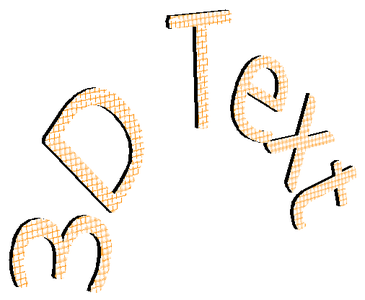

## **Genel Bakış**

Aspose.Slides for Python via Java, şekil ve metinler için PowerPoint tarzı 3D biçimlendirmeyi oluşturabilir, düzenleyebilir, koruyabilir ve renderlayabilir. Bu makale, döndürme, ekstrüzyon, köşe yuvarlamaları, aydınlatma, malzeme, degrade veya resim doldurmaları ve 3D metin gibi 3D etkileri kapsar.

{}
Bu makale, PowerPoint şekilleri ve metinleri üzerindeki 3D biçimlendirme etkileriyle ilgilidir. Bağımsız 3D model dosyalarının eklenmesi veya düzenlenmesiyle ilgili değildir. Bir slaytı görüntü, PDF veya HTML olarak dışa aktardığınızda, Aspose.Slides bu 3D etkileri dışa aktarılan 2D çıktıya renderlar.
{}

## **3D Biçimlendirme Kavramları**

Şekle 3D biçimlendirme uygulamak için [Shape.getThreeDFormat](https://reference.aspose.com/slides/python-java/aspose.slides/shape/#getThreeDFormat) yöntemini kullanın. Yöntem, o şekil için 3D sahneyi kontrol eden [ThreeDFormat](https://reference.aspose.com/slides/python-java/aspose.slides/threedformat/) nesnesini döndürür.

Metin için, [TextFrameFormat.getThreeDFormat](https://reference.aspose.com/slides/python-java/aspose.slides/textframeformat/#getThreeDFormat) yöntemini kullanın. Bu, şekil gövdesi yerine metin çerçevesine 3D biçimlendirme uygular.

En önemli API üyeleri şunlardır:

| API üyesi | Ne kontrol eder | Ne zaman kullanılır |
|---|---|---|
| [getCamera](https://reference.aspose.com/slides/python-java/aspose.slides/threedformat/#getCamera) | Görüş açısı, ön ayarlı kamera tipi, döndürme, yakınlaştırma ve perspektif. | Nesneyi 3D uzayda döndürün veya bir PowerPoint 3D döndürme ön ayarıyla eşleştirin. |
| [getLightRig](https://reference.aspose.com/slides/python-java/aspose.slides/threedformat/#getLightRig) | Işık ön ayarı, yön ve ışık döndürmesi. | 3D yüzeydeki vurgular ve gölgelerin nasıl göründüğünü değiştirin. |
| [getMaterial](https://reference.aspose.com/slides/python-java/aspose.slides/threedformat/#getMaterial) ve [setMaterial](https://reference.aspose.com/slides/python-java/aspose.slides/threedformat/#setMaterial) | Yüzey malzemesi, örneğin düz, mat, plastik veya metal. | Aynı geometrinin daha düz, yumuşak, parlak veya metalik görünmesini sağlayın. |
| [getExtrusionHeight](https://reference.aspose.com/slides/python-java/aspose.slides/threedformat/#getExtrusionHeight) ve [setExtrusionHeight](https://reference.aspose.com/slides/python-java/aspose.slides/threedformat/#setExtrusionHeight) | Şeklin ön yüzünden geriye ne kadar uzandığını. | Düz bir şekli görünen kalın bir 3D nesneye dönüştürün. |
| [getExtrusionColor](https://reference.aspose.com/slides/python-java/aspose.slides/threedformat/#getExtrusionColor) | Ekstrüde edilen kenarların rengi. | Derinliği görünür kılın veya yan renkleri ön doldurmayla eşleştirin. |
| [getDepth](https://reference.aspose.com/slides/python-java/aspose.slides/threedformat/#getDepth) ve [setDepth](https://reference.aspose.com/slides/python-java/aspose.slides/threedformat/#setDepth) | PowerPoint 3D biçimlendirmesinde kullanılan ek 3D derinlik. | Şekiller veya metinler için derinliği, özellikle köşe yuvarlaması ve malzeme ayarlarıyla birlikte, ince ayar yapın. |
| [getBevelTop](https://reference.aspose.com/slides/python-java/aspose.slides/threedformat/#getBevelTop) ve [getBevelBottom](https://reference.aspose.com/slides/python-java/aspose.slides/threedformat/#getBevelBottom) | Ön ve arka yüzlerde yükseltilmiş veya yuvarlatılmış kenarlar. | Keskin düz bir yüzey yerine yumuşak ya da kalıplanmış bir kenar ekleyin. |
| [getContourColor](https://reference.aspose.com/slides/python-java/aspose.slides/threedformat/#getContourColor) ve [getContourWidth](https://reference.aspose.com/slides/python-java/aspose.slides/threedformat/#getContourWidth) ve [setContourWidth](https://reference.aspose.com/slides/python-java/aspose.slides/threedformat/#setContourWidth) | 3D nesnenin etrafındaki kontur. | Renderlanan çıktıda nesne sınırını vurgulayın. |

## **3D Şekil Oluşturma**

- Kamera ayarları, çünkü varsayılan ön görünüm ekstrüzyonu gizleyebilir.
- Işık ayarları, çünkü aydınlatma yüzeyleri ve kenarları okunabilir kılar.
- Malzeme ayarları, çünkü yüzey ışığın nasıl renderlandığını etkiler.
- Ekstrüzyon veya derinlik ayarları, çünkü düz bir şeklin kalınlığa ihtiyacı vardır.

Aşağıdaki örnek bir dikdörtgen oluşturur, ön yüzüne metin ekler ve 3D biçimlendirme uygular. Kamera döndürme değerleri derecedir ve ekstrüzyon yüksekliği 100 puandır. Örnek, slaytı iki katı varsayılan boyutta bir PNG görüntüsüne renderlar ve sunumu PPTX olarak kaydeder:

```python
import jpype
import asposeslides

if not jpype.isJVMStarted():
    jpype.startJVM()

from asposeslides.api import CameraPresetType, FillType, ImageFormat, LightRigPresetType, LightingDirection, MaterialPresetType, Presentation, SaveFormat, ShapeType
from java.awt import Color

image_scale = 2.0

presentation = Presentation()
try:
    slide = presentation.getSlides().get_Item(0)

    shape = slide.getShapes().addAutoShape(ShapeType.Rectangle, 200, 150, 200, 200)
    shape.getTextFrame().setText("3D")
    shape.getTextFrame().getParagraphs().get_Item(0).getParagraphFormat().getDefaultPortionFormat().setFontHeight(64)

    shape.getFillFormat().setFillType(FillType.Solid)
    shape.getFillFormat().getSolidFillColor().setColor(Color(100, 149, 237))

    shape.getThreeDFormat().getCamera().setCameraType(CameraPresetType.OrthographicFront)
    shape.getThreeDFormat().getCamera().setRotation(20, 30, 40)
    shape.getThreeDFormat().getLightRig().setLightType(LightRigPresetType.Flat)
    shape.getThreeDFormat().getLightRig().setDirection(LightingDirection.Top)
    shape.getThreeDFormat().setMaterial(MaterialPresetType.Flat)
    shape.getThreeDFormat().setExtrusionHeight(100)
    shape.getThreeDFormat().getExtrusionColor().setColor(Color.BLUE)

    thumbnail = slide.getImage(image_scale, image_scale)
    try:
        thumbnail.save("shape_3d.png", ImageFormat.Png)
    finally:
        thumbnail.dispose()

    presentation.save("shape_3d.pptx", SaveFormat.Pptx)
finally:
    presentation.dispose()
```

Renderlanan slayt görüntüsü dikdörtgeni kalın bir 3D blok olarak gösterir:


## **Kamerayla Bir Şekli Döndürme**

PowerPoint'te 3D döndürme, 3‑D Döndürme bölmesinden yapılandırılır. X, Y ve Z döndürme değerleri, kamera API'siyle ayarladığınız döndürmeye karşılık gelir.


Aspose.Slides'te kameraya [ThreeDFormat.getCamera](https://reference.aspose.com/slides/python-java/aspose.slides/threedformat/#getCamera) üzerinden erişilir. Bu örnek bir dikdörtgen oluşturur, ortografik ön görünüm seçer ve X, Y, Z döndürmelerini sırasıyla 20, 30 ve 40 derece olarak ayarlar. Şekli bir dosyaya kaydetmeden bellekte yapılandırır:

```python
import jpype
import asposeslides

if not jpype.isJVMStarted():
    jpype.startJVM()

from asposeslides.api import CameraPresetType, Presentation, ShapeType

presentation = Presentation()
try:
    slide = presentation.getSlides().get_Item(0)

    shape = slide.getShapes().addAutoShape(ShapeType.Rectangle, 200, 150, 200, 200)

    shape.getThreeDFormat().getCamera().setCameraType(CameraPresetType.OrthographicFront)
    shape.getThreeDFormat().getCamera().setRotation(20, 30, 40)
finally:
    presentation.dispose()
```

İzleyicinin nesneyi nasıl gördüğünü değiştirmeniz gerektiğinde kamerayı kullanın. Bu, slayttaki 2D şekil geometrisini değiştirmez. PowerPoint ve Aspose.Slides render ederken kullanılan 3D bakış noktasını değiştirir.

### **Şablon Şekilden Kamera Yönelimini Kopyalama**

Şablon şeklin yönelimini eşleştirmek için [Camera.getCameraType](https://reference.aspose.com/slides/python-java/aspose.slides/camera/#getCameraType) ile kamera ön ayarını ve [Camera.getRotation](https://reference.aspose.com/slides/python-java/aspose.slides/camera/#getRotation) ile döndürme açılarını okuyun. Örnek `template.pptx` dosyasını açar ve ilk slaydın ilk şeklinin kamera yönelimini ikinci şekle kopyalar. Her iki şeklin de 3D aydınlatması vardır ve ikinci şeklin açık bir kamera döndürmesi yoktur.

Açılar derecedir. `0` dizini enlem, `1` dizini boylam, `2` dizini devrimdir. Bu sırayla [Camera.setRotation](https://reference.aspose.com/slides/python-java/aspose.slides/camera/#setRotation) metoduna gönderin. Kaynak `None` döndürürse, açık bir döndürme yoktur, bu yüzden ikinci şeklin açılarını bırakın. `(0, 0, 0)` gibi açık bir döndürme üç sıfır döndürür ve kopyalanmalıdır.

```python
import jpype
import asposeslides

if not jpype.isJVMStarted():
    jpype.startJVM()

from asposeslides.api import Presentation, SaveFormat

presentation = Presentation("template.pptx")
try:
    shapes = presentation.getSlides().get_Item(0).getShapes()
    
    source_camera = shapes.get_Item(0).getThreeDFormat().getCamera()
    destination_camera = shapes.get_Item(1).getThreeDFormat().getCamera()

    destination_camera.setCameraType(source_camera.getCameraType())
    angles = source_camera.getRotation()
    if angles is not None:
        destination_camera.setRotation(angles[0], angles[1], angles[2])

    presentation.save("camera-copy.pptx", SaveFormat.Pptx)
finally:
    presentation.dispose()
```

`camera-copy.pptx` dosyasını PowerPoint'te yeniden açtığınızda, sağdaki ok, soldaki dikdörtgene aynı kamera ön ayarı ve döndürmeye sahiptir. Her iki şekil de aynı aydınlatma ve ekstrüzyon derinliğini kullanır.


## **Ekstrüzyon ve Derinlik Ekleme**

Ekstrüzyon, şeklin ön yüzünün arkasına uzatarak kalın görünmesini sağlar. PowerPoint'te derinlik kontrolü bu görünür kalınlığı ayarlar ve renk kontrolü yan yüzlerin rengini belirler.


Kalınlığı ayarlamak için [ThreeDFormat.setExtrusionHeight](https://reference.aspose.com/slides/python-java/aspose.slides/threedformat/#setExtrusionHeight) yöntemini ve yan rengini almak için [ThreeDFormat.getExtrusionColor](https://reference.aspose.com/slides/python-java/aspose.slides/threedformat/#getExtrusionColor) yöntemini kullanın. Bu örnek, dikdörtgene 100 puanlık bir ekstrüzyon, mor kenarlar verir ve kalınlığı göstermek için kamerayı döndürür. Şekli bir dosyaya kaydetmeden bellekte yapılandırır:

```python
import jpype
import asposeslides

if not jpype.isJVMStarted():
    jpype.startJVM()

from asposeslides.api import CameraPresetType, LightRigPresetType, LightingDirection, MaterialPresetType, Presentation, ShapeType
from java.awt import Color

presentation = Presentation()
try:
    slide = presentation.getSlides().get_Item(0)

    shape = slide.getShapes().addAutoShape(ShapeType.Rectangle, 200, 150, 200, 200)

    extrusion_color = Color(128, 0, 128)

    shape.getThreeDFormat().getCamera().setCameraType(CameraPresetType.OrthographicFront)
    shape.getThreeDFormat().getCamera().setRotation(20, 30, 40)
    shape.getThreeDFormat().getLightRig().setLightType(LightRigPresetType.Flat)
    shape.getThreeDFormat().getLightRig().setDirection(LightingDirection.Top)
    shape.getThreeDFormat().setMaterial(MaterialPresetType.Flat)
    shape.getThreeDFormat().setExtrusionHeight(100)
    shape.getThreeDFormat().getExtrusionColor().setColor(extrusion_color)
finally:
    presentation.dispose()
```

[ThreeDFormat.setDepth](https://reference.aspose.com/slides/python-java/aspose.slides/threedformat/#setDepth) yöntemi bir 3D şeklin derinliğini ayarlar. [setExtrusionHeight](https://reference.aspose.com/slides/python-java/aspose.slides/threedformat/#setExtrusionHeight) yöntemi bu örnekte gösterildiği gibi ekstrüzyon etkisinin yüksekliğini kontrol eder.

## **3D Efektlerle Degrade veya Resim Doldurmaları Kullanma**

3D biçimlendirme şekil doldurmalarından bağımsızdır. Ön yüzeye katı renk, degrade, desen veya resim doldurması uygulayabilir ve aynı kamera, ışık, malzeme ve ekstrüzyon ayarlarını kullanabilirsiniz.

Bu örnek, ön yüze mavi‑turuncu bir degrade uygular ve 150 puanlık ekstrüzyona koyu turuncu bir renk verir. Degrade durakları 0 ve 100, başlangıç ve bitişi gösterir. Kamera döndürme değerleri derecedir. Slayt iki katı varsayılan boyutta bir PNG görüntüsüne renderlanır:

```python
import jpype
import asposeslides

if not jpype.isJVMStarted():
    jpype.startJVM()

from asposeslides.api import CameraPresetType, FillType, ImageFormat, LightRigPresetType, LightingDirection, MaterialPresetType, Presentation, ShapeType
from java.awt import Color

image_scale = 2.0

presentation = Presentation()
try:
    slide = presentation.getSlides().get_Item(0)

    shape = slide.getShapes().addAutoShape(ShapeType.Rectangle, 200, 150, 250, 250)
    shape.getTextFrame().setText("3D Gradient")
    shape.getTextFrame().getParagraphs().get_Item(0).getParagraphFormat().getDefaultPortionFormat().setFontHeight(64)

    shape.getFillFormat().setFillType(FillType.Gradient)
    shape.getFillFormat().getGradientFormat().getGradientStops().add(0, Color.BLUE)
    shape.getFillFormat().getGradientFormat().getGradientStops().add(100, Color(255, 165, 0))

    shape.getThreeDFormat().getCamera().setCameraType(CameraPresetType.OrthographicFront)
    shape.getThreeDFormat().getCamera().setRotation(10, 20, 30)
    shape.getThreeDFormat().getLightRig().setLightType(LightRigPresetType.Flat)
    shape.getThreeDFormat().getLightRig().setDirection(LightingDirection.Top)
    shape.getThreeDFormat().setMaterial(MaterialPresetType.Flat)
    extrusion_color = Color(255, 140, 0)
    shape.getThreeDFormat().setExtrusionHeight(150)
    shape.getThreeDFormat().getExtrusionColor().setColor(extrusion_color)

    thumbnail = slide.getImage(image_scale, image_scale)
    try:
        thumbnail.save("gradient_3d.png", ImageFormat.Png)
    finally:
        thumbnail.dispose()
finally:
    presentation.dispose()
```

Renderlanan çıktı, ön yüzdeki degradeyi korur ve ekstrüzyonu ayrı olarak renderlar:


Resim doldurma kullanmak isterseniz, görüntüyü sunuma ekleyin ve şekil doldurmasına atayın. Bu örnek, çalışma dizininde "image.jpg" adlı bir dosyanın var olmasını gerektirir. Görüntüyü dikdörtgeni dolduracak şekilde uzatır, 150 puanlık bir ekstrüzyon uygular ve kamerayı derecelerde döndürür. Şekli bir dosyaya kaydetmeden veya renderlamadan bellekte yapılandırır:

```python
import jpype
import asposeslides

if not jpype.isJVMStarted():
    jpype.startJVM()

from asposeslides.api import CameraPresetType, FillType, LightRigPresetType, LightingDirection, MaterialPresetType, PictureFillMode, Presentation, ShapeType
from java.awt import Color
from pathlib import Path

presentation = Presentation()
try:
    slide = presentation.getSlides().get_Item(0)

    shape = slide.getShapes().addAutoShape(ShapeType.Rectangle, 200, 150, 250, 250)

    image_data = Path("image.jpg").read_bytes()
    java_image_data = jpype.JArray(jpype.JByte)(image_data)
    image = presentation.getImages().addImage(java_image_data)

    shape.getFillFormat().setFillType(FillType.Picture)
    shape.getFillFormat().getPictureFillFormat().getPicture().setImage(image)
    shape.getFillFormat().getPictureFillFormat().setPictureFillMode(PictureFillMode.Stretch)

    extrusion_color = Color(255, 140, 0)
    shape.getThreeDFormat().getCamera().setCameraType(CameraPresetType.OrthographicFront)
    shape.getThreeDFormat().getCamera().setRotation(10, 20, 30)
    shape.getThreeDFormat().getLightRig().setLightType(LightRigPresetType.Flat)
    shape.getThreeDFormat().getLightRig().setDirection(LightingDirection.Top)
    shape.getThreeDFormat().setMaterial(MaterialPresetType.Flat)
    shape.getThreeDFormat().setExtrusionHeight(150)
    shape.getThreeDFormat().getExtrusionColor().setColor(extrusion_color)
finally:
    presentation.dispose()
```

Resim ön yüzde renderlanırken, ekstrüzyon 3D yan yüzey olarak renderlanır:


## **Metne 3D Biçimlendirme Uygulama**

Şekil 3D biçimlendirmesi şekil gövdesini etkiler. Metin 3D biçimlendirmesi metin çerçevesini etkiler. Bu, harflerin kendisinin ekstrüzyon, malzeme, aydınlatma ve kamera ayarlarına ihtiyaç duyduğu WordArt benzeri etkiler için yararlıdır.

Aşağıdaki örnek, turuncu‑beyaz bir ızgara deseniyle metin oluşturur, yukarı doğru bir yay uygular ve [TextFrameFormat.getThreeDFormat](https://reference.aspose.com/slides/python-java/aspose.slides/textframeformat/#getThreeDFormat) aracılığıyla 3D ayarlarını yapılandırır. Ekstrüzyon yüksekliği ve derinliği puan cinsindendir, ışık döndürmesi derecedir. Şekil doldurması ve kontur gizlenir, sadece metin görünür. Örnek, iki katı varsayılan slayt boyutunda bir PNG görüntüsü renderlar ve sunumu PPTX olarak kaydeder:

```python
import jpype
import asposeslides

if not jpype.isJVMStarted():
    jpype.startJVM()

from asposeslides.api import CameraPresetType, FillType, ImageFormat, LightRigPresetType, LightingDirection, MaterialPresetType, PatternStyle, Presentation, SaveFormat, ShapeType, TextShapeType
from java.awt import Color

image_scale = 2.0

presentation = Presentation()
try:
    slide = presentation.getSlides().get_Item(0)
    
    shape = slide.getShapes().addAutoShape(ShapeType.Rectangle, 200, 150, 250, 250)
    shape.getFillFormat().setFillType(FillType.NoFill)
    shape.getLineFormat().getFillFormat().setFillType(FillType.NoFill)
    shape.getTextFrame().setText("3D Text")

    portion = shape.getTextFrame().getParagraphs().get_Item(0).getPortions().get_Item(0)
    portion.getPortionFormat().getFillFormat().setFillType(FillType.Pattern)
    pattern_color = Color(255, 140, 0)
    portion.getPortionFormat().getFillFormat().getPatternFormat().getForeColor().setColor(pattern_color)
    portion.getPortionFormat().getFillFormat().getPatternFormat().getBackColor().setColor(Color.WHITE)
    portion.getPortionFormat().getFillFormat().getPatternFormat().setPatternStyle(PatternStyle.LargeGrid)

    shape.getTextFrame().getParagraphs().get_Item(0).getParagraphFormat().getDefaultPortionFormat().setFontHeight(128)

    text_frame_format = shape.getTextFrame().getTextFrameFormat()
    text_frame_format.setTransform(TextShapeType.ArchUp)
    text_frame_format.getThreeDFormat().setExtrusionHeight(3.5)
    text_frame_format.getThreeDFormat().setDepth(3)
    text_frame_format.getThreeDFormat().setMaterial(MaterialPresetType.Plastic)
    text_frame_format.getThreeDFormat().getLightRig().setDirection(LightingDirection.Top)
    text_frame_format.getThreeDFormat().getLightRig().setLightType(LightRigPresetType.Balanced)
    text_frame_format.getThreeDFormat().getLightRig().setRotation(0, 0, 40)
    text_frame_format.getThreeDFormat().getCamera().setCameraType(CameraPresetType.PerspectiveContrastingRightFacing)

    thumbnail = slide.getImage(image_scale, image_scale)
    try:
        thumbnail.save("text_3d.png", ImageFormat.Png)
    finally:
        thumbnail.dispose()

    presentation.save("text_3d.pptx", SaveFormat.Pptx)
finally:
    presentation.dispose()
```

Renderlanan 3D metin, yaylı bir WordArt dönüşümü, turuncu desen doldurması ve koyu ekstrüzyonla gösterilir:



## **3D Şekilde Metni Düz Tutma**

Metni 3D sahneden çıkarmak için, [TextFrame.getTextFrameFormat](https://reference.aspose.com/slides/python-java/aspose.slides/textframe/#getTextFrameFormat) üzerinden [TextFrameFormat.setKeepTextFlat](https://reference.aspose.com/slides/python-java/aspose.slides/textframeformat/#setKeepTextFlat) çağırın. Değer `True` ise metin 3D sahneden dışarı kalır. `False` ise metin sahneye katılır ve 3D yönelimini izler.

Bu ayar, şeklin 3D biçimlendirmesini (kamera, aydınlatma, malzeme ve ekstrüzyon) kaldırmaz; bu ayarlar hâlâ [Shape.getThreeDFormat](https://reference.aspose.com/slides/python-java/aspose.slides/shape/#getThreeDFormat) üzerinden yapılandırılmıştır. Ayrıca normal döndürmeden farklıdır. [Shape.setRotation](https://reference.aspose.com/slides/python-java/aspose.slides/shape/#setRotation) şekli slayt düzleminde döndürürken, [TextFrameFormat.setRotationAngle](https://reference.aspose.com/slides/python-java/aspose.slides/textframeformat/#setRotationAngle) metnin kendi sınırlama kutusu içindeki özel döndürmesini kontrol eder. Metni 3D sahneden çıkarmak, bu açıları sıfırlamaz.

Aşağıdaki bağımsız örnek, mavi bir dikdörtgen ve metin oluşturur, orijinalin yanında bir kopyasını yerleştirir. Her iki şekil aynı 3D biçimlendirmeye sahiptir; sadece metin ayarı farklıdır: solda `False`, sağda `True`. Kamera açıları derecedir, ekstrüzyon yüksekliği 40 puandır. Örnek sunumu PPTX olarak kaydeder ve karşılaştırma slaydını iki katı varsayılan boyutta PNG’ye renderlar:

```python
import jpype
import asposeslides

if not jpype.isJVMStarted():
    jpype.startJVM()

from asposeslides.api import CameraPresetType, FillType, ImageFormat, LightRigPresetType, LightingDirection, MaterialPresetType, Presentation, SaveFormat, ShapeType, TextAlignment, TextAnchorType
from java.awt import Color

presentation = Presentation()
try:
    slide = presentation.getSlides().get_Item(0)

    shape = slide.getShapes().addAutoShape(ShapeType.Rectangle, 70, 160, 240, 140)

    shape.getTextFrame().setText("Readable text")
    shape.getTextFrame().getParagraphs().get_Item(0).getParagraphFormat().getDefaultPortionFormat().setFontHeight(28)
    shape.getTextFrame().getParagraphs().get_Item(0).getParagraphFormat().setAlignment(TextAlignment.Center)
    shape.getTextFrame().getTextFrameFormat().setAnchoringType(TextAnchorType.Center)
    shape.getFillFormat().setFillType(FillType.Solid)
    shape.getFillFormat().getSolidFillColor().setColor(Color(100, 149, 237))

    shape.getThreeDFormat().getCamera().setCameraType(CameraPresetType.OrthographicFront)
    shape.getThreeDFormat().getCamera().setRotation(30, 30, 0)
    shape.getThreeDFormat().getLightRig().setLightType(LightRigPresetType.Flat)
    shape.getThreeDFormat().getLightRig().setDirection(LightingDirection.Top)
    shape.getThreeDFormat().setMaterial(MaterialPresetType.Flat)
    shape.getThreeDFormat().setExtrusionHeight(40)
    shape.getThreeDFormat().getExtrusionColor().setColor(Color(65, 105, 225))
    shape.getTextFrame().getTextFrameFormat().setKeepTextFlat(False)

    flat_text_shape = slide.getShapes().addClone(shape, 400, 160)
    flat_text_shape.getTextFrame().getTextFrameFormat().setKeepTextFlat(True)

    presentation.save("keep_text_flat.pptx", SaveFormat.Pptx)
    image = slide.getImage(2, 2)
    try:
        image.save("keep_text_flat.png", ImageFormat.Png)
    finally:
        image.dispose()
finally:
    presentation.dispose()
```

Solda metin 3D yönelimini izler. Sağda metin düz kalır ve daha okunaklıdır. Her iki dikdörtgen de aynı görünen ekstrüzyon ve 3D yönelimini korur.


## **Dışa Aktarma ve Render Davranışı**

Aspose.Slides, PPTX gibi PowerPoint formatlarında 3D biçimlendirmeyi korur. Sabit sayfa formatlarına renderlarken veya dışa aktarırken 3D sahne rasterize edilir ve 2D sonuç olarak çıktı içerisine çizilir. Bu, slaytları [PNG](/slides/tr/python-java/convert-powerpoint-to-png/), [PDF](/slides/tr/python-java/convert-powerpoint-to-pdf/), [HTML](/slides/tr/python-java/convert-powerpoint-to-html/) formatlarına renderlarken ya da [video dönüşümü](/slides/tr/python-java/convert-powerpoint-to-video/) için kareler üretirken geçerlidir.

Bu noktaları aklınızda tutun:

- Dışa aktarılan görüntüler ve PDF'ler etkileşimli değildir. Nesne, dışa aktarıldıktan sonra izleyici tarafından döndürülemez.
- Son görünüm, kamera, ışık takımı, malzeme, ekstrüzyon, doldurma ve slayt ölçeklemesinin kombinasyonuna bağlıdır.
- Kalıtılmış veya tema tabanlı biçimlendirme değerlerini incelemeniz gerekiyorsa, [effective shape properties](/slides/tr/python-java/shape-effective-properties/) sayfasını okuyun.
- Bazı çıktı formatları düzenlenebilir PowerPoint 3D biçimlendirmesini saklayamaz. Bu formatlarda görsel sonuç, düzenlenebilir 3D ayarları olarak değil, renderlanmış biçimde saklanır.

## **SSS**

**Aspose.Slides etkileşimli 3D sunumlar oluşturabilir mi?**

Aspose.Slides, şekil ve metinler için PowerPoint 3D etkilerini oluşturur ve renderlar. Dışa aktarılan görüntüler, PDF'ler veya HTML sayfaları, izleyicinin döndürebileceği etkileşimli 3D sahneler haline getirmez. PPTX içinde, format destekliyorsa 3D biçimlendirme PowerPoint'te düzenlenebilir kalır.

**Bir 3D model ile bir 3D efekt arasındaki fark nedir?**

3D model, sunuma eklenen ayrı bir 3D nesnedir. 3D efekt, bir PowerPoint şekli veya metnine uygulanan döndürme, ekstrüzyon, köşe yuvarlaması, aydınlatma ve malzeme gibi biçimlendirmedir. Bu makale 3D etkileri ele alır.

**Görünür bir 3D şekil için hangi ayarlar gerekir?**

En az bir kamera döndürmesi ve ya ekstrüzyon ya da derinlik ayarı yapın. Pratikte, renderlanan yüzeylerin net vurgular ve gölgeler alması için bir ışık takımı ve malzeme de ayarlayın.

**Hem şekillere hem de metne 3D efektleri uygulayabilir miyim?**

Evet. Şekil gövdesi için [Shape.getThreeDFormat](https://reference.aspose.com/slides/python-java/aspose.slides/shape/#getThreeDFormat), metin için ise [TextFrameFormat.getThreeDFormat](https://reference.aspose.com/slides/python-java/aspose.slides/textframeformat/#getThreeDFormat) kullanın.

**Görüntülere, PDF, HTML veya video karelerine dışa aktarırken 3D efektler görünür mü?**

Evet. Aspose.Slides, slayt görüntüleri, PDF çıktısı, HTML çıktısı ve video dönüşümü için kullanılan kareler üretirken 3D etkileri renderlar. Dışa aktarılan çıktı renderlanmış görünümü içerir, düzenlenebilir bir 3D nesne içermez.

**Kalıtım ve tema ayarları uygulandıktan sonra son 3D değerlerini okuyabilir miyim?**

Evet. Final kamera, ışık takımı, köşe yuvarlaması ve ilgili 3D değerlerini okumak için [Shape Effective Properties](/slides/tr/python-java/shape-effective-properties/) API'lerini kullanın.