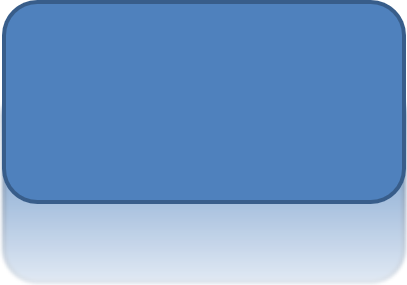

## **Giriş**

PowerPoint'teki efektler bir şekli öne çıkarmak için kullanılabilirken, [doldurmalardan](/slides/tr/python-net/shape-formatting/#gradient-fill) veya kenarlıklardan farklıdır. PowerPoint efektlerini kullanarak bir şekil üzerinde ikna edici yansımalar oluşturabilir, şeklin parlaklığını yayabilirsiniz vb.


PowerPoint, şekillere uygulanabilen altı efekt sağlar. Bir şekle bir veya daha fazla efekt uygulayabilirsiniz.

Bazı efekt kombinasyonları diğerlerinden daha iyi görünür. Bu nedenle PowerPoint, **Preset** altında seçenekler sunar. Preset seçenekleri, iki veya daha fazla efektten oluşan, güzel görünen bilinen bir kombinasyondur. Böylece bir preset seçerek farklı efektleri test etmek veya birleştirmek için zaman harcamanıza gerek kalmaz.

Aspose.Slides, PowerPoint sunumlarındaki şekillere aynı efektleri uygulamanızı sağlayan [EffectFormat](https://reference.aspose.com/slides/python-net/aspose.slides/effectformat/) sınıfı altında özellikler ve yöntemler sağlar.

## **Gölge Efekti Uygulama**

Aspose.Slides for Python via .NET, şekiller için dış ve iç gölgeleri destekler. Renklerini, yönünü, mesafesini ve bulanıklık yarıçapını sunum tasarımınıza uygun şekilde özelleştirebilirsiniz.

### **Dış Gölge Uygulama**

Dış gölgeyi, bir kartı veya paneli slayt arka planına karşı öne çıkarmak için kullanın. Gölge, şeklin kenarlarının ötesine uzanarak şeklin slayt üzerinde yükselmiş izlenimini yaratır. Renk, yön, mesafe ve bulanıklık yarıçapını şablonunuzun ışıklandırması ve stiline uygun şekilde ayarlayın.

Bu Python kodu, bir dikdörtgene [dış gölge efekti](https://reference.aspose.com/slides/python-net/aspose.slides/effectformat/outer_shadow_effect/) nasıl uygulanacağını gösterir:

```python
import aspose.slides as slides

with slides.Presentation() as presentation:
    slide = presentation.slides[0]

    shape = slide.shapes.add_auto_shape(slides.ShapeType.ROUND_CORNER_RECTANGLE, 20, 20, 200, 100)
    shape.effect_format.enable_outer_shadow_effect()
    shape.effect_format.outer_shadow_effect.shadow_color.color = slides.Color.dark_gray
    shape.effect_format.outer_shadow_effect.distance = 10
    shape.effect_format.outer_shadow_effect.direction = 45

    presentation.save("shadow_effect.pptx", slides.export.SaveFormat.PPTX)
```


### **İç Gölge Uygulama**

Bir şablonun görsel stilini yeniden üretirken, bir kart veya panela gömülü bir görünüm vermek için iç gölge kullanın. Dış gölge, şeklin dışına uzanarak yükselmiş görünürken, iç gölge kenarların iç kısmını gölgeler.

İç gölge efektini etkinleştirmek için [enable_inner_shadow_effect](https://reference.aspose.com/slides/python-net/aspose.slides/effectformat/enable_inner_shadow_effect/), ardından [inner_shadow_effect](https://reference.aspose.com/slides/python-net/aspose.slides/effectformat/inner_shadow_effect/) yapılandırın. Daha büyük bulanıklık yarıçapı değerleri daha yumuşak kenarlar üretir.

Bu Python örneği, açık mavi bir kart ve koyu gri bir iç gölge oluşturur ve PPTX dosyası olarak kaydeder:

```python
import aspose.slides as slides

with slides.Presentation() as presentation:
    slide = presentation.slides[0]

    shape = slide.shapes.add_auto_shape(slides.ShapeType.RECTANGLE, 20, 20, 200, 100)
    shape.fill_format.fill_type = slides.FillType.SOLID
    shape.fill_format.solid_fill_color.color = slides.Color.light_blue
    shape.line_format.fill_format.fill_type = slides.FillType.NO_FILL

    shape.effect_format.enable_inner_shadow_effect()
    shadow = shape.effect_format.inner_shadow_effect
    shadow.shadow_color.color = slides.Color.dim_gray
    shadow.direction = 225
    shadow.distance = 7
    shadow.blur_radius = 6

    presentation.save("inner_shadow_effect.pptx", slides.export.SaveFormat.PPTX)
```


İç gölgeyi kaldırmak için, şeklin effect format'ında [disable_inner_shadow_effect](https://reference.aspose.com/slides/python-net/aspose.slides/effectformat/disable_inner_shadow_effect/) çağırın.

## **Yansıma Efekti Uygulama**

Aspose.Slides for Python via .NET'te bir yansıma efekti uygulamak için, şekillere ayna benzeri bir yansıma ekleyebilir, mesafe, şeffaflık ve boyut gibi parametreleri ayarlayabilirsiniz. Bu efekt, şekillere daha cilalı ve sofistike bir görünüm vererek sunumlarınızın estetiğini artırır. Basit kodla kolayca uygulanabilir ve tutarlı bir tasarım için birden çok öğeye hızlıca uygulanmasını sağlar.

Bu Python kodu, bir şekle [yansıma efekti](https://reference.aspose.com/slides/python-net/aspose.slides/effectformat/reflection_effect/) nasıl uygulanacağını gösterir:

```python
import aspose.slides as slides

with slides.Presentation() as presentation:
    slide = presentation.slides[0]

    shape = slide.shapes.add_auto_shape(slides.ShapeType.ROUND_CORNER_RECTANGLE, 20, 20, 200, 100)
    shape.effect_format.enable_reflection_effect()
    shape.effect_format.reflection_effect.rectangle_align = slides.RectangleAlignment.BOTTOM
    shape.effect_format.reflection_effect.direction = 90
    shape.effect_format.reflection_effect.distance = 40
    shape.effect_format.reflection_effect.blur_radius = 2

    presentation.save("reflection_effect.pptx", slides.export.SaveFormat.PPTX)
```



## **Parlaklık Efekti Uygulama**

Aspose.Slides for Python via .NET'te bir şekle parlaklık efekti uygulamak için, şekillerin etrafına yumuşak, ışıklı bir aura ekleyebilir, renk ve boyut gibi özellikleri ayarlayabilirsiniz. Bu efekt, şekillerin öne çıkmasını sağlar ve sunumunuza çekici, göz alıcı bir görsel öğe ekler. Minimum kodla kolayca uygulanabilir ve slaytlarınızın genel görünümünü iyileştirir.

Bu Python kodu, bir şekle [parlaklık efekti](https://reference.aspose.com/slides/python-net/aspose.slides/effectformat/glow_effect/) nasıl uygulanacağını gösterir:

```python
import aspose.slides as slides

with slides.Presentation() as presentation:
    slide = presentation.slides[0]

    shape = slide.shapes.add_auto_shape(slides.ShapeType.ROUND_CORNER_RECTANGLE, 20, 20, 200, 100)
    shape.effect_format.enable_glow_effect()
    shape.effect_format.glow_effect.color.color = slides.Color.magenta
    shape.effect_format.glow_effect.radius = 15

    presentation.save("glow_effect.pptx", slides.export.SaveFormat.PPTX)
```


## **Yumuşak Kenarlar Efekti Uygulama**

Aspose.Slides for Python via .NET'te yumuşak kenarlar efekti uygulamak için, bir şeklin kenarları etrafında pürüzsüz, bulanık bir geçiş oluşturabilirsiniz. Bu efekt, daha nazik ve ince bir görünüm ekler; hafif ve yumuşak bir görünüm gerektiren tasarımlar için mükemmeldir. Sunumunuzdaki çeşitli şekillerde istenen etkiyi elde etmek için yarıçap gibi parametreleri kolayca ayarlayabilirsiniz.

Bu Python kodu, bir şekle [yumuşak kenarlar](https://reference.aspose.com/slides/python-net/aspose.slides/effectformat/soft_edge_effect/) nasıl uygulanacağını gösterir:

```python
import aspose.slides as slides

with slides.Presentation() as presentation:
    slide = presentation.slides[0]

    shape = slide.shapes.add_auto_shape(slides.ShapeType.ROUND_CORNER_RECTANGLE, 20, 20, 200, 150)
    shape.effect_format.enable_soft_edge_effect()
    shape.effect_format.soft_edge_effect.radius = 8

    presentation.save("soft_edges_effect.pptx", slides.export.SaveFormat.PPTX)
```


## **Bulanıklaştırma Efekti Uygulama**

Şekil bulanıklığını kullanarak bir şeklin doldurmasını ve kenarlığını yumuşatabilir, şekli düzenlenebilir tutabilirsiniz. Şeklin effect format'ında [set_blur_effect](https://reference.aspose.com/slides/python-net/aspose.slides/effectformat/set_blur_effect/) çağırın. Yarıçap, nokta cinsinden ölçülür (1/72 inç): negatif olmayan bir değer kullanın; daha büyük değerler daha güçlü bulanıklık oluşturur. Sıfır yarıçap görünümü değiştirmez.

[grow](https://reference.aspose.com/slides/python-net/aspose.slides.effects/blur/grow/) ayarı, efektin görünen sınırlarını kontrol eder. `False` ile bulanıklık, kenarlık dahil orijinal çizilen sınırlara kırpılır. `True` ile bulanıklık bu sınırların ötesine uzanabilir. Hiçbir ayar şeklin konumunu veya boyutlarını değiştirmez.

Aşağıdaki karşılaştırma, aynı doldurma, kenarlık ve şekil boyutlarını bütün satırlarda kullanır. Üst satır `grow = False`; alt satır `grow = True` kullanır.


Bu Python örneği, turuncu bir dikdörtgen ve koyu mavi bir kenarlık oluşturur, 5 nokta bulanıklık uygular ve ardından [set_blur_effect](https://reference.aspose.com/slides/python-net/aspose.slides/effectformat/set_blur_effect/) tekrar çağırarak 15 nokta bulanıklığa günceller. Her iki bulanık durumu kaydeder, ardından [disable_blur_effect](https://reference.aspose.com/slides/python-net/aspose.slides/effectformat/disable_blur_effect/) çağırıp şekli bulanıklıksız kaydeder.

```python
import aspose.slides as slides

with slides.Presentation() as presentation:
    slide = presentation.slides[0]

    shape = slide.shapes.add_auto_shape(slides.ShapeType.RECTANGLE, 100, 80, 160, 100)
    shape.fill_format.fill_type = slides.FillType.SOLID
    shape.fill_format.solid_fill_color.color = slides.Color.orange
    shape.line_format.fill_format.fill_type = slides.FillType.SOLID
    shape.line_format.fill_format.solid_fill_color.color = slides.Color.dark_blue
    shape.line_format.width = 8

    shape.effect_format.set_blur_effect(5, False)
    presentation.save("shape_blur_5.pptx", slides.export.SaveFormat.PPTX)

    shape.effect_format.set_blur_effect(15, True)
    presentation.save("shape_blur_15.pptx", slides.export.SaveFormat.PPTX)

    shape.effect_format.disable_blur_effect()
    presentation.save("shape_blur_removed.pptx", slides.export.SaveFormat.PPTX)
```

Şekil bulanıklığı, doldurma ve kenarlığı birlikte etkiler. Yumuşak kenarlar efekti, şeklin kenarlarını soluklaştırırken, gölge bulanıklığı yalnızca gölgeyi yumuşatır. Görüntü dönüşüm efektleri, görüntü içeriği üzerinde çalışır; bu örnek, şekli bir görüntüye dönüştürmeden doğrudan şeklin effect format'ına bulanıklık uygular.

## **SSS**

**Aynı şekle birden fazla efekt uygulayabilir miyim?**

Evet, gölge, yansıma ve parlaklık gibi farklı efektleri tek bir şekle birleştirerek daha dinamik bir görünüm oluşturabilirsiniz.

**Hangi şekillere efekt uygulayabilirim?**

Autoshape'ler, grafikler, tablolar, resimler, SmartArt nesneleri, OLE nesneleri ve daha fazlası dahil olmak üzere çeşitli şekillere efekt uygulayabilirsiniz.

**Gruplandırılmış şekillere efekt uygulayabilir miyim?**

Evet, gruplandırılmış şekillere efekt uygulayabilirsiniz. Efekt tüm gruba uygulanır.