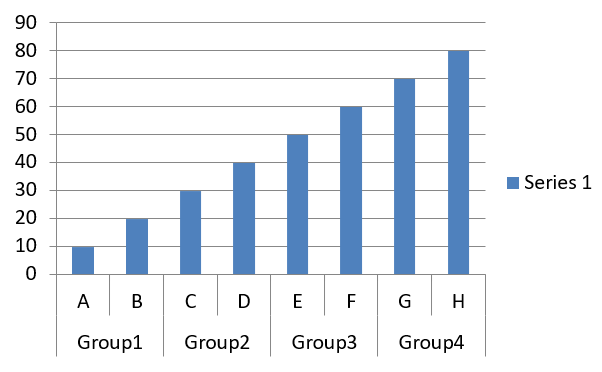

## **Tổng quan**

Bài viết này cung cấp hướng dẫn toàn diện về cách tạo và tùy chỉnh biểu đồ bằng Aspose.Slides for Android via Java. Bạn sẽ học cách thêm biểu đồ vào một slide một cách lập trình, đưa dữ liệu vào, và áp dụng các tùy chọn định dạng khác nhau để phù hợp với yêu cầu thiết kế cụ thể của mình. Trong suốt bài viết, các ví dụ mã chi tiết minh họa từng bước, từ khởi tạo đối tượng Presentation và biểu đồ đến cấu hình series, trục và chú giải. Bằng cách làm theo hướng dẫn này, bạn sẽ nắm vững cách tích hợp việc tạo biểu đồ động vào các ứng dụng Android, giúp giảm bớt quy trình tạo các bản thuyết trình dựa trên dữ liệu.

## **Tạo biểu đồ**

Biểu đồ giúp người dùng nhanh chóng hình dung dữ liệu và rút ra những hiểu biết mà có thể không ngay lập tức hiển thị trong bảng hoặc bảng tính.

**Tại sao tạo biểu đồ?**

Sử dụng biểu đồ, bạn có thể:

* tổng hợp, rút gọn hoặc tóm tắt một lượng lớn dữ liệu trên một slide trong bản thuyết trình;
* lộ ra các mẫu và xu hướng trong dữ liệu;
* suy ra hướng và độ mạnh của dữ liệu theo thời gian hoặc theo một đơn vị đo cụ thể;
* phát hiện các giá trị ngoại lệ, bất thường, sai lệch, lỗi và dữ liệu vô nghĩa;
* truyền đạt hoặc trình bày dữ liệu phức tạp.

Trong PowerPoint, bạn có thể tạo biểu đồ thông qua chức năng *Insert*, cung cấp các mẫu để thiết kế nhiều loại biểu đồ. Sử dụng Aspose.Slides, bạn có thể tạo cả biểu đồ thông thường (dựa trên các loại biểu đồ phổ biến) và biểu đồ tùy chỉnh.

{}
Sử dụng [ChartType](https://reference.aspose.com/slides/androidjava/com.aspose.slides/charttype/) enumeration trong gói [com.aspose.slides](https://reference.aspose.com/slides/androidjava/com.aspose.slides/). Các giá trị trong enumeration này tương ứng với các loại biểu đồ khác nhau.
{}

### **Tạo biểu đồ Cột Nhóm**

Ví dụ này sử dụng [addChart](https://reference.aspose.com/slides/androidjava/com.aspose.slides/ishapecollection/#addChart-int-float-float-float-float-) để tạo biểu đồ cột nhóm so sánh hai series qua ba danh mục. Các series sử dụng màu đỏ và xanh lá, và các nhãn riêng lẻ hiển thị tên danh mục, tên series và giá trị. Chỉ mục worksheet 0 chỉ đến sheet đầu tiên trong workbook biểu đồ được nhúng.

```java
import com.aspose.slides.*;
import android.graphics.Color;

Presentation presentation = new Presentation();
try
{
    ISlide slide = presentation.getSlides().get_Item(0);

    IChart chart = slide.getShapes().addChart(ChartType.ClusteredColumn, 20, 20, 500, 300);

    chart.getChartTitle().addTextFrameForOverriding("Sample Title");
    chart.getChartTitle().getTextFrameForOverriding().getTextFrameFormat().setCenterText(NullableBool.True);
    chart.getChartTitle().setHeight(20);
    chart.setTitle(true);

    IChartDataWorkbook workbook = chart.getChartData().getChartDataWorkbook();
    int worksheetIndex = 0;

    chart.getChartData().getSeries().clear();
    chart.getChartData().getCategories().clear();

    IChartDataCell seriesNameCell = workbook.getCell(worksheetIndex, 0, 1, "Series 1");
    chart.getChartData().getSeries().add(seriesNameCell, chart.getType());
    seriesNameCell = workbook.getCell(worksheetIndex, 0, 2, "Series 2");
    chart.getChartData().getSeries().add(seriesNameCell, chart.getType());

    IChartDataCell categoryCell = workbook.getCell(worksheetIndex, 1, 0, "Category 1");
    chart.getChartData().getCategories().add(categoryCell);
    categoryCell = workbook.getCell(worksheetIndex, 2, 0, "Category 2");
    chart.getChartData().getCategories().add(categoryCell);
    categoryCell = workbook.getCell(worksheetIndex, 3, 0, "Category 3");
    chart.getChartData().getCategories().add(categoryCell);

    IChartSeries series = chart.getChartData().getSeries().get_Item(0);

    IChartDataCell valueCell = workbook.getCell(worksheetIndex, 1, 1, 20);
    series.getDataPoints().addDataPointForBarSeries(valueCell);
    valueCell = workbook.getCell(worksheetIndex, 2, 1, 50);
    series.getDataPoints().addDataPointForBarSeries(valueCell);
    valueCell = workbook.getCell(worksheetIndex, 3, 1, 30);
    series.getDataPoints().addDataPointForBarSeries(valueCell);

    series.getFormat().getFill().setFillType(FillType.Solid);
    series.getFormat().getFill().getSolidFillColor().setColor(Color.RED);

    series = chart.getChartData().getSeries().get_Item(1);

    valueCell = workbook.getCell(worksheetIndex, 1, 2, 30);
    series.getDataPoints().addDataPointForBarSeries(valueCell);
    valueCell = workbook.getCell(worksheetIndex, 2, 2, 10);
    series.getDataPoints().addDataPointForBarSeries(valueCell);
    valueCell = workbook.getCell(worksheetIndex, 3, 2, 60);
    series.getDataPoints().addDataPointForBarSeries(valueCell);

    series.getFormat().getFill().setFillType(FillType.Solid);
    series.getFormat().getFill().getSolidFillColor().setColor(Color.rgb(0, 128, 0));

    IDataLabel label = series.getDataPoints().get_Item(0).getLabel();
    label.getDataLabelFormat().setShowCategoryName(true);

    label = series.getDataPoints().get_Item(1).getLabel();
    label.getDataLabelFormat().setShowSeriesName(true);

    label = series.getDataPoints().get_Item(2).getLabel();
    label.getDataLabelFormat().setShowValue(true);
    label.getDataLabelFormat().setShowSeriesName(true);
    label.getDataLabelFormat().setSeparator("/");

    presentation.save("AsposeChart.pptx", SaveFormat.Pptx);
}
finally
{
    presentation.dispose();
}
```

Kết quả:


### **Tạo biểu đồ Phân tán**

Biểu đồ phân tán (còn gọi là scatter plot hoặc biểu đồ x‑y) thường được dùng để kiểm tra các mẫu hoặc chứng minh mối tương quan giữa hai biến.

Sử dụng biểu đồ phân tán khi:

* Bạn có dữ liệu số cặp.
* Bạn có hai biến có mối quan hệ chặt chẽ.
* Bạn muốn xác định liệu hai biến có liên quan hay không.
* Bạn có một biến độc lập có nhiều giá trị cho một biến phụ thuộc.

Ví dụ này vẽ hai tập giá trị x‑y. Series đầu tiên dùng đường thẳng với dấu sao, trong khi series thứ hai dùng đường mượt với dấu tròn; cả hai đều có kích thước dấu 10, được cấu hình bằng [setSize](https://reference.aspose.com/slides/androidjava/com.aspose.slides/imarker/#setSize-int-). Phương thức [setSymbol](https://reference.aspose.com/slides/androidjava/com.aspose.slides/imarker/#setSymbol-int-) điều khiển hình dạng dấu.

```java
import com.aspose.slides.*;

Presentation presentation = new Presentation();
try
{
    ISlide slide = presentation.getSlides().get_Item(0);

    IChart chart = slide.getShapes().addChart(ChartType.ScatterWithSmoothLines, 20, 20, 500, 300);

    IChartDataWorkbook workbook = chart.getChartData().getChartDataWorkbook();
    int worksheetIndex = 0;

    chart.getChartData().getSeries().clear();

    IChartDataCell seriesNameCell = workbook.getCell(worksheetIndex, 1, 1, "Series 1");
    chart.getChartData().getSeries().add(seriesNameCell, chart.getType());
    seriesNameCell = workbook.getCell(worksheetIndex, 1, 3, "Series 2");
    chart.getChartData().getSeries().add(seriesNameCell, chart.getType());

    IChartSeries series = chart.getChartData().getSeries().get_Item(0);

    IChartDataCell xValueCell = workbook.getCell(worksheetIndex, 2, 1, 1);
    IChartDataCell yValueCell = workbook.getCell(worksheetIndex, 2, 2, 3);
    series.getDataPoints().addDataPointForScatterSeries(xValueCell, yValueCell);

    xValueCell = workbook.getCell(worksheetIndex, 3, 1, 2);
    yValueCell = workbook.getCell(worksheetIndex, 3, 2, 10);
    series.getDataPoints().addDataPointForScatterSeries(xValueCell, yValueCell);

    series.setType(ChartType.ScatterWithStraightLinesAndMarkers);

    series.getMarker().setSize(10);
    series.getMarker().setSymbol(MarkerStyleType.Star);

    series = chart.getChartData().getSeries().get_Item(1);

    xValueCell = workbook.getCell(worksheetIndex, 2, 3, 5);
    yValueCell = workbook.getCell(worksheetIndex, 2, 4, 2);
    series.getDataPoints().addDataPointForScatterSeries(xValueCell, yValueCell);

    xValueCell = workbook.getCell(worksheetIndex, 3, 3, 3);
    yValueCell = workbook.getCell(worksheetIndex, 3, 4, 1);
    series.getDataPoints().addDataPointForScatterSeries(xValueCell, yValueCell);

    xValueCell = workbook.getCell(worksheetIndex, 4, 3, 2);
    yValueCell = workbook.getCell(worksheetIndex, 4, 4, 2);
    series.getDataPoints().addDataPointForScatterSeries(xValueCell, yValueCell);

    xValueCell = workbook.getCell(worksheetIndex, 5, 3, 5);
    yValueCell = workbook.getCell(worksheetIndex, 5, 4, 1);
    series.getDataPoints().addDataPointForScatterSeries(xValueCell, yValueCell);

    series.getMarker().setSize(10);
    series.getMarker().setSymbol(MarkerStyleType.Circle);

    presentation.save("AsposeChart.pptx", SaveFormat.Pptx);
}
finally
{
    presentation.dispose();
}
```

Kết quả:


### **Tạo biểu đồ Tròn**

Biểu đồ tròn thích hợp để hiển thị mối quan hệ phần‑trong‑toàn của dữ liệu, đặc biệt khi dữ liệu có nhãn phân loại kèm giá trị số. Tuy nhiên, nếu dữ liệu có quá nhiều phần hoặc nhãn, bạn có thể cân nhắc sử dụng biểu đồ cột thay thế.

Ví dụ này tạo biểu đồ tròn với ba giá trị quý. Mỗi miếng có màu và viền tùy chỉnh, và các nhãn hiển thị các tổ hợp khác nhau của giá trị, phần trăm và thông tin series. Phương thức [setFirstSliceAngle](https://reference.aspose.com/slides/androidjava/com.aspose.slides/ichartseriesgroup/#setFirstSliceAngle-int-) đặt miếng đầu tiên bắt đầu ở 180 độ.

```java
import com.aspose.slides.*;
import android.graphics.Color;

Presentation presentation = new Presentation();
try
{
    ISlide slide = presentation.getSlides().get_Item(0);

    IChart chart = slide.getShapes().addChart(ChartType.Pie, 20, 20, 500, 300);

    chart.getChartTitle().addTextFrameForOverriding("Sample Title");
    chart.getChartTitle().getTextFrameForOverriding().getTextFrameFormat().setCenterText(NullableBool.True);
    chart.getChartTitle().setHeight(20);
    chart.setTitle(true);

    chart.getChartData().getSeries().get_Item(0).getLabels().getDefaultDataLabelFormat().setShowValue(true);

    IChartDataWorkbook workbook = chart.getChartData().getChartDataWorkbook();
    int worksheetIndex = 0;

    chart.getChartData().getSeries().clear();
    chart.getChartData().getCategories().clear();

    IChartDataCell categoryCell = workbook.getCell(0, 1, 0, "1st Qtr");
    chart.getChartData().getCategories().add(categoryCell);
    categoryCell = workbook.getCell(0, 2, 0, "2nd Qtr");
    chart.getChartData().getCategories().add(categoryCell);
    categoryCell = workbook.getCell(0, 3, 0, "3rd Qtr");
    chart.getChartData().getCategories().add(categoryCell);

    IChartDataCell seriesNameCell = workbook.getCell(0, 0, 1, "Series 1");
    IChartSeries series = chart.getChartData().getSeries().add(seriesNameCell, chart.getType());

    IChartDataCell valueCell = workbook.getCell(worksheetIndex, 1, 1, 20);
    series.getDataPoints().addDataPointForPieSeries(valueCell);
    valueCell = workbook.getCell(worksheetIndex, 2, 1, 50);
    series.getDataPoints().addDataPointForPieSeries(valueCell);
    valueCell = workbook.getCell(worksheetIndex, 3, 1, 30);
    series.getDataPoints().addDataPointForPieSeries(valueCell);

    chart.getChartData().getSeriesGroups().get_Item(0).setColorVaried(true);

    IChartDataPoint firstSlice = series.getDataPoints().get_Item(0);
    firstSlice.getFormat().getFill().setFillType(FillType.Solid);
    firstSlice.getFormat().getFill().getSolidFillColor().setColor(Color.CYAN);

    firstSlice.getFormat().getLine().getFillFormat().setFillType(FillType.Solid);
    firstSlice.getFormat().getLine().getFillFormat().getSolidFillColor().setColor(Color.rgb(128, 128, 128));
    firstSlice.getFormat().getLine().setWidth(3.0);
    firstSlice.getFormat().getLine().setStyle(LineStyle.ThinThick);
    firstSlice.getFormat().getLine().setDashStyle(LineDashStyle.LargeDash);

    IChartDataPoint secondSlice = series.getDataPoints().get_Item(1);
    secondSlice.getFormat().getFill().setFillType(FillType.Solid);
    secondSlice.getFormat().getFill().getSolidFillColor().setColor(Color.rgb(165, 42, 42));

    secondSlice.getFormat().getLine().getFillFormat().setFillType(FillType.Solid);
    secondSlice.getFormat().getLine().getFillFormat().getSolidFillColor().setColor(Color.BLUE);
    secondSlice.getFormat().getLine().setWidth(3.0);
    secondSlice.getFormat().getLine().setStyle(LineStyle.Single);
    secondSlice.getFormat().getLine().setDashStyle(LineDashStyle.LargeDashDot);

    IChartDataPoint thirdSlice = series.getDataPoints().get_Item(2);
    thirdSlice.getFormat().setFill().setFillType(FillType.Solid);
    thirdSlice.getFormat().getFill().getSolidFillColor().setColor(Color.rgb(255, 127, 80));

    thirdSlice.getFormat().getLine().getFillFormat().setFillType(FillType.Solid);
    thirdSlice.getFormat().getLine().getFillFormat().getSolidFillColor().setColor(Color.RED);
    thirdSlice.getFormat().getLine().setWidth(2.0);
    thirdSlice.getFormat().getLine().setStyle(LineStyle.ThinThin);
    thirdSlice.getFormat().getLine().setDashStyle(LineDashStyle.LargeDashDotDot);

    IDataLabel firstLabel = series.getDataPoints().get_Item(0).getLabel();
    firstLabel.getDataLabelFormat().setShowValue(true);

    IDataLabel secondLabel = series.getDataPoints().get_Item(1).getLabel();
    secondLabel.getDataLabelFormat().setShowValue(true);
    secondLabel.getDataLabelFormat().setShowLegendKey(true);
    secondLabel.getDataLabelFormat().setShowPercentage(true);

    IDataLabel thirdLabel = series.getDataPoints().get_Item(2).getLabel();
    thirdLabel.getDataLabelFormat().setShowSeriesName(true);
    thirdLabel.getDataLabelFormat().setShowPercentage(true);

    series.getLabels().getDefaultDataLabelFormat().setShowLeaderLines(true);

    chart.getChartData().getSeriesGroups().get_Item(0).setFirstSliceAngle(180);

    presentation.save("PieChart.pptx", SaveFormat.Pptx);
}
finally
{
    presentation.dispose();
}
```

Kết quả:


### **Tạo biểu đồ Đường**

Biểu đồ đường (còn gọi là line graph) thích hợp trong các tình huống bạn muốn minh họa sự thay đổi giá trị theo thời gian. Sử dụng biểu đồ đường, bạn có thể so sánh một lượng lớn dữ liệu cùng lúc, theo dõi thay đổi và xu hướng theo thời gian, nổi bật các điểm bất thường trong series dữ liệu, và hơn thế nữa.

Ví dụ này sử dụng [addChart](https://reference.aspose.com/slides/androidjava/com.aspose.slides/ishapecollection/#addChart-int-float-float-float-float-) để tạo biểu đồ đường với series và danh mục mặc định, sau đó lưu bản thuyết trình dưới dạng PPTX.

```java
import com.aspose.slides.*;

Presentation presentation = new Presentation();
try
{
    ISlide slide = presentation.getSlides().get_Item(0);

    IChart lineChart = slide.getShapes().addChart(ChartType.Line, 20, 20, 500, 300);

    presentation.save("lineChart.pptx", SaveFormat.Pptx);
}
finally
{
    presentation.dispose();
}
```

Mặc định, các điểm trên biểu đồ đường được nối bằng các đường thẳng liên tục. Nếu bạn muốn các điểm được nối bằng đường gạch, gọi [setDashStyle](https://reference.aspose.com/slides/androidjava/com.aspose.slides/ilineformat/#setDashStyle-byte-) với giá trị từ [LineDashStyle](https://reference.aspose.com/slides/androidjava/com.aspose.slides/linedashstyle/):

```java
import com.aspose.slides.*;

Presentation presentation = new Presentation();
try
{
    ISlide slide = presentation.getSlides().get_Item(0);

    IChart lineChart = slide.getShapes().addChart(ChartType.Line, 20, 20, 500, 300);

    for (IChartSeries series : lineChart.getChartData().getSeries())
    {
        series.getFormat().getLine().setDashStyle(LineDashStyle.Dash);
    }
}
finally
{
    presentation.dispose();
}
```

Kết quả:


### **Tạo biểu đồ Cây**

Biểu đồ cây (Tree map) thích hợp cho dữ liệu bán hàng khi bạn muốn hiển thị kích thước tương đối của các danh mục dữ liệu và nhanh chóng thu hút sự chú ý tới những mục đóng góp lớn trong mỗi danh mục.

Ví dụ này tạo một tree map với tám lá được nhóm thành bốn nhánh và hai cành. Phương thức [setGroupingItem](https://reference.aspose.com/slides/androidjava/com.aspose.slides/ichartcategorylevelsmanager/#setGroupingItem-int-java.lang.Object-) gán các nhánh ở mức nhóm 1 và các cành ở mức 2. Các giá trị xác định kích thước hình chữ nhật tương đối, trong khi nhãn danh mục và nhãn cha chồng lên nhau xác định cấu trúc phân cấp.

```java
import com.aspose.slides.*;

Presentation presentation = new Presentation();
try
{
    ISlide slide = presentation.getSlides().get_Item(0);

    IChart chart = slide.getShapes().addChart(ChartType.Treemap, 20, 20, 500, 300);

    chart.getChartData().getCategories().clear();
    chart.getChartData().getSeries().clear();

    IChartDataWorkbook workbook = chart.getChartData().getChartDataWorkbook();
    workbook.clear(0);

    // Nhánh 1
    IChartDataCell categoryCell = workbook.getCell(0, "C1", "Leaf1");
    IChartCategory leaf = chart.getChartData().getCategories().add(categoryCell);
    leaf.getGroupingLevels().setGroupingItem(1, "Stem1");
    leaf.getGroupingLevels().setGroupingItem(2, "Branch1");

    categoryCell = workbook.getCell(0, "C2", "Leaf2");
    chart.getChartData().getCategories().add(categoryCell);

    categoryCell = workbook.getCell(0, "C3", "Leaf3");
    leaf = chart.getChartData().getCategories().add(categoryCell);
    leaf.getGroupingLevels().setGroupingItem(1, "Stem2");

    categoryCell = workbook.getCell(0, "C4", "Leaf4");
    chart.getChartData().getCategories().add(categoryCell);

    // Nhánh 2
    categoryCell = workbook.getCell(0, "C5", "Leaf5");
    leaf = chart.getChartData().getCategories().add(categoryCell);
    leaf.getGroupingLevels().setGroupingItem(1, "Stem3");
    leaf.getGroupingLevels().setGroupingItem(2, "Branch2");

    categoryCell = workbook.getCell(0, "C6", "Leaf6");
    chart.getChartData().getCategories().add(categoryCell);

    categoryCell = workbook.getCell(0, "C7", "Leaf7");
    leaf = chart.getChartData().getCategories().add(categoryCell);
    leaf.getGroupingLevels().setGroupingItem(1, "Stem4");

    categoryCell = workbook.getCell(0, "C8", "Leaf8");
    chart.getChartData().getCategories().add(categoryCell);

    IChartSeries series = chart.getChartData().getSeries().add(ChartType.Treemap);
    series.getLabels().getDefaultDataLabelFormat().setShowCategoryName(true);
    IChartDataCell valueCell = workbook.getCell(0, "D1", 4);
    series.getDataPoints().addDataPointForTreemapSeries(valueCell);
    valueCell = workbook.getCell(0, "D2", 5);
    series.getDataPoints().addDataPointForTreemapSeries(valueCell);
    valueCell = workbook.getCell(0, "D3", 3);
    series.getDataPoints().addDataPointForTreemapSeries(valueCell);
    valueCell = workbook.getCell(0, "D4", 6);
    series.getDataPoints().addDataPointForTreemapSeries(valueCell);
    valueCell = workbook.getCell(0, "D5", 9);
    series.getDataPoints().addDataPointForTreemapSeries(valueCell);
    valueCell = workbook.getCell(0, "D6", 9);
    series.getDataPoints().addDataPointForTreemapSeries(valueCell);
    valueCell = workbook.getCell(0, "D7", 4);
    series.getDataPoints().addDataPointForTreemapSeries(valueCell);
    valueCell = workbook.getCell(0, "D8", 3);
    series.getDataPoints().addDataPointForTreemapSeries(valueCell);

    series.setParentLabelLayout(ParentLabelLayoutType.Overlapping);

    presentation.save("Treemap.pptx", SaveFormat.Pptx);
}
finally
{
    presentation.dispose();
}
```

Kết quả:


### **Tạo biểu đồ Thác nước**

Biểu đồ thác nước cho thấy cách các thay đổi dương và âm đóng góp vào giá trị cuối cùng. Ví dụ, phân tích lợi nhuận có thể bắt đầu bằng doanh thu, trừ chi phí, và cộng thu nhập khác. Các cột thay đổi nổi giữa giá trị chạy trước và giá trị chạy mới, trong khi các cột tổng mở rộng từ 0 đến giá trị tích lũy.

Ví dụ sau sử dụng các khoản tiền tính bằng hàng ngàn USD:

| Category | Workbook value | Column type |
| --- | ---: | --- |
| Revenue | 1000 | Increase |
| Cost of sales | -400 | Decrease |
| Gross profit | 600 | Intermediate total |
| Operating expenses | -200 | Decrease |
| Other income | 50 | Increase |
| Net profit | 450 | Final total |

Để đánh dấu một điểm là tổng trung gian hoặc tổng cuối cùng, gọi phương thức [setSetAsTotal](https://reference.aspose.com/slides/androidjava/com.aspose.slides/chartdatapoint/#setSetAsTotal-boolean-) của nó với `true`. Cung cấp số tiền tích lũy thực tế trong ô workbook của điểm đó: `600` cho lợi nhuận gộp (`1000 - 400`) và `450` cho lợi nhuận ròng (`600 - 200 + 50`). Phương thức chỉ đánh dấu cột là tổng; nó không tính toán hay điền giá trị ô. Không sử dụng 0 làm chỗ giữ hoặc cung cấp thay đổi khác cho điểm tổng. Cột tổng hiển thị giá trị tích lũy mà không cộng lại vào giá trị chạy.

Ví dụ Java đầy đủ này tạo biểu đồ bằng thành phần `Waterfall` của [ChartType](https://reference.aspose.com/slides/androidjava/com.aspose.slides/charttype/), xóa dữ liệu mặc định và điền workbook được nhúng. Chỉ mục worksheet `0` chọn sheet đầu tiên; cột A chứa tên danh mục và cột B chứa giá trị. Mỗi ô giá trị được thêm bằng [addDataPointForWaterfallSeries](https://reference.aspose.com/slides/androidjava/com.aspose.slides/ichartdatapointcollection/#addDataPointForWaterfallSeries-com.aspose.slides.IChartDataCell-). Các chỉ số điểm 0‑dựa `2` và `5` xác định tổng trung gian và tổng cuối. Gọi [setShowValue](https://reference.aspose.com/slides/androidjava/com.aspose.slides/idatalabelformat/#setShowValue-boolean-) với `true` để hiển thị số tiền trên các cột. Không cần bản thuyết trình hoặc workbook đầu vào.

```java
import com.aspose.slides.*;

Presentation presentation = new Presentation();
try
{
    ISlide slide = presentation.getSlides().get_Item(0);

    IChart chart = slide.getShapes().addChart(ChartType.Waterfall, 20, 20, 680, 200);

    chart.setTitle(true);
    chart.getChartTitle().addTextFrameForOverriding("Profit breakdown (USD thousands)");
    chart.getChartTitle().setOverlay(false);
    chart.setLegend(false);

    chart.getChartData().getSeries().clear();
    chart.getChartData().getCategories().clear();

    IChartDataWorkbook workbook = chart.getChartData().getChartDataWorkbook();
    int worksheetIndex = 0;

    workbook.clear(worksheetIndex);

    IChartDataCell seriesNameCell = workbook.getCell(worksheetIndex, 0, 1, "Profit");
    IChartSeries series = chart.getChartData().getSeries().add(seriesNameCell, ChartType.Waterfall);
    String[] categories = new String[] { "Revenue", "Cost of sales", "Gross profit", "Operating expenses", "Other income", "Net profit" };
    double[] values = new double[] { 1000, -400, 600, -200, 50, 450 };

    for (int i = 0; i < categories.length; i++)
    {
        IChartDataCell categoryCell = workbook.getCell(worksheetIndex, i + 1, 0, categories[i]);
        chart.getChartData().getCategories().add(categoryCell);
        IChartDataCell valueCell = workbook.getCell(worksheetIndex, i + 1, 1, values[i]);
        series.getDataPoints().addDataPointForWaterfallSeries(valueCell);
    }

    // Điểm thứ ba và thứ sáu là tổng, không phải các thay đổi bổ sung.
    series.getDataPoints().get_Item(2).setSetAsTotal(true);
    series.getDataPoints().get_Item(5).setSetAsTotal(true);
    series.setShowConnectorLines(true);
    series.getLabels().getDefaultDataLabelFormat().setShowValue(true);

    presentation.save("WaterfallChart.pptx", SaveFormat.Pptx);
}
finally
{
    presentation.dispose();
}
```

Gọi phương thức cấp series [setShowConnectorLines](https://reference.aspose.com/slides/androidjava/com.aspose.slides/chartseries/#setShowConnectorLines-boolean-) với `true` để hiển thị các đường nối các cột liên tiếp và làm cho giá trị chạy dễ theo dõi hơn. Để ẩn các đường này, thay thế lời gọi phương thức trong ví dụ bằng `series.setShowConnectorLines(false);` trước khi lưu. Thay đổi này chỉ ảnh hưởng tới hiển thị đường, không thay đổi dữ liệu hoặc tổng.

Bản thuyết trình đã lưu hiển thị lợi nhuận gộp 600 và lợi nhuận ròng 450, với cả hai tổng được vẽ từ 0:


### **Tạo biểu đồ Cổ phiếu**

Biểu đồ cổ phiếu được dùng để hiển thị dữ liệu tài chính như giá mở cửa, cao nhất, thấp nhất và đóng cửa, hỗ trợ phân tích xu hướng thị trường và độ biến động. Chúng cung cấp thông tin quan trọng về hiệu suất cổ phiếu, giúp nhà đầu tư và phân tích đưa ra quyết định thông minh.

Ví dụ này tạo biểu đồ OHLC với bốn series theo thứ tự đó và ba danh mục. Phương thức [setUpDownBars](https://reference.aspose.com/slides/androidjava/com.aspose.slides/iupdownbarsmanager/#setUpDownBars-boolean-) bật các thanh lên/xuống, và [getHiLowLinesFormat](https://reference.aspose.com/slides/androidjava/com.aspose.slides/ichartseriesgroup/#getHiLowLinesFormat--) điều khiển các đường cao‑thấp thể hiện phạm vi giá, trong khi các đường series riêng và các đường lưới ngang phụ được ẩn.

```java
import com.aspose.slides.*;

Presentation presentation = new Presentation();
try
{
    ISlide slide = presentation.getSlides().get_Item(0);

    IChart chart = slide.getShapes().addChart(ChartType.OpenHighLowClose, 20, 20, 500, 300, false);

    IChartDataWorkbook workbook = chart.getChartData().getChartDataWorkbook();

    IChartDataCell categoryCell = workbook.getCell(0, 1, 0, "A");
    chart.getChartData().getCategories().add(categoryCell);
    categoryCell = workbook.getCell(0, 2, 0, "B");
    chart.getChartData().getCategories().add(categoryCell);
    categoryCell = workbook.getCell(0, 3, 0, "C");
    chart.getChartData().getCategories().add(categoryCell);

    IChartDataCell seriesNameCell = workbook.getCell(0, 0, 1, "Open");
    chart.getChartData().getSeries().add(seriesNameCell, ChartType.OpenHighLowClose);
    seriesNameCell = workbook.getCell(0, 0, 2, "High");
    chart.getChartData().getSeries().add(seriesNameCell, ChartType.OpenHighLowClose);
    seriesNameCell = workbook.getCell(0, 0, 3, "Low");
    chart.getChartData().getSeries().add(seriesNameCell, ChartType.OpenHighLowClose);
    seriesNameCell = workbook.getCell(0, 0, 4, "Close");
    chart.getChartData().getSeries().add(seriesNameCell, ChartType.OpenHighLowClose);

    IChartSeries series = chart.getChartData().getSeries().get_Item(0);
    IChartDataCell valueCell = workbook.getCell(0, 1, 1, 72);
    series.getDataPoints().addDataPointForStockSeries(valueCell);
    valueCell = workbook.getCell(0, 2, 1, 25);
    series.getDataPoints().addDataPointForStockSeries(valueCell);
    valueCell = workbook.getCell(0, 3, 1, 38);
    series.getDataPoints().addDataPointForStockSeries(valueCell);

    series = chart.getChartData().getSeries().get_Item(1);
    valueCell = workbook.getCell(0, 1, 2, 172);
    series.getDataPoints().addDataPointForStockSeries(valueCell);
    valueCell = workbook.getCell(0, 2, 2, 57);
    series.getDataPoints().addDataPointForStockSeries(valueCell);
    valueCell = workbook.getCell(0, 3, 2, 57);
    series.getDataPoints().addDataPointForStockSeries(valueCell);

    series = chart.getChartData().getSeries().get_Item(2);
    valueCell = workbook.getCell(0, 1, 3, 12);
    series.getDataPoints().addDataPointForStockSeries(valueCell);
    valueCell = workbook.getCell(0, 2, 3, 12);
    series.getDataPoints().addDataPointForStockSeries(valueCell);
    valueCell = workbook.getCell(0, 3, 3, 13);
    series.getDataPoints().addDataPointForStockSeries(valueCell);

    series = chart.getChartData().getSeries().get_Item(3);
    valueCell = workbook.getCell(0, 1, 4, 25);
    series.getDataPoints().addDataPointForStockSeries(valueCell);
    valueCell = workbook.getCell(0, 2, 4, 38);
    series.getDataPoints().addDataPointForStockSeries(valueCell);
    valueCell = workbook.getCell(0, 3, 4, 50);
    series.getDataPoints().addDataPointForStockSeries(valueCell);

    chart.getChartData().getSeriesGroups().get_Item(0).getUpDownBars().setUpDownBars(true);
    chart.getChartData().getSeriesGroups().get_Item(0).getHiLowLinesFormat().getLine().getFillFormat().setFillType(FillType.Solid);

    for (IChartSeries stockSeries : chart.getChartData().getSeries())
    {
        stockSeries.getFormat().getLine().getFillFormat().setFillType(FillType.NoFill);
    }

    chart.getAxes().getVerticalAxis().getMinorGridLinesFormat().getLine().getFillFormat().setFillType(FillType.NoFill);

    presentation.save("Stock-chart.pptx", SaveFormat.Pptx);
}
finally
{
    presentation.dispose();
}
```

Kết quả:


### **Tạo biểu đồ Hộp và Râu**

Biểu đồ hộp và râu được dùng để hiển thị phân phối dữ liệu bằng cách tóm tắt các thống kê chính như trung vị, các phần tư và các ngoại lệ tiềm năng. Chúng rất hữu ích trong phân tích dữ liệu khám phá và các nghiên cứu thống kê để nhanh chóng hiểu biến thể dữ liệu và xác định bất thường.

Ví dụ này tạo một biểu đồ hộp và râu từ sáu giá trị. Phương thức [setQuartileMethod](https://reference.aspose.com/slides/androidjava/com.aspose.slides/ichartseries/#setQuartileMethod-int-) chọn cách tính phần tư độc lập. Ví dụ cũng bật các đường trung bình, dấu trung bình, điểm nội bộ và điểm ngoại lệ.

```java
import com.aspose.slides.*;

Presentation presentation = new Presentation();
try
{
    ISlide slide = presentation.getSlides().get_Item(0);

    IChart chart = slide.getShapes().addChart(ChartType.BoxAndWhisker, 20, 20, 500, 300);

    chart.getChartData().getCategories().clear();
    chart.getChartData().getSeries().clear();

    IChartDataWorkbook workbook = chart.getChartData().getChartDataWorkbook();
    workbook.clear(0);

    IChartDataCell categoryCell = workbook.getCell(0, "A1", "Category 1");
    chart.getChartData().getCategories().add(categoryCell);
    categoryCell = workbook.getCell(0, "A2", "Category 2");
    chart.getChartData().getCategories().add(categoryCell);
    categoryCell = workbook.getCell(0, "A3", "Category 3");
    chart.getChartData().getCategories().add(categoryCell);
    categoryCell = workbook.getCell(0, "A4", "Category 4");
    chart.getChartData().getCategories().add(categoryCell);
    categoryCell = workbook.getCell(0, "A5", "Category 5");
    chart.getChartData().getCategories().add(categoryCell);
    categoryCell = workbook.getCell(0, "A6", "Category 6");
    chart.getChartData().getCategories().add(categoryCell);

    IChartSeries series = chart.getChartData().getSeries().add(ChartType.BoxAndWhisker);

    series.setQuartileMethod(QuartileMethodType.Exclusive);
    series.setShowMeanLine(true);
    series.setShowMeanMarkers(true);
    series.setShowInnerPoints(true);
    series.setShowOutlierPoints(true);

    IChartDataCell valueCell = workbook.getCell(0, "B1", 15);
    series.getDataPoints().addDataPointForBoxAndWhiskerSeries(valueCell);
    valueCell = workbook.getCell(0, "B2", 41);
    series.getDataPoints().addDataPointForBoxAndWhiskerSeries(valueCell);
    valueCell = workbook.getCell(0, "B3", 16);
    series.getDataPoints().addDataPointForBoxAndWhiskerSeries(valueCell);
    valueCell = workbook.getCell(0, "B4", 10);
    series.getDataPoints().addDataPointForBoxAndWhiskerSeries(valueCell);
    valueCell = workbook.getCell(0, "B5", 23);
    series.getDataPoints().addDataPointForBoxAndWhiskerSeries(valueCell);
    valueCell = workbook.getCell(0, "B6", 16);
    series.getDataPoints().addDataPointForBoxAndWhiskerSeries(valueCell);

    presentation.save("BoxAndWhisker.pptx", SaveFormat.Pptx);
}
finally
{
    presentation.dispose();
}
```

### **Tạo biểu đồ Phễu**

Biểu đồ phễu dùng để hình dung quy trình có các giai đoạn tuần tự, nơi khối lượng dữ liệu giảm dần khi tiến qua từng bước. Chúng đặc biệt hữu ích để phân tích tỷ lệ chuyển đổi, xác định các nút thắt và theo dõi hiệu quả của quy trình bán hàng hoặc tiếp thị.

Ví dụ này sử dụng [addChart](https://reference.aspose.com/slides/androidjava/com.aspose.slides/ishapecollection/#addChart-int-float-float-float-float-) để thêm biểu đồ phễu vào slide đầu tiên của một bản thuyết trình hiện có. Nó thay thế dữ liệu mặc định bằng sáu danh mục và các giá trị từ 50 đến 500, sau đó lưu bản thuyết trình đã cập nhật. Bản thuyết trình đầu vào phải có ít nhất một slide.

```java
import com.aspose.slides.*;

Presentation presentation = new Presentation("test.pptx");
try
{
    ISlide slide = presentation.getSlides().get_Item(0);

    IChart chart = slide.getShapes().addChart(ChartType.Funnel, 50, 50, 500, 400);

    chart.getChartData().getCategories().clear();
    chart.getChartData().getSeries().clear();

    IChartDataWorkbook workbook = chart.getChartData().getChartDataWorkbook();
    workbook.clear(0);

    IChartDataCell categoryCell = workbook.getCell(0, "A1", "Category 1");
    chart.getChartData().getCategories().add(categoryCell);
    categoryCell = workbook.getCell(0, "A2", "Category 2");
    chart.getChartData().getCategories().add(categoryCell);
    categoryCell = workbook.getCell(0, "A3", "Category 3");
    chart.getChartData().getCategories().add(categoryCell);
    categoryCell = workbook.getCell(0, "A4", "Category 4");
    chart.getChartData().getCategories().add(categoryCell);
    categoryCell = workbook.getCell(0, "A5", "Category 5");
    chart.getChartData().getCategories().add(categoryCell);
    categoryCell = workbook.getCell(0, "A6", "Category 6");
    chart.getChartData().getCategories().add(categoryCell);

    IChartSeries series = chart.getChartData().getSeries().add(ChartType.Funnel);

    IChartDataCell valueCell = workbook.getCell(0, "B1", 50);
    series.getDataPoints().addDataPointForFunnelSeries(valueCell);
    valueCell = workbook.getCell(0, "B2", 100);
    series.getDataPoints().addDataPointForFunnelSeries(valueCell);
    valueCell = workbook.getCell(0, "B3", 200);
    series.getDataPoints().addDataPointForFunnelSeries(valueCell);
    valueCell = workbook.getCell(0, "B4", 300);
    series.getDataPoints().addDataPointForFunnelSeries(valueCell);
    valueCell = workbook.getCell(0, "B5", 400);
    series.getDataPoints().addDataPointForFunnelSeries(valueCell);
    valueCell = workbook.getCell(0, "B6", 500);
    series.getDataPoints().addDataPointForFunnelSeries(valueCell);

    presentation.save("Funnel.pptx", SaveFormat.Pptx);
}
finally
{
    presentation.dispose();
}
```

Kết quả:


### **Tạo biểu đồ Mặt trời**

Biểu đồ mặt trời dùng để hình dung dữ liệu phân cấp, hiển thị các cấp độ dưới dạng các vòng đồng tâm. Chúng giúp minh họa mối quan hệ phần‑trong‑toàn và là lựa chọn lý tưởng để biểu diễn các danh mục lồng nhau một cách rõ ràng và gọn gàng.

Ví dụ này tạo một biểu đồ mặt trời với tám lá được nhóm thành bốn nhánh và hai cành. Phương thức [setGroupingItem](https://reference.aspose.com/slides/androidjava/com.aspose.slides/ichartcategorylevelsmanager/#setGroupingItem-int-java.lang.Object-) gán các nhánh ở mức nhóm 1 và các cành ở mức 2. Nhãn danh mục xác định các đoạn, và các giá trị quyết định kích thước tương đối của chúng.

```java
import com.aspose.slides.*;

Presentation presentation = new Presentation();
try
{
    ISlide slide = presentation.getSlides().get_Item(0);

    IChart chart = slide.getShapes().addChart(ChartType.Sunburst, 20, 20, 500, 300);

    chart.getChartData().getCategories().clear();
    chart.getChartData().getSeries().clear();

    IChartDataWorkbook workbook = chart.getChartData().getChartDataWorkbook();
    workbook.clear(0);

    // Nhánh 1
    IChartDataCell categoryCell = workbook.getCell(0, "C1", "Leaf1");
    IChartCategory leaf = chart.getChartData().getCategories().add(categoryCell);
    leaf.getGroupingLevels().setGroupingItem(1, "Stem1");
    leaf.getGroupingLevels().setGroupingItem(2, "Branch1");

    categoryCell = workbook.getCell(0, "C2", "Leaf2");
    chart.getChartData().getCategories().add(categoryCell);

    categoryCell = workbook.getCell(0, "C3", "Leaf3");
    leaf = chart.getChartData().getCategories().add(categoryCell);
    leaf.getGroupingLevels().setGroupingItem(1, "Stem2");

    categoryCell = workbook.getCell(0, "C4", "Leaf4");
    chart.getChartData().getCategories().add(categoryCell);

    // Nhánh 2
    categoryCell = workbook.getCell(0, "C5", "Leaf5");
    leaf = chart.getChartData().getCategories().add(categoryCell);
    leaf.getGroupingLevels().setGroupingItem(1, "Stem3");
    leaf.getGroupingLevels().setGroupingItem(2, "Branch2");

    categoryCell = workbook.getCell(0, "C6", "Leaf6");
    chart.getChartData().getCategories().add(categoryCell);

    categoryCell = workbook.getCell(0, "C7", "Leaf7");
    leaf = chart.getChartData().getCategories().add(categoryCell);
    leaf.getGroupingLevels().setGroupingItem(1, "Stem4");

    categoryCell = workbook.getCell(0, "C8", "Leaf8");
    chart.getChartData().getCategories().add(categoryCell);

    IChartSeries series = chart.getChartData().getSeries().add(ChartType.Sunburst);
    series.getLabels().getDefaultDataLabelFormat().setShowCategoryName(true);
    IChartDataCell valueCell = workbook.getCell(0, "D1", 4);
    series.getDataPoints().addDataPointForSunburstSeries(valueCell);
    valueCell = workbook.getCell(0, "D2", 5);
    series.getDataPoints().addDataPointForSunburstSeries(valueCell);
    valueCell = workbook.getCell(0, "D3", 3);
    series.getDataPoints().addDataPointForSunburstSeries(valueCell);
    valueCell = workbook.getCell(0, "D4", 6);
    series.getDataPoints().addDataPointForSunburstSeries(valueCell);
    valueCell = workbook.getCell(0, "D5", 9);
    series.getDataPoints().addDataPointForSunburstSeries(valueCell);
    valueCell = workbook.getCell(0, "D6", 9);
    series.getDataPoints().addDataPointForSunburstSeries(valueCell);
    valueCell = workbook.getCell(0, "D7", 4);
    series.getDataPoints().addDataPointForSunburstSeries(valueCell);
    valueCell = workbook.getCell(0, "D8", 3);
    series.getDataPoints().addDataPointForSunburstSeries(valueCell);

    presentation.save("Sunburst.pptx", SaveFormat.Pptx);
}
finally
{
    presentation.dispose();
}
```

Kết quả:


### **Tạo biểu đồ Histogram**

Biểu đồ histogram cho thấy cách các giá trị số được phân bố qua các khoảng (bins). Đối với báo cáo tháng về thời gian xử lý đơn hàng, sử dụng cùng độ rộng bin và ngưỡng để giữ các khoảng nhất quán và dễ so sánh phân phối.

Gọi [setAggregationType](https://reference.aspose.com/slides/androidjava/com.aspose.slides/iaxis/#setAggregationType-int-) trên trục ngang với một chế độ từ [AxisAggregationType](https://reference.aspose.com/slides/androidjava/com.aspose.slides/axisaggregationtype/). [setBinWidth](https://reference.aspose.com/slides/androidjava/com.aspose.slides/iaxis/#setBinWidth-double-) chỉ áp dụng cho `ByBinWidth`; [setNumberOfBins](https://reference.aspose.com/slides/androidjava/com.aspose.slides/iaxis/#setNumberOfBins-long-) chỉ áp dụng cho `ByNumberOfBins`. Sử dụng `Automatic` để cho phép biểu đồ tự chọn các bin.

#### **Sử dụng độ rộng bin cố định**

Ví dụ này nhóm thời gian xử lý thành các khoảng 10 phút, với các bin riêng cho thời gian ≤ 10 phút và > 40 phút. Kích hoạt các bin này bằng [setUnderflowBin](https://reference.aspose.com/slides/androidjava/com.aspose.slides/iaxis/#setUnderflowBin-boolean-) và [setOverflowBin](https://reference.aspose.com/slides/androidjava/com.aspose.slides/iaxis/#setOverflowBin-boolean-). Khi cung cấp ngưỡng rõ ràng qua [setUnderflowBin](https://reference.aspose.com/slides/androidjava/com.aspose.slides/iaxis/#setUnderflowBin-double-) và [setOverflowBin](https://reference.aspose.com/slides/androidjava/com.aspose.slides/iaxis/#setOverflowBin-double-), gọi [setAutomaticUnderflowBin](https://reference.aspose.com/slides/androidjava/com.aspose.slides/iaxis/#setAutomaticUnderflowBin-boolean-) và [setAutomaticOverflowBin](https://reference.aspose.com/slides/androidjava/com.aspose.slides/iaxis/#setAutomaticOverflowBin-boolean-) với `false`.

```java
import com.aspose.slides.*;

Presentation presentation = new Presentation();
try
{
    ISlide slide = presentation.getSlides().get_Item(0);

    IChart chart = slide.getShapes().addChart(ChartType.Histogram, 20, 20, 680, 200);

    chart.setLegend(false);
    chart.setTitle(false);

    chart.getChartData().getCategories().clear();
    chart.getChartData().getSeries().clear();

    IChartDataWorkbook workbook = chart.getChartData().getChartDataWorkbook();
    workbook.clear(0);

    IChartSeries series = chart.getChartData().getSeries().add(ChartType.Histogram);
    double[] values = { 5, 10, 10, 11, 15, 20, 20, 21, 25, 30, 30, 31, 35, 40, 40, 41, 50 };
    for (int i = 0; i < values.length; i++)
    {
        IChartDataCell valueCell = workbook.getCell(0, i, 0, values[i]);
        series.getDataPoints().addDataPointForHistogramSeries(valueCell);
    }

    IAxis axis = chart.getAxes().getHorizontalAxis();
    axis.setAggregationType(AxisAggregationType.ByBinWidth);
    axis.setBinWidth(10);
    axis.setUnderflowBin(true);
    axis.setAutomaticUnderflowBin(false);
    axis.setUnderflowBin(10);
    axis.setOverflowBin(true);
    axis.setAutomaticOverflowBin(false);
    axis.setOverflowBin(40);

    presentation.save("Histogram-bin-width.pptx", SaveFormat.Pptx);
}
finally
{
    presentation.dispose();
}
```

Bản thuyết trình hiển thị trong PowerPoint cho thấy số lượng bin **3, 4, 4, 4, và 2**. Bin dưới bao gồm `5, 10, 10`, vì vậy ngưỡng của nó là bao gồm. Bin trên bao gồm chỉ `41, 50`, vì vậy ngưỡng của nó là không bao gồm; các giá trị bằng `40` vẫn nằm trong khoảng trước. Các bin trung gian chứa các giá trị lớn hơn rìa dưới và nhỏ hơn hoặc bằng rìa trên.


#### **Chỉ định số lượng bin**

Đối với mức chi tiết cố định thay vì khoảng cố định, yêu cầu năm bin cho cùng bộ dữ liệu. Ví dụ này để bin dưới và bin trên vô hiệu. Biểu đồ xác định độ rộng từ phạm vi dữ liệu, vì vậy các rìa có thể thay đổi giữa các báo cáo.

```java
import com.aspose.slides.*;

Presentation presentation = new Presentation();
try
{
    ISlide slide = presentation.getSlides().get_Item(0);

    IChart chart = slide.getShapes().addChart(ChartType.Histogram, 20, 20, 680, 200);

    chart.setLegend(false);
    chart.setTitle(false);

    chart.getChartData().getCategories().clear();
    chart.getChartData().getSeries().clear();

    IChartDataWorkbook workbook = chart.getChartData().getChartDataWorkbook();
    workbook.clear(0);

    IChartSeries series = chart.getChartData().getSeries().add(ChartType.Histogram);
    double[] values = { 5, 10, 10, 11, 15, 20, 20, 21, 25, 30, 30, 31, 35, 40, 40, 41, 50 };
    for (int i = 0; i < values.length; i++)
    {
        IChartDataCell valueCell = workbook.getCell(0, i, 0, values[i]);
        series.getDataPoints().addDataPointForHistogramSeries(valueCell);
    }

    IAxis axis = chart.getAxes().getHorizontalAxis();
    axis.setAggregationType(AxisAggregationType.ByNumberOfBins);
    axis.setNumberOfBins(5);

    presentation.save("Histogram-bin-count.pptx", SaveFormat.Pptx);
}
finally
{
    presentation.dispose();
}
```

Năm bin có số lượng **4, 4, 4, 4, và 1**. So sánh phân phối này với kết quả độ rộng cố định ở trên: các giá trị đầu vào giống nhau, nhưng các rìa khác nhau.


### **Tạo biểu đồ Radar**

Biểu đồ radar dùng để hiển thị dữ liệu đa biến trong định dạng hai chiều, cho phép so sánh nhiều biến cùng lúc một cách dễ dàng. Chúng đặc biệt hữu ích để xác định các mẫu, điểm mạnh và điểm yếu trên nhiều chỉ số hiệu suất hoặc thuộc tính.

Ví dụ này sử dụng [addChart](https://reference.aspose.com/slides/androidjava/com.aspose.slides/ishapecollection/#addChart-int-float-float-float-float-) để tạo biểu đồ radar với series và danh mục mặc định, sau đó lưu bản thuyết trình dưới dạng PPTX.

```java
import com.aspose.slides.*;

Presentation presentation = new Presentation();
try
{
    ISlide slide = presentation.getSlides().get_Item(0);

    slide.getShapes().addChart(ChartType.Radar, 20, 20, 500, 300);

    presentation.save("Radar-chart.pptx", SaveFormat.Pptx);
}
finally
{
    presentation.dispose();
}
```

Kết quả:


### **Tạo biểu đồ Đa‑danh mục**

Biểu đồ đa‑danh mục dùng để hiển thị dữ liệu có hơn một nhóm danh mục, cho phép bạn so sánh các giá trị trên nhiều chiều cùng lúc. Chúng đặc biệt hữu ích khi cần phân tích xu hướng và mối quan hệ trong các bộ dữ liệu phức tạp, đa lớp.

Ví dụ này tạo một biểu đồ cột nhóm với tám danh mục được sắp xếp thành bốn cặp. Phương thức [setGroupingItem](https://reference.aspose.com/slides/androidjava/com.aspose.slides/ichartcategorylevelsmanager/#setGroupingItem-int-java.lang.Object-) cung cấp cho mỗi cặp một nhãn chung ở mức nhóm 1, tạo trục danh mục có cả nhãn riêng lẻ và nhãn nhóm.

```java
import com.aspose.slides.*;

Presentation presentation = new Presentation();
try
{
    ISlide slide = presentation.getSlides().get_Item(0);

    IChart chart = slide.getShapes().addChart(ChartType.ClusteredColumn, 20, 20, 500, 300);

    chart.getChartData().getSeries().clear();
    chart.getChartData().getCategories().clear();

    IChartDataWorkbook workbook = chart.getChartData().getChartDataWorkbook();
    workbook.clear(0);

    int worksheetIndex = 0;

    IChartDataCell categoryCell = workbook.getCell(0, "c2", "A");
    IChartCategory category = chart.getChartData().getCategories().add(categoryCell);
    category.getGroupingLevels().setGroupingItem(1, "Group1");
    categoryCell = workbook.getCell(0, "c3", "B");
    category = chart.getChartData().getCategories().add(categoryCell);

    categoryCell = workbook.getCell(0, "c4", "C");
    category = chart.getChartData().getCategories().add(categoryCell);
    category.getGroupingLevels().setGroupingItem(1, "Group2");
    categoryCell = workbook.getCell(0, "c5", "D");
    category = chart.getChartData().getCategories().add(categoryCell);

    categoryCell = workbook.getCell(0, "c6", "E");
    category = chart.getChartData().getCategories().add(categoryCell);
    category.getGroupingLevels().setGroupingItem(1, "Group3");
    categoryCell = workbook.getCell(0, "c7", "F");
    category = chart.getChartData().getCategories().add(categoryCell);

    categoryCell = workbook.getCell(0, "c8", "G");
    category = chart.getChartData().getCategories().add(categoryCell);
    category.getGroupingLevels().setGroupingItem(1, "Group4");
    categoryCell = workbook.getCell(0, "c9", "H");
    category = chart.getChartData().getCategories().add(categoryCell);

    IChartDataCell seriesNameCell = workbook.getCell(0, "D1", "Series 1");
    IChartSeries series = chart.getChartData().getSeries().add(seriesNameCell, ChartType.ClusteredColumn);

    IChartDataCell valueCell = workbook.getCell(worksheetIndex, "D2", 10);
    series.getDataPoints().addDataPointForBarSeries(valueCell);
    valueCell = workbook.getCell(worksheetIndex, "D3", 20);
    series.getDataPoints().addDataPointForBarSeries(valueCell);
    valueCell = workbook.getCell(worksheetIndex, "D4", 30);
    series.getDataPoints().addDataPointForBarSeries(valueCell);
    valueCell = workbook.getCell(worksheetIndex, "D5", 40);
    series.getDataPoints().addDataPointForBarSeries(valueCell);
    valueCell = workbook.getCell(worksheetIndex, "D6", 50);
    series.getDataPoints().addDataPointForBarSeries(valueCell);
    valueCell = workbook.getCell(worksheetIndex, "D7", 60);
    series.getDataPoints().addDataPointForBarSeries(valueCell);
    valueCell = workbook.getCell(worksheetIndex, "D8", 70);
    series.getDataPoints().addDataPointForBarSeries(valueCell);
    valueCell = workbook.getCell(worksheetIndex, "D9", 80);
    series.getDataPoints().addDataPointForBarSeries(valueCell);

    presentation.save("AsposeChart.pptx", SaveFormat.Pptx);
}
finally
{
    presentation.dispose();
}
```

Kết quả:



### **Tạo biểu đồ Bản đồ**

Biểu đồ bản đồ dùng để hình dung dữ liệu địa lý bằng cách ánh xạ thông tin tới các vị trí cụ thể như quốc gia, tiểu bang hoặc thành phố. Chúng rất hữu ích để phân tích xu hướng khu vực, dữ liệu nhân khẩu và sự phân bố không gian một cách rõ ràng, hấp dẫn trực quan.

Ví dụ này sử dụng [addChart](https://reference.aspose.com/slides/androidjava/com.aspose.slides/ishapecollection/#addChart-int-float-float-float-float-) để tạo một biểu đồ bản đồ với dữ liệu địa lý mặc định và lưu nó để xem trong PowerPoint.

```java
import com.aspose.slides.*;

Presentation presentation = new Presentation();
try
{
    ISlide slide = presentation.getSlides().get_Item(0);

    IChart chart = slide.getShapes().addChart(ChartType.Map, 20, 20, 500, 300);

    presentation.save("mapChart.pptx", SaveFormat.Pptx);
}
finally
{
    presentation.dispose();
}
```

Kết quả:


{}
Hình trên cho thấy bản thuyết trình đã lưu được mở trong PowerPoint. Aspose.Slides ghi đúng biểu đồ bản đồ và dữ liệu của nó, nhưng không tự vẽ các biểu đồ bản đồ: khi một slide chứa biểu đồ này được render thành hình ảnh hoặc chuyển đổi sang PDF hoặc SVG, khu vực biểu đồ sẽ trống. Các hình dạng khác trên cùng slide không bị ảnh hưởng.
{}

### **Tạo biểu đồ Kết hợp**

Biểu đồ kết hợp (hoặc combo chart) kết hợp hai hoặc nhiều loại biểu đồ trong một đồ thị. Biểu đồ này cho phép bạn làm nổi bật, so sánh hoặc kiểm tra các khác biệt giữa hai hoặc nhiều bộ dữ liệu, giúp xác định mối quan hệ giữa chúng.


Ví dụ này kết hợp hai series cột nhóm với một series đường trên bốn danh mục. Các cột dùng trục dọc chính, trong khi [setPlotOnSecondAxis](https://reference.aspose.com/slides/androidjava/com.aspose.slides/ichartseries/#setPlotOnSecondAxis-boolean-) đặt đường trên trục dọc phụ ở phía bên phải. Các hàm trợ giúp cấu hình tiêu đề, chú giải, nhãn trục và lưới.

```java
import com.aspose.slides.*;
import android.graphics.Color;

class ComboChartExample
{
    void createComboChart()
    {
        Presentation presentation = new Presentation();
        try
        {
            IChart chart = createChartWithFirstSeries(presentation.getSlides().get_Item(0));

            addSecondSeriesToChart(chart);
            addThirdSeriesToChart(chart);

            setPrimaryAxesFormat(chart);
            setSecondaryAxesFormat(chart);

            presentation.save("combo-chart.pptx", SaveFormat.Pptx);
        }
        finally
        {
            presentation.dispose();
        }
    }

    IChart createChartWithFirstSeries(ISlide slide)
    {
        IChart chart = slide.getShapes().addChart(ChartType.ClusteredColumn, 50, 50, 600, 400);

        chart.setTitle(true);
        chart.getChartTitle().addTextFrameForOverriding("Chart Title");
        chart.getChartTitle().setOverlay(false);
        IPortionFormat portionFormat = chart.getChartTitle().getTextFrameForOverriding().getParagraphs().get_Item(0).getParagraphFormat().getDefaultPortionFormat();
        portionFormat.setFontBold(NullableBool.False);
        portionFormat.setFontHeight(18f);

        chart.getLegend().setPosition(LegendPositionType.Bottom);
        chart.getLegend().getTextFormat().getPortionFormat().setFontHeight(12f);

        chart.getChartData().getSeries().clear();
        chart.getChartData().getCategories().clear();

        IChartDataWorkbook workbook = chart.getChartData().getChartDataWorkbook();
        int worksheetIndex = 0;

        IChartDataCell categoryCell = workbook.getCell(worksheetIndex, 1, 0, "Category 1");
        chart.getChartData().getCategories().add(categoryCell);
        categoryCell = workbook.getCell(worksheetIndex, 2, 0, "Category 2");
        chart.getChartData().getCategories().add(categoryCell);
        categoryCell = workbook.getCell(worksheetIndex, 3, 0, "Category 3");
        chart.getChartData().getCategories().add(categoryCell);
        categoryCell = workbook.getCell(worksheetIndex, 4, 0, "Category 4");
        chart.getChartData().getCategories().add(categoryCell);

        IChartDataCell seriesNameCell = workbook.getCell(worksheetIndex, 0, 1, "Series 1");
        IChartSeries series = chart.getChartData().getSeries().add(seriesNameCell, chart.getType());

        series.getParentSeriesGroup().setOverlap((byte) -25);
        series.getParentSeriesGroup().setGapWidth(220);

        IChartDataCell valueCell = workbook.getCell(worksheetIndex, 1, 1, 4.3);
        series.getDataPoints().addDataPointForBarSeries(valueCell);
        valueCell = workbook.getCell(worksheetIndex, 2, 1, 2.5);
        series.getDataPoints().addDataPointForBarSeries(valueCell);
        valueCell = workbook.getCell(worksheetIndex, 3, 1, 3.5);
        series.getDataPoints().addDataPointForBarSeries(valueCell);
        valueCell = workbook.getCell(worksheetIndex, 4, 1, 4.5);
        series.getDataPoints().addDataPointForBarSeries(valueCell);

        return chart;
    }

    void addSecondSeriesToChart(IChart chart)
    {
        IChartDataWorkbook workbook = chart.getChartData().getChartDataWorkbook();
        final int worksheetIndex = 0;

        IChartDataCell seriesNameCell = workbook.getCell(worksheetIndex, 0, 2, "Series 2");
        IChartSeries series = chart.getChartData().getSeries().add(seriesNameCell, ChartType.ClusteredColumn);

        series.getParentSeriesGroup().setOverlap((byte) -25);
        series.getParentSeriesGroup().setGapWidth(220);

        IChartDataCell valueCell = workbook.getCell(worksheetIndex, 1, 2, 2.4);
        series.getDataPoints().addDataPointForBarSeries(valueCell);
        valueCell = workbook.getCell(worksheetIndex, 2, 2, 4.4);
        series.getDataPoints().addDataPointForBarSeries(valueCell);
        valueCell = workbook.getCell(worksheetIndex, 3, 2, 1.8);
        series.getDataPoints().addDataPointForBarSeries(valueCell);
        valueCell = workbook.getCell(worksheetIndex, 4, 2, 2.8);
        series.getDataPoints().addDataPointForBarSeries(valueCell);
    }

    void addThirdSeriesToChart(IChart chart)
    {
        IChartDataWorkbook workbook = chart.getChartData().getChartDataWorkbook();
        final int worksheetIndex = 0;

        IChartDataCell seriesNameCell = workbook.getCell(worksheetIndex, 0, 3, "Series 3");
        IChartSeries series = chart.getChartData().getSeries().add(seriesNameCell, ChartType.Line);

        IChartDataCell valueCell = workbook.getCell(worksheetIndex, 1, 3, 2.0);
        series.getDataPoints().addDataPointForLineSeries(valueCell);
        valueCell = workbook.getCell(worksheetIndex, 2, 3, 2.0);
        series.getDataPoints().addDataPointForLineSeries(valueCell);
        valueCell = workbook.getCell(worksheetIndex, 3, 3, 3.0);
        series.getDataPoints().addDataPointForLineSeries(valueCell);
        valueCell = workbook.getCell(worksheetIndex, 4, 3, 5.0);
        series.getDataPoints().addDataPointForLineSeries(valueCell);

        series.setPlotOnSecondAxis(true);
    }

    void setPrimaryAxesFormat(IChart chart)
    {
        IAxis horizontalAxis = chart.getAxes().getHorizontalAxis();
        horizontalAxis.getTextFormat().getPortionFormat().setFontHeight(12f);
        horizontalAxis.getFormat().getLine().getFillFormat().setFillType(FillType.NoFill);

        setAxisTitle(horizontalAxis, "X Axis");

        IAxis verticalAxis = chart.getAxes().getVerticalAxis();
        verticalAxis.getTextFormat().getPortionFormat().setFontHeight(12f);
        verticalAxis.getFormat().getLine().getFillFormat().setFillType(FillType.NoFill);

        ILineFillFormat majorGridLinesFormat = verticalAxis.getMajorGridLinesFormat().getLine().getFillFormat();
        majorGridLinesFormat.setFillType(FillType.Solid);
        majorGridLinesFormat.getSolidFillColor().setColor(Color.rgb(217, 217, 217));
    }

    void setSecondaryAxesFormat(IChart chart)
    {
        IAxis secondaryHorizontalAxis = chart.getAxes().getSecondaryHorizontalAxis();
        secondaryHorizontalAxis.setPosition(AxisPositionType.Bottom);
        secondaryHorizontalAxis.setCrossType(CrossesType.Maximum);
        secondaryHorizontalAxis.setVisible(false);
        secondaryHorizontalAxis.getMajorGridLinesFormat().getLine().getFillFormat().setFillType(FillType.NoFill);
        secondaryHorizontalAxis.getMinorGridLinesFormat().getLine().getFillFormat().setFillType(FillType.NoFill);

        IAxis secondaryVerticalAxis = chart.getAxes().getSecondaryVerticalAxis();
        secondaryVerticalAxis.setPosition(AxisPositionType.Right);
        secondaryVerticalAxis.getTextFormat().getPortionFormat().setFontHeight(12f);
        secondaryVerticalAxis.getFormat().getLine().getFillFormat().setFillType(FillType.NoFill);
        secondaryVerticalAxis.getMajorGridLinesFormat().getLine().getFillFormat().setFillType(FillType.NoFill);
        secondaryVerticalAxis.getMinorGridLinesFormat().getLine().getFillFormat().setFillType(FillType.NoFill);

        setAxisTitle(secondaryVerticalAxis, "Y Axis 2");
    }

    void setAxisTitle(IAxis axis, String axisTitle)
    {
        axis.setTitle(true);
        axis.getTitle().setOverlay(false);
        IPortionFormat titlePortionFormat = axis.getTitle().addTextFrameForOverriding(axisTitle).getParagraphs().get_Item(0).getParagraphFormat().getDefaultPortionFormat();
        titlePortionFormat.setFontBold(NullableBool.False);
        titlePortionFormat.setFontHeight(12f);
    }
}

ComboChartExample example = new ComboChartExample();
example.createComboChart();
```

## **Cập nhật biểu đồ**

Aspose.Slides for Android via Java cho phép bạn cập nhật các biểu đồ PowerPoint bằng cách sửa đổi dữ liệu biểu đồ, định dạng và kiểu dáng. Tính năng này đơn giản hóa quá trình duy trì bản thuyết trình cập nhật với nội dung động và đảm bảo biểu đồ phản ánh đúng dữ liệu và tiêu chuẩn hình ảnh hiện tại.

Ví dụ này cập nhật biểu đồ có tên "My chart" trên slide đầu tiên của một bản thuyết trình hiện có. Nó yêu cầu hai series cột, mỗi series có ba điểm dữ liệu, với nhãn danh mục ở cột A và tên series ở hàng đầu của worksheet đầu tiên. Ví dụ sử dụng [getCell](https://reference.aspose.com/slides/androidjava/com.aspose.slides/ichartdataworkbook/#getCell-int-int-int-java.lang.Object-) để thay đổi các ô workbook, cập nhật giá trị series, thêm một series thứ ba, và đổi loại biểu đồ thành clustered cylinders qua [setType](https://reference.aspose.com/slides/androidjava/com.aspose.slides/ichart/#setType-int-).

```java
import com.aspose.slides.*;

final String chartName = "My chart";

Presentation presentation = new Presentation("ExistingChart.pptx");
try
{
    ISlide slide = presentation.getSlides().get_Item(0);

    for (IShape shape : slide.getShapes())
    {
        if (shape instanceof IChart && chartName.equals(shape.getName()))
        {
            IChart chart = (IChart) shape;
            int worksheetIndex = 0;

            IChartDataWorkbook workbook = chart.getChartData().getChartDataWorkbook();

            workbook.getCell(worksheetIndex, 1, 0, "Modified Category 1");
            workbook.getCell(worksheetIndex, 2, 0, "Modified Category 2");

            IChartSeries series = chart.getChartData().getSeries().get_Item(0);

            workbook.getCell(worksheetIndex, 0, 1, "New_Series 1");
            series.getDataPoints().get_Item(0).getValue().setData(90);
            series.getDataPoints().get_Item(1).getValue().setData(123);
            series.getDataPoints().get_Item(2).getValue().setData(44);

            series = chart.getChartData().getSeries().get_Item(1);

            workbook.getCell(worksheetIndex, 0, 2, "New_Series 2");
            series.getDataPoints().get_Item(0).getValue().setData(23);
            series.getDataPoints().get_Item(1).getValue().setData(67);
            series.getDataPoints().get_Item(2).getValue().setData(99);

            IChartDataCell seriesNameCell = workbook.getCell(worksheetIndex, 0, 3, "Series 3");
            series = chart.getChartData().getSeries().add(seriesNameCell, chart.getType());

            IChartDataCell valueCell = workbook.getCell(worksheetIndex, 1, 3, 20);
            series.getDataPoints().addDataPointForBarSeries(valueCell);
            valueCell = workbook.getCell(worksheetIndex, 2, 3, 50);
            series.getDataPoints().addDataPointForBarSeries(valueCell);
            valueCell = workbook.getCell(worksheetIndex, 3, 3, 30);
            series.getDataPoints().addDataPointForBarSeries(valueCell);

            chart.setType(ChartType.ClusteredCylinder);
        }
    }

    presentation.save("AsposeChartModified.pptx", SaveFormat.Pptx);
}
finally
{
    presentation.dispose();
}
```

## **Đặt phạm vi dữ liệu cho biểu đồ**

Để kiểm tra phạm vi đã được một biểu đồ hiện có sử dụng, xem [Retrieve a Chart's Data Range](/slides/vi/androidjava/chart-workbook/#retrieve-a-charts-data-range).

Aspose.Slides for Android via Java cung cấp khả năng linh hoạt để xác định một phạm vi dữ liệu cụ thể từ worksheet làm nguồn cho dữ liệu biểu đồ của bạn. Điều này có nghĩa là bạn có thể ánh xạ trực tiếp một phần của worksheet vào biểu đồ, cho phép kiểm soát các ô nào đóng góp vào series và danh mục của biểu đồ. Kết quả là, bạn có thể dễ dàng cập nhật và đồng bộ biểu đồ với các thay đổi dữ liệu mới nhất trong worksheet, đảm bảo các bản thuyết trình PowerPoint của bạn phản ánh thông tin hiện tại và chính xác.

Ví dụ này sử dụng [setRange](https://reference.aspose.com/slides/androidjava/com.aspose.slides/ichartdata/#setRange-java.lang.String-) để đặt nguồn dữ liệu của biểu đồ có tên "My chart" trên slide đầu tiên của một bản thuyết trình hiện có thành `Sheet1!A1:B4`. Workbook của biểu đồ phải chứa worksheet đó và một phạm vi đã được điền với tiêu đề series ở hàng đầu, nhãn danh mục ở cột A và ba giá trị ở cột B.

```java
import com.aspose.slides.*;

final String chartName = "My chart";

Presentation presentation = new Presentation("ExistingChart.pptx");
try
{
    ISlide slide = presentation.getSlides().get_Item(0);

    for (IShape shape : slide.getShapes())
    {
        if (shape instanceof IChart && chartName.equals(shape.getName()))
        {
            IChart chart = (IChart) shape;
            chart.getChartData().setRange("Sheet1!A1:B4");
        }
    }

    presentation.save("SetDataRange.pptx", SaveFormat.Pptx);
}
finally
{
    presentation.dispose();
}
```

## **Sử dụng dấu chấm mặc định trong biểu đồ**

Khi bạn sử dụng dấu chấm mặc định trong biểu đồ, mỗi series sẽ tự động nhận một ký hiệu dấu chấm mặc định khác nhau.

Ví dụ này sử dụng [addChart](https://reference.aspose.com/slides/androidjava/com.aspose.slides/ishapecollection/#addChart-int-float-float-float-float-) để tạo biểu đồ với hai series đường và một chú giải. Cài đặt dấu chấm truy cập qua [getMarker](https://reference.aspose.com/slides/androidjava/com.aspose.slides/ichartseries/#getMarker--) giữ lại các ký hiệu dấu chấm được tự động gán. Series đầu tiên bao gồm một giá trị âm và một giá trị thiếu, được biểu thị bằng `null`, trong khi series thứ hai có giá trị cho mọi danh mục.

```java
import com.aspose.slides.*;

Presentation presentation = new Presentation();
try
{
    ISlide slide = presentation.getSlides().get_Item(0);

    IChart chart = slide.getShapes().addChart(ChartType.LineWithMarkers, 10, 10, 400, 400);

    chart.getChartData().getSeries().clear();
    chart.getChartData().getCategories().clear();

    IChartDataWorkbook workbook = chart.getChartData().getChartDataWorkbook();

    IChartDataCell seriesNameCell = workbook.getCell(0, 0, 1, "Series 1");
    IChartSeries series = chart.getChartData().getSeries().add(seriesNameCell, chart.getType());

    IChartDataCell categoryCell = workbook.getCell(0, 1, 0, "C1");
    chart.getChartData().getCategories().add(categoryCell);
    IChartDataCell valueCell = workbook.getCell(0, 1, 1, 24);
    series.getDataPoints().addDataPointForLineSeries(valueCell);

    categoryCell = workbook.getCell(0, 2, 0, "C2");
    chart.getChartData().getCategories().add(categoryCell);
    valueCell = workbook.getCell(0, 2, 1, 23);
    series.getDataPoints().addDataPointForLineSeries(valueCell);

    categoryCell = workbook.getCell(0, 3, 0, "C3");
    chart.getChartData().getCategories().add(categoryCell);
    valueCell = workbook.getCell(0, 3, 1, -10);
    series.getDataPoints().addDataPointForLineSeries(valueCell);

    categoryCell = workbook.getCell(0, 4, 0, "C4");
    chart.getChartData().getCategories().add(categoryCell);
    valueCell = workbook.getCell(0, 4, 1, null);
    series.getDataPoints().addDataPointForLineSeries(valueCell);

    seriesNameCell = workbook.getCell(0, 0, 2, "Series 2");
    IChartSeries secondSeries = chart.getChartData().getSeries().add(seriesNameCell, chart.getType());

    valueCell = workbook.getCell(0, 1, 2, 30);
    secondSeries.getDataPoints().addDataPointForLineSeries(valueCell);
    valueCell = workbook.getCell(0, 2, 2, 10);
    secondSeries.getDataPoints().addDataPointForLineSeries(valueCell);
    valueCell = workbook.getCell(0, 3, 2, 60);
    secondSeries.getDataPoints().addDataPointForLineSeries(valueCell);
    valueCell = workbook.getCell(0, 4, 2, 40);
    secondSeries.getDataPoints().addDataPointForLineSeries(valueCell);

    chart.setLegend(true);
    chart.getLegend().setOverlay(false);

    presentation.save("DefaultMarkersInChart.pptx", SaveFormat.Pptx);
}
finally
{
    presentation.dispose();
}
```

## **FAQ**

**Các loại biểu đồ nào được Aspose.Slides for Android via Java hỗ trợ?**

Aspose.Slides for Android via Java hỗ trợ đa dạng các loại biểu đồ, bao gồm bar, line, pie, area, scatter, histogram, radar và nhiều hơn nữa. Sự linh hoạt này cho phép bạn chọn loại biểu đồ phù hợp nhất cho nhu cầu trực quan hoá dữ liệu.

**Làm thế nào để thêm biểu đồ mới vào một slide?**

Để thêm biểu đồ, trước tiên bạn tạo một thể hiện của lớp [Presentation](https://reference.aspose.com/slides/androidjava/com.aspose.slides/presentation/), lấy slide mong muốn bằng chỉ mục của nó, và sau đó gọi phương thức để thêm biểu đồ, chỉ định loại biểu đồ và dữ liệu ban đầu. Quy trình này tích hợp biểu đồ trực tiếp vào bản thuyết trình của bạn.

**Làm sao tôi có thể cập nhật dữ liệu hiển thị trong biểu đồ?**

Bạn có thể cập nhật dữ liệu của biểu đồ bằng cách truy cập workbook dữ liệu của nó ([IChartDataWorkbook](https://reference.aspose.com/slides/androidjava/com.aspose.slides/ichartdataworkbook/)), xóa bất kỳ series và danh mục mặc định nào, sau đó thêm dữ liệu tùy chỉnh của bạn. Điều này cho phép bạn lập trình làm mới biểu đồ để phản ánh dữ liệu mới nhất.

**Có thể tùy chỉnh giao diện của biểu đồ không?**

Có, Aspose.Slides for Android via Java cung cấp nhiều tùy chọn tùy chỉnh. Bạn có thể thay đổi màu sắc, phông chữ, nhãn, chú giải và các yếu tố định dạng khác để điều chỉnh giao diện biểu đồ sao cho phù hợp với yêu cầu thiết kế cụ thể của bạn.