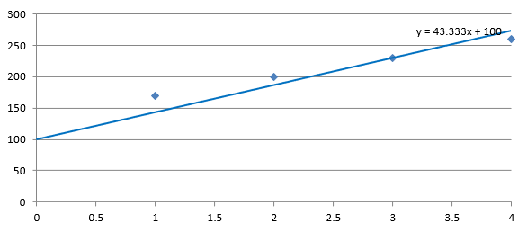

## **Tổng quan**

Bài viết này giải thích cách thêm các đường xu hướng vào biểu đồ trong bản trình chiếu bằng cách sử dụng Aspose.Slides. Nó chỉ ra cách tạo biểu đồ, thêm đường xu hướng vào các series của biểu đồ và làm việc với nhiều loại đường xu hướng, bao gồm hàm mũ, tuyến tính, logarit, trung bình động, đa thức và lũy thừa.

Nó cũng mô tả cách thêm một đường tùy chỉnh vào biểu đồ bằng cách chèn một hình dạng đường thẳng, và bao gồm một phần Hỏi‑Đáp ngắn về giá trị chiếu xu hướng “tiến phía trước” và “lùi lại” cũng như liệu các đường xu hướng có được giữ lại khi xuất bản trình chiếu sang PDF hoặc SVG và khi tạo hình ảnh từ biểu đồ hay không.

## **Thêm đường xu hướng**

Sử dụng [ITrendlineCollection::Add](https://reference.aspose.com/slides/cpp/aspose.slides.charts/itrendlinecollection/add/) để thêm một đường xu hướng vào series biểu đồ, chọn loại bằng [TrendlineType](https://reference.aspose.com/slides/cpp/aspose.slides.charts/trendlinetype/). Ví dụ tạo một biểu đồ cột nhóm với dữ liệu mặc định và thêm hai đường xu hướng vào mỗi ba series của nó.

Đường xu hướng hàm mũ ẩn phương trình và giá trị R‑squared thông qua [ITrendline::set_DisplayEquation](https://reference.aspose.com/slides/cpp/aspose.slides.charts/itrendline/set_displayequation/) và [ITrendline::set_DisplayRSquaredValue](https://reference.aspose.com/slides/cpp/aspose.slides.charts/itrendline/set_displayrsquaredvalue/), trong khi đường xu hướng tuyến tính có màu đỏ. Đường xu hướng logarit sử dụng [IOverridableText::AddTextFrameForOverriding](https://reference.aspose.com/slides/cpp/aspose.slides.charts/ioverridabletext/addtextframeforoverriding/) để tạo nhãn tùy chỉnh. Trung bình động sử dụng [ITrendline::set_Period](https://reference.aspose.com/slides/cpp/aspose.slides.charts/itrendline/set_period/) để tính trung bình ba điểm dữ liệu và [ITrendline::set_TrendlineName](https://reference.aspose.com/slides/cpp/aspose.slides.charts/itrendline/set_trendlinename/) cho tên tùy chỉnh.

Đường xu hướng đa thức sử dụng [ITrendline::set_Order](https://reference.aspose.com/slides/cpp/aspose.slides.charts/itrendline/set_order/) để đặt bậc thành ba và mở rộng một danh mục về phía trước thông qua [ITrendline::set_Forward](https://reference.aspose.com/slides/cpp/aspose.slides.charts/itrendline/set_forward/). Đường xu hướng lũy thừa mở rộng một danh mục về phía sau thông qua [ITrendline::set_Backward](https://reference.aspose.com/slides/cpp/aspose.slides.charts/itrendline/set_backward/).

```cpp
#include <system/shared_ptr.h>
#include <drawing/color.h>
#include <DOM/Presentation.h>
#include <DOM/ISlide.h>
#include <DOM/IShapeCollection.h>
#include <DOM/ILineFormat.h>
#include <DOM/IFillFormat.h>
#include <DOM/IColorFormat.h>
#include <DOM/FillType.h>
#include <DOM/IChart.h>
#include <DOM/Chart/ChartType.h>
#include <DOM/Chart/IChartData.h>
#include <DOM/Chart/IChartSeries.h>
#include <DOM/Chart/IChartSeriesCollection.h>
#include <DOM/Chart/ITrendline.h>
#include <DOM/Chart/ITrendlineCollection.h>
#include <DOM/Chart/TrendlineType.h>
#include <DOM/Chart/IFormat.h>
#include <Export/SaveFormat.h>

using namespace System;
using namespace System::Drawing;
using namespace Aspose::Slides;
using namespace Aspose::Slides::Charts;
using namespace Aspose::Slides::Export;

auto presentation = MakeObject<Presentation>();
auto slide = presentation->get_Slide(0);

auto chart = slide->get_Shapes()->AddChart(ChartType::ClusteredColumn, 20, 20, 500, 400);

auto firstSeries = chart->get_ChartData()->get_Series()->idx_get(0);

auto exponentialTrendline = firstSeries->get_TrendLines()->Add(TrendlineType::Exponential);
exponentialTrendline->set_DisplayEquation(false);
exponentialTrendline->set_DisplayRSquaredValue(false);

auto linearTrendline = firstSeries->get_TrendLines()->Add(TrendlineType::Linear);
linearTrendline->get_Format()->get_Line()->get_FillFormat()->set_FillType(FillType::Solid);
linearTrendline->get_Format()->get_Line()->get_FillFormat()->get_SolidFillColor()->set_Color(Color::get_Red());

auto secondSeries = chart->get_ChartData()->get_Series()->idx_get(1);

auto logarithmicTrendline = secondSeries->get_TrendLines()->Add(TrendlineType::Logarithmic);
logarithmicTrendline->AddTextFrameForOverriding(u"New log trend line");

auto movingAverageTrendline = secondSeries->get_TrendLines()->Add(TrendlineType::MovingAverage);
movingAverageTrendline->set_Period(3);
movingAverageTrendline->set_TrendlineName(u"New TrendLine Name");

auto thirdSeries = chart->get_ChartData()->get_Series()->idx_get(2);

auto polynomialTrendline = thirdSeries->get_TrendLines()->Add(TrendlineType::Polynomial);
polynomialTrendline->set_Forward(1);
polynomialTrendline->set_Order(3);

auto powerTrendline = thirdSeries->get_TrendLines()->Add(TrendlineType::Power);
powerTrendline->set_Backward(1);

presentation->Save(u"ChartTrendLines.pptx", SaveFormat::Pptx);
```

## **Đặt điểm cắt (Intercept) cho đường xu hướng**

Sử dụng [ITrendline::set_Intercept](https://reference.aspose.com/slides/cpp/aspose.slides.charts/itrendline/set_intercept/) để cố định giá trị Y của đường xu hướng tại X = 0. Cài đặt này được hỗ trợ cho các đường xu hướng tuyến tính, hàm mũ và đa thức.

Ví dụ, một mô hình chi phí sản xuất có thể cần bắt đầu tại chi phí cố định đã biết là 100, ngay cả khi các đo lường tại khối lượng sản xuất khác 0 gợi ý một đường cơ sở khác. Đối với đường xu hướng tuyến tính, cố định intercept buộc phương trình `y = ax + b` thành `b = 100`; độ dốc được điều chỉnh dựa trên dữ liệu theo ràng buộc đó. Nó không chỉ di chuyển một đường đã được điều chỉnh. Cài đặt giao cắt trục kiểm soát vị trí các trục biểu đồ gặp nhau, không phải hệ số của đường xu hướng đã điều chỉnh.

Ví dụ sau tạo một biểu đồ dạng phân tán (XY) với khối lượng sản xuất từ 1 đến 4 và chi phí 170, 200, 230, và 260. Nó lưu biểu đồ với intercept tự động mặc định, đặt intercept thành 100 và lưu một tệp PPTX thứ hai. Hai tệp chỉ khác nhau ở cài đặt intercept. Đường xu hướng hiển thị phương trình và mở rộng trở lại X = 0.

```cpp
#include <system/shared_ptr.h>
#include <system/object_ext.h>
#include <DOM/Chart/IChartDataWorkbook.h>
#include <DOM/Chart/IChartDataCell.h>
#include <DOM/Chart/IChartCategoryCollection.h>
#include <DOM/Chart/IChartDataPointCollection.h>
#include <DOM/Presentation.h>
#include <DOM/ISlide.h>
#include <DOM/IShapeCollection.h>
#include <DOM/IChart.h>
#include <DOM/Chart/ChartType.h>
#include <DOM/Chart/IChartData.h>
#include <DOM/Chart/IChartSeries.h>
#include <DOM/Chart/IChartSeriesCollection.h>
#include <DOM/Chart/ITrendline.h>
#include <DOM/Chart/ITrendlineCollection.h>
#include <DOM/Chart/TrendlineType.h>
#include <Export/SaveFormat.h>

using namespace System;
using namespace Aspose::Slides;
using namespace Aspose::Slides::Charts;
using namespace Aspose::Slides::Export;

auto presentation = MakeObject<Presentation>();
auto slide = presentation->get_Slide(0);

auto chart = slide->get_Shapes()->AddChart(ChartType::ScatterWithMarkers, 20, 20, 480, 210);
chart->set_HasLegend(false);

chart->get_ChartData()->get_Series()->Clear();
chart->get_ChartData()->get_Categories()->Clear();

auto workbook = chart->get_ChartData()->get_ChartDataWorkbook();
workbook->Clear(0);

auto nameCell = workbook->GetCell(0, 0, 1, ObjectExt::Box<String>(u"Production cost"));
auto series = chart->get_ChartData()->get_Series()->Add(nameCell, ChartType::ScatterWithMarkers);
const double costs[] = { 170, 200, 230, 260 };

for (auto i = 0; i < 4; i++)
{
    auto xCell = workbook->GetCell(0, i + 1, 0, ObjectExt::Box<int32_t>(i + 1));
    auto yCell = workbook->GetCell(0, i + 1, 1, ObjectExt::Box<double>(costs[i]));
    series->get_DataPoints()->AddDataPointForScatterSeries(xCell, yCell);
}

auto trendline = series->get_TrendLines()->Add(TrendlineType::Linear);
trendline->set_DisplayEquation(true);
trendline->set_Backward(1);

presentation->Save(u"AutomaticIntercept.pptx", SaveFormat::Pptx);

trendline->set_Intercept(100);
presentation->Save(u"FixedIntercept.pptx", SaveFormat::Pptx);
```

Với tính toán tự động, các dữ liệu này cho ra `y = 30x + 140`. Đặt intercept thành 100 thay thế cho khoảng `y = 43.33x + 100`: giá trị điều chỉnh tại zero khớp với cơ sở đã biết, trong khi đường không còn đi qua mọi điểm dữ liệu.

| Intercept tự động | Intercept cố định 100 |
| --- | --- |
|  |  |

Cả hai hình ảnh đều sử dụng cùng một bộ dữ liệu và tỷ lệ trục. Các đường xu hướng được mở rộng về X = 0 để hiển thị intercept của chúng.

Mặc định, thuộc tính chứa `std::numeric_limits<double>::quiet_NaN()`, đại diện cho một intercept chưa xác định thay vì zero. Intercept sau đó được tính tự động từ dữ liệu.

## **Thêm đường tùy chỉnh**

Một đường tùy chỉnh là một hình dạng vẽ lên trên biểu đồ thay vì một đường xu hướng được tính từ dữ liệu series. Ví dụ này sử dụng [IShapeCollection::AddAutoShape](https://reference.aspose.com/slides/cpp/aspose.slides/ishapecollection/addautoshape/) để thêm một đường ngang vào slide trên biểu đồ. Vị trí của đường được chỉ định bằng tọa độ slide, đo bằng điểm, vì vậy nó bắt đầu ở cạnh trái của biểu đồ và nằm ở giữa chiều cao biểu đồ. Độ rộng của nó khớp với độ rộng của biểu đồ. Định dạng đường được trả về bởi [IShape::get_LineFormat](https://reference.aspose.com/slides/cpp/aspose.slides/ishape/get_lineformat/) cung cấp cho đường một màu đỏ đặc.

```cpp
#include <system/shared_ptr.h>
#include <drawing/color.h>
#include <DOM/Presentation.h>
#include <DOM/ISlide.h>
#include <DOM/IShapeCollection.h>
#include <DOM/IAutoShape.h>
#include <DOM/ShapeType.h>
#include <DOM/ILineFormat.h>
#include <DOM/IFillFormat.h>
#include <DOM/IColorFormat.h>
#include <DOM/FillType.h>
#include <DOM/IChart.h>
#include <DOM/Chart/ChartType.h>
#include <Export/SaveFormat.h>

using namespace System;
using namespace System::Drawing;
using namespace Aspose::Slides;
using namespace Aspose::Slides::Charts;
using namespace Aspose::Slides::Export;

auto presentation = MakeObject<Presentation>();
auto slide = presentation->get_Slide(0);

auto chart = slide->get_Shapes()->AddChart(ChartType::ClusteredColumn, 100, 100, 500, 400);

auto line = slide->get_Shapes()->AddAutoShape(ShapeType::Line, chart->get_X(), chart->get_Y() + chart->get_Height() / 2, chart->get_Width(), 0);
line->get_LineFormat()->get_FillFormat()->set_FillType(FillType::Solid);
line->get_LineFormat()->get_FillFormat()->get_SolidFillColor()->set_Color(Color::get_Red());

presentation->Save(u"AddCustomLines.pptx", SaveFormat::Pptx);
```

## **FAQ**

**‘Tiến phía trước’ và ‘lùi lại’ có nghĩa là gì đối với một đường xu hướng?**

Chúng là độ dài của đường xu hướng được chiếu tiến về phía trước hoặc lùi lại: đối với biểu đồ phân tán (XY) — tính bằng đơn vị trục; đối với các biểu đồ không phân tán — tính bằng số danh mục. Chỉ cho phép các giá trị không âm.

**Đường xu hướng có được giữ lại khi xuất bản trình chiếu sang PDF hoặc SVG, hoặc khi render một slide thành hình ảnh không?**

Có. Aspose.Slides chuyển đổi các bản trình chiếu sang [PDF](/slides/vi/cpp/convert-powerpoint-to-pdf/) hoặc [SVG](/slides/vi/cpp/render-a-slide-as-an-svg-image/) và render các biểu đồ thành hình ảnh; các đường xu hướng, như một phần của biểu đồ, được giữ lại trong các thao tác này. Một phương thức cũng có sẵn để [xuất hình ảnh của biểu đồ](/slides/vi/cpp/shape-thumbnails/) riêng biệt.