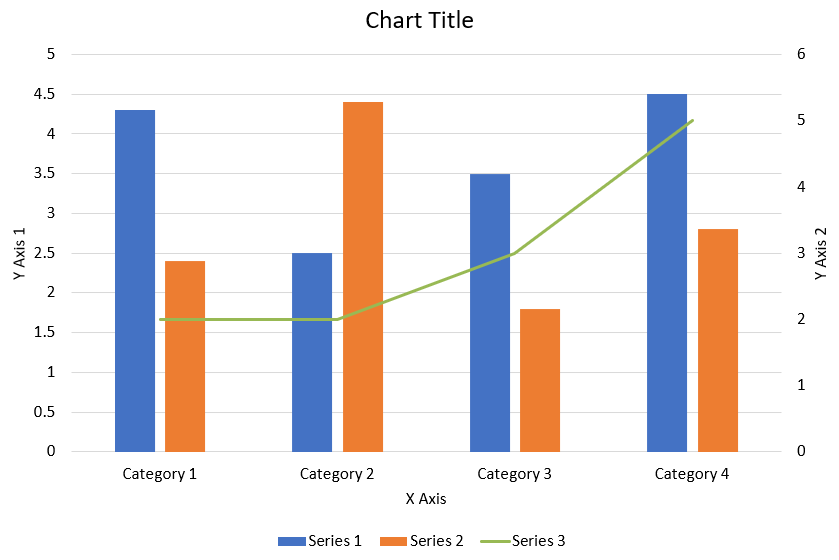

## **Tổng quan**

Bài viết này cung cấp hướng dẫn toàn diện về cách tạo và tùy chỉnh biểu đồ bằng Aspose.Slides cho C++. Bạn sẽ học cách thêm biểu đồ vào một slide một cách lập trình, điền dữ liệu vào biểu đồ và áp dụng các tùy chọn định dạng khác nhau để đáp ứng yêu cầu thiết kế cụ thể của mình. Trong suốt bài viết, các ví dụ mã chi tiết minh họa từng bước, từ khởi tạo đối tượng Presentation và Chart đến cấu hình series, trục và legend. Khi làm theo hướng dẫn này, bạn sẽ nắm vững cách tích hợp việc tạo biểu đồ động vào các ứng dụng C++ của mình, giúp đơn giản hoá quá trình tạo các bài thuyết trình dựa trên dữ liệu.

## **Tạo biểu đồ**

Biểu đồ giúp mọi người nhanh chóng hình dung dữ liệu và rút ra những hiểu biết có thể không hiển nhiên ngay từ bảng hoặc bảng tính.

**Tại sao nên tạo biểu đồ?**

* tổng hợp, cổng gọn hoặc tóm tắt một lượng lớn dữ liệu trên một slide trong bài thuyết trình;
* phô bày các mẫu và xu hướng trong dữ liệu;
* suy ra hướng và động lực của dữ liệu theo thời gian hoặc so với một đơn vị đo lường cụ thể;
* phát hiện các giá trị ngoại lệ, sai lệch, lỗi và dữ liệu không hợp lý;
* truyền đạt hoặc trình bày dữ liệu phức tạp.

Trong PowerPoint, bạn có thể tạo biểu đồ thông qua chức năng *Insert*, cung cấp các mẫu để thiết kế nhiều loại biểu đồ. Sử dụng Aspose.Slides, bạn có thể tạo cả biểu đồ chuẩn (dựa trên các loại biểu đồ phổ biến) và biểu đồ tùy chỉnh.

{}
Sử dụng enumeration [ChartType](https://reference.aspose.com/slides/cpp/aspose.slides.charts/charttype/) trong không gian tên [Aspose::Slides::Charts](https://reference.aspose.com/slides/cpp/aspose.slides.charts/). Các giá trị trong enumeration này tương ứng với các loại biểu đồ khác nhau.
{}

### **Tạo biểu đồ cột nhóm**

Ví dụ này sử dụng [AddChart](https://reference.aspose.com/slides/cpp/aspose.slides/ishapecollection/addchart/) để tạo một biểu đồ cột nhóm so sánh hai series qua ba danh mục. Các series sử dụng màu đỏ và xanh lá, và các nhãn riêng lẻ hiển thị tên danh mục, tên series và giá trị. Chỉ mục worksheet 0 đề cập đến sheet đầu tiên trong workbook biểu đồ nhúng.

```cpp
#include <system/shared_ptr.h>
#include <system/object_ext.h>
#include <system/string.h>
#include <drawing/color.h>
#include <DOM/Chart/ChartType.h>
#include <DOM/Chart/IChartCategoryCollection.h>
#include <DOM/Chart/IChartData.h>
#include <DOM/Chart/IChartDataCell.h>
#include <DOM/Chart/IChartDataPoint.h>
#include <DOM/Chart/IChartDataPointCollection.h>
#include <DOM/Chart/IChartDataWorkbook.h>
#include <DOM/Chart/IChartSeries.h>
#include <DOM/Chart/IChartSeriesCollection.h>
#include <DOM/Chart/IChartTitle.h>
#include <DOM/Chart/IDataLabel.h>
#include <DOM/Chart/IDataLabelCollection.h>
#include <DOM/Chart/IDataLabelFormat.h>
#include <DOM/Chart/IDoubleChartValue.h>
#include <DOM/Chart/IFormat.h>
#include <DOM/FillType.h>
#include <DOM/IChart.h>
#include <DOM/IColorFormat.h>
#include <DOM/IFillFormat.h>
#include <DOM/ILineFillFormat.h>
#include <DOM/ILineFormat.h>
#include <DOM/IShapeCollection.h>
#include <DOM/ISlide.h>
#include <DOM/ITextFrame.h>
#include <DOM/ITextFrameFormat.h>
#include <DOM/NullableBool.h>
#include <DOM/Presentation.h>
#include <Export/SaveFormat.h>

using namespace System;
using namespace System::Drawing;
using namespace Aspose::Slides;
using namespace Aspose::Slides::Charts;
using namespace Aspose::Slides::Export;

auto presentation = MakeObject<Presentation>();
auto slide = presentation->get_Slide(0);

auto chart = slide->get_Shapes()->AddChart(ChartType::ClusteredColumn, 20, 20, 500, 300);

chart->get_ChartTitle()->AddTextFrameForOverriding(u"Sample Title");
chart->get_ChartTitle()->get_TextFrameForOverriding()->get_TextFrameFormat()->set_CenterText(NullableBool::True);
chart->get_ChartTitle()->set_Height(20);
chart->set_HasTitle(true);

auto workbook = chart->get_ChartData()->get_ChartDataWorkbook();
auto worksheetIndex = 0;

chart->get_ChartData()->get_Series()->Clear();
chart->get_ChartData()->get_Categories()->Clear();

auto seriesNameCell = workbook->GetCell(worksheetIndex, 0, 1, ObjectExt::Box(String(u"Series 1")));
chart->get_ChartData()->get_Series()->Add(seriesNameCell, chart->get_Type());
seriesNameCell = workbook->GetCell(worksheetIndex, 0, 2, ObjectExt::Box(String(u"Series 2")));
chart->get_ChartData()->get_Series()->Add(seriesNameCell, chart->get_Type());

auto categoryCell = workbook->GetCell(worksheetIndex, 1, 0, ObjectExt::Box(String(u"Category 1")));
chart->get_ChartData()->get_Categories()->Add(categoryCell);
categoryCell = workbook->GetCell(worksheetIndex, 2, 0, ObjectExt::Box(String(u"Category 2")));
chart->get_ChartData()->get_Categories()->Add(categoryCell);
categoryCell = workbook->GetCell(worksheetIndex, 3, 0, ObjectExt::Box(String(u"Category 3")));
chart->get_ChartData()->get_Categories()->Add(categoryCell);

auto series = chart->get_ChartData()->get_Series()->idx_get(0);

auto valueCell = workbook->GetCell(worksheetIndex, 1, 1, ObjectExt::Box(20));
series->get_DataPoints()->AddDataPointForBarSeries(valueCell);
valueCell = workbook->GetCell(worksheetIndex, 2, 1, ObjectExt::Box(50));
series->get_DataPoints()->AddDataPointForBarSeries(valueCell);
valueCell = workbook->GetCell(worksheetIndex, 3, 1, ObjectExt::Box(30));
series->get_DataPoints()->AddDataPointForBarSeries(valueCell);

series->get_Format()->get_Fill()->set_FillType(FillType::Solid);
series->get_Format()->get_Fill()->get_SolidFillColor()->set_Color(Color::get_Red());

series = chart->get_ChartData()->get_Series()->idx_get(1);

valueCell = workbook->GetCell(worksheetIndex, 1, 2, ObjectExt::Box(30));
series->get_DataPoints()->AddDataPointForBarSeries(valueCell);
valueCell = workbook->GetCell(worksheetIndex, 2, 2, ObjectExt::Box(10));
series->get_DataPoints()->AddDataPointForBarSeries(valueCell);
valueCell = workbook->GetCell(worksheetIndex, 3, 2, ObjectExt::Box(60));
series->get_DataPoints()->AddDataPointForBarSeries(valueCell);

series->get_Format()->get_Fill()->set_FillType(FillType::Solid);
series->get_Format()->get_Fill()->get_SolidFillColor()->set_Color(Color::get_Green());

auto label = series->get_DataPoints()->idx_get(0)->get_Label();
label->get_DataLabelFormat()->set_ShowCategoryName(true);

label = series->get_DataPoints()->idx_get(1)->get_Label();
label->get_DataLabelFormat()->set_ShowSeriesName(true);

label = series->get_DataPoints()->idx_get(2)->get_Label();
label->get_DataLabelFormat()->set_ShowValue(true);
label->get_DataLabelFormat()->set_ShowSeriesName(true);
label->get_DataLabelFormat()->set_Separator(u"/");

presentation->Save(u"AsposeChart.pptx", SaveFormat::Pptx);
```

Kết quả:


### **Tạo biểu đồ phân tán**

Biểu đồ phân tán (còn được gọi là scatter plots hoặc đồ thị x‑y) thường được sử dụng để kiểm tra các mẫu hoặc minh họa mối tương quan giữa hai biến.

Sử dụng một biểu đồ phân tán khi:

* Bạn có dữ liệu số cặp đôi.
* Bạn có hai biến liên quan chặt chẽ với nhau.
* Bạn muốn xác định liệu hai biến có liên quan hay không.
* Bạn có một biến độc lập có nhiều giá trị cho một biến phụ thuộc.

Ví dụ này vẽ hai tập giá trị x‑y. Series đầu tiên sử dụng đường thẳng với dấu sao, trong khi series thứ hai sử dụng đường mượt với dấu vòng; cả hai đều có kích thước dấu hiệu là 10, được đặt bằng [set_Size](https://reference.aspose.com/slides/cpp/aspose.slides.charts/imarker/set_size/). Phương thức [set_Symbol](https://reference.aspose.com/slides/cpp/aspose.slides.charts/imarker/set_symbol/) điều khiển hình dạng dấu hiệu.

```cpp
#include <system/shared_ptr.h>
#include <system/object_ext.h>
#include <system/string.h>
#include <DOM/Chart/ChartType.h>
#include <DOM/Chart/IChartCategoryCollection.h>
#include <DOM/Chart/IChartData.h>
#include <DOM/Chart/IChartDataCell.h>
#include <DOM/Chart/IChartDataPoint.h>
#include <DOM/Chart/IChartDataPointCollection.h>
#include <DOM/Chart/IChartDataWorkbook.h>
#include <DOM/Chart/IChartSeries.h>
#include <DOM/Chart/IChartSeriesCollection.h>
#include <DOM/Chart/IDoubleChartValue.h>
#include <DOM/Chart/IFormat.h>
#include <DOM/Chart/IMarker.h>
#include <DOM/Chart/MarkerStyleType.h>
#include <DOM/IChart.h>
#include <DOM/IColorFormat.h>
#include <DOM/IFillFormat.h>
#include <DOM/ILineFillFormat.h>
#include <DOM/ILineFormat.h>
#include <DOM/IShapeCollection.h>
#include <DOM/ISlide.h>
#include <DOM/Presentation.h>
#include <Export/SaveFormat.h>

using namespace System;
using namespace Aspose::Slides;
using namespace Aspose::Slides::Charts;
using namespace Aspose::Slides::Export;

auto presentation = MakeObject<Presentation>();
auto slide = presentation->get_Slide(0);

auto chart = slide->get_Shapes()->AddChart(ChartType::ScatterWithSmoothLines, 20, 20, 500, 300);

auto workbook = chart->get_ChartData()->get_ChartDataWorkbook();
auto worksheetIndex = 0;

chart->get_ChartData()->get_Series()->Clear();

auto seriesNameCell = workbook->GetCell(worksheetIndex, 1, 1, ObjectExt::Box(String(u"Series 1")));
chart->get_ChartData()->get_Series()->Add(seriesNameCell, chart->get_Type());
seriesNameCell = workbook->GetCell(worksheetIndex, 1, 3, ObjectExt::Box(String(u"Series 2")));
chart->get_ChartData()->get_Series()->Add(seriesNameCell, chart->get_Type());

auto series = chart->get_ChartData()->get_Series()->idx_get(0);

auto xValueCell = workbook->GetCell(worksheetIndex, 2, 1, ObjectExt::Box(1));
auto yValueCell = workbook->GetCell(worksheetIndex, 2, 2, ObjectExt::Box(3));
series->get_DataPoints()->AddDataPointForScatterSeries(xValueCell, yValueCell);

xValueCell = workbook->GetCell(worksheetIndex, 3, 1, ObjectExt::Box(2));
yValueCell = workbook->GetCell(worksheetIndex, 3, 2, ObjectExt::Box(10));
series->get_DataPoints()->AddDataPointForScatterSeries(xValueCell, yValueCell);

series->set_Type(ChartType::ScatterWithStraightLinesAndMarkers);

series->get_Marker()->set_Size(10);
series->get_Marker()->set_Symbol(MarkerStyleType::Star);

series = chart->get_ChartData()->get_Series()->idx_get(1);

xValueCell = workbook->GetCell(worksheetIndex, 2, 3, ObjectExt::Box(5));
yValueCell = workbook->GetCell(worksheetIndex, 2, 4, ObjectExt::Box(2));
series->get_DataPoints()->AddDataPointForScatterSeries(xValueCell, yValueCell);

xValueCell = workbook->GetCell(worksheetIndex, 3, 3, ObjectExt::Box(3));
yValueCell = workbook->GetCell(worksheetIndex, 3, 4, ObjectExt::Box(1));
series->get_DataPoints()->AddDataPointForScatterSeries(xValueCell, yValueCell);

xValueCell = workbook->GetCell(worksheetIndex, 4, 3, ObjectExt::Box(2));
yValueCell = workbook->GetCell(worksheetIndex, 4, 4, ObjectExt::Box(2));
series->get_DataPoints()->AddDataPointForScatterSeries(xValueCell, yValueCell);

xValueCell = workbook->GetCell(worksheetIndex, 5, 3, ObjectExt::Box(5));
yValueCell = workbook->GetCell(worksheetIndex, 5, 4, ObjectExt::Box(1));
series->get_DataPoints()->AddDataPointForScatterSeries(xValueCell, yValueCell);

series->get_Marker()->set_Size(10);
series->get_Marker()->set_Symbol(MarkerStyleType::Circle);

presentation->Save(u"AsposeChart.pptx", SaveFormat::Pptx);
```

Kết quả:


### **Tạo biểu đồ tròn**

Biểu đồ tròn thích hợp nhất để hiển thị mối quan hệ phần‑đối‑với‑toàn trong dữ liệu, đặc biệt khi dữ liệu chứa các nhãn phân loại kèm giá trị số. Tuy nhiên, nếu dữ liệu của bạn có nhiều phần hoặc nhãn, bạn có thể xem xét sử dụng biểu đồ cột thay thế.

Ví dụ này tạo một biểu đồ tròn với ba giá trị theo quý. Mỗi lát có màu nền và viền tùy chỉnh, và các nhãn hiển thị các tổ hợp khác nhau của giá trị, phần trăm và thông tin series. Phương thức [set_FirstSliceAngle](https://reference.aspose.com/slides/cpp/aspose.slides.charts/ichartseriesgroup/set_firstsliceangle/) đặt lát đầu tiên bắt đầu tại 180 độ.

```cpp
#include <system/shared_ptr.h>
#include <system/object_ext.h>
#include <system/string.h>
#include <drawing/color.h>
#include <DOM/Chart/ChartType.h>
#include <DOM/Chart/IChartCategoryCollection.h>
#include <DOM/Chart/IChartData.h>
#include <DOM/Chart/IChartDataCell.h>
#include <DOM/Chart/IChartDataPoint.h>
#include <DOM/Chart/IChartDataPointCollection.h>
#include <DOM/Chart/IChartDataWorkbook.h>
#include <DOM/Chart/IChartSeries.h>
#include <DOM/Chart/IChartSeriesCollection.h>
#include <DOM/Chart/IChartSeriesGroup.h>
#include <DOM/Chart/IChartSeriesGroupCollection.h>
#include <DOM/Chart/IChartTextFormat.h>
#include <DOM/Chart/IChartTitle.h>
#include <DOM/Chart/IDataLabel.h>
#include <DOM/Chart/IDataLabelCollection.h>
#include <DOM/Chart/IDataLabelFormat.h>
#include <DOM/Chart/IDoubleChartValue.h>
#include <DOM/Chart/IFormat.h>
#include <DOM/Chart/ILegend.h>
#include <DOM/FillType.h>
#include <DOM/IChart.h>
#include <DOM/IColorFormat.h>
#include <DOM/IFillFormat.h>
#include <DOM/ILineFillFormat.h>
#include <DOM/ILineFormat.h>
#include <DOM/IPortionFormat.h>
#include <DOM/IShapeCollection.h>
#include <DOM/ISlide.h>
#include <DOM/ITextFrame.h>
#include <DOM/ITextFrameFormat.h>
#include <DOM/LineDashStyle.h>
#include <DOM/LineStyle.h>
#include <DOM/NullableBool.h>
#include <DOM/Presentation.h>
#include <Export/SaveFormat.h>

using namespace System;
using namespace System::Drawing;
using namespace Aspose::Slides;
using namespace Aspose::Slides::Charts;
using namespace Aspose::Slides::Export;

auto presentation = MakeObject<Presentation>();
auto slide = presentation->get_Slide(0);

auto chart = slide->get_Shapes()->AddChart(ChartType::Pie, 20, 20, 500, 300);

chart->get_ChartTitle()->AddTextFrameForOverriding(u"Sample Title");
chart->get_ChartTitle()->get_TextFrameForOverriding()->get_TextFrameFormat()->set_CenterText(NullableBool::True);
chart->get_ChartTitle()->set_Height(20);
chart->set_HasTitle(true);

chart->get_ChartData()->get_Series()->idx_get(0)->get_Labels()->get_DefaultDataLabelFormat()->set_ShowValue(true);

auto workbook = chart->get_ChartData()->get_ChartDataWorkbook();
auto worksheetIndex = 0;

chart->get_ChartData()->get_Series()->Clear();
chart->get_ChartData()->get_Categories()->Clear();

auto categoryCell = workbook->GetCell(0, 1, 0, ObjectExt::Box(String(u"1st Qtr")));
chart->get_ChartData()->get_Categories()->Add(categoryCell);
categoryCell = workbook->GetCell(0, 2, 0, ObjectExt::Box(String(u"2nd Qtr")));
chart->get_ChartData()->get_Categories()->Add(categoryCell);
categoryCell = workbook->GetCell(0, 3, 0, ObjectExt::Box(String(u"3rd Qtr")));
chart->get_ChartData()->get_Categories()->Add(categoryCell);

auto seriesNameCell = workbook->GetCell(0, 0, 1, ObjectExt::Box(String(u"Series 1")));
auto series = chart->get_ChartData()->get_Series()->Add(seriesNameCell, chart->get_Type());

auto valueCell = workbook->GetCell(worksheetIndex, 1, 1, ObjectExt::Box(20));
series->get_DataPoints()->AddDataPointForPieSeries(valueCell);
valueCell = workbook->GetCell(worksheetIndex, 2, 1, ObjectExt::Box(50));
series->get_DataPoints()->AddDataPointForPieSeries(valueCell);
valueCell = workbook->GetCell(worksheetIndex, 3, 1, ObjectExt::Box(30));
series->get_DataPoints()->AddDataPointForPieSeries(valueCell);

chart->get_ChartData()->get_SeriesGroups()->idx_get(0)->set_IsColorVaried(true);

auto firstSlice = series->get_DataPoints()->idx_get(0);
firstSlice->get_Format()->get_Fill()->set_FillType(FillType::Solid);
firstSlice->get_Format()->get_Fill()->get_SolidFillColor()->set_Color(Color::get_Cyan());

firstSlice->get_Format()->get_Line()->get_FillFormat()->set_FillType(FillType::Solid);
firstSlice->get_Format()->get_Line()->get_FillFormat()->get_SolidFillColor()->set_Color(Color::get_Gray());
firstSlice->get_Format()->get_Line()->set_Width(3.0);
firstSlice->get_Format()->get_Line()->set_Style(LineStyle::ThinThick);
firstSlice->get_Format()->get_Line()->set_DashStyle(LineDashStyle::LargeDash);

auto secondSlice = series->get_DataPoints()->idx_get(1);
secondSlice->get_Format()->get_Fill()->set_FillType(FillType::Solid);
secondSlice->get_Format()->get_Fill()->get_SolidFillColor()->set_Color(Color::get_Brown());

secondSlice->get_Format()->get_Line()->get_FillFormat()->set_FillType(FillType::Solid);
secondSlice->get_Format()->get_Line()->get_FillFormat()->get_SolidFillColor()->set_Color(Color::get_Blue());
secondSlice->get_Format()->get_Line()->set_Width(3.0);
secondSlice->get_Format()->get_Line()->set_Style(LineStyle::Single);
secondSlice->get_Format()->get_Line()->set_DashStyle(LineDashStyle::LargeDashDot);

auto thirdSlice = series->get_DataPoints()->idx_get(2);
thirdSlice->get_Format()->get_Fill()->set_FillType(FillType::Solid);
thirdSlice->get_Format()->get_Fill()->get_SolidFillColor()->set_Color(Color::get_Coral());

thirdSlice->get_Format()->get_Line()->get_FillFormat()->set_FillType(FillType::Solid);
thirdSlice->get_Format()->get_Line()->get_FillFormat()->get_SolidFillColor()->set_Color(Color::get_Red());
thirdSlice->get_Format()->get_Line()->set_Width(2.0);
thirdSlice->get_Format()->get_Line()->set_Style(LineStyle::ThinThin);
thirdSlice->get_Format()->get_Line()->set_DashStyle(LineDashStyle::LargeDashDotDot);

auto firstLabel = series->get_DataPoints()->idx_get(0)->get_Label();
firstLabel->get_DataLabelFormat()->set_ShowValue(true);

auto secondLabel = series->get_DataPoints()->idx_get(1)->get_Label();
secondLabel->get_DataLabelFormat()->set_ShowValue(true);
secondLabel->get_DataLabelFormat()->set_ShowLegendKey(true);
secondLabel->get_DataLabelFormat()->set_ShowPercentage(true);

auto thirdLabel = series->get_DataPoints()->idx_get(2)->get_Label();
thirdLabel->get_DataLabelFormat()->set_ShowSeriesName(true);
thirdLabel->get_DataLabelFormat()->set_ShowPercentage(true);

series->get_Labels()->get_DefaultDataLabelFormat()->set_ShowLeaderLines(true);

chart->get_ChartData()->get_SeriesGroups()->idx_get(0)->set_FirstSliceAngle(180);

presentation->Save(u"PieChart.pptx", SaveFormat::Pptx);
```

Kết quả:


Để cải thiện khả năng đọc của các nhãn bên ngoài hình tròn, xem [Format Leader Lines](/slides/vi/cpp/chart-data-label/#format-leader-lines) để biết ví dụ về cách định vị nhãn và tùy chỉnh màu, độ rộng, độ trong suốt và kiểu gạch của các đường nối.

### **Tạo biểu đồ đường**

Biểu đồ đường (còn được gọi là line graphs) thích hợp trong các tình huống bạn muốn minh họa sự thay đổi giá trị theo thời gian. Sử dụng biểu đồ đường, bạn có thể so sánh một lượng lớn dữ liệu một lúc, theo dõi các thay đổi và xu hướng theo thời gian, làm nổi bật các bất thường trong series và nhiều hơn nữa.

Ví dụ này sử dụng [AddChart](https://reference.aspose.com/slides/cpp/aspose.slides/ishapecollection/addchart/) để tạo một biểu đồ đường với series và danh mục mặc định, sau đó lưu bài thuyết trình dưới dạng PPTX.

```cpp
#include <system/shared_ptr.h>
#include <DOM/Chart/ChartType.h>
#include <DOM/Chart/IChartCategoryCollection.h>
#include <DOM/Chart/IChartData.h>
#include <DOM/Chart/IChartSeriesCollection.h>
#include <DOM/Chart/IFormat.h>
#include <DOM/IChart.h>
#include <DOM/IColorFormat.h>
#include <DOM/IFillFormat.h>
#include <DOM/ILineFillFormat.h>
#include <DOM/ILineFormat.h>
#include <DOM/IShapeCollection.h>
#include <DOM/ISlide.h>
#include <DOM/Presentation.h>
#include <Export/SaveFormat.h>

using namespace System;
using namespace Aspose::Slides;
using namespace Aspose::Slides::Charts;
using namespace Aspose::Slides::Export;

auto presentation = MakeObject<Presentation>();
auto slide = presentation->get_Slide(0);

auto lineChart = slide->get_Shapes()->AddChart(ChartType::Line, 20, 20, 500, 300);

presentation->Save(u"lineChart.pptx", SaveFormat::Pptx);
```

Mặc định, các điểm trên biểu đồ đường được nối bằng các đường thẳng liên tục. Nếu bạn muốn các điểm được nối bằng gạch nối, gọi [set_DashStyle](https://reference.aspose.com/slides/cpp/aspose.slides/ilineformat/set_dashstyle/) với một giá trị từ [LineDashStyle](https://reference.aspose.com/slides/cpp/aspose.slides/linedashstyle/):

```cpp
#include <system/shared_ptr.h>
#include <DOM/Chart/ChartType.h>
#include <DOM/Chart/IChartCategoryCollection.h>
#include <DOM/Chart/IChartData.h>
#include <DOM/Chart/IChartSeries.h>
#include <DOM/Chart/IChartSeriesCollection.h>
#include <DOM/Chart/IFormat.h>
#include <DOM/IChart.h>
#include <DOM/IColorFormat.h>
#include <DOM/IFillFormat.h>
#include <DOM/ILineFillFormat.h>
#include <DOM/ILineFormat.h>
#include <DOM/IShapeCollection.h>
#include <DOM/ISlide.h>
#include <DOM/LineDashStyle.h>
#include <DOM/Presentation.h>

using namespace System;
using namespace Aspose::Slides;
using namespace Aspose::Slides::Charts;

auto presentation = MakeObject<Presentation>();
auto slide = presentation->get_Slide(0);

auto lineChart = slide->get_Shapes()->AddChart(ChartType::Line, 20, 20, 500, 300);

for (auto series : lineChart->get_ChartData()->get_Series())
{
    series->get_Format()->get_Line()->set_DashStyle(LineDashStyle::Dash);
}
```

Kết quả:


### **Tạo biểu đồ cây**

Biểu đồ cây (Tree Map) thích hợp cho dữ liệu bán hàng khi bạn muốn hiển thị kích thước tương đối của các danh mục dữ liệu và nhanh chóng thu hút sự chú ý tới các mục đóng góp lớn trong mỗi danh mục.

Ví dụ này tạo một cây với tám lá được nhóm thành bốn thân và hai nhánh. Phương thức [SetGroupingItem](https://reference.aspose.com/slides/cpp/aspose.slides.charts/ichartcategorylevelsmanager/setgroupingitem/) gán các thân ở mức nhóm 1 và các nhánh ở mức 2. Các giá trị xác định kích thước hình chữ nhật tương đối, trong khi các nhãn danh mục và nhãn cha chồng lên nhau xác định cấp độ hệ thống.

```cpp
#include <system/shared_ptr.h>
#include <system/object_ext.h>
#include <system/string.h>
#include <DOM/Chart/ChartType.h>
#include <DOM/Chart/IChartCategory.h>
#include <DOM/Chart/IChartCategoryCollection.h>
#include <DOM/Chart/IChartCategoryLevelsManager.h>
#include <DOM/Chart/IChartData.h>
#include <DOM/Chart/IChartDataCell.h>
#include <DOM/Chart/IChartDataPoint.h>
#include <DOM/Chart/IChartDataPointCollection.h>
#include <DOM/Chart/IChartDataWorkbook.h>
#include <DOM/Chart/IChartSeries.h>
#include <DOM/Chart/IChartSeriesCollection.h>
#include <DOM/Chart/IDataLabel.h>
#include <DOM/Chart/IDataLabelCollection.h>
#include <DOM/Chart/IDataLabelFormat.h>
#include <DOM/Chart/IFormat.h>
#include <DOM/Chart/ParentLabelLayoutType.h>
#include <DOM/IChart.h>
#include <DOM/IColorFormat.h>
#include <DOM/IFillFormat.h>
#include <DOM/ILineFillFormat.h>
#include <DOM/ILineFormat.h>
#include <DOM/IShapeCollection.h>
#include <DOM/ISlide.h>
#include <DOM/Presentation.h>
#include <Export/SaveFormat.h>

using namespace System;
using namespace Aspose::Slides;
using namespace Aspose::Slides::Charts;
using namespace Aspose::Slides::Export;

auto presentation = MakeObject<Presentation>();
auto slide = presentation->get_Slide(0);

auto chart = slide->get_Shapes()->AddChart(ChartType::Treemap, 20, 20, 500, 300);

chart->get_ChartData()->get_Categories()->Clear();
chart->get_ChartData()->get_Series()->Clear();

auto workbook = chart->get_ChartData()->get_ChartDataWorkbook();
workbook->Clear(0);

// Nhánh 1
auto categoryCell = workbook->GetCell(0, u"C1", ObjectExt::Box(String(u"Leaf1")));
auto leaf = chart->get_ChartData()->get_Categories()->Add(categoryCell);
leaf->get_GroupingLevels()->SetGroupingItem(1, ObjectExt::Box(String(u"Stem1")));
leaf->get_GroupingLevels()->SetGroupingItem(2, ObjectExt::Box(String(u"Branch1")));

categoryCell = workbook->GetCell(0, u"C2", ObjectExt::Box(String(u"Leaf2")));
chart->get_ChartData()->get_Categories()->Add(categoryCell);

categoryCell = workbook->GetCell(0, u"C3", ObjectExt::Box(String(u"Leaf3")));
leaf = chart->get_ChartData()->get_Categories()->Add(categoryCell);
leaf->get_GroupingLevels()->SetGroupingItem(1, ObjectExt::Box(String(u"Stem2")));

categoryCell = workbook->GetCell(0, u"C4", ObjectExt::Box(String(u"Leaf4")));
chart->get_ChartData()->get_Categories()->Add(categoryCell);

// Nhánh 2
categoryCell = workbook->GetCell(0, u"C5", ObjectExt::Box(String(u"Leaf5")));
leaf = chart->get_ChartData()->get_Categories()->Add(categoryCell);
leaf->get_GroupingLevels()->SetGroupingItem(1, ObjectExt::Box(String(u"Stem3")));
leaf->get_GroupingLevels()->SetGroupingItem(2, ObjectExt::Box(String(u"Branch2")));

categoryCell = workbook->GetCell(0, u"C6", ObjectExt::Box(String(u"Leaf6")));
chart->get_ChartData()->get_Categories()->Add(categoryCell);

categoryCell = workbook->GetCell(0, u"C7", ObjectExt::Box(String(u"Leaf7")));
leaf = chart->get_ChartData()->get_Categories()->Add(categoryCell);
leaf->get_GroupingLevels()->SetGroupingItem(1, ObjectExt::Box(String(u"Stem4")));

categoryCell = workbook->GetCell(0, u"C8", ObjectExt::Box(String(u"Leaf8")));
chart->get_ChartData()->get_Categories()->Add(categoryCell);

auto series = chart->get_ChartData()->get_Series()->Add(ChartType::Treemap);
series->get_Labels()->get_DefaultDataLabelFormat()->set_ShowCategoryName(true);
auto valueCell = workbook->GetCell(0, u"D1", ObjectExt::Box(4));
series->get_DataPoints()->AddDataPointForTreemapSeries(valueCell);
valueCell = workbook->GetCell(0, u"D2", ObjectExt::Box(5));
series->get_DataPoints()->AddDataPointForTreemapSeries(valueCell);
valueCell = workbook->GetCell(0, u"D3", ObjectExt::Box(3));
series->get_DataPoints()->AddDataPointForTreemapSeries(valueCell);
valueCell = workbook->GetCell(0, u"D4", ObjectExt::Box(6));
series->get_DataPoints()->AddDataPointForTreemapSeries(valueCell);
valueCell = workbook->GetCell(0, u"D5", ObjectExt::Box(9));
series->get_DataPoints()->AddDataPointForTreemapSeries(valueCell);
valueCell = workbook->GetCell(0, u"D6", ObjectExt::Box(9));
series->get_DataPoints()->AddDataPointForTreemapSeries(valueCell);
valueCell = workbook->GetCell(0, u"D7", ObjectExt::Box(4));
series->get_DataPoints()->AddDataPointForTreemapSeries(valueCell);
valueCell = workbook->GetCell(0, u"D8", ObjectExt::Box(3));
series->get_DataPoints()->AddDataPointForTreemapSeries(valueCell);

series->set_ParentLabelLayout(ParentLabelLayoutType::Overlapping);

presentation->Save(u"Treemap.pptx", SaveFormat::Pptx);
```

Kết quả:


### **Tạo biểu đồ thác nước**

Biểu đồ thác nước cho thấy cách các thay đổi dương và âm đóng góp vào giá trị cuối cùng. Ví dụ, một bản phân tích lợi nhuận có thể bắt đầu với doanh thu, trừ chi phí và cộng thu nhập khác. Các cột thay đổi nổi giữa giá trị chạy trước và mới, trong khi các cột tổng mở rộng từ 0 tới giá trị tích lũy.

Ví dụ sau sử dụng các khoản tiền tính bằng nghìn đô la Mỹ:

| Category | Workbook value | Column type |
| --- | ---: | --- |
| Revenue | 1000 | Increase |
| Cost of sales | -400 | Decrease |
| Gross profit | 600 | Intermediate total |
| Operating expenses | -200 | Decrease |
| Other income | 50 | Increase |
| Net profit | 450 | Final total |

Để đánh dấu một điểm là tổng trung gian hoặc tổng cuối cùng, gọi phương thức [set_SetAsTotal](https://reference.aspose.com/slides/cpp/aspose.slides.charts/chartdatapoint/set_setastotal/) của nó với `true`. Cung cấp giá trị tích lũy thực tế trong ô workbook của điểm đó: `600` cho lợi nhuận gộp (`1000 - 400`) và `450` cho lợi nhuận ròng (`600 - 200 + 50`). Phương thức đánh dấu cột là tổng; nó không tính toán hay điền giá trị ô. Không sử dụng 0 làm chỗ trống hoặc cung cấp thay đổi khác cho điểm tổng. Một cột tổng hiển thị giá trị tích lũy mà không cộng lại vào giá trị đang chạy.

Ví dụ C++ hoàn chỉnh này tạo một biểu đồ bằng thành phần `Waterfall` của [ChartType](https://reference.aspose.com/slides/cpp/aspose.slides.charts/charttype/), xóa dữ liệu mặc định và điền workbook nhúng. Chỉ mục worksheet `0` chọn sheet đầu tiên; cột A chứa tên danh mục và cột B chứa giá trị. Mỗi ô giá trị được thêm bằng [AddDataPointForWaterfallSeries](https://reference.aspose.com/slides/cpp/aspose.slides.charts/ichartdatapointcollection/adddatapointforwaterfallseries/). Các chỉ số điểm dựa trên 0 `2` và `5` xác định tổng trung gian và tổng cuối cùng. Gửi `true` tới [set_ShowValue](https://reference.aspose.com/slides/cpp/aspose.slides.charts/idatalabelformat/set_showvalue/) để hiển thị số tiền trên các cột. Không cần file presentation hoặc workbook đầu vào.

```cpp
#include <system/shared_ptr.h>
#include <system/object_ext.h>
#include <system/string.h>
#include <system/array.h>
#include <DOM/Chart/ChartType.h>
#include <DOM/Chart/IChartCategoryCollection.h>
#include <DOM/Chart/IChartData.h>
#include <DOM/Chart/IChartDataCell.h>
#include <DOM/Chart/IChartDataPoint.h>
#include <DOM/Chart/IChartDataPointCollection.h>
#include <DOM/Chart/IChartDataWorkbook.h>
#include <DOM/Chart/IChartSeries.h>
#include <DOM/Chart/IChartSeriesCollection.h>
#include <DOM/Chart/IChartTextFormat.h>
#include <DOM/Chart/IChartTitle.h>
#include <DOM/Chart/IDataLabel.h>
#include <DOM/Chart/IDataLabelCollection.h>
#include <DOM/Chart/IDataLabelFormat.h>
#include <DOM/Chart/IDoubleChartValue.h>
#include <DOM/Chart/IFormat.h>
#include <DOM/Chart/ILegend.h>
#include <DOM/IChart.h>
#include <DOM/IColorFormat.h>
#include <DOM/IFillFormat.h>
#include <DOM/ILineFillFormat.h>
#include <DOM/ILineFormat.h>
#include <DOM/IPortionFormat.h>
#include <DOM/IShapeCollection.h>
#include <DOM/ISlide.h>
#include <DOM/ITextFrame.h>
#include <DOM/ITextFrameFormat.h>
#include <DOM/NullableBool.h>
#include <DOM/Presentation.h>
#include <Export/SaveFormat.h>

using namespace System;
using namespace Aspose::Slides;
using namespace Aspose::Slides::Charts;
using namespace Aspose::Slides::Export;

auto presentation = MakeObject<Presentation>();
auto slide = presentation->get_Slide(0);

auto chart = slide->get_Shapes()->AddChart(ChartType::Waterfall, 20, 20, 680, 200);

chart->set_HasTitle(true);
chart->get_ChartTitle()->AddTextFrameForOverriding(u"Profit breakdown (USD thousands)");
chart->get_ChartTitle()->set_Overlay(false);
chart->set_HasLegend(false);

chart->get_ChartData()->get_Series()->Clear();
chart->get_ChartData()->get_Categories()->Clear();

auto workbook = chart->get_ChartData()->get_ChartDataWorkbook();
auto worksheetIndex = 0;

workbook->Clear(worksheetIndex);

auto seriesNameCell = workbook->GetCell(worksheetIndex, 0, 1, ObjectExt::Box(String(u"Profit")));
auto series = chart->get_ChartData()->get_Series()->Add(seriesNameCell, ChartType::Waterfall);
auto categories = MakeArray<String>({ u"Revenue", u"Cost of sales", u"Gross profit", u"Operating expenses", u"Other income", u"Net profit" });
auto values = MakeArray<double>({ 1000, -400, 600, -200, 50, 450 });

for (auto i = 0; i < categories->get_Length(); i++)
{
    auto categoryCell = workbook->GetCell(worksheetIndex, i + 1, 0, ObjectExt::Box(categories->idx_get(i)));
    chart->get_ChartData()->get_Categories()->Add(categoryCell);
    auto valueCell = workbook->GetCell(worksheetIndex, i + 1, 1, ObjectExt::Box(values->idx_get(i)));
    series->get_DataPoints()->AddDataPointForWaterfallSeries(valueCell);
}

// Các điểm thứ ba và thứ sáu đại diện cho tổng, không phải các thay đổi bổ sung.
series->get_DataPoints()->idx_get(2)->set_SetAsTotal(true);
series->get_DataPoints()->idx_get(5)->set_SetAsTotal(true);
series->set_ShowConnectorLines(true);
series->get_Labels()->get_DefaultDataLabelFormat()->set_ShowValue(true);

presentation->Save(u"WaterfallChart.pptx", SaveFormat::Pptx);
```

Gọi phương thức cấp series [set_ShowConnectorLines](https://reference.aspose.com/slides/cpp/aspose.slides.charts/chartseries/set_showconnectorlines/) với `true` để hiển thị các đường nối các cột liên tiếp và giúp giá trị chạy dễ theo dõi hơn. Để ẩn các đường này, thay thế phần gán trong ví dụ bằng `series->set_ShowConnectorLines(false);` trước khi lưu. Thao tác này chỉ thay đổi hiển thị đường, không thay đổi dữ liệu hay tổng.

Bản trình bày đã lưu hiển thị lợi nhuận gộp 600 và lợi nhuận ròng 450, với cả hai tổng được vẽ từ 0:


### **Tạo biểu đồ chứng khoán**

Biểu đồ chứng khoán được dùng để hiển thị dữ liệu tài chính như giá mở cửa, cao nhất, thấp nhất và đóng cửa, hỗ trợ phân tích xu hướng thị trường và biến động. Chúng cung cấp những hiểu biết quan trọng về hiệu suất cổ phiếu, giúp nhà đầu tư và nhà phân tích đưa ra quyết định thông minh.

Ví dụ này tạo một biểu đồ open‑high‑low‑close với bốn series theo thứ tự và ba danh mục. Phương thức [set_HasUpDownBars](https://reference.aspose.com/slides/cpp/aspose.slides.charts/iupdownbarsmanager/set_hasupdownbars/) bật thanh lên/xuống, và [get_HiLowLinesFormat](https://reference.aspose.com/slides/cpp/aspose.slides.charts/ichartseriesgroup/get_hilowlinesformat/) điều khiển các đường high‑low hiển thị phạm vi giá, trong khi các đường series cá nhân và lưới ngang phụ nhỏ bị ẩn.

```cpp
#include <DOM/Chart/IChartLinesFormat.h>
#include <system/shared_ptr.h>
#include <system/object_ext.h>
#include <system/string.h>
#include <DOM/Chart/ChartType.h>
#include <DOM/Chart/IAxesManager.h>
#include <DOM/Chart/IAxis.h>
#include <DOM/Chart/IChartCategoryCollection.h>
#include <DOM/Chart/IChartData.h>
#include <DOM/Chart/IChartDataCell.h>
#include <DOM/Chart/IChartDataPoint.h>
#include <DOM/Chart/IChartDataPointCollection.h>
#include <DOM/Chart/IChartDataWorkbook.h>
#include <DOM/Chart/IChartSeries.h>
#include <DOM/Chart/IChartSeriesCollection.h>
#include <DOM/Chart/IChartSeriesGroup.h>
#include <DOM/Chart/IChartSeriesGroupCollection.h>
#include <DOM/Chart/IFormat.h>
#include <DOM/Chart/IUpDownBarsManager.h>
#include <DOM/FillType.h>
#include <DOM/IChart.h>
#include <DOM/IColorFormat.h>
#include <DOM/IFillFormat.h>
#include <DOM/ILineFillFormat.h>
#include <DOM/ILineFormat.h>
#include <DOM/IShapeCollection.h>
#include <DOM/ISlide.h>
#include <DOM/Presentation.h>
#include <Export/SaveFormat.h>

using namespace System;
using namespace Aspose::Slides;
using namespace Aspose::Slides::Charts;
using namespace Aspose::Slides::Export;

auto presentation = MakeObject<Presentation>();
auto slide = presentation->get_Slide(0);

auto chart = slide->get_Shapes()->AddChart(ChartType::OpenHighLowClose, 20, 20, 500, 300, false);

auto workbook = chart->get_ChartData()->get_ChartDataWorkbook();

auto categoryCell = workbook->GetCell(0, 1, 0, ObjectExt::Box(String(u"A")));
chart->get_ChartData()->get_Categories()->Add(categoryCell);
categoryCell = workbook->GetCell(0, 2, 0, ObjectExt::Box(String(u"B")));
chart->get_ChartData()->get_Categories()->Add(categoryCell);
categoryCell = workbook->GetCell(0, 3, 0, ObjectExt::Box(String(u"C")));
chart->get_ChartData()->get_Categories()->Add(categoryCell);

auto seriesNameCell = workbook->GetCell(0, 0, 1, ObjectExt::Box(String(u"Open")));
chart->get_ChartData()->get_Series()->Add(seriesNameCell, ChartType::OpenHighLowClose);
seriesNameCell = workbook->GetCell(0, 0, 2, ObjectExt::Box(String(u"High")));
chart->get_ChartData()->get_Series()->Add(seriesNameCell, ChartType::OpenHighLowClose);
seriesNameCell = workbook->GetCell(0, 0, 3, ObjectExt::Box(String(u"Low")));
chart->get_ChartData()->get_Series()->Add(seriesNameCell, ChartType::OpenHighLowClose);
seriesNameCell = workbook->GetCell(0, 0, 4, ObjectExt::Box(String(u"Close")));
chart->get_ChartData()->get_Series()->Add(seriesNameCell, ChartType::OpenHighLowClose);

auto series = chart->get_ChartData()->get_Series()->idx_get(0);
auto valueCell = workbook->GetCell(0, 1, 1, ObjectExt::Box(72));
series->get_DataPoints()->AddDataPointForStockSeries(valueCell);
valueCell = workbook->GetCell(0, 2, 1, ObjectExt::Box(25));
series->get_DataPoints()->AddDataPointForStockSeries(valueCell);
valueCell = workbook->GetCell(0, 3, 1, ObjectExt::Box(38));
series->get_DataPoints()->AddDataPointForStockSeries(valueCell);

series = chart->get_ChartData()->get_Series()->idx_get(1);
valueCell = workbook->GetCell(0, 1, 2, ObjectExt::Box(172));
series->get_DataPoints()->AddDataPointForStockSeries(valueCell);
valueCell = workbook->GetCell(0, 2, 2, ObjectExt::Box(57));
series->get_DataPoints()->AddDataPointForStockSeries(valueCell);
valueCell = workbook->GetCell(0, 3, 2, ObjectExt::Box(57));
series->get_DataPoints()->AddDataPointForStockSeries(valueCell);

series = chart->get_ChartData()->get_Series()->idx_get(2);
valueCell = workbook->GetCell(0, 1, 3, ObjectExt::Box(12));
series->get_DataPoints()->AddDataPointForStockSeries(valueCell);
valueCell = workbook->GetCell(0, 2, 3, ObjectExt::Box(12));
series->get_DataPoints()->AddDataPointForStockSeries(valueCell);
valueCell = workbook->GetCell(0, 3, 3, ObjectExt::Box(13));
series->get_DataPoints()->AddDataPointForStockSeries(valueCell);

series = chart->get_ChartData()->get_Series()->idx_get(3);
valueCell = workbook->GetCell(0, 1, 4, ObjectExt::Box(25));
series->get_DataPoints()->AddDataPointForStockSeries(valueCell);
valueCell = workbook->GetCell(0, 2, 4, ObjectExt::Box(38));
series->get_DataPoints()->AddDataPointForStockSeries(valueCell);
valueCell = workbook->GetCell(0, 3, 4, ObjectExt::Box(50));
series->get_DataPoints()->AddDataPointForStockSeries(valueCell);

chart->get_ChartData()->get_SeriesGroups()->idx_get(0)->get_UpDownBars()->set_HasUpDownBars(true);
chart->get_ChartData()->get_SeriesGroups()->idx_get(0)->get_HiLowLinesFormat()->get_Line()->get_FillFormat()->set_FillType(FillType::Solid);

for (auto stockSeries : chart->get_ChartData()->get_Series())
{
    stockSeries->get_Format()->get_Line()->get_FillFormat()->set_FillType(FillType::NoFill);
}

chart->get_Axes()->get_VerticalAxis()->get_MinorGridLinesFormat()->get_Line()->get_FillFormat()->set_FillType(FillType::NoFill);

presentation->Save(u"Stock-chart.pptx", SaveFormat::Pptx);
```

Kết quả:


### **Tạo biểu đồ hộp và râu**

Biểu đồ hộp và râu được dùng để hiển thị phân bố dữ liệu bằng cách tóm tắt các thống kê chính như trung vị, tứ phân vị và các ngoại lệ tiềm năng. Chúng đặc biệt hữu ích trong phân tích khám phá dữ liệu và các nghiên cứu thống kê để nhanh chóng hiểu biến thể dữ liệu và xác định bất thường.

Ví dụ này tạo một biểu đồ hộp và râu từ sáu giá trị. Phương thức [set_QuartileMethod](https://reference.aspose.com/slides/cpp/aspose.slides.charts/ichartseries/set_quartilemethod/) chọn cách tính tứ phân vị độc lập. Ví dụ cũng bật các đường trung bình, dấu hiệu trung bình, điểm nội và điểm ngoại lệ.

```cpp
#include <system/shared_ptr.h>
#include <system/object_ext.h>
#include <system/string.h>
#include <DOM/Chart/ChartType.h>
#include <DOM/Chart/IChartCategoryCollection.h>
#include <DOM/Chart/IChartData.h>
#include <DOM/Chart/IChartDataCell.h>
#include <DOM/Chart/IChartDataPoint.h>
#include <DOM/Chart/IChartDataPointCollection.h>
#include <DOM/Chart/IChartDataWorkbook.h>
#include <DOM/Chart/IChartSeries.h>
#include <DOM/Chart/IChartSeriesCollection.h>
#include <DOM/Chart/IFormat.h>
#include <DOM/Chart/IMarker.h>
#include <DOM/Chart/QuartileMethodType.h>
#include <DOM/IChart.h>
#include <DOM/IColorFormat.h>
#include <DOM/IFillFormat.h>
#include <DOM/ILineFillFormat.h>
#include <DOM/ILineFormat.h>
#include <DOM/IShapeCollection.h>
#include <DOM/ISlide.h>
#include <DOM/Presentation.h>
#include <Export/SaveFormat.h>

using namespace System;
using namespace Aspose::Slides;
using namespace Aspose::Slides::Charts;
using namespace Aspose::Slides::Export;

auto presentation = MakeObject<Presentation>();
auto slide = presentation->get_Slide(0);

auto chart = slide->get_Shapes()->AddChart(ChartType::BoxAndWhisker, 20, 20, 500, 300);

chart->get_ChartData()->get_Categories()->Clear();
chart->get_ChartData()->get_Series()->Clear();

auto workbook = chart->get_ChartData()->get_ChartDataWorkbook();
workbook->Clear(0);

auto categoryCell = workbook->GetCell(0, u"A1", ObjectExt::Box(String(u"Category 1")));
chart->get_ChartData()->get_Categories()->Add(categoryCell);
categoryCell = workbook->GetCell(0, u"A2", ObjectExt::Box(String(u"Category 2")));
chart->get_ChartData()->get_Categories()->Add(categoryCell);
categoryCell = workbook->GetCell(0, u"A3", ObjectExt::Box(String(u"Category 3")));
chart->get_ChartData()->get_Categories()->Add(categoryCell);
categoryCell = workbook->GetCell(0, u"A4", ObjectExt::Box(String(u"Category 4")));
chart->get_ChartData()->get_Categories()->Add(categoryCell);
categoryCell = workbook->GetCell(0, u"A5", ObjectExt::Box(String(u"Category 5")));
chart->get_ChartData()->get_Categories()->Add(categoryCell);
categoryCell = workbook->GetCell(0, u"A6", ObjectExt::Box(String(u"Category 6")));
chart->get_ChartData()->get_Categories()->Add(categoryCell);

auto series = chart->get_ChartData()->get_Series()->Add(ChartType::BoxAndWhisker);

series->set_QuartileMethod(QuartileMethodType::Exclusive);
series->set_ShowMeanLine(true);
series->set_ShowMeanMarkers(true);
series->set_ShowInnerPoints(true);
series->set_ShowOutlierPoints(true);

auto valueCell = workbook->GetCell(0, u"B1", ObjectExt::Box(15));
series->get_DataPoints()->AddDataPointForBoxAndWhiskerSeries(valueCell);
valueCell = workbook->GetCell(0, u"B2", ObjectExt::Box(41));
series->get_DataPoints()->AddDataPointForBoxAndWhiskerSeries(valueCell);
valueCell = workbook->GetCell(0, u"B3", ObjectExt::Box(16));
series->get_DataPoints()->AddDataPointForBoxAndWhiskerSeries(valueCell);
valueCell = workbook->GetCell(0, u"B4", ObjectExt::Box(10));
series->get_DataPoints()->AddDataPointForBoxAndWhiskerSeries(valueCell);
valueCell = workbook->GetCell(0, u"B5", ObjectExt::Box(23));
series->get_DataPoints()->AddDataPointForBoxAndWhiskerSeries(valueCell);
valueCell = workbook->GetCell(0, u"B6", ObjectExt::Box(16));
series->get_DataPoints()->AddDataPointForBoxAndWhiskerSeries(valueCell);

presentation->Save(u"BoxAndWhisker.pptx", SaveFormat::Pptx);
```

### **Tạo biểu đồ phễu**

Biểu đồ phễu được dùng để hình dung các quy trình có các giai đoạn tuần tự, trong đó khối lượng dữ liệu giảm dần khi tiến từ bước này sang bước tiếp theo. Chúng đặc biệt hữu ích để phân tích tỷ lệ chuyển đổi, xác định điểm nghẽn và theo dõi hiệu quả của các quy trình bán hàng hoặc marketing.

Ví dụ này sử dụng [AddChart](https://reference.aspose.com/slides/cpp/aspose.slides/ishapecollection/addchart/) để thêm một biểu đồ phễu vào slide đầu tiên của một bản trình bày hiện có. Nó thay thế dữ liệu mặc định bằng sáu danh mục và các giá trị từ 50 tới 500, sau đó lưu bản trình bày đã cập nhật. Bản trình bày đầu vào phải chứa ít nhất một slide.

```cpp
#include <system/shared_ptr.h>
#include <system/object_ext.h>
#include <system/string.h>
#include <DOM/Chart/ChartType.h>
#include <DOM/Chart/IChartCategoryCollection.h>
#include <DOM/Chart/IChartData.h>
#include <DOM/Chart/IChartDataCell.h>
#include <DOM/Chart/IChartDataPoint.h>
#include <DOM/Chart/IChartDataPointCollection.h>
#include <DOM/Chart/IChartDataWorkbook.h>
#include <DOM/Chart/IChartSeries.h>
#include <DOM/Chart/IChartSeriesCollection.h>
#include <DOM/Chart/IFormat.h>
#include <DOM/IChart.h>
#include <DOM/IColorFormat.h>
#include <DOM/IFillFormat.h>
#include <DOM/ILineFillFormat.h>
#include <DOM/ILineFormat.h>
#include <DOM/IShapeCollection.h>
#include <DOM/ISlide.h>
#include <DOM/Presentation.h>
#include <Export/SaveFormat.h>

using namespace System;
using namespace Aspose::Slides;
using namespace Aspose::Slides::Charts;
using namespace Aspose::Slides::Export;

auto presentation = MakeObject<Presentation>(u"test.pptx");
auto slide = presentation->get_Slide(0);

auto chart = slide->get_Shapes()->AddChart(ChartType::Funnel, 50, 50, 500, 400);

chart->get_ChartData()->get_Categories()->Clear();
chart->get_ChartData()->get_Series()->Clear();

auto workbook = chart->get_ChartData()->get_ChartDataWorkbook();
workbook->Clear(0);

auto categoryCell = workbook->GetCell(0, u"A1", ObjectExt::Box(String(u"Category 1")));
chart->get_ChartData()->get_Categories()->Add(categoryCell);
categoryCell = workbook->GetCell(0, u"A2", ObjectExt::Box(String(u"Category 2")));
chart->get_ChartData()->get_Categories()->Add(categoryCell);
categoryCell = workbook->GetCell(0, u"A3", ObjectExt::Box(String(u"Category 3")));
chart->get_ChartData()->get_Categories()->Add(categoryCell);
categoryCell = workbook->GetCell(0, u"A4", ObjectExt::Box(String(u"Category 4")));
chart->get_ChartData()->get_Categories()->Add(categoryCell);
categoryCell = workbook->GetCell(0, u"A5", ObjectExt::Box(String(u"Category 5")));
chart->get_ChartData()->get_Categories()->Add(categoryCell);
categoryCell = workbook->GetCell(0, u"A6", ObjectExt::Box(String(u"Category 6")));
chart->get_ChartData()->get_Categories()->Add(categoryCell);

auto series = chart->get_ChartData()->get_Series()->Add(ChartType::Funnel);

auto valueCell = workbook->GetCell(0, u"B1", ObjectExt::Box(50));
series->get_DataPoints()->AddDataPointForFunnelSeries(valueCell);
valueCell = workbook->GetCell(0, u"B2", ObjectExt::Box(100));
series->get_DataPoints()->AddDataPointForFunnelSeries(valueCell);
valueCell = workbook->GetCell(0, u"B3", ObjectExt::Box(200));
series->get_DataPoints()->AddDataPointForFunnelSeries(valueCell);
valueCell = workbook->GetCell(0, u"B4", ObjectExt::Box(300));
series->get_DataPoints()->AddDataPointForFunnelSeries(valueCell);
valueCell = workbook->GetCell(0, u"B5", ObjectExt::Box(400));
series->get_DataPoints()->AddDataPointForFunnelSeries(valueCell);
valueCell = workbook->GetCell(0, u"B6", ObjectExt::Box(500));
series->get_DataPoints()->AddDataPointForFunnelSeries(valueCell);

presentation->Save(u"Funnel.pptx", SaveFormat::Pptx);
```

Kết quả:


### **Tạo biểu đồ nắng mặt trời**

Biểu đồ nắng mặt trời (Sunburst) được dùng để hình dung dữ liệu phân cấp, hiển thị các mức độ dưới dạng các vòng đồng tâm. Chúng giúp minh họa mối quan hệ phần‑đối‑với‑toàn và lý tưởng để biểu diễn các danh mục và tiểu mục lồng nhau một cách rõ ràng, gọn gàng.

Ví dụ này tạo một biểu đồ nắng mặt trời với tám lá được nhóm thành bốn thân và hai nhánh. Phương thức [SetGroupingItem](https://reference.aspose.com/slides/cpp/aspose.slides.charts/ichartcategorylevelsmanager/setgroupingitem/) gán các thân ở mức nhóm 1 và các nhánh ở mức 2. Các nhãn danh mục xác định các đoạn, và các giá trị quyết định kích thước tương đối của chúng.

```cpp
#include <system/shared_ptr.h>
#include <system/object_ext.h>
#include <system/string.h>
#include <DOM/Chart/ChartType.h>
#include <DOM/Chart/IChartCategory.h>
#include <DOM/Chart/IChartCategoryCollection.h>
#include <DOM/Chart/IChartCategoryLevelsManager.h>
#include <DOM/Chart/IChartData.h>
#include <DOM/Chart/IChartDataCell.h>
#include <DOM/Chart/IChartDataPoint.h>
#include <DOM/Chart/IChartDataPointCollection.h>
#include <DOM/Chart/IChartDataWorkbook.h>
#include <DOM/Chart/IChartSeries.h>
#include <DOM/Chart/IChartSeriesCollection.h>
#include <DOM/Chart/IDataLabel.h>
#include <DOM/Chart/IDataLabelCollection.h>
#include <DOM/Chart/IDataLabelFormat.h>
#include <DOM/Chart/IFormat.h>
#include <DOM/IChart.h>
#include <DOM/IColorFormat.h>
#include <DOM/IFillFormat.h>
#include <DOM/ILineFillFormat.h>
#include <DOM/ILineFormat.h>
#include <DOM/IShapeCollection.h>
#include <DOM/ISlide.h>
#include <DOM/Presentation.h>
#include <Export/SaveFormat.h>

using namespace System;
using namespace Aspose::Slides;
using namespace Aspose::Slides::Charts;
using namespace Aspose::Slides::Export;

auto presentation = MakeObject<Presentation>();
auto slide = presentation->get_Slide(0);

auto chart = slide->get_Shapes()->AddChart(ChartType::Sunburst, 20, 20, 500, 300);

chart->get_ChartData()->get_Categories()->Clear();
chart->get_ChartData()->get_Series()->Clear();

auto workbook = chart->get_ChartData()->get_ChartDataWorkbook();
workbook->Clear(0);

// Nhánh 1
auto categoryCell = workbook->GetCell(0, u"C1", ObjectExt::Box(String(u"Leaf1")));
auto leaf = chart->get_ChartData()->get_Categories()->Add(categoryCell);
leaf->get_GroupingLevels()->SetGroupingItem(1, ObjectExt::Box(String(u"Stem1")));
leaf->get_GroupingLevels()->SetGroupingItem(2, ObjectExt::Box(String(u"Branch1")));

categoryCell = workbook->GetCell(0, u"C2", ObjectExt::Box(String(u"Leaf2")));
chart->get_ChartData()->get_Categories()->Add(categoryCell);

categoryCell = workbook->GetCell(0, u"C3", ObjectExt::Box(String(u"Leaf3")));
leaf = chart->get_ChartData()->get_Categories()->Add(categoryCell);
leaf->get_GroupingLevels()->SetGroupingItem(1, ObjectExt::Box(String(u"Stem2")));

categoryCell = workbook->GetCell(0, u"C4", ObjectExt::Box(String(u"Leaf4")));
chart->get_ChartData()->get_Categories()->Add(categoryCell);

// Nhánh 2
categoryCell = workbook->GetCell(0, u"C5", ObjectExt::Box(String(u"Leaf5")));
leaf = chart->get_ChartData()->get_Categories()->Add(categoryCell);
leaf->get_GroupingLevels()->SetGroupingItem(1, ObjectExt::Box(String(u"Stem3")));
leaf->get_GroupingLevels()->SetGroupingItem(2, ObjectExt::Box(String(u"Branch2")));

categoryCell = workbook->GetCell(0, u"C6", ObjectExt::Box(String(u"Leaf6")));
chart->get_ChartData()->get_Categories()->Add(categoryCell);

categoryCell = workbook->GetCell(0, u"C7", ObjectExt::Box(String(u"Leaf7")));
leaf = chart->get_ChartData()->get_Categories()->Add(categoryCell);
leaf->get_GroupingLevels()->SetGroupingItem(1, ObjectExt::Box(String(u"Stem4")));

categoryCell = workbook->GetCell(0, u"C8", ObjectExt::Box(String(u"Leaf8")));
chart->get_ChartData()->get_Categories()->Add(categoryCell);

auto series = chart->get_ChartData()->get_Series()->Add(ChartType::Sunburst);
series->get_Labels()->get_DefaultDataLabelFormat()->set_ShowCategoryName(true);
auto valueCell = workbook->GetCell(0, u"D1", ObjectExt::Box(4));
series->get_DataPoints()->AddDataPointForSunburstSeries(valueCell);
valueCell = workbook->GetCell(0, u"D2", ObjectExt::Box(5));
series->get_DataPoints()->AddDataPointForSunburstSeries(valueCell);
valueCell = workbook->GetCell(0, u"D3", ObjectExt::Box(3));
series->get_DataPoints()->AddDataPointForSunburstSeries(valueCell);
valueCell = workbook->GetCell(0, u"D4", ObjectExt::Box(6));
series->get_DataPoints()->AddDataPointForSunburstSeries(valueCell);
valueCell = workbook->GetCell(0, u"D5", ObjectExt::Box(9));
series->get_DataPoints()->AddDataPointForSunburstSeries(valueCell);
valueCell = workbook->GetCell(0, u"D6", ObjectExt::Box(9));
series->get_DataPoints()->AddDataPointForSunburstSeries(valueCell);
valueCell = workbook->GetCell(0, u"D7", ObjectExt::Box(4));
series->get_DataPoints()->AddDataPointForSunburstSeries(valueCell);
valueCell = workbook->GetCell(0, u"D8", ObjectExt::Box(3));
series->get_DataPoints()->AddDataPointForSunburstSeries(valueCell);

presentation->Save(u"Sunburst.pptx", SaveFormat::Pptx);
```

Kết quả:


### **Tạo biểu đồ histogram**

Biểu đồ histogram cho thấy cách các giá trị số được phân bố qua các khoảng (bins). Đối với báo cáo hàng tháng về thời gian xử lý đơn hàng, sử dụng cùng độ rộng bin và ngưỡng để giữ các khoảng nhất quán và giúp việc so sánh phân bố dễ hơn.

Gọi phương thức trục ngang [set_AggregationType](https://reference.aspose.com/slides/cpp/aspose.slides.charts/iaxis/set_aggregationtype/) với một chế độ từ [AxisAggregationType](https://reference.aspose.com/slides/cpp/aspose.slides.charts/axisaggregationtype/). [set_BinWidth](https://reference.aspose.com/slides/cpp/aspose.slides.charts/iaxis/set_binwidth/) chỉ áp dụng cho `ByBinWidth`; [set_NumberOfBins](https://reference.aspose.com/slides/cpp/aspose.slides.charts/iaxis/set_numberofbins/) chỉ áp dụng cho `ByNumberOfBins`. Dùng `Automatic` để cho phép biểu đồ tự chọn các bins.

#### **Sử dụng độ rộng bin cố định**

Ví dụ này nhóm thời gian xử lý thành các khoảng 10 phút, với các bin riêng cho thời gian ≤ 10 phút và > 40 phút. Kích hoạt các bin này bằng [set_IsUnderflowBin](https://reference.aspose.com/slides/cpp/aspose.slides.charts/iaxis/set_isunderflowbin/) và [set_IsOverflowBin](https://reference.aspose.com/slides/cpp/aspose.slides.charts/iaxis/set_isoverflowbin/). Khi cung cấp ngưỡng rõ ràng thông qua [set_UnderflowBin](https://reference.aspose.com/slides/cpp/aspose.slides.charts/iaxis/set_underflowbin/) và [set_OverflowBin](https://reference.aspose.com/slides/cpp/aspose.slides.charts/iaxis/set_overflowbin/), gọi [set_IsAutomaticUnderflowBin](https://reference.aspose.com/slides/cpp/aspose.slides.charts/iaxis/set_isautomaticunderflowbin/) và [set_IsAutomaticOverflowBin](https://reference.aspose.com/slides/cpp/aspose.slides.charts/iaxis/set_isautomaticoverflowbin/) với `false`.

```cpp
#include <system/array.h>
#include <system/shared_ptr.h>
#include <system/object_ext.h>
#include <system/string.h>
#include <DOM/Chart/AxisAggregationType.h>
#include <DOM/Chart/ChartType.h>
#include <DOM/Chart/IAxesManager.h>
#include <DOM/Chart/IAxis.h>
#include <DOM/Chart/IChartCategoryCollection.h>
#include <DOM/Chart/IChartData.h>
#include <DOM/Chart/IChartDataCell.h>
#include <DOM/Chart/IChartDataPoint.h>
#include <DOM/Chart/IChartDataPointCollection.h>
#include <DOM/Chart/IChartDataWorkbook.h>
#include <DOM/Chart/IChartSeries.h>
#include <DOM/Chart/IChartSeriesCollection.h>
#include <DOM/Chart/IFormat.h>
#include <DOM/IChart.h>
#include <DOM/IColorFormat.h>
#include <DOM/IFillFormat.h>
#include <DOM/ILineFillFormat.h>
#include <DOM/ILineFormat.h>
#include <DOM/IShapeCollection.h>
#include <DOM/ISlide.h>
#include <DOM/Presentation.h>
#include <Export/SaveFormat.h>

using namespace System;
using namespace Aspose::Slides;
using namespace Aspose::Slides::Charts;
using namespace Aspose::Slides::Export;

auto presentation = MakeObject<Presentation>();
auto slide = presentation->get_Slide(0);

auto chart = slide->get_Shapes()->AddChart(ChartType::Histogram, 20, 20, 680, 200);

chart->set_HasLegend(false);
chart->set_HasTitle(false);

chart->get_ChartData()->get_Categories()->Clear();
chart->get_ChartData()->get_Series()->Clear();

auto workbook = chart->get_ChartData()->get_ChartDataWorkbook();
workbook->Clear(0);

auto series = chart->get_ChartData()->get_Series()->Add(ChartType::Histogram);
auto values = MakeArray<double>({ 5, 10, 10, 11, 15, 20, 20, 21, 25, 30, 30, 31, 35, 40, 40, 41, 50 });
for (auto i = 0; i < values->get_Length(); i++)
{
    auto valueCell = workbook->GetCell(0, i, 0, ObjectExt::Box(values[i]));
    series->get_DataPoints()->AddDataPointForHistogramSeries(valueCell);
}

auto axis = chart->get_Axes()->get_HorizontalAxis();
axis->set_AggregationType(AxisAggregationType::ByBinWidth);
axis->set_BinWidth(10);
axis->set_IsUnderflowBin(true);
axis->set_IsAutomaticUnderflowBin(false);
axis->set_UnderflowBin(10);
axis->set_IsOverflowBin(true);
axis->set_IsAutomaticOverflowBin(false);
axis->set_OverflowBin(40);

presentation->Save(u"Histogram-bin-width.pptx", SaveFormat::Pptx);
```

Bản trình bày hiển thị trong PowerPoint cho thấy số lượng trong các bin là **3, 4, 4, 4, và 2**. Bin dưới bao gồm `5, 10, 10`, do đó ngưỡng của nó bao hàm. Bin trên bao gồm chỉ `41, 50`, vì vậy ngưỡng của nó loại trừ; cả hai giá trị bằng `40` vẫn nằm trong khoảng trước. Các bin nội chứa các giá trị lớn hơn giới hạn dưới và nhỏ hơn hoặc bằng giới hạn trên.


#### **Chỉ định số lượng bin**

Đối với mức chi tiết cố định thay vì các khoảng cố định, yêu cầu năm bin cho cùng dữ liệu. Ví dụ này để các bin dưới và trên tắt. Biểu đồ xác định độ rộng từ phạm vi dữ liệu, vì vậy các giới hạn có thể thay đổi giữa các báo cáo.

```cpp
#include <system/array.h>
#include <system/shared_ptr.h>
#include <system/object_ext.h>
#include <system/string.h>
#include <DOM/Chart/AxisAggregationType.h>
#include <DOM/Chart/ChartType.h>
#include <DOM/Chart/IAxesManager.h>
#include <DOM/Chart/IAxis.h>
#include <DOM/Chart/IChartCategoryCollection.h>
#include <DOM/Chart/IChartData.h>
#include <DOM/Chart/IChartDataCell.h>
#include <DOM/Chart/IChartDataPoint.h>
#include <DOM/Chart/IChartDataPointCollection.h>
#include <DOM/Chart/IChartDataWorkbook.h>
#include <DOM/Chart/IChartSeries.h>
#include <DOM/Chart/IChartSeriesCollection.h>
#include <DOM/Chart/IFormat.h>
#include <DOM/IChart.h>
#include <DOM/IColorFormat.h>
#include <DOM/IFillFormat.h>
#include <DOM/ILineFillFormat.h>
#include <DOM/ILineFormat.h>
#include <DOM/IShapeCollection.h>
#include <DOM/ISlide.h>
#include <DOM/Presentation.h>
#include <Export/SaveFormat.h>

using namespace System;
using namespace Aspose::Slides;
using namespace Aspose::Slides::Charts;
using namespace Aspose::Slides::Export;

auto presentation = MakeObject<Presentation>();
auto slide = presentation->get_Slide(0);

auto chart = slide->get_Shapes()->AddChart(ChartType::Histogram, 20, 20, 680, 200);

chart->set_HasLegend(false);
chart->set_HasTitle(false);

chart->get_ChartData()->get_Categories()->Clear();
chart->get_ChartData()->get_Series()->Clear();

auto workbook = chart->get_ChartData()->get_ChartDataWorkbook();
workbook->Clear(0);

auto series = chart->get_ChartData()->get_Series()->Add(ChartType::Histogram);
auto values = MakeArray<double>({ 5, 10, 10, 11, 15, 20, 20, 21, 25, 30, 30, 31, 35, 40, 40, 41, 50 });
for (auto i = 0; i < values->get_Length(); i++)
{
    auto valueCell = workbook->GetCell(0, i, 0, ObjectExt::Box(values[i]));
    series->get_DataPoints()->AddDataPointForHistogramSeries(valueCell);
}

auto axis = chart->get_Axes()->get_HorizontalAxis();
axis->set_AggregationType(AxisAggregationType::ByNumberOfBins);
axis->set_NumberOfBins(5);

presentation->Save(u"Histogram-bin-count.pptx", SaveFormat::Pptx);
```

Năm bin có số lượng là **4, 4, 4, 4, và 1**. So sánh phân bố này với kết quả độ rộng cố định ở trên: các giá trị đầu vào giống nhau, nhưng các giới hạn khác nhau.


### **Tạo biểu đồ radar**

Biểu đồ radar được dùng để hiển thị dữ liệu đa biến trong một định dạng hai chiều, cho phép so sánh dễ dàng nhiều biến đồng thời. Chúng đặc biệt hữu ích để xác định các mẫu, điểm mạnh và điểm yếu trên nhiều chỉ số hiệu suất hoặc thuộc tính.

Ví dụ này sử dụng [AddChart](https://reference.aspose.com/slides/cpp/aspose.slides/ishapecollection/addchart/) để tạo một biểu đồ radar với series và danh mục mặc định, sau đó lưu bản trình bày dưới dạng PPTX.

```cpp
#include <system/shared_ptr.h>
#include <DOM/Chart/ChartType.h>
#include <DOM/Chart/IChartCategoryCollection.h>
#include <DOM/Chart/IChartData.h>
#include <DOM/Chart/IChartSeriesCollection.h>
#include <DOM/Chart/IFormat.h>
#include <DOM/IChart.h>
#include <DOM/IColorFormat.h>
#include <DOM/IFillFormat.h>
#include <DOM/ILineFillFormat.h>
#include <DOM/ILineFormat.h>
#include <DOM/IShapeCollection.h>
#include <DOM/ISlide.h>
#include <DOM/Presentation.h>
#include <Export/SaveFormat.h>

using namespace System;
using namespace Aspose::Slides;
using namespace Aspose::Slides::Charts;
using namespace Aspose::Slides::Export;

auto presentation = MakeObject<Presentation>();
auto slide = presentation->get_Slide(0);

slide->get_Shapes()->AddChart(ChartType::Radar, 20, 20, 500, 300);

presentation->Save(u"Radar-chart.pptx", SaveFormat::Pptx);
```

Kết quả:


### **Tạo biểu đồ đa danh mục**

Biểu đồ đa danh mục được dùng để hiển thị dữ liệu có hơn một nhóm danh mục, cho phép so sánh các giá trị qua nhiều chiều cùng lúc. Chúng đặc biệt hữu ích khi cần phân tích xu hướng và mối quan hệ trong các tập dữ liệu phức tạp, nhiều lớp.

Ví dụ này tạo một biểu đồ cột nhóm với tám danh mục được sắp xếp thành bốn cặp. Phương thức [SetGroupingItem](https://reference.aspose.com/slides/cpp/aspose.slides.charts/ichartcategorylevelsmanager/setgroupingitem/) gán mỗi cặp một nhãn chung ở mức nhóm 1, tạo ra trục danh mục có cả nhãn riêng lẻ và nhãn nhóm.

```cpp
#include <system/shared_ptr.h>
#include <system/object_ext.h>
#include <system/string.h>
#include <DOM/Chart/ChartType.h>
#include <DOM/Chart/IChartCategory.h>
#include <DOM/Chart/IChartCategoryCollection.h>
#include <DOM/Chart/IChartCategoryLevelsManager.h>
#include <DOM/Chart/IChartData.h>
#include <DOM/Chart/IChartDataCell.h>
#include <DOM/Chart/IChartDataPoint.h>
#include <DOM/Chart/IChartDataPointCollection.h>
#include <DOM/Chart/IChartDataWorkbook.h>
#include <DOM/Chart/IChartSeries.h>
#include <DOM/Chart/IChartSeriesCollection.h>
#include <DOM/Chart/IFormat.h>
#include <DOM/IChart.h>
#include <DOM/IColorFormat.h>
#include <DOM/IFillFormat.h>
#include <DOM/ILineFillFormat.h>
#include <DOM/ILineFormat.h>
#include <DOM/IShapeCollection.h>
#include <DOM/ISlide.h>
#include <DOM/Presentation.h>
#include <Export/SaveFormat.h>

using namespace System;
using namespace Aspose::Slides;
using namespace Aspose::Slides::Charts;
using namespace Aspose::Slides::Export;

auto presentation = MakeObject<Presentation>();
auto slide = presentation->get_Slide(0);

auto chart = slide->get_Shapes()->AddChart(ChartType::ClusteredColumn, 20, 20, 500, 300);

chart->get_ChartData()->get_Series()->Clear();
chart->get_ChartData()->get_Categories()->Clear();

auto workbook = chart->get_ChartData()->get_ChartDataWorkbook();
workbook->Clear(0);

auto worksheetIndex = 0;

auto categoryCell = workbook->GetCell(0, u"c2", ObjectExt::Box(String(u"A")));
auto category = chart->get_ChartData()->get_Categories()->Add(categoryCell);
category->get_GroupingLevels()->SetGroupingItem(1, ObjectExt::Box(String(u"Group1")));
categoryCell = workbook->GetCell(0, u"c3", ObjectExt::Box(String(u"B")));
category = chart->get_ChartData()->get_Categories()->Add(categoryCell);

categoryCell = workbook->GetCell(0, u"c4", ObjectExt::Box(String(u"C")));
category = chart->get_ChartData()->get_Categories()->Add(categoryCell);
category->get_GroupingLevels()->SetGroupingItem(1, ObjectExt::Box(String(u"Group2")));
categoryCell = workbook->GetCell(0, u"c5", ObjectExt::Box(String(u"D")));
category = chart->get_ChartData()->get_Categories()->Add(categoryCell);

categoryCell = workbook->GetCell(0, u"c6", ObjectExt::Box(String(u"E")));
category = chart->get_ChartData()->get_Categories()->Add(categoryCell);
category->get_GroupingLevels()->SetGroupingItem(1, ObjectExt::Box(String(u"Group3")));
categoryCell = workbook->GetCell(0, u"c7", ObjectExt::Box(String(u"F")));
category = chart->get_ChartData()->get_Categories()->Add(categoryCell);

categoryCell = workbook->GetCell(0, u"c8", ObjectExt::Box(String(u"G")));
category = chart->get_ChartData()->get_Categories()->Add(categoryCell);
category->get_GroupingLevels()->SetGroupingItem(1, ObjectExt::Box(String(u"Group4")));
categoryCell = workbook->GetCell(0, u"c9", ObjectExt::Box(String(u"H")));
category = chart->get_ChartData()->get_Categories()->Add(categoryCell);

auto seriesNameCell = workbook->GetCell(0, u"D1", ObjectExt::Box(String(u"Series 1")));
auto series = chart->get_ChartData()->get_Series()->Add(seriesNameCell, ChartType::ClusteredColumn);

auto valueCell = workbook->GetCell(worksheetIndex, u"D2", ObjectExt::Box(10));
series->get_DataPoints()->AddDataPointForBarSeries(valueCell);
valueCell = workbook->GetCell(worksheetIndex, u"D3", ObjectExt::Box(20));
series->get_DataPoints()->AddDataPointForBarSeries(valueCell);
valueCell = workbook->GetCell(worksheetIndex, u"D4", ObjectExt::Box(30));
series->get_DataPoints()->AddDataPointForBarSeries(valueCell);
valueCell = workbook->GetCell(worksheetIndex, u"D5", ObjectExt::Box(40));
series->get_DataPoints()->AddDataPointForBarSeries(valueCell);
valueCell = workbook->GetCell(worksheetIndex, u"D6", ObjectExt::Box(50));
series->get_DataPoints()->AddDataPointForBarSeries(valueCell);
valueCell = workbook->GetCell(worksheetIndex, u"D7", ObjectExt::Box(60));
series->get_DataPoints()->AddDataPointForBarSeries(valueCell);
valueCell = workbook->GetCell(worksheetIndex, u"D8", ObjectExt::Box(70));
series->get_DataPoints()->AddDataPointForBarSeries(valueCell);
valueCell = workbook->GetCell(worksheetIndex, u"D9", ObjectExt::Box(80));
series->get_DataPoints()->AddDataPointForBarSeries(valueCell);

presentation->Save(u"AsposeChart.pptx", SaveFormat::Pptx);
```

Kết quả:


### **Tạo biểu đồ bản đồ**

Biểu đồ bản đồ được dùng để hình dung dữ liệu địa lý bằng cách ánh xạ thông tin tới các vị trí cụ thể như quốc gia, tiểu bang hoặc thành phố. Chúng đặc biệt hữu ích để phân tích xu hướng khu vực, dữ liệu dân số và phân bố không gian một cách rõ ràng, trực quan.

Ví dụ này sử dụng [AddChart](https://reference.aspose.com/slides/cpp/aspose.slides/ishapecollection/addchart/) để tạo một biểu đồ bản đồ với dữ liệu địa lý mặc định và lưu nó để xem trong PowerPoint.

```cpp
#include <system/shared_ptr.h>
#include <DOM/Chart/ChartType.h>
#include <DOM/Chart/IChartCategoryCollection.h>
#include <DOM/Chart/IChartData.h>
#include <DOM/Chart/IChartSeriesCollection.h>
#include <DOM/Chart/IFormat.h>
#include <DOM/IChart.h>
#include <DOM/IColorFormat.h>
#include <DOM/IFillFormat.h>
#include <DOM/ILineFillFormat.h>
#include <DOM/ILineFormat.h>
#include <DOM/IShapeCollection.h>
#include <DOM/ISlide.h>
#include <DOM/Presentation.h>
#include <Export/SaveFormat.h>

using namespace System;
using namespace Aspose::Slides;
using namespace Aspose::Slides::Charts;
using namespace Aspose::Slides::Export;

auto presentation = MakeObject<Presentation>();
auto slide = presentation->get_Slide(0);

auto chart = slide->get_Shapes()->AddChart(ChartType::Map, 20, 20, 500, 300);

presentation->Save(u"mapChart.pptx", SaveFormat::Pptx);
```

Kết quả:


{}
Hình ảnh trên cho thấy bản trình bày đã lưu mở trong PowerPoint. Aspose.Slides ghi biểu đồ bản đồ và dữ liệu của nó một cách chính xác, nhưng không tự vẽ biểu đồ bản đồ: khi một slide chứa biểu đồ này được render thành hình ảnh hoặc chuyển đổi thành PDF hoặc SVG, vùng biểu đồ sẽ trống. Các hình dạng khác trên cùng slide không bị ảnh hưởng.
{}

### **Tạo biểu đồ kết hợp**

Biểu đồ kết hợp (hoặc combo chart) kết hợp hai hoặc nhiều loại biểu đồ trong một đồ thị duy nhất. Biểu đồ này cho phép bạn làm nổi bật, so sánh hoặc kiểm tra sự khác nhau giữa hai hoặc nhiều bộ dữ liệu, giúp xác định mối quan hệ giữa chúng.



Ví dụ này kết hợp hai series cột nhóm với một series đường qua bốn danh mục. Các cột dùng trục tung chính, trong khi [set_PlotOnSecondAxis](https://reference.aspose.com/slides/cpp/aspose.slides.charts/ichartseries/set_plotonsecondaxis/) đặt đường trên trục tung phụ ở bên phải. Các hàm trợ giúp cấu hình tiêu đề, legend, nhãn trục và lưới.

```cpp
#include <DOM/Chart/IChartLinesFormat.h>
#include <DOM/Chart/IChartPortionFormat.h>
#include <DOM/Chart/IAxisFormat.h>
#include <system/shared_ptr.h>
#include <system/object_ext.h>
#include <system/string.h>
#include <drawing/color.h>
#include <DOM/Chart/AxisPositionType.h>
#include <DOM/Chart/ChartType.h>
#include <DOM/Chart/CrossesType.h>
#include <DOM/Chart/IAxesManager.h>
#include <DOM/Chart/IAxis.h>
#include <DOM/Chart/IChartCategoryCollection.h>
#include <DOM/Chart/IChartData.h>
#include <DOM/Chart/IChartDataCell.h>
#include <DOM/Chart/IChartDataPoint.h>
#include <DOM/Chart/IChartDataPointCollection.h>
#include <DOM/Chart/IChartDataWorkbook.h>
#include <DOM/Chart/IChartSeries.h>
#include <DOM/Chart/IChartSeriesCollection.h>
#include <DOM/Chart/IChartSeriesGroup.h>
#include <DOM/Chart/IChartSeriesGroupCollection.h>
#include <DOM/Chart/IChartTextFormat.h>
#include <DOM/Chart/IChartTitle.h>
#include <DOM/Chart/IFormat.h>
#include <DOM/Chart/ILegend.h>
#include <DOM/Chart/LegendPositionType.h>
#include <DOM/FillType.h>
#include <DOM/IChart.h>
#include <DOM/IColorFormat.h>
#include <DOM/IFillFormat.h>
#include <DOM/ILineFillFormat.h>
#include <DOM/ILineFormat.h>
#include <DOM/IParagraph.h>
#include <DOM/IParagraphCollection.h>
#include <DOM/IParagraphFormat.h>
#include <DOM/IPortionFormat.h>
#include <DOM/IShapeCollection.h>
#include <DOM/ISlide.h>
#include <DOM/ITextFrame.h>
#include <DOM/ITextFrameFormat.h>
#include <DOM/NullableBool.h>
#include <DOM/Presentation.h>
#include <Export/SaveFormat.h>

using namespace System;
using namespace System::Drawing;
using namespace Aspose::Slides;
using namespace Aspose::Slides::Charts;
using namespace Aspose::Slides::Export;

struct ComboChartExample
{
    static void CreateComboChart()
    {
        auto presentation = MakeObject<Presentation>();
        auto chart = CreateChartWithFirstSeries(presentation->get_Slide(0));

        AddSecondSeriesToChart(chart);
        AddThirdSeriesToChart(chart);

        SetPrimaryAxesFormat(chart);
        SetSecondaryAxesFormat(chart);

        presentation->Save(u"combo-chart.pptx", SaveFormat::Pptx);
    }

    static SharedPtr<IChart> CreateChartWithFirstSeries(SharedPtr<ISlide> slide)
    {
        auto chart = slide->get_Shapes()->AddChart(ChartType::ClusteredColumn, 50, 50, 600, 400);

        chart->set_HasTitle(true);
        chart->get_ChartTitle()->AddTextFrameForOverriding(u"Chart Title");
        chart->get_ChartTitle()->set_Overlay(false);
        auto portionFormat = chart->get_ChartTitle()->get_TextFrameForOverriding()->get_Paragraphs()->idx_get(0)->get_ParagraphFormat()->get_DefaultPortionFormat();
        portionFormat->set_FontBold(NullableBool::False);
        portionFormat->set_FontHeight(18.0f);

        chart->get_Legend()->set_Position(LegendPositionType::Bottom);
        chart->get_Legend()->get_TextFormat()->get_PortionFormat()->set_FontHeight(12.0f);

        chart->get_ChartData()->get_Series()->Clear();
        chart->get_ChartData()->get_Categories()->Clear();

        auto workbook = chart->get_ChartData()->get_ChartDataWorkbook();
        auto worksheetIndex = 0;

        auto categoryCell = workbook->GetCell(worksheetIndex, 1, 0, ObjectExt::Box(String(u"Category 1")));
        chart->get_ChartData()->get_Categories()->Add(categoryCell);
        categoryCell = workbook->GetCell(worksheetIndex, 2, 0, ObjectExt::Box(String(u"Category 2")));
        chart->get_ChartData()->get_Categories()->Add(categoryCell);
        categoryCell = workbook->GetCell(worksheetIndex, 3, 0, ObjectExt::Box(String(u"Category 3")));
        chart->get_ChartData()->get_Categories()->Add(categoryCell);
        categoryCell = workbook->GetCell(worksheetIndex, 4, 0, ObjectExt::Box(String(u"Category 4")));
        chart->get_ChartData()->get_Categories()->Add(categoryCell);

        auto seriesNameCell = workbook->GetCell(worksheetIndex, 0, 1, ObjectExt::Box(String(u"Series 1")));
        auto series = chart->get_ChartData()->get_Series()->Add(seriesNameCell, chart->get_Type());

        series->get_ParentSeriesGroup()->set_Overlap(-25);
        series->get_ParentSeriesGroup()->set_GapWidth(220);

        auto valueCell = workbook->GetCell(worksheetIndex, 1, 1, ObjectExt::Box(4.3));
        series->get_DataPoints()->AddDataPointForBarSeries(valueCell);
        valueCell = workbook->GetCell(worksheetIndex, 2, 1, ObjectExt::Box(2.5));
        series->get_DataPoints()->AddDataPointForBarSeries(valueCell);
        valueCell = workbook->GetCell(worksheetIndex, 3, 1, ObjectExt::Box(3.5));
        series->get_DataPoints()->AddDataPointForBarSeries(valueCell);
        valueCell = workbook->GetCell(worksheetIndex, 4, 1, ObjectExt::Box(4.5));
        series->get_DataPoints()->AddDataPointForBarSeries(valueCell);

        return chart;
    }

    static void AddSecondSeriesToChart(SharedPtr<IChart> chart)
    {
        auto workbook = chart->get_ChartData()->get_ChartDataWorkbook();
        const int worksheetIndex = 0;

        auto seriesNameCell = workbook->GetCell(worksheetIndex, 0, 2, ObjectExt::Box(String(u"Series 2")));
        auto series = chart->get_ChartData()->get_Series()->Add(seriesNameCell, ChartType::ClusteredColumn);

        series->get_ParentSeriesGroup()->set_Overlap(-25);
        series->get_ParentSeriesGroup()->set_GapWidth(220);

        auto valueCell = workbook->GetCell(worksheetIndex, 1, 2, ObjectExt::Box(2.4));
        series->get_DataPoints()->AddDataPointForBarSeries(valueCell);
        valueCell = workbook->GetCell(worksheetIndex, 2, 2, ObjectExt::Box(4.4));
        series->get_DataPoints()->AddDataPointForBarSeries(valueCell);
        valueCell = workbook->GetCell(worksheetIndex, 3, 2, ObjectExt::Box(1.8));
        series->get_DataPoints()->AddDataPointForBarSeries(valueCell);
        valueCell = workbook->GetCell(worksheetIndex, 4, 2, ObjectExt::Box(2.8));
        series->get_DataPoints()->AddDataPointForBarSeries(valueCell);
    }

    static void AddThirdSeriesToChart(SharedPtr<IChart> chart)
    {
        auto workbook = chart->get_ChartData()->get_ChartDataWorkbook();
        const int worksheetIndex = 0;

        auto seriesNameCell = workbook->GetCell(worksheetIndex, 0, 3, ObjectExt::Box(String(u"Series 3")));
        auto series = chart->get_ChartData()->get_Series()->Add(seriesNameCell, ChartType::Line);

        auto valueCell = workbook->GetCell(worksheetIndex, 1, 3, ObjectExt::Box(2.0));
        series->get_DataPoints()->AddDataPointForLineSeries(valueCell);
        valueCell = workbook->GetCell(worksheetIndex, 2, 3, ObjectExt::Box(2.0));
        series->get_DataPoints()->AddDataPointForLineSeries(valueCell);
        valueCell = workbook->GetCell(worksheetIndex, 3, 3, ObjectExt::Box(3.0));
        series->get_DataPoints()->AddDataPointForLineSeries(valueCell);
        valueCell = workbook->GetCell(worksheetIndex, 4, 3, ObjectExt::Box(5.0));
        series->get_DataPoints()->AddDataPointForLineSeries(valueCell);

        series->set_PlotOnSecondAxis(true);
    }

    static void SetPrimaryAxesFormat(SharedPtr<IChart> chart)
    {
        auto horizontalAxis = chart->get_Axes()->get_HorizontalAxis();
        horizontalAxis->get_TextFormat()->get_PortionFormat()->set_FontHeight(12.0f);
        horizontalAxis->get_Format()->get_Line()->get_FillFormat()->set_FillType(FillType::NoFill);

        SetAxisTitle(horizontalAxis, u"X Axis");

        auto verticalAxis = chart->get_Axes()->get_VerticalAxis();
        verticalAxis->get_TextFormat()->get_PortionFormat()->set_FontHeight(12.0f);
        verticalAxis->get_Format()->get_Line()->get_FillFormat()->set_FillType(FillType::NoFill);

        SetAxisTitle(verticalAxis, u"Y Axis 1");

        auto majorGridLinesFormat = verticalAxis->get_MajorGridLinesFormat()->get_Line()->get_FillFormat();
        majorGridLinesFormat->set_FillType(FillType::Solid);
        majorGridLinesFormat->get_SolidFillColor()->set_Color(Color::FromArgb(217, 217, 217));
    }

    static void SetSecondaryAxesFormat(SharedPtr<IChart> chart)
    {
        auto secondaryHorizontalAxis = chart->get_Axes()->get_SecondaryHorizontalAxis();
        secondaryHorizontalAxis->set_Position(AxisPositionType::Bottom);
        secondaryHorizontalAxis->set_CrossType(CrossesType::Maximum);
        secondaryHorizontalAxis->set_IsVisible(false);
        secondaryHorizontalAxis->get_MajorGridLinesFormat()->get_Line()->get_FillFormat()->set_FillType(FillType::NoFill);
        secondaryHorizontalAxis->get_MinorGridLinesFormat()->get_Line()->get_FillFormat()->set_FillType(FillType::NoFill);

        auto secondaryVerticalAxis = chart->get_Axes()->get_SecondaryVerticalAxis();
        secondaryVerticalAxis->set_Position(AxisPositionType::Right);
        secondaryVerticalAxis->get_TextFormat()->get_PortionFormat()->set_FontHeight(12.0f);
        secondaryVerticalAxis->get_Format()->get_Line()->get_FillFormat()->set_FillType(FillType::NoFill);
        secondaryVerticalAxis->get_MajorGridLinesFormat()->get_Line()->get_FillFormat()->set_FillType(FillType::NoFill);
        secondaryVerticalAxis->get_MinorGridLinesFormat()->get_Line()->get_FillFormat()->set_FillType(FillType::NoFill);

        SetAxisTitle(secondaryVerticalAxis, u"Y Axis 2");
    }

    static void SetAxisTitle(SharedPtr<IAxis> axis, String axisTitle)
    {
        axis->set_HasTitle(true);
        axis->get_Title()->set_Overlay(false);
        auto titlePortionFormat = axis->get_Title()->AddTextFrameForOverriding(axisTitle)->get_Paragraphs()->idx_get(0)->get_ParagraphFormat()->get_DefaultPortionFormat();
        titlePortionFormat->set_FontBold(NullableBool::False);
        titlePortionFormat->set_FontHeight(12.0f);
    }
};

ComboChartExample::CreateComboChart();
```

## **Cập nhật biểu đồ**

Aspose.Slides cho C++ cho phép bạn cập nhật các biểu đồ PowerPoint bằng cách sửa đổi dữ liệu biểu đồ, định dạng và kiểu dáng. Tính năng này đơn giản hoá quá trình giữ cho các bài thuyết trình luôn cập nhật với nội dung động và đảm bảo các biểu đồ phản ánh chính xác dữ liệu hiện tại và tiêu chuẩn hình ảnh.

Ví dụ này cập nhật biểu đồ có tên "My chart" trên slide đầu tiên của một bản trình bày hiện có. Nó yêu cầu hai series cột với ba điểm dữ liệu mỗi series, với các nhãn danh mục ở cột A và tên series ở hàng đầu tiên của worksheet đầu tiên. Ví dụ sử dụng [GetCell](https://reference.aspose.com/slides/cpp/aspose.slides.charts/ichartdataworkbook/getcell/) để thay đổi các ô workbook, cập nhật giá trị series, thêm một series thứ ba, và thay đổi biểu đồ thành dạng cylinder nhóm qua [set_Type](https://reference.aspose.com/slides/cpp/aspose.slides.charts/ichart/set_type/).

```cpp
#include <system/shared_ptr.h>
#include <system/object_ext.h>
#include <system/string.h>
#include <DOM/Chart/ChartType.h>
#include <DOM/Chart/IChartCategoryCollection.h>
#include <DOM/Chart/IChartData.h>
#include <DOM/Chart/IChartDataCell.h>
#include <DOM/Chart/IChartDataPoint.h>
#include <DOM/Chart/IChartDataPointCollection.h>
#include <DOM/Chart/IChartDataWorkbook.h>
#include <DOM/Chart/IChartSeries.h>
#include <DOM/Chart/IChartSeriesCollection.h>
#include <DOM/Chart/IDoubleChartValue.h>
#include <DOM/Chart/IFormat.h>
#include <DOM/IChart.h>
#include <DOM/IColorFormat.h>
#include <DOM/IFillFormat.h>
#include <DOM/ILineFillFormat.h>
#include <DOM/ILineFormat.h>
#include <DOM/IShape.h>
#include <DOM/IShapeCollection.h>
#include <DOM/ISlide.h>
#include <DOM/Presentation.h>
#include <Export/SaveFormat.h>

using namespace System;
using namespace Aspose::Slides;
using namespace Aspose::Slides::Charts;
using namespace Aspose::Slides::Export;

const String chartName = u"My chart";

auto presentation = MakeObject<Presentation>(u"ExistingChart.pptx");
auto slide = presentation->get_Slide(0);

for (auto shape : slide->get_Shapes())
{
    auto chart = System::DynamicCast<IChart>(shape);
    if (chart != nullptr && chart->get_Name() == chartName)
    {
        auto worksheetIndex = 0;

        auto workbook = chart->get_ChartData()->get_ChartDataWorkbook();

        workbook->GetCell(worksheetIndex, 1, 0, ObjectExt::Box(String(u"Modified Category 1")));
        workbook->GetCell(worksheetIndex, 2, 0, ObjectExt::Box(String(u"Modified Category 2")));

        auto series = chart->get_ChartData()->get_Series()->idx_get(0);

        workbook->GetCell(worksheetIndex, 0, 1, ObjectExt::Box(String(u"New_Series 1")));
        series->get_DataPoints()->idx_get(0)->get_Value()->set_Data(ObjectExt::Box(90));
        series->get_DataPoints()->idx_get(1)->get_Value()->set_Data(ObjectExt::Box(123));
        series->get_DataPoints()->idx_get(2)->get_Value()->set_Data(ObjectExt::Box(44));

        series = chart->get_ChartData()->get_Series()->idx_get(1);

        workbook->GetCell(worksheetIndex, 0, 2, ObjectExt::Box(String(u"New_Series 2")));
        series->get_DataPoints()->idx_get(0)->get_Value()->set_Data(ObjectExt::Box(23));
        series->get_DataPoints()->idx_get(1)->get_Value()->set_Data(ObjectExt::Box(67));
        series->get_DataPoints()->idx_get(2)->get_Value()->set_Data(ObjectExt::Box(99));

        auto seriesNameCell = workbook->GetCell(worksheetIndex, 0, 3, ObjectExt::Box(String(u"Series 3")));
        series = chart->get_ChartData()->get_Series()->Add(seriesNameCell, chart->get_Type());

        auto valueCell = workbook->GetCell(worksheetIndex, 1, 3, ObjectExt::Box(20));
        series->get_DataPoints()->AddDataPointForBarSeries(valueCell);
        valueCell = workbook->GetCell(worksheetIndex, 2, 3, ObjectExt::Box(50));
        series->get_DataPoints()->AddDataPointForBarSeries(valueCell);
        valueCell = workbook->GetCell(worksheetIndex, 3, 3, ObjectExt::Box(30));
        series->get_DataPoints()->AddDataPointForBarSeries(valueCell);

        chart->set_Type(ChartType::ClusteredCylinder);
    }
}

presentation->Save(u"AsposeChartModified.pptx", SaveFormat::Pptx);
```

## **Đặt phạm vi dữ liệu cho biểu đồ**

Để kiểm tra phạm vi đã được biểu đồ hiện có sử dụng, xem [Retrieve a Chart's Data Range](/slides/vi/cpp/chart-workbook/#retrieve-a-charts-data-range).

Aspose.Slides cho C++ cung cấp tính linh hoạt để định nghĩa một phạm vi dữ liệu cụ thể từ worksheet làm nguồn cho dữ liệu biểu đồ của bạn. Điều này có nghĩa là bạn có thể ánh xạ trực tiếp một phần của worksheet tới biểu đồ, cho phép kiểm soát các ô nào đóng góp vào series và danh mục của biểu đồ. Kết quả, bạn có thể dễ dàng cập nhật và đồng bộ các biểu đồ với những thay đổi dữ liệu mới nhất trong worksheet, đảm bảo các bài thuyết trình PowerPoint của bạn phản ánh thông tin hiện tại và chính xác.

Ví dụ này sử dụng [SetRange](https://reference.aspose.com/slides/cpp/aspose.slides.charts/ichartdata/setrange/) để đặt nguồn dữ liệu của biểu đồ có tên "My chart" trên slide đầu tiên của một bản trình bày hiện có thành `Sheet1!A1:B4`. Workbook của biểu đồ phải chứa worksheet đó và một phạm vi đã được điền với tiêu đề series ở hàng đầu, nhãn danh mục ở cột A và ba giá trị ở cột B.

```cpp
#include <system/shared_ptr.h>
#include <DOM/Chart/ChartType.h>
#include <DOM/Chart/IChartCategoryCollection.h>
#include <DOM/Chart/IChartData.h>
#include <DOM/Chart/IChartSeriesCollection.h>
#include <DOM/Chart/IFormat.h>
#include <DOM/IChart.h>
#include <DOM/IColorFormat.h>
#include <DOM/IFillFormat.h>
#include <DOM/ILineFillFormat.h>
#include <DOM/ILineFormat.h>
#include <DOM/IShape.h>
#include <DOM/IShapeCollection.h>
#include <DOM/ISlide.h>
#include <DOM/Presentation.h>
#include <Export/SaveFormat.h>

using namespace System;
using namespace Aspose::Slides;
using namespace Aspose::Slides::Charts;
using namespace Aspose::Slides::Export;

const String chartName = u"My chart";

auto presentation = MakeObject<Presentation>(u"ExistingChart.pptx");
auto slide = presentation->get_Slide(0);

for (auto shape : slide->get_Shapes())
{
    auto chart = System::DynamicCast<IChart>(shape);
    if (chart != nullptr && chart->get_Name() == chartName)
    {
        chart->get_ChartData()->SetRange(u"Sheet1!A1:B4");
    }
}

presentation->Save(u"SetDataRange.pptx", SaveFormat::Pptx);
```

## **Sử dụng dấu hiệu mặc định trong biểu đồ**

Khi bạn sử dụng dấu hiệu mặc định trong biểu đồ, mỗi series sẽ tự động nhận một ký hiệu dấu hiệu mặc định khác nhau.

Ví dụ này sử dụng [AddChart](https://reference.aspose.com/slides/cpp/aspose.slides/ishapecollection/addchart/) để tạo một biểu đồ với hai series đường và một legend. Cài đặt [get_Marker](https://reference.aspose.com/slides/cpp/aspose.slides.charts/ichartseries/get_marker/) giữ lại các ký hiệu dấu hiệu được gán tự động. Series đầu tiên bao gồm một giá trị âm và một giá trị thiếu, biểu thị bằng `nullptr`, trong khi series thứ hai có giá trị cho mọi danh mục.

```cpp
#include <system/shared_ptr.h>
#include <system/object_ext.h>
#include <system/string.h>
#include <DOM/Chart/ChartType.h>
#include <DOM/Chart/IChartCategoryCollection.h>
#include <DOM/Chart/IChartData.h>
#include <DOM/Chart/IChartDataCell.h>
#include <DOM/Chart/IChartDataPoint.h>
#include <DOM/Chart/IChartDataPointCollection.h>
#include <DOM/Chart/IChartDataWorkbook.h>
#include <DOM/Chart/IChartSeries.h>
#include <DOM/Chart/IChartSeriesCollection.h>
#include <DOM/Chart/IChartTextFormat.h>
#include <DOM/Chart/IFormat.h>
#include <DOM/Chart/ILegend.h>
#include <DOM/Chart/IMarker.h>
#include <DOM/IChart.h>
#include <DOM/IColorFormat.h>
#include <DOM/IFillFormat.h>
#include <DOM/ILineFillFormat.h>
#include <DOM/ILineFormat.h>
#include <DOM/IPortionFormat.h>
#include <DOM/IShapeCollection.h>
#include <DOM/ISlide.h>
#include <DOM/Presentation.h>
#include <Export/SaveFormat.h>

using namespace System;
using namespace Aspose::Slides;
using namespace Aspose::Slides::Charts;
using namespace Aspose::Slides::Export;

auto presentation = MakeObject<Presentation>();
auto slide = presentation->get_Slide(0);

auto chart = slide->get_Shapes()->AddChart(ChartType::LineWithMarkers, 10, 10, 400, 400);

chart->get_ChartData()->get_Series()->Clear();
chart->get_ChartData()->get_Categories()->Clear();

auto workbook = chart->get_ChartData()->get_ChartDataWorkbook();

auto seriesNameCell = workbook->GetCell(0, 0, 1, ObjectExt::Box(String(u"Series 1")));
auto series = chart->get_ChartData()->get_Series()->Add(seriesNameCell, chart->get_Type());

auto categoryCell = workbook->GetCell(0, 1, 0, ObjectExt::Box(String(u"C1")));
chart->get_ChartData()->get_Categories()->Add(categoryCell);
auto valueCell = workbook->GetCell(0, 1, 1, ObjectExt::Box(24));
series->get_DataPoints()->AddDataPointForLineSeries(valueCell);

categoryCell = workbook->GetCell(0, 2, 0, ObjectExt::Box(String(u"C2")));
chart->get_ChartData()->get_Categories()->Add(categoryCell);
valueCell = workbook->GetCell(0, 2, 1, ObjectExt::Box(23));
series->get_DataPoints()->AddDataPointForLineSeries(valueCell);

categoryCell = workbook->GetCell(0, 3, 0, ObjectExt::Box(String(u"C3")));
chart->get_ChartData()->get_Categories()->Add(categoryCell);
valueCell = workbook->GetCell(0, 3, 1, ObjectExt::Box(-10));
series->get_DataPoints()->AddDataPointForLineSeries(valueCell);

categoryCell = workbook->GetCell(0, 4, 0, ObjectExt::Box(String(u"C4")));
chart->get_ChartData()->get_Categories()->Add(categoryCell);
valueCell = workbook->GetCell(0, 4, 1, nullptr);
series->get_DataPoints()->AddDataPointForLineSeries(valueCell);

seriesNameCell = workbook->GetCell(0, 0, 2, ObjectExt::Box(String(u"Series 2")));
auto secondSeries = chart->get_ChartData()->get_Series()->Add(seriesNameCell, chart->get_Type());

valueCell = workbook->GetCell(0, 1, 2, ObjectExt::Box(30));
secondSeries->get_DataPoints()->AddDataPointForLineSeries(valueCell);
valueCell = workbook->GetCell(0, 2, 2, ObjectExt::Box(10));
secondSeries->get_DataPoints()->AddDataPointForLineSeries(valueCell);
valueCell = workbook->GetCell(0, 3, 2, ObjectExt::Box(60));
secondSeries->get_DataPoints()->AddDataPointForLineSeries(valueCell);
valueCell = workbook->GetCell(0, 4, 2, ObjectExt::Box(40));
secondSeries->get_DataPoints()->AddDataPointForLineSeries(valueCell);

chart->set_HasLegend(true);
chart->get_Legend()->set_Overlay(false);

presentation->Save(u"DefaultMarkersInChart.pptx", SaveFormat::Pptx);
```

## **FAQ**

**What chart types are supported by Aspose.Slides for C++?**

Aspose.Slides for C++ supports a wide range of chart types, including bar, line, pie, area, scatter, histogram, radar, and many more. This flexibility allows you to choose the most appropriate chart type for your data visualization needs.

**How do I add a new chart to a slide?**

To add a chart, you first create an instance of the [Presentation](https://reference.aspose.com/slides/cpp/aspose.slides/presentation) class, retrieve the desired slide using its index, and then call the method to add a chart, specifying the chart type and initial data. This process integrates the chart directly into your presentation.

**How can I update the data displayed in a chart?**

You can update a chart's data by accessing its data workbook ([IChartDataWorkbook](https://reference.aspose.com/slides/cpp/aspose.slides.charts/ichartdataworkbook/)), clearing any default series and categories, and then adding your custom data. This allows you to programmatically refresh the chart to reflect the latest data.

**Is it possible to customize the appearance of the chart?**

Yes, Aspose.Slides for C++ provides extensive customization options. You can modify colors, fonts, labels, legends, and other formatting elements to tailor the chart's appearance to your specific design requirements.