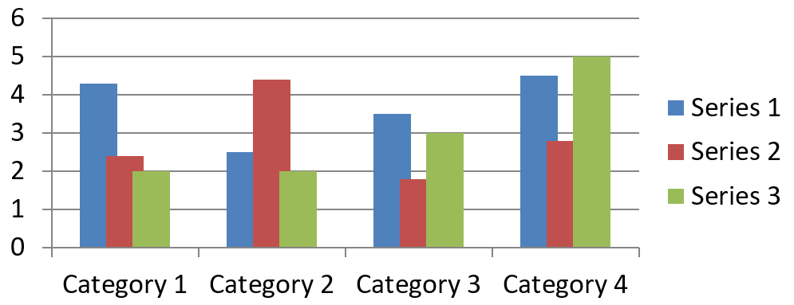

## **Tổng quan**

Biểu đồ có thể lưu các giá trị đã vẽ trong các ô bảng tính hoặc trực tiếp dưới dạng literal số. Một [IChartSeries](https://reference.aspose.com/slides/java/com.aspose.slides/ichartseries/) đại diện cho một tập hợp các giá trị liên quan, và mỗi [IChartDataPoint](https://reference.aspose.com/slides/java/com.aspose.slides/ichartdatapoint/) đại diện cho một điểm trong tập đó. Các đối tượng [IChartCategory](https://reference.aspose.com/slides/java/com.aspose.slides/ichartcategory/) cung cấp các nhãn hoặc giá trị nhóm được chia sẻ bởi các series. Trong các biểu đồ được tạo với dữ liệu mặc định, tên series, danh mục và giá trị điểm sử dụng các đối tượng [IChartDataCell](https://reference.aspose.com/slides/java/com.aspose.slides/ichartdatacell/) từ sổ làm việc của biểu đồ.

Đối với biểu đồ danh mục tiêu biểu, sổ làm việc mặc định sử dụng hàng 0 cho tên series, cột 0 cho tên danh mục và các ô còn lại cho giá trị series. Các chỉ mục worksheet, row và column truyền vào [IChartDataWorkbook.getCell](https://reference.aspose.com/slides/java/com.aspose.slides/ichartdataworkbook/#getCell-int-int-int-) là dựa trên chỉ số 0. Bố cục này hữu ích khi bạn tạo biểu đồ với dữ liệu mặc định, nhưng đừng giả định rằng mọi biểu đồ hiện có đều sử dụng nó. Đối với một bản trình chiếu đã tải, hãy kiểm tra các ô mà series, categories và data points tham chiếu trước khi thay đổi giá trị trong sổ làm việc.

Cài đặt biểu đồ có ba phạm vi khác nhau:

- Cài đặt ở mức Series, chẳng hạn [IChartSeries.getFormat](https://reference.aspose.com/slides/java/com.aspose.slides/ichartseries/#getFormat--), cung cấp giao diện mặc định cho tất cả các điểm trong một series.
- Cài đặt điểm dữ liệu, chẳng hạn [IChartDataPoint.getFormat](https://reference.aspose.com/slides/java/com.aspose.slides/ichartdatapoint/#getFormat--), ghi đè giao diện series cho một điểm.
- Cài đặt nhóm áp dụng cho các series tương thích thuộc cùng một [IChartSeriesGroup](https://reference.aspose.com/slides/java/com.aspose.slides/ichartseriesgroup/). Truy cập nhóm qua [IChartSeries.getParentSeriesGroup](https://reference.aspose.com/slides/java/com.aspose.slides/ichartseries/#getParentSeriesGroup--) khi bạn cần đặt các tùy chọn như overlap hoặc gap width.

Khi không có fill điểm hoặc series nào được thiết lập rõ ràng, style và theme của biểu đồ sẽ xác định giao diện tự động. Khi cả định dạng series và điểm đều có, định dạng điểm sẽ có ưu tiên cho điểm đó.


Đối với biểu đồ cylinder cụm, hãy xem cách [thay đổi kiểu chuỗi 3D hoặc hình dạng thanh](/slides/vi/java/3d-chart/#change-the-3d-series-type-and-bar-shape) ảnh hưởng đến series đầu tiên.

## **Đặt Giá Trị Series Bằng Literal Số**

Sử dụng literal số khi giá trị series đến từ dữ liệu hoặc phép tính trong ứng dụng và không cần tham chiếu đến ô worksheet. Gọi [setDataSourceTypeForValues](https://reference.aspose.com/slides/java/com.aspose.slides/ichartdatapointcollection/#setDataSourceTypeForValues-int-) với [DataSourceType.DoubleLiterals](https://reference.aspose.com/slides/java/com.aspose.slides/datasourcetype/#DoubleLiterals) trước khi gán kết quả của [getValue](https://reference.aspose.com/slides/java/com.aspose.slides/ichartdatapoint/#getValue--) cho mỗi điểm qua [setAsLiteralDouble](https://reference.aspose.com/slides/java/com.aspose.slides/idoublechartvalue/#setAsLiteralDouble-double-).

Cài đặt bộ sưu tập điều khiển loại nguồn của tất cả các giá trị điểm trong series đó. Phương thức [getDataSourceType](https://reference.aspose.com/slides/java/com.aspose.slides/ibasechartvalue/#getDataSourceType--) của mỗi giá trị điểm báo cáo loại đã chọn; thay đổi nó qua cài đặt bộ sưu tập. Với `Worksheet`, sử dụng [getAsCell](https://reference.aspose.com/slides/java/com.aspose.slides/isinglecellchartvalue/#getAsCell--) để truy cập ô được tham chiếu. Với `DoubleLiterals`, sử dụng [getAsLiteralDouble](https://reference.aspose.com/slides/java/com.aspose.slides/idoublechartvalue/#getAsLiteralDouble--) hoặc `setAsLiteralDouble` để đọc hoặc ghi số trực tiếp.

Ví dụ sau tạo một biểu đồ cột với series và categories mặc định, sau đó gán các giá trị tính toán 10, 20, … cho các điểm hiện có của series đầu tiên. Nó lưu bản trình chiếu, mở lại và in ra các giá trị đã lưu.

```java
import com.aspose.slides.*;

Presentation presentation = new Presentation();
try {
    ISlide slide = presentation.getSlides().get_Item(0);

    IChart chart = slide.getShapes().addChart(ChartType.ClusteredColumn, 20, 20, 500, 300);
    IChartSeries series = chart.getChartData().getSeries().get_Item(0);

    series.getDataPoints().setDataSourceTypeForValues(DataSourceType.DoubleLiterals);
    for (int i = 0; i < series.getDataPoints().size(); i++) {
        series.getDataPoints().get_Item(i).getValue().setAsLiteralDouble((i + 1) * 10);
    }

    presentation.save("numeric_literals.pptx", SaveFormat.Pptx);
} finally {
    presentation.dispose();
}

Presentation reopenedPresentation = new Presentation("numeric_literals.pptx");
try {
    ISlide reopenedSlide = reopenedPresentation.getSlides().get_Item(0);
    IChart reopenedChart = (IChart) reopenedSlide.getShapes().get_Item(0);
    IChartSeries reopenedSeries = reopenedChart.getChartData().getSeries().get_Item(0);
    for (IChartDataPoint point : reopenedSeries.getDataPoints()) {
        System.out.println(point.getValue().getAsLiteralDouble());
    }
} finally {
    reopenedPresentation.dispose();
}
```

Kiểu nguồn giá trị điểm tách biệt khỏi [IChartData.getDataSourceType](https://reference.aspose.com/slides/java/com.aspose.slides/ichartdata/#getDataSourceType--), phương thức này xác định cấu hình sổ làm việc nội bộ hoặc ngoại bộ của biểu đồ. Sử dụng literal số không tự động loại bỏ sổ làm việc nhúng. Trong ví dụ này, sổ làm việc vẫn tồn tại cho nhãn danh mục, tên series và các series khác. Xem [Chart Workbook](/slides/vi/java/chart-workbook/) để biết quản lý sổ làm việc.

Đối với biểu đồ scatter và bubble, sử dụng [setDataSourceTypeForXValues](https://reference.aspose.com/slides/java/com.aspose.slides/ichartdatapointcollection/#setDataSourceTypeForXValues-int-) và [setDataSourceTypeForYValues](https://reference.aspose.com/slides/java/com.aspose.slides/ichartdatapointcollection/#setDataSourceTypeForYValues-int-) để chọn nguồn cho [getXValue](https://reference.aspose.com/slides/java/com.aspose.slides/ichartdatapoint/#getXValue--) và [getYValue](https://reference.aspose.com/slides/java/com.aspose.slides/ichartdatapoint/#getYValue--). Biểu đồ bubble cũng sử dụng [setDataSourceTypeForBubbleSizes](https://reference.aspose.com/slides/java/com.aspose.slides/ichartdatapointcollection/#setDataSourceTypeForBubbleSizes-int-) cho [getBubbleSize](https://reference.aspose.com/slides/java/com.aspose.slides/ichartdatapoint/#getBubbleSize--). Đặt mỗi nguồn tương ứng thành `DoubleLiterals` trước khi gán số qua phương thức `setAsLiteralDouble` của giá trị đó.

## **Đặt Overlap cho Series của Biểu Đồ**

[IChartSeries.getOverlap](https://reference.aspose.com/slides/java/com.aspose.slides/ichartseries/#getOverlap--) báo cáo mức độ các thanh hoặc cột chồng lên nhau trong biểu đồ 2D, từ -100 đến 100 phần trăm. Đó là một phép chiếu chỉ đọc của cài đặt trên nhóm series cha. Sử dụng [IChartSeriesGroup.setOverlap](https://reference.aspose.com/slides/java/com.aspose.slides/ichartseriesgroup/#setOverlap-byte-) để cập nhật mọi series tương thích trong nhóm đó. Tùy chọn này áp dụng cho các loại biểu đồ hiển thị các thanh hoặc cột nhóm; nó không ảnh hưởng đến các nhóm series không liên quan trong biểu đồ kết hợp.

Ví dụ sau đặt overlap cho nhóm chứa series đầu tiên:

```java
import com.aspose.slides.*;

final int firstSlideIndex = 0;
final int firstSeriesIndex = 0;
final byte overlapPercent = 30;

Presentation presentation = new Presentation();
try {
    ISlide slide = presentation.getSlides().get_Item(firstSlideIndex);

    // Biểu đồ mới chứa các series mẫu, các danh mục và giá trị.
    IChart chart = slide.getShapes().addChart(ChartType.ClusteredColumn, 20, 20, 500, 200);

    IChartSeries series = chart.getChartData().getSeries().get_Item(firstSeriesIndex);
    series.getParentSeriesGroup().setOverlap(overlapPercent);

    presentation.save("series_overlap.pptx", SaveFormat.Pptx);
} finally {
    presentation.dispose();
}
```

Kết quả:



## **Thay Đổi Màu Fill của Series**

Sử dụng [IChartSeries.getFormat](https://reference.aspose.com/slides/java/com.aspose.slides/ichartseries/#getFormat--) để đặt fill mặc định cho toàn bộ series. Nếu một điểm đã có fill rõ ràng, cài đặt [IChartDataPoint.getFormat](https://reference.aspose.com/slides/java/com.aspose.slides/ichartdatapoint/#getFormat--) của nó sẽ ghi đè fill của series cho điểm đó.

Ví dụ sau áp dụng fill màu xanh đậm cho series đầu tiên:

```java
import com.aspose.slides.*;
import java.awt.Color;

final int firstSlideIndex = 0;
final int firstSeriesIndex = 0;

Presentation presentation = new Presentation();
try {
    ISlide slide = presentation.getSlides().get_Item(firstSlideIndex);

    IChart chart = slide.getShapes().addChart(ChartType.ClusteredColumn, 20, 20, 500, 200);

    IChartSeries series = chart.getChartData().getSeries().get_Item(firstSeriesIndex);
    series.getFormat().getFill().setFillType(FillType.Solid);
    series.getFormat().getFill().getSolidFillColor().setColor(Color.BLUE);

    presentation.save("series_color.pptx", SaveFormat.Pptx);
} finally {
    presentation.dispose();
}
```

Kết quả:


## **Thay Đổi Tên Series**

Tên series được lưu trong sổ làm việc dữ liệu biểu đồ và thường hiển thị trong legend. Trong sổ làm việc mặc định được tạo cho biểu đồ cột cụm, ô B1 ở hàng 0, cột 1 chứa tên của series đầu tiên. Các hằng số đã đặt tên trong ví dụ sau làm rõ cấu trúc này:

```java
import com.aspose.slides.*;

final int firstSlideIndex = 0;
final int worksheetIndex = 0;
final int seriesNameRowIndex = 0;
final int firstSeriesColumnIndex = 1;

Presentation presentation = new Presentation();
try {
    ISlide slide = presentation.getSlides().get_Item(firstSlideIndex);

    IChart chart = slide.getShapes().addChart(ChartType.ClusteredColumn, 20, 20, 500, 200);

    IChartDataWorkbook workbook = chart.getChartData().getChartDataWorkbook();
    IChartDataCell seriesNameCell = workbook.getCell(worksheetIndex, seriesNameRowIndex, firstSeriesColumnIndex);
    seriesNameCell.setValue("Revenue");

    presentation.save("series_name.pptx", SaveFormat.Pptx);
} finally {
    presentation.dispose();
}
```

Bạn cũng có thể cập nhật ô đã được [IChartSeries.getName](https://reference.aspose.com/slides/java/com.aspose.slides/ichartseries/#getName--) tham chiếu. Cách này tránh việc giả định một hàng và cột cụ thể trong một biểu đồ đã tồn tại:

```java
import com.aspose.slides.*;

final int firstSlideIndex = 0;
final int firstSeriesIndex = 0;
final int firstNameCellIndex = 0;

Presentation presentation = new Presentation();
try {
    ISlide slide = presentation.getSlides().get_Item(firstSlideIndex);

    IChart chart = slide.getShapes().addChart(ChartType.ClusteredColumn, 20, 20, 500, 200);

    IChartSeries series = chart.getChartData().getSeries().get_Item(firstSeriesIndex);
    IChartDataCell seriesNameCell = series.getName().getAsCells().get_Item(firstNameCellIndex);
    seriesNameCell.setValue("Revenue");

    presentation.save("series_name.pptx", SaveFormat.Pptx);
} finally {
    presentation.dispose();
}
```

Kết quả:


### **Tạo Series với Tên từ Nhiều Ô**

Tên series tổng hợp hữu ích khi tên sản phẩm và kỳ báo cáo được lưu trong các ô workbook riêng biệt. Ví dụ, bạn có thể kết hợp `Product A` trong B1 và `2026` trong C1 thành một tên series duy nhất đồng thời giữ cả hai phần liên kết tới ô nguồn của chúng.

Sử dụng [IChartDataWorkbook.getCellCollection](https://reference.aspose.com/slides/java/com.aspose.slides/ichartdataworkbook/#getCellCollection-java.lang.String-boolean-) để lấy phạm vi tên, sau đó truyền bộ sưu tập đó cho [IChartSeriesCollection.add](https://reference.aspose.com/slides/java/com.aspose.slides/ichartseriescollection/#add-com.aspose.slides.IChartCellCollection-int-). Tham số `skipHiddenCells` quyết định có bao gồm các ô ẩn hay không: `true` loại trừ chúng, `false` bao gồm. Ví dụ này sử dụng `false` để bao gồm mọi ô trong phạm vi tên.

Ví dụ sau tạo một bản trình chiếu với một series và hai điểm dữ liệu. Các ô B1:C1 chỉ cung cấp tên series; A2:A3 cung cấp nhãn danh mục, và B2:B3 cung cấp các giá trị số.

```java
import com.aspose.slides.*;

Presentation presentation = new Presentation();
try {
    ISlide slide = presentation.getSlides().get_Item(0);

    IChart chart = slide.getShapes().addChart(ChartType.ClusteredColumn, 50, 50, 620, 180);

    chart.getChartData().getSeries().clear();
    chart.getChartData().getCategories().clear();
    chart.setLegend(true);

    IChartDataWorkbook workbook = chart.getChartData().getChartDataWorkbook();
    workbook.clear(0);

    // Hai ô này cung cấp tên series.
    workbook.getCell(0, 0, 1, "Product A");
    workbook.getCell(0, 0, 2, "2026");
    IChartCellCollection nameCells = workbook.getCellCollection("Sheet1!$B$1:$C$1", false);
    IChartSeries series = chart.getChartData().getSeries().add(nameCells, ChartType.ClusteredColumn);

    // Các ô riêng biệt cung cấp các danh mục và các điểm dữ liệu số.
    IChartDataCell northCategory = workbook.getCell(0, 1, 0, "North");
    IChartDataCell southCategory = workbook.getCell(0, 2, 0, "South");
    chart.getChartData().getCategories().add(northCategory);
    chart.getChartData().getCategories().add(southCategory);
    IChartDataCell northValue = workbook.getCell(0, 1, 1, 120);
    IChartDataCell southValue = workbook.getCell(0, 2, 1, 150);
    series.getDataPoints().addDataPointForBarSeries(northValue);
    series.getDataPoints().addDataPointForBarSeries(southValue);

    presentation.save("composite_series_name.pptx", SaveFormat.Pptx);
} finally {
    presentation.dispose();
}
```

Tên series tạo ra là `Product A 2026`, với một khoảng trống giữa hai giá trị ô. Legend hiển thị điều này như một mục cho cả hai cột. Hình ảnh dưới đây minh họa kết quả:


## **Lấy Màu Fill Tự Động của Series**

[IChartSeries.getAutomaticSeriesColor](https://reference.aspose.com/slides/java/com.aspose.slides/ichartseries/#getAutomaticSeriesColor--) trả về màu được tính dựa trên chỉ số series và style biểu đồ. Đây là màu được dùng khi fill của series chưa được định nghĩa rõ ràng. Gọi phương thức này chỉ đọc màu đã tính; nó không gán một fill mới.

Ví dụ sau in ra màu tự động của mỗi series mặc định:

```java
import com.aspose.slides.*;
import java.awt.Color;

final int firstSlideIndex = 0;

Presentation presentation = new Presentation();
try {
    ISlide slide = presentation.getSlides().get_Item(firstSlideIndex);

    IChart chart = slide.getShapes().addChart(ChartType.ClusteredColumn, 20, 20, 500, 200);

    int seriesCount = chart.getChartData().getSeries().size();
    for (int seriesIndex = 0; seriesIndex < seriesCount; seriesIndex++) {
        IChartSeries series = chart.getChartData().getSeries().get_Item(seriesIndex);
        Color automaticColor = series.getAutomaticSeriesColor();
        System.out.println("Series " + seriesIndex + ": " + automaticColor);
    }
} finally {
    presentation.dispose();
}
```

Kết quả mẫu cho style biểu đồ mặc định:

```text
Series 0: java.awt.Color[r=79,g=129,b=189]
Series 1: java.awt.Color[r=192,g=80,b=77]
Series 2: java.awt.Color[r=155,g=187,b=89]
```

Màu chính xác phụ thuộc vào style và theme của biểu đồ.

## **Đặt Màu Fill Đảo Ngược cho Series của Biểu Đồ**

Đối với series thanh, cột và bubble, [IChartSeries.setInvertIfNegative](https://reference.aspose.com/slides/java/com.aspose.slides/ichartseries/#setInvertIfNegative-boolean-) có thể hiển thị giá trị âm bằng một màu fill khác. Đặt fill series thường thành solid, bật chế độ đảo ngược, và gán màu âm qua [IChartSeries.getInvertedSolidFillColor](https://reference.aspose.com/slides/java/com.aspose.slides/ichartseries/#getInvertedSolidFillColor--). Các số âm vẫn không thay đổi trong workbook; chỉ màu hiển thị thay đổi.

Ví dụ sau thay thế dữ liệu biểu đồ mặc định bằng một series. Hàng worksheet 0 chứa tên series, cột 0 chứa tên danh mục, và cột 1 chứa các giá trị:

```java
import com.aspose.slides.*;
import java.awt.Color;

final int firstSlideIndex = 0;
final int worksheetIndex = 0;
final int headerRowIndex = 0;
final int categoryColumnIndex = 0;
final int firstSeriesColumnIndex = 1;
final int firstDataRowIndex = 1;

String[] categoryNames = { "Category 1", "Category 2", "Category 3" };
int[] seriesValues = { -20, 50, -30 };

Presentation presentation = new Presentation();
try {
    ISlide slide = presentation.getSlides().get_Item(firstSlideIndex);

    IChart chart = slide.getShapes().addChart(ChartType.ClusteredColumn, 20, 20, 500, 200);
    IChartData chartData = chart.getChartData();
    IChartDataWorkbook workbook = chartData.getChartDataWorkbook();

    chartData.getSeries().clear();
    chartData.getCategories().clear();

    IChartDataCell seriesNameCell = workbook.getCell(worksheetIndex, headerRowIndex, firstSeriesColumnIndex, "Series 1");
    int chartType = chart.getType();
    IChartSeries series = chartData.getSeries().add(seriesNameCell, chartType);

    for (int categoryIndex = 0; categoryIndex < categoryNames.length; categoryIndex++) {
        int dataRowIndex = firstDataRowIndex + categoryIndex;
        String categoryName = categoryNames[categoryIndex];
        int seriesValue = seriesValues[categoryIndex];

        IChartDataCell categoryCell = workbook.getCell(worksheetIndex, dataRowIndex, categoryColumnIndex, categoryName);
        chartData.getCategories().add(categoryCell);

        IChartDataCell valueCell = workbook.getCell(worksheetIndex, dataRowIndex, firstSeriesColumnIndex, seriesValue);
        series.getDataPoints().addDataPointForBarSeries(valueCell);
    }

    Color automaticSeriesColor = series.getAutomaticSeriesColor();
    series.getFormat().getFill().setFillType(FillType.Solid);
    series.getFormat().getFill().getSolidFillColor().setColor(automaticSeriesColor);
    series.setInvertIfNegative(true);
    series.getInvertedSolidFillColor().setColor(Color.RED);

    presentation.save("inverted_solid_fill_color.pptx", SaveFormat.Pptx);
} finally {
    presentation.dispose();
}
```

Kết quả:


Bạn có thể bật đảo ngược cho một điểm thông qua [IChartDataPoint.setInvertIfNegative](https://reference.aspose.com/slides/java/com.aspose.slides/ichartdatapoint/#setInvertIfNegative-boolean-). Trong ví dụ sau, đảo ngược bị tắt cho series và chỉ bật cho điểm đã chọn. Điểm này cũng được gán giá trị âm để hiệu ứng hiển thị:

```java
import com.aspose.slides.*;
import java.awt.Color;

final int firstSlideIndex = 0;
final int firstSeriesIndex = 0;
final int targetDataPointIndex = 2;
final int negativeValue = -30;

Presentation presentation = new Presentation();
try {
    ISlide slide = presentation.getSlides().get_Item(firstSlideIndex);

    IChart chart = slide.getShapes().addChart(ChartType.ClusteredColumn, 20, 20, 500, 200);

    IChartSeries series = chart.getChartData().getSeries().get_Item(firstSeriesIndex);
    Color automaticSeriesColor = series.getAutomaticSeriesColor();
    series.getFormat().getFill().setFillType(FillType.Solid);
    series.getFormat().getFill().getSolidFillColor().setColor(automaticSeriesColor);
    series.getInvertedSolidFillColor().setColor(Color.RED);
    series.setInvertIfNegative(false);

    IChartDataPoint dataPoint = series.getDataPoints().get_Item(targetDataPointIndex);
    dataPoint.getValue().getAsCell().setValue(negativeValue);
    dataPoint.setInvertIfNegative(true);

    presentation.save("data_point_invert_color_if_negative.pptx", SaveFormat.Pptx);
} finally {
    presentation.dispose();
}
```

## **Xóa Giá Trị Điểm Dữ Liệu Cụ Thể**

Để làm cho một điểm rỗng mà không xóa các điểm khác, đặt ô workbook phía sau nó thành `null`. Đối với biểu đồ cột, giá trị được vẽ có sẵn qua [IChartDataPoint.getValue](https://reference.aspose.com/slides/java/com.aspose.slides/ichartdatapoint/#getValue--). Điểm dữ liệu vẫn giữ vị trí danh mục, nhưng biểu đồ sẽ xem giá trị của nó như trống dựa trên cài đặt blank-value của biểu đồ.

Ví dụ sau chỉ xóa điểm thứ hai trong series đầu tiên:

```java
import com.aspose.slides.*;

final int firstSlideIndex = 0;
final int firstSeriesIndex = 0;
final int targetDataPointIndex = 1;

Presentation presentation = new Presentation();
try {
    ISlide slide = presentation.getSlides().get_Item(firstSlideIndex);

    IChart chart = slide.getShapes().addChart(ChartType.ClusteredColumn, 20, 20, 500, 200);

    IChartSeries series = chart.getChartData().getSeries().get_Item(firstSeriesIndex);
    IChartDataPoint dataPoint = series.getDataPoints().get_Item(targetDataPointIndex);
    dataPoint.getValue().getAsCell().setValue(null);

    presentation.save("clear_data_point_value.pptx", SaveFormat.Pptx);
} finally {
    presentation.dispose();
}
```

Biểu đồ scatter sử dụng các ô X và Y riêng biệt, và biểu đồ bubble còn có ô kích thước. Chỉ xóa ô đại diện cho giá trị bạn muốn loại bỏ. Đừng gọi [IChartDataPointCollection.clear](https://reference.aspose.com/slides/java/com.aspose.slides/ichartdatapointcollection/#clear--) khi bạn muốn giữ lại các điểm khác, vì phương thức này sẽ xóa mọi điểm dữ liệu trong bộ sưu tập.

## **Kiểm Soát Hiển Thị Các Ô Trống**

Các ô ẩn chứa giá trị là một trường hợp riêng so với các ô trống. Để bao gồm hoặc loại trừ dữ liệu từ các hàng và cột worksheet ẩn, xem [Include Data from Hidden Rows and Columns](/slides/vi/java/chart-workbook/#include-data-from-hidden-rows-and-columns).

Một ô workbook trống đại diện cho dữ liệu thiếu; một ô chứa `0` đại diện cho một giá trị số đã biết. Gọi [IChartDataCell.setValue](https://reference.aspose.com/slides/java/com.aspose.slides/ichartdatacell/#setValue-java.lang.Object-) với `null` để làm ô rỗng. Số 0 vẫn là 0 bất kể cài đặt ô trống.

Sử dụng [IChart.setDisplayBlanksAs](https://reference.aspose.com/slides/java/com.aspose.slides/ichart/#setDisplayBlanksAs-int-) để chọn cách biểu đồ hiển thị các ô trống. Cài đặt này áp dụng cho toàn bộ biểu đồ. Nó thay đổi cách các khoảng trống được vẽ, mà không điền ô workbook trống bằng 0 hoặc giá trị nội suy.

Ví dụ tự chứa dưới đây tạo một biểu đồ line với một series, xóa giá trị cho Ngày 3, và lưu cùng một biểu đồ với mỗi chế độ. Không cần file đầu vào. [IChartDataWorkbook](https://reference.aspose.com/slides/java/com.aspose.slides/ichartdataworkbook/) sử dụng worksheet 0, cột 0 cho nhãn danh mục, và cột 1 cho các giá trị; hàng 0 giữ tên series. Dữ liệu cuối cùng là `10, 20, empty, 30, 40`.

```java
import com.aspose.slides.*;

Presentation presentation = new Presentation();
try {
    ISlide slide = presentation.getSlides().get_Item(0);

    IChart chart = slide.getShapes().addChart(ChartType.LineWithMarkers, 40, 40, 640, 400);
    IChartData chartData = chart.getChartData();
    IChartDataWorkbook workbook = chartData.getChartDataWorkbook();

    chartData.getSeries().clear();
    chartData.getCategories().clear();

    IChartDataCell seriesNameCell = workbook.getCell(0, 0, 1, "Measurements");
    IChartSeries series = chartData.getSeries().add(seriesNameCell, chart.getType());
    int[] values = { 10, 20, 25, 30, 40 };

    for (int i = 0; i < values.length; i++) {
        IChartDataCell categoryCell = workbook.getCell(0, i + 1, 0, "Day " + (i + 1));
        chartData.getCategories().add(categoryCell);
        IChartDataCell valueCell = workbook.getCell(0, i + 1, 1, values[i]);
        series.getDataPoints().addDataPointForLineSeries(valueCell);
    }

    // Để Ngày 3 thực sự trống, đồng thời giữ lại danh mục và điểm dữ liệu.
    workbook.getCell(0, 3, 1).setValue(null);

    int[] modes = { DisplayBlanksAsType.Gap, DisplayBlanksAsType.Zero, DisplayBlanksAsType.Span };
    String[] modeNames = { "Gap", "Zero", "Span" };
    for (int i = 0; i < modes.length; i++) {
        chart.setDisplayBlanksAs(modes[i]);
        presentation.save("empty_cells_" + modeNames[i] + ".pptx", SaveFormat.Pptx);
    }
} finally {
    presentation.dispose();
}
```

Mỗi file đầu ra lưu chế độ đã gán trước khi lưu: `empty_cells_Gap.pptx`, `empty_cells_Zero.pptx`, và `empty_cells_Span.pptx`. Để lưu chỉ một phiên bản, gán chế độ mong muốn và lưu bản trình chiếu một lần thay vì lặp qua các chế độ.

So sánh dưới đây cho thấy cùng một dữ liệu trong cả ba file. Ngày 3 là ô trống trong workbook trong mọi trường hợp:


Hiệu ứng hiển thị phụ thuộc vào loại biểu đồ. Biểu đồ line giúp so sánh ba chế độ dễ dàng. Biểu đồ bar và column không có đường để nối qua danh mục thiếu, vì vậy `Span` không thể tạo đoạn nối như trên; một cột thiếu và một cột cao 0 cũng có thể trông giống nhau. Tương tự, biểu đồ scatter chỉ có marker sẽ không có đường nối. Đừng mong đợi ba kết quả riêng biệt cho mọi loại biểu đồ; hãy kiểm tra đầu ra cho loại bạn đang dùng.

## **Đặt Khoảng Cách Gap Width cho Series**

Gap width là khoảng cách giữa các cụm thanh hoặc cột liền kề, tính theo phần trăm độ rộng của thanh hoặc cột. Giống như overlap, nó thuộc về nhóm series cha chứ không phải một series riêng lẻ. Gọi [IChartSeriesGroup.setGapWidth](https://reference.aspose.com/slides/java/com.aspose.slides/ichartseriesgroup/#setGapWidth-int-) một lần cho nhóm. Giá trị lớn tạo không gian rộng hơn giữa các cụm; giá trị nhỏ làm chúng dày đặc hơn.

Ví dụ sau thay đổi gap width và chỉ lưu bản trình chiếu cuối cùng:

```java
import com.aspose.slides.*;

final int firstSlideIndex = 0;
final int firstSeriesIndex = 0;
final int gapWidthPercent = 30;

Presentation presentation = new Presentation();
try {
    ISlide slide = presentation.getSlides().get_Item(firstSlideIndex);

    IChart chart = slide.getShapes().addChart(ChartType.StackedColumn, 20, 20, 500, 200);

    IChartSeries series = chart.getChartData().getSeries().get_Item(firstSeriesIndex);
    series.getParentSeriesGroup().setGapWidth(gapWidthPercent);

    presentation.save("gap_width_30.pptx", SaveFormat.Pptx);
} finally {
    presentation.dispose();
}
```

Kết quả:


## **Hiển Thị Hoặc Ẩn Đường Nối Series**

Đường nối series nối trực quan các phần liên quan của biểu đồ. Sử dụng [IChartSeriesGroup.setSeriesLines](https://reference.aspose.com/slides/java/com.aspose.slides/ichartseriesgroup/#setSeriesLines-boolean-) để hiển thị hoặc ẩn chúng trong các biểu đồ stacked bar và OfPie được hỗ trợ. Trong các biểu đồ stacked bar và column hai chiều, chúng nối các ranh giới stack tương ứng qua các danh mục. Trong Pie of Pie và Bar of Pie, chúng nối plot chính với plot phụ. Cài đặt này không phải là một công cụ kết nối chung cho các loại biểu đồ khác.

Truy cập nhóm qua [IChartSeries.getParentSeriesGroup](https://reference.aspose.com/slides/java/com.aspose.slides/ichartseries/#getParentSeriesGroup--). Cài đặt này áp dụng cho mọi series trong nhóm đó. [IChartSeries.hasSeriesLines](https://reference.aspose.com/slides/java/com.aspose.slides/ichartseries/#hasSeriesLines--) là chỉ đọc và phản ánh cài đặt của nhóm cha; hãy gọi setter của nhóm để cập nhật.

Ví dụ dưới tạo một biểu đồ [PieOfPie](https://reference.aspose.com/slides/java/com.aspose.slides/charttype/#PieOfPie) với dữ liệu mặc định. Nó lưu cùng một biểu đồ với đường nối series bật và sau đó tắt, tạo hai bản trình chiếu để so sánh.

```java
import com.aspose.slides.*;

Presentation presentation = new Presentation();
try {
    ISlide slide = presentation.getSlides().get_Item(0);

    IChart chart = slide.getShapes().addChart(ChartType.PieOfPie, 50, 50, 600, 400);
    IChartSeries series = chart.getChartData().getSeries().get_Item(0);
    IChartSeriesGroup seriesGroup = series.getParentSeriesGroup();

    seriesGroup.setSeriesLines(true);
    presentation.save("series_lines_enabled.pptx", SaveFormat.Pptx);

    seriesGroup.setSeriesLines(false);
    presentation.save("series_lines_disabled.pptx", SaveFormat.Pptx);
} finally {
    presentation.dispose();
}
```

| Đường nối series bật | Đường nối series tắt |
| --- | --- |
|  |  |
| Hai đường nối kết nối bánh chính với bánh phụ. | Cả hai bánh vẫn hiển thị, nhưng các đường nối được ẩn. |

Đường nối series khác với các leader line của nhãn dữ liệu, các gridline, hoặc các đường trong biểu đồ line; cài đặt này không điều khiển các thành phần đó.

## **Câu hỏi thường gặp**

**Các loại biểu đồ nào hỗ trợ series dữ liệu?**

Tất cả các loại biểu đồ được liệt kê trong enumeration [ChartType](https://reference.aspose.com/slides/java/com.aspose.slides/charttype/) sử dụng dữ liệu biểu đồ, nhưng series của chúng không đều có cấu trúc giá trị hoặc cài đặt giống nhau. Ví dụ, biểu đồ danh mục sử dụng categories và values, biểu đồ scatter sử dụng giá trị X và Y, và biểu đồ bubble còn thêm kích thước bubble. Sử dụng phương pháp tạo data-point phù hợp với loại series. Các tùy chọn như overlap và gap width chỉ áp dụng cho các nhóm bar hoặc column tương thích.

**Nhóm series biểu đồ là gì?**

Một [IChartSeriesGroup](https://reference.aspose.com/slides/java/com.aspose.slides/ichartseriesgroup/) chứa các series tương thích chia sẻ các cài đặt vẽ ở mức nhóm. Một biểu đồ kết hợp có thể chứa hơn một nhóm, vì vậy việc thay đổi nhóm thông qua một series không nhất thiết thay đổi mọi series trong biểu đồ.

**Biểu đồ mới tạo có chứa dữ liệu mặc định không?**

Có. Mặc định, [IShapeCollection.addChart](https://reference.aspose.com/slides/java/com.aspose.slides/ishapecollection/#addChart-int-float-float-float-float-) tạo các series, categories và values mẫu. Bạn có thể chỉnh sửa các ô này hoặc xóa cả bộ series và categories trước khi thêm một bộ dữ liệu tùy chỉnh hoàn toàn. Một overload cũng có thể tạo biểu đồ mà không có dữ liệu mặc định.

**Các đối tượng biểu đồ được kết nối với các ô sổ làm việc như thế nào?**

Tên series, nhãn danh mục và giá trị data-point tham chiếu tới các ô trong một [IChartDataWorkbook](https://reference.aspose.com/slides/java/com.aspose.slides/ichartdataworkbook/). Thay đổi một ô được tham chiếu sẽ cập nhật phần tử biểu đồ tương ứng. Khi bạn xây dựng dữ liệu tùy chỉnh, hãy giữ cho các hàng category và các hàng giá trị series được căn chỉnh sao cho mỗi điểm được vẽ dưới đúng danh mục.

**Làm sao để xóa một điểm thay vì toàn bộ series?**

Đặt ô giá trị liên quan thành `null` để giữ vị trí danh mục của điểm như một điểm trống. Sử dụng [IChartDataPointCollection.clear](https://reference.aspose.com/slides/java/com.aspose.slides/ichartdatapointcollection/#clear--) chỉ khi bạn muốn xóa mọi điểm trong series đó. Nếu bạn cũng xóa các danh mục, hãy cập nhật mọi series để giá trị của chúng vẫn đồng bộ với bộ categories.

**Các điểm trống được hiển thị như thế nào?**

Kết quả phụ thuộc vào loại biểu đồ và giá trị được cấu hình qua [IChart.setDisplayBlanksAs](https://reference.aspose.com/slides/java/com.aspose.slides/ichart/#setDisplayBlanksAs-int-). Các biểu đồ được hỗ trợ có thể hiển thị khoảng trống như lỗ hổng, như giá trị zero, hoặc bằng cách nối các điểm lân cận. Chọn cài đặt phù hợp với ý nghĩa của dữ liệu thiếu trong bản trình chiếu của bạn. Xem [Control the Display of Empty Cells](#control-the-display-of-empty-cells) để có ví dụ đầy đủ và so sánh trực quan.

**Giá trị âm được định dạng như thế nào?**

Đối với các series bar, column và bubble được hỗ trợ, gọi [IChartSeries.setInvertIfNegative](https://reference.aspose.com/slides/java/com.aspose.slides/ichartseries/#setInvertIfNegative-boolean-) và đặt màu trả về bởi [IChartSeries.getInvertedSolidFillColor](https://reference.aspose.com/slides/java/com.aspose.slides/ichartseries/#getInvertedSolidFillColor--). Bạn có thể ghi đè hành vi cho một điểm riêng lẻ bằng [IChartDataPoint.setInvertIfNegative](https://reference.aspose.com/slides/java/com.aspose.slides/ichartdatapoint/#setInvertIfNegative-boolean-). Các phương thức này ảnh hưởng đến định dạng, không phải các giá trị số được lưu.

**Định dạng nào được ưu tiên khi cả series và điểm đều được định dạng?**

Định dạng điểm dữ liệu rõ ràng sẽ có ưu tiên cho điểm đó. Các điểm khác vẫn dùng định dạng series rõ ràng hoặc, khi series không có định dạng, style và theme tự động của biểu đồ. Các cài đặt nhóm như overlap và gap width kiểm soát bố cục và không phải là ghi đè định dạng mức điểm.

**Có giới hạn số lượng series mà một biểu đồ có thể chứa không?**

Aspose.Slides không áp đặt một giới hạn cố định cho số series. Trong thực tế, các ràng buộc của tập tin trình chiếu, bộ nhớ khả dụng, thời gian render và khả năng đọc hiểu của biểu đồ sẽ quyết định một giới hạn hữu dụng.

**Tôi nên thay đổi gì khi các cột quá gần nhau hoặc quá xa nhau?**

Gọi [IChartSeriesGroup.setGapWidth](https://reference.aspose.com/slides/java/com.aspose.slides/ichartseriesgroup/#setGapWidth-int-) trên nhóm series cha thích hợp. Tăng giá trị để mở rộng không gian giữa các cụm, hoặc giảm để đưa các cụm lại gần nhau hơn.